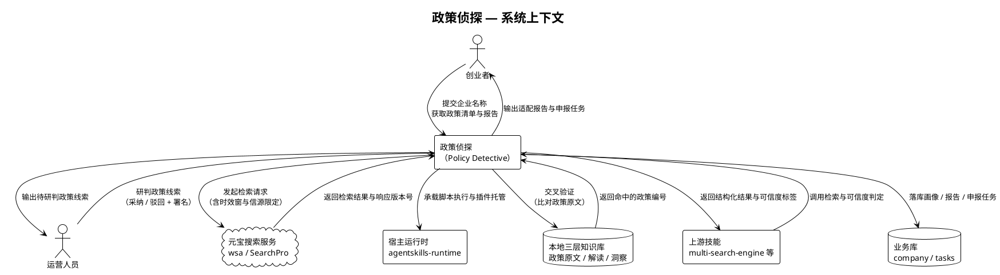
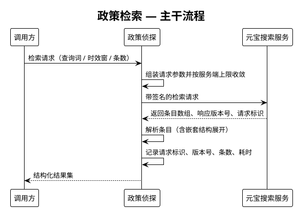
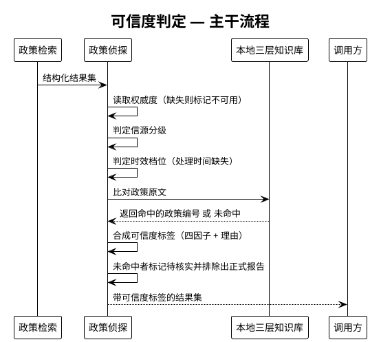
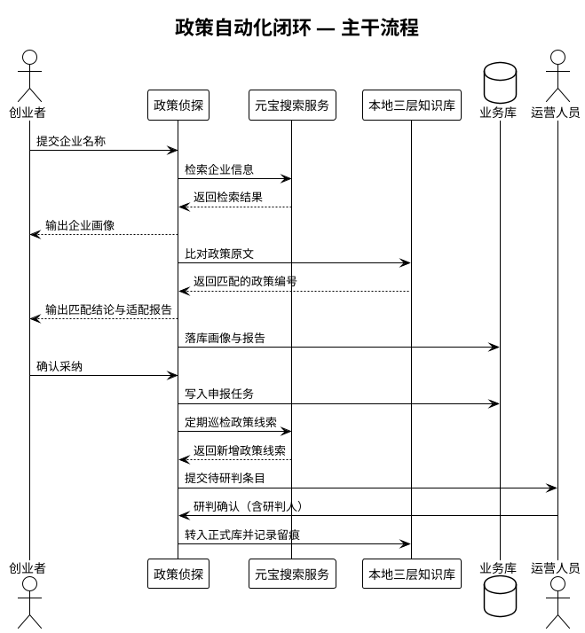
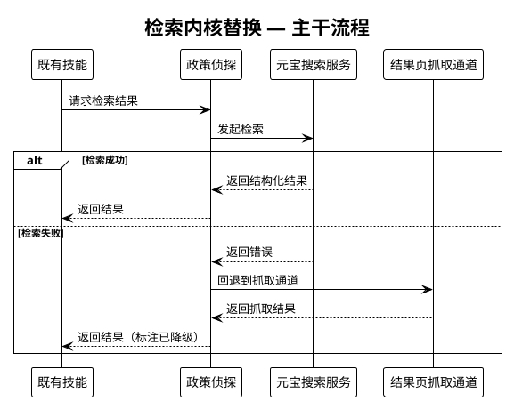
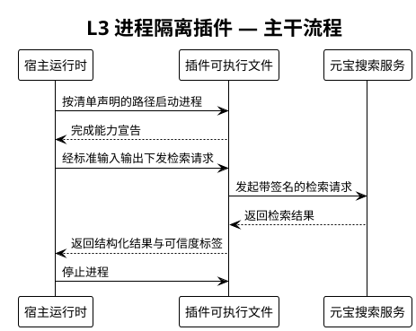

# 政策侦探（Policy Detective）需求规格说明书

> 产出：SDD 流程第 2 步（spec），子 agent `sdd-spec-writer`
> 模板：`skills/sdd/templates/spec_template.md`（6 节组件定位模板）
> 验收语法：`skills/sdd/templates/ears-format.md`（EARS）
> 上游输入：`.codeartsdoer/specs/1024/research.md`（v2）
> 输出目录：`.codeartsdoer/specs/1024/`（用户显式指定「在 1024 目录创建」，按 sdd README「用户显式指定输出目录时以用户为准」）
>
> **本版相对 research v2 的事实更新**：账号已由标准版升级为**旗舰版**，本 spec 已按旗舰版实测重写可信度相关需求。
>
> **v1.1 修订（2026-10-25，编码阶段实测回写）**：结论状态门禁由"未绑定 `policy_no` 即待核实"
> 改为**可核验出处门禁**。实测依据：50 条真实结果中，政府官网原文发布页（.gov.cn、权威度 4、时效现行）
> 因标题级相似度天然低分（最高 0.18 vs 阈值 0.6）被 100% 误判为"不知道"。
> 受影响条目：§2 术语（政策编号、待核实）、§5.2.3 第 5/6 条、§5.3.2 异常 2、§6.3 第 4/5 条。
> 关键实测（本轮共 26 次真实调用）：
> - `Response.Version` **不稳定**：同一 payload 重复 8 次，7 次 `flagship`、1 次 `standard`；不带 `Industry` 时 5 次中 3 `flagship` / 2 `standard`。
> - `authority_level`（权威度）**仅在 flagship 路由下返回**，实测值域 **2~4**，且该批次内 30/30 条全返回；standard 路由下 0 条返回。
> - `score` 量纲受 **`Industry` 与 `Version` 共同影响**，实测跨度 **0.75 ~ 5.46**（详见 §2 术语「相关性得分」与 §4.5 兼容性）。
> - `Mode=1`（纯垂直信源）旗舰版下仅召回 **1 条**，且该条带 `vr: true` 标记、**不含 `score`**。
> - `Deeplinks=true` 在旗舰版下生效并返回 `deeplinks` 子链字段。

---

# 1. 组件定位

## 1.1 核心职责

本组件负责**面向创业者的产业政策全流程自动化**：以元宝搜索为检索内核完成政策线索收集，以多层次可信度判定筛除不可信信息，输出可溯源的适配研判报告与申报任务，实现政策"查得到、信得过、用得上"。

## 1.2 核心输入

| 输入 | 来源 | 内容概要 |
|---|---|---|
| 检索请求 | 上游技能脚本、L3 插件调用方、定时任务 | 查询词、时效窗、信源限定/排除、返回条数、垂直领域 |
| 企业信息 | 终端用户（创业者） | 企业名称（支持批量，逗号分隔）、可选的补充经营信息 |
| 政策知识库 | 本地 `skills/beichen-policy-assistant/knowledge/` 三层知识库 | 政策原文、官方解读、实操洞察，及 `policy-index.json` 索引 |
| 检索响应 | 元宝搜索服务（`wsa` / `SearchPro`） | 结果条目数组及本次响应的版本号、请求标识 |
| 研判指令 | 运营人员 | 对储备条目的采纳/驳回决定及研判人署名 |

## 1.3 核心输出

| 输出 | 目标 | 内容概要 |
|---|---|---|
| 检索结果集 | 上游调用方 | 结构化条目（标题、链接、站点、发布时间、摘要、动态摘要）及来源请求标识 |
| 可信度标签 | 上游调用方、终端用户 | 权威度档位、信源分级、时效档位、是否命中政策原文库，及可解释理由 |
| 政策线索储备 | 运营人员 | 待人工研判的新增/变更政策条目 |
| 企业画像 | 下游匹配环节 | 结构化的企业属性摘要 |
| 匹配结论与适配报告 | 终端用户 | 政策适配矩阵、条件对标、缺口分析、合规声明 |
| 申报任务 | 终端用户、落库环节 | 材料清单、截止时间、跟进状态 |
| 落库数据 | `company` / `tasks` 表 | 企业画像、匹配报告、申报任务（复用既有表，不新建表） |

## 1.4 职责边界

本组件**不负责**下列事项：

1. **不实现**元宝搜索服务本身，也不承担其配额与计费运营；配额超限时仅作降级与提示。
2. **不替代**人工研判：储备库条目转入正式政策库**必须**经运营人员显式确认并署名，系统不得自动放行。
3. **不产出**法律意见：所有适配报告必须附"仅供申报参考，不构成法律意见"声明。
4. **不修改**宿主（`src/`）既有工具链与插件内核；本组件的宿主级能力以 L3 进程隔离插件形态提供，不侵入宿主源码。
5. **不抓取**未授权数据源（付费接口、反爬站点、企业隐私数据）。
6. **不新建**数据库表；落库复用既有 `company` / `tasks` 表。
7. **不承担**通用问答场景：本组件面向政策场景，不做泛化聊天式搜索。

---

# 2. 领域术语

**元宝搜索（SearchPro）**
: 腾讯元宝提供的结构化互联网检索云服务，服务标识 `wsa`，接口动作 `SearchPro`，版本 `2025-05-08`，以 JSON 形式返回排序后的检索结果。
: 备注：本文所有能力结论均来自对该服务的真实调用实测与官方 SDK 源码，非文档转述。

**响应版本号（Version）**
: 单次检索响应中标识本次实际服务档位的字段，取值为 `lite`（极速）/ `standard`（标准）/ `flagship`（旗舰）。
: 备注：**实测该字段在同一账号、同一请求参数下并不恒定**（8 次重复调用中出现 7 次 `flagship`、1 次 `standard`）。因此它只能作为观测指标，**禁止**用作能力开关或前置判断依据。

**相关性得分（score）**
: 检索响应条目上标识该条目与查询词相关程度的数值。
: 备注：**量纲受 `Industry` 与 `Version` 共同影响，不是固定的 0~1**。实测区间：无垂直领域且 flagship 为 0.75~0.79；无垂直领域且 standard 为 0.78~0.79；`gov` 且 flagship 为 5.23~5.46；`news` 且 flagship 为 4.68~5.44；`finance` 且 flagship 为 4.87~5.46；`finance` 且 standard 为 3.16~4.18；`acad` 且 flagship 为 4.90~5.46。**该值仅可用于同一批次内的相对排序。**

**权威度（authority_level）**
: 检索响应条目上标识信源权威程度的整数分值，官方定义取值 0~5，数值越大越权威。
: 备注：**仅在 flagship 路由下返回**，实测值域为 2~4，且该批次内全部条目均带此字段；standard 路由下该字段完全缺失。价值最高的可信度量化依据，但**不可假定其必然存在**。

**垂直信源标记（vr）**
: 检索响应条目上的布尔标记，`true` 表示该条目为"优质权威垂直信源"结果（VR 卡）。
: 备注：实测 `Mode=1` 下召回极少（1 条）且该条**不含 `score`**，因此带此标记的条目不得参与基于 `score` 的排序。

**可信度标签**
: 本组件对单条检索结果合成的可解释结论，由权威度档位、信源分级、时效档位、是否命中政策原文库四类因子构成，输出为分档结果与理由说明。
: 备注：刻意设计为**可解释标签**而非单一黑箱分数，理由是底层 `score` 量纲不稳定、且 `authority_level` 可能整批缺失。

**政策编号（policy_no）**
: 本地政策原文库中每条政策的唯一标识。
: 备注：**强制溯源锚点**。命中者必须绑定 `policy_no` 与原文路径；**未命中者须显式标注"未在本地政策原文库备案"**，
  由可核验出处门禁决定是否可采信（见术语「待核实」与 §5.2.3 第 5、6 条）。

**三层知识库**
: 由政策原文库、官方解读库、实操洞察库构成的事实底座，用于与网络检索结果做交叉验证。
: 备注：实测规模为政策原文 74 条、官方解读 3 条、实操洞察 3 条，索引 `policy-index.json` 记录 `count: 74`。

**待核实**
: **拿不出可核验出处**的结论所处的状态（2026-10-25 修订）。
: 判定：满足以下任一条件即置"待核实"——① 信源分级为最低档（未知站点 / 自媒体，无法核验发布主体）；
  ② 时效档位为已过期；③ 知识库不可用且信源分级非最高档。
: 备注：处于该状态的结论**禁止**进入正式适配报告，这是本组件"敢说不"的核心机制。
  原定义为"未绑定 `policy_no` 即待核实"，实测 50 条政府官网原文页被全部误判（检索结果是申报通知、
  库存的是政策名，标题级相似度天然低分），而官方发布页 URL 点得开、发布日期看得见，本身就是可核验出处，
  故改为以**出处可核验性**为门禁，原文库命中降级为加分项。

**储备库 / 正式库**
: 储备库存放未经人工确认的政策线索；正式库存放经运营人员确认并署名的政策条目。
: 备注：两者之间**必须**经过显式研判动作，系统不得自动迁移。

**研判门禁**
: 储备库条目转入正式库所必须经过的人工确认环节，须记录研判人。

**L3 进程隔离轨**
: 宿主的一种插件隔离形态，插件以独立可执行文件运行，宿主通过标准输入输出与之通信。
: 备注：该形态下插件源码无需随分发包提供，是本组件支持**闭源分发**的工程基础。

**闭源分发**
: 以编译后的可执行产物（而非可读源码）发布技能插件的分发方式。
: 备注：脚本型技能（JavaScript / Python / TypeScript）必须以明文源码分发，因而无法闭源；本组件的此项能力来自 L3 轨的编译产物形态。

---

# 3. 角色与边界

## 3.1 核心角色

- **创业者（终端用户）**：提供企业名称，获取可申报政策清单、适配研判报告与申报任务；是"政策自动化闭环"的发起者与最终受益者。
- **运营人员（研判人）**：对政策线索储备库中的条目做采纳或驳回决定，并署名留痕；是"信得过"的人工兜底环节。

## 3.2 外部系统

- **元宝搜索服务（wsa / SearchPro）**：提供结构化检索结果，是本组件"查得到"的能力来源。
- **宿主运行时（agentskills-runtime）**：提供技能加载、脚本执行、内置工具与 L3 插件托管能力。
- **本地三层知识库**：提供政策原文、官方解读、实操洞察，是"信得过"的事实比对基准。
- **上游技能（multi-search-engine、beichen-policy-assistant 等）**：调用本组件的检索与可信度能力，替换其原有的结果页抓取式检索。
- **业务数据库（company / tasks 表）**：接收企业画像、匹配报告与申报任务的落库结果。

## 3.3 交互上下文

---

# 4. DFX 约束

## 4.1 性能

1. 单次检索请求端到端耗时上限为 **5 秒**（实测基线 210 ms ~ 1488 ms，留足余量）。
2. 单条结果的解析与可信度标注耗时上限为 **50 毫秒**（单批处理 50 条时标注环节总耗时上限 2.5 秒）。
3. 政策库巡检任务单次运行总耗时上限为 **5 分钟**。
4. 面向终端用户的完整闭环（画像 → 匹配 → 报告）总耗时上限为 **3 分钟**；超出时应先返回阶段性结果而非阻塞。

## 4.2 可靠性

1. 检索失败时**必须**降级到宿主内置的抓取能力继续尝试，**禁止**因单一检索通道失败而整体中断。
2. `authority_level` 缺失时**必须**自动降级为无权威度分档的可信度标签，**禁止**因字段缺失而拒绝输出或抛出异常。
3. 政策库巡检失败时**必须**记录失败条目并继续处理其余条目，**禁止**整批回滚。
4. 落库失败时**必须**保留已生成的产物文件（画像 / 报告 / 匹配矩阵），供人工重试。
5. 同一检索请求在超时后最多重试 2 次，重试间隔按指数退避。

## 4.3 安全性

1. 调用凭据**必须**仅从运行环境配置读取，**禁止**硬编码、**禁止**出现在任何输出、日志、错误信息或异常堆栈中。
2. 检索请求**必须**使用带签名的鉴权方式，签名密钥不得落盘到产物文件。
3. 所有对政策原文库的写入**必须**记录操作人与时间，形成可审计留痕。
4. 研判动作**必须**记录研判人标识，缺失研判人时**禁止**执行转入正式库。
5. **禁止**采集与政策申报无关的企业隐私数据。

## 4.4 可维护性

1. 每次检索**必须**记录请求标识、响应版本号、返回条数、耗时，用于能力观测与问题定位。
2. 可信度标签**必须**附带可解释理由，说明各因子的实际取值与判定依据。
3. 响应版本号为 `standard` 或被观测到字段缺失时，**必须**记录一条降级事件日志。
4. 产物**必须**持久化落盘（画像、匹配矩阵、报告、待研判流水），支持事后复核。
5. 检索能力**必须**提供独立的自检入口，可在不触发完整业务闭环的情况下验证连通性与版本档位。

## 4.5 兼容性

1. **必须**兼容响应版本号在 `standard` 与 `flagship` 之间波动的情况；**禁止**假定任一档位为恒定状态。
2. **必须**兼容 `authority_level`、`content`、`pics`、`deeplinks`、`vr`、`score` 等字段在部分响应中缺失的情况；所有字段按"存在性校验后使用"处理。
3. **必须**兼容标准版与旗舰版两档能力：在仅标准版能力可用时，组件仍需完整交付，只是可信度标签中不含权威度分档。
4. **禁止**依赖 `Mode=1` 作为主要召回通道（实测旗舰版下仅召回 1 条）。
5. 检索请求参数**必须**向后兼容：新增可选参数不得改变既有参数的行为。
6. 面向上游技能的接口**必须**保持稳定，内核由结果页抓取切换为结构化检索时，上游调用方式不得中断。

## 4.6 赛事交付约束

> 依据：`1024 超能 Coding 周末｜选手手册.md`（同目录）第三、六、七节原文。本节为硬性交付红线，直接影响需求优先级。

1. **提交截止时间**：作品**必须**在 **10/25 16:00** 前完成提交（15:00 封板，15:00—16:00 提交窗口）。侦探赛道的社媒分享链接可补填至 10/25 23:59，但作品本体不延后。
2. **搜索必须为核心**：作品**必须**满足"去掉元宝搜索就转不起来"；元宝搜索只能作为装饰性组件的方案**禁止**采用。
3. **必须敢说不知道**：组件**必须**具备在查不到出处时明确拒绝输出结论的能力。
   - a. 验收条件：If 检索结果无法绑定到可溯源的政策依据，then the 政策侦探 shall 明确输出"未查到可靠依据"而不是生成推测性结论。
   - 备注：此项为赛事方明文列出的评委观察点（原文"查不到敢说不知道"），属于本组件的核心竞争力，不得弱化。
4. **来源必须可点开**：对外交付的每条结论**必须**附带可直接打开的来源链接。
   - a. 验收条件：When 展示检索结论，the 政策侦探 shall 使每条结论携带可点击打开的来源地址。
5. **演示材料**：**必须**提供至少 3 次真实查询的录屏或截图，每次均含结果与可点开的来源。
6. **社媒分享（获奖必要条件）**：**必须**将作品公开发布到小红书或视频号，并附带指定话题标签；未完成分享则不具备赛道评优资格。
7. **路演时长**：展示环节**必须**控制在 3 分钟内讲清"做了什么、为什么做、下一步"。
8. **内容禁区**：**禁止**涉及时事政治评论与涉及特定个人的信息。
   - 备注：本组件定位为**客观政策的检索与条件比对**，不得对政策做倾向性评价或解读，仅呈现原文与申报条件。
9. **开源与复用声明**：**必须**在作品介绍中注明所复用开源项目、模板的来源及本次新增内容。
   - 备注：本组件复用 `beichen-policy-assistant` 三层知识库与其脚本，须明确标注来源与本次新增点。

---

# 5. 核心能力

## 5.1 政策检索

### 5.1.1 业务规则

1. **检索通道唯一化**：政策线索的获取**必须**经由元宝搜索服务，**禁止**以抓取搜索引擎结果页作为主通道。
   - a. 验收条件：When 组件需要获取政策线索，the 政策侦探 shall 调用元宝搜索服务并解析其结构化响应。

2. **政策场景默认编排**：面向政策场景的检索**应当**默认限定政府垂直领域、取最大返回条数、并附带时效窗。
   - a. 验收条件：When 发起政策场景检索且未显式指定垂直领域，the 政策侦探 shall 以政府垂直领域与最大返回条数发起请求。
   - b. 验收条件：When 发起政策场景检索且指定了时效窗，the 政策侦探 shall 将该时效窗透传至检索请求。

3. **信源限定与排除**：检索**应当**支持按站点限定或排除，限定与排除互斥使用。
   - a. 验收条件：When 指定了站点限定值，the 政策侦探 shall 仅返回该站点下的结果。
   - b. 验收条件：When 指定了站点排除列表，the 政策侦探 shall 过滤掉列表中所有站点的结果。

4. **结果条数上限**：单次检索返回条数**禁止**超过服务端支持的最大值。
   - a. 验收条件：When 请求的条数超过服务端支持的最大值，the 政策侦探 shall 将请求条数收敛至该最大值。

5. **子链可选获取**：检索**可**请求附件子链信息。
   - a. 验收条件：Where 调用方请求附件子链，the 政策侦探 shall 在请求中携带子链开关并在响应包含子链时解析之。
   - b. 验收条件：If 响应中未包含子链字段，then the 政策侦探 shall 置子链为空且不视为错误。

6. **禁止依赖低召回模式**：检索**禁止**将纯垂直信源模式作为主要召回通道。
   - a. 验收条件：When 组件发起常规政策检索，the 政策侦探 shall 不携带纯垂直信源模式参数。

### 5.1.2 交互流程

### 5.1.3 异常场景

1. **配额超限**
   - a. 触发条件：服务端返回请求频率超限类错误。
   - b. 系统行为：按指数退避重试至多 2 次；仍失败则降级到宿主内置抓取通道。
   - c. 用户感知：返回检索通道降级的明确提示，说明当前为备用通道且结果可信度可能下降。

2. **资源未开通**
   - a. 触发条件：服务端返回资源未开通类错误。
   - b. 系统行为：不进行重试，直接降级并给出凭据与开通状态的排查指引。
   - c. 用户感知：返回"检索服务未开通"的可行动提示，指明需检查凭据与产品开通状态。

3. **鉴权失败**
   - a. 触发条件：服务端返回鉴权失败类错误。
   - b. 系统行为：不重试，降级并提示凭据问题；错误信息中不得包含任何密钥片段。
   - c. 用户感知：返回"凭据无效"提示，不含密钥内容。

4. **响应结构异常**
   - a. 触发条件：响应无法解析，或条目数组为空但与请求语义不符。
   - b. 系统行为：按空结果处理并记录告警，**禁止**抛出异常中断调用方。
   - c. 用户感知：返回空结果集并附带结构异常告警。

5. **请求超时**
   - a. 触发条件：单次请求耗时超过 5 秒。
   - b. 系统行为：中断本次请求并重试至多 2 次；全部失败则降级。
   - c. 用户感知：返回检索超时并已启用备用通道的提示。

---

## 5.2 可信度判定

### 5.2.1 业务规则

1. **权威度分档**：组件**应当**将检索响应的权威度分值映射为可读档位，作为可信度的主因子。
   - a. 验收条件：When 响应条目包含权威度分值，the 政策侦探 shall 将该分值映射为高 / 中 / 低三档之一并记录原始分值。
   - b. 验收条件：If 响应条目不包含权威度分值，then the 政策侦探 shall 将该因子标记为不可用，并在可信度标签中明示权威度未获取。

2. **权威度缺失降级**：整批响应缺失权威度时，组件**必须**仍能完成可信度判定。
   - a. 验收条件：While 本次响应全部条目均无权威度分值，the 政策侦探 shall 仅依据信源分级、时效档位与原文库命中情况合成可信度标签。
   - b. 验收条件：While 权威度因子不可用，the 政策侦探 shall 记录一条降级事件并继续处理。

3. **信源分级**：组件**必须**按结果来源站点所属机构性质分级，政府机构站点为最高档。
   - a. 验收条件：When 结果来源站点为政府机构域名，the 政策侦探 shall 将该条目的信源分级判定为最高档。
   - b. 验收条件：When 结果来源站点未知或为空，the 政策侦探 shall 将该条目的信源分级判定为最低档并在理由中说明。

4. **时效判定**：组件**必须**依据条目发布时间判定时效档位，并**必须**处理发布时间缺失的情况。
   - a. 验收条件：When 条目包含发布时间且落在指定时效窗内，the 政策侦探 shall 将其时效档位判定为现行有效。
   - b. 验收条件：When 条目包含发布时间但早于时效窗，the 政策侦探 shall 将其时效档位判定为已过期。
   - c. 验收条件：If 条目发布时间缺失，then the 政策侦探 shall 将时效档位判定为未知并据其下调可信度。

5. **事实交叉验证**：组件**必须**将检索结果与本地政策原文库比对，命中者绑定政策编号。
   - a. 验收条件：When 检索结果可对应到本地政策原文库中的条目，the 政策侦探 shall 为该结果绑定对应政策编号。
   - b. 验收条件：When 检索结果无法对应到本地政策原文库中的任何条目，the 政策侦探 shall 将其原文库命中情况标记为未命中，并在理由中注明"未在本地政策原文库备案，需人工复核"。

6. **无出处禁止入册**：**无法核验出处**的结论**禁止**进入正式适配报告（2026-10-25 修订）。
   - a. 验收条件：While 某结论处于待核实状态，the 政策侦探 shall 将其排除在正式适配报告之外。
   - b. 验收条件：When 生成正式适配报告，the 政策侦探 shall 确保报告中每一项结论均带可点开的绝对 URL 来源，命中原文库者另附政策编号。
   - c. 验收条件：While 结论的信源分级为最低档、或时效档位为已过期、或知识库不可用且信源非最高档，then the 政策侦探 shall 将其结论状态置为待核实。
   - d. 验收条件：While 结论未绑定政策编号但具备可核验出处，then the 政策侦探 shall 允许其进入正式报告，并标注"未在本地政策原文库备案"。

7. **相关性仅用于同批排序**：相关性得分**禁止**跨批次或跨配置比较，也**禁止**作为绝对可信度阈值。
   - a. 验收条件：When 对同一批次结果排序，the 政策侦探 shall 仅在同一批次内使用该批次的相关性得分。
   - b. 验收条件：If 需要将不同批次结果合并排序，then the 政策侦探 shall 先对各批次得分做批次内归一化再合并。
   - c. 验收条件：The 政策侦探 shall not 使用固定的相关性得分数值作为可信度判定阈值。

8. **垂直信源标记条目不参与得分排序**：带垂直信源标记的条目**禁止**参与基于相关性得分的排序。
   - a. 验收条件：When 条目带有垂直信源标记且不包含相关性得分，the 政策侦探 shall 将其置于排序序列之外并单独标注。

9. **可解释性**：可信度标签**必须**附带理由说明各因子的实际取值。
   - a. 验收条件：When 输出可信度标签，the 政策侦探 shall 同时输出权威度档位、信源分级、时效档位、原文库命中情况四项因子的实际取值与判定依据。

10. **溯源信息保留**：每条结果**必须**保留来源链接、站点、发布时间与请求标识。
    - a. 验收条件：When 输出检索结果，the 政策侦探 shall 使其携带来源链接、站点名称、发布时间与本次请求标识。

### 5.2.2 交互流程

### 5.2.3 异常场景

1. **权威度整批缺失**
   - a. 触发条件：本次响应所有条目均不含权威度字段（实测因响应版本波动会发生）。
   - b. 系统行为：将该因子标记为不可用，改用其余三因子合成标签，并记录降级事件。
   - c. 用户感知：可信度标签中明示"权威度未获取（本次服务档位未提供）"，不报错。

2. **知识库不可读**
   - a. 触发条件：本地政策原文库缺失或索引不可解析。
   - b. 系统行为：事实交叉验证因子标记为不可用；**非最高档信源的结论一律置为待核实**，最高档信源（政府发布页）的结论保留可采信但标注"未备案"。
   - c. 用户感知：返回"知识库不可用，非政府信源结论均待核实"的明确提示。

3. **发布时间缺失**
   - a. 触发条件：条目发布时间为空。
   - b. 系统行为：时效档位判定为未知，并据其下调可信度档位。
   - c. 用户感知：可信度理由中说明"发布时间缺失，时效未知"。

4. **相关性得分量纲漂移**
   - a. 触发条件：同一查询在不同批次间返回的得分量纲不一致（实测可跨 0.75 至 5.46）。
   - b. 系统行为：仅在当前批次内归一化使用该得分，不做跨批次比较。
   - c. 用户感知：结果按当前批次内相对顺序排列，不展示原始得分绝对值。

---

## 5.3 政策自动化闭环

### 5.3.1 业务规则

1. **企业画像生成**：组件**必须**依据企业名称生成结构化画像，未能获取的字段**禁止**编造。
   - a. 验收条件：When 输入企业名称，the 政策侦探 shall 输出结构化企业画像。
   - b. 验收条件：If 某字段的信息源不可用，then the 政策侦探 shall 将该字段留空并标记，而不是生成推测值。

2. **画像字段缺失降级**：画像所需外部信息不可用时，组件**必须**改用检索通道采集且不得中断。
   - a. 验收条件：When 画像所需的外部信息接口不可用，the 政策侦探 shall 改用检索通道采集并标记采集来源。

3. **政策匹配**：组件**必须**基于企业画像与政策知识库输出匹配结论，且每项结论绑定政策编号。
   - a. 验收条件：When 完成企业画像，the 政策侦探 shall 输出按适配度排序的政策匹配结论。
   - b. 验收条件：When 输出匹配结论，the 政策侦探 shall 使每项结论绑定具体政策编号。

4. **适配报告生成**：组件**必须**生成含条件对标、缺口分析与合规声明的适配报告。
   - a. 验收条件：When 完成政策匹配，the 政策侦探 shall 生成适配研判报告。
   - b. 验收条件：When 生成适配报告，the 政策侦探 shall 使报告包含条件对标、缺口分析与"仅供申报参考，不构成法律意见"声明。

5. **无大语言模型时的降级**：大语言模型不可用时，组件**必须**以规则与模板完成匹配与报告。
   - a. 验收条件：If 大语言模型不可用，then the 政策侦探 shall 以规则打分与模板生成完成匹配与报告，且流程不中断。

6. **申报任务生成**：组件**必须**为入选政策生成含材料清单与截止时间的申报任务。
   - a. 验收条件：When 用户确认采纳某项匹配结论，the 政策侦探 shall 生成对应申报任务并给出材料清单与截止时间。

7. **政策库巡检**：组件**必须**支持按周期巡检新增或变更的政策，结果进入储备库。
   - a. 验收条件：When 触发定期巡检，the 政策侦探 shall 检索指定时效窗内的政策线索并写入储备库，状态为待研判。
   - b. 验收条件：When 巡检过程中某个来源检索失败，the 政策侦探 shall 记录该失败条目并继续处理其余来源。

8. **研判门禁**：储备库条目转入正式库**必须**经运营人员显式确认并署名。
   - a. 验收条件：When 收到研判确认指令，the 政策侦探 shall 校验研判人标识存在后方可执行转入正式库。
   - b. 验收条件：If 研判指令缺失研判人标识，then the 政策侦探 shall 拒绝执行该转入动作。
   - c. 验收条件：The 政策侦探 shall not 在未经人工确认的情况下将储备库条目转入正式库。

9. **合规声明**：所有对外报告**必须**附免责声明。
   - a. 验收条件：When 输出任何适配报告，the 政策侦探 shall 附带"仅供申报参考，不构成法律意见"声明。

10. **结果落库**：组件**必须**将画像、报告与申报任务落库到既有表，**禁止**新建表。
    - a. 验收条件：When 生成画像、报告或申报任务，the 政策侦探 shall 将其写入既有的企业表与任务表。
    - b. 验收条件：If 数据库不可用，then the 政策侦探 shall 生成结构化产物文件供人工重试，且流程不中断。

### 5.3.2 交互流程

### 5.3.3 异常场景

1. **企业名称为空**
   - a. 触发条件：画像或匹配环节未收到企业名称。
   - b. 系统行为：拒绝执行并以非零状态退出。
   - c. 用户感知：返回"企业名称为必填项"的提示。

2. **外部工商信息不可用**
   - a. 触发条件：企业信息接口返回失败。
   - b. 系统行为：改用检索通道采集，缺失字段留空标记。
   - c. 用户感知：画像中标注部分字段为"未获取"，不中断流程。

3. **研判缺少署名**
   - a. 触发条件：研判确认指令未携带研判人标识。
   - b. 系统行为：拒绝执行转入正式库，保持条目为待研判状态。
   - c. 用户感知：返回"缺少研判人，拒绝入库"的提示。

4. **落库失败**
   - a. 触发条件：数据库连接或写入失败。
   - b. 系统行为：保留产物文件并提示可人工重试，流程不中断。
   - c. 用户感知：返回"落库失败，已生成产物文件"的提示。

5. **巡检部分失败**
   - a. 触发条件：巡检过程中部分检索请求失败。
   - b. 系统行为：记录失败条目并继续处理其余来源，**禁止**整批回滚。
   - c. 用户感知：返回巡检结果，其中失败来源被单独标记。

---

## 5.4 检索内核替换与既有技能改造

### 5.4.1 业务规则

1. **检索内核切换**：既有搜索技能的取数环节**必须**切换为元宝搜索，保留原有抓取能力作为兜底。
   - a. 验收条件：When 既有搜索技能需要获取检索结果，the 政策侦探 shall 优先提供基于元宝搜索的结果。
   - b. 验收条件：If 元宝搜索不可用，then the 政策侦探 shall 允许调用方回退到原有的结果页抓取通道。

2. **无效降级点修复**：既有技能中指向不存在能力的降级路径**必须**改指本组件。
   - a. 验收条件：When 既有技能触发检索降级路径，the 政策侦探 shall 使该路径指向可用的检索能力而非不存在的工具。

3. **聚合与限速策略保留**：既有技能的聚合、限速与重试策略**应当**保留复用。
   - a. 验收条件：When 替换检索内核，the 政策侦探 shall 保留既有技能的结果聚合与限速重试策略。

4. **双版本脚本供给**：检索能力**必须**同时提供 TypeScript 主实现与 Python 降级实现。
   - a. 验收条件：The 政策侦探 shall 提供 TypeScript 与 Python 两个版本的检索脚本。
   - b. 验收条件：If TypeScript 版本执行失败，then the 政策侦探 shall 允许调用方改用 Python 版本。

### 5.4.2 交互流程

### 5.4.3 异常场景

1. **两通道均失败**
   - a. 触发条件：元宝搜索与结果页抓取通道均不可用。
   - b. 系统行为：返回空结果集并记录双通道失败告警。
   - c. 用户感知：返回"检索通道均不可用"的提示。

2. **主实现执行失败**
   - a. 触发条件：TypeScript 版本脚本执行异常。
   - b. 系统行为：允许改用 Python 版本重试。
   - c. 用户感知：返回执行失败提示并说明已提供降级版本。

3. **降级标识缺失**
   - a. 触发条件：结果来自兜底通道但未标注来源。
   - b. 系统行为：强制标注结果来源通道。
   - c. 用户感知：结果中明示当前为备用通道。

---

## 5.5 L3 进程隔离插件轨

> 本模块为**可裁剪项**：其缺失不得影响 §5.1 至 §5.4 的完整交付。若时间受限，未完成编译的工程文件本身仍可作为可展示的工程证据。

### 5.5.1 业务规则

1. **独立工程形态**：检索能力**应当**同时以独立可编译工程形态提供，产物为独立可执行文件。
   - a. 验收条件：Where 启用 L3 插件轨，the 政策侦探 shall 提供独立的工程配置，其构建产物为可执行文件。

2. **进程隔离运行**：插件**必须**以独立进程运行，宿主通过标准输入输出与之通信。
   - a. 验收条件：While 插件处于启用状态，the 政策侦探 shall 以独立进程承载该插件并与宿主通过标准输入输出通信。

3. **闭源分发支持**：插件的发布形态**必须**允许不包含可读源码。
   - a. 验收条件：Where 以 L3 轨发布插件，the 政策侦探 shall 使分发包在不含源码的情况下仍可安装与运行。
   - b. 验收条件：The 政策侦探 shall 在插件清单中声明执行文件路径，使宿主无需源码即可加载。

4. **模型行为契约**：插件**必须**同时提供供模型理解的行为说明文件。
   - a. 验收条件：Where 以 L3 轨发布插件，the 政策侦探 shall 提供描述其行为与用法的说明文件。

5. **裁剪不影响主链路**：L3 轨缺失**禁止**影响脚本形态检索能力的可用性。
   - a. 验收条件：If L3 插件轨未构建或未启用，then the 政策侦探 shall 仍通过脚本形态提供完整检索与可信度能力。

### 5.5.2 交互流程

### 5.5.3 异常场景

1. **插件进程启动失败**
   - a. 触发条件：清单声明的可执行文件不存在或无法启动。
   - b. 系统行为：回退到脚本形态检索能力并告警，**禁止**整体中断。
   - c. 用户感知：返回"插件不可用，已回退脚本通道"的提示。

2. **插件进程异常退出**
   - a. 触发条件：插件进程在运行中崩溃。
   - b. 系统行为：按清单配置自动重启；重启失败则回退脚本通道。
   - c. 用户感知：返回插件重启或已回退的提示。

3. **依赖库缺失**
   - a. 触发条件：插件运行所需的动态库未随包分发。
   - b. 系统行为：启动即失败，回退脚本通道并记录缺失项。
   - c. 用户感知：返回"插件依赖缺失，已回退脚本通道"的提示。

---

# 6. 数据约束

## 6.1 检索请求

1. **查询词**：必填，非空字符串，长度上限 200 字符。
2. **垂直领域**：可选，取值限定为政府、新闻、学术、财经四者之一；未指定时不携带该参数。
3. **时效窗**：可选，取值为相对天数、相对月数、相对年数、单日日期或日期区间之一；区间结束日期不得早于开始日期，且均不得晚于请求当天。
4. **站点限定**：可选，单次仅支持一个域名。
5. **站点排除**：可选，单次最多排除五个域名，多个之间以竖线分隔；与站点限定互斥。
6. **返回条数**：可选，取值限定为 10、20、30、40、50 五个档位；超过上限时收敛至上限。
7. **子链开关**：可选布尔值；仅在服务档位支持时生效，响应缺失时不视为错误。
8. **结果类型模式**：可选；**禁止**使用纯垂直信源模式（实测召回极少），默认不携带该参数。

## 6.2 检索结果条目

1. **标题**：必填，非空字符串。
2. **来源链接**：必填，必须为合法绝对 URL；是溯源的唯一依据，不得为空。
3. **站点名称**：可为空；为空时信源分级判定为最低档。
4. **发布时间**：可为空；格式须可解析为日期，为空时效档位判定为未知。
5. **标准摘要**：可为空。
6. **动态摘要**：可为空；服务档位较低时可能整批缺失，缺失时不得视为错误。
7. **图片列表**：可为空数组；单条最多十条。
8. **站点图标链接**：可为空。
9. **相关性得分**：可选数值；**量纲不固定**，仅可在同一批次内用于相对排序，**禁止**作为绝对阈值或跨批次比较。
10. **权威度分值**：可选整数，取值 0 至 5；**仅在部分服务档位下返回**，缺失时必须降级处理。
11. **垂直信源标记**：可选布尔值；为真的条目**不含**相关性得分，不参与得分排序。
12. **附件子链**：可选；单条最多十条，每项含子链标题与子链地址。

## 6.3 可信度标签

1. **权威度档位**：取值限定为高、中、低、不可用四者之一；权威度分值缺失时取"不可用"。
2. **信源分级**：取值限定为最高档（政府机构域名）、中间档、最低档（站点未知或为空）三者之一。
3. **时效档位**：取值限定为现行有效、已过期、未知三者之一；发布时间缺失时取"未知"。
4. **原文库命中情况**：取值限定为已命中、未命中、知识库不可用三者之一；命中须同时给出证据类型（标题相似 / 核心名重叠 / 正文引用）。
5. **结论状态**：取值限定为可采信、待核实两者之一；由**可核验出处门禁**判定（信源最低档 / 时效已过期 / 库不可用且信源非最高档 → 待核实）。
6. **理由说明**：必填，须逐一列出上述各因子的实际取值与判定依据，不得为空。
7. **整体档位**：由权威度档位、信源分级、时效档位、原文库命中情况合成；任一因子缺失时须在下调档位的同时说明缺失项。

## 6.4 政策条目

1. **政策编号**：必填，在政策原文库内唯一，是强制溯源锚点。
2. **政策名称**：必填，非空字符串。
3. **所属领域**：必填，取自既定领域分类枚举。
4. **层级**：必填，取值限定为市级、区级。
5. **发布部门**：必填。
6. **状态**：取值限定为现行有效、已废止、待研判三者之一。
7. **适用条件**：可为结构化空对象；不得编造填充。
8. **原文文件路径**：必填，须指向实际存在的原文文件。
9. **适用范围说明**：必填，须明示该政策库的地域适用范围，**禁止**让用户误认为全国通用。

## 6.5 企业画像

1. **企业名称**：必填，非空。
2. **各项属性字段**：可为空；为空时**必须**标记为空并说明原因，**禁止**填充推测值。
3. **采集来源**：每条属性须记录其采集来源通道。
4. **生成时间**：必填。

## 6.6 匹配结论

1. **关联企业**：必填，须对应一个已生成的企业画像。
2. **关联政策编号**：必填；无法绑定政策编号的结论**禁止**作为匹配结论输出。
3. **适配依据**：必填，须说明匹配理由。
4. **缺口项**：可为数组；为空时表示无缺口。
5. **结论状态**：取值限定为可采信、待核实两者之一。

## 6.7 申报任务

1. **关联政策编号**：必填。
2. **关联企业**：必填。
3. **材料清单**：必填，非空数组。
4. **截止时间**：可为空；为空时须明示"截止时间未知"。
5. **跟进状态**：取值限定为待启动、进行中、已完成、已终止四者之一。

## 6.8 待研判条目

1. **来源链接**：必填，须为合法绝对 URL。
2. **发现时间**：必填。
3. **状态**：取值限定为待研判、已采纳、已驳回三者之一；新入库时**必须**为"待研判"。
4. **研判人**：在状态由待研判变更为已采纳时**必须**非空；未完成研判时可为空。
5. **研判时间**：在状态由待研判变更为已采纳时**必须**非空。
6. **来源请求标识**：必填，用于回溯到产生该条目的检索请求。

## 6.9 库表使用约束

1. **禁止新建表**：所有落库**必须**复用既有的企业表与任务表。
2. **企业数据**：企业画像以更新插入方式写入既有企业表。
3. **任务数据**：匹配报告与申报任务写入既有任务表，以任务类型区分。
4. **凭据存储**：调用凭据**仅**存放于运行环境配置，**禁止**写入任何库表或产物文件。
5. **留痕要求**：研判动作**必须**同时记录研判人与时间；政策原文库写入**必须**记录操作人与时间。

---

# 附录 A：需求编号索引

| 编号 | 需求 | 所属模块 |
|---|---|---|
| REQ-PD-001 | 检索通道唯一化 | 5.1 政策检索 |
| REQ-PD-002 | 政策场景默认编排 | 5.1 政策检索 |
| REQ-PD-003 | 信源限定与排除 | 5.1 政策检索 |
| REQ-PD-004 | 结果条数上限收敛 | 5.1 政策检索 |
| REQ-PD-005 | 子链可选获取 | 5.1 政策检索 |
| REQ-PD-006 | 禁止依赖低召回模式 | 5.1 政策检索 |
| REQ-PD-010 | 权威度分档 | 5.2 可信度判定 |
| REQ-PD-011 | 权威度缺失降级 | 5.2 可信度判定 |
| REQ-PD-012 | 信源分级 | 5.2 可信度判定 |
| REQ-PD-013 | 时效判定（含缺失处理） | 5.2 可信度判定 |
| REQ-PD-014 | 事实交叉验证 | 5.2 可信度判定 |
| REQ-PD-015 | 无出处禁止入册 | 5.2 可信度判定 |
| REQ-PD-016 | 相关性仅用于同批排序 | 5.2 可信度判定 |
| REQ-PD-017 | 垂直信源标记条目不参与得分排序 | 5.2 可信度判定 |
| REQ-PD-018 | 可解释性 | 5.2 可信度判定 |
| REQ-PD-019 | 溯源信息保留 | 5.2 可信度判定 |
| REQ-PD-020 | 企业画像生成（禁止编造） | 5.3 政策自动化闭环 |
| REQ-PD-021 | 画像字段缺失降级 | 5.3 政策自动化闭环 |
| REQ-PD-022 | 政策匹配（绑定编号） | 5.3 政策自动化闭环 |
| REQ-PD-023 | 适配报告生成（含合规声明） | 5.3 政策自动化闭环 |
| REQ-PD-024 | 无大语言模型时的降级 | 5.3 政策自动化闭环 |
| REQ-PD-025 | 申报任务生成 | 5.3 政策自动化闭环 |
| REQ-PD-026 | 政策库巡检 | 5.3 政策自动化闭环 |
| REQ-PD-027 | 研判门禁 | 5.3 政策自动化闭环 |
| REQ-PD-028 | 合规声明 | 5.3 政策自动化闭环 |
| REQ-PD-029 | 结果落库 | 5.3 政策自动化闭环 |
| REQ-PD-030 | 检索内核切换 | 5.4 内核替换与改造 |
| REQ-PD-031 | 无效降级点修复 | 5.4 内核替换与改造 |
| REQ-PD-032 | 聚合与限速策略保留 | 5.4 内核替换与改造 |
| REQ-PD-033 | 双版本脚本供给 | 5.4 内核替换与改造 |
| REQ-PD-040 | 独立工程形态 | 5.5 L3 进程隔离插件轨 |
| REQ-PD-041 | 进程隔离运行 | 5.5 L3 进程隔离插件轨 |
| REQ-PD-042 | 闭源分发支持 | 5.5 L3 进程隔离插件轨 |
| REQ-PD-043 | 模型行为契约 | 5.5 L3 进程隔离插件轨 |
| REQ-PD-044 | 裁剪不影响主链路 | 5.5 L3 进程隔离插件轨 |

**需求总数**：35 条（6 + 10 + 10 + 4 + 5）
**验收条件总数**：59 条（见附录 B）

---

# 附录 B：验收条件统计

| 模块 | 需求数 | 验收条件数 |
|---|---|---|
| 5.1 政策检索 | 6 | 9 |
| 5.2 可信度判定 | 10 | 19 |
| 5.3 政策自动化闭环 | 10 | 17 |
| 5.4 检索内核替换与既有技能改造 | 4 | 6 |
| 5.5 L3 进程隔离插件轨 | 5 | 6 |
| 4.6 赛事交付约束（非功能） | — | 2 |
| **合计** | **35** | **59** |

> 统计口径：以 §5 各模块「业务规则」小节中实际编号的规则条数为需求数（35 条），以其下 `验收条件：` 条目数为验收条件数（57 条），另加 §4.6 赛事交付约束中的 2 条（异常场景小节不计入）。
