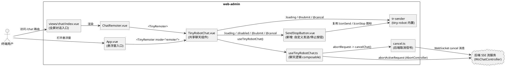
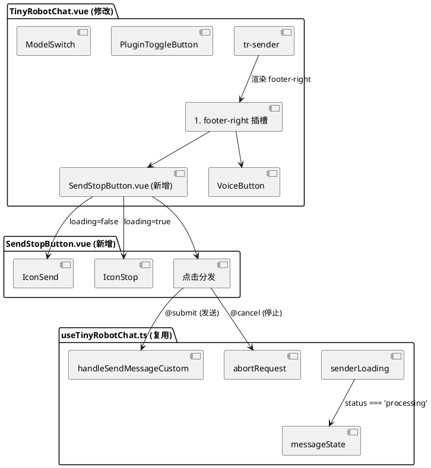
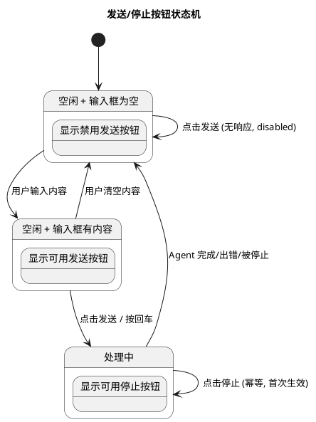
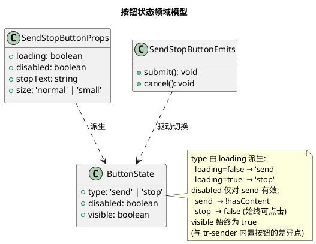

# 一、需求与存量功能关系分析

## 1.1 需求功能与存量功能对比

### 1.1.1 已实现功能

| 需求功能 | 存量功能 | 代码位置 | 匹配度 |
|---------|---------|---------|--------|
| 发送按钮点击提交消息 | tr-sender 的 `@submit` 事件绑定 `handleSendMessageCustom` | `next-remoter/src/components/TinyRobotChat.vue:57` | 100% |
| 停止按钮点击中止 Agent | tr-sender 的 `@cancel` 事件绑定 `abortRequest` | `next-remoter/src/components/TinyRobotChat.vue:57` | 100% |
| Agent 处理中时切换为停止按钮 | tr-sender 的 `:loading="senderLoading"` 驱动内置 `SubmitButton` 在 `loading=true` 时渲染 `IconStop` | `TinyRobotChat.vue:56` + `tiny-robot/dist/index2.js:130-140` | 75% |
| 停止确定性（前端+后端） | `abortRequest = cancelChat() + abortActiveRequest()` | `next-remoter/src/composable/useTinyRobotChat.ts:357-362` | 100% |
| 后端取消信号发送 | `cancelChat()` 通过 WebSocket 发送 cancel 消息 | `mcp-servers/chat/cancel.ts:14-20` | 100% |
| 前端本地流中止 | `abortActiveRequest()` 来自 `useConversation` | `useTinyRobotChat.ts:296-301` | 100% |
| Agent 运行状态来源 | `messageState.status` 来自 `activeConversation.engine.requestState` | `useTinyRobotChat.ts:311-317` | 100% |
| senderLoading 计算 | `computed(() => messageState.status === 'processing')` | `TinyRobotChat.vue:807` | 100% |
| 回车键发送兼容 | tr-sender 默认 `submitType="enter"`，内部 `checkSubmitShortcut` 处理 | `tiny-robot/dist/sender/index.js:2895-2923` | 100% |
| 输入框最大长度限制 | `:maxLength="20000"` + `:showWordLimit="true"` | `TinyRobotChat.vue:56` | 100% |
| 空内容禁止发送 | tr-sender 内置 `canSubmit` 计算包含 `hasContent` 判断 | `tiny-robot/dist/sender/index.js:3039-3041` | 100% |
| 悬浮窗模式（remoter） | `App.vue` 中 `<TinyRemoter mode="remoter">` | `apps/web-admin/web/src/App.vue:537-548` | 100% |
| 全屏对话模式（chat-dialog） | `views/chat/index.vue` → `ChatRemoter.vue` → `<TinyRemoter>` | `views/chat/index.vue:61-68` + `ChatRemoter.vue:3-46` | 100% |

### 1.1.2 需要扩展的功能

| 需求功能 | 存量功能 | 差异说明 | 扩展方向 |
|---------|---------|---------|---------|
| 发送按钮在输入框为空时仍可见（禁用状态） | tr-sender 内置 `SubmitButton` 仅在 `hasContent \|\| loading` 为 true 时条件渲染 | 库内部使用 `v-if`（`s.value ? (i(), f(J)) : h("", !0)`）而非 `display:none`，当输入框为空且 Agent 空闲时，发送按钮 DOM 节点不存在，CSS 无法覆盖 | 在 `#footer-right` 插槽中自定义 `SendStopButton` 组件，始终渲染并通过 `disabled` 属性控制可点击性；同时通过 `:deep()` CSS 隐藏库内置 `tr-sender-submit-button` 避免重复 |
| 停止按钮在 Agent 处理中时始终可见 | 库内置 `SubmitButton` 在 `loading=true` 时确实渲染 `IconStop`，但其容器 `DefaultActionButtons` 的渲染条件 `r.value = hasPrepend \|\| hasContent \|\| loading` 依赖 `footer-right` 插槽是否有内容 | 当 `footer-right` 插槽有 `VoiceButton` 时 `hasPrepend=true`，容器始终渲染，但 `SubmitButton` 仍受 `s.value` 控制 | 自定义 `SendStopButton` 独立控制可见性，不依赖 `hasContent` |

### 1.1.3 需要新增的功能或接口

**无完全新增的业务功能**。本需求本质上是修复/扩展现有发送按钮的可见性策略，所有底层机制（事件、状态、中止链路）均已存在且可用。

**新增的组件 artifact**：

| 组件 | 位置 | 职责 | 依赖 |
|------|------|------|------|
| `SendStopButton.vue` | `next-remoter/src/components/SendStopButton.vue` | 自定义发送/停止复合按钮，始终可见，根据 `loading` 切换图标与行为 | `@opentiny/tiny-robot-svgs` 的 `IconSend` / `IconStop`；父级传入的 `loading`、`disabled`、`stopText` props 与 `@submit` / `@cancel` 事件 |

## 1.2 存量功能详细分析

### 1.2.1 tr-sender 组件接口契约

**入参（props）**：

| 属性 | 类型 | 默认值 | 说明 |
|------|------|--------|------|
| `modelValue` | `string` | - | 输入框文本（v-model） |
| `loading` | `boolean` | `false` | 加载态，驱动内置 SubmitButton 在发送/停止图标间切换 |
| `disabled` | `boolean` | `false` | 禁用输入框 |
| `mode` | `'single' \| 'multiple'` | `'single'` | 单行/多行模式 |
| `maxLength` | `number` | - | 最大字符数 |
| `clearable` | `boolean` | `false` | 是否显示清除按钮 |
| `stopText` | `string` | - | 停止按钮附加文案 |
| `defaultActions` | `object` | - | 自定义默认动作按钮的 disabled/tooltip 配置 |
| `submitType` | `'enter' \| 'ctrlEnter' \| 'shiftEnter'` | `'enter'` | 提交快捷键类型 |

**出参（emits）**：

| 事件 | 参数 | 说明 |
|------|------|------|
| `submit` | `(text: string, mentions?: any, extra?: { externalPayloads: any[] })` | 用户提交消息 |
| `cancel` | `()` | 用户点击停止按钮 |
| `clear` | `()` | 用户点击清除按钮 |
| `focus` / `blur` / `input` | - | 编辑器焦点与输入事件 |

**暴露方法（defineExpose）**：`submit()`、`clear()`、`cancel()`、`focus()`、`blur()`、`setContent()`、`getContent()`、`editor`

### 1.2.2 内置 SubmitButton 业务规则

`tiny-robot/dist/index2.js` 第 81-142 行定义了 `SubmitButton` 组件：

1. **图标切换规则**：`loading=true` → 渲染 `IconStop`（停止图标）；`loading=false` → 渲染 `IconSend`（发送图标）
2. **点击行为**：`loading=true` → 调用 `cancel()`（触发 `@cancel` 事件）；`loading=false` → 调用 `submit()`（触发 `@submit` 事件）
3. **禁用条件**：`!canSubmit && !loading` 时 `is-disabled`，点击无响应
4. **渲染条件**：受父级 `DefaultActionButtons` 的 `s.value = hasContent || loading` 控制，**条件渲染**（非 display 切换）

### 1.2.3 abortRequest 链路分析

`useTinyRobotChat.ts` 第 357-362 行：

```
abortRequest()
  ├── cancelChat()                    // 异步，不阻塞
  │   └── sendMessage('cancel', {})   // WebSocket 发送 cancel 消息
  │       └── 后端 WsChatController._handleCancelMessage
  │           └── WebSocketSessionManager.cancelAgent
  │               └── 触发 AgentCancelException
  └── abortActiveRequest()            // 异步，不阻塞
      └── useConversation 内部 AbortController.abort()
          └── 中止前端 HTTP/SSE 流
```

**约束**：
- 两个操作并行执行，互不阻塞（各自 `.catch(() => {})` 吞掉异常）
- `cancelChat` 失败时降级为仅前端本地中止（`cancel.ts:19` 静默降级）
- 满足 spec.md §4.3 安全性要求：同时通知前端本地中止与后端确定性终止

### 1.2.4 senderLoading 状态来源链路

```
messageState.status (useTinyRobotChat.ts:311-317)
  ← activeConversation.value?.engine?.requestState.value
    ← useConversation 内部 UseMessageReturn.requestState
      ← tiny-robot-kit 消息引擎在发送/完成/出错时流转
        → 'idle' | 'processing'

senderLoading (TinyRobotChat.vue:807)
  ← computed(() => messageState.status === 'processing')
```

**约束**：状态来源单一（`engine.requestState`），不自行维护独立副本，满足 spec.md §6.2 要求。

### 1.2.5 两种聊天模式的入口分析

| 模式 | 入口文件 | 渲染路径 | mode prop |
|------|---------|---------|-----------|
| 悬浮窗（remoter） | `apps/web-admin/web/src/App.vue:537-548` | `App.vue` → `<TinyRemoter mode="remoter">` → `TinyRobotChat.vue` | `mode="remoter"` |
| 全屏对话（chat-dialog） | `apps/web-admin/web/src/views/chat/index.vue:61-68` | `chat/index.vue` → `ChatRemoter.vue` → `<TinyRemoter>` → `TinyRobotChat.vue` | 未显式传 mode（默认 `remoter`） |

**关键发现**：两种模式**共用同一个 `TinyRobotChat.vue` 组件**，该组件内部使用同一个 `<tr-sender>` 配置。因此只需在 `TinyRobotChat.vue` 一处修改即可同时适配两种模式，满足 spec.md §5.3 多模式适配要求。

**注意**：`ChatRemoter.vue` 未显式传 `mode` prop，使用 `TinyRobotChat.vue` 的默认值 `mode="remoter"`（第 227 行 `default: 'remoter'`）。若需全屏对话模式实际使用 `mode="chat-dialog"`，需在 `ChatRemoter.vue` 补传该 prop。但当前两种模式的输入框区域渲染逻辑一致，修改 `TinyRobotChat.vue` 即可覆盖。
# 二、增量设计方案

## 2.1 实现模型

### 2.1.1 上下文视图



### 2.1.2 服务/组件总体架构



### 2.1.3 实现设计文档

#### 按钮状态机设计



#### 状态切换流程

```plantuml
@startuml
title 发送/停止按钮点击处理流程

start
if (按钮当前状态?) then (发送按钮)
  if (输入框有内容?) then (是)
    :调用 senderRef.submit()\n或 handleSendMessageCustom(inputMessage);
    :tr-sender 触发 @submit 事件;
    :messageState.status → 'processing';
    :senderLoading → true;
    :按钮切换为停止图标;
  else (否)
    :点击无响应 (disabled);
  endif
else (停止按钮)
  :调用 abortRequest();
  fork
    :cancelChat()\nWebSocket 发送 cancel;
  fork
    :abortActiveRequest()\n前端 AbortController.abort();
  end fork
  :messageState.status → 'idle';
  :senderLoading → false;
  :按钮切换回发送图标;
endif
stop
@enduml
```

## 2.2 接口设计

### 2.2.1 总体设计

| 接口分类 | 接口名称 | 稳定性 | 说明 |
|---------|---------|--------|------|
| 组件 Props | `SendStopButtonProps` | 稳定 | 新增组件的输入属性契约 |
| 组件 Emits | `SendStopButtonEmits` | 稳定 | 新增组件的输出事件契约 |
| 复用接口 | `tr-sender` 的 `submit()` / `cancel()` 暴露方法 | 稳定（库内置） | 通过 `senderRef` 调用，触发已绑定的 `@submit` / `@cancel` |
| 复用接口 | `abortRequest()` | 稳定 | 来自 `useTinyRobotChat`，直接调用 |
| 复用状态 | `senderLoading` / `inputMessage` | 稳定 | 来自 `TinyRobotChat.vue` 现有响应式状态 |

### 2.2.2 接口清单

#### SendStopButton 组件

**接口签名**：

```typescript
// SendStopButton.vue props
interface SendStopButtonProps {
  /** 是否处于加载态（Agent 处理中），true 时显示停止按钮 */
  loading: boolean
  /** 是否禁用发送按钮（输入框为空时为 true） */
  disabled: boolean
  /** 停止按钮附加文案，不传则仅显示图标 */
  stopText?: string
  /** 按钮尺寸，与 tr-sender 的 size 保持一致 */
  size?: 'normal' | 'small'
}

// SendStopButton.vue emits
interface SendStopButtonEmits {
  /** 用户点击发送按钮（loading=false 且 disabled=false 时触发） */
  (e: 'submit'): void
  /** 用户点击停止按钮（loading=true 时触发） */
  (e: 'cancel'): void
}
```

**业务说明**：该组件为发送/停止复合按钮，在同一位置根据 `loading` 状态切换显示发送图标或停止图标。始终渲染 DOM 节点（不同于 tr-sender 内置 SubmitButton 的条件渲染），通过 `disabled` 属性控制发送按钮的可点击性。

**前置条件**：
- `loading=true` 时 `disabled` 属性被忽略（停止按钮始终可点击）
- `loading=false` 且 `disabled=true` 时，发送按钮显示禁用样式，点击无响应

**后置条件**：
- 点击发送按钮 → 触发 `submit` 事件，由父组件调用 `senderRef.submit()` 或 `handleSendMessageCustom`
- 点击停止按钮 → 触发 `cancel` 事件，由父组件调用 `abortRequest()`

**异常映射**：组件本身不处理异常，异常处理由父组件 `handleSendMessageCustom` 的 try/catch 和 `abortRequest` 的 `.catch(() => {})` 兜底。

**调用示例**（在 TinyRobotChat.vue 的 `#footer-right` 插槽中）：

```vue
<template #footer-right>
  <VoiceButton v-if="allowSpeech" />
  <SendStopButton
    :loading="senderLoading"
    :disabled="!inputMessage.trim()"
    @submit="() => senderRef?.submit()"
    @cancel="abortRequest"
  />
</template>
```

## 2.3 数据模型

### 2.3.1 设计目标

1. **支持的业务场景**：Agent 空闲时发送消息、Agent 处理中时停止运行、输入框为空时显示禁用发送按钮
2. **性能目标**：按钮状态切换 ≤50ms（响应式 computed 驱动，Vue 同步更新）；发送响应 ≤100ms；停止响应 ≤200ms
3. **兼容策略**：不修改 tr-sender 库内部代码，通过插槽 + CSS 覆盖方式扩展，库升级不受影响

### 2.3.2 模型实现



**对象创建与销毁策略**：
- `SendStopButton` 组件随 `TinyRobotChat.vue` 的 `tr-sender` 渲染而创建，随其卸载而销毁
- 无独立的生命周期管理需求，无定时器、无订阅、无手动内存管理

**持久化策略**：
- 按钮状态为纯前端 UI 状态，不持久化
- `loading` 来源于 `messageState.status`（内存响应式状态），不涉及数据库

## 2.4 逐文件修改清单

### 2.4.1 新增文件：`SendStopButton.vue`

**路径**：`apps/web-admin/web/src/lib/webmcp-sdk/packages/next-remoter/src/components/SendStopButton.vue`

**职责**：自定义发送/停止复合按钮组件，始终可见，根据 `loading` 切换图标与行为。

**设计要点**：
1. 复用 `@opentiny/tiny-robot-svgs` 的 `IconSend` 和 `IconStop` 图标，与 tr-sender 内置按钮视觉一致
2. `loading=false` 时显示 `IconSend`，`disabled=true` 时添加 `is-disabled` 样式类，点击无响应
3. `loading=true` 时显示 `IconStop`（可选附加 `stopText` 文案），点击触发 `cancel`
4. 样式类名与 tr-sender 内置按钮保持一致（`tr-sender-submit-button`），复用库内置 CSS
5. 组件不包含任何业务逻辑，仅做 UI 展示与事件分发

### 2.4.2 修改文件：`TinyRobotChat.vue`

**路径**：`apps/web-admin/web/src/lib/webmcp-sdk/packages/next-remoter/src/components/TinyRobotChat.vue`

**修改点 1：导入 SendStopButton 组件**

在 `<script setup>` 的 import 区域（约第 144-150 行自定义组件导入处）新增：
```typescript
import SendStopButton from './SendStopButton.vue'
```

**修改点 2：在 `#footer-right` 插槽中添加 SendStopButton**

将第 77-79 行的 `#footer-right` 插槽：
```vue
<template #footer-right>
  <VoiceButton v-if="allowSpeech" />
</template>
```
修改为：
```vue
<template #footer-right>
  <VoiceButton v-if="allowSpeech" />
  <SendStopButton
    :loading="senderLoading"
    :disabled="!inputMessage.trim()"
    @submit="() => senderRef?.submit()"
    @cancel="abortRequest"
  />
</template>
```

**设计理由**：
- `@submit` 调用 `senderRef.submit()` 而非直接调用 `handleSendMessageCustom`，是为了复用 tr-sender 内部的文本提取逻辑（含 mention/template 扩展处理），tr-sender 的 `submit()` 方法内部会触发 `@submit` 事件，进而调用已绑定的 `handleSendMessageCustom`
- `@cancel` 直接调用 `abortRequest`，复用现有的前端+后端双重中止链路
- `:disabled` 使用 `!inputMessage.trim()` 判断输入框是否有可发送内容，与 spec.md §5.1.1 空内容禁止发送规则一致

**修改点 3：通过 CSS 隐藏 tr-sender 内置的 SubmitButton 避免重复**

在 `<style scoped lang="less">` 中新增：
```less
// 隐藏 tr-sender 内置的发送/停止按钮，避免与自定义 SendStopButton 重复
:deep(.tr-sender-submit-button) {
  display: none !important;
}
```

**设计理由**：
- tr-sender 内置的 `SubmitButton` 仍在 `DefaultActionButtons` 中渲染（受 `hasContent || loading` 条件控制），若不隐藏，在输入框有内容或 Agent 处理中时会出现两个发送/停止按钮
- 使用 `:deep()` 穿透 scoped 样式，`!important` 确保覆盖库内置样式
- 仅隐藏 `tr-sender-submit-button`，不影响 `tr-default-action-buttons` 容器中的其他按钮（如 ClearButton）

### 2.4.3 不需要修改的文件

| 文件 | 原因 |
|------|------|
| `useTinyRobotChat.ts` | `abortRequest`、`messageState`、`senderLoading` 等均已正确实现，无需修改 |
| `cancel.ts` | `cancelChat` 后端取消信号发送逻辑完整，无需修改 |
| `App.vue` | 悬浮窗入口已正确使用 `<TinyRemoter mode="remoter">`，无需修改 |
| `views/chat/index.vue` | 全屏对话入口通过 `ChatRemoter.vue` 使用 `<TinyRemoter>`，无需修改 |
| `ChatRemoter.vue` | 已正确渲染 `<TinyRemoter>`，无需修改 |
| `tr-sender` 库内部 | 不修改第三方库源码，通过插槽 + CSS 扩展 |

## 2.5 样式设计

### 2.5.1 SendStopButton 样式策略

1. **类名复用**：组件根元素使用 `tr-sender-submit-button` 类名，复用 tiny-robot 库内置的按钮样式（尺寸、颜色、hover 效果）
2. **禁用样式**：`is-disabled` 类名与库内置一致，降低透明度 + `cursor: not-allowed`
3. **加载态样式**：`is-loading` 类名与库内置一致，停止按钮的视觉反馈
4. **明暗主题适配**：由于复用库内置类名，主题切换由 tiny-robot 库的 CSS 变量自动处理
5. **尺寸适配**：通过 `size` prop 控制 `--tr-action-button-size` CSS 变量，与 tr-sender 的 `size` prop 保持一致

### 2.5.2 与现有 UI 的一致性

- 按钮位置：`#footer-right` 插槽，位于输入框右下角，与库内置按钮位置一致
- 图标一致：复用 `IconSend` / `IconStop`，与库内置按钮图标完全相同
- 交互一致：点击行为（submit/cancel）与库内置按钮完全相同
- 动画一致：复用库内置的 `tr-slide-right` Transition 动画

## 2.6 回滚方案

### 2.6.1 回滚步骤

1. **删除新增文件**：删除 `SendStopButton.vue`
2. **还原 TinyRobotChat.vue**：
   - 移除 `import SendStopButton`
   - 还原 `#footer-right` 插槽为仅包含 `<VoiceButton v-if="allowSpeech" />`
   - 移除 `:deep(.tr-sender-submit-button) { display: none !important; }` 样式
3. **回滚验证**：回车键发送消息功能恢复正常，tr-sender 内置按钮在有内容时正常显示

### 2.6.2 回滚影响

- 回滚后恢复为 tr-sender 库默认行为：输入框为空时无发送按钮，有内容时显示发送按钮
- 不影响 `abortRequest`、`handleSendMessageCustom` 等现有逻辑
- 不影响 `App.vue`、`ChatRemoter.vue` 等入口文件

## 2.7 测试策略

### 2.7.1 类型检查（vue-tsc）

**验证点**：
1. `SendStopButton.vue` 的 props/emits 类型定义正确，无 `any` 类型
2. `TinyRobotChat.vue` 中 `SendStopButton` 的使用符合类型约束
3. `senderRef?.submit()` 调用类型安全（`senderRef` 为 `Ref<ComponentInstance<typeof TrSender>>`，`submit` 是 TrSender 暴露的方法）

**命令**：`npx vue-tsc --noEmit`

### 2.7.2 构建验证（vite build）

**验证点**：
1. `SendStopButton.vue` 组件被正确编译打包
2. `IconSend` / `IconStop` 图标导入路径正确
3. `:deep(.tr-sender-submit-button)` 样式正确编译
4. 无构建错误、无未解析的导入

**命令**：`npm run build`

### 2.7.3 单元测试（vitest）

**验证点**：

| 测试场景 | 验证内容 | 预期结果 |
|---------|---------|---------|
| 空闲 + 输入框为空 | SendStopButton 渲染 | 显示禁用状态的发送按钮（`is-disabled` 类），点击不触发 `submit` 事件 |
| 空闲 + 输入框有内容 | SendStopButton 渲染 | 显示可用发送按钮，点击触发 `submit` 事件 |
| 处理中 | SendStopButton 渲染 | 显示停止按钮（`IconStop`），点击触发 `cancel` 事件 |
| 处理中 → 空闲 | 状态切换 | 停止按钮切换回发送按钮，响应时间 ≤50ms |
| 快速连续点击停止 | 幂等性 | 首次点击触发 `cancel`，后续点击无响应（`loading` 已为 false 后才恢复） |
| 库内置按钮隐藏 | CSS 覆盖 | `.tr-sender-submit-button` 的 `display` 为 `none` |
| 回车键发送 | 兼容性 | 回车键仍触发 `@submit`，行为与点击 SendStopButton 一致 |

**测试文件位置**：`next-remoter/src/components/__tests__/SendStopButton.test.ts`（如项目无现成测试目录则新建）

**命令**：`npx vitest run --reporter verbose`

### 2.7.4 手动验证清单

| 验证项 | 操作步骤 | 预期结果 |
|--------|---------|---------|
| 悬浮窗模式发送 | 打开右下角悬浮窗 → 输入消息 → 点击发送按钮 | 消息发送成功，输入框清空，按钮切换为停止按钮 |
| 悬浮窗模式停止 | 发送消息后 → 点击停止按钮 | Agent 立即停止，按钮切换回发送按钮 |
| 全屏对话模式发送 | 访问 /chat → 打开聊天 → 输入消息 → 点击发送按钮 | 行为与悬浮窗模式一致 |
| 空输入框禁用 | 清空输入框 → 观察发送按钮 | 发送按钮显示为禁用样式，点击无响应 |
| 回车键兼容 | 输入消息 → 按回车键 | 消息正常发送，行为与点击发送按钮一致 |
| 明暗主题 | 切换主题 | 按钮样式正确适配主题 |
| 模式切换 | Agent 处理中时切换悬浮窗 ↔ 全屏 | 按钮状态正确显示停止按钮 |