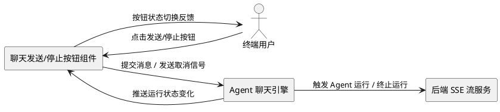
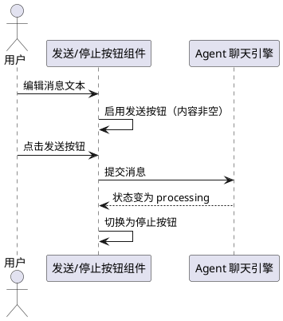
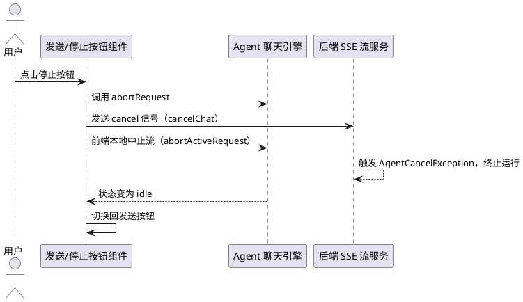
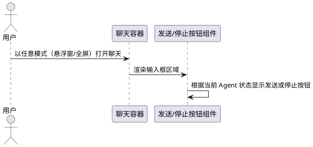

# **1. 组件定位**

## **1.1 核心职责**
本组件负责为 Agent 聊天输入框提供消息发送与运行中止的交互入口，实现用户可一键发送消息、一键停止 Agent 当前工作的核心价值。

## **1.2 核心输入**
1. 用户在聊天输入框中编辑完成的文本消息（来源：用户操作指令）
2. 用户点击"发送"按钮的触发信号（来源：用户操作指令）
3. 用户点击"停止"按钮的触发信号（来源：用户操作指令）
4. Agent 运行状态变化信号（来源：Agent 运行时状态流转，包括 idle → processing → idle）

## **1.3 核心输出**
1. 向 Agent 发起消息发送请求（目标：Agent 聊天引擎，内容：用户输入的文本消息）
2. 向 Agent 发起停止运行请求（目标：Agent 运行时与后端 SSE 流，内容：取消当前会话运行的信号）
3. 按钮状态切换的视觉反馈（目标：用户，内容：发送按钮 ↔ 停止按钮的图标与样式切换）

## **1.4 职责边界**
1. 本组件不负责消息内容的校验、过滤与转换（由聊天引擎处理）
2. 本组件不负责 Agent 的实际推理、工具调用与回复生成（由 Agent 运行时处理）
3. 本组件不负责会话历史的创建、切换与持久化（由会话管理模块处理）
4. 本组件不负责输入框本身的文本编辑、附件上传、语音输入等功能（由输入框组件处理）
5. 本组件不负责停止后 Agent 已生成内容的保留或清理策略（由聊天引擎决定）

# **2. 领域术语**

**发送按钮**
: 聊天输入框区域内的可点击控件，用于将用户当前编辑完成的文本消息提交给 Agent 引擎进行处理。

**停止按钮**
: Agent 正在处理消息期间，聊天输入框区域内显示的可点击控件，用于立即中止 Agent 当前的运行与流式输出。

**Agent 运行状态**
: Agent 引擎在处理用户消息期间的生命周期状态，取值包括 idle（空闲）与 processing（处理中）。

**发送/停止按钮**
: 根据当前 Agent 运行状态在同一控件位置动态切换显示的复合按钮：空闲时为发送按钮，处理中为停止按钮。

# **3. 角色与边界**

## **3.1 核心角色**
- **终端用户**：通过聊天界面与 Agent 交互的操作者，使用发送按钮提交消息，使用停止按钮中止 Agent 运行。

## **3.2 外部系统**
- **Agent 聊天引擎**：接收发送按钮提交的消息并启动推理流程，接收停止按钮的取消信号并终止当前运行。
- **后端 SSE 流服务**：接收停止信号，确定性终止后端 Agent 执行（触发 AgentCancelException）。

## **3.3 交互上下文**

# **4. DFX约束**

## **4.1 性能**
1. 发送按钮点击到消息提交的响应时间不得超过 100ms。
2. 停止按钮点击到 Agent 运行终止信号发出的响应时间不得超过 200ms。
3. 按钮状态切换（发送 ↔ 停止）的视觉响应时间不得超过 50ms。

## **4.2 可靠性**
1. 停止按钮点击后，Agent 必须在 2 秒内停止生成新内容。
2. 停止操作不得导致已生成的部分回复内容丢失。
3. 停止操作后，用户必须能够立即发起新的消息发送。
4. 发送按钮在 Agent 处理中状态下必须被禁用或切换为停止按钮，禁止重复触发发送。

## **4.3 安全性**
1. 停止信号必须同时通知前端本地中止与后端确定性终止，避免后端 Agent 继续无效运行消耗资源。
2. 按钮交互无需额外鉴权，复用现有聊天会话的鉴权上下文。

## **4.4 可维护性**
1. 按钮组件必须复用现有 `tr-sender` 组件的事件机制（`@submit` / `@cancel`）与 `loading` 状态属性。
2. 停止功能必须复用现有 `abortRequest` 方法（含 `cancelChat` 后端通知 + `abortActiveRequest` 前端中止）。

## **4.5 兼容性**
1. 发送/停止按钮的添加不得破坏现有回车键发送消息的行为。
2. 按钮交互必须同时适用于悬浮窗模式（remoter）与全屏对话模式（chat-dialog）。
3. 按钮样式必须适配明暗主题切换。

# **5. 核心能力**

## **5.1 发送按钮展示与消息提交**

### **5.1.1 业务规则**
1. **发送按钮可见性规则**：当 Agent 运行状态为 idle（空闲）且输入框存在可发送内容时，必须在输入框区域显示发送按钮。
   a. 验收条件：[Agent 空闲且输入框有文本] → [显示发送按钮]
2. **发送按钮触发规则**：用户点击发送按钮时，必须将输入框当前文本提交给 Agent 聊天引擎，并清空输入框。
   a. 验收条件：[用户点击发送按钮] → [消息提交至 Agent 引擎且输入框清空]
3. **空内容禁止发送规则**：当输入框内容为空或仅含空白字符时，发送按钮必须处于禁用状态，禁止提交空消息。
   a. 验收条件：[输入框为空或纯空白] → [发送按钮禁用，点击无响应]
4. **回车键兼容规则**：发送按钮的添加不得影响现有回车键发送消息的行为，两种发送方式必须并存且行为一致。
   a. 验收条件：[用户按回车键] → [消息正常提交，行为与点击发送按钮一致]
5. **禁止项**：禁止在 Agent 处理中状态下通过发送按钮重复提交消息。
   a. 验收条件：[Agent 处理中且用户点击发送按钮位置] → [不提交新消息（该位置此时应显示停止按钮）]

### **5.1.2 交互流程**

### **5.1.3 异常场景**
1. **发送时网络异常**
   a. 触发条件：用户点击发送按钮后，消息提交请求因网络故障失败
   b. 系统行为：保留输入框内容，按钮恢复为发送状态，显示错误提示
   c. 用户感知：输入框内容未丢失，显示"发送失败"提示，可重试
2. **输入框内容超长**
   a. 触发条件：用户输入文本超过最大长度限制（20000 字符）
   b. 系统行为：发送按钮禁用或截断处理（沿用现有 maxLength 机制）
   c. 用户感知：字数限制提示，无法发送超长内容

## **5.2 停止按钮展示与 Agent 运行中止**

### **5.2.1 业务规则**
1. **停止按钮可见性规则**：当 Agent 运行状态为 processing（处理中）时，必须在原发送按钮位置切换显示停止按钮。
   a. 验收条件：[Agent 状态变为 processing] → [发送按钮切换为停止按钮]
2. **停止按钮触发规则**：用户点击停止按钮时，必须立即向 Agent 聊天引擎与后端 SSE 流服务发送取消信号，终止当前 Agent 运行。
   a. 验收条件：[用户点击停止按钮] → [Agent 立即停止生成新内容，后端终止运行]
3. **停止后状态恢复规则**：Agent 运行被停止后，按钮必须立即恢复为发送按钮状态，允许用户发起新消息。
   a. 验收条件：[Agent 停止运行完成] → [停止按钮切换回发送按钮]
4. **停止确定性规则**：停止操作必须同时触发前端本地流中止与后端确定性终止（AgentCancelException），确保后端不再继续无效运行。
   a. 验收条件：[用户点击停止按钮] → [前端 SSE 流中止 AND 后端 Agent 执行终止]
5. **禁止项**：禁止停止按钮仅中止前端流而未通知后端，导致后端 Agent 继续消耗资源。
   a. 验收条件：[用户点击停止按钮] → [后端必须收到取消信号并终止]

### **5.2.2 交互流程**

### **5.2.3 异常场景**
1. **停止信号发送失败**
   a. 触发条件：用户点击停止按钮，但后端 cancel 信号发送失败（网络中断等）
   b. 系统行为：前端本地流仍立即中止，按钮恢复为发送状态，记录警告日志
   c. 用户感知：界面停止接收新内容，按钮恢复为发送按钮，后端可能继续运行至自然结束
2. **Agent 已自然结束时点击停止**
   a. 触发条件：用户点击停止按钮时，Agent 恰好已自然完成回复
   b. 系统行为：取消信号被忽略（无运行可终止），按钮正常恢复为发送状态
   c. 用户感知：无异常，按钮恢复为发送按钮
3. **快速连续点击停止**
   a. 触发条件：用户在 Agent 处理中快速多次点击停止按钮
   b. 系统行为：首次点击生效，后续点击幂等忽略，不产生重复取消信号
   c. 用户感知：无异常，Agent 正常停止

## **5.3 多模式适配**

### **5.3.1 业务规则**
1. **悬浮窗模式适配规则**：发送/停止按钮必须在悬浮窗模式（remoter）下正常显示与交互。
   a. 验收条件：[以悬浮窗模式打开聊天] → [输入框显示发送/停止按钮且功能正常]
2. **全屏对话模式适配规则**：发送/停止按钮必须全屏对话模式（chat-dialog）下正常显示与交互。
   a. 验收条件：[以全屏对话模式打开聊天] → [输入框显示发送/停止按钮且功能正常]
3. **样式一致性规则**：发送/停止按钮在不同模式下样式必须保持一致，遵循 tiny-robot 设计规范。
   a. 验收条件：[切换聊天模式] → [按钮样式、位置、交互行为一致]

### **5.3.2 交互流程**

### **5.3.3 异常场景**
1. **模式切换时按钮状态异常**
   a. 触发条件：Agent 处理中时用户切换聊天模式（悬浮窗 ↔ 全屏）
   b. 系统行为：切换后按钮必须正确反映当前 Agent 运行状态（显示停止按钮）
   c. 用户感知：模式切换后按钮状态正确，无错乱

# **6. 数据约束**

## **6.1 按钮状态对象**
1. **按钮类型**：取值范围为 `send`（发送）或 `stop`（停止），由 Agent 运行状态决定：idle → send，processing → stop
2. **是否禁用**：布尔值，发送按钮在输入框内容为空时为 true，停止按钮始终为 false（处理中可点击）
3. **可见性**：布尔值，按钮始终可见，仅在 send 与 stop 之间切换

## **6.2 Agent 运行状态对象**
1. **status**：取值范围为 `idle`（空闲）或 `processing`（处理中），驱动按钮类型切换
2. **状态来源**：必须来源于聊天引擎的 `messageState.status`，不得自行维护独立状态副本