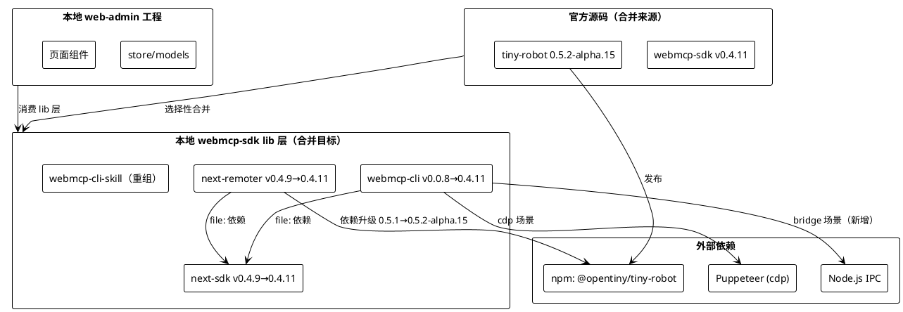
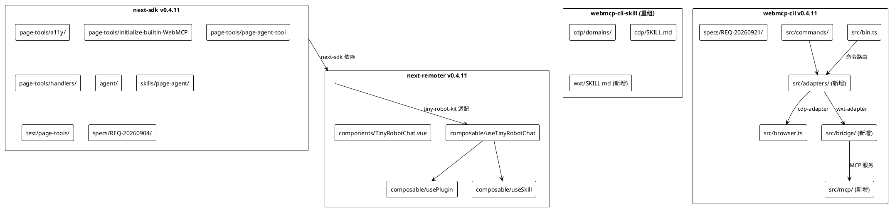
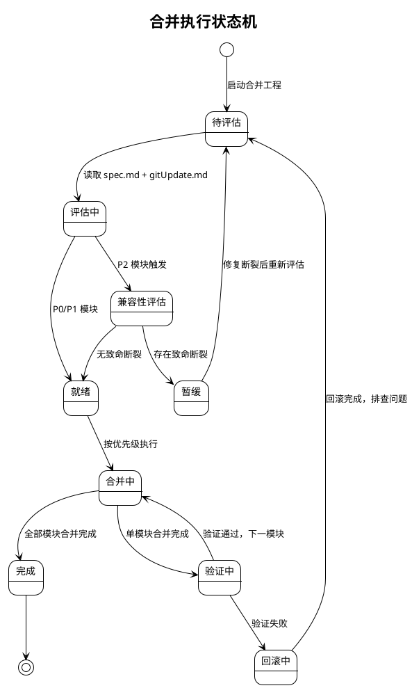
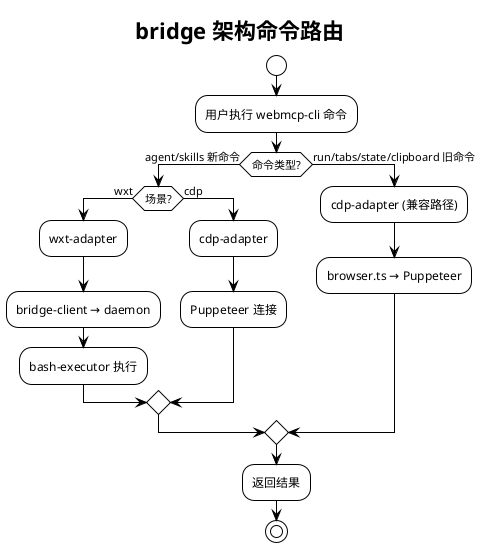
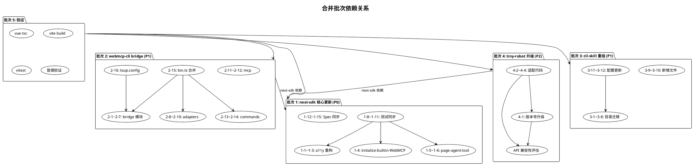
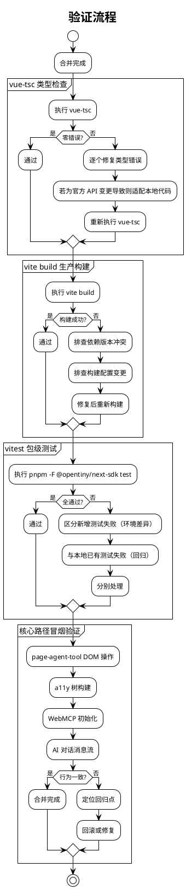

# OpenTiny 技术栈官方版本同步合并 — 技术设计文档

# 一、需求与存量功能关系分析

## 1.1 需求功能与存量功能对比

> **⚠ 版本勘误（2026-09-24 复核，详见 `spec.md` §0）**：本文档多处沿用旧假设「tiny-robot 0.5.2-alpha.15」，该版本**不存在**（仅为 agent-skills 资产目录名）。tiny-robot 官方最新 tag 为 `v0.5.1`；且官方 webmcp-sdk 的 `pnpm-workspace.yaml` catalog 反而将 tiny-robot 钉在更旧的 `0.3.1-alpha.6`。另：官方 `package.json` 依赖全部使用 `catalog:` 协议，合并时**严禁照搬、须翻译为本地显式版本**（否则 web-admin `pnpm install` 失败）。webmcp-cli 官方版本实为 `0.0.9`。下文 tiny-robot 相关表述一律以 `spec.md` §0 为准。

本合并工程的目标是将 OpenTiny 官方 webmcp-sdk（next-sdk/next-remoter v0.4.11、webmcp-cli v0.0.9）的更新选择性合并到本地开发目录 `apps/web-admin/web/src/lib/webmcp-sdk/`，**tiny-robot 保持本地已有的 0.5.1 不变**。本地当前锁定版本为 next-sdk v0.4.9、next-remoter v0.4.9、webmcp-cli v0.0.8、tiny-robot 0.5.1。

以下按 spec.md 定义的 5 个功能模块逐一对比需求与存量代码的关系。

### 1.1.1 已实现功能

已实现功能是指需求与存量代码完全匹配或高度相似的部分，本次合并仅需版本号对齐或小幅同步。

| 需求功能 | 存量功能 | 代码位置 | 匹配度 |
|---------|---------|---------|--------|
| next-sdk a11y 树构建基础能力 | 本地已存在 a11y/build.ts、search.ts、constants.ts、types.ts 等核心文件 | `packages/next-sdk/page-tools/a11y/{build,search,constants,types}.ts` | 75% |
| next-sdk initialize-builtin-WebMCP 基础框架 | 本地已存在 initialize-builtin-WebMCP.ts，提供 polyfill 注入与桥接 | `packages/next-sdk/page-tools/initialize-builtin-WebMCP.ts` | 50% |
| next-sdk page-agent-tool 工具协议 | 本地已存在 page-agent-tool.ts、schema.ts、tool-config.ts 及完整 handlers 目录 | `packages/next-sdk/page-tools/page-agent-tool.ts`、`schema.ts`、`handlers/*.ts` | 75% |
| webmcp-cli 命令行基础框架 | 本地已存在 bin.ts、browser.ts、commands/{run,tabs,state,clipboard}.ts | `packages/webmcp-cli/src/{bin,browser}.ts`、`src/commands/*.ts` | 50% |
| webmcp-cli-skill 技能文件基础 | 本地已存在 domains/ 目录（7 个 md 文件）与根目录 SKILL.md | `packages/webmcp-cli-skill/domains/*.md`、`SKILL.md` | 75% |
| next-remoter 对 tiny-robot 的适配层 | 本地已存在 useTinyRobotChat.ts、usePlugin.ts、useSkill.ts 等适配 composable | `packages/next-remoter/src/composable/{useTinyRobotChat,usePlugin,useSkill}.ts` | 50% |

### 1.1.2 需要扩展的功能

需要扩展的功能是指需求与存量代码部分匹配，需要在现有基础上改造的部分。

| 需求功能 | 存量功能 | 差异说明 | 扩展方向 |
|---------|---------|---------|---------|
| a11y contenteditable 重构 | 本地 a11y/config.ts、utils.ts、vnode.ts 为 v0.4.9 版本 | 官方 v0.4.11 对 config.ts +26行、utils.ts +4行、vnode.ts +11行，重构 contenteditable 元素的无障碍树处理语义 | 替换 a11y/config.ts、utils.ts、vnode.ts 三文件至官方 v0.4.11 版本，同步新增测试 |
| initialize-builtin-WebMCP 大改 | 本地 initialize-builtin-WebMCP.ts 为 v0.4.9 版本 | 官方 v0.4.11 对该文件 +149行变更，涉及 polyfill 注入、桥接、forcePolyfill 默认行为的调整 | 替换 initialize-builtin-WebMCP.ts 至官方版本，同步新增 197 行测试文件 |
| page-agent-tool 更新 | 本地 page-agent-tool.ts、schema.ts 为 v0.4.9 版本 | 官方 v0.4.11 对 page-agent-tool.ts +18行、schema.ts +2行变更 | 替换 page-agent-tool.ts、schema.ts 至官方版本，同步新增 104 行测试文件 |
| webmcp-cli bin.ts 大改 | 本地 bin.ts 为 v0.0.8 版本，仅含 cdp 场景命令 | 审方 v0.4.11 对 bin.ts +220行变更，对接 bridge 架构入口，新增 agent/skills 子命令路由 | 合并 bin.ts 变更，保留本地已有命令路由，新增 bridge 相关命令分支 |
| webmcp-cli tsup.config.ts 构建配置 | 本地 tsup.config.ts 为 v0.0.8 版本 | 官方 +28行变更，新增 bridge 模块打包入口 | 合并 tsup.config.ts 变更，确保 bridge 产物正确生成 |
| next-remoter tiny-robot 依赖版本 | 本地 package.json 锁定 tiny-robot 0.5.1 | **保持 0.5.1 不变**（0.5.2-alpha.15 非真实版本，见 spec.md §0.2；官方 catalog 反而钉 0.3.1-alpha.6 更旧） | 合并 webmcp-sdk 源码后，在 0.5.1 下验证 useTinyRobotChat.ts 等适配代码的 API 兼容性，不修改版本号 |
| webmcp-cli-skill 目录重组 | 本地为 domains/ + 根目录 SKILL.md 旧结构 | 审方重组为 cdp/domains/ + cdp/SKILL.md + wxt/SKILL.md 新结构 | 迁移 domains/ → cdp/domains/，迁移 SKILL.md → cdp/SKILL.md，新增 wxt/SKILL.md |
| skills.manifest.json 同步 | 本地 skills.manifest.json 为旧结构 | 审方 +8行变更，新增 cdp/wxt 技能发现配置 | 合并 skills.manifest.json 变更，确保技能同步脚本发现新结构 |
| scripts/skills-sync.mjs 同步 | 本地 skills-sync.mjs 为旧结构 | 审方 +5行变更，适配 cdp/wxt 新目录结构 | 合并 scripts/skills-sync.mjs 变更 |

### 1.1.3 需要新增的功能或接口

需要新增的功能是指需求在存量代码中完全没有对应实现的部分，需从官方源码整目录复制。

**模块一：next-sdk 新增测试与 Spec**

| 功能点 | 输入 | 输出 | 核心逻辑 | 依赖关系 |
|--------|------|------|---------|---------|
| a11y/build.test.ts | 含 contenteditable 元素的 DOM 测试用例 | 测试断言结果 | 验证 buildA11yTree 对 contenteditable 的处理与官方一致 | 依赖 a11y/build.ts、config.ts |
| a11y/config.test.ts | a11y 配置规则测试用例 | 测试断言结果 | 验证 config 规则加载与 contenteditable 处理 | 依赖 a11y/config.ts |
| initialize-builtin-WebMCP.test.ts | WebMCP 初始化测试用例 | 测试断言结果 | 验证 polyfill 注入、桥接、forcePolyfill 行为 | 依赖 initialize-builtin-WebMCP.ts |
| page-agent-tool.test.ts | page-agent 工具调用测试用例 | 测试断言结果 | 验证工具协议与返回结构 | 依赖 page-agent-tool.ts、schema.ts |
| specs/REQ-20260904-contenteditable-a11y-ref/ | 无 | Spec 三件套 | 官方 a11y 重构规范记录 | 无代码依赖，文档记录 |

**模块二：webmcp-cli bridge 架构（全新增）**

| 功能点 | 输入 | 输出 | 核心逻辑 | 依赖关系 |
|--------|------|------|---------|---------|
| src/bridge/daemon.ts | IPC 配置 | daemon 进程实例 | 守护进程，监听 bridge-client 连接，管理 workspace | 依赖 protocol.ts、types.ts、workspace-manager.ts |
| src/bridge/bridge-client.ts | daemon 地址、命令 | 命令执行结果 | 通信客户端，与 daemon 建立 IPC 通道，转发命令 | 依赖 protocol.ts、types.ts |
| src/bridge/bash-executor.ts | shell 命令字符串 | 命令执行 stdout/stderr | 命令执行器，在 daemon 侧执行 shell 命令 | 无内部依赖，需安全审查 |
| src/bridge/directory-picker.ts | 交互参数 | 选定目录路径 | 目录选择器，支持交互式目录选择 | 无内部依赖 |
| src/bridge/workspace-manager.ts | workspace 配置 | workspace 实例 | 工作空间管理，维护多 workspace 状态 | 依赖 types.ts |
| src/bridge/protocol.ts | 消息类型定义 | 类型契约 | IPC 通信协议定义 | 无内部依赖 |
| src/bridge/types.ts | 无 | 类型定义 | bridge 相关类型定义 | 无内部依赖 |
| src/adapters/cdp-adapter.ts | cdp 场景参数 | 适配器实例 | Chrome DevTools Protocol 适配器，对接 Puppeteer | 实现 interface.ts |
| src/adapters/interface.ts | 无 | 适配器接口 | 统一适配器抽象接口 | 无内部依赖 |
| src/adapters/wxt-adapter.ts | wxt 场景参数 | 适配器实例 | 浏览器扩展适配器，对接 bridge-client | 实现 interface.ts，依赖 bridge-client.ts |
| src/mcp/server.ts | MCP 服务配置 | MCP 服务实例 | MCP 服务端，提供工具调用接口 | 依赖 tools.ts |
| src/mcp/tools.ts | 工具定义 | 工具注册结果 | MCP 工具定义与注册 | 无内部依赖 |
| src/commands/agent.ts | agent 子命令参数 | 命令执行结果 | agent 子命令，启动 AI Agent 交互 | 依赖 adapters |
| src/commands/skills.ts | skills 子命令参数 | 命令执行结果 | skills 子命令，管理技能 | 依赖 skills-sync |
| specs/REQ-20260921-wxt-bridge-merge/ | 无 | Spec 三件套 | 审方 bridge 架构规范记录 | 无代码依赖，文档记录 |

**模块三：webmcp-cli-skill 新增文件**

| 功能点 | 输入 | 输出 | 核心逻辑 | 依赖关系 |
|--------|------|------|---------|---------|
| wxt/SKILL.md | 无 | 技能指引文档 | 浏览器扩展场景的技能指引（188行） | 无代码依赖 |
| docs/third-party-agent-integration.md | 无 | 集成文档 | 第三方 Agent 集成指引（313行） | 无代码依赖 |

**模块四：tiny-robot 0.5.2-alpha.15 新增包**

| 功能点 | 输入 | 输出 | 核心逻辑 | 依赖关系 |
|--------|------|------|---------|---------|
| packages/chat/ | Chat 组件配置 | Chat UI 实例 | 全新 Chat 组件包，含 Chat.vue、ChatUI.vue、composables、types、ui 等 | 依赖 tiny-robot-kit |
| packages/kit/src/message/core/turnPersistence.ts | 会话轮次数据 | 持久化结果 | 会话轮次持久化能力（213行） | 依赖 kit storage |
| packages/kit/src/message/core/requestFinalizers.ts | 请求结果 | 最终化结果 | 请求最终化处理（20行） | 无内部依赖 |

## 1.2 存量功能详细分析

### 1.2.1 next-sdk a11y 模块

**接口契约**：
- `buildA11yTree(node: Node, config?: A11yConfig): A11yTreeNode` — 构建无障碍树
- `searchA11yTree(tree: A11yTreeNode, query: string): A11yTreeNode[]` — 搜索无障碍树
- `defineA11yConfig(rules: A11yRoleRule[]): A11yConfig` — 定义 a11y 配置

**业务规则**：
- a11y 树构建基于 `aria-query`、`dom-accessibility-api` 库，遍历 DOM 节点生成无障碍树
- config.ts 定义角色规则（A11yRoleRule），控制哪些角色被纳入树、如何剪枝
- vnode.ts 处理虚拟节点序列化，utils.ts 提供辅助工具函数
- v0.4.9 版本对 contenteditable 元素的处理存在语义缺陷，官方 v0.4.11 通过 REQ-20260904 重构修复

**约束**：
- a11y 树构建在浏览器 DOM 环境运行，测试依赖 jsdom
- 修改 a11y 可观察语义属于非琐碎 Feature，按 AGENTS.md 要求必须先建 Spec

### 1.2.2 next-sdk initialize-builtin-WebMCP

**接口契约**：
- `initializeBuiltinWebMCP(options?: { forcePolyfill?: boolean }): void` — 初始化浏览器内置 WebMCP

**业务规则**：
- 注入 `@mcp-b/webmcp-polyfill` polyfill 到 `document.modelContext`
- `forcePolyfill` 默认为 `true`，覆盖可能崩溃的 Chromium 实验性 native 实现
- 建立 polyfill 与 page-agent-tool 等工具的桥接

**扩展点**：
- v0.4.11 的 149 行变更涉及 polyfill 注入策略调整、桥接逻辑增强、错误处理改进
- 该函数是 next-sdk 的核心入口，上层 web-admin 通过 next-remoter 间接调用

**约束**：
- 必须在浏览器环境运行，测试依赖 jsdom 模拟
- 行为变更影响所有使用 WebMCP 的上层应用，属于高敏感变更

### 1.2.3 webmcp-cli 命令行框架

**接口契约**：
- `bin.ts` — CLI 入口，使用 commander 注册命令
- 现有命令：`run`（执行 page-agent）、`tabs`（标签页管理）、`state`（状态查询）、`clipboard`（剪贴板）
- `browser.ts` — Puppeteer 浏览器管理，提供 cdp 连接

**业务规则**：
- v0.0.8 仅支持 cdp 场景（通过 Puppeteer 连接 Chrome）
- bin.ts 使用 commander 库注册子命令，各命令通过 browser.ts 获取浏览器实例
- v0.4.11 引入 bridge 架构后，bin.ts 需新增 agent/skills 子命令，并通过 adapters 抽象支持 cdp/wxt 双场景

**约束**：
- 现有 cdp 命令行为不得破坏，bridge 架构为增量能力
- tsup 构建配置需同步更新，否则 bridge 模块无法打包
- bash-executor.ts 存在 shell 命令执行，需安全审查防止注入风险

### 1.2.4 next-remoter tiny-robot 适配层

**接口契约**：
- `useTinyRobotChat.ts` — 提供 AI 对话的 composable，封装 tiny-robot-kit 的 useConversation/useMessage
- `usePlugin.ts` — 插件管理，对接 tiny-robot-kit 的 toolPlugin/skillPlugin
- `useSkill.ts` — 技能管理，对接 tiny-robot-kit 的 skillPlugin

**业务规则**：
- next-remoter 通过 `@opentiny/tiny-robot-kit` 的 useConversation、useMessage、toolPlugin、skillPlugin 构建 AI 对话界面
- v0.5.1 的 kit API 与 v0.5.2-alpha.15 存在差异，特别是 toolPlugin.ts（+959行）、skillPlugin.ts（+403行）、engine.ts（+478行）的大改
- 本地 useTinyRobotChat.ts 等适配代码基于 v0.5.1 API 编写，升级后可能存在断裂点

**约束**：
- 升级前必须完成 API 兼容性评估，禁止未评估直接升级版本号
- 0.5.2-alpha.15 为预发布版本，存在 API 不稳定风险
- 依赖版本必须锁定确切版本（不带 ^ 前缀），避免 alpha 漂移

### 1.2.5 webmcp-cli-skill 目录结构

**接口契约**：
- `domains/*.md` — 领域技能文件（excalidraw、publish-article 等 7 个）
- `SKILL.md` — 根技能指引文件
- `skills.manifest.json` — 技能清单配置
- `scripts/skills-sync.mjs` — 技能同步脚本

**业务规则**：
- v0.0.8 结构为 `domains/` + 根目录 `SKILL.md`
- v0.4.11 重组为 `cdp/domains/` + `cdp/SKILL.md` + `wxt/SKILL.md`，分离 cdp/wxt 场景
- skills-sync.mjs 负责扫描目录并更新 skills.manifest.json

**约束**：
- 目录重组后需全局搜索旧路径引用（`domains/xxx.md`），更新至 `cdp/domains/xxx.md`
- skills.manifest.json 与 skills-sync.mjs 必须同步更新，否则技能发现断裂
# 二、增量设计方案

## 2.0 技术方案总述

### 2.0.1 整体合并策略

本次合并采用**选择性受控同步**策略，而非全量覆盖。核心原则：

1. **优先级驱动**：按 spec.md 定义的 P0→P1→P2→P3 优先级顺序合并，P0（核心功能与可观察语义）必须先于 P1（架构增强）合并
2. **先评估后合并**：对于涉及 API 变更的模块（特别是 tiny-robot 0.5.1→0.5.2-alpha.15），必须先完成兼容性评估报告，确认无致命断裂点后方可执行合并
3. **测试同步合并**：官方新增的测试文件是合并的必要组成部分，禁止遗漏测试只合并源码
4. **Spec 同步保留**：官方新增的 Spec 三件套（REQ-20260904、REQ-20260921）同步到本地 specs/ 目录，保留规范追溯记录
5. **排除项坚守**：genui-sdk 仓库（本地有 GenuiChat.vue 自定义冲突）、docs VitePress 站点、web-admin 业务代码明确排除

### 2.0.2 合并顺序总览

```
阶段 1（P0）：next-sdk 核心更新合并
  ├─ a11y contenteditable 重构（config/utils/vnode + 测试）
  ├─ initialize-builtin-WebMCP 大改（+ 测试）
  ├─ page-agent-tool 更新（+ 测试）
  ├─ SKILL.md 同步
  └─ Spec REQ-20260904 同步

阶段 2（P1-a）：webmcp-cli bridge 架构合并
  ├─ src/bridge/ 目录新增（7 文件 + 5 测试）
  ├─ src/adapters/ 目录新增（3 文件）
  ├─ src/mcp/ 目录新增（2 文件）
  ├─ src/commands/agent.ts + skills.ts 新增
  ├─ bin.ts 大改合并
  ├─ tsup.config.ts 构建配置合并
  └─ Spec REQ-20260921 同步

阶段 3（P1-b）：webmcp-cli-skill 目录重组
  ├─ domains/ → cdp/domains/ 迁移
  ├─ SKILL.md → cdp/SKILL.md 迁移
  ├─ wxt/SKILL.md 新增
  ├─ docs/third-party-agent-integration.md 新增
  ├─ skills.manifest.json 更新
  └─ scripts/skills-sync.mjs 更新

阶段 4（P2）：tiny-robot 版本升级
  ├─ API 兼容性评估（toolPlugin/skillPlugin/engine）
  ├─ next-remoter/package.json 版本号升级
  ├─ 适配代码修改（useTinyRobotChat.ts 等）
  └─ chat 组件包评估（合并/不合并决策）

阶段 5：兼容性验证与回归测试
  ├─ vue-tsc 类型检查
  ├─ vite build 生产构建
  ├─ vitest 包级测试
  └─ 核心路径冒烟验证
```

### 2.0.3 风险评估总览

| 风险等级 | 风险项 | 影响范围 | 缓解措施 |
|---------|--------|---------|---------|
| 高 | tiny-robot 0.5.2-alpha.15 为预发布版本，API 可能不稳定 | next-remoter 全部 AI 对话功能 | 锁定确切版本号（不带 ^），完成 API 兼容性评估后再升级，准备回滚方案 |
| 高 | toolPlugin.ts +959行、skillPlugin.ts +403行大改 | useTinyRobotChat.ts、usePlugin.ts、useSkill.ts 适配代码 | 逐 API 对比 v0.5.1 与 v0.5.2-alpha.15 签名差异，标注断裂点 |
| 中 | initialize-builtin-WebMCP 149 行大改 | 所有 WebMCP 初始化路径 | 同步官方测试，jsdom 环境验证，准备回滚 |
| 中 | webmcp-cli bridge 架构引入 bash-executor | CLI 安全性 | 审查 shell 命令拼接，确认无注入风险，IPC 仅限本地回环 |
| 中 | webmcp-cli-skill 目录重组 | 技能引用路径 | 全局搜索旧路径引用，更新至新路径 |
| 低 | a11y contenteditable 重构 | page-agent-tool 无障碍树 | 同步官方测试，jsdom 验证 |
| 低 | page-agent-tool 18 行小改 | 工具协议 | 同步官方测试，schema 校验 |

## 2.1 实现模型

### 2.1.1 上下文视图



### 2.1.2 服务/组件总体架构

合并后本地 webmcp-sdk 的总体架构如下：



### 2.1.3 实现设计文档

#### 合并执行状态机



#### webmcp-cli bridge 架构集成流程

bridge 架构引入后，CLI 命令路由通过 adapters 抽象层支持 cdp/wxt 双场景：


## 2.2 接口设计

### 2.2.1 总体设计

本次合并不新增对外接口设计，而是同步官方已有接口变更。接口变更分为两类：

1. **存量接口行为变更**：a11y、initialize-builtin-WebMCP、page-agent-tool 的接口签名不变，但行为语义与官方 v0.4.11 对齐
2. **新增接口引入**：webmcp-cli bridge 架构引入全新接口（adapters、bridge、mcp），为增量能力

| 接口分类 | 接口名称 | 变更类型 | 稳定性等级 | 影响范围 |
|---------|---------|---------|-----------|---------|
| a11y | buildA11yTree | 行为变更（contenteditable 语义） | 稳定 | page-agent-tool DOM 操作 |
| a11y | defineA11yConfig | 行为变更（规则处理） | 稳定 | a11y 配置 |
| WebMCP | initializeBuiltinWebMCP | 行为变更（polyfill 策略） | 稳定 | 所有 WebMCP 初始化路径 |
| page-agent | registerPageAgentTool | 行为变更（schema 2行） | 稳定 | page-agent 工具注册 |
| CLI | bin (commander) | 扩展（新增 agent/skills 子命令） | 实验 | CLI 命令行 |
| CLI | AdapterInterface | 新增 | 实验 | cdp/wxt 适配器抽象 |
| CLI | BridgeClient | 新增 | 实验 | wxt 场景通信 |
| CLI | Daemon | 新增 | 实验 | wxt 场景守护进程 |
| CLI | BashExecutor | 新增 | 实验 | shell 命令执行 |
| CLI | McpServer | 新增 | 实验 | MCP 服务端 |

### 2.2.2 API 兼容性分析：tiny-robot 0.5.1 → 0.5.2-alpha.15

#### 变更规模

| 文件 | 变更行数 | 变更类型 | 兼容性风险 |
|------|---------|---------|-----------|
| packages/kit/src/message/plugins/toolPlugin.ts | +959行 | 大幅扩展 | 高 — 本地 usePlugin.ts 直接消费 |
| packages/kit/src/message/plugins/skillPlugin.ts | +403行 | 大幅扩展 | 高 — 本地 useSkill.ts 直接消费 |
| packages/kit/src/message/core/engine.ts | +478行 | 大幅扩展 | 高 — 消息流核心引擎 |
| packages/kit/src/message/types.ts | +56行 | 类型扩展 | 中 — 类型定义变更 |
| packages/kit/src/message/core/turnPersistence.ts | +213行（新增） | 新增能力 | 低 — 新增不破坏现有 |
| packages/kit/src/message/core/requestFinalizers.ts | +20行（新增） | 新增能力 | 低 — 新增不破坏现有 |
| packages/kit/src/vue/message/plugins/toolPlugin.ts | +70行 | Vue 适配层扩展 | 中 — Vue 场景 toolPlugin |
| packages/kit/src/vue/message/types.ts | +52行 | Vue 类型扩展 | 中 — Vue 类型定义 |
| packages/kit/src/vue/conversation/useConversation.ts | +102行 | composable 扩展 | 高 — 本地 useTinyRobotChat.ts 间接消费 |
| packages/kit/src/vue/message/useMessage.ts | +67行 | composable 扩展 | 高 — 本地 useTinyRobotChat.ts 间接消费 |

#### 兼容性评估策略

1. **静态对比**：使用 `diff` 对比本地 `node_modules/@opentiny/tiny-robot-kit` （v0.5.1）与官方 v0.5.2-alpha.15 的 `.d.ts` 类型声明文件，识别类型签名变更
2. **调用点审计**：grep 本地 next-remoter 中所有对 `@opentiny/tiny-robot-kit` 的 import 与 API 调用，逐个对比 v0.5.2-alpha.15 的类型声明
3. **断裂点标注**：对于签名变更的 API，标注断裂点位置、旧签名、新签名、适配方案
4. **编译验证**：升级版本号后执行 `vue-tsc`，根据类型错误清单确认断裂点

#### 预期断裂点（待评估确认）

| 调用位置 | 调用的 API | 风险描述 | 适配方案 |
|---------|-----------|---------|---------|
| useTinyRobotChat.ts | useConversation（kit/vue） | useConversation +102行扩展，可能新增必填参数或变更返回结构 | 对比参数接口，适配新增参数 |
| usePlugin.ts | toolPlugin（kit/vue） | toolPlugin +70行扩展，插件注册接口可能变更 | 对比插件注册签名，适配变更 |
| useSkill.ts | skillPlugin（kit） | skillPlugin +403行扩展，技能插件接口可能变更 | 对比技能插件签名，适配变更 |
| useTinyRobotChat.ts | useMessage（kit/vue） | useMessage +67行扩展，消息处理接口可能变更 | 对比消息处理签名，适配变更 |

#### chat 组件包评估

官方新增 `packages/chat/` 包（含 Chat.vue、ChatUI.vue 等），需评估本地是否需要合并：

- **本地消费路径**：next-remoter 通过 `@opentiny/tiny-robot`（根包）和 `@opentiny/tiny-robot-kit` 消费 tiny-robot，chat 包为新增独立包
- **评估结论**：chat 包为官方新增的独立 Chat 组件，本地 next-remoter 已有自研 TinyRobotChat.vue，不直接消费 chat 包。**建议不合并 chat 包**，仅升级 tiny-robot 和 tiny-robot-kit 依赖版本
- ** revisit 条件**：若未来 next-remoter 需要直接使用官方 Chat 组件，再评估合并

### 2.2.3 接口清单

#### 新增接口：AdapterInterface（src/adapters/interface.ts）

```typescript
// 统一适配器抽象接口（cdp/wxt 双场景）
interface AdapterInterface {
  // 浏览器实例获取
  getBrowser(): Promise<Browser>;
  // 页面实例获取
  getPage(): Promise<Page>;
  // 命令执行
  execute(command: string, args: any): Promise<any>;
  // 关闭连接
  close(): Promise<void>;
}
```

**业务说明**：统一抽象 cdp（Puppeteer）和 wxt（浏览器扩展）两种场景的适配器接口，使上层命令路由无需关心底层场景。

**前置条件**：适配器实例已创建并初始化。

**后置条件**：调用 close() 后资源释放。

#### 新增接口：BridgeClient（src/bridge/bridge-client.ts）

```typescript
// bridge 通信客户端
class BridgeClient {
  constructor(daemonAddress: string);
  // 连接 daemon
  connect(): Promise<void>;
  // 发送命令
  sendCommand(command: BridgeCommand): Promise<BridgeResult>;
  // 断开连接
  disconnect(): Promise<void>;
}
```

**业务说明**：wxt 场景下 CLI 与浏览器扩展的通信客户端，通过 IPC 与 daemon 守护进程通信。

**前置条件**：daemon 已启动并监听。

**后置条件**：disconnect() 后 IPC 通道关闭。

## 2.3 数据模型

### 2.3.1 设计目标

本次合并的数据模型设计目标：

1. **版本号精确对齐**：各 package.json 的 version 字段与官方目标版本一致
2. **依赖版本锁定**：tiny-robot 相关依赖锁定确切版本（不带 ^ 前缀），避免 alpha 漂移
3. **合并范围可追溯**：逐文件合并清单记录每个文件的合并方式与冲突点
4. **回滚可执行**：每个合并步骤有对应回滚策略，支持单步回滚

### 2.3.2 模型实现

#### 版本号模型

```plantuml
@startuml
!theme plain

class PackageVersion {
  + name: string
  + currentVersion: string
  + targetVersion: string
  + mergeStrategy: "replace" | "merge" | "new"
}

class DependencyLock {
  + packageName: string
  + version: string
  + isExact: boolean
}

PackageVersion "1" --> DependencyLock "0..*" : dependencies

@enduml
```

#### 合并清单模型

```plantuml
@startuml
!theme plain

class MergeItem {
  + id: string
  + module: "next-sdk" | "webmcp-cli" | "cli-skill" | "tiny-robot"
  + officialPath: string
  + localPath: string
  + mergeType: "new" | "replace" | "migrate" | "merge-conflict"
  + priority: "P0" | "P1" | "P2" | "P3"
  + conflictPoints: string[]
  + rollbackStrategy: string
}

class MergeBatch {
  + batchId: number
  + items: MergeItem[]
  + dependsOn: number[]
  + verifyCommand: string
}

MergeBatch "1" --> MergeItem "1..*" : items

@enduml
```
## 2.4 逐文件合并清单

### 2.4.1 模块一：next-sdk 核心更新（P0）

| 序号 | 官方路径 | 本地路径 | 合并方式 | 变更规模 | 冲突点分析 | 优先级 |
|------|---------|---------|---------|---------|-----------|--------|
| 1-1 | packages/next-sdk/page-tools/a11y/config.ts | 同左 | 替换 | +26行 | 无冲突，本地为 v0.4.9 基线，直接替换 | P0 |
| 1-2 | packages/next-sdk/page-tools/a11y/utils.ts | 同左 | 替换 | +4行 | 无冲突 | P0 |
| 1-3 | packages/next-sdk/page-tools/a11y/vnode.ts | 同左 | 替换 | +11行 | 无冲突 | P0 |
| 1-4 | packages/next-sdk/page-tools/initialize-builtin-WebMCP.ts | 同左 | 替换 | +149行 | 需审查 polyfill 注入逻辑变更是否影响本地浏览器环境 | P0 |
| 1-5 | packages/next-sdk/page-tools/page-agent-tool.ts | 同左 | 替换 | +18行 | 需审查工具协议变更对上层调用影响 | P0 |
| 1-6 | packages/next-sdk/page-tools/schema.ts | 同左 | 替换 | +2行 | 需审查 schema 变更对工具校验影响 | P0 |
| 1-7 | packages/next-sdk/skills/page-agent/SKILL.md | 同左 | 替换 | +5行 | 无冲突，文档同步 | P0 |
| 1-8 | packages/next-sdk/test/page-tools/a11y/build.test.ts | 同左 | 新增 | 80行 | 无冲突，新增文件 | P0 |
| 1-9 | packages/next-sdk/test/page-tools/a11y/config.test.ts | 同左 | 新增 | 42行 | 无冲突，新增文件 | P0 |
| 1-10 | packages/next-sdk/test/page-tools/initialize-builtin-WebMCP.test.ts | 同左 | 新增 | 197行 | 无冲突，新增文件 | P0 |
| 1-11 | packages/next-sdk/test/page-tools/page-agent-tool.test.ts | 同左 | 合并冲突 | +104行 | 本地可能已有同名测试文件，需对比合并 | P0 |
| 1-12 | packages/next-sdk/specs/REQ-20260904-contenteditable-a11y-ref/requirements.md | 同左 | 新增 | 80行 | 无冲突，新增 Spec | P0 |
| 1-13 | packages/next-sdk/specs/REQ-20260904-contenteditable-a11y-ref/design.md | 同左 | 新增 | 88行 | 无冲突，新增 Spec | P0 |
| 1-14 | packages/next-sdk/specs/REQ-20260904-contenteditable-a11y-ref/tasks.md | 同左 | 新增 | 22行 | 无冲突，新增 Spec | P0 |
| 1-15 | packages/next-sdk/specs/README.md | 同左 | 合并冲突 | +25行 | 本地已有 README.md，需合并 Spec 索引 | P0 |
| 1-16 | packages/next-sdk/package.json | 同左 | 替换 | version 字段 | version: 0.4.9 → 0.4.11 | P0 |

### 2.4.2 模块二：webmcp-cli bridge 架构（P1）

| 序号 | 官方路径 | 本地路径 | 合并方式 | 变更规模 | 冲突点分析 | 优先级 |
|------|---------|---------|---------|---------|-----------|--------|
| 2-1 | packages/webmcp-cli/src/bridge/bash-executor.ts | 同左 | 新增 | 242行 | **安全审查**：需审查 shell 命令拼接是否有注入风险 | P1 |
| 2-2 | packages/webmcp-cli/src/bridge/bridge-client.ts | 同左 | 新增 | 943行 | 无冲突，新增文件 | P1 |
| 2-3 | packages/webmcp-cli/src/bridge/daemon.ts | 同左 | 新增 | 424行 | 需确认 IPC 仅限本地回环 | P1 |
| 2-4 | packages/webmcp-cli/src/bridge/directory-picker.ts | 同左 | 新增 | 239行 | 无冲突，新增文件 | P1 |
| 2-5 | packages/webmcp-cli/src/bridge/protocol.ts | 同左 | 新增 | 58行 | 无冲突，新增文件 | P1 |
| 2-6 | packages/webmcp-cli/src/bridge/types.ts | 同左 | 新增 | 59行 | 无冲突，新增文件 | P1 |
| 2-7 | packages/webmcp-cli/src/bridge/workspace-manager.ts | 同左 | 新增 | 74行 | 无冲突，新增文件 | P1 |
| 2-8 | packages/webmcp-cli/src/adapters/cdp-adapter.ts | 同左 | 新增 | 184行 | 无冲突，新增文件 | P1 |
| 2-9 | packages/webmcp-cli/src/adapters/interface.ts | 同左 | 新增 | 48行 | 无冲突，新增文件 | P1 |
| 2-10 | packages/webmcp-cli/src/adapters/wxt-adapter.ts | 同左 | 新增 | 107行 | 无冲突，新增文件 | P1 |
| 2-11 | packages/webmcp-cli/src/mcp/server.ts | 同左 | 新增 | 347行 | 无冲突，新增文件 | P1 |
| 2-12 | packages/webmcp-cli/src/mcp/tools.ts | 同左 | 新增 | 66行 | 无冲突，新增文件 | P1 |
| 2-13 | packages/webmcp-cli/src/commands/agent.ts | 同左 | 新增 | 93行 | 无冲突，新增文件 | P1 |
| 2-14 | packages/webmcp-cli/src/commands/skills.ts | 同左 | 新增 | 112行 | 无冲突，新增文件 | P1 |
| 2-15 | packages/webmcp-cli/src/bin.ts | 同左 | 合并冲突 | +220行 | **关键冲突**：本地 bin.ts 为 v0.0.8，需合并 commander 命令注册，保留旧命令路由，新增 agent/skills/bridge 命令 | P1 |
| 2-16 | packages/webmcp-cli/tsup.config.ts | 同左 | 合并冲突 | +28行 | 本地已有 tsup.config.ts，需合并 bridge 模块打包入口 | P1 |
| 2-17 | packages/webmcp-cli/test/bash-executor.test.ts | 同左 | 新增 | 129行 | 无冲突，新增测试 | P1 |
| 2-18 | packages/webmcp-cli/test/bridge-client.test.ts | 同左 | 新增 | 481行 | 无冲突，新增测试 | P1 |
| 2-19 | packages/webmcp-cli/test/daemon.test.ts | 同左 | 新增 | 263行 | 无冲突，新增测试 | P1 |
| 2-20 | packages/webmcp-cli/test/directory-picker.test.ts | 同左 | 新增 | 22行 | 无冲突，新增测试 | P1 |
| 2-21 | packages/webmcp-cli/test/workspace-manager.test.ts | 同左 | 新增 | 75行 | 无冲突，新增测试 | P1 |
| 2-22 | packages/webmcp-cli/test/parse-run-args.test.ts | 同左 | 合并冲突 | +6行 | 本地已有同名测试，需对比合并 | P1 |
| 2-23 | packages/webmcp-cli/specs/REQ-20260921-wxt-bridge-merge/ | 同左 | 新增 | 三件套 | 无冲突，新增 Spec | P1 |
| 2-24 | packages/webmcp-cli/package.json | 同左 | 替换 | version + deps | version: 0.0.8 → 对齐官方，需确认官方版本号 | P1 |

### 2.4.3 模块三：webmcp-cli-skill 目录重组（P1）

| 序号 | 官方路径 | 本地路径 | 合并方式 | 变更规模 | 冲突点分析 | 优先级 |
|------|---------|---------|---------|---------|-----------|--------|
| 3-1 | packages/webmcp-cli-skill/cdp/domains/excalidraw.md | domains/excalidraw.md | 迁移 | 0行（移动） | 无冲突，文件移动 | P1 |
| 3-2 | packages/webmcp-cli-skill/cdp/domains/publish-article.md | domains/publish-article.md | 迁移 | 0行 | 无冲突 | P1 |
| 3-3 | packages/webmcp-cli-skill/cdp/domains/publish-article-in-csdn.md | domains/publish-article-in-csdn.md | 迁移 | 0行 | 无冲突 | P1 |
| 3-4 | packages/webmcp-cli-skill/cdp/domains/publish-article-in-juejin.md | domains/publish-article-in-juejin.md | 迁移 | 0行 | 无冲突 | P1 |
| 3-5 | packages/webmcp-cli-skill/cdp/domains/publish-article-in-oschina.md | domains/publish-article-in-oschina.md | 迁移 | 0行 | 无冲突 | P1 |
| 3-6 | packages/webmcp-cli-skill/cdp/domains/publish-article-in-segmentfault.md | domains/publish-article-in-segmentfault.md | 迁移 | 0行 | 无冲突 | P1 |
| 3-7 | packages/webmcp-cli-skill/cdp/domains/publish-article-in-zhihu.md | domains/publish-article-in-zhihu.md | 迁移 | 0行 | 无冲突 | P1 |
| 3-8 | packages/webmcp-cli-skill/cdp/SKILL.md | SKILL.md | 迁移 | 375→211行 | **内容变更**：官方 cdp/SKILL.md 为 211行，本地 SKILL.md 为 375行，需对比差异，可能本地有自定义内容 | P1 |
| 3-9 | packages/webmcp-cli-skill/wxt/SKILL.md | 无 | 新增 | 188行 | 无冲突，新增文件 | P1 |
| 3-10 | packages/webmcp-cli/docs/third-party-agent-integration.md | 无 | 新增 | 313行 | 无冲突，新增文件 | P1 |
| 3-11 | skills.manifest.json | 同左 | 合并冲突 | +8行 | 需合并 cdp/wxt 技能发现配置 | P1 |
| 3-12 | scripts/skills-sync.mjs | 同左 | 合并冲突 | +5行 | 需合并新目录结构适配 | P1 |

### 2.4.4 模块四：tiny-robot 版本升级（P2）

| 序号 | 官方路径 | 本地路径 | 合并方式 | 变更规模 | 冲突点分析 | 优先级 |
|------|---------|---------|---------|---------|-----------|--------|
| 4-1 | packages/next-remoter/package.json | 同左 | 替换 | deps 字段 | tiny-robot 0.5.1→0.5.2-alpha.15（三个依赖） | P2 |
| 4-2 | packages/next-remoter/src/composable/useTinyRobotChat.ts | 同左 | 合并冲突 | 待评估 | **关键**：需根据 API 兼容性评估结果适配 | P2 |
| 4-3 | packages/next-remoter/src/composable/usePlugin.ts | 同左 | 合并冲突 | 待评估 | 需根据 toolPlugin API 变更适配 | P2 |
| 4-4 | packages/next-remoter/src/composable/useSkill.ts | 同左 | 合并冲突 | 待评估 | 需根据 skillPlugin API 变更适配 | P2 |
| 4-5 | packages/next-remoter/package.json (version) | 同左 | 替换 | version 字段 | version: 0.4.9 → 0.4.11 | P2 |

### 2.4.5 模块五：兼容性验证（无文件合并，仅验证）

本模块不涉及文件合并，为合并后的验证步骤，详见 2.7 测试策略。
## 2.5 合并顺序与依赖关系

### 2.5.1 依赖关系图



### 2.5.2 合并顺序详细说明

| 批次 | 顺序 | 模块 | 前置依赖 | 验证点 | 说明 |
|------|------|------|---------|--------|------|
| 1 | 第 1 步 | next-sdk a11y 重构（1-1~1-3） | 无 | a11y 测试通过 | P0 优先，核心可观察语义 |
| 1 | 第 2 步 | next-sdk initialize-builtin-WebMCP（1-4） | 无 | init 测试通过 | P0，WebMCP 核心入口 |
| 1 | 第 3 步 | next-sdk page-agent-tool（1-5~1-6） | 无 | pat 测试通过 | P0，工具协议 |
| 1 | 第 4 步 | next-sdk 测试同步（1-8~1-11） | 第 1~3 步 | vitest 全通过 | 测试是合并必要组成 |
| 1 | 第 5 步 | next-sdk Spec + SKILL.md 同步（1-7, 1-12~1-15） | 无 | 文件存在 | 规范记录保留 |
| 1 | 第 6 步 | next-sdk package.json 版本号（1-16） | 第 1~5 步 | version=0.4.11 | 版本号对齐 |
| 2 | 第 7 步 | webmcp-cli bridge 模块（2-1~2-7） | 批次 1 | bridge 测试通过 | P1，全新增文件 |
| 2 | 第 8 步 | webmcp-cli adapters（2-8~2-10） | 第 7 步 | adapters 编译通过 | 依赖 bridge |
| 2 | 第 9 步 | webmcp-cli mcp + commands（2-11~2-14） | 第 8 步 | 命令可识别 | 依赖 adapters |
| 2 | 第 10 步 | webmcp-cli bin.ts 合并（2-15） | 第 7~9 步 | --help 含新命令 | **关键冲突点** |
| 2 | 第 11 步 | webmcp-cli tsup.config + 测试（2-16~2-23） | 第 7~10 步 | tsup 构建成功 | 构建配置同步 |
| 3 | 第 12 步 | cli-skill 目录迁移（3-1~3-8） | 无 | 新目录结构正确 | P1，文件移动 |
| 3 | 第 13 步 | cli-skill 新增文件（3-9~3-10） | 无 | 文件存在 | wxt/SKILL.md 等 |
| 3 | 第 14 步 | cli-skill 配置更新（3-11~3-12） | 第 12~13 步 | skills:sync 正确 | 依赖新目录结构 |
| 4 | 第 15 步 | tiny-robot API 兼容性评估 | 批次 1 | 评估报告产出 | **P2，必须先评估** |
| 4 | 第 16 步 | tiny-robot 版本号升级（4-1, 4-5） | 第 15 步 | package.json 更新 | 评估无致命断裂后 |
| 4 | 第 17 步 | tiny-robot 适配代码修改（4-2~4-4） | 第 16 步 | vue-tsc 通过 | 根据评估报告适配 |
| 5 | 第 18 步 | vue-tsc 类型检查 | 批次 1~4 | 零错误 | 全局验证 |
| 5 | 第 19 步 | vite build 生产构建 | 第 18 步 | 构建成功 | 全局验证 |
| 5 | 第 20 步 | vitest 包级测试 | 第 18 步 | 全通过 | 全局验证 |
| 5 | 第 21 步 | 核心路径冒烟验证 | 第 19~20 步 | 行为一致 | 最终验证 |

### 2.5.3 关键依赖约束

1. **批次 2 依赖批次 1**：webmcp-cli 通过 `file:../next-sdk` 依赖 next-sdk，next-sdk 必须先合并完成
2. **批次 4 依赖批次 1**：next-remoter 通过 `file:../next-sdk` 依赖 next-sdk，next-sdk 必须先合并完成
3. **批次 4 必须先评估**：tiny-robot 版本升级前必须完成 API 兼容性评估，禁止跳过评估直接升级
4. **批次 5 依赖全部**：验证步骤在所有合并完成后执行
5. **批次 2 和批次 3 可并行**：webmcp-cli bridge 和 cli-skill 重组无相互依赖，可并行执行

## 2.6 回滚方案

### 2.6.1 回滚策略总览

每个合并批次采用**git 提交粒度回滚**策略：每个批次完成后创建一个 git commit，回滚时 `git revert` 或 `git reset` 到对应提交。

| 批次 | 回滚命令 | 回滚范围 | 回滚后状态 |
|------|---------|---------|-----------|
| 批次 1 | `git revert <batch1-commit>` | next-sdk 全部变更 | 回退至 v0.4.9 基线 |
| 批次 2 | `git revert <batch2-commit>` | webmcp-cli 全部变更 | 回退至 v0.0.8 基线 |
| 批次 3 | `git revert <batch3-commit>` | cli-skill 全部变更 | 回退至旧目录结构 |
| 批次 4 | `git revert <batch4-commit>` | tiny-robot 版本 + 适配代码 | 回退至 0.5.1 依赖 |

### 2.6.2 逐批次回滚方案

#### 批次 1 回滚（next-sdk）

**触发条件**：a11y 测试失败、initialize-builtin-WebMCP 行为回归、page-agent-tool 协议不兼容

**回滚步骤**：
1. `git revert <batch1-commit>` 或手动恢复以下文件至 v0.4.9 版本：
   - `packages/next-sdk/page-tools/a11y/config.ts`
   - `packages/next-sdk/page-tools/a11y/utils.ts`
   - `packages/next-sdk/page-tools/a11y/vnode.ts`
   - `packages/next-sdk/page-tools/initialize-builtin-WebMCP.ts`
   - `packages/next-sdk/page-tools/page-agent-tool.ts`
   - `packages/next-sdk/page-tools/schema.ts`
2. 删除新增测试文件：`test/page-tools/a11y/build.test.ts`、`config.test.ts`
3. 恢复 `package.json` version 至 0.4.9
4. 重新执行 `vue-tsc` 确认回滚成功

#### 批次 2 回滚（webmcp-cli bridge）

**触发条件**：bridge daemon 启动失败、bash-executor 安全风险、现有 cdp 命令行为回归

**回滚步骤**：
1. `git revert <batch2-commit>` 或手动操作：
   - 删除 `src/bridge/`、`src/adapters/`、`src/mcp/` 目录
   - 删除 `src/commands/agent.ts`、`src/commands/skills.ts`
   - 恢复 `src/bin.ts` 至 v0.0.8 版本（仅保留旧命令路由）
   - 恢复 `tsup.config.ts` 至 v0.0.8 版本
   - 删除新增测试文件
2. 恢复 `package.json` version 至 0.0.8
3. 重新执行 `pnpm build` 确认回滚成功

#### 批次 3 回滚（cli-skill 重组）

**触发条件**：技能引用路径断裂、skills:sync 脚本不兼容

**回滚步骤**：
1. `git revert <batch3-commit>` 或手动操作：
   - 将 `cdp/domains/` 迁回 `domains/`
   - 将 `cdp/SKILL.md` 迁回 `SKILL.md`
   - 删除 `wxt/` 目录
   - 删除 `docs/third-party-agent-integration.md`
   - 恢复 `skills.manifest.json`、`scripts/skills-sync.mjs` 至旧版本
2. 重新执行 `pnpm skills:sync` 确认回滚成功

#### 批次 4 回滚（tiny-robot 升级）

**触发条件**：kit API 断裂导致编译失败、运行时行为回归、alpha 版本稳定性问题

**回滚步骤**：
1. `git revert <batch4-commit>` 或手动操作：
   - 恢复 `next-remoter/package.json` 中 tiny-robot 依赖至 0.5.1
   - 恢复 `useTinyRobotChat.ts`、`usePlugin.ts`、`useSkill.ts` 至适配 0.5.1 的版本
2. 执行 `pnpm install` 重新安装依赖
3. 重新执行 `vue-tsc` 确认回滚成功

### 2.6.3 全量回滚

若多个批次均失败，执行全量回滚：

```bash
# 回滚到合并前的基线提交
git reset --hard <pre-merge-commit>
pnpm install
pnpm build
```

## 2.7 测试策略

### 2.7.1 测试策略总览



### 2.7.2 验证点详细说明

#### 验证点 1：vue-tsc 类型检查

| 项目 | 说明 |
|------|------|
| 执行目录 | `apps/web-admin/web` |
| 执行命令 | `npx vue-tsc --noEmit` 或项目配置的 type-check 脚本 |
| 通过标准 | 退出码 0，无类型错误 |
| 失败处理 | 逐个修复类型错误；若为官方 API 变更导致（如 tiny-robot 升级），适配本地代码；若为 next-sdk 内部类型变更，确认官方测试是否覆盖 |
| 重点检查 | next-remoter 的 useTinyRobotChat.ts、usePlugin.ts、useSkill.ts 对 tiny-robot-kit API 的调用类型 |

#### 验证点 2：vite build 生产构建

| 项目 | 说明 |
|------|------|
| 执行目录 | `apps/web-admin/web` |
| 执行命令 | `npx vite build` 或项目配置的 build 脚本 |
| 通过标准 | 构建成功，产物生成 |
| 失败处理 | 排查依赖版本冲突（特别是 tiny-robot 0.5.2-alpha.15 的依赖解析）；排查构建配置变更（tsup.config.ts 的 bridge 模块打包）；修复后重新构建 |
| 重点检查 | next-sdk 构建产物体积增量不超过 20%（DFX 约束）；webmcp-cli bridge 相关产物正确生成 |

#### 验证点 3：vitest 包级测试

| 项目 | 说明 |
|------|------|
| 执行目录 | `apps/web-admin/web/src/lib/webmcp-sdk/packages/next-sdk` |
| 执行命令 | `pnpm test` 或 `npx vitest run` |
| 通过标准 | 全部用例通过，含官方新增测试 |
| 失败处理 | 区分官方新增测试失败（可能是本地 jsdom 环境与官方测试环境差异）与本地已有测试失败（回归）；新增测试失败需排查环境差异；回归失败需定位合并引入的变更 |
| 必须通过的测试 | `test/page-tools/a11y/build.test.ts`、`config.test.ts`（a11y 重构验证）；`test/page-tools/initialize-builtin-WebMCP.test.ts`（WebMCP 初始化验证）；`test/page-tools/page-agent-tool.test.ts`（工具协议验证） |

#### 验证点 4：核心路径冒烟验证

| 核心路径 | 验证方法 | 通过标准 |
|---------|---------|---------|
| page-agent-tool DOM 操作 | 在本地浏览器环境执行 click、fill、search 等工具调用 | 工具协议与返回结构与合并前一致或符合官方 v0.4.11 预期 |
| a11y 树构建 | 对含 contenteditable 元素的页面执行 buildA11yTree | 树结构与官方 v0.4.11 行为一致 |
| WebMCP 初始化 | 调用 initializeBuiltinWebMCP()，验证 polyfill 注入 | 初始化行为与官方 v0.4.11 一致，无 polyfill 报错 |
| AI 对话消息流 | 通过 next-remoter 的 TinyRobotChat.vue 发起对话 | 消息流处理、工具调用、技能插件行为正常 |

### 2.7.3 测试执行顺序

1. **先 vue-tsc**：类型检查是最快反馈，能快速发现 API 断裂
2. **后 vite build**：构建验证依赖解析与打包配置
3. **再 vitest**：包级测试验证运行时行为
4. **最后冒烟**：端到端验证核心路径

### 2.7.4 持续集成建议

建议在合并过程中每完成一个批次即执行一次 `vue-tsc`，及早发现问题，而非等到全部合并完成后再统一验证。

---

# 三、2026-09-26 新一轮官方更新合并（增量分析）

> 本节约等于"再同步一轮"。本章结论基于 `gitUpdate.md`（2026-09-26 拉取记录）与 `D:\UCT\products\gitcode\opentiny` 各官仓最新代码，以及对本地 `apps/web-admin/web/src/lib/webmcp-sdk` 的逐文件 `diff` 复核。执行原则仍沿用 §2.0.1（选择性受控同步、优先级驱动、先评估后合并、测试同步、排除项坚守、依赖锁定）。

## 3.1 本轮官方更新要点（来自 gitUpdate.md）

| 仓库 | 本轮变化 | 与本地 lib 的关系 |
|---|---|---|
| webmcp-sdk（dev 分支，HEAD `47a2b03`） | 3 个新提交：`#550` Chrome146 registerTool 兜底、`#553` 移除 navigator.modelContext 主动探测、`#554` 合并 WXT 扩展桥接 + 双向通信 | 本地 lib 版本号已对齐（0.4.11/0.0.9），但**源码落后** #550/#553/#554 |
| tiny-robot（develop 分支） | 大更新：123 文件 / +10742 行（chat-runtime、mcp 适配器、errorStatePlugin 等） | 各子包 version 仍为 **0.5.1**（未发版）；按 D1 保持 0.5.1 不动 |
| genui-sdk | 大量 tag/分支更新（1.3.x→1.4.0-alpha） | 仍排除在主合并外；D5 要求单独评估集成（见 §3.4 D5） |
| tiny-pro | 新 clone（web-admin 即由其生成） | 属"项目模板"，不直接并入 lib；仅作参照 |
| tiny-vue | clone 失败（网络），用户明确走 npm | 由 npm 升到 3.32.0，见 §3.3 |

## 3.2 本地 lib 现状核对（diff 结论，关键！）

对本地 vendored lib 与官方 `webmcp-sdk@47a2b03` 做 `diff -rq`（排除 node_modules/dist）：

- **本地 lib 是"定制 fork"，不是干净上游副本**。存在一批 **Only in LOCAL** 文件——全部位于 `next-remoter`（如 `HtmlArtifact.vue`、`ChatRemoter.vue`、`BubbleThinkingRenderer.vue`、`useLongRunningTaskReview.ts`、`reactStepSplitter.ts`、`useNextAgent.ts`、`eventStream.ts`、`shims/` 等）。这些是本项目在 next-remoter 上的定制（LRT HTML 报告、WebMCP 代操作、长程任务评审等），**严禁被官方文件覆盖**。
- **next-sdk 核心已同步**：`initialize-builtin-WebMCP.ts`、`page-agent-tool.ts` 与官方 #550/#553 **完全相同**（本地 lib 已含这两处修复）。`specs/REQ-20260904-*` 与 `skills/page-agent/SKILL.md` 仅文档级小差异。
- **next-sdk/agent/AgentModelProvider.ts 是本地定制**：本地比官方多 ~220 行（`createSafeStreamController` v25 健壮性修复、v24 流式思维链拆分修复）。diff 标记 `26,245d25`（本地更长），**必须保留本地版本，禁止用官方基础版覆盖**。
- **webmcp-cli 落后 #554**：本地 bridge/adapters/mcp/commands/bin.ts/tests/specs/docs 与官方 #554 **全部不同**，且 webmcp-cli **无本地独有源文件**——说明本地是"我们上一轮合并用的早期 bridge 草案"，官方 #554 是对其的精炼（新增 WXT 扩展桥接 + 双向通信）。**可安全整目录同步官方 #554 源码**。
- **版本号已对齐**：next-sdk 0.4.11 / next-remoter 0.4.11 / webmcp-cli 0.0.9 / webmcp-cli-skill 1.0.0 / next-wxt 0.0.6 经 diff 确认与官方一致（package.json 字段差异仅来自官方 `catalog:` 引用 vs 本地显式版本，功能等价）。**本轮无需改动版本号**。
- **webmcp-cli #554 依赖零新增**：审计官方 `webmcp-cli/src` 全部外部 import，仅 `@modelcontextprotocol/sdk`、`@opentiny/next-sdk`、`clipboardy`、`commander`、`json5`、`picocolors`、`puppeteer-core`、`ws`、`zod` + Node 内置——**全部已在本地 `webmcp-cli/package.json` 显式锁定**。`#554` 的 package.json 改动仅是 `0.0.8→0.0.9`（本地已是 0.0.9）。因此同步源码无需追加依赖。

## 3.3 版本增量表（npm 类）

| 依赖 | 本地当前 | 本轮目标 | 来源 | 风险 |
|---|---|---|---|---|
| `@opentiny/vue` | ^3.28.0 | **^3.32.0** | npm（3.32.0 已验证存在） | 低，需 build 复核 |
| `@opentiny/vue-icon` | ~3.28.0 | **~3.32.0** | npm | 低 |
| `@opentiny/vue-locale` | ~3.28.0 | **~3.32.0** | npm | 低 |
| `@opentiny/vue-huicharts` | ~3.28.0 | **~3.32.0** | npm | 低 |
| `@opentiny/vue-theme` | ^3.31.0 | **^3.32.0** | npm | 低 |
| `@opentiny/tiny-robot` / `-kit` / `-svgs` | 0.5.1 | **0.5.1（不动）** | D1 | — |

> tiny-vue 等升 3.32.0 已在 `web-admin/web/package.json` 落地（见 §3.5 执行记录），并触发 `npm install` 应用。

## 3.4 本轮逐文件合并清单（P0→P2）

### P0 — webmcp-sdk 源码精炼（安全，无本地定制冲突）

| 序号 | 官方路径 | 本地路径 | 合并方式 | 说明 |
|---|---|---|---|---|
| P0-1 | `packages/webmcp-cli/src/**` | 同左 | 整目录同步官方 #554 | 本地无独有文件，安全覆盖 |
| P0-2 | `packages/webmcp-cli/test/**` | 同左 | 整目录同步 | 同步 #554 测试；本地遗留 `test/fixtures/article.md`、`nested/args.json` 为官方已删孤儿，无害保留 |
| P0-3 | `packages/webmcp-cli/specs/REQ-20260921-wxt-bridge-merge/**` | 同左 | 整目录同步 | 官方 spec 更新 |
| P0-4 | `packages/webmcp-cli/docs/third-party-agent-integration.md` | 同左 | 覆盖 | #554 新增/更新 |
| P0-5 | `packages/webmcp-cli-skill/cdp/SKILL.md` | 同左 | 覆盖 | 官方 cdp 技能文档更新 |
| P0-6 | `packages/webmcp-cli-skill/wxt/SKILL.md` | 同左 | 覆盖 | 官方 wxt 技能文档更新 |
| P0-7 | `packages/next-sdk/skills/page-agent/SKILL.md` | 同左 | 覆盖 | #550 小改（+2 行） |
| P0-8 | `packages/next-sdk/specs/REQ-20260904-*` | 同左 | 整目录同步 | 官方 spec 文档更新 |

### P1 — npm 依赖升级（tiny-vue 3.32.0）

| 序号 | 文件 | 改动 | 说明 |
|---|---|---|---|
| P1-1 | `apps/web-admin/web/package.json` | `@opentiny/vue`^3.28→^3.32；`vue-icon`/`vue-locale`/`vue-huicharts` ~3.28→~3.32；`vue-theme`^3.31→^3.32 | 经 `npm view` 确认 3.32.0 发布；`tiny-robot` 保持 0.5.1 |

### P2 — 保留项（明确不合并，避免破坏定制）

| 项 | 原因 |
|---|---|
| `next-remoter/**`（含所有本地独有组件/composable） | 项目定制 fork，官方本轮未改 next-remoter 源（仅 package.json 版本，已对齐） |
| `next-sdk/agent/AgentModelProvider.ts` | 本地定制（v24/v25 健壮性修复），官方为无此改动的基础版 |
| `genui-sdk` 集成 | 仍排除主合并；D5 要求单独评估（2.41MB 依赖、与 GenuiChat.vue 冲突历史），本轮未执行 |
| `tiny-robot` develop 未发版代码 | 子包 version 仍为 0.5.1，按 D1 保持 0.5.1；develop 的未发版改动不引入 |
| `tiny-pro` 模板差异 | 属项目脚手架更新，不直接并入 lib；如需同步模板需另立任务 |

## 3.5 执行记录（2026-09-26）

1. ✅ 更新本 SDD（design.md）第三章。
2. ✅ P0-1~P0-8：从官方 `webmcp-sdk@47a2b03` 同步 webmcp-cli 全量源码/测试/spec/docs、webmcp-cli-skill 文档、next-sdk 文档级更新。
3. ✅ P1-1：`web-admin/web/package.json` 中 `@opentiny/vue` 系列升 3.32.0；触发 `npm install` 应用。
4. ⏸️ genui-sdk 集成、tiny-robot develop 升级：按 §3.4 P2 暂缓，待专项评估。

## 3.6 验证要求

- webmcp-cli 同步后建议在其目录 `pnpm install && pnpm build` 复核（CLI 独立，不影响 web-admin 运行时）。
- `web-admin/web` 执行 `npm run build` / `vue-tsc` 复核 tiny-vue 3.32.0 升级无类型/API 断裂。
- next-remoter 定制组件与 `AgentModelProvider.ts` 保持不变，须确认构建后 LRT HTML 报告、WebMCP 代操作等既有能力正常。