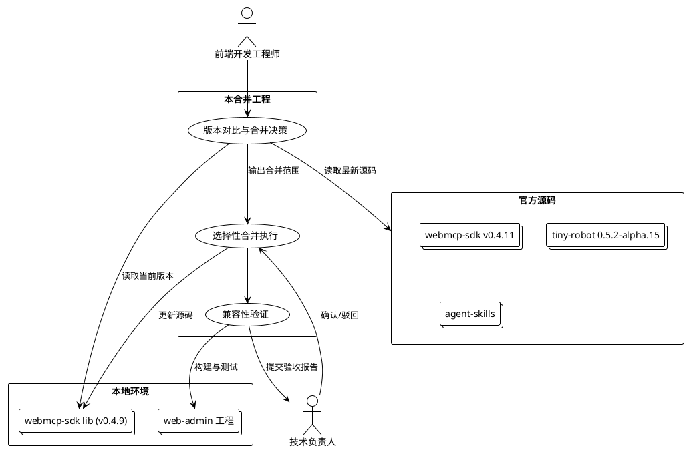
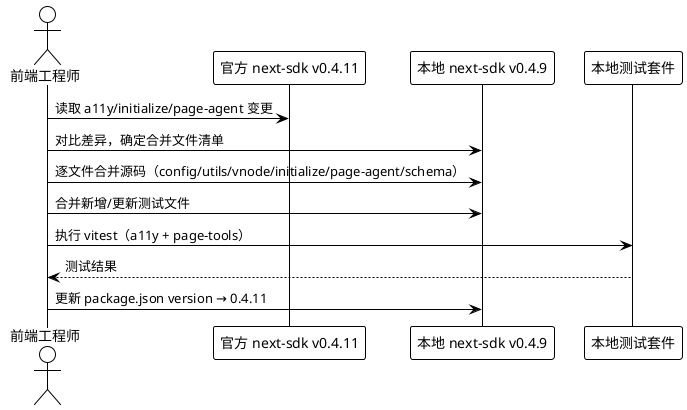
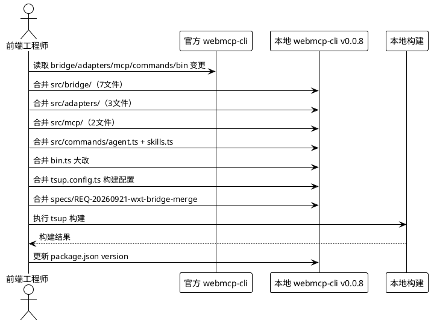
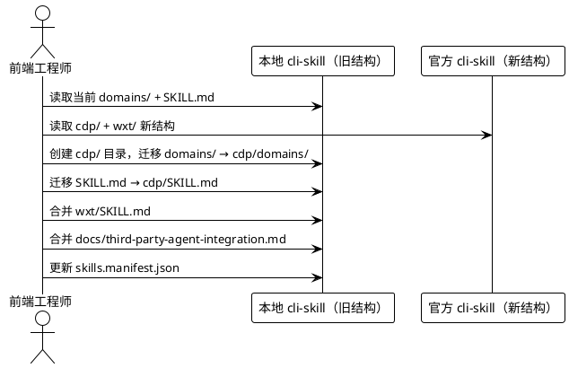
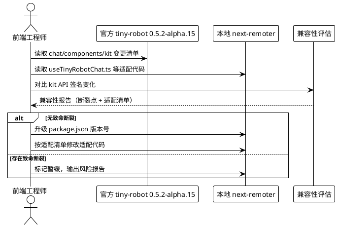
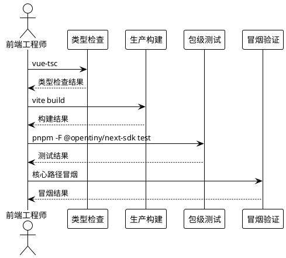

# OpenTiny 技术栈官方版本同步合并

# **0. 版本事实复核与待确认项（2026-09-24 复核）**

> 本节为 2026-09-24 对照 `gitUpdate.md` 与本地/官方仓库**实际版本**后的勘误与决策点，优先级高于下文 §1~§6 中与之冲突的版本表述。下文仍有若干处沿用旧假设（tiny-robot 0.5.2-alpha.15），**一律以本节为准**。

## **0.1 版本事实核对表**

| 包 / 依赖 | 本地（src/lib/webmcp-sdk） | 官方（git pulled，dev 分支 head 47a2b03） | 结论 |
|---|---|---|---|
| next-sdk | 0.4.9 | **0.4.11** | 落后 2 个小版本，需合并源码 |
| next-remoter | 0.4.9 | **0.4.11** | 同上 |
| webmcp-cli | 0.0.8 | **0.0.9** | 落后 1 个补丁版本（非原 §6.1.3 所写"待确认"） |
| webmcp-cli-skill | 1.0.0 | 1.0.0（仅结构重组） | 版本号不变，目录重组 |
| next-wxt | 0.0.6 | 0.0.6 | 本回未变更 |
| @opentiny/tiny-robot（web-admin 直接依赖） | **0.5.1**（精确锁定） | 官方 webmcp-sdk `pnpm-workspace.yaml` catalog 钉 **0.3.1-alpha.6** | **方向相反**：官方 catalog 比本地更旧 |
| @opentiny/tiny-robot（官方仓库各子包 version） | — | chat/kit/components 子包均为 **0.5.1**，最新 tag `v0.5.1` | 官方仓库自身无 0.5.2 发布 |

## **0.2 三项勘误（修正原 spec 假设）**

1. **tiny-robot 目标版本"0.5.2-alpha.15"不存在**。该字符串仅出现在 `agent-skills` 仓库的**资产目录名** `webmcp-next-0.4.11-tinyrobot-0.5.2-alpha.15/`（agent-skills 集成用的快照），**不是 tiny-robot 的发布版本**。tiny-robot 官方最新 tag 为 `v0.5.1`。原 spec/design/tasks 中"升级 0.5.1 → 0.5.2-alpha.15"的前提不成立，相关 P2 任务（T401~T403）降级为"待定"，见 §5.4 修订。
2. **"跟随官方主版本"对 tiny-robot 实际意味着降级**。官方 webmcp-sdk 的 `pnpm-workspace.yaml` catalog 将 tiny-robot 钉在 `0.3.1-alpha.6`，比我们本地运行的 `0.5.1` 还旧。盲目照搬官方 `package.json` 会把 tiny-robot 降到 0.3.1-alpha.6，几乎必然破坏基于 0.5.1 的适配代码。**建议：tiny-robot 保持 0.5.1 不动，仅合并 webmcp-sdk 源码并验证其在 0.5.1 下的兼容性**（见 §5.4）。
3. **webmcp-cli 官方版本为 0.0.9**（非"待确认"），合并后版本号应对齐 0.0.9。

## **0.3 合并技术陷阱：官方 `catalog:` 依赖引用**

官方 `packages/next-remoter/package.json` 与 `next-sdk/package.json` 的所有依赖均使用 **`catalog:` 协议**（如 `"@opentiny/tiny-robot": "catalog:"`），版本号定义在官方 `pnpm-workspace.yaml` catalog（其中 tiny-robot = 0.3.1-alpha.6）。而：

- 本地 `next-remoter/next-sdk` 使用**显式精确版本**（tiny-robot 0.5.1 等）；
- `web-admin/web` 通过 `file:` 依赖消费这两个包（package.json 第 39~40 行），且 `web-admin/web` **没有** `pnpm-workspace.yaml`（无 catalog）；
- 本地 `src/lib/webmcp-sdk/pnpm-workspace.yaml` 的 catalog 把 tiny-robot 钉在 0.5.1。

→ **若直接照搬官方 `package.json`（`catalog:` 引用）到本地 vendored 副本，web-admin 的 `pnpm install` 会因无法解析 `catalog:` 而失败**。合并策略必须将官方 `catalog:` 引用**翻译为本地等效的显式版本**（tiny-robot/vue/ai 等保持本地当前值，且不引入 genui-sdk/next 等本地未使用的依赖），严禁整文件替换 package.json。详见 §5.6。

## **0.4 agent-skills 仓库变更（原 P3 暂缓，建议重新评估）**

`gitUpdate.md` 显示 `opentiny/agent-skills` 本回同步了 **20 个文件**（非 trivial），与 WebMCP 集成强相关的有：
- `skills/opentiny-next-app-integration/assets/.../webmcp/web-skills.ts`（新增）、`webmcp-adapter.ts`(+20)、`webmcp-tool-plugin.ts`(+64，新增)、`webmcp-types.ts`（100% 重命名）
- `pagetool/action-policy.ts`(+10)、`pagetool-init.ts`(+6)
- `references/webmcp-business-skill.md`(+76)、`opentiny-integration.md`(+87)、`genui-*`(+27/+77)、`pagetool-automation.md`(+21)
- `useDeferredConversationRuntime.ts`(+31，新增)

这些定义"WebMCP 如何接入 Agent"的集成技能，与本 runtime（agentskills-runtime）直接相关。原 spec 仅在 §6.2 P3 一笔带过。鉴于本项目定位，**建议单独评估 agent-skills 集成文件是否需同步到 runtime 的技能加载路径**，而非默认暂缓。详见 §5.7。

## **0.5 genui-sdk 同步状态提示**

`gitUpdate.md` 显示 `genui-sdk` 的 `git pull` 因本地 `GenuiChat.vue` 改动会被覆盖而**中止**，随后从 atomgit **重新 clone** 了整仓。这意味着原 spec §1.2.4 / §1.4.2 所述"本地 GenuiChat.vue 自定义修改冲突"状态可能已因重新 clone 而改变（本地自定义改动可能已被覆盖）。genui-sdk 仍排除在本合并组件范围外，但如其后续纳入，需先重新确认本地改动现状。

## **0.6 决策结果（2026-09-25 人工确认，已闭环）**

| 编号 | 决策 | 结果 |
|---|---|---|
| **D1** | tiny-robot 版本 | ✅ **保持 0.5.1 不变**（不升级、不降到 0.3.1-alpha.6） |
| **D2** | webmcp-cli 版本 | ✅ **对齐 0.0.9** |
| **D3** | agent-skills 纳入范围 | ✅ 以"技能整包复制"方式闭环（见 §0.7 原则 6）：agent-skills 的 5 个技能复制到三个技能库目录；**不**将其集成资产合并进 webmcp-sdk lib |
| **D4** | 合并方式 | ✅ **仅做"选择性源码合并 + package.json 版本号/依赖翻译"，禁止整文件替换/覆盖** |
| **D5** | 新增 | ✅ **需集成最新版 genui-sdk 到 lib**（见 §5.8 方案） |

## **0.7 更新原则（人工确认，执行时须严格遵守）**

1. **逐文件源码级手动合并，禁止文件覆盖**。参照 `specs/opentiny_version_sync/gitUpdate.md`（524 行，与 `apps/web-admin/web/log/gitUpdate.md` 同源）的版本更新记录，**逐个文件**分析官方 diff 后在本地源码上手工施加变更；**不允许**直接用官方文件覆盖本地文件。`package.json` 仅做 version 与依赖版本号的"翻译式"修改。
2. **以本地 lib 自身管理的依赖为准**。不考量、不引入官方的依赖管理方式——官方 `package.json` 的 `catalog:` 引用一律不采纳，须翻译为本地显式版本（详见 §5.6）。
3. **genui-sdk 需集成**：研究并给出最新版 genui-sdk 集成到本地 lib 的方案（见 §5.8）。
4. **tiny-robot 保持 0.5.1**（D1）。
5. **webmcp-cli 对齐 0.0.9**（D2）。
6. **agent-skills 技能整包复制**：`D:\UCT\products\gitcode\opentiny\agent-skills\skills\` 下的最新版本技能，直接复制到以下三处各一份：
   - workbuddy 技能库：`C:\Users\patrick\.workbuddy\skills\`
   - `apps\agentskills-runtime\skills\`
   - `.codeartsdoer\skills\`
   涉及 5 个技能：`opentiny-next-app-integration`、`tiny-robot-skill`、`tiny-vue-skill`、`webmcp-cli-skill`、`webmcp-sdk-skill`。

# **1. 组件定位**

## **1.1 核心职责**
本组件负责将 OpenTiny 官方最新版本（webmcp-sdk v0.4.11、tiny-robot 0.5.2-alpha.15 等）的更新选择性合并到本地 webmcp-sdk 开发目录，实现本地依赖与官方主版本的受控同步。

## **1.2 核心输入**
1. 官方 git 更新记录：`apps/web-admin/web/log/gitUpdate.md`，记录了 agent-skills、docs、genui-sdk、tiny-robot、webmcp-sdk 五个仓库的 git pull 差异
2. 本地开发依赖目录：`apps/web-admin/web/src/lib/webmcp-sdk/`，当前锁定在 next-sdk v0.4.9、next-remoter v0.4.9、webmcp-cli v0.0.8、tiny-robot 0.5.1
3. 官方最新源码：已 git clone 到本地的 `D:\UCT\products\gitcode\opentiny\` 下各仓库
4. 本地自定义修改：next-remoter 中基于 tiny-robot **0.5.1** 的适配代码（useTinyRobotChat.ts、usePlugin.ts、useSkill.ts 等）。注：genui-sdk 中 GenuiChat.vue 的本地改动状态见 §0.5——本回同步时该仓因 pull 冲突被重新 clone，本地自定义改动可能已被覆盖，需重新确认。

## **1.3 核心输出**
1. 合并后的本地 webmcp-sdk 目录：`apps/web-admin/web/src/lib/webmcp-sdk/` 各子包源码更新至目标版本
2. 合并决策记录：spec.md / design.md / tasks.md 三件套，记录合并范围、优先级与验收标准
3. 兼容性验证报告：合并后本地构建与测试的通过情况
4. 版本号更新：各 package.json 的 version 字段同步至官方目标版本

## **1.4 职责边界**
1. 本组件**不负责**重新设计或重写官方已提供的功能，仅做版本同步与适配
2. 本组件**不负责** genui-sdk 仓库的合并（该仓库本地存在 GenuiChat.vue 自定义修改冲突，需单独处理，仅在本规格中标注风险）
3. 本组件**不负责** docs 仓库的 VitePress 文档站点同步（仅涉及 tiny-vue 3.32.0 版本号对齐，属琐碎变更）
4. 本组件**不负责**修改本地业务代码（web-admin 的 store/models、页面组件等），仅更新 lib 依赖层
5. 本组件**不负责**数据库变更或后端 Java 工程改动

# **2. 领域术语**

**webmcp-sdk**
: OpenTiny 官方前端智能应用开发工具包 monorepo，包含 next-sdk、next-remoter、webmcp-cli、webmcp-cli-skill、next-wxt 等子包。

**next-sdk**
: webmcp-sdk 中的核心 SDK 包，提供浏览器内置 WebMCP 桥接、page-agent-tool、a11y 无障碍树、Agent 模型提供者等能力。

**next-remoter**
: webmcp-sdk 中的 Vue3 聊天 UI 包，基于 tiny-robot 构建 AI 对话界面，是本地 web-admin 直接消费的组件层。

**webmcp-cli**
: webmcp-sdk 中的命令行工具包，通过 Puppeteer 注入浏览器并与 AI Agent 交互。

**tiny-robot**
: OpenTiny 官方 AI 聊天组件库，包含 chat、components、kit 等子包，是 next-remoter 的上游依赖。

**a11y**
: 无障碍可访问性（Accessibility）的缩写，指 page-agent-tool 中基于 DOM 构建无障碍树、搜索元素、序列化的能力。

**bridge 架构**
: webmcp-cli v0.4.11 引入的 wxt 桥接架构，包含 daemon 守护进程、bridge-client 通信客户端、bash-executor 命令执行器等，用于支持浏览器扩展（wxt）场景下 CLI 与浏览器的桥接通信。

**cdp / wxt 适配器**
: webmcp-cli 新增的适配器层，cdp-adapter 面向 Chrome DevTools Protocol 场景，wxt-adapter 面向浏览器扩展（WebExtension）场景，通过 interface.ts 统一抽象。

**contenteditable a11y 重构**
: 官方 spec REQ-20260904-contenteditable-a11y-ref 引入的无障碍树对 contenteditable 元素的处理重构，影响 a11y/config.ts、utils.ts、vnode.ts 的可观察语义。

**Spec 三件套**
: 官方 AGENTS.md 规范驱动开发要求的 requirements.md + design.md + tasks.md 文档组，非琐碎功能变更必须先建 Spec 再实现。

# **3. 角色与边界**

## **3.1 核心角色**
- **前端开发工程师**：执行版本合并、适配修改、构建验证与回归测试
- **技术负责人**：审核合并范围与优先级决策，确认兼容性验收结果

## **3.2 外部系统**
- **官方 webmcp-sdk 仓库**（github.com/opentiny/webmcp-sdk）：提供 next-sdk、next-remoter、webmcp-cli、webmcp-cli-skill 的最新源码
- **官方 tiny-robot 仓库**（gitcode.com/opentiny/tiny-robot）：提供 chat、components、kit 子包的最新源码
- **官方 agent-skills 仓库**（github.com/opentiny/agent-skills）：提供 webmcp 适配器、web-skills、pagetool 等集成技能文件
- **本地 web-admin 工程**：消费 webmcp-sdk lib 层的上层应用，合并后需保证其构建与运行不受破坏

## **3.3 交互上下文**



# **4. DFX约束**

## **4.1 性能**
1. 合并后 next-sdk 构建产物体积增量不得超过 20%（相对 v0.4.9 基线）
2. 合并后 next-remoter 首屏加载不得引入新的同步阻塞型依赖
3. webmcp-cli bridge 架构的 daemon 启动时间不得超过 3 秒

## **4.2 可靠性**
1. 合并后本地 web-admin 工程的 `vue-tsc` 类型检查必须零错误通过
2. 合并后本地 web-admin 工程的 `vite build` 生产构建必须成功
3. 合并后 next-sdk 包级 `vitest` 测试必须全部通过（含官方新增的 a11y、initialize-builtin-WebMCP、page-agent-tool 测试）
4. 合并不得引入运行时回归：page-agent-tool 的 DOM 操作、a11y 树构建、WebMCP 初始化等核心路径行为与官方 v0.4.11 一致

## **4.3 安全性**
1. 合并前必须审查 webmcp-cli bridge 架构新增代码，确认无未授权的网络外联、无 shell 注入风险（bash-executor 的命令拼接需审查）
2. daemon 进程的 IPC 通信协议需确认仅限本地回环，不暴露远程调用面

## **4.4 可维护性**
1. 合并后的代码必须保留官方 AGENTS.md 规范约束，Spec 目录结构与官方一致
2. 合并范围必须有 design.md 记录技术方案、tasks.md 记录执行清单，供后续追溯
3. 本地相对官方的差异化修改必须显式标注（注释或 diff 记录），不得静默偏离

## **4.5 兼容性**
1. 合并后 next-remoter 对 tiny-robot 的依赖版本升级（0.5.1 → 0.5.2-alpha.15）必须保证本地 useTinyRobotChat.ts 等适配代码的 API 兼容
2. webmcp-cli 的 bridge 架构为新增能力，不得破坏现有 cdp 场景（Puppeteer）的命令行行为
3. webmcp-cli-skill 目录重组（domains/ → cdp/domains/ + wxt/）必须保证现有 skill 引用路径的可发现性
4. next-sdk 的 a11y 重构不得破坏现有 page-agent-tool 的工具协议与返回结构

# **5. 核心能力**

## **5.1 next-sdk 核心更新合并**

### **5.1.1 业务规则**
1. **a11y contenteditable 重构合并**：必须合并官方 spec REQ-20260904-contenteditable-a11y-ref 引入的 a11y/config.ts、a11y/utils.ts、a11y/vnode.ts 变更，使本地无障碍树对 contenteditable 元素的处理语义与官方 v0.4.11 一致
   a. 验收条件：[合并后对含 contenteditable 的页面执行 buildA11yTree] → [树结构与官方 v0.4.11 行为一致，本地已有 a11y/build.test.ts、a11y/config.test.ts 通过]
2. **initialize-builtin-WebMCP 大改合并**：必须合并 initialize-builtin-WebMCP.ts 的 149 行变更，保证 WebMCP 初始化（polyfill 注入、桥接、forcePolyfill 默认行为）与官方一致
   a. 验收条件：[合并后调用 initializeBuiltinWebMCP()] → [初始化行为与官方 v0.4.11 一致，initialize-builtin-WebMCP.test.ts 通过]
3. **page-agent-tool 更新合并**：必须合并 page-agent-tool.ts 的 18 行变更及 schema.ts 的 2 行变更
   a. 验收条件：[合并后执行 page-agent 工具调用] → [工具协议与返回结构与官方一致，page-agent-tool.test.ts 通过]
4. **SKILL.md 同步**：应当合并 skills/page-agent/SKILL.md 的 5 行文档更新，保持编码 Agent Skill 指引与官方一致
   a. 验收条件：[查阅合并后的 SKILL.md] → [内容与官方 v0.4.11 一致]
5. **禁止项**：禁止在合并 a11y 重构时遗漏官方新增的测试文件（a11y/build.test.ts、a11y/config.test.ts），测试是合并的必要组成部分
   a. 验收条件：[合并完成后检查 test/page-tools/a11y/ 目录] → [build.test.ts 与 config.test.ts 均存在且通过]

### **5.1.2 交互流程**


### **5.1.3 异常场景**
1. **a11y 测试失败**
   a. 触发条件：合并后 a11y/build.test.ts 或 config.test.ts 不通过
   b. 系统行为：停止合并流程，排查本地 DOM 环境与官方测试用例的差异
   c. 用户感知：测试报告显示失败用例及差异原因
2. **initialize-builtin-WebMCP 行为回归**
   a. 触发条件：合并后 WebMCP 初始化在本地浏览器环境报错或 polyfill 注入失败
   b. 系统行为：回滚 initialize-builtin-WebMCP.ts，对比本地浏览器环境与官方测试环境的差异
   c. 用户感知：构建或运行时错误日志，提示 polyfill 相关错误
3. **page-agent-tool 协议不兼容**
   a. 触发条件：合并后上层 web-admin 调用 page-agent-tool 时参数或返回结构不匹配
   b. 系统行为：排查 schema.ts 变更对上层调用的影响，必要时适配上层代码
   c. 用户感知：运行时工具调用错误，提示 schema 校验失败

## **5.2 webmcp-cli bridge 架构合并**

### **5.2.1 业务规则**
1. **bridge 模块合并**：必须合并官方新增的 src/bridge/ 目录全部文件（bash-executor.ts、bridge-client.ts、daemon.ts、directory-picker.ts、protocol.ts、types.ts、workspace-manager.ts），引入 wxt 桥接通信能力
   a. 验收条件：[合并后检查 src/bridge/ 目录] → [7 个文件均存在，bridge-client.test.ts、daemon.test.ts、bash-executor.test.ts、directory-picker.test.ts、workspace-manager.test.ts 通过]
2. **adapters 模块合并**：必须合并 src/adapters/ 目录（cdp-adapter.ts、interface.ts、wxt-adapter.ts），建立 cdp/wxt 统一适配器抽象
   a. 验收条件：[合并后检查 src/adapters/ 目录] → [3 个文件均存在，interface.ts 定义统一适配器接口]
3. **mcp 模块合并**：必须合并 src/mcp/ 目录（server.ts、tools.ts），引入 MCP 服务端能力
   a. 验收条件：[合并后检查 src/mcp/ 目录] → [server.ts 与 tools.ts 均存在]
4. **commands 扩展合并**：必须合并 src/commands/agent.ts 与 src/commands/skills.ts，扩展 CLI 命令
   a. 验收条件：[合并后执行 webmcp-cli agent/skills 子命令] → [命令可识别并执行]
5. **bin.ts 大改合并**：必须合并 bin.ts 的 220 行变更，对接 bridge 架构入口
   a. 验收条件：[合并后执行 webmcp-cli --help] → [帮助信息包含 bridge 相关新命令/选项]
6. **Spec 合并**：应当合并官方 spec REQ-20260921-wxt-bridge-merge（requirements.md、design.md、tasks.md），保留官方规范记录
   a. 验收条件：[合并后检查 specs/REQ-20260921-wxt-bridge-merge/ 目录] → [三件套均存在]
7. **禁止项**：禁止合并 bridge 架构时遗漏 tsup.config.ts 的构建配置变更（28 行），否则 bridge 模块无法正确打包
   a. 验收条件：[合并后执行 pnpm build] → [bridge 相关产物正确生成]

### **5.2.2 交互流程**


### **5.2.3 异常场景**
1. **bridge daemon 启动失败**
   a. 触发条件：合并后 daemon.ts 启动报错（端口占用、IPC 通道建立失败）
   b. 系统行为：排查本地 Node.js 环境版本与 IPC 机制兼容性
   c. 用户感知：CLI 错误日志，提示 daemon 启动失败原因
2. **bash-executor 安全风险**
   a. 触发条件：审查发现 bash-executor.ts 存在未转义的用户输入拼接 shell 命令
   b. 系统行为：标记安全风险，要求人工审查后方可合并该文件
   c. 用户感知：安全审查报告，提示注入风险及建议修复方案
3. **现有 cdp 命令行为回归**
   a. 触发条件：合并后现有 Puppeteer（cdp）场景的 CLI 命令（run、tabs、state、clipboard）行为变化
   b. 系统行为：对比 cdp-adapter.ts 与原有 browser.ts 的行为差异，必要时保留兼容路径
   c. 用户感知：CLI 命令执行结果与合并前不一致

## **5.3 webmcp-cli-skill 目录重组**

### **5.3.1 业务规则**
1. **cdp/wxt 分离重组**：必须将现有 domains/ 目录迁移至 cdp/domains/，与官方结构对齐
   a. 验收条件：[合并后检查目录结构] → [cdp/domains/ 包含全部原有 domain 文件，根目录 domains/ 不再存在]
2. **wxt/SKILL.md 新增**：必须合并官方新增的 wxt/SKILL.md（188 行），引入浏览器扩展场景的技能指引
   a. 验收条件：[合并后检查 wxt/SKILL.md] → [文件存在且内容与官方一致]
3. **cdp/SKILL.md 迁移**：必须将根目录 SKILL.md 迁移至 cdp/SKILL.md，与官方重组一致
   a. 验收条件：[合并后检查 cdp/SKILL.md] → [文件存在，根目录 SKILL.md 已移除]
4. **第三方集成文档合并**：应当合并官方新增的 docs/third-party-agent-integration.md（313 行）
   a. 验收条件：[合并后检查 docs/third-party-agent-integration.md] → [文件存在]
5. **禁止项**：禁止在目录重组后遗漏 skills.manifest.json 的同步更新（8 行变更），否则技能同步脚本无法发现新结构
   a. 验收条件：[合并后执行 skills:sync] → [cdp 与 wxt 技能均被正确发现]

### **5.3.2 交互流程**


### **5.3.3 异常场景**
1. **技能引用路径断裂**
   a. 触发条件：目录重组后上层代码或配置仍引用旧路径 domains/xxx.md
   b. 系统行为：全局搜索旧路径引用，更新至 cdp/domains/xxx.md
   c. 用户感知：技能加载失败，提示文件不存在
2. **skills:sync 脚本不兼容**
   a. 触发条件：skills-sync.mjs 的 5 行变更未合并，导致脚本无法识别新目录结构
   b. 系统行为：合并 scripts/skills-sync.mjs 变更
   c. 用户感知：技能同步命令报错或遗漏技能

## **5.4 tiny-robot 版本升级**

### **5.4.1 业务规则**
1. **版本号策略（待人工决策 D1，见 §0.6）**：tiny-robot 目标版本**不应是 0.5.2-alpha.15**（该版本不存在，仅为 agent-skills 资产目录名，详见 §0.2）。当前本地锁定 0.5.1，而官方 webmcp-sdk 的 catalog 钉的是更旧的 0.3.1-alpha.6。
   a. **推荐策略**：tiny-robot 保持 **0.5.1 不动**，仅合并 webmcp-sdk 源码（next-sdk/next-remoter/webmcp-cli）并验证其在 0.5.1 下的兼容性；next-remoter/package.json 中的三个 tiny-robot 依赖维持 0.5.1 精确版本。
   b. 验收条件：[合并后检查 next-remoter/package.json] → [三个 tiny-robot 依赖版本仍为 0.5.1，且 vue-tsc / vite build 通过]
   c. **禁止项**：禁止照搬官方 package.json 的 `catalog:` 引用（详见 §5.6），禁止将 tiny-robot 降到 0.3.1-alpha.6。
2. **chat 组件包评估**：应当评估官方新增的 packages/chat/ 是否需要合并到本地（本地 next-remoter 是否直接消费 chat 包，还是通过 kit 间接消费）
   a. 验收条件：[分析 next-remoter 对 tiny-robot 的依赖路径] → [明确 chat 包是否为直接依赖，输出合并/不合并结论]
3. **kit 核心变更兼容评估**：必须评估 packages/kit/src/message/plugins/toolPlugin.ts（+959行）、skillPlugin.ts（+403行）、core/engine.ts（+478行）的大改对本地 next-remoter 适配代码（useTinyRobotChat.ts、usePlugin.ts 等）的 API 兼容性
   a. 验收条件：[对比本地 useTinyRobotChat.ts 调用的 kit API 与官方 0.5.2-alpha.15 的 API 签名] → [输出兼容性报告，标注需适配的断裂点]
4. **turnPersistence 新增评估**：应当评估 packages/kit/src/message/core/turnPersistence.ts（213行）是否为本地所需能力
   a. 验收条件：[分析 turnPersistence 的职责与本地会话持久化需求] → [输出合并/不合并结论]
5. **禁止项**：禁止在未完成 API 兼容性评估的情况下直接升级 tiny-robot 版本号，必须先评估再升级
   a. 验收条件：[版本号升级前] → [兼容性评估报告已产出且无致命断裂点]

### **5.4.2 交互流程**


### **5.4.3 异常场景**
1. **kit API 断裂导致编译失败**
   a. 触发条件：tiny-robot 升级后 next-remoter 的 useTinyRobotChat.ts 等文件 vue-tsc 报错
   b. 系统行为：根据兼容性报告逐个适配断裂 API，若无法适配则回滚版本号
   c. 用户感知：类型检查错误日志，提示具体断裂的 API 调用
2. **运行时行为回归**
   a. 触发条件：升级后 AI 对话的消息流处理、工具调用、技能插件行为与 0.5.1 不一致
   b. 系统行为：对比 toolPlugin/skillPlugin 的行为变更，定位回归点
   c. 用户感知：对话功能异常（工具不触发、消息流中断等）
3. **alpha 版本稳定性风险**
   a. 触发条件：0.5.2-alpha.15 为预发布版本，可能存在未稳定的 API
   b. 系统行为：在 design.md 中标注 alpha 风险，建议锁定确切版本而非范围
   c. 用户感知：风险提示，建议关注官方正式版发布

## **5.5 兼容性验证与回归测试**

### **5.5.1 业务规则**
1. **类型检查门禁**：合并完成后必须执行 `vue-tsc` 类型检查且零错误
   a. 验收条件：[合并完成后在 web-admin/web 执行 vue-tsc] → [退出码 0，无类型错误]
2. **生产构建门禁**：合并完成后必须执行 `vite build` 生产构建且成功
   a. 验收条件：[合并完成后在 web-admin/web 执行 vite build] → [构建成功，产物生成]
3. **包级测试门禁**：合并完成后必须执行 next-sdk 包级 `vitest` 且全部通过
   a. 验收条件：[在 next-sdk 包执行 pnpm test] → [全部用例通过，含官方新增测试]
4. **核心路径冒烟验证**：应当对 page-agent-tool 的 DOM 操作、a11y 树构建、WebMCP 初始化、AI 对话消息流等核心路径进行冒烟验证
   a. 验收条件：[在本地浏览器环境执行核心路径操作] → [行为与合并前一致或符合官方 v0.4.11 预期]
5. **禁止项**：禁止在类型检查或构建未通过的情况下声明合并完成
   a. 验收条件：[声明合并完成前] → [vue-tsc 与 vite build 均已通过]

### **5.5.2 交互流程**


### **5.5.3 异常场景**
1. **类型检查失败**
   a. 触发条件：vue-tsc 报告类型错误
   b. 系统行为：逐个修复类型错误，若为官方 API 变更导致则适配本地代码
   c. 用户感知：类型错误清单及修复状态
2. **生产构建失败**
   a. 触发条件：vite build 报错（依赖解析失败、打包错误等）
   b. 系统行为：排查依赖版本冲突、构建配置变更，修复后重新构建
   c. 用户感知：构建错误日志及修复状态
3. **包级测试失败**
   a. 触发条件：vitest 报告失败用例
   b. 系统行为：区分官方新增测试失败（环境差异）与本地已有测试失败（回归），分别处理
   c. 用户感知：测试报告，区分新增失败与回归失败

## **5.6 合并技术约束：禁止照搬官方 `package.json`（`catalog:` 陷阱）**

### **5.6.1 业务规则**
1. **依赖引用翻译**：合并 next-sdk / next-remoter 的 `package.json` 时，必须将官方 `catalog:` 引用**逐条翻译为本地等效的显式版本**，不得整文件替换。官方 next-remoter 全部依赖均为 `catalog:`（见 §0.3），直接复制会导致 web-admin `pnpm install` 因无法解析 `catalog:` 而失败。
   a. 验收条件：[合并后 diff next-remoter/package.json] → [无任何 `catalog:` 字样，tiny-robot/vue/ai 等依赖版本与本地当前值一致]
2. **禁止引入本地未使用依赖**：官方 next-remoter 额外依赖 `@opentiny/genui-sdk`、`@opentiny/genui-sdk-vue`、`@opentiny/next` 等本地未使用的包（见 §0.3 分析）。合并时应**剔除**这些依赖，避免引入 genui-sdk（本组件明确排除，见 §1.4.2）。
   a. 验收条件：[合并后 next-remoter/package.json] → [不包含 genui-sdk / next / 等本地未声明的依赖]
3. **版本号对齐**：next-sdk、next-remoter 的 `version` 字段更新为 0.4.11；webmcp-cli 更新为 0.0.9（见 §0.1/§0.2）。tiny-robot 依赖保持 0.5.1（见 §5.4）。
   a. 验收条件：[合并后各 package.json version 字段] → [next-sdk/next-remoter=0.4.11，webmcp-cli=0.0.9，tiny-robot 依赖=0.5.1]

### **5.6.2 异常场景**
1. **pnpm install 失败（catalog 无法解析）**
   a. 触发条件：合并时误将官方含 `catalog:` 的 package.json 整文件覆盖本地
   b. 系统行为：回滚 package.json，按 §5.6.1.1 逐条翻译依赖后重试
   c. 用户感知：`pnpm install` 报 `catalog: protocol is not supported` 或依赖解析错误

## **5.7 agent-skills 集成文件变更评估（建议单列，非默认暂缓）**

### **5.7.1 业务规则**
1. **变更范围**：`gitUpdate.md` 显示 `opentiny/agent-skills` 本回同步 20 个文件，核心是 `skills/opentiny-next-app-integration/assets/.../webmcp/` 下新增的 `web-skills.ts`、`webmcp-tool-plugin.ts`、`webmcp-adapter.ts`(+20)、`webmcp-types.ts`（重命名），以及 `pagetool/*`、`references/*`（opentiny-integration +87、webmcp-business-skill +76、genui-* 等）、`useDeferredConversationRuntime.ts`(+31)。这些定义"WebMCP 如何接入 Agent"，与本 runtime 直接相关。
2. **评估结论（建议）**：原 §6.2 P3「暂缓合并」不足以覆盖其重要性。建议将其**单列为一个独立的评估批次**（不在 webmcp-sdk lib 目录合并范围内，而是评估是否需同步到 runtime 的技能加载路径/Business Skill 注册逻辑）。在 D3（§0.6）决策前，本合并组件不对其执行文件合并。
3. **依赖关系澄清**：agent-skills 是独立 skills 仓库，其产物不被 vendored 进 `src/lib/webmcp-sdk`；它与本合并组件的边界是"webmcp-sdk 提供 SDK，agent-skills 提供集成技能"。两者通过 WebMCP 协议衔接，不存在源码级依赖，故可独立决策。

### **5.7.2 待人工决策**
- 是否将 agent-skills 的 webmcp 集成文件纳入本次同步（决策点 D3，§0.6）？
- 若纳入，应同步到 runtime 的哪个路径（技能加载 / Business Skill 注册）？需结合 agentskills-runtime 当前的技能挂载机制确认。

## **5.8 genui-sdk 集成方案（2026-09-25 研究结论）**

### **5.8.1 本地 lib 现状核查**

| 项 | 状态 |
|---|---|
| `node_modules/@opentiny/genui-sdk` | 存在，版本 **0.0.1-alpha.2**；但为**传递安装**，未在任何 package.json 声明、不在 `packages/` 工作区 → **未受管** |
| `node_modules/@opentiny/genui-sdk-vue` | **实际不可用**（pnpm 符号链接断裂/未安装，`cat package.json` 失败）→ 这是本地无法渲染 GenUI 的直接原因 |
| 本地已有 GenUI 配套代码 | `GenUISwitch.vue`、`config/genui-config.ts`、`composable/handleSchema.ts`（从流中提取 schema）、`shims/tiny-robot-kit-shim.ts`（为 genui-sdk-vue@1.0.0-beta.1 补齐 `GeneratingStatus` 枚举） |
| **能力缺口** | 官方 `TinyRobotChat.vue:119` 有 `import { GenuiRenderer } from '@opentiny/genui-sdk-vue'`；**本地 TinyRobotChat.vue 没有该 import** → 本地只有开关、**不能真正渲染生成式 UI** |

### **5.8.2 官方最新版形态（`D:\UCT\products\gitcode\opentiny\genui-sdk`，head a9c229c8）**

- `packages/core` → `@opentiny/genui-sdk-core` **0.0.1**（63 文件 / 245K），依赖全为普通 npm 包（flat、jsondiffpatch、jsonrepair、radash、zod、zod-to-json-schema）→ 易 vendor。
- `packages/frameworks/vue` → `@opentiny/genui-sdk-vue` **1.0.0**（59 文件 / 306K）。
- 官方 webmcp-sdk catalog 仍在用**旧组合**：`genui-sdk 0.0.1-alpha.2` + `genui-sdk-vue 1.0.0-beta.1`。

### **5.8.3 关键冲突点（与本地口径的落差）**

`frameworks/vue` 的依赖声明与本地锁定值冲突：
- `@opentiny/tiny-robot*` 声明 **0.3.3** vs 本地锁定 **0.5.1**（D1 明确保持 0.5.1，不可让步）；
- `@opentiny/vue*` 声明 **~3.31.0** vs 本地 `@opentiny/vue ^3.27.0`；
- 依赖 `workspace:*` 引用 `@opentiny/genui-sdk-core` 与 `@opentiny/genui-sdk-materials-vue-opentiny-vue` → 二者也需一并 vendor。

### **5.8.4 候选方案**

| 方案 | 做法 | 优点 | 风险 |
|---|---|---|---|
| **A（推荐主线）** | 将官方 `packages/core` + `packages/frameworks/vue`（+ 所需 materials）源码 vendor 进 `src/lib/webmcp-sdk/packages/genui-sdk-core`、`packages/genui-sdk-vue`；`workspace:*` → `file:`；依赖按本地口径翻译（tiny-robot 保持 0.5.1、vue 对齐本地） | 符合原则 2（lib 自管依赖）与既有 vendor 模式（同 next-sdk/next-remoter） | 需实测 GenuiRenderer 在 tiny-robot 0.5.1 + vue 3.27 下是否可用 |
| **B（快速回退）** | 以本地依赖管理直接安装发布版 `@opentiny/genui-sdk-vue@1.0.0-beta.1`（与本地 shim 注释匹配的版本） | 快、无源码冲突 | 源码不在 lib 内、不受我们管理 |
| **C（最小改动）** | 仅修复已断裂的 genui-sdk-vue 依赖使其可用，暂不接 `GenuiRenderer` | 风险最低 | 仍无实际渲染能力 |

**推荐路径**：以方案 A 为主线，但**先做可行性验证**——确认 `frameworks/vue` 在 tiny-robot 0.5.1 + vue 3.27 下能否构建/运行；若冲突不可解则退到方案 B。
**配套改动**：本地 `TinyRobotChat.vue` 需**源码级手工**加入 `GenuiRenderer` 的引入与渲染分支（严禁覆盖该文件——该文件此前已修过 `linkifyTextNodes` 的 `m[1]` bug，覆盖会回退修复）。

### **5.8.5 方案 A 可行性验证结论（2026-09-25 实测）**

**结论：方案 A 可行，但必须采用「renderer-only 切片」，不能整包 vendor `frameworks/vue`。**

#### 验证 1：官方 genui 集成代码与 tiny-robot 0.5.1 不兼容（解释了本地当初为何移除）

官方 `next-remoter@0.4.11` 的 `TinyRobotChat.vue` 有两处 0.5.1 下**必然失败**的引用：

| 官方代码 | 位置 | 0.5.1 实测结果 |
|---|---|---|
| `import { BubbleMarkdownContentRenderer } from '@opentiny/tiny-robot'` | 官方 99~117 行 import 块 | ❌ **0.5.1 无此导出**。全包检索仅 `dist/index6.js` 内有已改名的 `BubbleMarkdownRenderer`，而 `dist/index.js`（main）与 `dist/index.d.ts`（5533 行）**均无** `BubbleMarkdown*` → 属未导出的内部死代码 |
| `import { GeneratingStatus, STATUS } from '@opentiny/tiny-robot-kit'` | 官方 120 行 | ⚠️ 0.5.1 已移除，但**本地 shim 已补齐**（`next-remoter/src/shims/tiny-robot-kit-shim.ts`） |

→ 这印证了本地 `TinyRobotChat.vue:500` 的注释判断（"genui-sdk-vue 依赖已移除"），也说明**官方那份 genui 接线代码不能整段照搬**。

#### 验证 2：GenuiRenderer 本体与 tiny-robot **零耦合**（方案 A 成立的关键）

`frameworks/vue/src/renderer/GenuiRenderer.vue` 的完整 import 面：

```
vue（ref/watch/computed/inject/nextTick/onErrorCaptured/provide/shallowRef）
@opentiny/tiny-schema-renderer   → SchemaRenderer, RENDERER_SETTINGS_KEY
@opentiny/genui-sdk-core          → DeltaPatcher, repairJson, RepairJsonState, IMaterials
./config、./renderer.types
../config-provider/injection-tokens → GENUI_CONFIG, GENUI_MATERIALS
../chat/useChat                    → cardIdSymbol（该文件仅 1 行：export const cardIdSymbol = Symbol(...)）
../chat/i18n                       → useI18n（仅 json + 自实现 i18n，无三方依赖）
```

**renderer 子树不含任何 `@opentiny/tiny-robot*` 导入。** tiny-robot 耦合全部集中在 `chat/` 子树（`GenuiChat.vue`、`CustomModelProvider.ts`、`tiny-robot-patch/*`，用到 `STATUS`、`GeneratingStatus`、`AIClient`、`BaseModelProvider` 等），而**方案 A 不需要 `chat/`**。

#### 验证 3：唯一间接耦合可解

`config-provider/ConfigProvider.vue` 有 `import { ThemeProvider } from '@opentiny/tiny-robot'` —— 实测 tiny-robot **0.5.1 的 `index.d.ts` 与 `index.js` 均导出 `ThemeProvider`** → ✅ 无冲突，无需适配。

#### 验证 4：外部依赖收敛为两个

| 依赖 | 来源 | 处置 |
|---|---|---|
| `@opentiny/tiny-schema-renderer` | **官方 genui-sdk 仓库 `packages/` 下没有该包**（已确认目录只有 benchmarks/chat-completions/core/frameworks/integrate/materials/server/skill-generator） | 走 npm，已发布 **`1.0.0-beta.6`** |
| `@opentiny/genui-sdk-core` `@opentiny/genui-sdk-materials-vue-opentiny-vue` | 官方源码包（`workspace:*`） | vendor 进 lib，`workspace:*` → `file:` |

- `core@0.0.1` 依赖全是普通 npm 包（flat / jsondiffpatch / jsonrepair / radash / zod / zod-to-json-schema）→ 易 vendor。
- `materials@1.0.0` 体量 **722K / 25 文件**，依赖约 50 个 `@opentiny/vue-*@~3.31.0` 子包 + `gridstack` → **这是方案 A 的主要体积与版本对齐成本**（本地 `@opentiny/vue` 为 `^3.27.0`）。

#### 验证 5：本地已有承接设施

- `next-remoter/src/shims/tiny-robot-kit-shim.ts` 已在 vite alias 层把 `@opentiny/tiny-robot-kit` 指向 shim，并补齐 `STATUS` / `GeneratingStatus`。
- 本地已有 `GenUISwitch.vue`、`config/genui-config.ts`、`composable/handleSchema.ts`（从流中提取 schema）——**只差渲染器**。
- 本地 `TinyRobotChat.vue` 已按 0.5.1 契约改为 `contentRendererMatches`（`find(message, content, contentIndex) => boolean`，renderer 收 `{ message, contentIndex }`），因此 GenuiRenderer 应按**此契约**挂为一条 `schema-card` 匹配，而不是照搬官方旧式 `contentRenderer` 对象。

#### 方案 A 落地清单（建议）

1. vendor `packages/core` → `src/lib/webmcp-sdk/packages/genui-sdk-core`（版本 0.0.1）；
2. vendor `frameworks/vue` 的 **renderer-only 切片**：`src/renderer/*`(5)、`src/config-provider/*`、`src/chat/useChat.ts`、`src/chat/i18n/*` → `packages/genui-sdk-vue`；**不 vendor `src/chat/` 其余部分与 `legacy-*`**；
3. vendor `materials/vue-opentiny-vue` → `packages/genui-sdk-materials-vue-opentiny-vue`；
4. `@opentiny/tiny-schema-renderer@1.0.0-beta.6` 走 npm 依赖（不 vendor）；
5. 所有 `workspace:*` → `file:`；**tiny-robot 三件套保持 0.5.1**；`@opentiny/vue*` 按本地口径对齐（materials 的 ~3.31.0 需评估是否可降到 3.27）；
6. `next-remoter/package.json` 补入 `@opentiny/genui-sdk` / `@opentiny/genui-sdk-vue` 两个 `file:` 依赖（当前本地**缺失**，官方有）；
7. **手工编辑** `TinyRobotChat.vue`（严禁覆盖）：在既有 `contentRendererMatches` 中新增一条 `schema-card` 匹配，`h(GenuiRenderer, { ...props, customComponents: props.genUiComponents })`。

#### 剩余风险

- materials 包的 ~50 个 `@opentiny/vue-*@~3.31.0` 与本地 `^3.27.0` 的对齐尚未实测，是方案 A 唯一未闭环项；
- 尚未做运行时冒烟（`GenuiRenderer` 实际渲染一张 schema card），需在 vendor 完成后由门禁批次（T504）验证。

### **5.9 npm 环境启动验证与 Vite 依赖扫描修复（第 5 轮，2026-09-24）**

开发环境实际为 **npm**（非 §1 假设的 pnpm），后续所有门禁命令统一改用 npm 表述。

#### 5.9.1 现象

`npm install` 无错误（仅 EBADENGINE 告警，562 packages，见 `npm.md`）；`npm start` 启动成功（`ready in 33902 ms`）后打印 18 条 `could not be resolved`，并以 `node_modules/.vite/deps/chunk-DZ5VRGCL.js` 缺失结束（见 `webstart.md`）。

#### 5.9.2 根因

| 编号 | 根因 | 证据 |
| --- | --- | --- |
| A | Vite 默认 `optimizeDeps.entries` 对项目根做 `**/*.html` glob，把 vendor 的 `packages/next-wxt/entrypoints/{options,sidepanel}/index.html` 收为扫描入口 | 该目录下确有这两个 html |
| B | `@opentiny/genui-sdk-vue` alias 指向仓外 `D:/UCT/products/gitcode/opentiny/genui-sdk/...`，import 以仓外目录为 Node 解析起点 | `@opentiny/tiny-robot`、`prettier`、`uuid` 在项目 node_modules 中确实存在仍报 unresolved |
| C | `optimizeDeps.excludeScan` 在 Vite 6.4.3 中不存在 | `vite/dist/node/index.d.ts` 中 grep 计数为 0 |
| D | 扫描失败 → 预构建元数据不完整 → 浏览器请求到磁盘上不存在的 chunk | 末行 `chunk-DZ5VRGCL.js` 报错 |

#### 5.9.3 已修复

`config/vite.config.base.ts`：移除无效 `excludeScan`，改为 `entries: [resolve(__dirname, '../index.html')]`；并清理 `node_modules/.vite` 缓存。prod / dev 配置无需改动（前者无该字段，后者经 `mergeConfig` 继承 base）。

#### 5.9.4 genui-sdk 集成状态：未完成

判定依据：`apps/web-admin/web/package.json` 无 genui 依赖声明；`node_modules/@opentiny/genui*` 不存在；应用侧对 lib 的唯一深链 `src/views/chat/index.vue:75 → ChatRemoter.vue` 不涉及 genui；全仓唯一 `import '@opentiny/genui-sdk-vue'` 位于 `packages/next-wxt/entrypoints/sidepanel/App.vue:9`（扩展工程，本应用不构建）；`TinyRobotChat.vue:500` 仍注明「genui-sdk-vue 依赖已移除」且无 GenuiRenderer 接线。

另注：`vite.config.base.ts` 中该 alias 的注释声称源码已 patched，但实测仓外 `chat/GenuiChat.vue` 仍 `import { AIClient, GeneratingStatus, STATUS } from '@opentiny/tiny-robot-kit'`，**注释与事实不符**。

### **5.10 HTML 产物（Artifact）渲染方案（第 6 轮，2026-09-25）**

#### 5.10.1 genui-sdk 不能用于渲染完整 HTML（实测结论）

- `renderer.types.ts` 的 `IRendererProps.content` 契约是 **schema JSON**；`GenuiRenderer.vue:106` 对字符串走 `repairJson`，解析失败即 `isError=true` 落到错误态。喂 HTML 必然失败。
- 其渲染受限于 materials 组件白名单，无法还原任意 HTML/CSS。
- 接入代价：`GenuiRenderer.vue:4` 硬依赖 `@opentiny/tiny-schema-renderer`，npm `1.0.0-beta.6` **unpackedSize 2.41 MB**，依赖 `@babel/core@7.18.13` 与 `@opentiny/tiny-engine-builtin-component@^2.6.0`（低代码引擎内置组件栈）——这正是 `TinyRobotChat.vue:500` 注释所述当初摘除 genui 的原因。
- `@opentiny/genui-sdk-core@0.0.1` 未发 npm，须 vendor（227 KB / 57 文件）。

#### 5.10.2 决策

完整 HTML 文档采用 **iframe 沙箱**渲染（对齐 Claude artifacts / ChatGPT canvas），零新增依赖、100% 保真；
genui 不纳入本次范围，仅在需要「AI 实时生成交互式 schema 卡片」时另行评估。

#### 5.10.3 落地

`next-remoter/src/components/HtmlArtifact.vue`（新增，iframe 沙箱 + 高度自适应 + 工具条）、
`composable/handleSchema.ts`（扩展 ` ```html ` / ` ```artifact ` 解析为 `html-artifact`）、
`components/TinyRobotChat.vue`（注册 `contentRendererMatches` 命中项）。详见 `tasks.md` 第 6 轮。

#### 5.10.4 约束

1. 只有**完整 HTML 文档**（` <!DOCTYPE html> ` 或 `<html` 开头）才渲染为 artifact；HTML 代码片段仍按 markdown 代码块展示，避免用户想看源码时看不到。
2. 沙箱不给 `allow-same-origin`，iframe 处 opaque origin；父级仅接受 `event.source === iframe.contentWindow` 且 id 匹配的高度消息。
3. 端到端仍需 Agent 以 ` ```html ` 输出报告，或后端推 `{ type:'html_artifact', title, url|html }`（两种 type 写法均已兼容）。

### 5.11 LRT 报告自动进对话（第 7 轮，runtime 侧）

第 6 轮留下的问题是"报告内容如何到达前端"。本轮打通**通路 2（结构化推送）**，
并把第 6 轮建议的通路 1（Agent 以 ` ```html ` 输出）作为可选增强，不阻塞。

#### 5.11.1 为什么推"正文"而不是"路径"

产物落在 runtime 本地磁盘（`<runtime>/skills/.../output/...`、`output/report/`），
前端没有静态服务能访问这些路径——只给 `artifactPath` 等于给不了内容。
因此 `artifact_ready` 事件必须携带 HTML 正文。

#### 5.11.2 事件契约

沿用既有 `lrt_event`（SSE `event: lrt_event`）通道，新增 `type=artifact_ready`：

| 字段 | 说明 |
| --- | --- |
| `type` | `artifact_ready` |
| `lrtTaskId` / `agentId` / `timestamp` / `traceId` | `buildLrtEvent` 统一字段 |
| `title` | 产物文件名（卡片标题） |
| `html` | HTML **正文**（完整文档） |
| `artifactPath` | 绝对路径，仅供排查，前端不渲染 |

前端收到后 push 一条 assistant 消息 `content:[{ type:'html_artifact', title, html }]`，
由第 6 轮已注册的 `contentRendererMatches` 首条渲染为 `HtmlArtifact` 卡片。

#### 5.11.3 触发点与边界

- 触发点：`LrtHostExecutor.runRound`，在**产物登记之后**（`patchPayload` 之后）调用
  `pushHtmlArtifactsToChat`，只处理本回合 `registered` 里的 `.html` / `.htm`。
- **纯 cron 任务不推**：`session_id` 为空时直接 return——没有会话就发不到聊天区，
  读文件纯属浪费。
- **只推报告类**：`round-N.md` 这类回合记录塞进对话只会刷屏。
- **体积上限 1 MB**：超限只记日志跳过，避免 SSE 单帧拖慢整条流、iframe srcdoc 扛不住。
- **跨回合去重**：`registerArtifact` 对"已登记过"的路径同样返回 `true`，
  故用进程内 `pushedHtmlArtifacts`（key=`taskId|path`，value=字节数）去重，
  字节数变化才重推（报告被改写）。
- **全程只记日志不上抛**：这是展示面而非控制面，读不到文件/编码异常都不该让回合失败
  （与 `LrtEventBridge.dispatch` 同款取舍）。

#### 5.11.4 SSE 行协议约束（关键）

SSE 帧格式为 `id: N\nevent: T\ndata: ${data}\n\n`，而前端 `parseSSEBlock`
**只收以 `data:` 开头的行**并逐行 `trim()`。因此 `data` 必须是**单行**：

- data 里残留裸换行 → 一帧被切成多段 → 后续行无 `data:` 前缀被丢弃 →
  残缺 JSON 连 `JSON.parse` 都过不了 → **整条事件静默丢失**。
- 故 `LrtEventBridge.dispatch` 在协议边界做**幂等加固**：已转义时无裸换行（空操作），
  万一序列化器漏转义控制字符，就地补成 `\r` / `\n` 转义序列。

# **6. 数据约束**

## **6.1 版本号约束**
1. **next-sdk version**：合并后必须为 `0.4.11`，与官方 webmcp-sdk v0.4.11 tag 一致
2. **next-remoter version**：合并后必须为 `0.4.11`，与官方一致
3. **webmcp-cli version**：合并后必须为 `0.0.9`，与官方 git pulled 的 dev 分支（head 47a2b03）一致（已核实，非原"待确认"）
4. **tiny-robot 依赖版本**：next-remoter 的 @opentiny/tiny-robot、tiny-robot-kit、tiny-robot-svgs 依赖**维持锁定版本 0.5.1**（不带 ^ 前缀）。`0.5.2-alpha.15` 不是真实版本（见 §0.2），官方 catalog 反而钉在更旧的 0.3.1-alpha.6；保持 0.5.1 并验证兼容性为推荐策略（决策点 D1）

## **6.2 合并范围约束**
1. **合并文件清单**：合并范围必须以 design.md 中的逐文件清单为准，不得超出清单范围静默合并额外文件
2. **排除项**：genui-sdk 仓库、docs 仓库 VitePress 站点、本地 web-admin 业务代码（store/models、页面组件）明确排除在合并范围外
3. **Spec 同步**：官方新增的 spec（REQ-20260904-contenteditable-a11y-ref、REQ-20260921-wxt-bridge-merge）必须同步到本地 specs/ 目录，保留官方规范记录

## **6.3 优先级约束**
1. **P0 必须合并**：next-sdk a11y 重构、initialize-builtin-WebMCP 大改、page-agent-tool 更新（核心功能与可观察语义）
2. **P1 建议合并**：webmcp-cli bridge 架构、adapters、mcp、commands；webmcp-cli-skill 目录重组；tiny-robot 版本升级
3. **P2 谨慎合并**：tiny-robot kit 核心大改（toolPlugin/skillPlugin/engine）需先完成 API 兼容性评估
4. **P3 待定评估**：genui-sdk（本地自定义改动状态见 §0.5，明确排除在本组件范围外）；agent-skills webmcp 集成文件（变更显著，建议单列为独立评估批次，见 §5.7 与决策点 D3，不再默认"暂缓"）