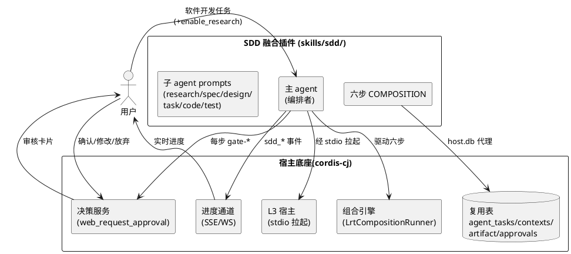

# 规范驱动开发融合插件（SDD）技术设计文档

> 本文档是 `specs/sdd/spec.md`（需求规格，Style A 6 节）的「怎么做」配套，采用仓库 house style（legacy 10 节通用设计 + 两段式首章）。
> 一切引用以 `skills/long-running-task/` 已落地的真实实现为准（路径见文末附录），**禁止**沿用 `specs/sdd-skills/` 的 COMPOSITION 理想稿 schema（已标记 DEPRECATED）。
> 设计目标：一个**独立 L3 进程隔离轨融合插件 `skills/sdd/`**，复用宿主底座，库表**复用优先、确有必要时才新建表/列**（见 spec §6.7 / 铁律 9，DB 结构变更一律走 `loaddbinfo` → `crudgen`/`plugingen` → `crudweb` 确定性生成），六步文档契约链 + 步步人工闸口。

---

# 一、需求与存量功能关系分析

## 1.1 需求功能与存量功能对比

### 1.1.1 已实现功能（直接复用，不重造）

| 需求功能（REQ-SDD-###） | 存量功能 | 代码 / 文档位置 | 匹配度 |
|---|---|---|---|
| 插件进程隔离宿主 | cordis-cj L3 宿主（`mode: process`，stdio 拉起） | `src/plugin/cordis_host_manager.cj` / `cordis_host_services.cj` | 100% |
| 组合编排引擎 | 文件态 `COMPOSITION.yaml` + `LrtCompositionRunner` | `skills/long-running-task/COMPOSITION.yaml` + `src/skill/lrt_composition_runner.cj` | 100% |
| 人在回路决策框架 | `decision-points` frontmatter + `web_request_approval` 契约 | `skills/long-running-task/SKILL.md`（decision-points + §决策点） | 100% |
| 阶段产物落库 | `long_running_task_artifact`（usage=deliverable） | long-running-task `tableWhitelist` + DATA_CONTRACT | 100% |
| 任务 / 检查点持久化 | `agent_tasks` / `agent_contexts` | long-running-task DATA_CONTRACT | 100% |
| 审核留痕 | `agent_approvals` | long-running-task `tableWhitelist` | 100% |
| 进度 / 可观测通道 | SSE/WS 事件桥（`step_start/step_complete/...`） | long-running-task `LrtEventEmitter` + `host.event` | 95% |
| Agent 声明文件解析 | `AgentLoader` 解析 frontmatter → `AgentDefinition` | `src/core/agent/agent_loader.cj:117-190` + `agent_definition.cj:114-160` | 100% |
| Agent 文件↔DB 同步 | `AgentSyncHandler` + `ChangeDetector` | `src/app/services/sync/handler/AgentSyncHandler.cj`、`detector/ChangeDetector.cj:140-170` | 60%（见 §1.2.6） |
| 子 agent 执行器 | `AgentAsTool`（`Isolated` / `WithContext` 两种上下文模式） | `src/tool/agent_as_tool.cj:46-123` | 100%（但缺"造 Agent 实例"的前半段） |
| 仓颉编码执行者 | `cangjie-coder` 四步工作流 | `skills/cangjie-coder/SKILL.md` | ✅ 90%——**SOP 部分（确定性优先四步工作流）成熟可直接复用**；其 `agents/` 子目录为早期 AI 工具遗留物且从未运行，**须删除**（见 §1.2.7） |
| 代码质量闸门 | `code-gen-verifier` | `skills/code-gen-verifier` | 100% |
| 需求 / 设计文档模板 | 6 节组件定位 / 10 节设计 | `managing-spec-document` / legacy `managing-sdd-design-markdown` | 100% |

### 1.1.2 需要扩展的功能（复用为主，少量适配）

| 需求功能 | 说明 | 扩展方向 |
|---|---|---|
| 六步组合编排 | long-running-task 是"自主执行"6 步，SDD 是"文档契约链 + 步步闸口"6 步 | 新建 `skills/sdd/COMPOSITION.yaml`，复用同款文件态格式与运行器，仅改步骤语义 |
| 决策点语义 | long-running-task 仅终点 `review`；SDD 需每步闸口（confirm/revise/abandon） | 在 SDD `SKILL.md` 声明 5 个 `gate-*` 决策点，revise→回退上一步 |
| 进度事件命名 | 长程任务用 `lrt_*` | 新增 `sdd_step_start` / `sdd_step_complete` / `sdd_progress_update` / `sdd_goal_achieved` |
| 交付物写入 | 复用 `long_running_task_artifact`，但须按 `stage` 维度标记 | 在 SDD DATA_CONTRACT 中约束 `stage` 取值 |
| **同步扫描范围** | `ChangeDetector.collectMdFiles` 只扫 `<base>/AGENTS.md` + `<base>/agents/**/*.md`，**漏掉 `skills/*/agents/*.md`** | 扩展为同时遍历 `<base>/skills/*/agents/**/*.md`，使 `skills/sdd/agents/*.md` 自动入库 |
| **子 agent 拉起** | `SubAgentTool.executeSubAgent` 是桩（只返回字符串，不创建/运行 Agent） | 补全为「查 `agents` 表 → `AgentLoader` 造 `AgentDefinition` → 造 Agent → `AgentAsTool` 包装 → `chat`」 |
| **上下文隔离维度** | `agent_contexts` 只有 `agent_id`，同一子 agent 多次调用会串上下文 | 新增 `task_id` 列，上下文按次隔离 |
| **结构化能力描述** | `agents.capabilities` / `default_input_types` / `default_output_types` 三个 jsonb 列已存在但全为 NULL | 按 GB/Z 185.4 ACS 结构填充 SDD 六子 agent 的输入输出契约 |

### 1.1.3 需要新增的功能或接口（本插件交付范围）

| 需求功能 | 说明 | 交付物 |
|---|---|---|
| ~~六个~~ 五个子 agent **声明文件** | 可被派生的专职 agent（`sdd-researcher` / `sdd-spec-writer` / `sdd-design-writer` / `sdd-task-planner` / `sdd-tester`）。**v13：`code` 步改主 agent 直执行，原 `sdd-code-dispatcher.md` 已删除**（见 §1.1.3-编码步语言分派） | `skills/sdd/agents/*.md`（frontmatter + 系统提示词正文），经同步入 `agents` 表 |
| 六份执行提示词（含 `code.md`；code 步由主 agent 直执行，不派生子 agent） | 各步的工作流指令（与声明文件配套：声明定义"是谁"，提示词定义"这一步怎么做"） | `skills/sdd/prompts/{research,spec,design,task,code,test}.md` |
| 编码步语言分派 | 按 `tasks.md` 语言标签分派 cangjie/web/app | `skills/sdd/prompts/code.md` + 路由契约 |
| `web-coder` / `app-coder` **编程技能** | 前端 / 原生 app 编码 SOP（当前缺失） | 新建 `skills/web-coder` / `skills/app-coder`（过渡期路由 `fullstack-codegen` / `frontend-dev`）；**均为纯技能形态，不建 `agents/` 子目录** |
| 技能内 `agents/` 自动探测 | 加载带 `agents/` 的技能即自动注册其中子 agent | 技能加载管线挂载 `bundledAgents` + 同步层扩扫（见 §2.9） |
| `cangjie-coder` 去子 agent 化 | 删除 `skills/cangjie-coder/agents/`（4 个语言角色）与 `agents` 表对应 4 条手工数据 | 随本工程一并清理（见 §1.2.7） |
| 子 agent 执行链路补全 | `SubAgentTool.executeSubAgent` 由桩改为真实派生 | 宿主侧 `src/tool/sub_agent_tool.cj` 改造 + `docs/agents/agent-declaration-spec.md` 修订 |
| SDD 版数据契约 | 复用表的 SDD 视角约束 | `skills/sdd/DATA_CONTRACT.yaml` |
| 任务规划 / 测试验收模板 | 缺口补齐 | `skills/sdd/templates/{tasks-template,test-report-template}.md`（specs/sdd/ 已产出，随插件打包） |
| 数据库增量 | 工程实例头表 + 派单留痕表 + 2 个列 | `sql/incremental/sdd_subagent_20260927.sql`（见 §2.8） |

## 1.2 存量功能详细分析（复用依据）

### 1.2.1 L3 进程隔离轨宿主（cordis-cj）

SDD 插件以 `mode: process` 被宿主经 **stdio** 拉起（见 long-running-task `plugin.yaml` 注释：不要写 `protocol` 字段；`command` 是相对宿主工作目录的路径，两种部署形态都须带 `skills/sdd/` 前缀）。插件进程通过 `cordis_host_services.cj` 提供的 `host.db` / `host.log` / `host.cache` 服务代理访问宿主能力，**不自带 DB 连接**，也与宿主内存配置隔离（插件模型凭据只走 `.env` + 重启，见 memory 的插件落库/配置红线）。

### 1.2.2 组合执行引擎（COMPOSITION.yaml + LrtCompositionRunner）

long-running-task 的 `COMPOSITION.yaml` 是**真实在用**的文件态 DSL（非 DB 存储态 schema），由 `LrtCompositionRunner` 解析。其步骤要素为：`name` / `step_type`（script|plugin|output） / `script` / `plugin_route` / `depends_on` / `condition` / `input`（支持 `${input.x}` 与 `${file:path}` 插值） / `uses_tables` / `acceptance_criteria` / `degradation_chain`。**SDD 的 COMPOSITION 必须沿用这套真实要素**，不得抄 sdd-skills 理想稿的 `composition:` 根 + `skill:`/`agent_type:`/`output:` schema（两者不可混用，见 research.md §八）。

### 1.2.3 人在回路决策框架（decision-points + web_request_approval）

long-running-task `SKILL.md` 的 `decision-points` frontmatter 声明决策点（如 `review`，含 `when`/`question`/`options`/`default`/`recommended`/`timeout_seconds`），并在正文 §决策点 规定闭环契约：**到达任一决策点须调用 `web_request_approval`，必带 `skillName` + `decisionPointId` + 该决策点的 `options/default/recommended`**；决策点失效时工具自动降级为普通"批准/拒绝"审批，不得伪造选项卡片。SDD 的步步闸口原样复用此机制。

### 1.2.4 数据契约（DATA_CONTRACT.yaml）

long-running-task 的 DATA_CONTRACT 定义了 `tables[]`（name/access/role/idempotent_key/columns[]/write_rule/sample_rows），用于单回合 token 约束、tableWhitelist 校验、`crudgen` 生成依据。SDD 复用其 schema，但只声明四张复用表，并在 `write_rule` 中固化 SDD 写入纪律。

### 1.2.5 进度 / 可观测（SSE/WS 事件桥）

long-running-task 通过 `LrtEventEmitter` → `host.event` → WS/SSE 推送 `step_start`/`step_complete`/`progress_update`/`goal_achieved`，纯 cron 任务无 session 时早退。SDD 复用该通道，新增 `sdd_*` 前缀事件，前端按 session_id 路由。

### 1.2.6 子 agent 机制现状（四次研究结论，决定 SDD 能否真正"调子 agent"）

> 这是本轮研究最关键的一条：**Anthropic `agents/` 子目录机制在本项目里只落地了"声明"这一半，"派生"那一半是断的。**

**① 业界基线（可直接对标）**：`skills/skill-creator/`（Anthropic 官方，目录内带 `LICENSE.txt`）结构为 `SKILL.md` + `agents/{analyzer,comparator,grader}.md`。子 agent = **Markdown 正文（系统提示词）+ YAML frontmatter（元数据）**，标准键为 `name` / `agent_type` / `description` / `version` / `author` / `tools` / `model` / `maxTurns` / `memory` / `background` / `parent_id` / `permissions`。`skills/cangjie-coder/` 即仿此机制（frontmatter 声明 `agents: [doc-consultant, code-searcher, code-editor, code-verifier]` + `agents/*.md` 四文件）。

**② 逐层核验结果**（每条附源码位置，可复核）：

| 层 | 实现位置 | 真实状态 |
|---|---|---|
| 声明（SKILL.md `agents:` 键） | `skills/cangjie-coder/SKILL.md:10-13` | ❌ **无人解析**。`src/skill/skill_parser.cj`、`skill_loader.cj` grep `"agents"` 无命中；全仓 `src` 除 `AutoRouteConfig.cj:1244` 路由表字符串外无解析逻辑 → **纯文档，运行时忽略** |
| 解析（frontmatter → 对象） | `src/core/agent/agent_loader.cj:117-190` | ✅ 已实现。必填 `name` / **`agent_type`** / `description`，正文作 `systemPrompt` |
| 同步（文件 ↔ DB） | `AgentSyncHandler.cj` + `ChangeDetector.cj:140-170` | ⚠️ **只扫一半**。只收 `<base>/AGENTS.md` 与 `<base>/agents/**/*.md`（`base` = `main.cj:264` 的 `SYNC_AGENT_BASE_PATH`，默认 `./`）→ **不扫 `skills/*/agents/*.md`** |
| 拉起（主 agent 派生） | `src/tool/sub_agent_tool.cj:141-190`（`executeSubAgent`） | ❌ **桩实现**。同步分支 `return "Sub-agent task completed: ${question}"`；background 分支返回拼出来的 `subagent_<ts>`。不创建、不运行任何 Agent（工具已在 `builtin_tools_registry.cj:120` 注册为 `sub_agent_execute`） |
| 团队派生（备选路径） | `src/agent_group/team_manager.cj:163-169` | ❌ **空壳**。`BaseAgent(model: unsafe { zeroValue<ChatModel>() }, description: "Agent role: ${agentType}")` —— 零值模型、无 system_prompt、不读 `agents` 表 |

**③ 唯一真实可用的执行器**是 `src/tool/agent_as_tool.cj` 的 `AgentAsTool`：

- `enum SubAgentMode { Isolated | WithContext }`（L46-56）——**这就是现成的上下文交接语义**：
  - `Isolated`：子 agent 不继承主 agent 状态，全部上下文必须塞进唯一的 `question`（L34-41 要求"core question + necessary context or constraints + expected output format"）；
  - `WithContext`：继承主 agent 完整上下文，`question` 只需简短提问。
- `invoke`（L102-123）：`agent.chat(AgentRequest(question))`，非 JSON 响应被包成 `{"result":..., "is_raw_response": true}`。

**缺口定位**：`AgentAsTool` 是"给定 Agent 实例 → 包成工具"的**后半段**；缺的是**前半段**——"给定 `agents` 表一行 → 造出 Agent 实例"。`SubAgentTool` 本该补这一环，但它目前是桩。

**④ 附带发现（须一并修正）**：

1. `docs/agents/agent-declaration-spec.md` §3.1 写 frontmatter 键为 `type:`，而 `agent_loader.cj:177` 实际读 **`agent_type:`** → 文档与实现不一致，且该文档未覆盖已实装键 `parent_id` / `model_capabilities` / `capabilities_skill` / `identity_status` / `discoverable` / `aic`。
2. frontmatter 里 `parent_id: MainAgent` 是**名字**，`agents` 表存的是 **uuid**，同步时需按 name 解析；解析不到应记 `sync_status='dependency_missing'`，不得静默写 NULL。
3. 现有 `agents` 表 4 条子 agent 全部来自 `sql/insert_subagents.sql`（文件头注释自证"手工补充"），`discoverable=false`、`capabilities` 等三列 NULL，`created_at` 集中在 `2026-09-24 13:23:28` → **不是运行产物**。

**⑤ 因此 SDD 的设计取向**：不把"子 agent"当文本约定，而按项目**数据驱动**哲学把它做成数据库一等公民——定义同步入表、派单落库留痕、上下文按次隔离、输入输出契约结构化（对齐 GB/Z 185.4 ACS，与智能体互联国标已采用的 frontmatter 描述方案同构）。详见 §2.7。

---

### 1.2.7 coder 类技能的形态决策与自动探测挂点（五次研究结论）

> 本节回应一个架构层面的取舍：**哪些能力该做成"技能"，哪些才值得派生"子 agent"**，以及"带 `agents/` 的技能如何被自动发现"。

#### ① 架构演进：从"多语言专用 agent"到"主 agent + 语言技能"

早期（2025-12）的多语言专用 agent 协作架构，前提是模型通用编码能力不足、需要角色切分（检索 / 编辑 / 验证 / 查阅）来补偿。随着 agentskills 机制普及与模型能力跃升，这一前提已不成立：

| 维度 | 多语言专用子 agent（旧） | 主 agent + 语言技能（新，采纳） |
|---|---|---|
| 能力来源 | 角色切分 + 上下文隔离 | 技能 SOP + 官方文档技能检索 |
| 每次编码成本 | 派生 + 上下文重建 + 结果回传 | 加载 SKILL.md，主 agent 上下文连续 |
| 复杂度 | 需编排（谁先谁后、结果怎么传） | 无编排，SOP 顺序执行 |
| 边际收益 | 已被模型能力提升覆盖 | — |

**结论（采纳用户意见）**：`cangjie-coder` / `web-coder` / `app-coder` 一律为**纯技能形态**——`SKILL.md`（SOP）+ 官方文档技能引用 + `references/` + `scripts/`，**不建 `agents/` 子目录、不派生编码子 agent**。

#### ② `skills/cangjie-coder/agents/` 的处置

四个文件 `code-searcher` / `code-editor` / `code-verifier` / `doc-consultant`（`agent_type: sub`，均带 `language: cangjie`、`language_context: cangjie-language-guide,cangjie-full-docs`）属**早期 AI 开发工具自行创建的遗留物**，判据：

1. `SKILL.md` 的 `agents:` 键**无人解析**（§1.2.6 ②），即从未被 runtime 真正加载过；
2. 四条 DB 记录来自 `sql/insert_subagents.sql` 手工灌入（§1.2.6 ④-3）；
3. 角色切分（检索 / 编辑 / 验证 / 查阅）**恰好是 `SKILL.md` 四步工作流的步骤**，本就应由单个 agent 顺序执行，切成四个子 agent 只会引入上下文重建开销。

**处置**：删除 `skills/cangjie-coder/agents/` 目录，并清理 `agents` 表中 `skill_name='cangjie-coder'`（或 `source_path LIKE '%/cangjie-coder/agents/%'`）的 4 条记录。四个角色的**职责并入 `SKILL.md` 四步工作流**（已有对应）。

#### ③ 自动探测的三个挂点（关键实现依据）

| 层 | 现状 | 改造 |
|---|---|---|
| **同步层**（文件 → DB） | `ChangeDetector.collectMdFiles`（L140-174）只收 `<base>/AGENTS.md` + `<base>/agents/**/*.md`；`collectSkillDirs`（L175-193）用 `Directory.walk` 找含 `SKILL.md` 的目录（**这套 walk 逻辑可直接复用来找 `agents/`**） | 扩展为 `<base>/skills/*/agents/**/*.md`；`source_path` 存绝对路径，`skill_name` 由路径反推 |
| **加载层**（技能 → 内存） | ⚠️ **`src/skill/skill_loader.cj:55` 的 `loadSkillFromDirectory` 是桩**——返回 `BaseSkill(name: "placeholder-skill")`；真解析入口是 **`SkillManagementService.loadSkillsFromDirectory`**（frontmatter → manifest 校验 → Skill 实例，见 `src/plugin/skill_bridge.cj:18` 注释） | 在**真入口**处探测 `<skill-root>/agents/*.md`，解析 frontmatter 后挂到 Skill 的 `bundledAgents`；**禁止**改那个桩 |
| **派生层**（名字 → 执行） | `SubAgentTool.executeSubAgent` 是桩（§1.2.6 ③） | 按 `agent_name` 优先在**当前技能的 `bundledAgents`** 内查找，未命中再查全局 `agents` 表；命中后走 `AgentAsTool` 真实执行 |

> **实现前必读**：`skill_loader.cj` 是桩这件事容易被误判为"加载入口就在这"，改造前须先确认 `SkillManagementService` 的实现位置。

#### ④ 与 Anthropic 基线的差异（本项目超出业界的部分）

Anthropic `skill-creator` 的 `agents/*.md` 是**文本约定**：SKILL.md 里写 "read `agents/grader.md`"，由模型自行 spawn 并读文件；runtime 不解析、不入库、不可发现。

本项目将同一目录约定升级为**运行时机制**：`agents/` 一放即注册、入表可查询可发现、可带 ACS 能力契约、删除即下线（**约定即注册**，见 spec §2）。这是"数据驱动"哲学在子 agent 机制上的直接体现，也是相对业界基线的实质增强。

---

# 二、增量设计方案

## 2.1 实现模型

### 2.1.1 上下文视图



### 2.1.2 服务 / 组件总体架构

```
skills/sdd/                          # 单一 L3 融合插件
├── plugin.yaml                      # mode: process；tableWhitelist 仅四张复用表；routes=gen-*/review
├── COMPOSITION.yaml                 # 六步文件态编排（研究可选 + spec→design→task→code→test + output）
├── SKILL.md                         # frontmatter: decision-points(gate-*) + 触发 + 全流程 SOP
├── DATA_CONTRACT.yaml               # 四张复用表的 SDD 视角约束
├── agents/                          # 【v2 新增】子 agent 声明文件（可被派生的实体；v13 起为五个，code 步不再派生）
│   ├── sdd-researcher.md  sdd-spec-writer.md  sdd-design-writer.md
│   └── sdd-task-planner.md  sdd-tester.md
├── prompts/                         # 各步工作流指令（"这一步怎么做"，随 COMPOSITION 步骤加载）
│   ├── research.md  spec.md  design.md  task.md  code.md  test.md  review.md
├── templates/                       # 【v2】实体复制，随插件自完备（禁止仅引用外部路径）
│   ├── research-template.md
│   ├── spec_template.md             # 复制自 managing-spec-document
│   ├── design_template.md           # 复制自 legacy managing-sdd-design-markdown(10 节)
│   ├── tasks-template.md
│   ├── test-report-template.md
│   ├── ears-format.md
│   └── design-principles.md
├── scripts/                         # 可选脚本（parse_input.py / notify_progress.py）
└── src/
    ├── main.cj                      # L3 进程入口
    ├── sdd_handlers.cj              # gen-*/review/spawn-subagent 路由
    ├── sdd_subagent_dispatch.cj     # 【v2 新增】子 agent 派单（八步时序，见 §2.7.3）
    └── sdd_event_relay.cj           # sdd_* 进度事件
```

> **为什么 `agents/` 与 `prompts/` 分离**：`agents/*.md` 定义"**是谁**"（身份/工具/模型/权限/输入输出契约，同步进 `agents` 表后可被任何场景发现与复用），`prompts/*.md` 定义"**这一步怎么做**"（SDD 专属工作流）。二者分离后，同一子 agent 可被非 SDD 场景复用；也正因为分离，Anthropic 的 `agents/` 机制与 SDD 六步工作流才能各司其职。

> **布局决策**：sdd-skills 设想 `skills/sdd-spec|sdd-design|sdd-task|sdd-test` + 独立 `skills/sdd-flow` 分散布局；本设计**改为单一融合插件 `skills/sdd/`**，子能力以 `prompts/` 内聚，更贴合"融合插件"定位（research.md §八 已记录此分歧）。

> **哪些技能该带 `agents/`（判别准则）**：只有**流程编排类**技能（产物是"多角色协作的文档 / 流程"，如 SDD）才建 `agents/`；**编程 / 领域类**技能（`cangjie-coder` / `web-coder` / `app-coder`）一律不建——它们的能力由主 agent 加载 SOP 后直接执行。判别口诀：**"需要换脑子的才派生，只需要换说明书的用技能"**。参照实现：
>
> ```
> skills/sdd/             → agents/ 有（5 个流程角色）
> skills/cangjie-coder/   → agents/ 无（SOP + CangjieSkills 官方文档技能）
> skills/web-coder/       → agents/ 无（SOP + 前端官方文档技能）
> skills/app-coder/       → agents/ 无（SOP + 鸿蒙/安卓/苹果官方文档技能）
> ```

### 2.1.3 关键组件设计

- **主 agent（编排者）**：SDD 主入口，负责类型识别、建工程目录、驱动 COMPOSITION、在每步后调用 `gate-*` 决策点、处理 revise→回退。
- **子 agent 撰写者**：research/spec/design/task/test 五个领域撰写者以 `prompts/*.md` 形式内聚于插件，写入规范分别绑定 `research-template.md` / `managing-spec-document`(6 节) / legacy `managing-sdd-design-markdown`(10 节+两段式) / `tasks-template.md` / `test-report-template.md`。
- **编码分派器（code）**：读取 `tasks.md` 语言标签，**加载对应编程技能**——`cangjie-coder`（cangjie）/ `web-coder` 或 `fullstack-codegen`（web）/ `app-coder` 或 `frontend-dev`（app），由主 agent 按技能 SOP 执行编码（**不派生编码子 agent**，见 §1.2.7①），产物经 `code-gen-verifier` 闸门。

## 2.2 接口设计

### 2.2.1 plugin.yaml 配置（关键项，非完整文件）

```yaml
name: sdd
version: 1.0.0
mode: process
# 不写 protocol 字段（宿主无解析逻辑，静默忽略）；L3 进程轨固定 stdio
# command 相对宿主工作目录，两种部署形态都带 skills/sdd/ 前缀（见 long-running-task 注释）
command: ./skills/sdd/target/release/bin/skill_sdd.exe
description: 规范驱动开发融合插件（六步文档契约链 + 步步人工闸口）
enabled: true
order: 8
autoRestart: true
config:
  maxRounds: 30
  maxRoundDurationMs: 1800000
  maxTaskDurationMs: 86400000
  checkpointStrategy: "per-stage"        # 按阶段落检查点
  qualityGate: true                      # 编码步强制 code-gen-verifier
  decisionJsonlEnabled: true             # 决策走 stderr（stdout 为 RPC 通道，禁打）
env:
  SDD_SKILL_ROOT: ""
  SDD_SCRIPTS_DIR: ""
  SDD_PYTHON: ""
# 复用表 5 张 + 本工程新增 2 张；新增范围严格受 spec.md §6.7 约束，不得再扩张
tableWhitelist:
  - agent_tasks          # SDD 工程实例（权威态）
  - agent_contexts       # 阶段检查点（新增 task_id 列，按次隔离）
  - long_running_task_artifact  # 阶段交付物正文
  - agent_approvals      # 闸口审核留痕
  - agents               # 只读：查子 agent 定义（skill_name='sdd'）
  - sdd_projects         # 【新增】工程实例可查询投影
  - sub_agent_invocations # 【新增】派单留痕
routes:
  # 六步生成入口 + 审核闸口
  - method: POST
    path: /api/v1/uctoo/sdd/gen-research
  - method: POST
    path: /api/v1/uctoo/sdd/gen-spec
  - method: POST
    path: /api/v1/uctoo/sdd/gen-design
  - method: POST
    path: /api/v1/uctoo/sdd/gen-task
  - method: POST
    path: /api/v1/uctoo/sdd/gen-code
  - method: POST
    path: /api/v1/uctoo/sdd/gen-test
  - method: POST
    path: /api/v1/uctoo/sdd/review
  - method: POST
    path: /api/v1/uctoo/sdd/spawn-subagent    # 子 agent 派生（主 agent → 子 agent）
  - method: GET
    path: /api/v1/uctoo/sdd/projects/:feature_name   # 工程实例查询（读 sdd_projects）
# 各表经 host.db 服务代理读写（cordis_host_services），不在此重复暴露 CRUD 路由
```

### 2.2.2 COMPOSITION.yaml 步骤编排终稿（真实 schema）

> 以下为 SDD 实际采用的文件态格式（要素与 long-running-task 一致）。**研究步 `condition` 挂在入口信号 `enable_research` 上，不挂"文件是否存在"**（否则恒跳过，见 research.md §四 决策风险 2）。

```yaml
# 完整六步编排已落盘为 skills/sdd/COMPOSITION.yaml（单一事实来源，本文不再复制全文）
# 关键约定（与实现文件一致）：
#   step_type ∈ {script, plugin, output}（与 long-running-task 同款）
#   research  → condition: "${input.enable_research}"（入口信号，非文件存在）
#   spec/design/task/test → plugin_route: /api/v1/uctoo/sdd/gen-*，各派生一个子 agent
#   code      → 按语言标签加载编程技能，不派生编码子 agent
#   落盘      → outdir: "specs/${input.feature_name}"（runtime 自有目录）
#   每步验收  → 追加"子 agent 真实派生 + 回传经契约校验通过"两条
```

### 2.2.3 人在回路决策点声明（SKILL.md frontmatter 节选）

> 五个 `gate-*` 决策点（研究/需求/设计/任务/编码），每个固定三选项 `confirm/revise/abandon`；测试为末步不挂闸口（其报告本身即验收依据）。`revise` 回退上一步重做（不丢已确认产物）。

```yaml
decision-points:
  - id: gate-research
    when: 研究步产物生成后
    question: 研究文档是否通过？可确认进入需求步，或要求修改，或放弃。
    options:
      - id: confirm
        label: 确认通过
        description: 进入需求规格步骤
      - id: revise
        label: 要求修改
        description: 回退研究步重做
      - id: abandon
        label: 放弃
        description: 终止 SDD 工程，置终态
    default: confirm
    recommended: confirm
    timeout_seconds: 300
  # gate-spec / gate-design / gate-task / gate-code 同构，仅 id/when/question 不同
```

### 2.2.4 编码步语言分派路由契约（code.md）

> **形态约定**：下表目标一律为**编程技能**（`skills/<name>/SKILL.md`），主 agent 加载后自执行；**不是子 agent，不派单、不入 `sub_agent_invocations`、不建 `agents/` 目录**（§1.2.7①）。

| 语言标签 | 目标编程技能 | 状态 | 过渡路由 | 官方文档技能（必须包含 / 引用） |
|---|---|---|---|---|
| `cangjie` | `cangjie-coder`（已存在，四步工作流） | 直接加载 | — | `CangjieSkills`（`scripts/search_docs.py`） |
| `web` | `web-coder`（待新建） | 过渡期路由 | `fullstack-codegen` / `frontend-dev` | 前端技术栈（HTML / CSS / TS 及所用框架） |
| `app` | `app-coder`（待新建，覆盖鸿蒙/安卓/苹果） | 过渡期路由 | `frontend-dev`（近似，原生部分待补） | 鸿蒙 / 安卓 / 苹果原生技术栈 |

> 过渡期路由**必须**在 `prompts/code.md` 中显式写明调用契约，不得静默 fallback；`web-coder`/`app-coder` 属于本插件交付范围，建成后可无缝替换。
>
> 三者共同遵循**确定性优先**（spec §5.6.1 规则 5）：先在目标工程查既有依据 + 经官方文档技能确认 API 契约，再"复制粘贴 + 二次编辑"产出；查不到依据须显式标注缺口请人工确认，**禁止**静默猜写。

## 2.3 数据模型（SDD 版 DATA_CONTRACT 要点）

> 沿用 long-running-task DATA_CONTRACT schema（`tables[]` + `idempotent_key` + `columns[]` + `write_rule` + `sample_rows`），**只声明四张复用表**，并固化 SDD 写入纪律。完整版见 `skills/sdd/DATA_CONTRACT.yaml`。

### 2.3.1 agent_tasks（SDD 工程实例）

- `id`（uuid，主键）、`parent_task_id`（根任务为 null）、`status`（枚举 0待/1进行中/2完成/3失败/4取消/5暂停/6等待下回合，与 long-running-task 对齐）；SDD 业务终态用 1运行/2完成/3失败/4取消/5阻塞。
- `payload`（jsonb）：SDD 专属，`{"feature_name","task_description","enable_research","current_stage","stages":{"research":"approved",...},"decision_history":[...]}`。
- `creator` / `owner_user_id`：双账号身份；空串转 None（22P02 防护），查询方不一致时写 `owner_user_id`（行级权限白名单仅含此四表）。

### 2.3.2 agent_contexts（按阶段检查点 / 子 agent 上下文）

- `metadata`（jsonb）：`{"taskId","stage","savedAt"}`；恢复时**必须按 taskId 过滤**，只按 agent_id 取会串任务。
- **新增列 `task_id`**（见 §2.8）：子 agent 上下文**按次隔离**——同一子 agent 在同一工程被多次调用（revise 重做）时，每次持有独立上下文。落库时 `agent_id` + `task_id` 双键定位；恢复时按 `task_id` 过滤，**禁止**只按 `agent_id` 取（会串味）。

### 2.3.3 long_running_task_artifact（阶段交付物）

- 新增 SDD 维度约束：`stage` ∈ `research|spec|design|task|code|test`；`usage` 固定 `deliverable`；`file_path` 相对 **runtime 自有 `specs/{feature_name}/`**（**禁止** `.codeartsdoer/specs/`，该目录归属 CodeArts Agent）；`version`（每次 revise 递增）；`state` ∈ `draft|approved|revising`。

### 2.3.3-bis agents（子 agent 定义，只读）

- 读取条件：`skill_name = 'sdd'` AND `deleted_at IS NULL`；按 `stage` 映射 `name`（如 `spec` → `sdd-spec-writer`）。
- 派单前需取：`id`（作 `agent_id`）、`system_prompt`、`model`、`tools`、`permissions`、`default_input_types`（校验入参齐备）、`default_output_types`（校验回传结构）。
- 查不到对应子 agent 时**立即失败并提示**，禁止静默降级（§2.7.5 第 3 项）。

### 2.3.3-ter sub_agent_invocations（派单留痕，新增表）

- `parent_task_id` = SDD 工程根任务；`task_id` = 本次派单建的 `agent_tasks` 子任务；`stage` ∈ 六步；`mode` ∈ `isolated|path_ref`；`input_json` 即 §2.7.4 的上下文包；`output_json` 为子 agent 回传（成功必填）；`status` ∈ `running|completed|failed|timeout`；`duration_ms` 必填（用于性能观测）。

### 2.3.4 agent_approvals（审核留痕）

- `skill_name` 固定 `sdd`；`decision_point_id` ∈ `gate-research|gate-spec|gate-design|gate-task|gate-code`；`choice` ∈ `confirm|revise|abandon`；`feedback`（可空）；`operator`/`created_at` 必填。

### 2.3.5 写入纪律（write_rule 节选）

- 创建根任务：`parent_task_id=null, status=0`。
- 阶段推进：仅更新 `payload.current_stage` + `stages`；**禁止把 status 倒退为 0**（会被当新任务重复派发）。
- 审核决策：每次 `gate-*` 必须写入 `agent_approvals`，与 `stages` 状态变更同一事务。
- **禁止**为 SDD 新建任何表或向四表新增字段；扩展信息收纳进 `payload` JSON / `feedback` 文本。

## 2.4 进度与可观测设计（SSE/WS）

- 复用 long-running-task 事件通道（`LrtEventEmitter` → `host.event` → WS/SSE），新增 SDD 专属事件：`sdd_step_start` / `sdd_step_complete` / `sdd_progress_update` / `sdd_goal_achieved`。
- 数据边界加固（沿用前端 SSE 单行约束）：多行正文（HTML 报告 / 长文本）推送前做 `\r`→`\\r`、`\n`→`\\n` 幂等转义，避免一帧被切多段导致事件静默丢失。
- **纯 cron 任务无 session 时早退**：推之前判空 session_id，`goal_achieved` 等事件不到聊天区。
- L3 进程日志**只走 stderr**（stdout 为 stdio RPC 通道，禁打）；决策 JSONL 经 stderr 落盘。

## 2.5 人在回路决策设计（步步闸口）

- **原则**：声明在技能（SKILL.md `decision-points`），能力在 runtime（`web_request_approval`）。
- **闭环契约**：到达任一 `gate-*` 须调用 `web_request_approval`，必带 `skillName="sdd"` + `decisionPointId` + 该决策点 `options/default/recommended`；失效时工具自动降级为普通"批准/拒绝"审批，不得伪造选项卡片。
- **revise 语义**：回退到上一步文档重做，不丢失已确认步骤产物；连续 revise 不可越级跳更早步骤（除非 abandon 后重开）。
- **abandon 语义**：终止 SDD 工程，置 `status=4`，保留已落盘文档供查阅。

## 2.6 约束与防回退机制（严禁复现）

1. **禁止跳过闸口**：除 `abandon` 外，流程禁止跳过任何 `gate-*` 直达末步，否则 SDD 退化为"一次性自动生成四份文档"。
2. **禁止新建库表**：tableWhitelist 仅四张复用表；任何表结构变更需求先过"是否可收纳进 payload/feedback"一问。
3. **研究步 condition 红线**：必须挂 `enable_research` 显式信号，禁挂"文件是否存在"（恒跳过）。
4. **编码质量闸门**：code 步产物未过 `code-gen-verifier` 禁止标记完成；web/app 过渡路由须显式声明。
5. **L3 进程日志只走 stderr**：stdout 被 stdio RPC 独占，业务打印会污染通道导致解析失败。
6. **状态不倒退**：干预/超时/revise 只更新 `payload` 与 `stages`，`status` 不得回退为 0。
7. **确定性优先**：CRUD/权限/调度/检查点用既有基础设施（host.db 代理），推理/撰写由 AI 驱动。
8. **COMPOSITION 真实 schema**：六步编排必须用 long-running-task 同款 `step_type`/`uses_tables`/`acceptance_criteria`/`condition`/`degradation_chain` 要素，**禁止**抄 sdd-skills 理想稿 schema。
9. **子 agent 必须真派生**：禁止沿用 `SubAgentTool.executeSubAgent` 的桩行为（返回字符串冒充执行）；子 agent 定义缺失时**立即失败并提示**，禁止静默降级为"主 agent 自己写"。
10. **上下文统一隔离**：六步一律 `SubAgentMode.Isolated` + 显式上下文包；`agent_contexts` 按 `task_id` 隔离，禁止同一子 agent 多次调用共用一份上下文。
11. **coder 技能无 `agents/`**：`cangjie-coder` / `web-coder` / `app-coder` **禁止**出现 `agents/` 子目录；编码一律由主 agent 加载技能 SOP 执行。**禁止**以"多角色协作看起来更专业"为由重新引入语言专用子 agent。
12. **子 agent 只靠约定注册**：**禁止**用手工 SQL 灌子 agent、也**禁止**在代码里硬编码注册；`agents/` 目录下文件是唯一来源，删除即下线（约定即注册）。
13. **禁改假加载入口**：`src/skill/skill_loader.cj:55` 是返回 `placeholder-skill` 的**桩**，自动探测**必须**挂在真入口 `SkillManagementService.loadSkillsFromDirectory` 上。

---

## 2.7 子 agent 派生与上下文交接设计（对应 REQ-SDD-010）

### 2.7.1 目录与载体

```
skills/sdd/
├── SKILL.md                      # frontmatter 声明 agents: [...]（本次须让宿主真正解析）
├── agents/                       # 【新增】子 agent 声明文件（Anthropic 开放式标准 + 本项目扩展键）
│   ├── sdd-researcher.md         # v13 起为五个：code 步改主 agent 直执行，sdd-code-dispatcher.md 已删
│   ├── sdd-spec-writer.md
│   ├── sdd-design-writer.md
│   ├── sdd-task-planner.md
│   └── sdd-tester.md
├── prompts/                      # 各步工作流指令（"这一步怎么做"）
└── templates/                    # 文档模板（插件自完备）
```

声明文件与提示词分离的理由：`agents/*.md` 定义"**是谁**"（身份、工具、模型、权限、输入输出契约，入 `agents` 表可被发现与复用），`prompts/*.md` 定义"**这一步怎么做**"（SDD 专属工作流，随 COMPOSITION 步骤加载）。二者分离后，同一个子 agent 可被非 SDD 场景复用。

### 2.7.2 子 agent 声明文件 frontmatter 规范（扩展键已标注）

```yaml
---
name: sdd-spec-writer
agent_type: sub                    # 必填；注意是 agent_type 而非 type（docs/agents 规范文档已过时）
description: SDD 需求规格撰写子 agent，产出符合 6 节组件定位模板 + EARS 的 spec.md
version: 1.0.0
author: UCToo
skill_name: sdd                    # 【本项目扩展】所属技能，可索引查询
parent_id: MainAgent               # 名字；同步时解析为 uuid，解析不到记 dependency_missing
tools: [file_read, file_write, file_search, cli_execute]
model: deepseek-v4-pro
maxTurns: 100
memory: session
background: false
identity_status: none
discoverable: true                 # 与现有 4 条 cangjie-coder 手工数据的 false 不同，SDD 子 agent 需可被发现
input_types:                       # 【本项目扩展】→ agents.default_input_types（GB/Z 185.4 ACS）
  - name: task_description
    type: text
    required: true
  - name: research_md_path
    type: file_path
    required: false
  - name: template_path
    type: file_path
    required: true
output_types:                      # 【本项目扩展】→ agents.default_output_types
  - name: spec_md_path
    type: file_path
    required: true
  - name: acceptance_criteria_count
    type: number
    required: true
capabilities:                      # 【本项目扩展】→ agents.capabilities
  - id: write-sdd-spec
    description: 按 6 节组件定位模板撰写需求规格，验收条件用 EARS 语法
permissions:
  - database.uctoo.agents:read
  - database.uctoo.long_running_task_artifact:write
---

# Spec Writer Agent
...（系统提示词正文）
```

### 2.7.3 派单时序（补全后的链路）

```
主 agent
  │ ① 按 stage + skill_name='sdd' 查 agents 表 → 拿 agent_id / system_prompt / model / tools
  │ ② 组装显式上下文包（上一步产物路径 + 模板路径 + 用户反馈 + 本步验收要求 + 期望输出格式）
  │ ③ 写 sub_agent_invocations(parent_task_id, agent_id, stage, mode='isolated', input_json, status='running')
  │ ④ 建 agent_tasks 子任务（parent_task_id = SDD 工程任务）
  ▼
SubAgentTool.executeSubAgent（改造后）
  │ ⑤ AgentLoader 造 AgentDefinition → 造 Agent 实例（model/tools/system_prompt 来自 ①）
  │ ⑥ AgentAsTool(agent, mode=Isolated) → invoke({question: 上下文包})
  ▼
子 agent 执行 → 回传字符串/JSON
  │ ⑦ 回写 sub_agent_invocations.output_json / status / duration_ms
  │ ⑧ 主 agent 落 long_running_task_artifact(stage=..., usage=deliverable)
  ▼
进入该步闸口（web_request_approval）
```

### 2.7.4 上下文包的构成（Isolated 模式下的契约）

```json
{
  "stage": "spec",
  "feature_name": "<name>",
  "specs_dir": "specs/<feature_name>/",
  "inputs": {
    "research_md": "specs/<feature_name>/research.md",
    "template": "skills/sdd/templates/spec-template.md",
    "ears_ref": "skills/sdd/templates/ears-format.md"
  },
  "user_feedback": "<上一轮闸口的 revise 意见，可空>",
  "acceptance": ["6 节结构齐全", "验收条件用 EARS", "不含实现细节"],
  "output": {"path": "specs/<feature_name>/spec.md", "format": "markdown"},
  "context_mode": "inline"
}
```

**超限降级**：上下文包超出窗口预算时，把 `inputs` 中的长文档改为**路径引用**（`context_mode: 'path_ref'`），由子 agent 自行 `file_read` 按需读取，并在 `sub_agent_invocations.mode` 标注。

### 2.7.5 宿主侧改造清单（runtime 侧，非插件内）

| # | 文件 | 改造内容 |
|---|---|---|
| 1 | `src/app/services/sync/detector/ChangeDetector.cj:140-170` | `collectMdFiles` 增加遍历 `<base>/skills/*/agents/**/*.md` |
| 2 | `src/app/services/sync/handler/AgentSyncHandler.cj` | 映射新增键：`skill_name`（由 source_path 推导）、`input_types`/`output_types` → `default_input_types`/`default_output_types`、`capabilities`；`parent_id` 按 name 解析 uuid，失败记 `dependency_missing` |
| 3 | `src/tool/sub_agent_tool.cj:141-190` | `executeSubAgent` 由桩改为真实派生（查表 → `AgentLoader` → 造 Agent → `AgentAsTool` → `chat`），并写 `sub_agent_invocations` |
| 4 | `src/core/agent/agent_definition.cj` / `agent_loader.cj` | 增加 `skill_name` / `input_types` / `output_types` / `capabilities` 字段与解析 |
| 5 | `docs/agents/agent-declaration-spec.md` | 修订：`type:` → `agent_type:`；补齐 `parent_id` / `skill_name` / `capabilities` / `model_capabilities` / `identity_status` / `discoverable`；修正 §7.1 已失效的加载目录；**新增"技能内 `agents/` 目录约定"章节** |
| 6 | `src/skill/skill_parser.cj` | 解析 SKILL.md frontmatter 的 `agents:` 键，使其从"文档"变为"声明" |
| 7 | **`SkillManagementService`（真加载入口，见 §1.2.7③）** | 加载技能时探测 `<skill-root>/agents/*.md`，解析 frontmatter 后挂 `bundledAgents` 到 Skill 实例；**禁止**改 `src/skill/skill_loader.cj:55` 的桩 |
| 8 | `src/tool/sub_agent_tool.cj` 解析顺序 | 按 `agent_name` 解析时**优先查当前技能 `bundledAgents`**，未命中再查全局 `agents` 表 |

> **注意**：第 1/2/3/5/7/8 项是 SDD 可用的**前置**。若暂不改造宿主，SDD 只能退化为"主 agent 自扮演子 agent"（过渡模式），必须在日志显式标注，不得冒充子 agent 协作。
>
> **警告**：第 7 项实现前必须再次确认真加载入口。`src/skill/skill_loader.cj:55` 返回 `placeholder-skill`，是**桩**；真解析在 `SkillManagementService.loadSkillsFromDirectory`（依据 `src/plugin/skill_bridge.cj:18` 注释）。若误改桩，功能是假的却能"看起来跑通"。

---

## 2.8 数据库增量设计（可直接执行）

> 落盘路径：`apps/agentskills-runtime/sql/incremental/sdd_subagent_20260927.sql`。以下 SQL 可直接粘进 psql 执行，不含示意/伪代码。

```sql
-- 1) agents：子 agent 归属技能（替代 source_path 字符串解析，可索引）
ALTER TABLE "public"."agents" ADD COLUMN IF NOT EXISTS "skill_name" varchar(128);
COMMENT ON COLUMN "public"."agents"."skill_name" IS '所属技能名（skills/<skill_name>/agents/*.md），子agent必填，主agent为空';
CREATE INDEX IF NOT EXISTS "idx_agents_skill_name"
  ON "public"."agents" ("skill_name") WHERE "deleted_at" IS NULL;

-- 2) agent_contexts：上下文按"次"隔离（子 agent 被同一工程多次调用不串味）
ALTER TABLE "public"."agent_contexts" ADD COLUMN IF NOT EXISTS "task_id" uuid;
COMMENT ON COLUMN "public"."agent_contexts"."task_id" IS '所属任务/调用次，子agent按次隔离上下文';
CREATE INDEX IF NOT EXISTS "idx_agent_contexts_task_id"
  ON "public"."agent_contexts" ("task_id") WHERE "deleted_at" IS NULL;

-- 3) sub_agent_invocations：派单留痕（入参/出参/耗时/模式，可回放可审计）
CREATE TABLE IF NOT EXISTS "public"."sub_agent_invocations" (
  "id" uuid NOT NULL DEFAULT gen_random_uuid(),
  "parent_task_id" uuid,
  "task_id" uuid,
  "agent_id" uuid NOT NULL,
  "skill_name" varchar(128),
  "stage" varchar(64),
  "mode" varchar(20) NOT NULL DEFAULT 'isolated',
  "input_json" jsonb NOT NULL DEFAULT '{}'::jsonb,
  "output_json" jsonb,
  "status" varchar(20) NOT NULL DEFAULT 'running',
  "duration_ms" int8,
  "error_message" text,
  -- REQ-SDD-012-A 契约校验（规则取自 agents.capabilities.output_contract，不单独建表/列）
  "contract_type" varchar(64),
  "verify_passed" bool,
  "verify_errors" text,
  "attempt" int4 NOT NULL DEFAULT 1,
  -- REQ-SDD-012-B 成本账本（token 取不到记 0 并在 payload/error_message 标 token_missing）
  "prompt_tokens" int8 NOT NULL DEFAULT 0,
  "completion_tokens" int8 NOT NULL DEFAULT 0,
  "total_tokens" int8 NOT NULL DEFAULT 0,
  "creator" uuid,
  "created_at" timestamptz(6) NOT NULL DEFAULT CURRENT_TIMESTAMP,
  "updated_at" timestamptz(6) NOT NULL DEFAULT CURRENT_TIMESTAMP,
  "deleted_at" timestamptz(6)
);
COMMENT ON TABLE "public"."sub_agent_invocations" IS '子agent派单留痕：入参/出参/耗时/契约校验结果/token成本，可按stage聚合派生ROI';
COMMENT ON COLUMN "public"."sub_agent_invocations"."attempt" IS '第几次尝试，契约校验失败自动重派时递增，首次为1';
COMMENT ON COLUMN "public"."sub_agent_invocations"."total_tokens" IS '本次派生总token，取不到记0并标token_missing';

-- 成本账本常用聚合视图（口径固定，避免各处分母不一致）
CREATE OR REPLACE VIEW "public"."v_sub_agent_stage_cost" AS
SELECT
  "skill_name",
  "stage",
  count(*)                                                        AS "invocations",
  count(*) FILTER (WHERE "attempt" > 1)                           AS "retries",
  round(avg("total_tokens"))::int8                                AS "avg_tokens",
  round(avg("duration_ms"))::int8                                 AS "avg_duration_ms",
  round(100.0 * count(*) FILTER (WHERE "verify_passed" IS NOT NULL AND NOT "verify_passed")
        / NULLIF(count(*), 0), 2)                                 AS "verify_fail_rate_pct"
FROM "public"."sub_agent_invocations"
WHERE "deleted_at" IS NULL
GROUP BY "skill_name", "stage";
COMMENT ON VIEW "public"."v_sub_agent_stage_cost" IS '派生成本账本：按技能+阶段给出派单次数/重派数/平均token/平均耗时/校验失败率';

-- 4) sdd_projects：SDD 工程实例（可查询投影，feature_name 唯一）
CREATE TABLE IF NOT EXISTS "public"."sdd_projects" (
  "id" uuid NOT NULL DEFAULT gen_random_uuid(),
  "feature_name" varchar(64) NOT NULL,
  "title" varchar(256),
  "task_id" uuid,
  "current_stage" varchar(32) NOT NULL DEFAULT 'init',
  "status" varchar(20) NOT NULL DEFAULT 'running',
  "enable_research" bool NOT NULL DEFAULT false,
  "round" int4 NOT NULL DEFAULT 1,
  "payload" jsonb NOT NULL DEFAULT '{}'::jsonb,
  "creator" uuid,
  "owner_user_id" uuid,
  "created_at" timestamptz(6) NOT NULL DEFAULT CURRENT_TIMESTAMP,
  "updated_at" timestamptz(6) NOT NULL DEFAULT CURRENT_TIMESTAMP,
  "deleted_at" timestamptz(6)
);
COMMENT ON TABLE "public"."sdd_projects" IS 'SDD规范驱动开发工程实例：feature_name唯一，current_stage取值 init/research/spec/design/task/code/test/done';
CREATE UNIQUE INDEX IF NOT EXISTS "uq_sdd_projects_feature"
  ON "public"."sdd_projects" ("feature_name") WHERE "deleted_at" IS NULL;
```

**配套（非 DDL，但必须做）**：

1. 若 `sdd_projects` 启用 owner 隔离，表名**必须**加入 `PermissionUtils.hasOwnerUserColumn` 白名单（现仅 `agent_tasks` / `crontab` / `long_running_task_artifact` / `long_running_task_evolution`）。
2. 五个 SDD 子 agent 的记录**由同步机制自动写入**，不手工灌 SQL（否则无法证明子 agent 机制真的跑通）。初始化验证 SQL：

```sql
SELECT name, agent_type, skill_name, source_path, parent_id, discoverable,
       default_input_types IS NOT NULL AS has_input_contract,
       default_output_types IS NOT NULL AS has_output_contract
FROM public.agents
WHERE skill_name = 'sdd' AND deleted_at IS NULL
ORDER BY name;
-- 预期：5 行，discoverable=true，has_input_contract/has_output_contract 均为 true
```

3. **现有 4 条 cangjie-coder 手工数据必须清理**（§1.2.7② 决策变更：不再保留回填，而是下线）——随 `skills/cangjie-coder/agents/` 目录一并删除：

```sql
-- 清理早期遗留的 4 条语言角色子 agent（由 sql/insert_subagents.sql 手工灌入，从未运行）
DELETE FROM "public"."agents"
 WHERE "source_path" LIKE '%/cangjie-coder/agents/%'
    OR "skill_name" = 'cangjie-coder';

-- 自检：预期 0 行
SELECT count(*) FROM "public"."agents" WHERE "skill_name" = 'cangjie-coder';
```

> **验收口径**：清理后 `agents` 表应只剩主 agent（`source_path` 为 `AGENTS.md`）与 `skill_name='sdd'` 的 5 条自动同步记录，**不得**再有任何手工灌入行。（前版设计为"回填保留"，本版改为"下线清理"，原因见 §1.2.7①。）

---

## 2.9 技能内 `agents/` 自动探测与自动加载设计（对应 REQ-SDD-011）

> 目标：把 `agents/` 从"文档约定"升级为"运行时机制"——**主 agent 加载任一技能时自动探测其 `agents/` 目录、自动注册、自动可派生**。SDD 六步子 agent 是该机制的首个消费者。

### 2.9.1 三层协作

```
[文件] skills/<skill>/agents/*.md
   │
   ├─ 同步层 ChangeDetector.collectMdFiles（扩扫 skills/*/agents/**）──→ agents 表（持久化、可查询、可发现）
   │                                                                      ↑ 以 DB 为准
   └─ 加载层 SkillManagementService（真入口）──→ Skill.bundledAgents（内存、随技能生命周期）
                                                       │
                                                       ↓ 优先查找
   派生层 SubAgentTool ──按 name 解析──→ AgentDefinition ──→ AgentAsTool（Isolated）──→ chat
```

### 2.9.2 同步层改造（ChangeDetector）

现状 `collectMdFiles`（L140-174）只收 `<base>/AGENTS.md` + `<base>/agents/**/*.md`。改造要点：

1. 复用已存在的 `collectSkillDirs`（L175-193）的 `Directory.walk` 模式，先枚举 `<base>/skills/*`，再对每个 skill 目录收集其 `agents/**/*.md`；
2. 收集结果以**绝对路径**作为 `source_path`（与现有 `normalizePath` 口径一致）；
3. `skill_name` 由路径反推（`skills/<name>/agents/...` → `<name>`）；
4. 已存在的"文件删除 → DB 删除"逻辑（L60-64）自动生效，无需额外代码。

> **不改动** `AGENTS.md` 主 agent 的既有扫描逻辑，避免回归。

### 2.9.3 加载层改造（挂载 bundledAgents）

在**真加载入口** `SkillManagementService.loadSkillsFromDirectory` 内，技能解析完成后追加：

```
探测 <skill-root>/agents/ 目录
  → 逐个解析 *.md 的 YAML frontmatter（复用 src/core/agent/agent_loader.cj:117-190 的解析器，读 agent_type 而非 type）
  → 必需键 name / agent_type / description 缺失 → 跳过并报错（不中断整体加载）
  → 组装 AgentDeclaration 列表，挂到 Skill 实例（新增字段 bundledAgents）
```

> **红线**：`src/skill/skill_loader.cj:55` 的 `loadSkillFromDirectory` 返回 `placeholder-skill`，是**桩**。挂在它上面会让功能"看起来跑通但实际是假的"。改造前须先确认 `SkillManagementService` 实现位置（`src/plugin/skill_bridge.cj:18` 注释指明它内含 SKILL.md 解析 → manifest 校验 → Skill 实例创建完整管线）。

### 2.9.4 派生层解析顺序（SubAgentTool）

```
resolveAgent(agentName, currentSkill):
  1. 若 currentSkill 非空 → 在 currentSkill.bundledAgents 中按 name 查找
  2. 未命中 → 查 agents 表（WHERE name = ? AND discoverable = true）
  3. 仍未命中 → 立即失败并报出缺失的 source_path，禁止静默降级（spec §5.9.3-1）
```

命中后走 §2.7.3 的八步派单时序（写 `sub_agent_invocations` → `AgentAsTool` Isolated 执行 → 回写结果）。

### 2.9.5 一致性校验（防止两层走偏）

同步层与加载层覆盖同一路径集合，但时机不同（一个随同步任务、一个随技能加载）。校验规则：

| 情形 | 处理 |
|---|---|
| 文件数 N == DB 条数 M | 正常 |
| N ≠ M | 以 **DB 为准**，打 WARN 提示"未触发同步"，派单仍走 DB |
| frontmatter 非法 | 跳过该文件并报出文件名 + 缺失键，同步继续 |

### 2.9.6 首个消费者：SDD 六步

`skills/sdd/agents/` 下的声明文件（`sdd-researcher` / `sdd-spec-writer` / `sdd-design-writer` / `sdd-task-planner` / `sdd-tester`；**v13 起 code 步不再派生，原 `sdd-code-dispatcher` 已下线**）经本节机制注册后，主 agent 加载 `sdd` 技能即可直接按名派生，**无需任何手工 SQL 与硬编码注册**——这同时也是"多 agent 协作"在 runtime 上的首个真实落地示例（此前只有 Anthropic 的文本约定，无运行侧）。

---

## 2.10 派单结果契约校验与派生成本账本设计（对应 REQ-SDD-012）

> 两条增强均建在 §2.7 的派单链路之上：校验器插在「子 agent 回传 → 写 `output_json`」之间；成本账本沿用同一次派单记录。二者共用 `sub_agent_invocations` 一行，不新增表、不向既有表加列（§6.7 限量不变）。

### 2.10.1 为什么需要（相对业界基线的增量）

| 维度 | Anthropic `skill-creator` / 业界常见做法 | 本设计 |
|---|---|---|
| 回传结果 | 字符串直接采信，主 agent 自己看着办 | **按 ACS 输出契约自动校验**，不过则不采信 |
| 失败处理 | 无（或靠 prompt 里写"请检查"） | **携结构化错误自动重派 1 次**，仍失败转人工闸口 |
| 派单成本 | 不记账 | **duration + token 四项入库**，可按 stage 聚合 ROI |
| 规则存放 | 写死在 prompt 里 | 存 `agents.capabilities.output_contract`，改规则不改代码 |

### 2.10.2 契约校验器（ContractVerifier）

**位置**：宿主侧 `src/tool/` 新增 `sub_agent_contract_verifier.cj`；由 `SubAgentTool` 在回写前调用，纯字符串 / JSON 处理，**禁止**发起网络或模型调用（spec §4.1-3：≤1s）。

**规则来源**：`agents.capabilities.output_contract`（jsonb），结构：

```json
{
  "output_contract": {
    "kind": "markdown",
    "required_sections": ["1. 组件定位", "2. 领域术语", "3. 角色与边界"],
    "forbidden_placeholders": ["TODO", "待补充", "xxx", "TBD"],
    "min_chars": 500
  }
}
```

json 类产物改用 `"kind": "json"` + `"schema": {"required": ["a","b"], "types": {"a": "string"}}`。

> **frontmatter 写法**：声明文件里 `capabilities`（数组，ACS 能力项）与 `output_contract`（对象，校验规则）**并列写在顶层**；同步层入库时二者合并为 `agents.capabilities = {"items": [...], "output_contract": {...}}`。这样既保持 ACS 的 `capabilities` 数组语义，又不污染 ACS 结构。已落地的五个声明文件见 `skills/sdd/agents/*.md`。

**校验流程**：

```
① 取 agents.default_output_types → contract_type（空则标 contract_absent，降级仅非空校验）
② 取 capabilities.output_contract → 规则集（无规则则只做非空校验）
③ 按 kind 执行：markdown → 章节标题齐全 / 占位符未残留 / 长度达标
                json     → 必需字段存在 / 类型匹配
④ 结果写入 sub_agent_invocations(verify_passed, verify_errors, contract_type, attempt)
⑤ 通过 → 写 output_json 并返回主 agent
   失败且 attempt=1 → attempt=2 重派，errors 原文注入子 agent 上下文
   失败且 attempt=2 → 转人工闸口（放宽 / 改写 / 终止）
```

**错误结构**（`verify_errors` 文本，便于直接回灌 prompt）：

```
[缺章节] 6. 数据约束
[残留占位符] TODO（第 128 行）
[长度不足] 当前 312 字符 < 500
```

### 2.10.3 成本账本字段与取数口径

| 字段 | 来源 | 取不到时 |
|---|---|---|
| `duration_ms` | 派单开始 / 结束时间差 | 必填 |
| `prompt_tokens` / `completion_tokens` / `total_tokens` | 模型返回的 `usage` | 记 `0` 并在 `error_message` 追加 `token_missing` 标记 |
| `attempt` | 重派递增 | 首次 `1` |
| `stage` | 派单时传入（research/spec/design/task/code/test） | 必填 |

**聚合视图** `v_sub_agent_stage_cost`（DDL 见 §2.8）固定口径，输出四张指标：派单次数 / 平均 tokens / 重派率 / 平均耗时，外加校验失败率。用途有二：

1. **工程内决策**：跑几个 SDD 工程后即可回答"这一步派生划算吗"——这正是判断"语言专用子 agent 是否落伍"的依据，目前靠直觉（research §十二），做成账本后靠数据。
2. **对外叙事**：业界在讨论"要不要做多 agent"，我们可以给出**每一次派生的实测 ROI**，这是可对外讲的差异化。

### 2.10.4 防回退约束（并入 §2.6 精神，此處显式列出）

1. **禁止跳过校验**：`default_output_types` 为空时降级为非空校验并标 `contract_absent`，**不得**因此不校验。
2. **禁止无限重试**：自动重派上限 **1 次**，第二次失败必须转人工。
3. **禁止估算 token**：取不到记 `0` + `token_missing`，不得用字符数折算冒充实测。
4. **禁止新建存储**：校验规则进 `capabilities`、成本字段进**新表** `sub_agent_invocations`，既有表新增列仍锁定为 2 个。

---

# 附录：本文设计直接引用的真实实现文件

| 用途 | 文件 | 说明 |
|---|---|---|
| L3 插件骨架 | `skills/long-running-task/plugin.yaml` | 仿写 SDD plugin.yaml（mode/command/tableWhitelist/routes） |
| 组合编排格式 | `skills/long-running-task/COMPOSITION.yaml` + `src/skill/lrt_composition_runner.cj` | SDD 六步复用同款文件态格式 |
| 决策点契约 | `skills/long-running-task/SKILL.md`（decision-points + §决策点） | `gate-*` 原样套用 |
| 数据契约 schema | `skills/long-running-task/DATA_CONTRACT.yaml` | SDD 版沿用其 tables 结构 |
| 进度事件通道 | long-running-task `LrtEventEmitter` + `host.event` | 新增 `sdd_*` 事件命名 |
| 需求/设计模板 | `managing-spec-document` / legacy `managing-sdd-design-markdown` | 子 agent 写入规范 |
| 早期意图原型（已过期） | `specs/sdd-skills/{spec,design,tasks}.md` | 仅参考，schema 不可抄 |
| **业界子 agent 基线** | `skills/skill-creator/{SKILL.md, agents/*.md}`（Anthropic 官方） | frontmatter 机制样板 |
| **子 agent 仿制样本（待清理）** | `skills/cangjie-coder/{SKILL.md, agents/*.md}` | 未定稿、运行侧未接通；`agents/` 4 文件须删除（§1.2.7②） |
| **技能加载真入口** | `SkillManagementService.loadSkillsFromDirectory`（见 `src/plugin/skill_bridge.cj:18` 注释） | 自动探测挂点（§2.9.3） |
| **技能加载桩（勿改）** | `src/skill/skill_loader.cj:55` | 返回 `placeholder-skill`，改它等于造假 |
| **frontmatter 解析** | `src/core/agent/agent_loader.cj:117-190` | 读 `agent_type`（非 `type`） |
| **文件↔DB 同步** | `src/app/services/sync/handler/AgentSyncHandler.cj` + `detector/ChangeDetector.cj:140-170` | 扫描范围须扩展 |
| **子 agent 拉起（桩）** | `src/tool/sub_agent_tool.cj:141-190` | 须改造为真实派生 |
| **子 agent 执行器** | `src/tool/agent_as_tool.cj:46-123` | `Isolated` / `WithContext` |
| **Agent 声明规范（过时）** | `docs/agents/agent-declaration-spec.md` | `type:` 与实现冲突，须修订 |
| **数据基线** | `sql/public20260927.sql` | `agents` DDL 在 19755 行，现状 5 行 |
| **手工演示数据** | `sql/insert_subagents.sql` | 4 条 cangjie-coder 子 agent 的来源 |
