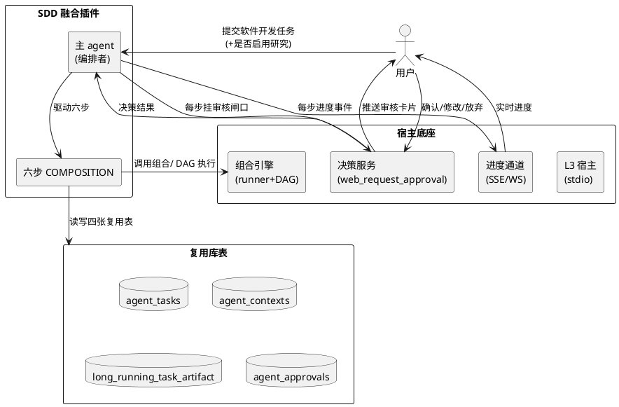
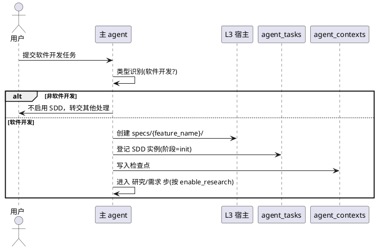
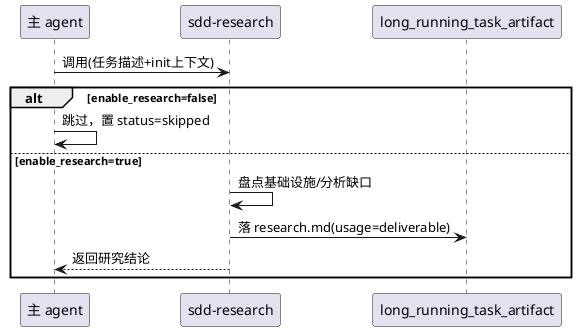
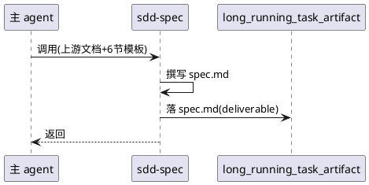
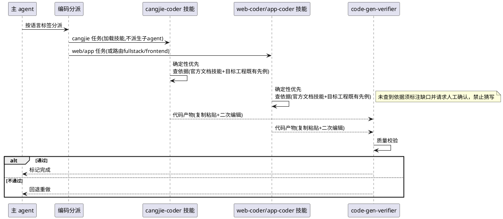
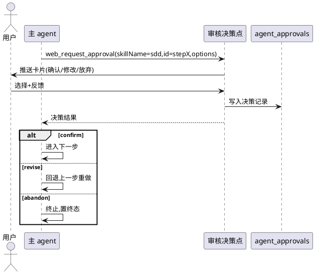
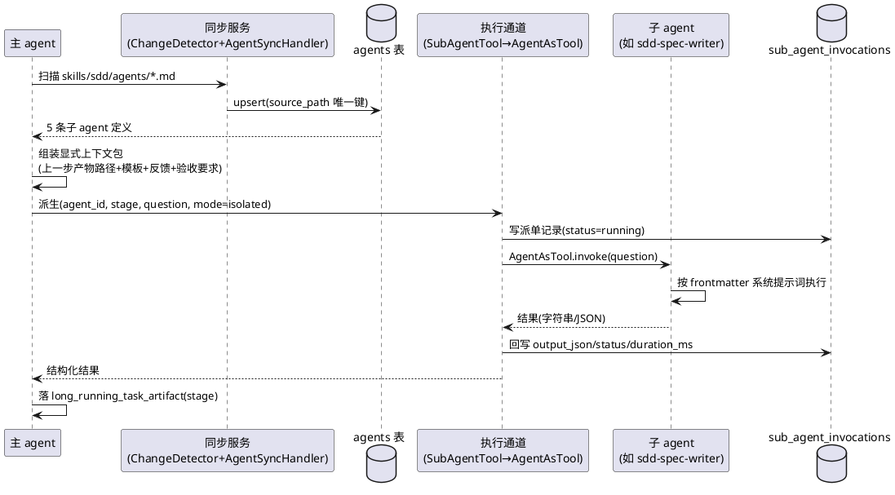
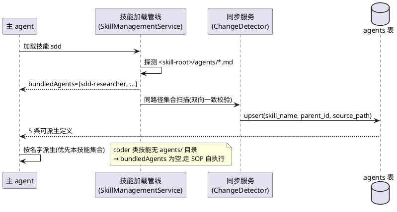
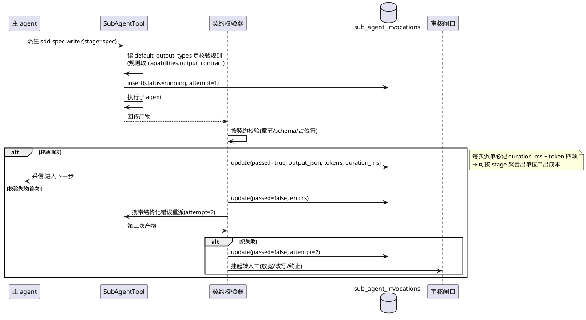

# **1. 组件定位**

> 本文档采用 CodeArts Agent 最新明文方法论中的「6 节组件定位」模板（来源：`managing-spec-document/spec_template.md`，与仓库早期 `managing-sdd-spec-markdown` 一致），是 `long-running-task` 正在使用的风格，也是被认可的 house style。
> 文档只回答"做什么"（业务能力 + 验收条件），不写"怎么做"（库表 / 类图 / 算法）。"怎么做"留待 `design.md`。

## **1.1 核心职责**

SDD（Specification-Driven Development，规范驱动开发）融合插件负责：在识别到用户提出的任务属于**软件开发类任务**时，按 **研究（可选）→ 需求规格 → 设计 → 任务规划 → 编码实现 → 测试验收** 六步规范驱动流程推进开发，并在**每一步完成后挂载人工审核闸口**，实现可追溯、可迭代、文档契约链完整的软件开发过程。

一句话：**本组件负责把"软件开发意图"转化为"带审核留痕的文档链 + 代码产物 + 验收报告"，实现规范驱动的、人在回路可控的开发流程。**

## **1.2 核心输入**

1. **用户的软件开发任务描述**：来自主 agent 入口的自然语言任务（`input: task_description`），是 SDD 流程的总触发源。
2. **研究步骤启用开关**：入口处用户对"是否启用研究步骤"的显式选择（`input: enable_research`，布尔）。这是研究步骤可判定的前置信号（不挂在"研究文档是否存在"上，避免恒跳过）。
3. **每步人工审核反馈**：来自宿主 `web_request_approval` 的决策点答复（`input: review_decision`，取值见 §5.8），包含"确认通过 / 要求修改 / 放弃"及用户文字反馈。
4. **上一步阶段文档**：作为下一步的结构化输入（研究文档 → spec 输入、spec → design 输入……），通过 SDD 版数据契约在跨步传递。

## **1.3 核心输出**

1. **阶段文档（交付物）**：`research.md`（可选）、`spec.md`、`design.md`、`tasks.md`、`test-report.md`，按固定命名落盘到 **runtime 自有 `specs/{feature_name}/`**（相对 runtime 根，如 `apps/agentskills-runtime/specs/{feature_name}/`），**而非** CodeArts Agent 的 `.codeartsdoer/specs/` 目录——`.codeartsdoer` 归属 CodeArts Agent，agentskills-runtime 独立运行 SDD 任务时必须生成到自己的目录下，并以 `usage=deliverable` 标记入库。
2. **代码产物**：编码步产出的源代码与资源文件。
3. **审核决策记录**：每一步审核闸口的决策（谁、何时、选了什么、反馈是什么），落 `agent_approvals` 表，提供审计留痕。
4. **进度事件**：每步开始 / 完成 / 阶段推进事件，经宿主 SSE/WS 通道推送给前端聊天区（纯 cron 任务无 session 时早退）。

## **1.4 职责边界**

1. **不负责非软件开发类任务**：识别到任务不属于软件开发（如纯问答、运维操作、资料整理）时，不启用本插件，交由主 agent 或其他 agent 处理。
2. **复用优先，确有必要时允许新建数据库表/列**：默认优先复用既有四张表（`agent_tasks` / `agent_contexts` / `long_running_task_artifact` / `agent_approvals`）及 `payload` / `config` 等 JSON 字段收纳扩展信息；当且仅当复用明显不成立（语义不可直接复用 / 既有表承载不了新维度 / 跨域或隔离需要独立表）时，才允许新表或新列，并**须在 design 写明复用不成立的理由**。库表结构变更后有两种落地方式（铁律 9 / 铁律 14）：① 走确定性代码生成工具（`loaddbinfo` → `crudgen`/`plugingen` → `crudweb`，详见 §6.7）；② 手动补，但须参照生成逻辑把涉及的所有代码位置补全。早期"原则上不新建、最多两张表两个列"的限制已作废。
3. **不与 `long-running-task` 混用代码**：两者是**平行独立的 L3 进程隔离轨插件**，共享宿主底座但不共享业务代码。SDD 的"文档契约链 + 步步闸口"语义与长程任务的"自主执行"语义不同，禁止把 SDD 塞进 long-running-task。
4. **不自动跳过人工审核**：除用户显式"放弃"外，每一步必须经由审核闸口确认才能进入下一步；禁止为提速而退化为"一次性自动生成四份文档"。
5. **不替代子 agent 的专业能力**：本插件是**编排者**，具体的 spec/design/task/code/test 撰写由各专用子 agent 完成，插件不内置这些领域的专业知识。

---

# **2. 领域术语**

**SDD（规范驱动开发）**
: 一种以文档契约为核心驱动力的软件开发方法论，先用研究 / 需求 / 设计 / 任务四类文档固化"做什么、怎么做、做什么顺序"，再进入编码与验收，每一步都有人工审核闸口。

**规范驱动开发技能融合插件（简称 SDD 插件）**
: 把上述 SDD 方法论以 L3 进程隔离轨插件形态真实落地的宿主组件，内部用 `COMPOSITION.yaml` 编排六步并挂载决策点。

**融合插件（Fusion Plugin）**
: 在 agentskills-runtime 插件系统中，一个插件同时编排多个子能力（子 agent / 脚本 / 外部插件）并对外呈现为单一能力的插件形态；区别于只暴露单一工具的普通插件。

**L3 进程隔离轨**
: 插件系统的三轨架构之一（`mode: process`）。插件以独立进程方式被宿主经 stdio 拉起运行，与宿主进程隔离，崩溃不影响宿主。SDD 插件即落在此轨。

**COMPOSITION.yaml（组合编排文件）**
: `long-running-task` 已验证的文件态组合 DSL，用声明式步骤（`step_type` / `depends_on` / `condition` / `acceptance_criteria` / `uses_tables` 等）描述多步编排；SDD 插件直接复用其格式与 `LrtCompositionRunner` 运行器。

**决策点（decision-point）**
: 在 SKILL.md 的 `decision-points` frontmatter 中声明的、需请求人工确认的关键节点；宿主据此校验决策点是否生效，并通过 `web_request_approval` 把选项卡片推给用户。

**web_request_approval（人工审批契约）**
: 宿主提供的人工审批工具。到达任一决策点时，必须带 `skillName` + `decisionPointId` + 该决策点的 `options/default/recommended` 调用；失效时自动降级为普通"批准/拒绝"审批。

**步步闸口（Step Gate）**
: SDD 的核心机制——六步中除最后一步外的每一步完成后，都必须调用审核决策点，根据"确认 / 修改 / 放弃"决定进入下一步、回退重做或终止。

**数据契约（Data Contract）**
: 跨步传递的结构化约定。`long-running-task` 用 `DATA_CONTRACT.yaml` 把每步输入/输出参数化摊平给后续步骤；SDD 复用该模式，契约内容为"各阶段 Markdown 路径 + 结构化元信息（版本 / 状态 / 编号 / 验收清单）"。

**交付物（deliverable）**
: 经审核确认、标记为 `usage=deliverable` 的阶段文档或代码产物，入库 `long_running_task_artifact` 供追溯与下载。

**人在回路（Human-in-the-loop）**
: 开发过程中人作为审核者持续参与的闭环。在 SDD 中体现为每步闸口 + "修改→回退上一步"迭代。

**确定性优先（Certainty First）**
: 各领域**编程技能**（cangjie-coder / web-coder / app-coder）统一遵循的核心设计哲学——**先取得确定的编码依据，再动手写代码**。写代码前必须先在目标工程中查到既有依据（工程内已有的 import 先例、同类/同名的既有实现、调用范式与目录约定）或经官方文档技能确认过的 API 契约；**禁止**凭模型印象或从其他语言经验臆造 API 后直接生成代码。其行为模式等价于人类"复制粘贴一段既有的正确代码 + 二次编辑适配"，而非从零生成。

**官方文档技能（Official Doc Skill）**
: 某一技术栈官方/权威的结构化文档技能（含脚本化检索入口），是"确定性优先"在**知识侧的依据来源**。范例：`cangjie-coder` 引用 `CangjieSkills`，经 `<skill-root>/scripts/search_docs.py` 批量查询 API 签名与契约。相应地，`web-coder` / `app-coder` 必须同等地包含或引用各自技术栈的官方文档技能。

**插件自完备（Plugin Self-containment）**
: SDD 插件须自带运行所需的全部模板与约定——各阶段文档模板以独立文件随插件打包进 `skills/sdd/templates/`，不得依赖插件目录之外的路径（如 `.codeartsdoer/skills/managing-*`），以保证离线可用、可独立部署、信息自完备。

**子 agent 派生（Sub-agent Spawning）**
: 主 Agent 按声明把某一步工作交给一个专职子 Agent 执行的动作。在本项目中它不是"概念分工"而是**可执行动作**：运行时依据 `agents` 表（或 `skills/*/agents/*.md` frontmatter）中的定义实例化一个 Agent，并通过工具调用驱动它，产出结构化结果回传主 Agent。

**子 agent 声明文件（Agent Declaration File）**
: 以 `Markdown 正文（系统提示词）+ YAML frontmatter（元数据）` 定义的单个子 agent 文件，沿用 Anthropic Agent Skills 开放标准的 `agents/` 子目录约定。本项目在标准键之外自主扩展了 `parent_id` / `skill_name` / `input_types` / `output_types` / `capabilities` / `model_capabilities` / `identity_status` / `discoverable` 等键。

**上下文交接模式（Isolated / WithContext）**
: 由 `src/tool/agent_as_tool.cj` 的 `SubAgentMode` 定义的两种子 agent 上下文语义——
: - **Isolated（隔离模式）**：子 agent 不继承主 agent 任何状态，全部上下文必须显式写入唯一的 `question` 参数（核心指令 + 必要上下文与约束 + 期望输出格式）；
: - **WithContext（继承模式）**：子 agent 继承主 agent 的完整上下文，`question` 只需简短提问。
: SDD 六步**统一采用 Isolated 模式 + 显式上下文包**，理由见 §5.9。

**派单即数据（Dispatch-as-Data）**
: 本项目数据驱动哲学在子 agent 机制上的体现：主 agent 的每一次派生都必须落库为可查询、可回放、可审计的记录（`sub_agent_invocations`），而非仅存在于模型上下文中的隐式行为。

**ACS 能力描述（GB/Z 185.4）**
: 智能体互联国家标准中用于描述智能体能力的结构化格式，含 `capabilities` / `default_input_types` / `default_output_types` 三段。`agents` 表已具备这三个 jsonb 列（当前全为 NULL），SDD 五个子 agent 须按此结构填充其输入输出契约。

**技能内子 agent（Bundled Sub-agent）**
: 声明在技能目录 `<skill-root>/agents/*.md` 中的子 agent，经自动探测注册后归属于该技能（`agents.skill_name`）。是"多 agent 协作"的最小承载单位：**流程编排类技能**（如 SDD）用它定义协作角色；**编程 / 领域类技能**（如 cangjie-coder）不含此目录，其能力以 SOP + 官方文档技能提供，由主 agent 直接执行。

**约定即注册（Convention-as-Registration）**
: 与"派单即数据"并列的数据驱动原则：子 agent 的存在性由**目录约定**（`agents/` 下的声明文件）决定，经自动探测双向同步进 DB，**禁止**手工灌 SQL 或在代码中硬编码注册；文件删除即下线。

---

# **3. 角色与边界**

## **3.1 核心角色**

- **用户（开发者 / 需求方）**：提出软件开发任务，并在每一审核闸口给出"确认 / 修改 / 放弃"决策与文字反馈；是 SDD 流程的启动者与最终验收者。
- **主 agent（SDD 编排者）**：SDD 插件的主入口，识别任务类型、创建 SDD 工程实例、驱动六步 COMPOSITION 执行、在每步挂审核闸口、处理"修改→回退"。
- **研究子 agent（sdd-research）**：可选步执行者，产出 `research.md`（基础设施盘点 / 缺口 / 推荐方案）。
- **需求子 agent（sdd-spec）**：产出 `spec.md`，写入规范来自 `managing-spec-document` 6 节模板 + EARS。
- **设计子 agent（sdd-design）**：产出 `design.md`，写入规范来自 legacy `managing-sdd-design-markdown` 10 节模板 + 两段式首章。
- **任务规划子 agent（sdd-task）**：产出 `tasks.md`，写入规范来自插件内置 `skills/sdd/templates/tasks-template.md`（详见 §4.4 插件自完备要求）。
- **编码执行者（cangjie-coder / web-coder / app-coder 编程技能）**：按 `tasks.md` 的语言标签分派给对应的**编程语言 / 领域技能**（**不是**子 agent），产出代码后经 `code-gen-verifier` 闸门。三者遵循同一的**确定性优先**哲学（先在目标工程查到确定依据再写代码），并各自包含 / 引用本技术栈的**官方文档技能**（详见 §5.6.1 规则 5）。
  > **形态约定（重要）**：编码能力以**技能**形态提供，主 agent 加载技能后按其 SOP 自行执行编码，**不派生编码子 agent**。理由：语言专用子 agent 的边际收益已被"主 agent + 语言技能"模式覆盖，而派生子 agent 会带来额外的上下文重建成本与编排复杂度（详见 `research.md` §十二）。
- **测试验收子 agent（sdd-test）**：产出 `test-report.md`（一致性 / 完成度 / 缺陷 / 完善意见）。

> **子 agent 的载体与注册（强制）**：上述五个 SDD 子 agent **必须**以声明文件形式落在 `skills/sdd/agents/*.md`（YAML frontmatter + Markdown 系统提示词），并经文件↔DB 同步机制注册进 `agents` 表（`agent_type='sub'`、`parent_id`=主 Agent、`source_path='skills/sdd/agents/<name>.md'`、`skill_name='sdd'`）。**不得**仅以 SKILL.md 正文里的文字分工存在——那不是可执行的子 agent（详见 §5.9 与 research.md §十）。

## **3.2 外部系统**

- **插件系统宿主（cordis-cj L3 宿主）**：经 stdio 拉起 SDD 插件进程，提供 `host.db` / `host.log` / `host.cache` 服务代理。
- **组合执行引擎（LrtCompositionRunner + DAG）**：解析并执行 SDD 的 `COMPOSITION.yaml` 六步编排。
- **人在回路决策服务（web_request_approval）**：推送审核卡片、回收决策结果。
- **进度推送服务（SSE/WS 通道）**：把每步进度事件推到前端聊天区。
- **代码质量闸门（code-gen-verifier）**：编码步产物的强制质量校验。
- **子 agent 执行链路（AgentAsTool + SubAgentTool）**：宿主侧把 `AgentDefinition` 实例化为 Agent 并包装成工具的实际执行通道；SDD 依赖它完成"主 agent 派生子 agent"（详见 §5.9）。
- **Agent 定义同步服务（AgentSyncHandler + ChangeDetector）**：把 `skills/*/agents/*.md` 同步进 `agents` 表，是子 agent 定义的注册入口。

## **3.3 交互上下文**

---

# **4. DFX 约束**

## **4.1 性能**

1. **单步编排开销上限**：除编码 / 测试步可能涉及长耗时子 agent 外，研究 / 需求 / 设计 / 任务四步的纯编排与文档落盘须在 **10 秒内**完成（不含子 agent 撰写耗时，子 agent 耗时不计入插件编排开销）。
   a. 验收条件：触发"进入某文档步" → 预期宿主在 10 秒内完成步骤调度与上下文准备。
2. **进度事件实时性**：每步状态变化后 **2 秒内**推送 SSE/WS 事件。
   a. 验收条件：某步 status 变更 → 预期前端在 2 秒内收到对应事件。
3. **契约校验开销上限**：单条派单结果的契约校验（markdown 章节 / json schema / 占位符三类规则合计）须在 **1 秒内**完成，且不得引入网络或模型调用。
   a. 验收条件：回传一篇 2000 行 markdown → 预期校验在 1 秒内返回结论。

## **4.2 可靠性**

1. **状态持久化**：SDD 工程实例的当前阶段、每步状态、审核决策须持久化到复用表，进程崩溃后可从检查点恢复，不丢失已产出文档。
   a. 验收条件：编码步执行中断并重拉起 → 预期从最近检查点（`agent_contexts`）恢复到"编码步重入"，已落盘的 spec/design/tasks 不丢。
2. **审核留痕不可丢失**：每一次闸口决策必须写入 `agent_approvals`，即使后续步骤失败也不能丢失。
   a. 验收条件：用户在某步点"放弃" → 预期该决策记录与"终止"状态同时落库。

## **4.3 安全性**

1. **审核鉴权**：任何"进入下一步"的动作都必须经过 `web_request_approval` 决策点闭环，禁止绕过决策点直接推进。
   a. 验收条件：流程在某步试图跳过闸口 → 预期被宿主决策点框架拦截并报错。
2. **操作审计**：全部阶段文档落库、审核决策、任务终止均须可审计（谁、何时、做了什么）。
   a. 验收条件：查询某 SDD 实例 → 预期能回溯每一步文档版本与对应审核人。

## **4.4 可维护性**

1. **模板随插件打包（插件自完备）**：六步文档模板（`research-template.md` / `spec_template.md` / `design_template.md` / `tasks-template.md` / `test-report-template.md`，及其附带的 `ears-format.md` / `design-principles.md`）**必须**以独立文件形式随插件打包进 **`skills/sdd/templates/`**，使 SDD 插件信息自完备、可独立部署与离线可用；**禁止**让插件依赖其自身目录之外的模板路径（如 CodeArts Agent 的 `.codeartsdoer/skills/managing-*`），也**禁止**把模板硬编码进子 agent prompt 的不可见处。
   a. 验收条件：更新 `skills/sdd/templates/tasks-template.md` → 预期下次任务规划步即采用新模板，无需改代码；且**仅**部署 `skills/sdd/` 一个目录（不额外挂载 `.codeartsdoer/skills/`）时六步仍能产出合规文档。
2. **日志规范**：插件自身（L3 进程）日志须走 `host.log` 且**只走 stderr**（L3 进程 stdout 是 stdio RPC 通道，禁止打印），避免污染 RPC。
   a. 验收条件：插件运行期 → 预期 stdout 无业务打印，日志均经 stderr 落盘。

## **4.5 兼容性**

1. **表复用兼容**：以复用既有表为默认（`agent_tasks` / `agent_contexts` / `long_running_task_artifact` / `agent_approvals` / `agents`），**仅允许**新增 `sdd_projects` / `sub_agent_invocations` 两张表与 `agents.skill_name` / `agent_contexts.task_id` 两列，且**不得**修改任何既有列的语义。
   a. 验收条件：SDD 插件安装 → 预期新增 DDL 恰好为 2 张表 + 2 个列（见 research.md §11.2 的可直接执行脚本），不多不少；对既有表数据的兼容性回归通过。
2. **底座版本兼容**：SDD 插件须兼容当前 cjc 1.1.3 + cordis-cj（ystyle）宿主；其 `plugin.yaml` 不写 `protocol` 字段（宿主无解析逻辑），`command` 为相对宿主工作目录的路径。
   a. 验收条件：按 long-running-task 同款 `plugin.yaml` 骨架部署 → 预期宿主正常拉起。

---

# **5. 核心能力**

> 组织原则：按业务功能模块划分二级标题；每个模块含「业务规则（EARS 验收）/ 交互流程（时序图）/ 异常场景」。需求编号沿用本仓库 `REQ-SDD-NNN` 约定，便于与早期 `sdd-skills` 基线对照。

## **5.1 任务识别与工程初始化（REQ-SDD-001）**

### **5.1.1 业务规则**

1. **类型识别**：当主 agent 分析用户任务属于"软件开发类"（涉及写代码 / 建模块 / 改功能 / 出技术文档）时，**必须**启用 SDD 插件；非软件开发类任务**禁止**启用。
   a. 验收条件：用户提出"帮我写一个用户登录接口" → 预期启用 SDD 并进入初始化；用户提出"今天天气如何" → 预期不启用。
2. **工程目录创建**：启用后**必须**在 **runtime 自有 `specs/{feature_name}/`**（相对 runtime 根，如 `apps/agentskills-runtime/specs/{feature_name}/`）创建工程目录；**禁止**落到 `.codeartsdoer/specs/`——该目录归属 CodeArts Agent，SDD 插件在 agentskills-runtime 独立运行时须写入自己的目录。`feature_name` ≤ 10 字符、小写字母+数字+下划线（沿用 `creating-sdd-directory` 命名约定）。
   a. 验收条件：用户输入功能名 → 预期在 runtime 自有 `specs/` 下生成合法目录，且不向 `.codeartsdoer/specs/` 写入任何文档。
3. **实例登记**：初始化**必须**在 `agent_tasks` 登记 SDD 工程实例（阶段状态树根），初始阶段为 `init`，并在 `agent_contexts` 写入首个检查点。
   a. 验收条件：初始化完成 → 预期 `agent_tasks` 存在该实例且状态可查。

### **5.1.2 交互流程**

### **5.1.3 异常场景**

1. **目录冲突**
   a. 触发条件：`feature_name` 已存在。
   b. 系统行为：自动追加序号或提示用户重命名。
   c. 用户感知：提示"该工程目录已存在，请换名或沿用"。
2. **类型识别不确定**
   a. 触发条件：任务介于"软件开发"与"咨询"之间。
   b. 系统行为：先进入轻量确认决策点，让用户确认是否走 SDD。
   c. 用户感知：弹出"是否以规范驱动方式开发？"确认卡片。

## **5.2 可选研究步骤（REQ-SDD-002）**

### **5.2.1 业务规则**

1. **启用可控**：研究步骤**应当**由入口 `enable_research` 开关控制；开关为 true 时才执行，为 false 时**必须**跳过且不阻断后续。
   a. 验收条件：`enable_research=false` → 预期跳过研究步直接进入需求步，且流程不报错。
2. **前置信号判定**：研究步的 `condition` **必须**挂在"用户在入口显式选择"这一可判定信号上，**禁止**挂在"研究文档是否存在"上（否则恒跳过）。
   a. 验收条件：外层 condition 评估 → 预期只依赖 `enable_research`，不读 `research.md` 是否存在。
3. **产出规范**：研究步产出的 `research.md` **必须**符合插件内置 `skills/sdd/templates/research-template.md` 骨架（原始需求 / 现状定位 / 基础设施盘点 / 能力缺口 / 推荐方案 / 决策风险 / 后续指引 / 文件索引）。
   a. 验收条件：研究步完成 → 预期 `research.md` 八节齐全且落盘。

### **5.2.2 交互流程**

### **5.2.3 异常场景**

1. **研究子 agent 超时**
   a. 触发条件：研究步超过约定上限仍未返回。
   b. 系统行为：标记为 `skipped` 并提示用户，允许后续补做。
   c. 用户感知：提示"研究步超时已跳过，可稍后手动补研究"。

## **5.3 需求规格步骤（REQ-SDD-003）**

### **5.3.1 业务规则**

1. **必选且前置**：需求步骤**必须**执行，且**必须**在研究步（若启用）之后、设计步之前。
   a. 验收条件：流程推进 → 预期 spec.md 存在且早于 design.md 落盘。
2. **产出规范**：`spec.md` **必须**采用 6 节组件定位模板（**出处来源** `managing-spec-document/spec_template.md`；**运行时依据插件内置副本** `skills/sdd/templates/spec_template.md`），核心能力章节**必须**用 EARS 语法写验收条件。
   a. 验收条件：需求步完成 → 预期 `spec.md` 含"组件定位 / 领域术语 / 角色与边界 / DFX / 核心能力 / 数据约束"六节。
3. **入参**：需求步**必须**以 `research.md`（若启用）或用户原始任务为输入，不得凭空撰写。
   a. 验收条件：需求步输入校验 → 预期至少绑定一份上游文档或原始任务。

### **5.3.2 交互流程**

### **5.3.3 异常场景**

1. **缺少上游输入**
   a. 触发条件：研究步被跳过且原始任务过短。
   b. 系统行为：先经轻量决策点让用户补充需求背景，再撰写。
   c. 用户感知：提示"请补充更多背景，或确认按当前描述生成规格"。

## **5.4 设计步骤（REQ-SDD-004）**

### **5.4.1 业务规则**

1. **必选且依赖 spec**：设计步**必须**在 spec.md 落盘后执行。
   a. 验收条件：spec.md 不存在 → 预期设计步拒绝启动。
2. **产出规范**：`design.md` **必须**采用 legacy 10 节通用设计模板（**出处来源** `managing-sdd-design-markdown/design_template.md`；**运行时依据插件内置副本** `skills/sdd/templates/design_template.md`）+ 两段式首章（需求与存量功能关系分析：已实现 / 需扩展对比表），**禁止**采用产品当前仅有 3 节的偏薄骨架。
   a. 验收条件：设计步完成 → 预期 `design.md` 首章为"已实现/需扩展"对比，主体覆盖架构/详细/数据/API/接口/安全/性能/部署等必要节。
3. **复用导向**：设计**必须**在首章显式标注对 agentskills-runtime 既有设施的复用，不得把可复用能力写成新建。
   a. 验收条件：设计评审 → 预期复用项在对比表中明确列出。

## **5.5 任务规划步骤（REQ-SDD-005）**

### **5.5.1 业务规则**

1. **必选且依赖 design**：任务步**必须**在 design.md 落盘后执行。
   a. 验收条件：design.md 不存在 → 预期任务步拒绝启动。
2. **产出规范**：`tasks.md` **必须**采用插件内置 `skills/sdd/templates/tasks-template.md`（开发规范 → 任务总览 → 任务依赖关系图 → 任务详细说明 → 需求覆盖追踪矩阵 → 验收检查清单 → 多轮修订记录）。
   a. 验收条件：任务步完成 → 预期含"需求覆盖追踪矩阵"，且每条 spec 需求被至少一个任务覆盖。
3. **语言标签**：任务拆解**必须**为每条编码任务打语言标签（`cangjie` / `web` / `app`），供编码步分派。
   a. 验收条件：任务总览 → 预期每条代码任务有明确语言标签。

## **5.6 编码实现步骤（REQ-SDD-006）**

### **5.6.1 业务规则**

1. **必选且依赖 tasks**：编码步**必须**在 tasks.md 落盘后执行，并按任务依赖图串行 / 并行推进。
   a. 验收条件：tasks.md 不存在 → 预期编码步拒绝启动。
2. **语言分派**：编码步**必须**按任务语言标签分派到专用子 agent：
   - `cangjie` → 加载 **`cangjie-coder`** 技能（已存在；仓颉四步工作流：查阅 `CangjieSkills` → 检索代码片段 → 编辑适配 → 写入文件）；
   - `web` → 加载 **`web-coder`** 技能（待新建；**形态与哲学对齐 `cangjie-coder`**，过渡期路由到 `fullstack-codegen` / `frontend-dev`）；
   - `app` → 加载 **`app-coder`** 技能（待新建；**形态与哲学对齐 `cangjie-coder`**，覆盖鸿蒙 / 安卓 / 苹果原生）。
   - 三者均为**技能形态**：主 agent 加载其 `SKILL.md` 后按 SOP 执行，**不派生子 agent、不创建 `agents/` 子目录**；技能内容 = 语言 / 领域 SOP + 官方文档技能引用（可附 `references/` 与 `scripts/`）。
   a. 验收条件：遇到 web/app 标签任务 → 预期加载到对应编程技能（或过渡路由）并打印路由说明。
3. **质量闸门**：编码步产出**必须**经 `code-gen-verifier` 校验通过，未通过**禁止**标记为完成。
   a. 验收条件：代码产出 → 预期强制走 code-gen-verifier，失败则回退重做。
4. **新建编程技能决策**：`web-coder` / `app-coder` 以**技能形态**新建，属于本插件交付范围（REQ 固化）；过渡期允许路由到 `fullstack-codegen` / `frontend-dev`，但**必须**在 `skills/sdd/` 的编码步 prompt 中写明路由契约，不得静默 fallback。二者**均不创建 `agents/` 子目录**。
   a. 验收条件：编码步 prompt 复查 → 预期含 web/app 显式路由说明；复查 `skills/web-coder/`、`skills/app-coder/` → 预期无 `agents/` 目录。
5. **确定性优先与官方文档技能（REQ-SDD-006 核心约束）**：三个编程技能 **必须**遵循统一的"**确定性优先**"设计哲学，形态与约束对齐既有 `cangjie-coder`：
   - **先查依据再写代码**：接到编码任务后，先在**目标工程内**查到确定依据——工程内已有的 import 先例、同类 / 同名的既有实现、既有调用范式与目录约定；再经**官方文档技能**确认 API 契约。符号归属哪个包、某 API 怎么调，**必须**以"官方文档 + 目标工程内既有先例"为判据，**禁止**凭模型印象或照搬其他语言的经验直接生成代码。
   - **复制粘贴 + 二次编辑**：产出路径应当是"定位一段目标工程内既有的正确代码 → 复制 → 针对新需求做最小适配"，等价于人类的二次编辑行为，而非从零凭空生成。
   - **知识侧依据（官方文档技能）**：`cangjie-coder` **必须**引用 `CangjieSkills`（经 `<skill-root>/scripts/search_docs.py` 批量查询 `language` / `std` / `stdx` / `tools` / `examples` 域）；`web-coder` **必须**包含或引用前端技术栈（HTML / CSS / TypeScript 及所用框架）的官方文档技能；`app-coder` **必须**包含或引用鸿蒙 / 安卓 / 苹果原生技术栈的官方文档技能。
   - **依据留痕与降级**：查不到确定依据时，**必须**在产物注释或日志中显式标注知识缺口并交由人工确认，**不得**静默猜写；"检索失败"须走用户明示的降级路径（对齐 `cangjie-coder` 的错误处理指导），**不得**把猜写结果当作确定产物交付。
   a. 验收条件：任取一个 cangjie / web / app 编码任务 → 预期该 coder 先执行"查依据（官方文档技能 + 目标工程既有实现）"动作并给出依据来源，再产出代码；查不到依据时预期显式提示缺口并请求人工确认，而非直接写代码。

### **5.6.2 交互流程**

### **5.6.3 异常场景**

1. **语言标签缺失**
   a. 触发条件：某编码任务未打语言标签。
   b. 系统行为：经轻量决策点让用户补全，或默认按 cangjie 处理并提示。
   c. 用户感知：提示"任务 X 缺少语言标签，已默认按仓颉处理，请确认"。
2. **质量闸门反复失败**
   a. 触发条件：同一任务连续 N 次未通过 verifier。
   b. 系统行为：挂审核闸口请用户决策是否放宽 / 改写需求 / 终止。
   c. 用户感知：提示"编码质量未达标，请选择放宽标准或调整设计"。
3. **查不到确定编码依据**
   a. 触发条件：官方文档技能与目标工程内均未检索到该 API / 范式的可靠依据。
   b. 系统行为：显式标注知识缺口并停在审核闸口，请用户补充官方文档或指定参考实现；**禁止**凭模型印象或其他语言经验猜写后当作确定产物交付。
   c. 用户感知：提示"未找到 XXX 的确定依据，请提供官方文档 / 参考实现，或确认由人工补全"。

## **5.7 测试验收步骤（REQ-SDD-007）**

### **5.7.1 业务规则**

1. **必选且末步**：测试验收**必须**在编码步全部完成后执行，是六步的最后一步。
   a. 验收条件：编码未完成 → 预期测试步拒绝启动。
2. **产出规范**：`test-report.md` **必须**采用插件内置 `skills/sdd/templates/test-report-template.md`（文档信息 / 测试概述 / 测试依据 / 环境工具 / 执行结果 / 一致性核查 / 完成度 / 缺陷清单 P0-P2 / 完善意见 / 验收结论）。
   a. 验收条件：测试步完成 → 预期报告含"与 spec/design 的一致性核查"与"缺陷分级"。
3. **一致性核查**：报告**必须**逐条比对产出物与 spec/design/tasks 的覆盖情况，未覆盖项**必须**在缺陷或完善意见中列出。
   a. 验收条件：报告评审 → 预期每条未覆盖需求均有归因。

## **5.8 人在回路审核闸口（REQ-SDD-008 / REQ-SDD-009）**

### **5.8.1 业务规则**

1. **步步闸口（REQ-SDD-008）**：除测试步作为末步外，研究 / 需求 / 设计 / 任务 / 编码每一步完成后**必须**调用审核决策点，决策点 `options` 固定为三选一：
   - `confirm`（确认通过）：进入下一步；
   - `revise`（要求修改）：携带用户反馈**回退到上一步重做**（类似 long-running-task 的 `review→improve`）；
   - `abandon`（放弃）：终止 SDD 工程，置终态。
   a. 验收条件：某步完成 → 预期弹出含"确认/修改/放弃"三选项 + `recommended=confirm` 的卡片。
2. **决策闭环（REQ-SDD-009）**：每次闸口调用 `web_request_approval` **必须**带 `skillName="sdd"` + `decisionPointId`（该步 id）+ 该决策点 frontmatter 的 `options/default/recommended`；决策结果**必须**写入 `agent_approvals` 留痕。
   a. 验收条件：用户任一点选 → 预期 `agent_approvals` 新增一条记录且状态与选择一致。
3. **回退语义**：`revise` **必须**回到"上一步文档重做"，不丢失已确认步骤的产物；连续 `revise` 不可越级跳到更早步骤（除非用户显式放弃后重开）。
   a. 验收条件：设计步点"修改" → 预期回到需求步重做，spec.md 保留供参考。
4. **禁止退化**：除 `abandon` 外，流程**禁止**跳过任何闸口直达末步，否则视为严重违规。
   a. 验收条件：编排配置审查 → 预期每一步均声明对应决策点，无"裸推进"。

### **5.8.2 交互流程**

### **5.8.3 异常场景**

1. **决策点失效 / 被禁用**
   a. 触发条件：宿主判定该决策点已失效（如超时未响应被自动降级）。
   b. 系统行为：工具自动降级为普通"批准/拒绝"审批，按用户实际答复继续，**不得**自行伪造选项卡片。
   c. 用户感知：提示"审核已降级为简单批准/拒绝"。
2. **用户在闸口超时未响应**
   a. 触发条件：超过 `timeout_seconds`（默认 30s）无响应。
   b. 系统行为：按 `default`（= `confirm`）自动推进，并记录"超时默认通过"。
   c. 用户感知：提示"审核超时，已按默认确认继续"。

---

## **5.9 子 agent 派生与上下文交接（REQ-SDD-010）**

> **为什么单列一条需求**：核实现状后确认，runtime 目前的 `agents/` 子目录只是**文本约定**——SKILL.md 的 `agents:` 键无人解析、`skills/*/agents/*.md` 不在同步扫描范围、`SubAgentTool.executeSubAgent` 是桩实现（详见 research.md §十）。若不把"派生与交接"固化成需求，SDD 六步会退化成主 agent 自说自话的角色扮演。

### **5.9.1 业务规则**

1. **声明即注册**：SDD 五个子 agent 必须以 `skills/sdd/agents/<name>.md` 声明，frontmatter 至少含 `name` / `agent_type: sub` / `description` / `parent_id: MainAgent` / `tools` / `model` / `maxTurns` / `memory` / `permissions` / **`skill_name: sdd`** / **`input_types`** / **`output_types`**；并必须能经同步进入 `agents` 表（`sync_status='synced'`）。
   a. 验收条件：清理 `agents` 表中 5 条 SDD 子 agent 记录后重启同步 → 预期 5 条被自动重建，且 `source_path` 均为 `skills/sdd/agents/*.md`。
2. **同步范围扩展**：同步服务的文件扫描**必须**覆盖 `<base>/skills/*/agents/**/*.md`（现状只扫 `<base>/agents/**/*.md`）。
   a. 验收条件：新建 `skills/sdd/agents/probe.md` → 预期无需任何手工 SQL 即可在 `agents` 表查到该行。
3. **派生即可执行**：主 agent 派生子 agent **必须**走真实执行通道（`AgentDefinition` → Agent 实例 → `AgentAsTool` → `chat`），**禁止**沿用 `SubAgentTool.executeSubAgent` 的桩实现（返回字符串冒充执行结果）。
   a. 验收条件：派单一子 agent 并令其写一个探针文件 → 预期文件真实落盘，且 `sub_agent_invocations` 有对应记录。
4. **交接模式统一为 Isolated**：六步一律采用 `SubAgentMode.Isolated` + **显式上下文包**（上一步产物路径、模板路径、用户反馈、本步验收要求一并写入 `question`），**不得**使用 `WithContext` 继承主 agent 全量上下文。
   a. 验收条件：任一步派单 → 预期子 agent 收到的 `question` 含完整上下文包，且其可见上下文不包含其他步骤的历史消息。
   b. 理由：SDD 每步产物是大文档，继承全量上下文会撑爆窗口；且 revise 回退重做时，隔离模式能保证重跑结果可复现。
5. **派单即数据**：每次派生**必须**落库 `sub_agent_invocations`（`parent_task_id` / `agent_id` / `skill_name` / `stage` / `mode` / `input_json` / `output_json` / `status` / `duration_ms`），并同步建 `agent_tasks` 子任务（`parent_task_id` 指向 SDD 工程任务）。
   a. 验收条件：一次完整六步 → 预期 `sub_agent_invocations` 至少 5 条（research/spec/design/task/test 五步各派生一次；code 步由主 agent 直执行，不派生子 agent），且可按 `parent_task_id` 还原完整派单时序。
6. **上下文按次隔离**：子 agent 上下文**必须**按 `task_id` 隔离（`agent_contexts.task_id`），同一子 agent 在同一工程内被多次调用（revise 重做）不得互相污染。
   a. 验收条件：spec 步重做两次 → 预期三次调用各自持有独立上下文，前一次的 messages 不出现在后一次。
7. **契约结构化**：五个子 agent 的 `default_input_types` / `default_output_types` / `capabilities` 三列**必须**按 GB/Z 185.4 ACS 结构填充（现状为 NULL），供派单前校验与能力发现。
   a. 验收条件：`SELECT capabilities, default_input_types FROM agents WHERE skill_name='sdd'` → 预期 5 行均非 NULL。
8. **coder 技能去子 agent 化（共同前置）**：`cangjie-coder` 的 `agents/` 子目录（code-searcher / code-editor / code-verifier / doc-consultant 四个语言角色）属早期 AI 工具自行创建的遗留物，runtime 从未运行过，**必须**随本需求一并**删除并统一形态**：coder 类技能只保留 SOP（`SKILL.md`）+ 官方文档技能引用 + `references/` + `scripts/`，**不保留 `agents/` 子目录**。
   a. 验收条件：`ls skills/cangjie-coder/agents` → 预期目录不存在；`agents` 表中 `skill_name='cangjie-coder'` 的行 → 预期被清理。
   b. 理由：语言专用子 agent 的收益已被"主 agent + 语言技能"覆盖，派生成本（上下文重建、编排复杂度）不再划算。

### **5.9.2 交互流程**

### **5.9.3 异常场景**

1. **子 agent 定义缺失 / 未同步**
   a. 触发条件：`agents` 表查不到 `skill_name='sdd'` 且 `stage` 对应的子 agent。
   b. 系统行为：**立即失败并提示**，禁止回退为"主 agent 自己写"的静默降级；提示需给出缺失的 `source_path`。
   c. 用户感知："子 agent `sdd-spec-writer` 未注册，请先同步 `skills/sdd/agents/`"。
2. **上下文包超限**
   a. 触发条件：显式上下文包超出模型窗口预算。
   b. 系统行为：改为传**产物路径 + 摘要**，由子 agent 自行按需读取全文，并在派单记录标注 `context_mode='path_ref'`。
   c. 用户感知：无感知，日志可见降级标记。
3. **子 agent 执行失败 / 超时**
   a. 触发条件：子 agent 返回错误或超时。
   b. 系统行为：重试一次（同 `task_id` 新上下文）；仍失败则把错误写进 `sub_agent_invocations.error_message` 并挂审核闸口请用户决策（重试 / 放宽 / 终止）。
   c. 用户感知：提示"XX 步骤执行失败，请选择重试或终止"。

---

## **5.10 技能内 `agents/` 目录自动探测与自动加载（REQ-SDD-011）**

> 本需求是 SDD 六步子 agent 的**注册前置**：让"带 `agents/` 目录的技能"这一约定成为 runtime 的一等机制——主 agent 加载任一技能时，自动探测其 `agents/` 子目录并注册其中的子 agent，无需手工 SQL、无需在 `SKILL.md` 里重复声明。

### **5.10.1 业务规则**

1. **约定即注册**：任意技能目录 `<skill-root>/agents/*.md` 中的 frontmatter 子 agent 声明，**必须**被自动探测并注册进 `agents` 表，`skill_name` 回填为该技能名、`parent_id` 回填为该技能对应的主 agent（无则为空）。
   a. 验收条件：在任一技能下新建 `agents/foo.md`（含合法 frontmatter）→ 重启 / 触发同步后，无需任何手工 SQL 即可在 `agents` 表查到该行且 `skill_name` 正确。
2. **探测时机三处一致**：**同步层**（`ChangeDetector` 文件扫描，**新增** `<base>/skills/*/agents/**/*.md`）与**加载层**（技能加载管线探测并挂载 `bundledAgents`）**必须**覆盖同一路径集合，二者结果不一致时以**同步层（DB）为准**并告警。
   a. 验收条件：对比 DB 中 `skill_name='sdd'` 的行数与加载层 `bundledAgents` 条数 → 预期相等；人为删除一个文件 → 预期同步层删除、加载层同步失效且产生告警日志。
   b. 实现提示：真解析入口是 `SkillManagementService.loadSkillsFromDirectory`（`src/skill/skill_loader.cj` 的 `loadSkillFromDirectory` 目前是返回 `placeholder-skill` 的桩，**不可**作为挂点）；实现前须先定位确认。
3. **加载即就绪**：主 agent 加载带 `agents/` 的技能后，**必须**能直接按名字派生其中的子 agent，无需额外配置；`SubAgentTool` 解析 `agent_name` 时**必须**优先在该技能绑定的子 agent 集合内查找，再回退全局 `agents` 表。
   a. 验收条件：主 agent 加载 `sdd` 技能 → 预期可直接派生 `sdd-spec-writer` 等五者，无需写任何注册代码。
4. **coder 类技能不含 `agents/`**：编程语言 / 领域技能（cangjie-coder / web-coder / app-coder）**禁止**包含 `agents/` 子目录；其能力以 SOP + 官方文档技能提供（见 §5.6.1 规则 2、§5.9.1 规则 8）。
   a. 验收条件：扫描 `skills/*/agents` → 预期只有 `sdd`（以及未来的流程编排类技能）命中，coder 类零命中。
5. **声明缺失即失败**：`agents/*.md` 缺少必需 frontmatter 键（`name` / `agent_type` / `description`）时，**必须**跳过该文件并在同步结果中报出明确错误，**禁止**以默认值静默入库。
   a. 验收条件：放入一个缺 `agent_type` 的 md → 预期同步报错并指出文件与缺失键，DB 不产生该行。
6. **删除即下线**：`agents/*.md` 文件被删除 / 移出后，对应 `agents` 表行**必须**同步删除（`source_path` 为唯一键），**禁止**残留成孤儿记录。
   a. 验收条件：删除 `skills/sdd/agents/probe.md` → 预期 `agents` 表对应行消失。

### **5.10.2 交互流程**

### **5.10.3 异常场景**

1. **探测结果不一致**
   a. 触发条件：加载层发现 N 个文件，同步层 DB 只有 M 条（N≠M）。
   b. 系统行为：以 DB 为准并打 WARN，提示可能未触发同步。
   c. 用户感知：日志提示"技能 sdd 的 agents 声明与 DB 不一致（文件 6 / DB 4），以 DB 为准"。
2. **frontmatter 非法**
   a. 触发条件：`agents/*.md` 缺必需键或 `agent_type` 非 main / sub。
   b. 系统行为：跳过该文件、报错并继续处理其余文件（不中断整体同步）。
   c. 用户感知：提示"`skills/sdd/agents/x.md` 缺少必需字段 agent_type，已跳过"。

---

## **5.11 派单结果契约校验与派生成本账本（REQ-SDD-012）**

> 本需求是对 REQ-SDD-010 的两条增强，目标是把"子 agent 交回什么就信什么"升级为**可校验**，把"派生划不划算"从**直觉**升级为**可测量**。业界基线（含 Anthropic `skill-creator`）两者皆无：子 agent 返回字符串即被采信，派单成本无人记账。

### **5.11.1 业务规则**

**A. 派单结果契约校验（Contract Verification）**

1. **契约先行声明**：派单前**必须**从 `agents` 表的 `default_output_types` 取得该子 agent 的期望输出类型，并据此确定校验规则；`default_output_types` 为空时**必须**降级为"仅非空校验"并在派单记录中标注 `contract_absent`，**禁止**跳过校验。
   a. 验收条件：派生 `sdd-spec-writer`（`default_output_types` 声明 `markdown`）→ 预期派单记录含期望类型且执行后产生一条校验结果。
2. **回传即校验**：子 agent 回传结果后，**必须**在写入 `sub_agent_invocations.output_json` 之前执行契约校验，校验不通过者**不得**被主 agent 采信。
   a. 验收条件：构造一个缺章节的 `spec.md` 回传 → 预期校验失败且主 agent 未进入下一步。
3. **校验规则两类**（规则集**必须**可配置，存放于 `agents.capabilities` 的 `output_contract` 段，**禁止**为校验规则新建库表或列）：
   - **markdown 类**：校验必需章节标题（如 spec 的 6 节、design 的 10 节）齐全、正文非空、占位符（`TODO` / `待补充` / `xxx`）未残留；
   - **json 类**：按 `output_contract.schema` 校验必需字段与类型。
   a. 验收条件：修改 `capabilities.output_contract.required_sections` → 预期下次校验即按新规则生效，无需改代码。
4. **一次自动重派**：校验失败时**必须**携带结构化校验错误（缺哪个章节 / 哪个字段）自动重派**一次**；重派仍失败**必须**挂起并转人工闸口，由用户决定放宽 / 改写 / 终止，**禁止**无限重试或静默接受残次品。
   a. 验收条件：连续两次产出缺章节文档 → 预期恰好两次派单记录，随后闸口提示"契约校验未通过：缺少 6. 数据约束，请选择重试/放宽/终止"。
5. **校验留痕**：每次校验的 `passed` / `rule_version` / `errors` **必须**落 `sub_agent_invocations` 的校验字段（见 §6.6），使"为什么这一步被打回"可追溯。
   a. 验收条件：查询派单记录 → 预期能看到失败原因文本。

**B. 派生成本账本（Invocation Cost Ledger）**

6. **按次记账**：每次派单**必须**记录 `duration_ms`、`prompt_tokens`、`completion_tokens`、`total_tokens`四项；token 数由模型返回值读取，取不到时记 `0` 并标注 `token_missing`，**禁止**估算或跳过。
   a. 验收条件：一次成功派单 → 预期四条成本字段均非 NULL。
7. **成本可归因**：成本记录**必须**带 `stage` 与 `attempt`（第几次尝试，重派递增），使"某一步的产出花多少"与"重派浪费多少"可分别统计。
   a. 验收条件：按 `stage` 聚合 → 预期能算出各阶段 token 均值与重派率。
8. **单位产出成本可计算**：`sub_agent_invocations` 的行数 + 成本字段**必须**足以回答"该步派生子 agent 是否比主 agent 自执行划算"，即支持 `sum(total_tokens) / count(distinct parent_task_id)` 类查询；**禁止**把成本只打进日志而不入库。
   a. 验收条件：跑完一个完整 SDD 工程 → 预期可导出各阶段「派单次数 / 平均 tokens / 重派率 / 平均耗时」四张指标。
9. **成本字段归属新表**：`prompt_tokens` 等四项**必须**作为 `sub_agent_invocations` **新表**的固有字段（该表本身是复用不成立时允许的新增表，见 §6.7）；确需在既有表上扩展时，须先论证复用可行性（铁律 9），不得为图省事盲目向既有表加列。
   a. 验收条件：既有表未被盲目加列，新增字段均落在经论证允许的新表内。

### **5.11.2 交互流程**

### **5.11.3 异常场景**

1. **契约缺失降级**
   a. 触发条件：子 agent 的 `default_output_types` 为 NULL。
   b. 系统行为：降级为"非空校验"，派单记录标注 `contract_absent`，并打 WARN 提示补齐 ACS 契约。
   c. 用户感知：日志提示"子 agent X 未声明输出契约，已降级为非空校验"。
2. **token 取不到**
   a. 触发条件：模型返回未携带 usage 字段。
   b. 系统行为：`prompt_tokens`/`completion_tokens`/`total_tokens` 记 `0`，标注 `token_missing`，**不阻断**主流程。
   c. 用户感知：成本账本中该次派单 token 显示为 0 且带 `token_missing` 标记。
3. **重派仍失败**
   a. 触发条件：`attempt=2` 校验仍未通过。
   b. 系统行为：停止自动重试，转人工闸口并附上两次的错误详情。
   c. 用户感知：提示"契约校验连续未通过（2 次），请人工介入"。

---

# **6. 数据约束**

> 本章只定义领域对象的**逻辑约束**（业务含义 / 取值 / 格式 / 关联 / 必填），不定义库表类型、索引、外键等实现细节。

## **6.1 SDD 工程实例（逻辑）**

对应表 `agent_tasks`（权威态）+ `sdd_projects`（可查询投影，见 §6.7），一条记录代表一个 SDD 开发工程。`sdd_projects.feature_name` 全局唯一，`task_id` 回指 `agent_tasks.id`。

1. **feature_name**：工程目录名，≤ 10 字符，仅含小写字母 / 数字 / 下划线，全局唯一。
2. **current_stage**：当前阶段，取值 `init | research | spec | design | task | code | test | done | abandoned`，必填。
3. **enable_research**：布尔，记录入口是否启用研究步，必填。
4. **status**：实例终态，取值 `running(1) | completed(2) | failed(3) | cancelled(4) | blocked(5)`，与 long-running-task 状态机对齐，必填。
5. **creator / owner_user_id**：执行者 / 归属者，遵循双账号身份与行级权限约定（空串转 None）。

## **6.2 阶段文档（逻辑）**

对应复用表 `long_running_task_artifact`，一条记录代表一个阶段产出。

1. **stage**：所属步骤，取值 `research | spec | design | task | code | test`，必填。
2. **file_path**：相对 runtime 自有 `specs/{feature_name}/` 的路径（如 `spec.md`），必填；**不得**指向 `.codeartsdoer/specs/`。
3. **usage**：必须为 `deliverable`（交付物），必填。
4. **version**：文档版本号，每次 `revise` 回退重做后递增，必填。
5. **state**：文档审核状态，取值 `draft | approved | revising`，必填。

## **6.3 审核决策（逻辑）**

对应复用表 `agent_approvals`，一条记录代表一次闸口决策。

1. **decision_point_id**：决策点 id（如 `step-spec`），必填。
2. **skill_name**：固定 `sdd`，必填。
3. **choice**：取值 `confirm | revise | abandon`，必填。
4. **feedback**：用户文字反馈，可空。
5. **operator / created_at**：决策人与时间，必填。

## **6.4 检查点（逻辑）**

对应复用表 `agent_contexts`，用于断点恢复。

1. **checkpoint_stage**：最近一次成功完成的步骤，必填。
2. **payload**：阶段间传递的结构化数据契约（各阶段 Markdown 路径 + 元信息），必填。

## **6.5 子 agent 定义（逻辑）**

对应表 `agents`（既有表，不新建），一条记录代表一个可被派生的子 agent。

1. **name**：子 agent 名（如 `sdd-spec-writer`），全局唯一，必填。
2. **agent_type**：固定 `sub`，必填。
3. **skill_name**：所属技能名，SDD 子 agent 固定 `sdd`，必填（新增列，见 §6.7）。
4. **parent_id**：主 Agent 的 uuid，必填；frontmatter 中写名字（`MainAgent`）时由同步服务解析为 uuid。
5. **source_path**：`skills/sdd/agents/<name>.md`，作为同步唯一键，必填。
6. **default_input_types / default_output_types / capabilities**：按 GB/Z 185.4 ACS 结构填充的输入/输出契约与能力描述，必填（现状为 NULL，须补齐）。其中 `capabilities.output_contract` 段承载 REQ-SDD-012-A 的**回传校验规则**（markdown 类写 `required_sections` / `forbidden_placeholders`；json 类写 `schema`），规则可配置，**禁止**为规则新建库表或列。
7. **discoverable**：SDD 子 agent 必须为 `true`（**区别于**现有 4 条 cangjie-coder 手工数据的 `false`）。
8. **system_prompt**：来自声明文件的 Markdown 正文，必填。

## **6.6 派单留痕（逻辑）**

对应新表 `sub_agent_invocations`，一条记录代表一次子 agent 派生。

1. **parent_task_id**：所属 SDD 工程任务，必填。
2. **agent_id / skill_name / stage**：被派生的子 agent 与所处阶段，必填。
3. **mode**：上下文交接模式，SDD 六步固定 `isolated`（超限降级时标 `path_ref`），必填。
4. **input_json / output_json**：派单入参与回传结果，入参必填、出参成功时必填。
5. **status / duration_ms / error_message**：执行状态、耗时、错误，必填 / 必填 / 可空。
6. **契约校验字段（REQ-SDD-012-A）**：`contract_type`（取 `default_output_types`，缺失标 `contract_absent`）、`verify_passed`（布尔）、`verify_errors`（结构化错误文本，可空）、`attempt`（第几次尝试，重派递增，首次为 1），必填 / 必填 / 可空 / 必填。
7. **成本账本字段（REQ-SDD-012-B）**：`prompt_tokens` / `completion_tokens` / `total_tokens` / `duration_ms`，必填（取不到记 `0` 并标 `token_missing`）；须支持按 `stage` 聚合出「派单次数 / 平均 tokens / 重派率 / 平均耗时」四项指标。

## **6.7 库表使用约束（强制：复用优先，必要时可建，DB 变更走确定性生成）**

1. SDD 插件 `tableWhitelist` **必须**声明：`agent_tasks`、`agent_contexts`、`long_running_task_artifact`、`agent_approvals`、`agents`（只读，用于查子 agent 定义）、`sdd_projects`、`sub_agent_invocations` 七张表。
2. **复用优先，确有必要时允许新建表/列**：默认优先复用既有表与列（含 `payload` / `config` 等 JSON 字段收纳扩展信息）。当且仅当复用明显不成立（语义不可直接复用 / 既有表承载不了新维度 / 跨域或隔离需要独立表）时，才允许新增表或列，并**必须在 design 写明复用不成立的理由**。早期版本"新增表≤2、新增列≤2、额度封顶"的限制作废。
3. **DB 结构变更后两种方式二选一（2026-10-14 修订）**：可走确定性代码生成工具，或手动补（须参照生成逻辑补全 PO/DAO/Service/Controller/前端所有位置）。若走工具链：① `loaddbinfo` 先把新结构灌进 `db_info`（后续生成工具都从它读）；② 按"要更新的既有代码是宿主模块还是插件"选工具——宿主 `src/app/` 公共基础设施走 `crudgen`，插件走 `plugingen`（默认 process 轨，需内嵌 sync 轨显式 `--mode sync`）；③ 管理界面走 `crudweb`；④ 生成后必补 `sql/incremental/` 增量 DDL + 新增宿主路由的 `permissions` / `role_has_permission` 授权（否则 403）。
4. 行级权限：`sdd_projects` 若启用 owner 隔离，其表名**必须**同步加入 `PermissionUtils.hasOwnerUserColumn` 白名单（现仅 `agent_tasks` / `crontab` / `long_running_task_artifact` / `long_running_task_evolution` 在列）；否则会出现"产出但查不到"的静默失败。
5. 写入方 `creator` 与查询方 `userId` 不一致时**必须**写 `owner_user_id`（遵循双账号身份约定，空串转 None）。
6. 阶段文档正文**必须**落 `long_running_task_artifact`，不得在新表中重复存储文档内容（这是存储语义约束，与"是否允许建表"无关）。
