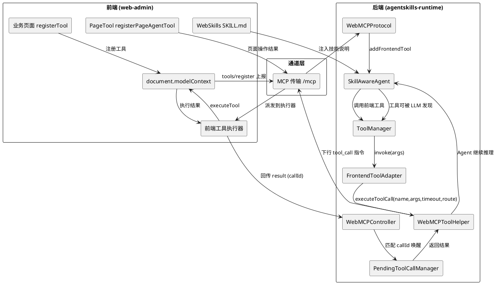

# Agent 操作 Web 应用链路闭环 —— 需求规格文档

## 1. 组件定位

### 1.1 核心职责

本组件负责打通 UCToo 系统中"Agent 直接操作 Web 应用"的完整闭环，使 agentskills-runtime 中的
SkillAwareAgent 能够真正驱动 web-admin 前端页面完成业务操作：

**工具注册 → 注册上报 → Agent 决策 → 指令下行 → 前端执行 → 结果回传 → Agent 继续推理**

本组件是 `webmcp-new-completion` 与 `webmcp-tool-chain` 的延续：后两者分别完成了协议对接与后端链路，
本组件补齐**指令下行通道**与**前端执行器**这两个断开的环节，并接入 PageTool 与 WebSkills。

### 1.2 核心输入

1. **前端页面注册的工具定义**：通过 `document.modelContext.registerTool` 注册的业务工具元数据
   （name、description、inputSchema、execute）及可选的路由信息
2. **后端 Agent 的工具调用决策**：SkillAwareAgent 推理后产生的工具调用请求（工具名 + 参数）
3. **前端工具执行结果**：前端执行完成后回传的结果数据或错误信息
4. **业务技能文档**：`src/skills/<业务名>/SKILL.md`，说明工具何时用、参数怎么填、结果怎么答
5. **PageTool 页面标记**：业务元素上的 `data-page-tool-id` / `data-page-tool-action` / `aria-label`

### 1.3 核心输出

1. **下行到前端的工具调用指令**：工具名、参数、callId、目标路由
2. **回传到 Agent 的工具执行结果**：结果数据或结构化错误信息
3. **Agent 可发现的前端工具集合**：同步到 Agent ToolManager 的工具定义
4. **PageTool 页面操作能力**：未适配页面的元素查询、滚动定位、导航点击

### 1.4 职责边界

- **不负责**：AI 模型推理（由 SkillAwareAgent 与 ChatModel 承担）
- **不负责**：后端技能的执行（由 SkillManager 承担）
- **不负责**：用户认证与权限（由 JWTAuthMiddleware 承担）
- **不负责**：前端业务工具的具体业务逻辑（由各业务页面承担，本组件只提供注册与执行通道）
- **不负责**：引入独立 WebAgent Node.js 服务（agentskills-runtime 自身充当 MCP 中枢层）
- **不负责**：训练或托管 GenUI 服务（本阶段只评估，不实现，见 8.2）

### 1.5 与既有工程的关系

| 工程 | 职责 | 与本组件关系 |
|---|---|---|
| `webmcp-new-completion` | TinyRemoter 对接、OpenAI 兼容接口、MCP 协议 | 前置，已完成大部分 |
| `webmcp-tool-chain` | 后端工具调用链路（SSE 推送 / 阻塞等待 / 结果回传） | 前置，后端已完整 |
| 本组件 | 指令下行通道 + 前端执行器 + PageTool + WebSkills | 补齐断点点 1/2/4/5 |

---

## 2. 领域术语

**document.modelContext**
: 浏览器原生 WebMCP 接口，用于在页面中注册工具。OpenTiny 官方现行推荐的标准接入方式，
通过 `initializeBuiltinWebMCP()` 注入 Polyfill 以兼容低版本浏览器。

**前端工具（Frontend Tool）**
: 注册在前端页面中的工具，由页面执行。按生命周期分为应用级常驻工具（如 `navigate_url`）
与页面级工具（随 `onMounted`/`onUnmounted` 注册注销）。

**工具调用链路闭环**
: Agent 决策调用 → 指令下行到前端 → 前端执行 → 结果回传 → 结果注入 Agent 上下文 → Agent 继续推理。

**callId**
: 工具调用唯一标识，由后端生成，贯穿下行指令与上行结果，用于关联请求与响应。

**PendingToolCallManager**
: 待处理工具调用管理器，管理回调注册、结果匹配、超时清理。

**WebMCPToolHelper**
: 后端统一工具执行入口，封装"生成 callId → 推送指令 → 注册回调 → 阻塞等待 → 超时处理"。

**PageTool**
: next-sdk 提供的页面级操作能力（`registerPageAgentTool`），对未适配 WebMCP 的页面提供
元素查询、滚动定位、导航点击。与 WebMCP Tool 互补而非替代。

**WebSkills**
: 业务技能文档（`SKILL.md`），说明工具适用意图、参数规则、工具选择、失败处理，
由 `loadSkillWithDetails` + `skillPlugin` 装载给模型。

**routeConfig / 路由前置条件**
: 业务工具声明的所属页面路由。当工具被调用但页面未在该路由时，返回 `ROUTE_REQUIRED` 提示，
由 PageTool 完成导航后重试。

---

## 3. 架构设计

### 3.1 目标链路

### 3.2 分层职责

| 层 | 组件 | 职责 |
|---|---|---|
| 注册层 | 业务页面 / `registerTool` | 声明工具元数据与执行逻辑 |
| 通道层 | MCP 传输（或 SSE / WS） | 承载上下行消息 |
| 中枢层 | WebMCPProtocol / Controller | 消息分发、会话管理、callId 匹配 |
| 执行层 | 前端工具执行器 / PageTool | 真正执行工具 |
| 认知层 | SkillAwareAgent + WebSkills | 决策调用哪个工具、怎么传参、怎么回答 |

---

## 4. 核心能力

### 4.1 指令下行通道

#### 4.1.1 业务规则

1. **通道唯一性规则**：When 后端需要向前端下发工具调用指令，the 系统 shall 使用**当前会话已建立的
   MCP 连接**下行，不得依赖额外的独立 EventSource 长连接

   a. 验收条件：[Agent 调用前端工具] → [指令通过 `/mcp` 已建立的传输下行，浏览器连接数不增加]

2. **通道不可用规则**：If 指令下行时对应会话的传输连接不存在或已关闭，the 系统 shall 返回明确的
   错误 ToolResponse（含"前端连接不可用"），不得静默失败

   a. 验收条件：[传输已断开时调用前端工具] → [工具返回 isError=true 且错误信息可读]

3. **callId 一致性规则**：The 下行指令 shall 携带 callId，前端回传结果 shall 携带同一 callId

   a. 验收条件：[下行 callId=call_x] → [回传 callId=call_x，PendingToolCallManager 匹配成功]

4. **禁止项**：禁止恢复 v19 移除的独立 EventSource 通道而不先解决 "Empty request body" 根因

   a. 验收条件：[检查前端连接建立逻辑] → [不存在未被根因说明的独立 EventSource 长连接]

#### 4.1.2 异常场景

1. **传输连接不存在**：返回错误 ToolResponse，Agent 可重试或换用其他方式
2. **写入失败**：清理该连接并返回错误，不阻塞 Agent
3. **callId 不匹配**：`/tool-result` 返回 404，防止结果错配

### 4.2 前端工具执行器

#### 4.2.1 业务规则

1. **统一执行入口规则**：When 前端收到 `tool_call` 指令，the 前端工具执行器 shall 通过
   `document.modelContext` 查找并执行目标工具，而不是广播消息后等待不确定的消费方

   a. 验收条件：[收到 tool_call(toolName=order_query)] → [执行器调用 executeTool 并返回结果]

2. **结果回传规则**：When 工具执行完成（成功或失败），the 执行器 shall 携带同一 callId 回传结果

   a. 验收条件：[工具执行完成] → [POST /tool-result {callId, result} 或 {callId, error}]

3. **未知工具规则**：If 指令中的 toolName 在当前 `document.modelContext` 中不存在，
   the 执行器 shall 回传明确的未知工具错误

   a. 验收条件：[调用未注册工具] → [回传 error="未找到工具 xxx"，后端 30s 内解除阻塞]

4. **路由前置条件规则**：When 被调用工具声明了目标路由而当前页面不在该路由，
   the 执行器 shall 先完成路由跳转再执行，或回传 `ROUTE_REQUIRED` 供 Agent 用 PageTool 导航后重试

   a. 验收条件：[在非目标页调用页面级工具] → [返回 ROUTE_REQUIRED 提示，或自动跳转后执行成功]

5. **执行超时规则**：If 工具执行超过约定时间未返回，the 执行器 shall 回传超时错误

   a. 验收条件：[工具执行超过 30s] → [回传 error，后端解除阻塞]

6. **禁止项**：禁止执行器只做 `window.postMessage` 广播而不保证有确定的执行与回传路径

   a. 验收条件：[任意 tool_call 指令] → [必然有确定的执行结果或错误回传，不会无人认领]

#### 4.2.2 异常场景

1. **页面已卸载**：工具注册已随 AbortController 注销 → 回传未知工具错误
2. **执行抛异常**：捕获并回传 error 字段，不得导致执行器整体失效
3. **并发调用**：多个 callId 并行执行，互不干扰

### 4.3 工具注册与上报

#### 4.3.1 业务规则

1. **标准注册规则**：The 前端业务工具 shall 通过 `document.modelContext.registerTool` 注册，
   不得继续使用 `src/mcp-servers/` 的 `server.registerTool` 旧模式

   a. 验收条件：[新增业务工具] → [使用 document.modelContext.registerTool 注册]

2. **生命周期规则**：When 业务页面卸载，the 页面级工具 shall 通过 AbortController 注销，
   避免模型看到已不可用的工具

   a. 验收条件：[离开订单页] → [order_query / order_detail 从 modelContext 中注销]

3. **上报后端规则**：When 工具注册或注销后，the 前端 shall 将工具定义同步到后端
   `FrontendToolRegistry` 与 Agent ToolManager

   a. 验收条件：[前端注册工具 order_query] → [后端 Agent ToolManager 中可发现 order_query]

4. **重名冲突规则**：If 前端工具与后端技能同名，the 系统 shall 保留后端技能并记 WARN 日志

   a. 验收条件：[前端注册与后端同名的工具] → [后端保留原技能，日志有 WARN]

5. **禁止项**：禁止前端工具仅存在于 `document.modelContext` 而不同步到后端

   a. 验收条件：[前端工具注册成功] → [后端 ToolManager 中存在同名工具]

### 4.4 PageTool 页面操作

#### 4.4.1 业务规则

1. **初始化规则**：The 前端应用 shall 在 `createApp` 之前调用 `initializeBuiltinWebMCP()` 与
   `registerPageAgentTool()`，确保 PageTool 与 WebMCP Polyfill 就绪

   a. 验收条件：[应用启动] → [document.modelContext 可用，PageTool 工具已注册]

2. **页面标记规则**：When 业务需要开放页面查询/定位/导航，the 业务页面 shall 在元素上标注
   `data-page-tool-id`、`data-page-tool-action`、`aria-label`

   a. 验收条件：[业务元素标注] → [PageTool 可识别该目标并允许对应动作]

3. **黑名单规则**：The PageTool 配置 shall 排除对话框自身与敏感区域，防止 Agent 操作 AI 界面本身

   a. 验收条件：[PageTool 初始化] → [黑名单包含 .chat-add-window / .tr-sender / .tr-bubble 等]

4. **副作用禁止规则**：The PageTool shall 不开放 `fill`、`select`、`executeJavascript`
   以及提交、删除、发布、支付等副作用操作

   a. 验收条件：[检查 PageTool 动作白名单] → [不含写操作类动作]

5. **与业务工具协同规则**：When 需要读取业务数据时，the Agent shall 优先使用 WebMCP 业务工具，
   PageTool 只负责查询、定位、导航

   a. 验收条件：[查询订单数据] → [调用 order_query，而非用 PageTool 读取表格文本]

### 4.5 WebSkills 业务技能

#### 4.5.1 业务规则

1. **技能文档结构规则**：The 业务技能文档 shall 采用 `src/skills/<业务名>/SKILL.md`，
   含 YAML frontmatter（name、description）与"适用范围、可用工具、参数规则、工具选择"四段

   a. 验收条件：[新增订单技能] → [src/skills/orders/SKILL.md 含 frontmatter 与四段结构]

2. **技能装载规则**：When 应用启动，the 系统 shall 通过 `import.meta.glob` 加载全部 SKILL.md，
   经 `loadSkillWithDetails` 解析后由 `skillPlugin` 注入对话

   a. 验收条件：[应用启动] → [技能列表非空，模型可感知业务工具用法]

3. **不虚构规则**：The 技能文档 shall 明确要求模型在工具不可用时提示用户，不得虚构结果

   a. 验收条件：[技能文档内容] → [包含"工具不可用时不得虚构结果"的约束]

4. **禁止项**：禁止技能文档中声明的页面目标与页面代码实际标注不一致

   a. 验收条件：[比对 SKILL.md 与页面 data-page-tool-id] → [完全一致]

### 4.6 后端内置工具收敛

#### 4.6.1 业务规则

1. **统一链路规则**：The 后端内置 WebMCP 工具（`web_navigate` / `web_notify` / `web_request_approval`）
   shall 与前端工具使用相同的下行/上行链路

   a. 验收条件：[分别调用 web_navigate 与 order_query] → [走同一通道，同一 callId 匹配机制]

2. **渐进收敛规则**：If 某后端内置工具的能力可由前端标准工具承担，the 系统 shall 在前端工具就绪后
   将其中置为过渡状态并最终移除

   a. 验收条件：[navigate_url 前端工具可用] → [web_navigate 标记为 deprecated 并排期移除]

---

## 5. DFX 约束

### 5.1 性能

- 工具调用指令下行延迟：≤ 500ms（从 Agent 决策到消息发出）
- 结果回传到回调触发延迟：≤ 200ms
- 前端工具同步到 Agent ToolManager：≤ 1s（10 个工具以内）
- 单页面常驻长连接数：≤ 1（MCP 传输），不额外占用浏览器连接池

### 5.2 可靠性

- 工具调用必须显式超时：普通工具 30s，需审批工具 120s
- 超时后必须清理 PendingToolCallManager 条目，不得泄漏
- 通道断开时返回明确错误，不得静默失败或无限阻塞
- PageTool 初始化失败不得阻塞应用正常启动

### 5.3 安全性

- callId 必须校验，未知 callId 拒绝并返回 404
- PageTool 不开放写操作与脚本执行
- 提交/删除/发布/支付类操作必须走带权限校验与确认机制的专用工具
- 用户身份通过 JWT 解析，工具调用需携带有效 access_token

### 5.4 可维护性

- 工具调用链路每段（决策→下行→执行→回传→唤醒）必须有可追踪日志，含 toolName 与 callId
- 前端工具注册集中管理，页面级工具随页面生命周期自动注销
- 不得新增并行注册体系，`src/mcp-servers/` 旧模式需排期收敛

### 5.5 兼容性

- 必须兼容 `document.modelContext` 标准接口与 `initializeBuiltinWebMCP()` Polyfill
- 前端框架：Vue 3.5+
- 后端框架：agentskills-runtime（仓颉）

### 5.6 仓颉代码开发约束

- 所有仓颉（.cj）代码必须使用 **cangjie-coder 技能** 编写
- `magic.tool.webmcp` 不应 import `magic.app.services.webmcp`（避免循环依赖）
- 数据库列名使用 snake_case，仓颉代码使用 camelCase
- `type` 是仓颉保留关键字，需用反引号转义
- 仓颉 String 的 trim 方法是 `trimAscii()`
- 仓颉 Duration 用 `Duration.second * N` 格式
- 仓颉 HashMap 用 `add()` 而不是 `put()`
- Condition 需要 ReentrantMutex 配合使用

---

## 6. 数据约束

### 6.1 下行工具调用指令

1. **toolName**：必填，字符串，前端注册的工具名
2. **arguments**：必填，对象，与 inputSchema 一致
3. **callId**：必填，字符串，格式 `call_{timestamp}_{random8位}`
4. **route**：可选，字符串，目标页面路由

### 6.2 上行工具结果

1. **callId**：必填，字符串，与下行一致
2. **result**：工具成功时必填，对象
3. **error**：工具失败时必填，字符串

### 6.3 前端工具注册信息

1. **name**：必填，字符串，全局唯一
2. **description**：必填，字符串，供 LLM 理解
3. **inputSchema**：必填，对象，JSON Schema
4. **title**：可选，字符串
5. **route**：可选，字符串，所属页面路由
6. **annotations**：可选，对象

### 6.4 PageTool 页面标记

1. **data-page-tool-id**：必填，稳定且唯一的业务标识
2. **data-page-tool-action**：必填，允许的动作类别（query / navigation）
3. **aria-label**：必填，可访问名称

---

## 7. 需求追踪矩阵

| 需求ID | 对应问题 | 优先级 | 需求标题 |
|---|---|---|---|
| REQ-OP-01 | 断点 1 | P0 | 指令下行通道（复用 MCP 传输） |
| REQ-OP-02 | 断点 2 | P0 | 前端工具执行器 |
| REQ-OP-03 | 断点 3 | P0 | 工具注册上报后端 |
| REQ-OP-04 | 断点 4 | P1 | PageTool 接入 |
| REQ-OP-05 | 断点 5 | P1 | WebSkills 业务技能体系 |
| REQ-OP-06 | 断点 7 | P1 | 后端内置工具收敛 |
| REQ-OP-07 | 断点 7 | P2 | `src/mcp-servers/` 旧模式迁移 |
| REQ-OP-08 | 断点 6 | P2 | GenUI 与 tiny-robot 版本评估 |

---

## 8. 范围说明

### 8.1 本阶段实现

REQ-OP-01 ~ REQ-OP-06，目标是让"Agent 操作 Web 应用"端到端可用，并以一个真实业务场景
（建议选 `entity` 或订单类页面，与参考实现的订单场景对齐）作为验收 Demo。

### 8.2 本阶段不实现

- **GenUI**：依赖 genui-sdk-vue，会引入整套低代码引擎栈，且当前依赖已被移除。
  本阶段只做可行性评估（REQ-OP-08），输出结论文档，不落代码。
- **tiny-robot 版本升级**：升级到 0.5.2-alpha.x 会引入 `tiny-robot-chat` 与本地运行时概念，
  与当前远端 Agent 架构存在路线冲突。本阶段只评估，不升级。

---

## 9. EARS 格式需求清单

### REQ-OP-01：指令下行通道 [P0]

**Ubiquitous**：The 工具调用指令 shall 通过当前会话已建立的 MCP 连接下行，不新建独立长连接。

**Event-Driven**：When Agent 通过 ToolManager 调用前端工具，the WebMCPToolHelper shall 通过
已建立的传输通道推送 tool_call 指令（含 toolName、arguments、callId、route）。

**Unwanted Behaviour**：If 传输连接不存在或已关闭，the 系统 shall 返回含"前端连接不可用"的
错误 ToolResponse，不得静默失败。

**Unwanted Behaviour**：If 恢复独立 EventSource 通道而未解决 "Empty request body" 根因，
the 系统 shall 视此为回归缺陷并修正。

### REQ-OP-02：前端工具执行器 [P0]

**Ubiquitous**：The 前端 shall 提供统一的工具执行器，接收指令、执行工具、回传结果。

**Event-Driven**：When 执行器收到 tool_call 指令，the 执行器 shall 通过
`document.modelContext` 查找并执行目标工具。

**Event-Driven**：When 工具执行完成，the 执行器 shall 携带同一 callId 回传 result 或 error。

**Unwanted Behaviour**：If toolName 在当前 modelContext 中不存在，the 执行器 shall 回传未知工具错误。

**Unwanted Behaviour**：If 工具声明了目标路由而当前不在该路由，the 执行器 shall 回传
`ROUTE_REQUIRED` 或自动跳转后执行。

**Unwanted Behaviour**：If 执行超过 30 秒未返回，the 执行器 shall 回传超时错误。

**Unwanted Behaviour**：If 执行器仅广播消息而无确定执行与回传路径，the 系统 shall 视此为架构缺陷。

### REQ-OP-03：工具注册上报后端 [P0]

**Event-Driven**：When 前端注册或注销工具，the 前端 shall 将工具定义同步到后端
FrontendToolRegistry 与 Agent ToolManager。

**Event-Driven**：When 业务页面卸载，the 页面级工具 shall 通过 AbortController 注销并同步后端。

**Unwanted Behaviour**：If 前端工具与后端技能同名，the 系统 shall 保留后端技能并记 WARN 日志。

**Unwanted Behaviour**：If 前端工具仅存在于 modelContext 而不同步到后端，the 系统 shall 视此为缺陷。

### REQ-OP-04：PageTool 接入 [P1]

**Ubiquitous**：The 前端应用 shall 在 createApp 之前完成 `initializeBuiltinWebMCP()` 与
`registerPageAgentTool()`。

**Event-Driven**：When 业务需要开放页面查询/定位/导航，the 业务页面 shall 标注
`data-page-tool-id`、`data-page-tool-action`、`aria-label`。

**Unwanted Behaviour**：If PageTool 配置未排除对话框自身与敏感区域，the 系统 shall 视此为缺陷。

**Unwanted Behaviour**：If PageTool 开放 fill、select、executeJavascript 或提交/删除/发布/支付，
the 系统 shall 视此为安全违规。

**Ubiquitous**：The Agent shall 优先使用 WebMCP 业务工具读取业务数据，PageTool 只负责查询、定位、导航。

### REQ-OP-05：WebSkills 业务技能体系 [P1]

**Ubiquitous**：The 业务技能 shall 以 `src/skills/<业务名>/SKILL.md` 组织，含 frontmatter 与
"适用范围、可用工具、参数规则、工具选择"四段。

**Event-Driven**：When 应用启动，the 系统 shall 加载全部 SKILL.md 并经 skillPlugin 注入对话。

**Unwanted Behaviour**：If 技能文档声明的页面目标与页面实际标注不一致，the 系统 shall 视此为缺陷。

### REQ-OP-06：后端内置工具收敛 [P1]

**Ubiquitous**：The 后端内置 WebMCP 工具 shall 与前端工具使用相同的下行/上行链路。

**Event-Driven**：When 某后端内置工具的能力可由前端标准工具承担，the 系统 shall 将其置为
deprecated 并排期移除。

### REQ-OP-07：旧注册模式迁移 [P2]

**Event-Driven**：When 新增或改造业务工具，the 开发 shall 使用 `document.modelContext.registerTool`
而非 `src/mcp-servers/` 的 `server.registerTool`。

**Ubiquitous**：The `src/mcp-servers/` 目录下的既有工具 shall 有明确的迁移计划与排期。

### REQ-OP-08：GenUI 与版本评估 [P2]

**Ubiquitous**：The 本阶段 shall 输出 GenUI 可行性评估与 tiny-robot 版本升级影响分析文档，
但不实施代码改造。
