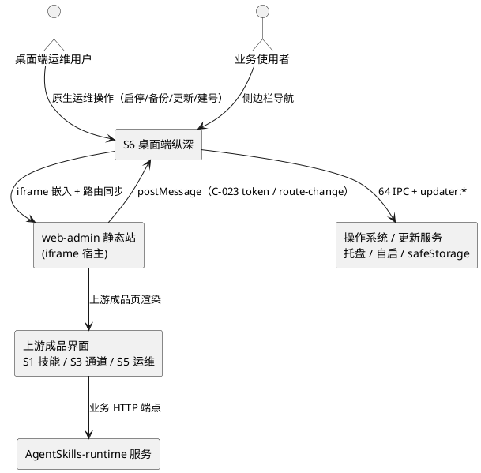
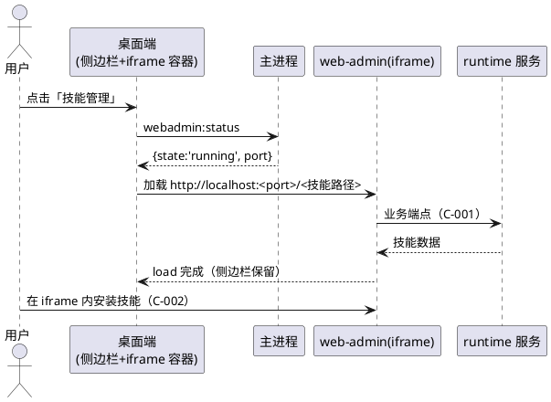
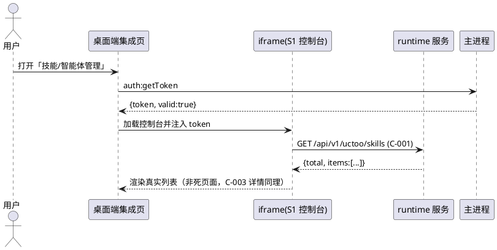
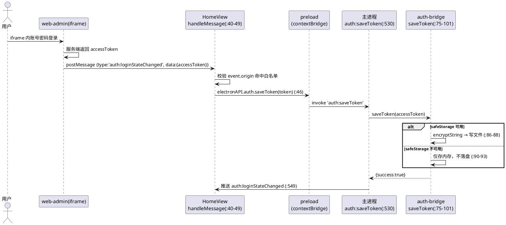
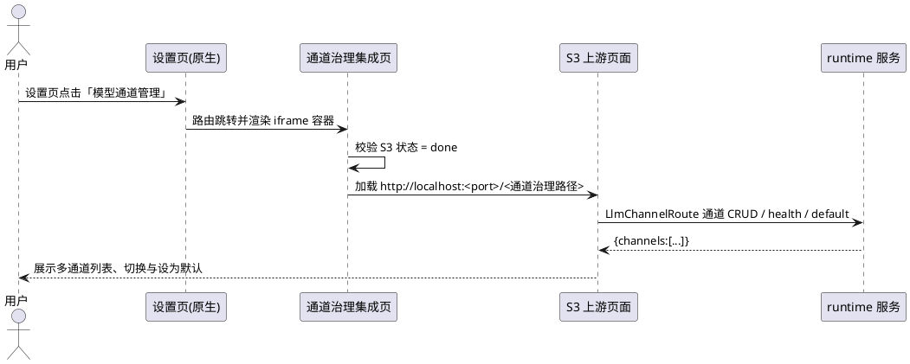

# S6 桌面端纵深 · spec

> 主工程：`ConsoleClosure`（三端能力补全）　子系统 ID：**S6**　中文名：桌面端纵深
> feature_name：`ConsoleClosure--desktop-depth`　产物目录：`specs/ConsoleClosure/ConsoleClosure--desktop-depth/`
> 语言标签：**app（Electron）**　集成契约：**C-023 桌面端 iframe 集成桥**（待 S6 spec 冻结）
> 承载缺口：**A7**（技能页假实现）、**A8**（智能体页死页面）、**G6**（多通道管理）+「混合模式落地」
> 上游依赖：**S1 / S3 / S5 均 `done`**（`SPECS_INDEX.md` §4 DAG）　事实依据：`research.md` §4 + `apps/pc-client` 源码复核　铁律：9（复用优先）/ 12（落盘优先）/ 15（不重复子系统细节）

---

# **1. 组件定位**

## **1.1 核心职责**

本组件负责在 Electron 桌面端以「核心运维原生 + 业务 iframe 深度集成」混合模式承接技能、智能体、LLM 通道与运维能力，消除 PC 端假实现与死页面。

## **1.2 核心输入**

1. **iframe 内 web-admin 的跨上下文消息**：登录态与路由变更消息，经 `postMessage` 抵达 `src/views/HomeView.vue:40-49`（契约 C-023 记 `uctoo://route-change` / `auth:token`，现网实现为 `auth:loginStateChanged`，见 §7-T1）。
2. **上游子系统成品界面 URL**：S1 技能控制台、S3 LLM 通道与成本治理、S5 系统运维与可观测。**硬前提**：三者须先达 `done`，否则集成的是半成品（`SPECS_INDEX.md` §4 依赖理由）。
3. **用户操作指令**：侧边栏点击（`src/components/AppSidebar.vue`，挂载于 `src/App.vue:40`）、托盘菜单点击、设置页表单提交。
4. **主进程推送（9 个）**：`runtime:stateChanged`（`electron/main/index.ts:366`）、`pgsql:stateChanged`（:435）、`webadmin:stateChanged`（:446）、`auth:loginStateChanged`（:549）、`bootstrap:progress`（:628）、`runtime:integrateProgress`（:946）、`service:startFailed`（:699）、`service:postgresqlReuse`（:794）、`navigate`（`electron/modules/tray.ts:152,185`，订阅于 `src/App.vue:27`）。
5. **原生能力 IPC 返回值**：Runtime 11 + PostgreSQL 8 + WebAdmin/环境同步 8 + 配置 15 + 建号 5 + 认证/依赖/更新/自启/技能 14 = 64 个 invoke 通道，全部注册于 `electron/main/index.ts`，经 `electron/modules/ipc.ts:20` 封装；首次运行向导输入同源：`setup:database` / `setup:ai` / `setup:complete` / `setup:hasSuperAdmin` / `setup:submit`（:217-240）。

## **1.3 核心输出**

1. **令牌凭据落盘**：token 经主进程加密后写入凭据文件（`electron/modules/auth-bridge.ts:75-101`，加密分支 :86-88）。
2. **桌面端路由与 iframe 目标 URL**：由侧边栏/托盘/`navigate` 驱动 `vue-router`（`src/router/index.ts:4-52`，8 条路由），并向 iframe 回送路由同步、登录态通知与 ack 回执（C-023 桌面端→iframe 方向）。
3. **托盘与侧边栏状态呈现**：runtime / pgsql / webadmin 三态随推送实时反映。
4. **系统集成副作用**：开机自启（`autoLaunch:*`，:332-344）、应用更新（`updater:*`，:307-322）、依赖检测安装（`dep:*`，:554-572）、外链与目录打开（`system:openExternal/openPath`，:87-92）。

## **1.4 职责边界**

> **本章是 S6 的定盘星**，直接消解 `SPECS_INDEX.md` §7 风险 **R7 桌面端双份实现**。
> 判定原则：**凡操作系统能力 → 必须原生；凡服务端业务 → 必须 iframe。两者互斥，不重叠、不双写。**

### 1.4.1 必须原生（禁止改走 iframe，亦不得重写）

| 能力 | 判定依据（`research.md` §4.3 / 源码复核） |
|---|---|
| Runtime 进程管理 | `runtime:start/stop/restart/status/install/logs/versionInfo/checkUpdate/upgrade/integrate/integrateStatus`（`index.ts:255-359, 949-953`），11 通道 |
| 内置 PostgreSQL 实例管理 | `pgsql:init/start/stop/status/backup/restore/testConnection/updateEnvUrl`（:392-423），8 通道 |
| WebAdmin 静态站托管与环境同步 | `webadmin:start/stop/status/invalidateCache`、`envsync:getRuntimeEnv/setRuntimeEnv/syncWebAdminEnv/getSyncStatus`（:457-515），8 通道 |
| 更新、自启、依赖检测、托盘与窗口 | `updater:*`（:307-322）、`autoLaunch:*`（:332-344）、`dep:*`（:554-572）；1 BrowserWindow + 1 Tray（`research.md` §4.3） |
| 系统路径与本地配置、首次建号 | `system:getPaths/openPath/openExternal/getAppInfo`（:71-97）、`config:*` 15 通道（:112-201）、`setup:*` 5 通道（:217-240） |
| 令牌保管（加密/读取/清除） | `auth:getToken/saveToken/clearToken`（:521-539，实现 `auth-bridge.ts:75-101`） |

### 1.4.2 必须 iframe（禁止在渲染进程写第二套 Vue 业务页）

| 能力 | 承载上游 / 契约 |
|---|---|
| 技能列表 / 详情 / 安装 / 校验 / 用量 | S1 成品页；`SkillRoutes.cj:68-103`（C-001~C-005） |
| 智能体管理、任务、Agent 相关 | S1 / S2 成品页（`research.md` §5.1） |
| LLM 多通道管理与成本治理 | S3 成品页；`LlmChannelRoute.cj:54-74`（G6） |
| 日志查看、环境采集、健康检查 | S5 成品页；C-019 / C-020 |
| 登录与注册 | PC 端**无原生登录页**（`research.md` §4.4），登录在 iframe 内完成 |

### 1.4.3 明确不做

1. **禁止**为技能、智能体、LLM 通道、任务在 `src/views/**` 新建业务 `.vue` 页面——只允许新建 iframe 容器组件。
2. **禁止**重写或删除 §1.4.1 中任一原生能力；本子系统只做「打通」与「集成」。
3. **禁止**在 Electron 侧重复实现权限与菜单逻辑——菜单由后端菜单树驱动（C-024，`src/router/guard/menu.ts:79`），PC 端只消费不生产；**禁止**新增业务数据表承载集成状态，优先复用 `config:*` 键值与凭据文件，新增表须按铁律 9 书面论证（§6.1）。

---

# **2. 领域术语**

**混合模式**
: 桌面端「核心运维原生 + 业务 iframe」的能力承载方式，用户 2026-10-29 拍板（`research.md` §4.4、`SPECS_INDEX.md` §1）。

**iframe 深度集成页**
: 保留桌面端侧边栏与窗口框架、内容区由 iframe 承载上游成品业务页的页面形态，区别于 `HomeView.vue` 的全屏 iframe。

**postMessage 桥（C-023）**
: 渲染进程与 iframe 内 web-admin 之间的跨上下文消息通道，承载 token 回传与路由同步；原生运维面指由主进程 IPC 直接支撑的 Runtime 监控 / PostgreSQL / 设置 / 关于四页。

**safeStorage**
: Electron 提供的系统级加密存储，用于 token 加密；`isEncryptionAvailable()` 为 false 时不得退化为明文落盘。

---

# **3. 角色与边界**

## **3.1 核心角色**

- **桌面端运维用户**：执行首次运行向导、Runtime/PostgreSQL 启停、更新、自启、备份恢复等原生运维操作的人。
- **业务使用者**：在 iframe 深度集成页中使用技能、智能体、LLM 通道的人，心智与 Web 端一致。
- **超级管理员**：首次运行时经 `setup:submit`（`index.ts:240`）建立的首个账号，拥有全部业务页访问权。

## **3.2 外部系统**

- **AgentSkills-runtime 服务**：服务端能力源（≈976 端点，`research.md` §2.3）；桌面端**不直连业务端点**，一律经 iframe 内页面访问。
- **web-admin 静态站（iframe 宿主）**：本地托管，桌面端以 `postMessage` 与其交换 token 与路由。
- **上游成品界面**：S1 / S3 / S5 —— S6 的集成对象，必须先 `done`。
- **操作系统与更新服务**：提供托盘、开机自启、`safeStorage`、文件路径与外链打开，以及 `updater:*` 应用升级。

## **3.3 交互上下文**

---

# **4. DFX约束**

## **4.1 性能**

1. 状态类 IPC 通道响应 ≤ **100ms**，其余原生通道 ≤ **200ms**（不含进程启停类长操作）。
2. iframe 深度集成页首屏可交互 ≤ **3s**（自 `webadmin:status` 返回 `state=running` 起算）。
3. 路由切换渲染完成 ≤ **300ms**；同屏并存 iframe ≤ **3** 个，实例复用不销毁，常驻内存增量 ≤ **50MB**。

## **4.2 可靠性**

1. iframe 加载失败自动重试上限 **5 次**（`HomeView.vue:14` `MAX_LOAD_ATTEMPTS = 5`），用尽后展示明确错误与「重试」，不得静默空白。
2. 三个 `*:stateChanged` 推送自事件产生到 UI 反映 ≤ **2s**。
3. token 解密失败或凭据文件损坏时，系统应当清除本地凭据并引导重新登录，禁止保留无效态导致业务页反复 401。

## **4.3 安全性**

1. **token 必须加密落盘**：`safeStorage.isEncryptionAvailable()` 为 true 时经 `safeStorage.encryptString` 写入（`auth-bridge.ts:86-88`）；**禁止**任何明文落盘（含 base64、配置文件、日志）。
2. **降级不得退化为明文**：加密不可用时仅存内存（`auth-bridge.ts:90-93`），重启后必须重新登录，禁止以未加密文件兜底。
3. **iframe 来源校验**：处理 `postMessage` 必须先校验 `event.origin`，再校验消息类型与负载；校验通过前**禁止**向 iframe 回传 token 或身份信息。
4. **白名单精确化**：现网为前缀匹配 `http://localhost:` / `http://127.0.0.1:`（`HomeView.vue:41-42`），须改为精确 origin 或与 `webadmin:status` 返回端口比对，杜绝本机任意端口恶意页面骗取 token。
5. **token 禁止经 URL 传递**：集成页 URL 不得携带 token / API Key；跨上下文仅走 `postMessage`。
6. 渲染进程**禁止** `nodeIntegration`，对外能力仅经 `contextBridge` 暴露的 13 个方法组（`electron/preload/index.ts`）；登出必须同时清除内存态与磁盘密文并推送 `auth:loginStateChanged`。

## **4.4 可维护性**

1. iframe 加载失败/重试/降级全链路必须落主进程日志，含 origin、端口、尝试次数、失败原因，统一 `key=value` 格式；集成页 URL 必须登记到统一「集成路由表」（§6.1），禁止组件内硬编码。
2. C-023 消息须带 `version` 字段，版本不一致时降级为「仅渲染、不交换 token」并告警，不得静默失败。

## **4.5 兼容性**

1. 现有 **64 个 IPC 通道**签名只增不改不删；确需变更须按 `SPECS_INDEX.md` §6 登记并回归 L2。
2. 上游 S1/S3/S5 未 `done` 时对应集成页降级为占位态，桌面端其余功能不受影响。
3. `webadmin:status` 端口变化时集成页 URL 自动跟随，不得依赖固定 3031（`HomeView.vue:6` 仅为初值）；目标平台以 Windows 为准，macOS / Linux **待确认**（§7-T4）。

---

# **5. 核心能力**

## **5.1 桌面端导航与 iframe 深度集成**

### **5.1.1 业务规则**

1. **原生/集成分区**：当用户在侧边栏点击导航项时，系统应当按 §1.4 清单判定目标归属并渲染原生页或 iframe 容器。｜验收：点击技能/智能体/通道 → 渲染 iframe 容器且 URL 命中集成路由表；点击 Runtime/PG/设置/关于 → 渲染原生页且不产生 iframe。
2. **侧边栏保留**：当渲染任一集成页时，系统应当保留桌面端侧边栏与窗口框架，不得让 iframe 全屏覆盖。｜验收：集成页可见时 8 个导航项全部可点击且跳转生效，iframe 实例切走保活不销毁。
3. **上游就绪**：若上游子系统未达 `done`，则系统应当将集成页渲染为「上游未就绪」占位态并标注依赖对象，禁止展示半成品页面。｜验收：S1 标记未完成 → 技能集成页显示占位态并标注「等待 S1 完成」。
4. **禁止项**：禁止在 `src/views/**` 下新增技能、智能体、通道、任务的业务 `.vue` 实现。｜验收：代码审查中 `src/views/{skills,agents,channels,tasks}/**` 无新增业务表单或表格页。

### **5.1.2 交互流程**

### **5.1.3 异常场景**

1. **web-admin 未启动** — 触发：`webadmin:status` 返回 `state != 'running'`；行为：调用 `webadmin:start` 并在 30s 内等待转 `running`；感知：「正在启动本地管理站…」→ 超时「启动失败，请前往 Runtime 监控检查」+「重试」。
2. **iframe 加载失败** — 触发：`onIframeError`（`HomeView.vue:33-38`）；行为：按 5 次上限自动重试，每次前复查 `webadmin.status()`；感知：显示失败原因与第 N/5 次重试，用尽后提供手动重试。

## **5.2 技能与智能体页打通（A7 / A8）**

### **5.2.1 业务规则**

1. **技能页真值**：当用户打开技能管理页时，系统应当展示 iframe 内 S1 技能控制台的真实技能列表，不得返回空数组或硬编码占位。｜验收：Web 端已安装 1 个技能 → 桌面端集成页在同一账号下展示同名技能（`SPECS_INDEX.md` §5.2 冒烟用例 2）。
2. **假实现清除**：`skills:list` 硬编码 `return { success: true, data: [] }`（`index.ts:583-585`）与 `skills:getDetail` / `skills:install` 返回 `'Not implemented'`（:587-593）必须被处置，最终态不得保留「假成功」。｜验收：检索 `Not implemented` 与 `data: []` 假实现，结果为零或仅存于明确标注为桥接的通道。
3. **智能体页真值**：当用户打开智能体管理页时，系统应当展示真实数据，不得保持 `const agents = ref<any[]>([])` 的死状态（`src/views/agents/AgentsView.vue:4`）。｜验收：服务端存在 1 个 Agent → 桌面端集成页展示该 Agent 且非空态。
4. **跨端一致**：当同一账号在 Web 端与桌面端先后查看同一技能时，系统应当展示同一份服务端数据，桌面端不得持有独立副本。｜验收：Web 端修改技能启用状态 → 桌面端刷新后状态一致。

### **5.2.2 交互流程**

### **5.2.3 异常场景**

1. **未登录访问** — 触发：`auth:getToken` 返回 `valid:false` 时直接进入集成页；行为：跳转 iframe 登录上下文，登录后按 §5.3 回传 token 并自动返回原页；感知：「请先登录」→ 登录完成回到技能页。
2. **runtime 未启动或安装失败** — 触发：`runtime:status` 非运行态，或 iframe 内安装返回失败（C-002）；行为：前者展示未就绪提示并提供跳转「Runtime 监控」入口，后者错误仅在 iframe 内呈现、桌面端只记日志不弹二次框；感知：「Runtime 未启动，技能数据不可用」+「前往启动」，或仅一份上游错误提示。

## **5.3 登录态与令牌桥（C-023）**

### **5.3.1 业务规则**

1. **token 回传**：当 iframe 内完成登录时，系统应当经 `postMessage` 将 token 回传桌面端并加密保存，不得在桌面端另设原生登录页。｜验收：iframe 内登录成功 → 凭据文件为 `safeStorage` 密文，重启后仍为登录态。
2. **来源校验**：当桌面端收到 `postMessage` 时，系统应当先校验 `event.origin` 命中白名单，否则丢弃消息。｜验收：非白名单 origin 的伪造 `auth:loginStateChanged` → 无 token 写入且记录安全告警日志。
3. **不降级**：若 `safeStorage.isEncryptionAvailable()` 为 false，则系统应当仅将 token 存于内存并在重启后要求重新登录，禁止明文落盘。｜验收：模拟加密不可用 → 磁盘无明文 token，重启后为未登录态。
4. **登出同步**：当收到登出事件时，系统应当清除磁盘密文与内存态，并令所有集成页回到未登录态。｜验收：iframe 内登出 → 集成页刷新显示登录引导，托盘状态同步为未登录。
5. **禁止项**：禁止将 token 拼接进 iframe URL 或写入 `config:*` 配置值。｜验收：集成页 URL 构造处无 token 字段；`config:getAll` 结果无 token 相关键。

### **5.3.2 交互流程**

### **5.3.3 异常场景**

1. **伪造来源** — 触发：`postMessage` 的 `event.origin` 不在白名单内；行为：丢弃消息、不写 token、记录含 origin 的安全告警日志；感知：无变化，运维可在日志追溯被拒来源。
2. **空 token / 写入失败 / token 过期** — 触发：`accessToken` 为空、写入抛异常（`auth-bridge.ts:76-78, 96-100`）或集成页请求返回 401；行为：拒绝空 token 不写文件、写入异常回退内存态并记录 error、401 时清除凭据并推送未登录态；感知：分别提示「登录信息无效」、本次可用但重启需重登、统一回到登录引导且无连续 401 报错。

## **5.4 多通道管理入口与设置面收口（G6）**

### **5.4.1 业务规则**

1. **多通道入口**：当用户在桌面端需要管理 LLM 通道时，系统应当提供进入 S3 通道治理集成页的入口，并在设置面给出等价跳转。｜验收：设置页存在「模型通道管理」入口，点击后渲染 S3 集成页。
2. **单条配置兼容**：当用户仍在设置页使用单条 AI 配置时，系统应当保留现有 `provider/apiKey/baseUrl/model` 四项与 6 家预设（`SettingsView.vue:59-63, 68-74`）的读写行为，且默认通道展示与 S3 集成页一致或标注「以通道管理页为准」。｜验收：设置页保存单条配置 → `config:get('ai')` 返回结构与改动前一致；S3 设 B 为默认 → 设置页无冲突值。
3. **多通道不走原生**：多通道列表、切换、设为默认、健康探测**必须**由 S3 集成页承载，桌面端不得新增多通道 IPC 或本地多通道表。｜验收：`electron/main/index.ts` 中无 `channel:*` 新增注册；多通道数据仅存在于 iframe 上下文。
4. **未就绪降级**：若 S3 未达 `done`，则系统应当将入口置为不可用并说明依赖，禁止跳转空白页。｜验收：S3 未 done → 入口禁用 + 提示「待 S3 完成后开放」。

### **5.4.2 交互流程**

### **5.4.3 异常场景**

1. **S3 未就绪** — 触发：集成路由表中 S3 状态非 `done`；行为：入口禁用、渲染占位态、不加载 iframe；感知：「通道管理待 S3 完成后开放」。
2. **单条配置保存失败** — 触发：`config:set('ai', ...)` 返回失败或 Runtime 未启动（`SettingsView.vue:182-191`）；行为：保留用户输入并记录日志，不做静默丢弃；感知：「配置已保存，Runtime 未启动将在启动后验证」或明确失败原因。

# **6. 数据约束**

## **6.1 集成路由条目**

> 复用优先：本对象优先落既有 `config:*` 键值（铁律 9）。是否新增 1 张表由 design 步论证，论证不通过即复用配置键。

1. **routeKey**：桌面端路由键，必须命中 `src/router/index.ts:4-52` 已定义的 8 条 name 或本子系统新增的集成页 name，全端唯一。
2. **upstreamId**：上游子系统标识，取值限定 `S1` / `S3` / `S5`，必填。
3. **iframePath**：iframe 内相对路径，必须以 `/` 开头且不含协议与主机，端口由 `webadmin:status` 运行时注入。
4. **readinessState**：取值 `ready` / `pending`，仅 `ready` 时允许加载 iframe。
5. **requiredContract**：依赖契约编号列表（如 `C-001,C-002`），至少 1 项，用于 L2 冒烟断言；集成页 `sidebarVisible` 恒为 true（§5.1.1-2）。

## **6.2 令牌凭据**

1. **accessToken**：登录令牌，非空字符串；**禁止**以明文出现在日志、配置或 iframe URL 中。
2. **storageMode**：取值 `safeStorage`（加密落盘）或 `memory`（仅内存）；`memory` 时重启必须回到未登录态，登出时磁盘密文与内存态均须清除。
3. **valid**：有效性标志，布尔值；解密失败或文件缺失时为 false。
4. **origin**：令牌来源 origin，必须是白名单内精确值，用于审计与伪造来源追溯。

## **6.3 原生运维状态快照**

1. **runtimeState / pgsqlState / webadminState**：分别取自 `runtime:status`、`pgsql:status`、`webadmin:status`，UI 呈现必须与三个 `*:stateChanged` 推送（`index.ts:366 / 435 / 446`）一致。
2. **port / loggedIn**：WebAdmin 端口为正整数，集成页 URL 必须取本值而非硬编码 3031；登录态布尔值与 `auth:loginStateChanged`（:549）保持一致。

---

# **7. 待确认项**

| 编号 | 事项 | 待确认动作 |
|---|---|---|
| T1 | C-023 记消息类型为 `uctoo://route-change` / `auth:token`，现网实现为 `auth:loginStateChanged`（`HomeView.vue:44`） | 待与 C-023 冻结口径核对，统一后落 `contract.md` |
| T2 | `skills:list` / `skills:getDetail` / `skills:install` 三通道处置（保留作桥接 vs 随 iframe 落地废弃） | 待 S1 `done` 后与 S1 契约（C-001/C-002）核对确认 |
| T3 | 契约登记「v1 / 8 接口 / 1 表」的具体清单，及是否真需新增 1 张表 | 待 design 步按铁律 9 论证后确认 |
| T4 | 目标平台范围（现网证据均为 Windows） | 待确认是否需支持 macOS / Linux |
| T5 | 集成页在侧边栏的分组、顺序与 iframe 保活数量上限；离线可用性 | 待 UX / 平台策略确认后落 design |
| T6 | 各上游页在 web-admin 内的确切路由路径（依赖 C-024 菜单登记） | 待 S1/S3/S5 菜单登记完成后回填 |
| T7 | 是否需支持非 localhost 的远程 web-admin（影响 origin 白名单设计） | 待确认部署形态后决定白名单策略 |

---

> 本 spec 覆盖缺口 **A7 / A8 / G6** 与「混合模式落地」；上游 **S1 / S3 / S5** 未 `done` 前不得进 `code` 步。下一步 `design` 步须先收敛 §1.4 边界清单与 §7 待确认项。
