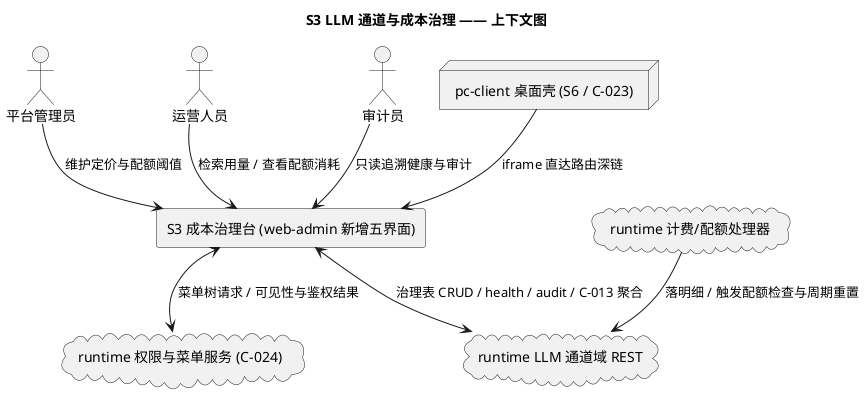
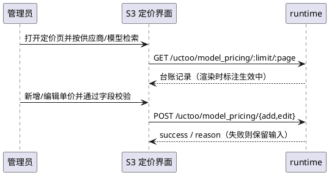
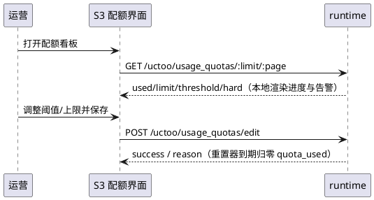
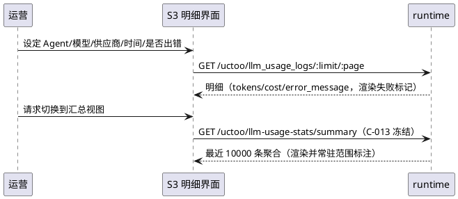
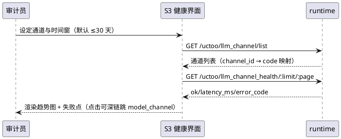
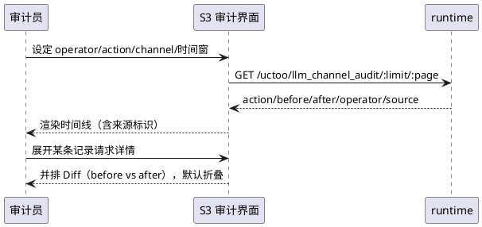
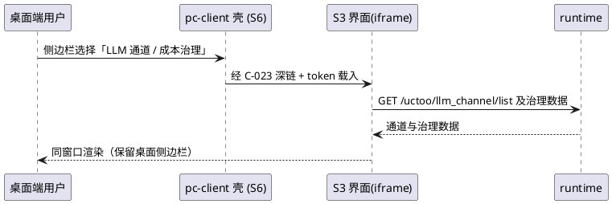

# S3 LLM 通道与成本治理 —— spec
> 主工程：`ConsoleClosure`（三端能力补全）｜feature_name：`ConsoleClosure--llm-governance`
> 阶段：`spec` ｜ 语言标签：`web`（C1-C5 全为 web-admin；G6 边界见待确认 T-4）
> 事实依据：`research.md` §2.2 / §3.2 / §5.2 / §5.3 ｜ 契约依据：`SPECS_INDEX.md` §3（**C-013 已冻结**、C-024 已冻结）、§7（R2/R4/R5/R6/R7）
> 关联：S5 / S1 无依赖可并行；S6 为下游，依赖本子系统 done

---

## **1. 组件定位**
### **1.1 核心职责**
本组件负责为 LLM 通道域的**模型定价、用量配额、用量明细、健康历史、审计追溯**五类已落表能力提供专用治理界面，使成本可见、配额可控、变更可追溯。

### **1.2 核心输入**
1. `GET /api/v1/uctoo/llm_channel/{list,health,audit}` —— runtime（`LlmChannelRoute.cj:54-74`）：通道列表、健康记录、审计记录，C4/C5 唯一数据入口。
2. `GET /api/v1/uctoo/llm-usage-stats/{summary,by-agent,by-model}` —— runtime（`AutoRouteConfig.cj:1478-1480`）：Token/费用聚合，属**已冻结**契约 C-013。
3. `GET /api/v1/uctoo/billing-report/{daily,monthly,export-csv}` —— runtime（`AutoRouteConfig.cj:1464-1466`）：日报/月报/CSV，属 C-013。
4. 五张治理表标准 CRUD 壳 —— runtime（`ModelPricingRoute.cj` 等 crudgen 生成）：`model_pricing` / `usage_quotas` / `llm_usage_logs` / `llm_channel_health` / `llm_channel_audit`。
5. 计费事件产出 —— runtime（`BillingEventHandler` / `QuotaCheckHandler` / `QuotaResetExecutor`）：`ChatModelEndEvent` 落明细，`ChatModelStartEvent` 触发配额检查。
6. 管理员操作指令：定价维护、阈值设定、明细检索、健康/审计筛选。
7. 菜单树 `POST /api/v1/uctoo/permissions/user/menu` —— runtime（C-024）：决定五个新界面入口是否可见。

### **1.3 核心输出**
1. 五个治理界面渲染结果 → 管理员/运营/审计员：定价台账、配额看板、用量明细表、健康历史图、审计流水。
2. 通道关联深链跳转 → 已有 `model_channel/index.vue`：从健康/审计记录反查通道详情，**复用现有页，不另建**。
3. 配额告警（界面侧）→ 运营人员：基于 `alert_threshold` 的本地比值告警（服务端仅 `LogUtils.warn`，无告警出口）。
4. CSV 透传下载 → 管理员浏览器：由 `/billing-report/export-csv` 产出，前端只透传不重算。

### **1.4 职责边界**
> 本子系统是**补齐**不是重建。以下为硬边界，违反即判为越界。

1. **不重建已有五个页面**（research.md §3.2，共 2674 行，均已实测存在）：`ai/model_channel/index.vue`(732)、`route-rule.vue`(681)、`shadow-compare.vue`(272)、`ai/token_dashboard/index.vue`(705)、`ai/billing_report/index.vue`(284)。禁止重写、禁止复制第二份、禁止改其内部结构；只允许**新增同级目录 + 深链跳转**。
2. **不改动已冻结契约 C-013**：`/llm-usage-stats/*`、`/billing-report/*` 的路径/方法/入参/返回结构**只读消费**，包括其「忽略全部 query 参数、固定扫描 10000 条」的既有行为（§4.1 P-2），本子系统不得要求服务端修改。
3. **不做通道 CRUD 本身**：增删改、启停、设默认、连通性测试、密钥设置、导入导出、重载注册表、路由规则与影子对比，均属 `model_channel/index.vue` 既有能力，**不在范围内**。
4. **不新增任何表或列**：五张治理表字段齐备；按 R4，本子系统未发现「复用不成立」场景。
5. **不做服务端计费链路改造**（见 T-1）；**不做 PC 端原生重复实现**（R7，见 §5.6）。

### 1.5 待确认项
1. **T-1**：`QuotaCheckHandler.incrementUsage()`（`quota_check_handler.cj:67`）全仓**无调用点**，`quota_used` 不会随调用自动累加 —— 待确认是否在本子系统补调用点，或仅如实展示现状（倾向后者）。
2. **T-2**：五个聚合端点固定 `(1,10000,...)` 硬扫描且忽略时间范围（`LlmUsageStatsController.cj:19`、`BillingReportController.cj:20`），因 C-013 冻结不可改 —— 待确认 UI 接受「最近 10000 条」口径并角标明示，或由用户另推服务端改造。
3. **T-3（版本号）**：CHANGELOG 最新 `0.0.25`(2026-07-23) 与资料提及 v0.0.30 口径不一致（research.md §7、R5）—— **待用户确认真实版本号**；所有版本展示位（导出文件名、快照版本标记、页脚）一律渲染「待用户确认」，本 spec 不自定版本。
4. **T-4**：G6 归属冲突（research.md §5.3/§6.3 列入 S6，本轮指派 S3 承载）—— 待用户确认；§5.6 按「S3 交付可 iframe 直达界面 + 菜单权限登记，S6 负责 Electron 集成」的最小无重复口径撰写。
5. **T-5**：`quota_type` 取值域（`daily_`/`weekly_`/`monthly_` 驱动重置，其余待查）与 `target_type` 取值域（代码仅实现 `agent`、`global/*`）—— 待查 `sql/incremental/` 与设计文档确认枚举，在此之前用自由输入 + 服务端现存口径校验。

## **2. 领域术语**
- **模型定价（model_pricing）**：某供应商某模型的计费单价台账，含输入/输出单价、币种与生效区间，是费用换算基准。备注：`llm_usage_logs` 冗余了当次成交单价与金额快照，二者口径可能不一致。
- **用量配额（usage_quotas）**：针对某对象在某周期内的用量上限与告警阈值记录，超限时按 `is_hard_limit` 决定拦截或放行。
- **硬配额**：`is_hard_limit=true`，达上限后服务端直接终止会话并返回 `quota-blocked`，不再调用模型。
- **软配额**：`is_hard_limit=false`，达上限后服务端仅告警放行，不阻断调用。
- **用量明细（llm_usage_logs）**：每次模型调用完成后由 `ChatModelEndEvent` 落盘的单条消耗记录，含 Token、耗时、费用快照与错误信息。
- **通道健康记录（llm_channel_health）**：通道探测产生的一次健康检查快照，含可用性、延迟、错误码，是健康历史唯一数据源。
- **通道审计记录（llm_channel_audit）**：通道配置变更时落下的 before/after 流水，操作人由 `operator` 承载。
- **配额周期（quota_period_start）**：当前统计周期起始时间戳字符串；`QuotaResetExecutor` 依据 `quota_type` 前缀判定到期后将 `quota_used` 归零。

## **3. 角色与边界**
### **3.1 核心角色**
- **平台管理员**：维护模型定价与配额阈值，五个界面读写权限。
- **运营人员**：查看用量明细与配额消耗，定位高成本 Agent/模型；不可改写定价。
- **审计员**：只读追溯健康历史与审计流水，导出留痕证据。

### **3.2 外部系统**
- **runtime 服务端（LLM 通道域）**：提供通道 list/health/audit、五张治理表 CRUD、C-013 聚合与报表接口。
- **runtime 权限与菜单服务**：菜单树注入（C-024，`src/router/guard/menu.ts:79`）与 RBAC 双层鉴权（R6）。
- **runtime 计费与配额处理器**：`BillingEventHandler` / `QuotaCheckHandler` / `QuotaResetExecutor`，产出用量与配额状态变更。
- **pc-client 桌面壳（S6，经 C-023）**：以 iframe 承载本子系统界面，消费路由深链。

### **3.3 交互上下文**

## **4. DFX约束**
### **4.1 性能**
1. **P-1**：用量明细、健康历史、审计流水三个列表页首屏（默认 20 条/页，含鉴权）95 分位 ≤ 3s；单页上限 200 条，超出必须分页。
2. **P-2**：`summary`/`by-agent`/`by-model`/`daily`/`monthly` 由服务端固定扫描 10000 条且忽略入参（T-2），界面须常驻标注「统计范围：最近 10000 条用量明细」，**禁止**前端二次全量聚合或伪造全量口径。
3. **P-3**：健康历史单次查询时间窗默认 ≤ 30 天、点位 ≤ 500；超出须提示缩小时间窗，禁止静默截断。
4. **P-4**：CSV 导出为服务端结果透传，前端不得做二次汇总计算。

### **4.2 可靠性**
1. **R-1**：`llm_channel_health` 与 `llm_channel_audit` 均无 `deleted_at`，界面**禁止**提供删除入口，`del` / `empty-recycle-bin` 对本子系统不可调用。
2. **R-2**：写操作失败时必须保留用户已填内容并给出可复现错误原因，禁止静默丢弃输入；`/llm_channel/reload` 现有用例不得变更。
3. **R-3**：硬限拦截为服务端 `EventResponse.Terminate` 行为，幂等不可绕过；界面不得提供「强制放行」按钮，也不得把软告警渲染为阻断态。

### **4.3 安全性**
1. **S-1（密钥不落前端）**：`LlmChannelPO.toJsonValue()` 明确不回显 `api_key`，只输出 `api_key_set` 布尔标志。五界面**禁止**渲染、日志、导出任何密钥，仅显示「已配置/未配置」徽标。
2. **S-2（RBAC 双层登记，R6）**：每个后端调用点必须进 `permissions` + `role_has_permission`，执行后必跑 `loaddbinfo`；缺登记表现为「看不到入口」而非 403。
3. **S-3**：审计 `before`/`after` 可能含敏感配置片段，默认折叠，仅审计员显式展开可查看，并计入访问留痕。
4. **S-4**：写操作必须走服务端既有路径以保留审计写入能力，禁止绕过 Service 直连写表。

### **4.4 可维护性**
1. **M-1（菜单登记硬约束，R2）**：五界面全依赖后端菜单树注入才可见；`tasks.md` 须为每个界面单列「菜单登记 + 权限登记」任务，缺一视为未完成。
2. **M-2**：接口失败须以「接口路径 + 服务端 reason」格式输出到浏览器控制台，与服务端 `LogUtils` 日志对齐排障。
3. **M-3**：字段名不得硬编码进展示文案，统一走 Model 层映射。

### **4.5 兼容性**
1. **C-1（契约只读）**：C-013 / C-024 已冻结，只消费不改；变更须走 `SPECS_INDEX.md` §6 登记，且「先改契约 → 再改实现」。
2. **C-2（不新增存储，R4）**：不新增任何表/列，全复用五张既有表；design 步若出现新增诉求，必须先给出「复用既有表或 JSON 字段不成立」书面论证。
3. **C-3**：新界面路径不得占用 `model_channel/` `token_dashboard/` `billing_report/` 既有文件名，避免复写既有产物。
4. **C-4**：版本展示位（导出文件名、快照版本标记等）在 T-3 确认前一律渲染「待用户确认」，禁止写入推测值。

## **5. 核心能力**
### **5.1 模型定价维护** ｜ 承载缺口 **C1**（research.md §5.2：当前仅 `model_pricing` 表 CRUD）
#### **5.1.1 业务规则**
1. **定价归属**：以「供应商 + 模型」为业务主键展示，同组合多条时按 `effective_from` 倒序。当管理员打开定价页时，系统应当倒序展示，并对 `is_active=true` 且落在 `effective_from`~`effective_to` 区间内的记录标记「生效中」。
2. **单价约束**：`rate_prompt_per_million`、`rate_completion_per_million` 必须为非负数值。当管理员提交负数或非法数值时，系统应当阻止提交并给出字段级提示；若 `rate_currency` 为空，则系统应当阻止保存并提示必须填币种。
3. **区间约束**：`effective_to` 为空表示长期有效，非空必须晚于 `effective_from`。若管理员填写的 `effective_to` 早于或等于 `effective_from`，则系统应当拒绝保存并说明区间冲突。
4. **快照免责 + 禁止项**：界面必须明示明细自带成交快照，且禁止提供「按新定价重算历史费用」操作。当定价页存在任何历史记录时，系统应当在显著位置标注「历史用量金额取自当次成交快照，修改本页不会重算历史费用」，且不提供任何触发历史费用重算的入口。

#### **5.1.2 交互流程**

#### **5.1.3 异常场景**
1. **并发编辑同一条定价** ｜ 触发：两名管理员对同一 `id` 提交不同单价 ｜ 系统行为：以服务端最后写入为准（未实现乐观锁），刷新后展示最新值 ｜ 用户感知：提交成功提示 + 帮助文案说明「后写覆盖」，界面不做冲突 Diff。
2. **服务端写失败** ｜ 触发：`add`/`edit` 返回 `success=false` ｜ 系统行为：保留已填表单并展示服务端 `reason` ｜ 用户感知：错误提示含 `reason` 原文，不清空输入。

### **5.2 用量配额治理** ｜ 承载缺口 **C2**（research.md §5.2：仅 `usage_quotas` 表 CRUD；服务端行为已复核 `QuotaCheckHandler.cj` + `QuotaResetExecutor.cj`）
#### **5.2.1 业务规则**
1. **作用域口径**：`target_type`/`target_id` 须遵循服务端 `_isQuotaApplicable` 现有判定（`agent`→Agent 名、`global`→`*`）。当管理员选择 global 时，系统应当自动将目标标识置为 `*` 且禁止手工改写。
2. **阈值语义**：`alert_threshold` 是 **0~1 的比值**（服务端判定式 `quota_used/quota_limit >= alert_threshold`）。当管理员输入的阈值不在 0~1 区间时，系统应当阻止保存并提示其为比例值而非百分比；若某配额已用占比达到或超过该阈值，则系统应当以告警色标注该行并给出百分比读数。
3. **触限后果**：由 `is_hard_limit` 决定且界面必须区分呈现。若 `quota_used >= quota_limit` 且 `is_hard_limit=true`，则系统应当标记为「硬限-已拦截」并明示后续调用将被 `quota-blocked` 终止；若同条件但 `is_hard_limit=false`，则系统应当标记为「软限-放行中」，不得渲染为阻断态。
4. **周期前缀**：重置由 `quota_type` 前缀驱动（`daily_`→1 天、`weekly_`→7 天、`monthly_`→30 天），其余前缀永不重置。当管理员创建非三类前缀的配额时，系统应当提示「该类型不会被自动重置，用量将持续累计」。
5. **告警自营 + 禁止项**：服务端告警仅 `LogUtils.warn`，无推送出口，故当管理员打开配额页时，系统应当基于已用/上限本地计算告警态并渲染，不依赖任何服务端告警接口；且 T-1 确认前禁止界面宣称「用量自动累计」，当用户悬停消耗进度条时，系统应当提示「`quota_used` 当前不会被调用链路自动累加，请以实际值为准」。

#### **5.2.2 交互流程**

#### **5.2.3 异常场景**
1. **配额上限为零** ｜ 触发：`quota_limit` 为 0 或空（服务端无除零保护）｜ 系统行为：界面在提交前拦截 ｜ 用户感知：字段级提示「上限必须大于 0，否则触限判定失效」。
2. **周期起点为空或已用量脏数据** ｜ 触发：`quota_period_start` 为空串（重置执行器直接 continue），或 `quota_used` 为负/大于 `quota_limit` ｜ 系统行为：前者明示该配额不参与重置，后者进度条封顶渲染并标注异常且不修改服务端数据 ｜ 用户感知：分别标注「无周期起点，不会被自动重置」与「数据异常」徽标（tooltip 展示原始值）。

### **5.3 用量明细查询** ｜ 承载缺口 **C3**（research.md §5.2：仅 `llm_usage_logs` 表 CRUD；数据由 `BillingEventHandler.onChatModelEnd` 经 `DbSerialLock` 落盘）
#### **5.3.1 业务规则**
1. **只读流水**：明细不可变。当任何角色打开明细页时，系统应当不提供新增、编辑、删除入口。
2. **五维筛选**：须支持按 Agent、模型、供应商、时间范围、是否出错筛选。当运营人员设定条件并检索时，系统应当返回命中记录并按创建时间倒序排列；若某条记录 `error_message` 非空，则系统应当以失败样式标注并支持查看原文。
3. **快照优先**：金额以记录自带快照为准。当渲染明细行金额时，系统应当直接展示 `cost_amount` 与 `cost_currency`，不得用 `model_pricing` 现值反算。
4. **口径差异明示**：页脚小计与 C-013 聚合可能不一致。当二者不一致时，系统应当标注统计范围差异（分页/10000 条上限），不得静默取舍。

#### **5.3.2 交互流程**

#### **5.3.3 异常场景**
1. **筛选结果为空** ｜ 触发：条件过窄无命中 ｜ 系统行为：展示空态并列出当前全部筛选条件 ｜ 用户感知：空态提示 + 「清空条件」按钮。
2. **异步落盘延迟** ｜ 触发：调用刚结束即查询（`spawn` 异步写库）｜ 系统行为：不做自动轮询补偿 ｜ 用户感知：提供显式刷新按钮，空态说明「刚结束的调用可能存在秒级延迟」。

### **5.4 通道健康历史** ｜ 承载缺口 **C4**（research.md §5.2：仅 `llm_channel_health` 表 CRUD）
#### **5.4.1 业务规则**
1. **只增不删**：健康记录只增不改，界面只读且禁止删除（该表无 `deleted_at`）。当审计员打开健康历史页时，系统应当仅提供筛选与导出，不提供增删改入口。
2. **名称映射**：须由 `channel_id` 映射 `llm_channel.code` 后呈现。当渲染健康折线或多通道对比图时，系统应当先拉取 `/llm_channel/list` 完成映射，并以 `code` 作图例。
3. **失败分类**：须区分「连通失败」与「慢响应」。若某条记录 `ok=false`，则系统应当在 tooltip 展示 `error_code` 与 `error_message` 原文；若 `ok=true` 但 `latency_ms` 超过同期 P95 的 2 倍，则系统应当在图上标注为慢点。
4. **跳转复用**：必须能跳转到通道详情且不得另建通道页。当用户点击异常点并请求查看通道时，系统应当跳转到已有 `model_channel/index.vue` 并定位该通道。

#### **5.4.2 交互流程**

#### **5.4.3 异常场景**
1. **点位超上限** ｜ 触发：时间窗过宽致点位 > 500（P-3）｜ 系统行为：不静默截断，提示缩小时间窗或指定通道 ｜ 用户感知：「结果超过 500 点，请缩小时间窗」。
2. **通道已删除** ｜ 触发：`channel_id` 在 `/llm_channel/list` 中无对应 ｜ 系统行为：以 `channel_id` 原值兜底作图例并标记失效 ｜ 用户感知：灰色图例且禁用跳转入口。

### **5.5 通道审计追溯** ｜ 承载缺口 **C5**（research.md §5.2：仅 `llm_channel_audit` 表 CRUD）
#### **5.5.1 业务规则**
1. **只读**：审计流水只增不改不删（无 `deleted_at`）。当审计员打开审计页时，系统应当仅提供筛选、对比与导出。
2. **可 Diff**：每条变更必须可比对。当用户展开某条审计记录时，系统应当并排展示 `before` 与 `after` 差异，默认折叠原文。
3. **四维检索**：须支持按操作人、动作类型、通道、时间检索。当审计员设定条件后，系统应当返回命中记录并按 `created_at` 倒序排列；若某条记录 `channel_id` 为空，则系统应当显示「—」并支持不按通道筛选的场景。
4. **来源可见**：`source` 字段必须可见。当渲染审计列表时，系统应当展示 `source` 列且不得省略。

#### **5.5.2 交互流程**

#### **5.5.3 异常场景**
1. **before/after 超长** ｜ 触发：单次变更差异体量过大 ｜ 系统行为：折叠并提供全文查看，不做截断丢失 ｜ 用户感知：展示摘要 + 「查看完整内容」入口。
2. **操作人为空** ｜ 触发：`operator` 缺失（系统内部触发）｜ 系统行为：渲染为「系统」而非空白 ｜ 用户感知：显示「系统」标识，保留 `source` 供溯源。

### **5.6 PC 端多通道入口（G6）** ｜ 承载缺口 **G6**（research.md §5.3/§6.3：PC 端 Settings 现仅单条 AI 配置，`SettingsView.vue` 经 `electronAPI.config.set('ai', ...)` 写单 provider/单 model）；归属存在冲突，按 **T-4 最小口径**执行
#### **5.6.1 业务规则**
1. **交付边界**：本子系统只交付「可被 iframe 直达」的 Web 界面与菜单/权限登记，Electron 集成壳由 S6 承接（R7）。当桌面壳按路由深链打开治理界面时，系统应当在同一域名与 token 下正常渲染并保留桌面侧边栏。
2. **禁止双份**：禁止在 pc-client 侧重写第二套多通道业务页。当需求涉及多通道列表与切换时，系统应当复用本子系统 Web 界面经 iframe 承载，pc-client 不新增多通道 Vue 页。
3. **同源数据**：桌面端展示必须与 Web 端同源。当桌面端查看通道列表或成本数据时，系统应当展示同一份服务端数据，不引入桌面本地配置作为数据源。
4. **禁止项**：禁止修改 `SettingsView.vue` 现有单条 AI 配置保存逻辑，除非 T-4 明确改由 S3 承接。当用户在桌面设置中修改单条 AI 配置时，系统应当保持既有行为不变（`electronAPI.config.set('ai', ...)`）。

#### **5.6.2 交互流程**

#### **5.6.3 异常场景**
1. **iframe 未就绪** ｜ 触发：宿主静态站未启动（`HomeView.vue` 已存在 5 次重试）｜ 系统行为：交由桌面壳既有重试与错误态处理，本子系统不另建重试逻辑 ｜ 用户感知：桌面端既有「服务未启动」提示。
2. **归属变更** ｜ 触发：T-4 确认 G6 改由 S6 全量承接 ｜ 系统行为：本子系统仅保留「可被 iframe 直达」交付物，其余回退 S6 ｜ 用户感知：界面不变，仅责任归属调整。

## **6. 数据约束**
> 字段取自 `src/app/models/uctoo/*PO.cj` 的 `@ORMField`，未作增补；新增字段须按 R4 出具论证。

### **6.1 模型定价（model_pricing）**
1. **provider** / **model** / **model_id**：必填字符串，非空；`provider` + `model` 构成业务主键语义。
2. **rate_prompt_per_million** / **rate_completion_per_million**：必填数值，`>= 0`。
3. **rate_currency**：必填字符串，币种标识，不得为空；**rate_unit**：必填字符串，单价单位说明。
4. **is_active**：布尔，是否启用；**source**：必填字符串，记录来源。
5. **effective_from**：必填字符串，生效起点；**effective_to**：可空字符串，非空时必须晚于 `effective_from`，空值表示长期有效；**remark**：可空字符串。

### **6.2 用量配额（usage_quotas）**
1. **target_type**：必填字符串；服务端仅实现 `agent`、`global` 两类语义（完整枚举待 T-5 确认）。
2. **target_id**：必填字符串；`target_type=global` 时固定 `*`，`=agent` 时为 Agent 名。
3. **quota_type**：必填字符串；以 `daily_`/`weekly_`/`monthly_` 开头参与自动重置，其余永不重置。
4. **quota_limit**：必填数值，须 `> 0`；为 0 将导致触限判定与告警比值失效。
5. **quota_used**：数值 `>= 0`；达到 `quota_limit` 即触限，是否阻断由 `is_hard_limit` 决定。
6. **quota_period_start**：字符串；为空则被重置执行器跳过，永不自动重置。
7. **is_hard_limit**：布尔；真则达限返回 `quota-blocked` 终止会话，假则仅告警放行。
8. **alert_threshold**：数值，区间 `[0,1]`，为「已用/上限」**比值**（非百分比）。

### **6.3 用量明细（llm_usage_logs）**
1. **provider** / **model** / **model_id** / **request_type**：必填字符串。
2. **agent_id** / **task_id** / **user_id** / **session_id** / **request_id** / **error_message**：可空；缺失时界面须渲染占位而非报错。
3. **prompt_tokens** / **completion_tokens** / **total_tokens**：整型 `>= 0`；不等时以服务端值为准如实展示。
4. **time_cost_ms** / **tool_calls_count**：整型 `>= 0`；**is_streaming**：布尔，是否流式。
5. **cost_amount**：数值 `>= 0`，当次金额快照；**cost_currency**：字符串，金额币种快照。
6. **rate_prompt** / **rate_completion**：数值快照；与 `model_pricing` 现值不一致时**以快照为准**。

### **6.4 通道健康记录（llm_channel_health）**
1. **channel_id**：必填字符串，关联 `llm_channel`；本表无 `deleted_at`，记录不可软删。
2. **model_id**：可空字符串；有值表示针对单模型的检查。
3. **ok**：布尔，本次检查是否成功；**latency_ms**：整型 `>= 0`，探测延迟。
4. **error_code** / **error_message**：可空；`ok=false` 时应当有值，缺失时界面渲染「未提供错误详情」。
5. **checked_at**：必填时间戳，为时间轴排序与分窗依据。

### **6.5 通道审计记录（llm_channel_audit）**
1. **channel_id**：可空字符串；为空表示非通道级操作，界面须渲染占位。
2. **action**：必填字符串，变更动作类型；**before** / **after**：必填字符串，变更前后快照，用于 Diff。
3. **operator**：可空字符串；为空时界面须渲染为「系统」。
4. **source**：必填字符串，变更来源标识，不得省略展示；**created_at**：必填时间戳，为审计排序依据。

---

**spec 步产出完毕，等待 gate-spec 闸口确认（confirm / revise / abandon）。**
