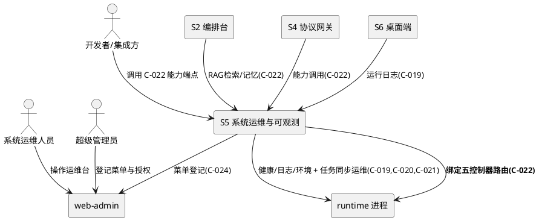
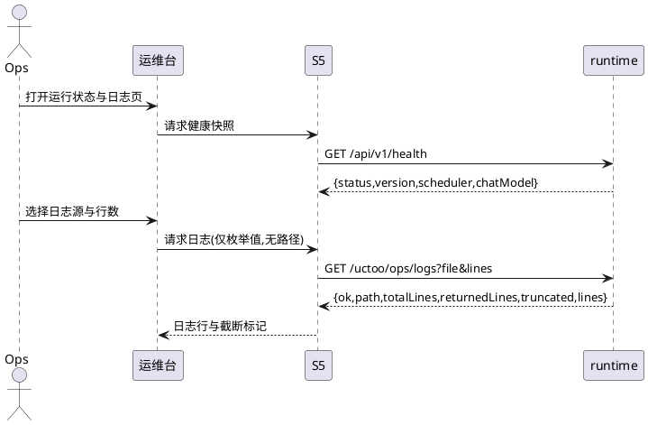
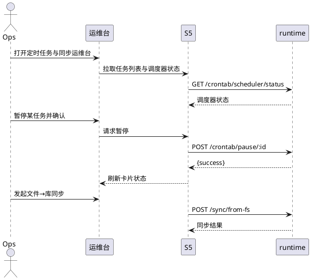
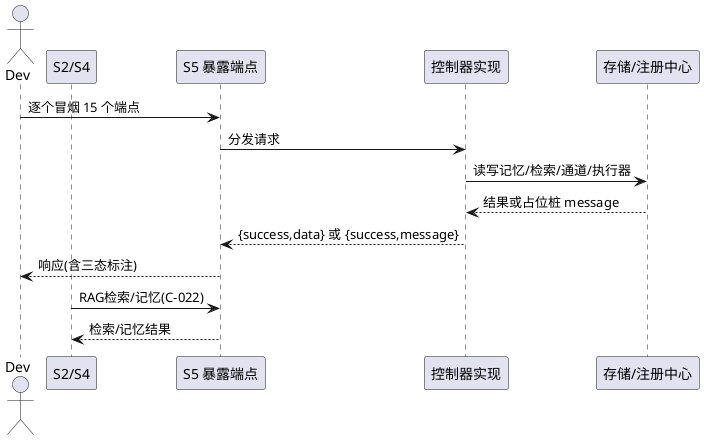
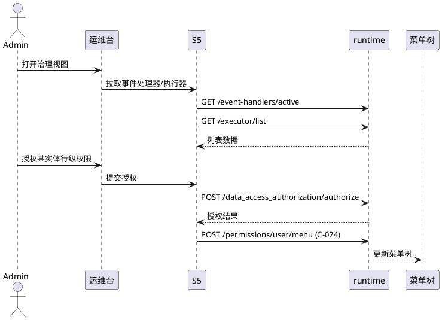

# **1. 组件定位**

> 子系统 ID：**S5** ｜ feature_name：`ConsoleClosure--ops-observability`
> 主工程：`ConsoleClosure`（三端能力补全）｜ 事实依据：`specs/ConsoleClosure/research.md` §5.2 / §5.3 / §5.4
> 契约：C-019 / C-020 / C-021 / C-022 / C-024 ｜ 语言标签：cangjie + web
> 承载缺口：E1-E9、G4、G5、**R3 横切 P0（S2 / S4 / S6 的开工前置）**
> 证据口径：全部 API 路径与行号取自 `apps/agentskills-runtime/src/app/` 源码实读，非转述。

## **1.1 核心职责**

本组件负责**把 AgentSkills-runtime 已实现但无 HTTP 出口、无界面的运维与存储/检索能力暴露为端点并建成运维台**，实现「排障有界面、能力有出口」。

其中 **R3 横切 P0 是地基**：`MemoryController` / `ModelController` / `StorageController` / `RetrieverController` / `ExecutorController` 五个控制器**已实现但无任何路由绑定**（research.md §5.4），矢量库 / RAG 检索 / 存储 / 记忆 / 执行器连 HTTP 都没暴露。本子系统必须先把它们绑成 HTTP 端点（契约 C-022），S2 / S4 才能开工。

## **1.2 核心输入**

1. **运维人员操作指令**：日志拉取、能力采集、定时任务 trigger/pause/resume/reload、同步 from-fs/to-fs/all、事件处理器注册/注销、执行器切换、行级授权。
2. **runtime 进程自产数据**：`logs/` 下带时间戳的运行日志与 `logs/startup-trace.txt`（`runtime_log_service.cj:9-10`）；启动时落盘的 `./runtime/capabilities.json`（`main.cj:711-717`）。
3. **下游子系统能力调用**：S2（RAG 检索）、S4（协议网关）经 C-022 调用本暴露的端点；**既有 ORM 模型**可直接复用——web-admin `src/store/models/uctoo/` 已有 `crontab.ts`、`crontab_log.ts`、`event_handlers.ts`、`retrievers.ts`、`sync_log.ts`、`sync_manager.ts`、`agent_executors.ts`、`agent_memories.ts`（实读确认）。

## **1.3 核心输出**

1. **运维台页面**：健康检查面板、运行日志查看器、定时任务运维台、同步运维台、能力暴露状态页、事件处理器管理页、行级授权页、国际化管理页。
2. **新暴露的 HTTP 端点**：五个无路由控制器的全部公开方法绑到 `/api/v1/uctoo/{memory,model,storage,retriever,executor}/*`（C-022）。
3. **菜单与权限登记**：经 C-024（`POST /api/v1/uctoo/permissions/user/menu`）登记菜单树并写入 `permissions` + `role_has_permission`；**既有资产挂载**指 `user/role/permission/menu` 四页与 `setup.vue` 挂上路由。

## **1.4 职责边界**

1. **不做 `data_flow.vue` 已覆盖部分的重建**。`src/views/ai/data_flow/index.vue`（797 行）已实现数据流可视化，本子系统**不碰它、不重写它**；仅补齐它未触及的 `/api/v1/uctoo/sync/*` 七个运维端点（实读：该文件仅用 6 个 ORM 模型，未调用 sync 端点）。
2. **不做同步引擎本身的改造**。`SyncService` / `SyncLogService` 内部逻辑不在范围内，只做端点承接与状态展示。
3. **不做五个控制器内部业务逻辑的实现**。其中 `StorageController` 的 kv/vector 与 `RetrieverController.search` 当前为**占位桩**（源码返回含「待…集成」的 `message`），本子系统**不在本期内实现真实存储/检索**，仅按 §5.3.1 以「未接入」如实暴露。
4. **不做 PC 端原生页面**。桌面端归 S6，本子系统只经 C-019 向 S6 供日志数据；**不新建业务表**，见 §5.3.1 铁律 9 论证。

---

# **2. 领域术语**

**运行日志（Runtime Log）**
: runtime 进程自身输出并落盘到 `logs/` 目录的文本日志，与业务表日志（`crontab_log` / `llm_usage_logs`）是两类东西（`runtime_log_service.cj:8` 明确禁止以业务表查询替代进程运行日志）。

**能力暴露（Capability Exposure）**
: 把已实现但无路由绑定的控制器方法注册为 HTTP 端点的动作。
: 备注：R3 的实质是「控制器有实现、注册表无条目」，不是「功能没做」。

**检索器（Retriever）**
: 一条 RAG 检索配置记录，落 `retrievers` 表，由 `RetrieversPO` 承载；与「矢量库」不同层——检索器是配置，矢量库是被检对象。

**执行器（Executor）**
: Agent 执行策略，内置 5 种：`naive` / `react` / `plan-react` / `tool-loop` / `dsl-executor`（`ExecutorController.cj:17,61`）。

**行级授权（Data Access Authorization）**
: 在「实体类型 + 实体 ID」粒度上授予/撤销访问权限的能力（`DataAccessAuthorizationRoute.cj:50-52`）。

---

# **3. 角色与边界**

## **3.1 核心角色**

- **系统运维人员**：查看健康状态、拉取运行日志、运维定时任务与同步、切换执行器。
- **超级管理员**：登记菜单与 `permissions`、处置行级授权、决定死代码路由的去留。
- **开发者 / 集成方**：经 C-022 调用本组件暴露的端点。
## **3.2 外部系统**

- **web-admin**：界面宿主，管理后台路由由后端菜单树动态注入（`src/router/guard/menu.ts:79`），依赖 C-024。
- **runtime 进程**：被观测对象，提供 `/api/v1/health`、`/api/v1/info`、`ops/logs`、`ops/env`。
- **S2 编排台 / S4 协议网关**：均消费 C-022 能力端点，依赖本组件先完成暴露。
- **S6 桌面端纵深**：经 C-019 消费运行日志，依赖本组件 done 后 iframe 集成。

## **3.3 交互上下文**

---

# **4. DFX约束**

## **4.1 性能**

1. `/api/v1/health` 与 `/api/v1/uctoo/sync/health` 的 P95 响应时间 ≤ 300ms。
2. `ops/logs` 单次返回行数上限 **5000**、默认 500（`runtime_log_service.cj:66-72`）；前端默认请求行数 ≤ 500。
3. 运维台首屏（健康 + 任务列表 + 同步概览）3 个并发接口渲染完成 ≤ 2s。

## **4.2 可靠性**

1. 能力采集失败**不阻断启动**：`RuntimeCapabilityCollector` 启动采集异常仅 `warn` 不抛出（`main.cj:712-717`），本组件须保持同一行为。
2. 单个运维端点 5xx 时，运维台须隔离该卡片并保留其余面板可用，不得整页白屏。
3. 五个新暴露端点中任一端点异常，不得影响已生效的 86 条 `RouteEntry` 路由。

## **4.3 安全性**

1. **路径穿越防护（硬红线）**：服务端 `RuntimeLogService.resolvePath` 采用白名单 + 固定路径，**参数绝不作为文件系统路径使用**（`runtime_log_service.cj:108-118`）；`file` 仅接受 `startup` / `startup-trace`，其余值一律回落主运行日志。**前端禁止构造、拼接、透传任何路径片段至 `file` 参数**，只可从服务端下发的枚举值中选择，禁止以任何方式绕过该白名单。
2. 全部新增端点须经 API 层 `RequirePermissionMiddleware` 鉴权，并登记进 `permissions` + `role_has_permission`（R6）；未登记即缺陷。
3. `ops/env` 返回的能力清单须剔除密钥类取值（API Key、数据库口令），仅输出 `{name, available}` 级别信息。
4. 破坏性动作（`/crontab/del`、`/sync/to-fs`、`/event-handlers/unregister`）须二次确认并写入操作日志。

## **4.4 可维护性**

1. 新增路由一律走 `AutoRouteConfig.cj` 的 `RouteEntry`（`tableName, routePath, priority, enabled, registerFunc`），禁止散落到 `main.cj` 内联注册。
2. 每个新暴露端点须标注三态之一（`可用`/`占位桩`/`待集成`），禁止把占位桩登记为可用；运维台每个面板须显示数据来源端点路径。

## **4.5 兼容性**

1. 已有端点路径**禁止改名**：`crontab/scheduler/status`（源码 `CrontabRoute.cj:57`）保持不动；research.md §5.2-E4 写作 `scheduler-status` 属文档口径偏差，待回写订正。
2. 新端点一律 `v1`，前缀沿用 `/api/v1/uctoo/`，响应体沿用既有 `{success, data, reason}` 或 `{ok, ...}` 形状，不引入第三套。
3. 删除死代码路由前须确认无外部调用方；未确认则保持「不注册」而非物理删除。

---

# **5. 核心能力**

## **5.1 运行状态与运行日志观测（E1 / E2 / E3）**

### **5.1.1 业务规则**

1. **健康检查真实化**：系统必须采用 `/api/v1/health`（`main.cj:661-701`）的 `chatModel.available` 作为模型可用性判据，禁止以「是否拿到 ChatModel 实例」冒充可用；并展示 `scheduler` 的 `running` / `totalTasks` / `activeTasks` / `runningTasks` 四项与 `/api/v1/info`（`main.cj:703-705`）的 `name` / `version` / `language`。
   a. 验收条件：若默认通道状态为 `degraded`，则系统应当返回 `available=false` 并在 `error` 中说明「已被探活降级」。
   b. 验收条件：当 `SchedulerEngine` 未初始化时，系统应当展示 `running=false` 并标注 `not initialized`。
2. **日志来源与口径**：系统必须调用 `/api/v1/uctoo/ops/logs`（`main.cj:720-735`），禁止以 `crontab_log` / `llm_usage_logs` 业务表查询冒充进程运行日志（`runtime_log_service.cj:8`）；`file` 仅允许 `startup` 或 `startup-trace`，`lines` ≤ 0 取默认 500、> 5000 封顶 5000。
   a. 验收条件：若前端传入 `../../etc/passwd`，则系统应当返回主运行日志且不暴露 `logs/` 之外的任何文件。
   b. 验收条件：当 `lines=99999` 时，系统应当返回 ≤ 5000 行且 `truncated=true`。
   c. 验收条件：当日志输出到控制台时，系统应当返回 `ok=false` 并附「无落盘文件可读」，不得返回空行列表。
3. **环境能力采集**：系统应当调用 `/api/v1/uctoo/ops/env`（`main.cj:738-745`）展示 `{capabilities:[{name, available}]}`。
   a. 验收条件：当采集器抛异常时，系统应当返回 500 且 `ok=false`，前端展示「采集失败」而非空白清单。
4. **禁止项**：前端禁止自行拼接路径或绕过 §4.3-1 白名单，禁止把 5xx 响应渲染为「正常」。

### **5.1.2 交互流程**

### **5.1.3 异常场景**

1. **模型通道不可用**
   a. 触发条件：默认通道缺失、被禁用或已降级。
   b. 系统行为：`chatModel.available=false` 并附 `error` 文案。
   c. 用户感知：健康卡片显示红色并附原因，不显示 `ok`。
2. **日志文件缺失或读取失败**
   a. 触发条件：解析出的路径文件缺失，或文件读取抛异常。
   b. 系统行为：`ok=false` 并附具体 `error` 信息。
   c. 用户感知：显示「日志文件不存在」或「读取日志失败」+ 摘要，不显示空列表。
3. **端点不可达**
   a. 触发条件：`/api/v1/health` 超时或返回 5xx。
   b. 系统行为：仅健康卡片降级，其余面板保持可用。
   c. 用户感知：卡片显示「健康端点不可达」。

## **5.2 定时任务与同步运维（E4 / E5）**

### **5.2.1 业务规则**

1. **crontab 动作端点对齐源码**：系统必须按 `CrontabRoute.cj:53-60` 的真实路径调用——`POST /crontab/trigger/:id`、`/pause/:id`、`/resume/:id`、`/reload`；`GET /crontab/scheduler/status`、`/running`、`/executors`、`/builtin-tasks`。
   a. 验收条件：当运维人员点击「触发」时，系统应当对指定 `id` 发起 `POST /api/v1/uctoo/crontab/trigger/:id` 并展示结果。
2. **破坏性动作二次确认**：pause / resume / trigger 须展示任务名与确认弹窗；`POST /crontab/reload` 无 `id` 参数，界面须提示「将重载全部任务」。
   a. 验收条件：当运维人员未确认时，系统应当不发出请求。
3. **sync 七端点全覆盖**：系统必须覆盖 `SyncRoute.cj:31-63` 七个端点——`GET /sync/summary`、`GET /sync/status/:entityType`、`POST /sync/from-fs`、`POST /sync/to-fs/:entityType/:entityId`、`POST /sync/all`、`GET /sync/logs`、`GET /sync/health`；且 from-fs 与 to-fs 须区分为「文件→库」与「库→文件」两个方向按钮。
   a. 验收条件：当运维人员发起全量同步时，系统应当调用 `POST /api/v1/uctoo/sync/all` 并轮询 `/sync/logs` 展示结果。
   b. 验收条件：当选中某实体执行 to-fs 时，系统应当传入 `entityType` 与 `entityId` 两个路径参数。
4. **不重建 data_flow**：本页为**同步运维操作台**，与 `views/ai/data_flow/index.vue` 的数据流可视化互补，二者不得合并或互相替换。

### **5.2.2 交互流程**

### **5.2.3 异常场景**

1. **任务不存在**
   a. 触发条件：`:id` 在 `crontab` 表中已删除。
   b. 系统行为：返回失败并在列表中标记该条失效。
   c. 用户感知：提示「任务不存在，请刷新列表」。
2. **调度引擎未初始化**
   a. 触发条件：`SchedulerEngine.instance` 为 `None`。
   b. 系统行为：`scheduler/status` 返回 `not initialized`。
   c. 用户感知：运维台顶部常驻「调度引擎未初始化」告警条。
3. **同步不可用或实体类型无效**
   a. 触发条件：`GET /sync/health` 非 200，或 `/sync/status/:entityType` 的 `entityType` 不受支持。
   b. 系统行为：前者禁用同步动作按钮；后者返回空状态并标注未知类型。
   c. 用户感知：提示「同步服务不可用，操作已禁用」或「未知实体类型」。

## **5.3 横切能力暴露（R3，P0 地基：S2 / S4 开工前置，契约 C-022）**

### **5.3.1 业务规则**

1. **五个控制器必须全部绑定路由**：`MemoryController`（`update/search/list/delete`）、`ModelController`（`list/test`）、`StorageController`（`listTypes/kvGet/kvSet/vectorSearch`）、`RetrieverController`（`list/getById/search`）、`ExecutorController`（`list/getByName/listSchemes`），共 **15 个方法**逐一绑到 `/api/v1/uctoo/{memory,model,storage,retriever,executor}/*`。
   a. 验收条件：当逐个请求这 15 个端点时，系统应当全部返回 2xx/4xx 业务响应而不出现 404。
2. **注册方式统一**：必须新增 `RouteEntry`（`tableName, routePath, priority, enabled, registerFunc`）进 `AutoRouteConfig.cj`，priority 取 **300+**（现有最大 290）。
   a. 验收条件：当启动 runtime 时，系统应当在既有 87 条 `RouteEntry` 之外注册本批条目且不影响既有 86 条生效路由。
3. **占位桩如实标注**：`StorageController.kvGet/kvSet/vectorSearch` 与 `RetrieverController.search` 当前为**占位桩**（源码返回含「待…集成」的 `message`，不产生真实读写）。
   a. 验收条件：当调用这些端点时，系统应当在响应中携带 `message` 字段，且前端必须以「未接入」徽标渲染，**禁止渲染为成功数据**。
   b. 验收条件：若响应体缺少 `message` 字段，则前端应当按「未接入」处理而非按成功处理。
4. **铁律 9 论证（复用优先，不新建表/列）**：
   - `MemoryController` → 复用既有 `agent_memories` 表（`agent_id`/`content`/`scope`/`weight`/`tags`/`metadata`），scope 缺省 `episodic`；`RetrieverController` → 复用既有 `retrievers` 表（`RetrieversPO`）。
   - `ModelController` → 复用 `llm_channel` 表通道注册表（`ChannelRegistry`），注册表为空时才回落内置名单；`ExecutorController` → 复用内置 5 种执行器名单与 `agent_executors` 既有模型。
   - `StorageController` → 当前无落表需求；KV 值若后续需持久化，**优先复用**既有 JSON 字段（`agent_memories.metadata` 或 `retrievers` 的既有 JSON 列），复用不成立时才另案论证。
   - **结论：本模块 0 新建表、0 新建列。**
5. **禁止项**：禁止在绑定路由时顺带改写控制器内部逻辑。

### **5.3.2 交互流程**

### **5.3.3 异常场景**

1. **参数缺失**
   a. 触发条件：`agentId` / `id` / `name` / `key` / `model` / `memoryId` 缺失。
   b. 系统行为：返回 400 与 `reason=<参数>参数缺失`。
   c. 用户感知：界面提示具体缺失参数名。
2. **检索器不存在**
   a. 触发条件：`RetrieverController.search` 传入不存在的 `id`。
   b. 系统行为：返回 404 + `检索器不存在`。
   c. 用户感知：提示「检索器不存在」，不静默返回空结果。
3. **占位桩被误当可用**
   a. 触发条件：前端未识别 `message` 字段。
   b. 系统行为：按 §5.3.1-3 判定为「未接入」。
   c. 用户感知：显示「未接入」徽标与桩说明文案。

## **5.4 治理视图与既有资产挂载（E6 / E7 / E8 / E9 / G4 / G5）**

### **5.4.1 业务规则**

1. **事件处理器管理与执行器切换（E6 / E7）**：系统必须覆盖 `AutoRouteConfig.cj:1492-1496` 五个端点（`GET /event-handlers/active`、`GET /event-handlers/history`、`POST /event-handlers/register`、`/unregister`、`/toggle`）与 `AutoRouteConfig.cj:1508-1510` 三个端点（`POST /executor/switch`、`GET /executor/list`、`GET /executor/agent-executor`）。
2. **行级授权（E8）**：系统必须覆盖 `DataAccessAuthorizationRoute.cj:50-52` 三个端点——`POST /data_access_authorization/authorize`、`/revoke`、`GET /data_access_authorization/:entityType/:entityId/authorizations`。
3. **国际化管理与既有页面挂载（E9 / G4 / G5）**：系统应当挂载 `src/views/locale/index.vue`（36 行，子组件 `add-locale.vue` / `lang-table.vue` / `locale-table.vue` 已存在）、`src/views/{userManager,role,permission,menu}/**` 与 `src/views/setup.vue`（235 行），**挂载即可，无需重写**。
   a. 验收条件：当 `src/router/constant.ts` 仅 import `aibuilder` 与 `website` 时，系统应当在本次交付后使这批页面可达。
4. **菜单与权限登记（R2 / R6 / C-024）**：所有新增与挂载页面必须登记菜单，并写入 `permissions` + `role_has_permission` 后执行 `loaddbinfo`。
   a. 验收条件：当超管登录后，系统应当在菜单树中返回全部本子系统页面；漏登记视为 P0 缺陷。
5. **死代码处置**：`MockRoute.cj`、`AiDevDemoRoute.cj`、`LanguageOrchestrationRoute.cj`、`PublicCompaniesRoute.cj`、`PublicTasksRoute.cj` 五个文件仅被 import、从未注册（research.md §5.4）。
   a. 验收条件：当处置完成时，系统应当使这五个文件处于「已物理删除」或「已注册并登记权限」二者之一，禁止保持半绑定状态。

### **5.4.2 交互流程**

### **5.4.3 异常场景**

1. **菜单与权限未登记**
   a. 触发条件：页面已挂载但菜单树无条目，或路由未进 `permissions` + `role_has_permission`。
   b. 系统行为：按 R2 判定为 P0 阻断验收；API 层返回 403。
   c. 用户感知：菜单中看不到入口（「功能做了但找不到」）或提示「无访问权限」，需补登记后执行 `loaddbinfo`。
2. **行级授权目标不存在**
   a. 触发条件：`entityType`/`entityId` 指向已删除记录。
   b. 系统行为：返回失败并保留授权列表不变。
   c. 用户感知：提示「目标实体不存在」。

---

# **6. 数据约束**

## **6.1 健康检查与定时任务**

1. **status**：取值为 `ok` 或服务端定义的非正常态，禁止前端自行推断。
2. **version**：来自 `cjpm.toml` 的 runtime 版本字符串，非空。
3. **scheduler.running**：布尔；未初始化时为 `false` 且附 `not initialized`。
4. **totalTasks / activeTasks / runningTasks**：三个非负整数且 `runningTasks ≤ activeTasks`。
5. **chatModel.available**：布尔，须与默认通道真实状态一致；为 `false` 时必须同时给出 `error`。
6. **crontab.id**：UUID 字符串，trigger / pause / resume 的路径参数，必填。

## **6.2 运行日志视图**

1. **file**：枚举值，仅 `startup` / `startup-trace` / 主运行日志三者之一；禁止出现路径分隔符。
2. **lines**：整数，有效值 1 ≤ n ≤ 5000；≤ 0 时服务端按 500 处理。
3. **truncated**：布尔，为 `true` 时前端必须展示截断提示。
4. **totalLines / returnedLines**：非负整数且 `returnedLines ≤ totalLines`。
5. **path**：仅用于展示，前端不得将其作为下一次请求的参数来源。

## **6.3 检索器与记忆条目**

1. **retriever.id**：UUID 字符串，`getById` 与 `search` 的路径参数，必填。
2. **retriever.query**：非空字符串，`search` 请求体必填项。
3. **memory.agentId**：UUID 字符串，更新/搜索/列举的路径参数，必填。
4. **memory.scope**：字符串，缺省 `episodic`，须与 `agent_memories.scope` 取值域一致。
5. **memory.content**：非空字符串，更新时必填。
6. **memoryId**：UUID 字符串，删除操作的路径参数，必填。
7. **message**：占位桩响应必带字段，前端据此判定「未接入」，缺失时按未接入处理。

## **6.4 落表范围声明**

1. 全部领域对象落在既有表（`crontab`、`crontab_log`、`retrievers`、`agent_memories`、`llm_channel`、`sync_log`、`event_handlers`、`agent_executors`、`permissions`、`role_has_permission`）上，**本期 0 新建表、0 新建列**；占位桩端点不落数据，`kvSet` 在 `JsonKVStorage` 集成前为空操作。

---

## 待确认项

1. **五个控制器的路由注册位置与 priority 取值**：建议在 `AutoRouteConfig.cj` 新增 5 条 `RouteEntry`，priority 300-340，**待 design 步确认具体分配**。
2. **`ops/env` 响应体完整字段集**：research.md 只给 `{capabilities:[{name,available}]}`，**待读 `RuntimeCapabilityCollector.buildOpsResponse` 确认**后再定前端表格列。
3. **占位桩的真集成时机**：`JsonKVStorage` / `InMemoryVectorDatabase` 真实集成是否在本子系统内完成，**待用户确认**；本 spec 按「仅暴露、标注未接入」编制。
4. **五个死代码文件的处置方式**：本 spec 建议物理删除，**待用户确认**删除或补注册。
5. **`crontab/scheduler/status` 文档口径偏差**：research.md §5.2-E4 写作 `scheduler-status`，源码实为 `scheduler/status`，**待回写 research.md 订正**。
6. **ops/logs 前端轮询周期**：默认取 10s，**待 design 步结合日志量确认**。
