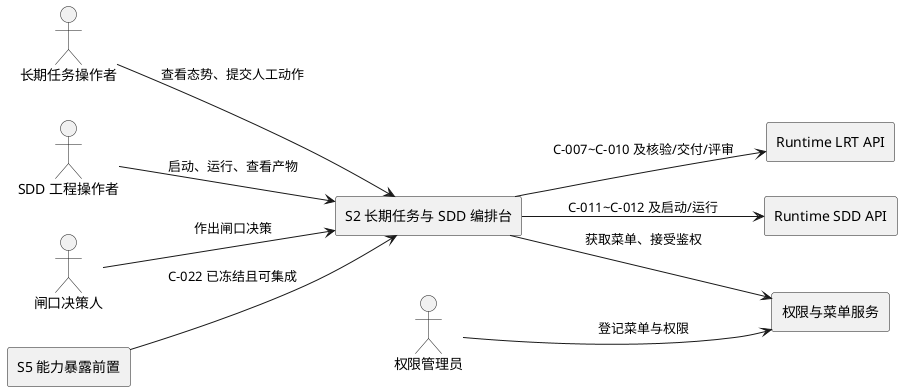
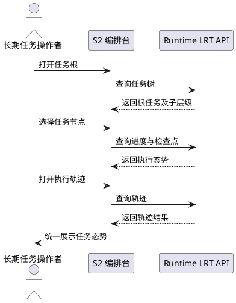
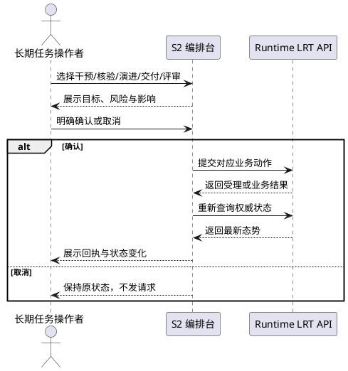
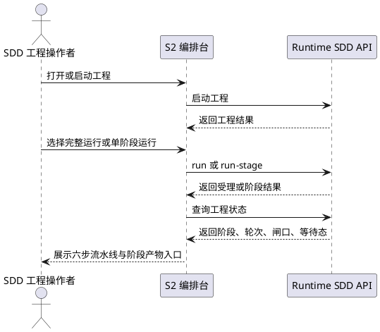
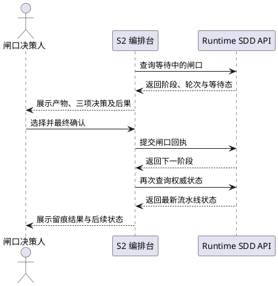
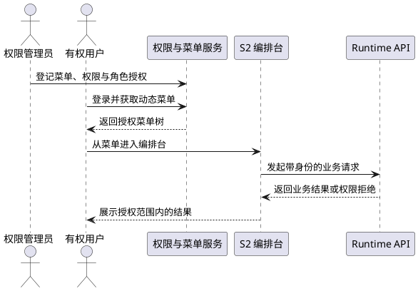

# ConsoleClosure--orchestration-desk 需求规格

- feature_name：`ConsoleClosure--orchestration-desk`
- 子系统：S2 长期任务与 SDD 编排台
- 语言标签：`web`
- 覆盖缺口：B1-B8
- 集成契约：C-007~C-012；硬前置 C-022；菜单契约 C-024

# **1. 组件定位**
## **1.1 核心职责**

本组件负责可视化长期任务与 SDD 流水线，并以人工闸口约束关键推进与自演进操作。

核心价值不是“再做一组表 CRUD”，而是把任务树、执行进度、阶段产物和决策后果放在同一业务界面中，使系统能够持续执行和改进，同时保证关键节点始终有人确认、可追溯、可停止。

事实基线：LRT 九个业务动作已注册但前端零业务界面，证据为 `src/app/routes/uctoo/long_running_task/LongRunningTaskRoute.cj:43-80` 与 `specs/ConsoleClosure/research.md:186-190`；SDD 五个语义端点已注册但仅有 `sdd_projects` 表 CRUD，证据为 `src/app/routes/uctoo/sdd/SddOrchestrationRoute.cj:26-36` 与 `specs/ConsoleClosure/research.md:191-193`。

| 缺口 | 本规格承载能力 |
|---|---|
| B1 | LRT 任务树可视化 |
| B2 | LRT 进度与检查点 |
| B3 | LRT 人工干预 |
| B4 | LRT 核验、交付与评审 |
| B5 | LRT 演进与追踪 |
| B6 | SDD 六步流水线可视化 |
| B7 | SDD 五个闸口决策界面 |
| B8 | SDD 阶段产物查看 |
## **1.2 核心输入**
1. **LRT 查询输入**：操作者提供 `rootId` 或 `taskId`，组件消费 C-007、C-008、C-010，读取任务树、进度、检查点和执行轨迹。
2. **LRT 动作输入**：操作者针对当前任务发起人工干预、核验、交付、评审或演进；人工干预契约输入为 `taskId`、`action`、`payload`，字段依据 `specs/ConsoleClosure/SPECS_INDEX.md:70-75`。
3. **SDD 编排输入**：操作者提供工程标识及服务端所需参数，调用 `start`、`run`、`run-stage`；具体请求字段待核对 `SddOrchestrationController` 后确认，禁止由前端猜测。
4. **SDD 状态与闸口输入**：组件以 `featureName` 查询状态，并接收闸口决策人的 `confirm`、`revise`、`abandon` 决策；五个 gate 定义见 `skills/sdd/SKILL.md:44-139,190-198`。
5. **动态菜单输入**：组件入口依赖 `POST /api/v1/uctoo/permissions/user/menu` 返回的菜单树和组件标识，依据 `specs/ConsoleClosure/research.md:92-97` 与 C-024。
6. **权限输入**：组件依赖 API 层权限与菜单层可见性两层结果；新增路由必须登记 `permissions` 与 `role_has_permission`，依据 `specs/ConsoleClosure/SPECS_INDEX.md:169-174`。
7. **硬前置输入**：S5 必须先为 `MemoryController`、`ModelController`、`StorageController`、`RetrieverController`、`ExecutorController` 等未绑定控制器完成并冻结 C-022“能力暴露”，且至少达到 `test`，S2 才可进入实现；确切新增路径由 S5 契约冻结，当前为待新增，依据 `specs/ConsoleClosure/research.md:233-245` 与 `specs/ConsoleClosure/SPECS_INDEX.md:85,94-111`。
8. **接口数量口径**：源码呈现 LRT 九动作加 SDD 五语义端点，共十四个；`SPECS_INDEX.md:45` 摘要写十三个，待在 `contract.md` 冻结前逐项对账确认。
## **1.3 核心输出**
1. **长期任务态势**：向操作者输出可展开的任务树、进度、当前阶段、检查点和执行轨迹，不补造服务端未返回的数据。
2. **动作回执**：展示干预是否受理、核验/演进/交付/评审的服务端结果；回执字段以 C-007~C-012 冻结契约为准。
3. **SDD 流水线态势**：展示 research（可选）→ spec → design → tasks → code → test 六步、当前轮次、等待中的 gate 和阶段产物。
4. **人工决策结果**：把闸口选择提交至 `POST /api/v1/uctoo/sdd/review`，并展示下一阶段或继续等待状态。
5. **可审计留痕**：LRT 人工干预与 SDD 闸口决策由既有 `agent_approvals` 承载，具体列映射待核对实体与控制器后确认。
6. **可导航入口**：通过动态菜单向有权角色暴露编排台入口；无权用户既看不到菜单，也不能越权调用 API。
## **1.4 职责边界**
1. 不实现 LRT 或 SDD 服务端编排算法，不改变任务状态机语义。
2. 不新增或猜测 API；仅消费源码已注册端点及 S5 后续冻结的 C-022 端点。
3. 不替人自动选择 `confirm`、`revise`、`abandon`，也不以超时默认确认关键闸口。
4. 不把 `long_running_task_artifact`、`long_running_task_evolution`、`lrt_verify_job` 或 `sdd_projects` 的通用 CRUD 页包装成业务闭环。
5. 不负责 S5 的控制器路由暴露实现；S2 只把 C-022 作为开工硬前置并执行集成验收。
6. 不负责 PC 原生重复实现；PC 端业务承载遵循“核心运维原生 + 业务 iframe”的主工程边界。
7. 不在本规格新增表或列；优先复用既有六类数据对象。若设计阶段提出结构变更，必须先写明复用不成立理由。
8. 不承接 LRT 新任务提交界面；`POST /api/v1/uctoo/long_running_task/add` 不属于 B1-B8 的九动作范围，是否纳入待主工程确认。

# **2. 领域术语**

**长期任务（LRT）**
: 能够形成任务树、持续推进、产生检查点并接受人工干预的任务执行过程。

**任务树**
: 以 `rootId` 定位、由根任务及其层级子任务组成的只读业务视图，契约为 C-007。

**检查点**
: 长期任务执行过程中可供恢复、核验或理解进度的阶段性上下文，契约为 C-008。

**人工干预**
: 人对进行中的长期任务显式提交动作和补充信息，并获得受理回执的过程，契约为 C-009。

**SDD 流水线**
: research（可选）、spec、design、tasks、code、test 六步组成的可回放开发过程，依据 `skills/sdd/SKILL.md:146-157`。

**人在回路闸口**
: research、spec、design、task、code 五个阶段后的人工决策点；测试为末步，不设置同类 gate。

**闸口决策**
: `confirm`、`revise`、`abandon` 三选一的人工回执；任何选择都必须展示后果并留痕。

**阶段产物**
: 各 SDD 阶段落盘并记录于 `long_running_task_artifact` 的文档或代码验收结果，依据 `skills/sdd/SKILL.md:153-157,254-258`。

**能力暴露前置**
: S5 将尚未绑定路由的控制器能力暴露为 HTTP API 的 C-022 交付，是 S2 实现前的硬依赖。

**动态菜单**
: 由权限服务返回并在运行时注入的 Web 管理路由；未登记即没有用户可见入口。

# **3. 角色与边界**
## **3.1 核心角色**

- **长期任务操作者**：查看任务树、进度、检查点和轨迹，并在授权范围内发起干预、核验、演进、交付或评审。
- **SDD 工程操作者**：启动工程、触发异步流水线或同步单阶段执行、查看阶段状态与产物。
- **闸口决策人**：阅读产物和影响说明，独立作出 `confirm`、`revise` 或 `abandon` 决策；该角色是本组件核心控制边界。
- **审计与运维人员**：核查任务动作、闸口留痕、权限登记和异常链路，不代替业务决策人作出闸口选择。
- **权限管理员**：登记菜单、`permissions` 和 `role_has_permission`，确保菜单可见性与 API 授权一致。
## **3.2 外部系统**

- **AgentSkills Runtime LRT API**：提供九个 LRT 业务动作，路径依据 `LongRunningTaskRoute.cj:43-80`。
- **AgentSkills Runtime SDD API**：提供 `start`、`run`、`run-stage`、`review`、`status` 五个语义端点，路径依据 `SddOrchestrationRoute.cj:26-36`。
- **权限与菜单服务**：通过 C-024 提供动态菜单，并在 API 层执行权限校验。
- **S5 系统运维与可观测**：提供并冻结 C-022，作为 S2 开工与 L2 集成验收的上游。
- **主工程 ConsoleClosure**：维护依赖 DAG、C-007~C-012 契约与 L2/L3 组合验收，不介入 S2 内部交互设计。
## **3.3 交互上下文**

# **4. DFX约束**
## **4.1 性能**
1. 在任务树不超过 1,000 个节点、同屏展开不超过 200 个节点时，树视图从收到成功响应到可交互的 p95 应不超过 2 秒。
2. 运行中任务的默认状态刷新间隔应为 5 秒，同一页面同一时刻最多存在 1 个未完成状态请求。
3. 人工动作提交后，界面应在 1 秒内进入“提交中”状态；服务端完成时间上限待联调基线确认。
## **4.2 可靠性**
1. 查询类请求失败时最多自动重试 2 次；`intervene`、`verify`、`evolve`、`deliver`、`review` 及 SDD `review` 写动作自动重试次数必须为 0。
2. 运行中页面恢复可见后应在 10 秒内重新拉取权威状态，不得仅凭前端缓存宣称阶段已推进。
3. 对 100% 的写动作，按钮在收到回执前必须防重复提交；幂等语义待逐项核对控制器后确认。
## **4.3 安全性**
1. C-007~C-012 及相关业务端点的鉴权覆盖率必须为 100%；未授权请求应返回 403 或既有统一拒绝响应，前端不得降级绕过。
2. 新增页面和路由的 `permissions`、`role_has_permission` 登记覆盖率必须为 100%，且完成后执行 `loaddbinfo`，依据 R6。
3. 干预、演进、交付、评审和五个 SDD 闸口决策的审计留痕率必须为 100%；展示敏感内容的脱敏规则待安全评审确认。
## **4.4 可维护性**
1. B1-B8 每个缺口必须至少对应 1 条自动化验收用例，需求覆盖率必须为 100%。
2. C-007~C-012 每个契约必须至少包含 1 条主干和 1 条异常测试，契约测试覆盖率必须为 100%。
3. 所有接口错误展示必须保留 1 个可定位请求的标识；标识名称与日志格式待既有前端错误规范确认。
## **4.5 兼容性**
1. C-007~C-012 在 v1 冻结后允许新增可选响应属性，但破坏性字段或语义变更数量必须为 0；变更须先更新主工程契约。
2. 新业务界面不得删除或改写现有四张 CRUD 页，存量页面可访问性回归通过率必须为 100%。
3. 浏览器版本矩阵当前待定；design 阶段必须冻结至少 2 个受支持浏览器内核及最低版本。

# **5. 核心能力**
## **5.1 长期任务态势查看**
### **5.1.1 业务规则**
1. **任务树按根加载**：组件必须通过 `GET /api/v1/uctoo/long_running_task/tree/:rootId` 获取层级，不得从附属表 CRUD 结果自行拼树。
   - 验收条件：当操作者打开有效 `rootId` 时，系统应当展示 C-007 返回的根任务及子层级。
2. **进度与检查点同任务关联**：组件必须分别调用 `GET /api/v1/uctoo/long_running_task/progress/:taskId` 与 `GET /api/v1/uctoo/long_running_task/checkpoints/:taskId`，并明确区分总体进度和检查点列表。
   - 验收条件：当操作者选中树节点时，系统应当展示该 `taskId` 对应的进度和检查点。
3. **轨迹按服务端事实展示**：组件必须通过 `GET /api/v1/uctoo/long_running_task/trace` 获取轨迹；查询参数待核对控制器后确认。
   - 验收条件：当操作者打开轨迹视图时，系统应当展示服务端返回结果，缺失属性应显示为空态而非推断值。
4. **演进结果可回看**：演进动作完成后，组件应刷新 C-010 相关视图，呈现服务端返回的演进标识与轨迹。
   - 验收条件：当演进请求被服务端接受时，系统应当展示回执并刷新演进与追踪区域。
### **5.1.2 交互流程**

### **5.1.3 异常场景**
1. **根任务不存在**：触发条件为 C-007 返回不存在；系统行为是停止后续节点查询；用户感知为“任务根不存在或不可见”。
2. **部分查询失败**：触发条件为树成功但进度、检查点或轨迹失败；系统行为是保留已成功区域并标注失败区域；用户感知为可单独重试的局部错误。
3. **返回结构未冻结**：触发条件为响应与 C-007/C-008/C-010 不一致；系统行为是拒绝猜测映射并记录契约偏差；用户感知为“接口契约不匹配”。
## **5.2 长期任务人工控制与质量闭环**
### **5.2.1 业务规则**
1. **干预前显式确认**：组件必须展示目标任务、动作和影响摘要，再调用 `POST /api/v1/uctoo/long_running_task/intervene`；`action` 候选值待核对控制器确认。
   - 验收条件：当操作者确认干预时，系统应当只提交一次 C-009 请求并展示 `accepted` 与 `reason` 回执。
2. **核验独立触发**：核验必须调用 `POST /api/v1/uctoo/long_running_task/verify/:taskId`，不得以读取 `lrt_verify_job` CRUD 页代替。
   - 验收条件：当有权操作者发起核验时，系统应当提交目标任务并展示服务端核验回执。
3. **演进受人在回路约束**：调用 `POST /api/v1/uctoo/long_running_task/evolve/:agentId` 前必须二次确认，禁止页面加载后自动触发。
   - 验收条件：当操作者取消演进确认时，系统应当不发送任何演进请求。
4. **交付必须由人确认**：组件必须在明确确认后调用 `POST /api/v1/uctoo/long_running_task/deliver/:taskId`，符合 `LongRunningTaskRoute.cj:61-62` 的语义。
   - 验收条件：当操作者未确认交付时，系统应当保持任务原状态且不调用交付端点。
5. **评审承接反馈**：组件必须通过 `POST /api/v1/uctoo/long_running_task/review/:taskId` 提交反馈；反馈请求字段待核对控制器确认。
   - 验收条件：当操作者提交有效评审反馈时，系统应当展示服务端是否进入改进流程的回执。
### **5.2.2 交互流程**

### **5.2.3 异常场景**
1. **重复点击**：触发条件为同一写动作尚未返回；系统行为是禁用重复提交；用户感知为单一“处理中”状态。
2. **状态冲突**：触发条件为任务状态已变化导致动作被拒；系统行为是刷新权威状态且不自动重试；用户感知为服务端拒绝原因。
3. **权限不足**：触发条件为 API 层拒绝；系统行为是结束操作并保留上下文；用户感知为无权限提示，不展示成功假象。
## **5.3 SDD 六步流水线与产物查看**
### **5.3.1 业务规则**
1. **六步完整呈现**：组件必须按 research（可选）、spec、design、tasks、code、test 展示流水线，不得把五个 gate 误当成六个阶段。
   - 验收条件：当用户打开 SDD 工程时，系统应当展示六个阶段及 research 的可选属性。
2. **启动走语义端点**：工程启动必须调用 `POST /api/v1/uctoo/sdd/start`，禁止直接编辑 `sdd_projects` CRUD 记录。
   - 验收条件：当用户启动工程时，系统应当展示服务端返回的工程结果并随后查询状态。
3. **异步与同步入口分离**：完整编排调用 `POST /api/v1/uctoo/sdd/run`，单阶段探针调用 `POST /api/v1/uctoo/sdd/run-stage`，界面必须说明前者立即返回、后者等待阶段结果。
   - 验收条件：当用户选择运行模式时，系统应当调用对应端点并展示不同等待语义。
4. **状态以服务端为准**：组件必须通过 `GET /api/v1/uctoo/sdd/status/:featureName` 展示 C-011 的 `stage`、`round`、`gate`、`waiting`。
   - 验收条件：当状态刷新完成时，系统应当按 C-011 更新当前阶段、轮次与等待状态。
5. **产物可关联查看**：组件必须从既有 `long_running_task_artifact` 关联展示阶段产物；关联字段与读取 API 待核对源码确认。
   - 验收条件：当用户选择已有产物的阶段时，系统应当展示对应产物；无产物时应显示明确空态。
### **5.3.2 交互流程**

### **5.3.3 异常场景**
1. **上游产物缺失**：触发条件为指定阶段不满足服务端前置校验；系统行为是不伪造补件且展示拒绝原因；用户感知为缺失产物提示。
2. **同步执行超时**：触发条件为 `run-stage` 长时间未返回；系统行为是不改写阶段状态并允许重新查询；超时阈值待联调确认。
3. **产物读取能力不明确**：触发条件为未找到已注册读取 API；系统行为是阻断 B8 完成声明；用户感知为“阶段产物读取接口待确认”。
## **5.4 五个人在回路闸口**
### **5.4.1 业务规则**
1. **五闸口固定对应**：组件必须支持 gate-research、gate-spec、gate-design、gate-task、gate-code；test 为末步验收，不新增虚构 gate-test。
   - 验收条件：当工程等待任一既定 gate 时，系统应当高亮对应阶段并展示决策区。
2. **决策只能由人提交**：组件禁止自动确认、默认倒计时确认或由主工程代签，必须由有权决策人选择三项之一。
   - 验收条件：当无人作出选择时，系统应当保持 `waiting`，不得推进下一阶段。
3. **决策后果先展示**：提交前必须说明 `confirm` 推进、`revise` 重做并增加轮次、`abandon` 终止且保留已有产物。
   - 验收条件：当决策人选择任一选项时，系统应当在最终提交前展示该选项的后果。
4. **回执走统一端点**：决策必须调用 `POST /api/v1/uctoo/sdd/review`，输入 `featureName`、`stage`、`decision`，返回 `nextStage`，依据 C-012。
   - 验收条件：当决策人确认提交时，系统应当展示 C-012 返回的下一阶段并刷新状态。
5. **决策必须留痕**：五类闸口决策必须在 `agent_approvals` 留痕，界面不得把本地成功提示当作落库成功。
   - 验收条件：当 review 返回成功时，系统应当重新查询状态；若状态未变化，则应当提示核对审批留痕。
6. **revise 不抹除历史**：revise 应增加轮次且保留已确认产物，禁止前端隐藏历史轮次，依据 `skills/sdd/SKILL.md:190-198`。
   - 验收条件：当 revise 生效时，系统应当显示新轮次并允许回看先前产物。
### **5.4.2 交互流程**

### **5.4.3 异常场景**
1. **非等待态提交**：触发条件为工程已离开目标 gate；系统行为是拒绝本地继续并刷新状态；用户感知为“闸口状态已变化”。
2. **并发决策冲突**：触发条件为两名决策人先后提交；系统行为是以后端权威回执为准且不覆盖先到结果；用户感知为冲突提示与最新状态。
3. **留痕失败**：触发条件为 review 返回失败或状态未变化；系统行为是不展示推进成功；用户感知为可定位的失败信息和人工核查入口。
## **5.5 上线前置、菜单与 RBAC 闭环**
### **5.5.1 业务规则**
1. **C-022 是硬开工门槛**：若 S5 未达到 `test` 或 C-022 未冻结，则 S2 不得进入 code，依据主工程 DAG。
   - 验收条件：若 C-022 仍处于待新增或未验证状态，则系统应当把 S2 标记为 blocked 并写明 S5 依赖。
2. **动态菜单必须登记**：新增业务界面必须进入 C-024 菜单树，组件解析规则遵循 `views/${menu.component}.vue`，依据 `research.md:92-97`。
   - 验收条件：当有权用户重新登录并获取菜单时，系统应当展示“长期任务与 SDD 编排台”入口。
3. **RBAC 双层一致**：菜单可见角色与 API 授权角色必须一致，新路由必须登记 `permissions` 与 `role_has_permission`。
   - 验收条件：若用户无页面权限，则系统应当不展示入口；若用户绕过菜单直达，则系统应当由 API 拒绝访问。
4. **复用既有数据对象**：本子系统必须优先复用现有表，不新增专属表；任何新增提案必须先完成 R4 复用不成立论证。
   - 验收条件：当 design 提出新表或列时，系统应当在缺少复用论证的情况下阻断设计闸口确认。
### **5.5.2 交互流程**

### **5.5.3 异常场景**
1. **菜单漏登记**：触发条件为页面已部署但 C-024 无节点；系统行为是 L2/L3 验收失败；用户感知为无入口，不得标记 done。
2. **权限漏登记**：触发条件为菜单可见但 API 返回 403；系统行为是定位 `permissions` 与 `role_has_permission`；用户感知为权限配置错误。
3. **S5 前置未完成**：触发条件为 C-022 未冻结；系统行为是保持 blocked 且不绕过依赖；用户感知为明确上游阻塞说明。

# **6. 数据约束**
## **6.1 LRT 任务树视图**
1. **root**：C-007 响应必须包含根对象；其契约属性为 `id`、`title`、`state`、`children`，依据 `SPECS_INDEX.md:70`。
2. **children**：必须保持服务端返回的层级和顺序；空集合表示叶节点，不得据此推断执行完成。
3. **数据归属**：契约映射到 `long_running_task.*`；属性与实体列是否同名待核对 PO/Controller 后确认。
## **6.2 LRT 进度与检查点视图**
1. **percent**：表示 C-008 返回的进度值；合法范围和是否允许空值待核对 `LongRunningTaskController` 后确认。
2. **currentStage**：表示服务端返回的当前阶段文本；前端不得自行枚举未证实阶段。
3. **checkpoints**：必须为服务端返回的检查点集合；其元素字段待核对源码确认。
4. **数据归属**：契约映射到 `agent_contexts.*`，不声明未经源码确认的具体存储列。
## **6.3 LRT 人工干预与审批留痕**
1. **taskId**：C-009 必填的目标任务标识，不得从当前页面以外的缓存对象替换。
2. **action**：C-009 必填动作；允许值待核对控制器校验逻辑后确认。
3. **payload**：C-009 扩展内容；格式、大小和敏感信息约束待核对控制器后确认。
4. **accepted / reason**：必须按 C-009 原样展示受理结果及原因。
5. **数据归属**：审批留痕复用 `agent_approvals.*`；具体字段映射待核对实体源码确认。
## **6.4 LRT 演进与轨迹视图**
1. **evolutionId**：C-010 返回的演进标识；缺失时不得生成前端临时标识冒充服务端结果。
2. **trace**：C-010 返回的追踪内容；结构和分页口径待核对 `getTrace` 控制器实现后确认。
3. **数据归属**：演进记录复用 `long_running_task_evolution.*`，不新增 S2 专属演进表。
## **6.5 SDD 工程状态视图**
1. **stage**：C-011 当前阶段；展示值必须来自服务端。
2. **round**：C-011 当前轮次；revise 后必须可见递增结果，不得覆盖历史轮次展示。
3. **gate**：C-011 当前闸口；只允许映射已确认的五个 gate，未知值显示为未识别状态。
4. **waiting**：C-011 等待标志；为等待态时禁止前端假定自动推进。
5. **数据归属**：状态复用 `sdd_projects.*`；与实际实体列的映射待核对源码确认。
## **6.6 SDD 闸口回执**
1. **featureName**：C-012 必填工程标识，必须与当前查看工程一致。
2. **stage**：C-012 必填目标阶段，必须与最新状态中的等待阶段一致。
3. **decision**：只允许 `confirm`、`revise`、`abandon` 三值，依据 `skills/sdd/SKILL.md:190-198`。
4. **nextStage**：必须采用服务端返回值；`abandon` 等情况下的具体返回口径待控制器联调确认。
5. **数据归属**：决策留痕复用 `agent_approvals.*`，与 LRT 干预共享表但按既有业务语义区分。
## **6.7 SDD 阶段产物**
1. **数据归属**：阶段产物复用 `long_running_task_artifact`，依据 `research.md:193` 与 `skills/sdd/SKILL.md:153-157`。
2. **关联约束**：产物与工程、阶段、轮次的关联字段待核对实体、服务与读取接口后确认。
3. **内容约束**：界面必须展示服务端权威产物，不得以本地临时文本替代已落库内容。
4. **复用结论**：现有六类对象已覆盖任务、上下文、审批、演进、工程和产物，本规格不提出新表或新列。
