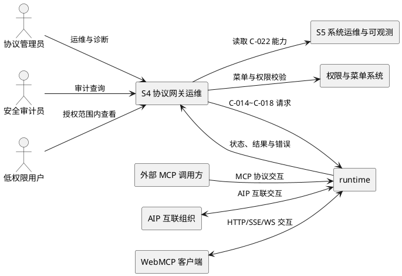
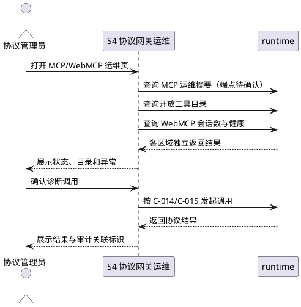
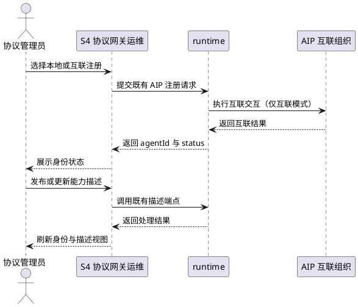
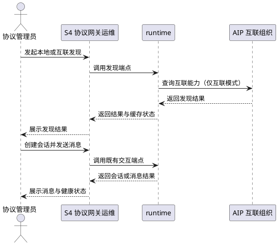
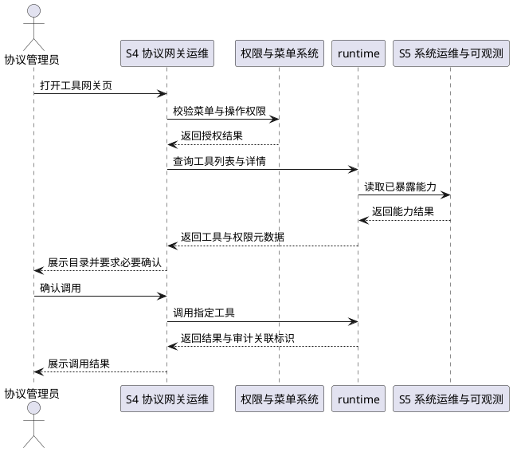

# **1. 组件定位**

- **feature_name**：`ConsoleClosure--protocol-gateway`
- **子系统编号**：S4（协议网关运维）
- **语言标签**：cangjie + web
- **承载缺口**：D1-D8
- **集成契约**：C-014~C-018；同时遵循 R2 与已冻结的 C-024 动态菜单契约
- **上游依赖**：遵循 R3，S5 的 C-022 能力暴露达到 `test` 后，本子系统方可进入 `code`
## **1.1 核心职责**

本组件负责统一运维 MCP、WebMCP、AIP 与工具网关，实现协议能力可见、可控、可审计。
## **1.2 核心输入**

| 来源 | 输入对象 | 内容概要 |
|---|---|---|
| 协议管理员 | 运维指令 | 查询状态、查看目录、发起诊断调用、刷新缓存、切换模式与检查健康状态 |
| 安全审计员 | 审计查询 | 查询 AIP 身份关键操作、MCP 外部调用与工具调用的审计记录 |
| runtime | MCP/WebMCP 运行态 | MCP JSON-RPC 响应、WebMCP 会话数、健康状态、远程连接与客户端解析结果 |
| runtime | AIP 领域对象 | 身份、能力描述、发现缓存、会话、消息、配置、模式及健康状态 |
| runtime | 工具元数据 | 工具名称、权限路径、敏感级别、确认要求及审计开关 |
| S5 | C-022 能力目录 | S5 新暴露并完成验证的能力，供协议网关展示和调用 |
| 权限系统 | 菜单树与授权结果 | C-024 菜单可见性及 API 权限判定结果 |
## **1.3 核心输出**

| 目标 | 输出对象 | 内容概要 |
|---|---|---|
| 协议管理员 | 协议运维视图 | MCP/WebMCP 状态、AIP 身份与交互状态、工具目录及操作结果 |
| runtime | 协议操作请求 | C-014~C-018 约束下的既有协议请求，以及经确认后新增的运维查询请求 |
| 安全审计员 | 审计视图 | 关键操作的操作者、目标、动作、结果、时间与关联标识；具体存储字段待审计实现勘查确认 |
| 权限系统 | 权限与菜单登记 | 新增服务端路由的 `permissions`、`role_has_permission` 登记及新增页面的 C-024 菜单登记 |
| 主工程 | L2 验收结果 | S5→S4 能力列出与调用主干、权限异常分支的验证结果 |
## **1.4 职责边界**

1. 本子系统不重新设计 MCP、WebMCP 或 AIP 协议，不修改既有协议语义、状态机与消息格式。
2. AIP/MCP 的协议语义以服务端既有实现为准；前端不得自行推导或改写服务端状态。
3. 本子系统只建设运维业务界面，并补齐界面必需但当前缺失的服务端查询或诊断端点。
4. 本子系统不负责 S5 的 C-022 控制器路由暴露；该能力是 S4 开工前置，不得在 S4 重复实现。
5. 本子系统不建设通用权限平台，仅登记本子系统菜单、路由权限与角色授权。
6. 本子系统不建设第二套表 CRUD 页面；已有表 CRUD 只作为数据底座，不等同于运维业务界面。
7. 本子系统不新增数据表；若 design 阶段证明审计等需求无法复用既有设施，必须先按 R4 给出“复用不成立”论证。
8. 本子系统不承担 PC 原生页面建设；桌面端仍由 S6 按业务 iframe 模式集成。

# **2. 领域术语**

**MCP Server**
: 宿主通过同路径 `GET/POST /api/v1/uctoo/mcp/stream` 对外提供的 Streamable HTTP 协议能力。

**MCP 开放调用**
: runtime 通过 `GET /api/v1/uctoo/mcp/open/tools` 提供目录、通过 `POST /api/v1/uctoo/mcp/open/call` 执行工具的能力。

**WebMCP**
: runtime 通过 HTTP、SSE 与 WebSocket 通道连接 Web 客户端，并提供会话数、健康、远程连接及客户端解析运维端点的能力。

**AIP 身份**
: AIP 中可本地注册或互联注册，并可登录、启停、锁定、解锁、吊销和查询的 Agent 身份。

**AIP 能力描述**
: 与 AIP 身份关联、可注册、发布、查询和更新的能力声明；字段语义以既有服务端实现为准。

**发现缓存**
: AIP 对本地或互联发现结果形成的缓存，可按 `queryHash` 查询、刷新或清理过期项。

**AIP 会话**
: 本地或互联 Agent 之间承载消息交互的会话，可创建、查看消息和关闭。

**工具网关**
: 通过 `/api/v1/tools` 提供工具列表、工具信息与工具调用的统一 HTTP 边界。

**运维端点**
: 为状态查看、诊断、审计或列表查询服务，不改变协议本身语义的服务端接口。

# **3. 角色与边界**
## **3.1 核心角色**

- 协议管理员：查看协议运行态，管理 AIP 身份与模式，执行受控诊断和缓存运维。
- 安全审计员：查看跨组织身份操作、外部能力调用和工具调用的审计证据，不执行协议写操作。
- 低权限用户：仅访问角色授权的只读页面和操作，用于验证菜单层与 API 层双层 RBAC。
## **3.2 外部系统**

- runtime：提供 MCP、WebMCP、AIP 与工具网关既有端点，并承载需要补齐的运维端点。
- S5 系统运维与可观测：通过 C-022 提供已暴露的能力，作为 S4 能力展示和调用的上游前置。
- 权限与菜单系统：通过 `permissions`、`role_has_permission` 和 C-024 菜单树控制入口与操作权限。
- 外部 MCP 调用方：按既有 MCP 语义连接宿主 MCP Server；本组件只展示和审计其运行态。
- AIP 互联组织：参与 AIP 互联注册、发现、会话和消息交互，其信任语义以既有实现为准。
- WebMCP 客户端：通过 HTTP、SSE 或 WebSocket 与 runtime 建立协议连接。
## **3.3 交互上下文**

# **4. DFX约束**
## **4.1 性能**

1. 在 20 个并发后台用户下，列表、详情、健康检查和会话数查询的服务端 p95 响应时间应不超过 2 秒，外部互联耗时不计入此指标。
2. 运维页首屏应在 3 秒内呈现可操作骨架，并在单个接口超时时独立标记失败，不得阻塞其他协议卡片。
3. AIP 消息分页单次请求数量应使用路由中的 `limit` 控制，页面默认值与最大值待现有控制器校验规则确认。
## **4.2 可靠性**

1. 对吊销、锁定、禁用、模式切换和外部能力调用，前端一次确认只应提交 1 次请求；连续点击不得产生重复提交。
2. 当任一协议请求失败时，其他协议区域应保持可用；故障隔离验收覆盖 MCP、AIP、WebMCP、工具网关 4 个区域。
3. 写操作成功后应在 2 秒内重新读取服务端状态；若读取失败，应显示“结果待同步”，禁止伪造本地成功状态。
## **4.3 安全性**

1. AIP 互联注册、互联发现、互联会话、互联消息、身份吊销、锁定及模式切换必须 100% 经过认证与授权；未认证返回 401，未授权返回 403。
2. MCP 开放调用与工具调用必须 100% 绑定可识别调用主体并执行权限校验；无法证明受保护的端点不得上线到运维界面。
3. 身份注册/启停/锁定/解锁/吊销、能力发布/更新、模式切换、MCP 外部调用和工具调用必须 100% 产生审计记录；审计存储与查询端点待现有审计设施勘查确认。
4. 审计记录必须至少表达操作者、目标、动作、结果、时间和关联标识，且敏感凭据与完整消息正文的明文记录数必须为 0。
5. 所有新增路由必须按 R6 以 100% 覆盖率登记 `permissions` 并按角色写入 `role_has_permission`，登记后执行 `loaddbinfo`；新增页面必须 100% 完成 C-024 菜单登记。
6. AIP 跨组织操作与身份吊销的确认界面必须展示目标身份和动作，确认前发出的服务端写请求数必须为 0。
## **4.4 可维护性**

1. 4 个协议区域必须分别提供成功数、失败数和最近失败时间共 3 类可观测信息；指标落点待 S5 监控能力确认。
2. 新增服务端端点的错误日志必须 100% 包含协议域、操作、结果和关联标识，不得记录凭据或完整消息正文。
3. C-014~C-018 每项至少提供 1 条主干冒烟；S5→S4 另提供不少于 3 条主干和 1 条权限异常用例。
## **4.5 兼容性**

1. 既有 `v1` 路径、HTTP 方法和协议响应保持 100% 向后兼容；本子系统不得以运维需求替换既有协议端点。
2. C-014~C-018 的现有调用冒烟必须 100% 通过后才能合并新增端点；契约变更须先更新主工程 §3 与 §6。
3. `GET/POST /api/v1/uctoo/mcp/stream`、WebMCP 三通道及 AIP 本地/互联模式均必须保留，不得因控制台建设减少通道。

# **5. 核心能力**
## **5.1 MCP 与 WebMCP 运维（D1-D2；C-014/C-015）**
### **5.1.1 业务规则**

1. **统一状态展示**：页面应当展示 MCP Server、MCP 开放工具目录及 WebMCP 的会话数和健康状态。
   - 验收条件：当管理员进入 MCP 运维页时，系统应当分别返回各区域状态，并隔离展示失败区域。
2. **遵循既有协议**：C-014 应当沿用 JSON-RPC 请求与响应，界面不得改变 MCP 协议语义。
   - 验收条件：当管理员发起 MCP 诊断时，系统应当按既有服务端实现发送请求并原样表达结果状态。
3. **开放调用分离**：工具目录使用 `GET /api/v1/uctoo/mcp/open/tools`，调用使用 `POST /api/v1/uctoo/mcp/open/call`。
   - 验收条件：当管理员仅查看工具目录时，系统应当不发送任何工具调用请求。
4. **补齐运维摘要**：现有 MCP 仅有流端点时，服务端应当补充 UI 必需的只读运维摘要或诊断端点。
   - 验收条件：若现有端点无法返回 MCP 运维摘要，则系统应当在路径和响应契约经 design 勘查确认后补充端点。
5. **WebMCP 运维范围**：页面应当消费 `/webmcp/sessions/count`、`/health`、`/remote`、`/client`，并展示 HTTP/SSE/WS 通道说明。
   - 验收条件：当 WebMCP 健康检查成功时，系统应当展示服务状态；当失败时，应当保留其他协议区域可用。
### **5.1.2 交互流程**

### **5.1.3 异常场景**

1. **流端点不可达**
   - 触发条件：MCP Streamable HTTP 连接失败或超时。
   - 系统行为：标记 MCP 区域不可用并保留 WebMCP、AIP、工具网关操作。
   - 用户感知：显示“连接失败”，并展示服务端返回的安全错误摘要。
2. **WebMCP 局部故障**
   - 触发条件：会话数、健康、远程或客户端端点中的部分请求失败。
   - 系统行为：分别记录失败，不以一个端点失败覆盖其他端点结果。
   - 用户感知：失败卡片显示“数据不可用”，成功卡片正常展示。
## **5.2 AIP 身份与能力描述运维（D3-D4；C-016）**
### **5.2.1 业务规则**

1. **身份全生命周期**：界面应当承载本地注册、互联注册、登录、查询、启停、锁定、解锁、更新和吊销。
   - 验收条件：当管理员执行任一身份操作时，系统应当调用 `AipRoute.cj:29-39` 对应既有端点并刷新服务端状态。
2. **关键操作确认**：禁用、锁定和吊销必须先展示目标 `agentId` 与动作，再由有权限用户确认。
   - 验收条件：若用户未完成确认，则系统应当不发送禁用、锁定或吊销请求。
3. **能力描述管理**：界面应当承载本地/互联注册、按身份查询、发布和更新能力描述。
   - 验收条件：当管理员发布或更新能力描述时，系统应当展示服务端返回结果，不得在前端改写描述语义。
4. **跨组织受控**：互联注册与能力发布必须受独立权限和审计约束。
   - 验收条件：若用户缺少互联操作权限，则系统应当隐藏操作入口且服务端返回 403。
### **5.2.2 交互流程**

### **5.2.3 异常场景**

1. **互联注册失败**
   - 触发条件：互联组织不可达、拒绝注册或返回协议错误。
   - 系统行为：保留服务端原有状态，不生成前端临时身份。
   - 用户感知：显示互联注册失败及安全错误摘要。
2. **身份状态冲突**
   - 触发条件：页面状态已过期，服务端拒绝启停、锁定、解锁或吊销。
   - 系统行为：重新读取身份详情，并以服务端状态覆盖页面缓存。
   - 用户感知：显示“状态已变化，请复核后重试”。
## **5.3 AIP 发现、交互与模式运维（D5-D7；C-017）**
### **5.3.1 业务规则**

1. **发现与缓存**：界面应当支持本地/互联发现、按 `queryHash` 读取缓存、清理过期缓存和刷新指定缓存。
   - 验收条件：当管理员刷新指定缓存时，系统应当调用既有刷新端点并展示最新服务端结果。
2. **会话与消息**：界面应当支持本地/互联会话创建、消息发送、分页查看和关闭。
   - 验收条件：当管理员打开已知 `sessionId` 的消息页时，系统应当按 `limit/page` 请求消息并展示服务端顺序。
3. **补齐会话列表**：现有路由无法列出会话时，服务端应当补充只读会话列表端点。
   - 验收条件：若页面没有已知 `sessionId`，则系统应当通过 design 阶段确认的列表端点获取会话，不得扫描表 CRUD 接口替代。
4. **模式与健康**：界面应当展示配置和当前模式，受控执行模式切换，并分别检查本地与互联健康。
   - 验收条件：当模式切换成功时，系统应当重新读取模式和两类健康状态后再展示成功。
### **5.3.2 交互流程**

### **5.3.3 异常场景**

1. **缓存不存在或过期**
   - 触发条件：按 `queryHash` 查询失败或缓存已过期。
   - 系统行为：提示刷新或重新发现，不将旧页面数据标记为最新。
   - 用户感知：显示“缓存不可用，请刷新或重新发现”。
2. **会话不可用**
   - 触发条件：`sessionId` 不存在、会话已关闭或互联端不可达。
   - 系统行为：停止发送消息并重新读取会话状态。
   - 用户感知：显示“会话不可用”，保留已加载的历史消息只读展示。
3. **模式切换失败**
   - 触发条件：权限不足、当前模式冲突或服务端拒绝切换。
   - 系统行为：不改变页面模式，重新读取配置和健康状态。
   - 用户感知：显示服务端错误摘要及当前实际模式。
## **5.4 工具网关治理（D8；C-018）**
### **5.4.1 业务规则**

1. **工具目录与详情**：页面应当通过 `GET /api/v1/tools/list` 和 `GET /api/v1/tools/:toolName/info` 展示工具及权限元数据。
   - 验收条件：当管理员选择工具时，系统应当展示 `name`、`path`、`sensitiveLevel`、`requiresConfirmation` 和 `auditEnabled`。
2. **受控调用**：页面应当通过 `POST /api/v1/tools/:toolName` 调用工具，并遵循敏感级别与确认要求。
   - 验收条件：若工具要求确认，则系统应当在确认完成前不发送调用请求。
3. **权限双层登记**：新增工具运维路由和页面必须同时完成 API 权限、角色授权与菜单登记。
   - 验收条件：当低权限用户登录时，系统应当无菜单入口；即使直达接口，服务端也应当返回 403。
4. **补齐审计查询**：现有工具路由无审计查询能力时，服务端应当补充只读审计查询端点。
   - 验收条件：当审计员查询工具调用时，系统应当返回授权范围内的审计记录；路径与响应待审计设施勘查确认。
5. **S5 能力联动**：S5 经 C-022 暴露的能力进入工具体系后，页面应当可列出并完成一次授权调用。
   - 验收条件：当 S5 能力达到 `test` 且已登记权限时，系统应当在工具目录中展示并完成 L2 主干调用。
### **5.4.2 交互流程**

### **5.4.3 异常场景**

1. **未认证调用**
   - 触发条件：请求上下文没有可识别用户。
   - 系统行为：拒绝工具调用，不进入调度。
   - 用户感知：返回 401，并提示先登录。
2. **工具不存在**
   - 触发条件：`:toolName` 未在权限注册表中找到。
   - 系统行为：不发起调用，记录失败结果。
   - 用户感知：返回 404，并提示工具不存在。
3. **权限或确认不足**
   - 触发条件：用户无权调用，或敏感工具未完成确认。
   - 系统行为：拒绝调用并生成安全审计记录。
   - 用户感知：返回 403 或“需要确认”，不得显示内部异常堆栈。

# **6. 数据约束**
## **6.1 MCP 与 WebMCP 运维对象**

1. **MCP 请求/响应**：遵循 C-014 的 JSON-RPC→JSON-RPC，具体字段与错误语义完全复用既有实现。
2. **开放工具调用**：`toolName` 必须对应开放工具目录项，`args` 为既有调用参数，`result` 为服务端返回结果。
3. **WebMCP 会话数**：`count` 表达活跃会话数，必须为服务端返回值，前端不得自行累加。
4. **WebMCP 健康**：现有响应字段为 `status` 与 `service`，页面只解释既有取值。
5. **落表约束**：C-014、C-015 当前标记为无落表；本 spec 不新增 MCP 表。
## **6.2 AIP 身份与能力描述对象**

1. **agentId**：身份唯一标识，用于身份详情、状态操作、能力描述查询及会话关联；格式待既有模型校验规则确认。
2. **status**：身份当前状态，取值集合与流转规则以服务端既有实现为准，前端禁止扩展枚举。
3. **能力描述字段集**：字段名、必填项和格式待读取既有控制器与模型校验规则确认，本 spec 不虚构字段。
4. **复用表**：身份复用 `aip_agent_identity.*`，能力描述复用 `aip_agent_description.*`，不新建同义表。
## **6.3 AIP 发现与交互对象**

1. **queryHash**：发现缓存定位标识，必须使用服务端产生或认可的值；生成规则待既有发现实现确认。
2. **sessionId**：会话唯一标识，用于消息分页与关闭操作，不得由前端生成替代值。
3. **limit/page**：消息分页参数；允许范围待现有控制器校验规则确认，界面不得绕过服务端限制。
4. **sessions/messages**：C-017 响应逻辑集合；元素字段待既有响应模型确认，页面按服务端结果展示。
5. **复用表**：发现缓存复用 `aip_discovery_cache.*`，会话复用 `aip_interaction_session.*`，消息落点待既有模型勘查确认。
## **6.4 工具元数据与权限对象**

1. **name**：工具名称，必须与 `:toolName` 路径参数一致。
2. **path**：工具权限路径，由 `ToolPermissionRegistry` 返回，前端只读。
3. **sensitiveLevel**：工具敏感级别，由服务端返回；取值范围待权限注册实现确认。
4. **requiresConfirmation**：是否需要调用前确认，前端必须严格执行服务端布尔值。
5. **auditEnabled**：是否启用工具审计，前端只读；审计关闭不豁免本 spec 的关键调用审计要求。
6. **result/isError**：调用结果与工具级错误标识，以服务端响应为准。
7. **复用表**：C-018 复用 `permissions.*`；角色授权复用 `role_has_permission`，不新建 S4 私有权限表。
## **6.5 契约差异与待确认项**

1. C-015 在主工程表中以 `POST /mcp/open/{call,tools}` 简写，但源码为 `POST .../call` 与 `GET .../tools`；待更新主工程契约表确认。
2. C-018 主工程摘要字段为 `name/desc/permission`，源码实际返回 `name/path/sensitiveLevel/requiresConfirmation/auditEnabled`；待契约冻结前对齐确认。
3. C-014 主工程表仅登记 `POST /mcp/stream`，源码同时存在同路径 GET；待明确 GET 是否纳入 C-014 冻结范围。
4. MCP 运维摘要/诊断端点的路径和响应、AIP 会话列表端点、工具审计查询端点均待 design 阶段勘查既有控制器与路由命名规范后确认。
5. 审计记录的既有存储位置、查询字段和保留周期待勘查现有审计设施确认；确认前不得新建表。
6. 新增 Web 页面组件路径与 C-024 菜单节点标识待 web-admin 现有菜单数据勘查确认。
