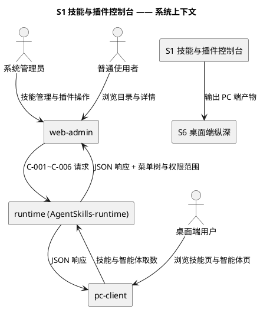
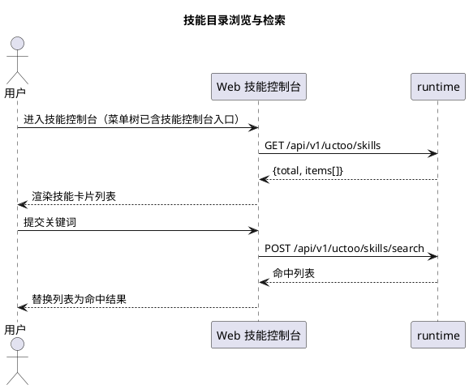
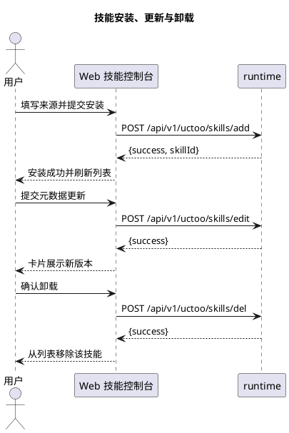
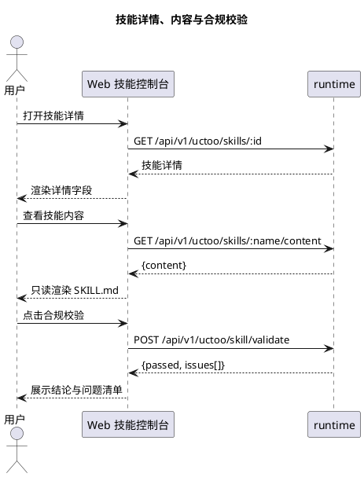
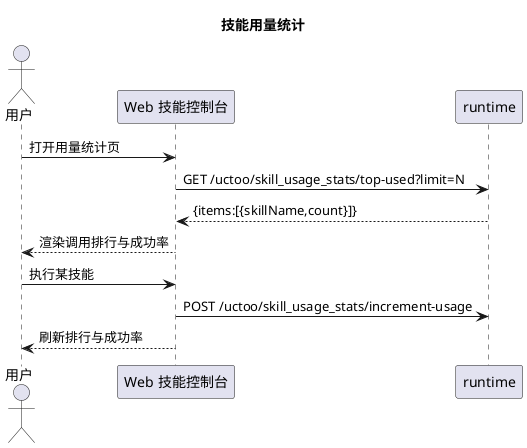
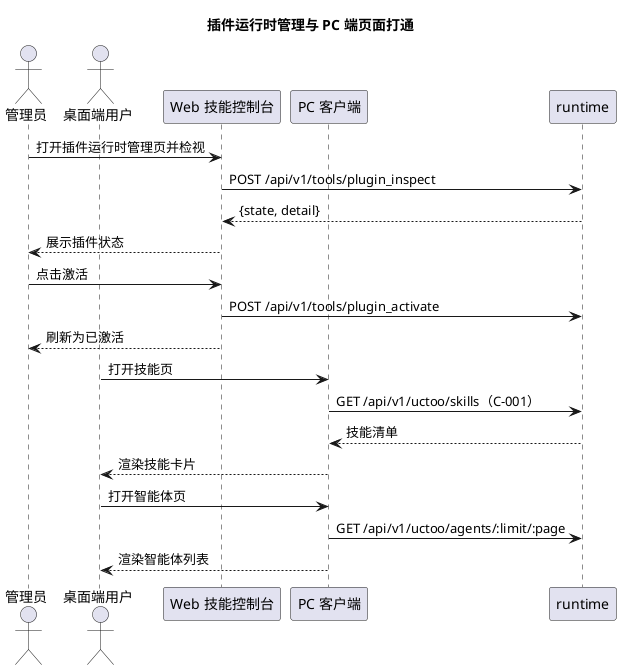
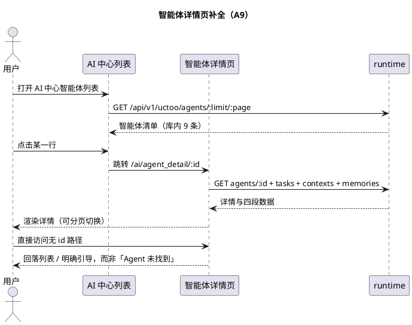
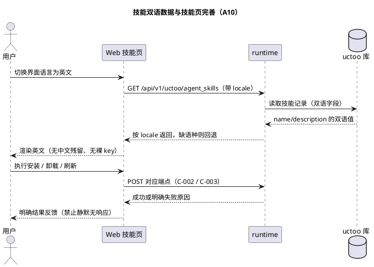

# **1. 组件定位**

> 主工程 `ConsoleClosure` ｜ 子系统 **S1 技能与插件控制台** ｜ feature_name：`ConsoleClosure--skill-console` ｜ 标签：web + app
> 依据：`specs/ConsoleClosure/research.md`（A1-A8）、`SPECS_INDEX.md`（C-001~C-006、R2、R4、R6）
> 契约：C-001 技能列表 / C-002 安装卸载 / C-003 内容读取 / C-004 合规校验 / C-005 用量统计 / C-006 插件运行时自管理

## **1.1 核心职责**

本组件负责为技能与插件提供 Web 端管理控制台与 PC 端原生页面取数，实现技能可安装、可查看、可校验、可运营。

## **1.2 核心输入**

1. **用户操作**：Web 端浏览/检索/安装/更新/卸载技能、查看内容与校验结论、操作插件运行时；PC 端浏览技能页与智能体页、发起安装。
2. **技能业务接口**（`src/app/routes/skill/SkillRoutes.cj:67-105`）：`GET /api/v1/uctoo/skills`、`GET /skills/:id`、`GET /skills/:name/content`、`POST /skills/add`、`POST /skills/edit`、`POST /skills/del`、`POST /skills/execute`、`POST /skills/search`。
3. **其余服务端能力**：合规校验 `/skill/validate`、`/validate-security`、`/execute-secure`、`/skill/validate-all`（`src/app/registry/AutoRouteConfig.cj:1519-1522`）；用量统计 `/increment-usage`、`/top-used`（`src/app/routes/uctoo/skill_usage_stats/SkillUsageStatsRoute.cj:53-54`）；插件运行时工具（`src/app/main.cj:602-606` 注册 `PluginInspect/Activate/Deactivate/RefreshTool`，经 `src/app/routes/tool/ToolRoutes.cj:39` 的 `POST /api/v1/tools/:toolName` 暴露）；动态菜单树（C-024，已冻结）。

## **1.3 核心输出**

1. **Web 端界面**：技能目录检索页、详情与内容页、合规校验页、用量统计页、插件运行时管理页（拟落盘 `src/views/ai/skill_console/**`，经后端菜单 `component` 解析，见 `src/router/guard/menu.ts:79`）。
2. **PC 端 IPC 真实数据**：`skills:list` / `skills:getDetail` / `skills:install` 与 `AgentsView.vue` 的智能体列表返回 runtime 真实数据；对 runtime 下发安装/更新/卸载、内容读取、合规校验、插件操作请求（C-001~C-006）。
3. **登记与对外交付**：新增界面与路由写入 `permissions` 与 `role_has_permission`（R6）；PC 端技能页输出给 S6 按混合模式集成（`S1 → S6`）。

## **1.4 职责边界**

**不做以下事项**：

1. **不做技能组合编排与执行 UI**（P2-G3），`POST /skills/execute` 仅作单次试执行入口；**不做技能生成**，生成类字段仅只读展示；**不提供 SKILL.md 在线编辑器**。
2. **不做 Agent 业务态管理**：PC 端智能体页只打通列表读取，上下文/消息/任务/记忆/审批不属本范围。
3. **不做长期任务与 SDD 编排**（属 S2）、**不做成本治理**（属 S3）。
4. **不改写服务端**：不新增/修改 runtime 仓颉路由；确需新增接口走 S5 横切前置与契约登记，禁止单边改码。
5. **不重复建设 PC 端业务页**：桌面端业务页以 iframe 集成为主（混合模式），本子系统在 PC 端只补数据层，页面壳与导航由 S6 统筹。

# **2. 领域术语**

**技能（Skill）**
: 以目录形式组织、含 SKILL.md 与附属脚本的能力单元，在 `agent_skills` 表中以一条记录表达；其 SKILL.md 全文经 C-003 返回。
: 备注：业务接口 `/api/v1/uctoo/skills`（`SkillRoutes.cj:68`）与表 CRUD 壳 `/api/v1/uctoo/agent_skills`（`AutoRouteConfig.cj:618`）是两套路径，不可混用；安装来源由 **source** / **source_type** 描述，后者枚举取值待读 `handleAddSkill` 实现确认。

**合规校验（validation）**
: 对技能包的规范性与安全性检查，结论落在 `validation_status` / `validation_errors`，经 C-004 四条接口触发；问题分级枚举待读 `SkillValidationController` 实现确认。

**插件（Plugin）**
: runtime 内可激活/停用的扩展单元，其自管理能力以工具形式暴露，与「技能」是不同层次的对象；其增量发现依赖 reconcile（`main.cj:602-606` + `main.cj:913`），60s 周期待读 `main.cj:929-974` 复核。

# **3. 角色与边界**

## **3.1 核心角色**

- **系统管理员**：管理技能全生命周期、执行合规校验、操作插件运行时、查看用量排行。
- **普通使用者**：浏览技能目录、查看详情与内容，无安装/卸载权限。
- **桌面端用户**：在 PC 端技能页与智能体页浏览并发起安装。

## **3.2 外部系统**

- **runtime（AgentSkills-runtime）**：提供 C-001~C-006 全部能力，是本组件唯一数据来源。
- **web-admin**：承载 Web 端界面，路由由动态菜单树注入（`src/router/guard/menu.ts:79`）。
- **pc-client**：承载 PC 端页面，经 `skills:*` 与智能体取数通道访问 runtime。
- **S6 桌面端纵深**：消费本组件 PC 端产物并按混合模式集成。

## **3.3 交互上下文**

# **4. DFX约束**

## **4.1 性能**

1. 技能列表首屏：发起 `GET /api/v1/uctoo/skills` 到卡片渲染完成 ≤ 2s（50 条数据量、局域网）。
2. 内容读取与单技能校验 ≤ 3s（内容 ≤ 200KB）；用量排行 `top-used` 请求 ≤ 2s、渲染 ≤ 1s；PC 端 `skills:list` IPC 到卡片渲染 ≤ 2s。

## **4.2 可靠性**

1. 任一 C-001~C-006 接口返回非 2xx 时，必须展示明确错误文案与重试入口，禁止静默空列表；runtime 恢复后手动刷新即恢复全部功能（MTTR ≤ 1 次刷新）。
2. 列表与详情的 `name` / `version` / `validation_status` 必须同源一致，禁止前端本地改写；`POST /skills/del` 成功后列表立即移除该条目，不得依赖下次全量刷新。

## **4.3 安全性**

1. **权限双层登记（R6 硬约束）**：每条新路由必须写入 `permissions` + 在 `role_has_permission` 授权 + 执行 `loaddbinfo`；缺失表现为「无入口」而非 403，必须按缺权限排查而非按前端 bug 排查。
2. 全部请求携带 `Authorization: Bearer <token>`（对齐 `src/store/models/uctoo/agent_skills.ts:80` 现有写法）；未授权角色直接调用安装接口必须得到 403 且界面不展示安装入口；`env_vars` / **source_path** / **install_path** 仅对系统管理员可见。

## **4.4 可维护性**

1. **菜单登记可追溯（R2 硬约束）**：每个新增界面在 tasks.md 中有独立「菜单登记」任务，并在 L3 端到端用例 1 验证入口可见。
2. 必须复用 `src/store/models/uctoo/*` 现有 Model 层（97 个模型），禁止在 `src/api/*` 遗留 thin 层上另起封装；技能域接口失败日志必须含接口路径与 HTTP 状态码。

## **4.5 兼容性**

1. 只消费 C-001~C-006 现有 v1 契约，不引入破坏性变更；演进按 minor 处理并登记 `SPECS_INDEX.md` §6；仅读取既有 `agent_skills` / `skill_usage_stats` 记录，不做存量数据迁移与字段回填。
2. **复用论证（R4 硬约束）**：本子系统不新建表；C-006 中标注「新增，需论证」的 `plugin_state` 暂缓建表，插件状态直接取 `plugin_inspect` 返回的运行时态，复用论证待 S5 能力暴露前置完成后再议。

# **5. 核心能力**

## **5.1 技能目录浏览与检索（A1）**
### **5.1.1 业务规则**
1. **目录默认展示**：当用户在 Web 端进入技能控制台时，系统应当调用 `GET /api/v1/uctoo/skills`（C-001，`SkillRoutes.cj:68`）拉取清单并渲染卡片列表。
   a. 验收条件：打开首页 → 卡片 2s 内出现；总数超单页容量 → 底部提供 page/limit 翻页且两页条目无重复。
2. **关键词检索**：当用户输入关键词并提交时，系统应当调用 `POST /api/v1/uctoo/skills/search`（`SkillRoutes.cj:103`）并以下发结果替换列表。
   a. 验收条件：提交关键词 → 列表仅保留命中项；无命中 → 展示「无匹配技能」且不残留上次结果。
3. **菜单登记（R2 硬约束）**：当本子系统新增任一 Web 业务界面时，系统应当在后端菜单树同步登记该页面（C-024，`POST /api/v1/uctoo/permissions/user/menu`）。
   a. 验收条件：授权用户登录 → 菜单栏出现技能控制台入口且可点击进入；未登记 → 判定不通过。
4. **权限登记（R6 硬约束）**：当本子系统引入新路由时，系统应当将路由写入 `permissions` 并在 `role_has_permission` 完成授权后执行 `loaddbinfo`。
   a. 验收条件：未授权角色 → 菜单无入口；该角色直接调用技能 API → 返回 403。
5. **禁止项**：禁止以 `agent_skills` 表 CRUD 页（`/api/v1/uctoo/agent_skills/*`，`AutoRouteConfig.cj:618`）替代技能业务界面交付。
   a. 验收条件：评审复核 → 技能控制台不跳转至 `database/uctoo/agent_skills` 页面。
### **5.1.2 交互流程**

### **5.1.3 异常场景**
1. **runtime 不可用**
   a. 触发条件：`GET /api/v1/uctoo/skills` 超时或返回 5xx。
   b. 系统行为：保留上次成功数据，展示错误提示条与重试按钮，不抛未捕获异常。
   c. 用户感知：「技能服务暂时不可用，请重试」。
2. **无菜单权限**
   a. 触发条件：菜单树不含技能控制台。
   b. 系统行为：不渲染入口，直接访问 URL 时路由守卫拦截并跳回首页。
   c. 用户感知：看不到入口，无任何报错文案。

## **5.2 技能安装、更新与卸载（A2）**
### **5.2.1 业务规则**
1. **安装提交**：当用户提交安装表单时，系统应当调用 `POST /api/v1/uctoo/skills/add`（C-002，`SkillRoutes.cj:83`）并传递来源与来源形态。
   a. 验收条件：提交合法来源 → 返回成功且列表新增该技能卡片。
2. **来源校验**：若安装请求的来源或来源形态为空，则系统应当在提交前阻断并提示必填；若拟安装技能名称与库中已有技能重复，则系统应当停止提交并提示改用更新。
   a. 验收条件：来源留空 → 请求不发出并出现必填提示；提交重名技能 → 不新增记录并提示「技能已存在，请执行更新」。
3. **更新提交**：当用户对已有技能提交更新时，系统应当调用 `POST /api/v1/uctoo/skills/edit`（`SkillRoutes.cj:88`）并刷新该条目。
   a. 验收条件：更新版本信息 → 卡片版本号变为新值。
4. **卸载确认与引用阻断**：当用户执行卸载时，系统应当在 `POST /api/v1/uctoo/skills/del`（`SkillRoutes.cj:93`）发出前弹出确认；若该技能被 Agent 引用（`agents.skill_name`），则系统应当在弹窗展示引用数量并要求显式确认。
   a. 验收条件：卸载被 2 个 Agent 引用的技能 → 弹窗显示「被 2 个智能体引用」，确认后才发出请求；取消 → 技能仍在列表。
### **5.2.2 交互流程**

### **5.2.3 异常场景**
1. **来源不可达**
   a. 触发条件：来源地址无效或不可访问。
   b. 系统行为：展示服务端返回原因，保留已填内容便于修正。
   c. 用户感知：「技能安装失败：<服务端错误信息>」。
2. **权限不足**
   a. 触发条件：当前角色未被授予安装权限（R6 未登记）。
   b. 系统行为：API 层返回 403，界面隐藏安装入口并提示联系管理员。
   c. 用户感知：「无安装权限，请联系管理员授权」。

## **5.3 技能详情、内容与合规校验（A3 / A4）**
### **5.3.1 业务规则**
1. **详情展示**：当用户点击技能卡片查看详情时，系统应当调用 `GET /api/v1/uctoo/skills/:id`（`SkillRoutes.cj:73`）并展示名称、描述、版本、来源与校验状态。
   a. 验收条件：打开任一技能详情 → 名称/描述/版本与列表卡片一致。
2. **内容读取**：当用户在详情页查看内容时，系统应当调用 `GET /api/v1/uctoo/skills/:name/content`（C-003，`SkillRoutes.cj:78`）并以只读文本渲染。
   a. 验收条件：切换到内容页 → 3s 内展示 SKILL.md 全文；内容为空 → 展示「该技能暂无内容」。
3. **合规校验与留痕**：当用户发起单技能校验时，系统应当调用 `POST /api/v1/uctoo/skill/validate`（C-004，`AutoRouteConfig.cj:1519`）展示结论与问题清单；当用户发起安全校验时，系统应当调用 `POST /api/v1/uctoo/skill/validate-security`（`AutoRouteConfig.cj:1520`）分区展示安全问题；当用户发起全库校验时，系统应当调用 `GET /api/v1/uctoo/skill/validate-all`（`AutoRouteConfig.cj:1522`）展示汇总；当校验完成时，系统应当以 `validation_status` 与 `last_validated_at` 留痕。
   a. 验收条件：单技能校验 → 展示通过结论与可定位的问题清单；安全校验 → 安全问题与规范问题分栏不混排；全量校验 → 展示受检总数与不通过数；刷新详情 → 状态与最近校验时间均已更新。
### **5.3.2 交互流程**

### **5.3.3 异常场景**
1. **内容缺失**
   a. 触发条件：技能名存在但内容文件缺失。
   b. 系统行为：展示空态文案，不阻断页面。
   c. 用户感知：「该技能暂无内容」。
2. **技能已被卸载**
   a. 触发条件：查看详情时该记录已被删除。
   b. 系统行为：提示记录不存在并引导返回列表。
   c. 用户感知：「技能不存在或已被卸载」。

## **5.4 技能用量统计可视化（A5）**
### **5.4.1 业务规则**
1. **排行展示**：当用户进入用量统计页时，系统应当调用 `GET /api/v1/uctoo/skill_usage_stats/top-used`（C-005，`SkillUsageStatsRoute.cj:54`）并展示调用次数排行。
   a. 验收条件：打开统计页 → 2s 内展示按 `use_count` 降序的排行；指定 Top 10 → 榜单恰好 10 条。
2. **执行侧计数**：当技能被执行时，系统应当在服务端调用 `POST /api/v1/uctoo/skill_usage_stats/increment-usage`（`SkillUsageStatsRoute.cj:53`）累加计数。
   a. 验收条件：执行一次技能 → 该技能 `use_count` 增加 1，界面随之更新。
3. **成功率与禁止项**：当展示技能健康度时，系统应当以 `success_count` 与 `failure_count` 计算成功率；禁止前端本地累加或改写用量计数。
   a. 验收条件：成功 8 次失败 2 次 → 展示 80%；断开服务端后执行技能 → 界面不出现本地自增的假计数。
### **5.4.2 交互流程**

### **5.4.3 异常场景**
1. **统计接口失败或无数据**
   a. 触发条件：`top-used` 返回非 2xx，或库中存在技能但无任何调用记录。
   b. 系统行为：前者展示错误提示与重试入口且不展示缓存数据；后者展示空态与引导文案。
   c. 用户感知：「用量统计加载失败，请重试」/「暂无用量数据，执行一次技能后即可看到统计」。

## **5.5 插件运行时管理与 PC 端页面打通（A6 / A7 / A8）**
### **5.5.1 业务规则**
1. **插件检视、启停与增量发现**：当用户在插件运行时管理页执行检视时，系统应当以 `POST /api/v1/tools/plugin_inspect`（C-006，`ToolRoutes.cj:39` + `main.cj:602`）下发并展示运行时态；当用户执行激活或停用时，系统应当分别调用 `plugin_activate` / `plugin_deactivate`（`main.cj:603-604`）并在返回后刷新状态；当用户在新增技能目录后点击刷新时，系统应当调用 `plugin_refresh`（`main.cj:606`）。
   a. 验收条件：检视 → 展示插件名与当前状态且不依赖本地缓存；激活 → 状态变为已激活，停用 → 变为已停用；新增目录后刷新 → 新技能出现在列表且无需重启 runtime。
2. **PC 端技能页取数**：当桌面端用户打开技能页、查看详情或发起安装时，系统应当使 `skills:list` / `skills:getDetail` / `skills:install` 返回 runtime 真实数据，替换 `electron/main/index.ts:583-585` 的硬编码空数组与 `Not implemented`。
   a. 验收条件：打开 PC 端技能页 → 展示与 Web 端同一账号下相同的技能；发起安装 → 返回成功或明确失败原因。
3. **PC 端智能体页取数**：当桌面端用户打开智能体页时，系统应当以 `GET /api/v1/uctoo/agents/:limit/:page`（`AutoRouteConfig.cj:1386`）拉取并渲染，替换 `AgentsView.vue:4` 的写死空数组。
   a. 验收条件：打开 PC 端智能体页 → 展示库中智能体名称与描述；空库 → 展示空态。
   b. 备注：A8 同时出现在 S1 与 S6 缺口清单，归属待主工程闸口确认；本子系统仅承担数据层打通。
### **5.5.2 交互流程**

### **5.5.3 异常场景**
1. **插件工具未就绪**
   a. 触发条件：runtime 未注册对应插件工具。
   b. 系统行为：展示工具不可用提示并禁用操作按钮。
   c. 用户感知：「插件工具未就绪，请检查 runtime 已启动」。
2. **PC 端后端地址未配置**
   a. 触发条件：桌面端未配置 runtime 地址或 token 失效。
   b. 系统行为：展示连接失败提示并引导到设置页。
   c. 用户感知：「无法连接后端服务，请先在设置中配置服务地址」。
   d. 备注：PC 端取数所需地址与 token 来源（Settings 配置 / `auth-bridge` 的 `safeStorage`）待 S6 归口确认。

## **5.6 Web 端智能体详情页补全（A9）**

> **来源**：2026-10-30 用户人工走查确认 —— `http://localhost:3031/vue-pro/ai/agent_detail` 页面**未完成**。
> **实读取证**：`apps/web-admin/src/views/ai/agent_detail/index.vue`（267 行）已实现取数逻辑
> （`fetchAgentInfo` / `fetchTasks` / `fetchContexts` / `fetchMemories`，`onMounted → fetchAll()`），
> 但 `agentId` 取自 `route.params.id`（`index.vue:12`），**不带 id 直接访问时为空串**，
> 页面渲染为「Agent 未找到」。即：组件已写、链路未通、入口缺失。

### **5.6.1 业务规则**
1. **路由参数与取数前置**：当用户打开智能体详情页时，系统应当要求 `route.params.id` 为有效智能体标识；若为缺失或空串，系统应当跳转到 AI 中心的智能体列表或展示明确的引导入口，**禁止**仅渲染一句静态的「Agent 未找到」。
   a. 验收条件：从列表点击某智能体进入 → 展示该 Agent 的名称、类型、状态与四个分页（任务 / 上下文 / 记忆 / 详情）；直接访问无 id 的 `/vue-pro/ai/agent_detail` → 落到列表或引导页，且可一键返回。
2. **上游入口**：当用户在 AI 中心浏览智能体时，系统应当提供一个可点击的智能体列表入口，点击行携带 id 跳转详情页。
   a. 验收条件：AI 中心内存在列表入口 → 点击任意一行 → URL 带 id 且详情页展示对应数据；库内 `agents` 表现有 9 条记录可全部可达。
   b. 现状：`menu.ai.agentDetail` 为独立菜单项，无上游列表页，属于「有终点无起点」。
3. **详情四段数据的真实性**：当用户切换详情页的标签时，系统应当分别以 `agent_tasks` / `agent_contexts` / `agent_memories` 的真实数据渲染，并支持分页。
   a. 验收条件：库内 `agent_tasks` 615 条、`agent_memories` 371 条 → 详情页对应标签展示相同量级数据且可翻页，禁止写死或空数组。
4. **菜单与权限登记**：当 A9 完成时，系统应当在 `permissions` 与 `role_has_permission` 中登记该路由并完成授权（R6 双层）。
   a. 验收条件：超管账号可见入口且接口不返回 403。

### **5.6.2 交互流程**

### **5.6.3 异常场景**
1. **id 缺失或不存在**
   a. 触发条件：`route.params.id` 为空，或该 id 在 `agents` 表中不存在。
   b. 系统行为：前者回落列表页；后者展示「智能体不存在或已删除」并提供返回入口。
   c. 用户感知：不出现裸的「Agent 未找到」，必须带可操作出口。
2. **详情接口失败**
   a. 触发条件：任一 fetch 返回非 2xx。
   b. 系统行为：该标签页内展示错误与重试，其余标签不受影响；禁止整页白屏。
   c. 用户感知：「该部分数据加载失败，请重试」。

## **5.7 技能多语言（双语）数据与技能页功能完善（A10）**

> **来源**：2026-10-30 用户人工走查确认 —— `http://localhost:3031/vue-pro/ai/agent_skills` **缺少双语多语言数据，页面功能需要完善**。
> **实读取证（两条独立证据）**：
> 1. **数据模型层根本没有存双语的地方** —— `public.agent_skills` 表 52 列中**无任何多语言列**
>    （只有单列 `name` / `description`）；全库仅 `permissions.locale` 一列与多语言相关
>    （2026-10-30 以 `.env` 的 `DATABASE_URL` 直连 `uctoo` 库核实）。
>    即：这不是"数据没填"，而是"没地方填"，属**数据模型缺口**而非内容缺口。
> 2. **界面层 i18n 半途而废** —— `views/ai/agent_skills.vue:20-25` 的 `serviceOptions`
>    前 3 项走 `t('agentSkills.options.*')`，后 2 项「服务端」「浏览器端」为硬编码中文；
>    且前 3 项的 key 在实际运行中**取不到译文**，直接显示成 `agentSkills.options.all`。

### **5.7.1 业务规则**
1. **双语数据建模**：当系统存储技能的名称与描述时，系统应当支持中英双语并可按当前语言取值。
   a. 验收条件：切换界面语言为英文 → 技能名与描述展示英文；切回中文 → 展示中文；缺失某语种 → 回退到另一语种而非显示空或 key。
   b. 建模口径：优先复用既有多语言机制（国际化词条表 `permissions.locale` 所在体系）或既有 JSON 字段，**新建列必须按铁律 9 写明"复用不成立"的理由**。
   c. 现状：库内 `agent_skills` 109 条记录均为单语，迁移须给出存量数据的补录路径。
2. **界面文案全量走 i18n**：当技能页渲染分类与筛选项时，系统应当使所有可见文案取自词条，**禁止**硬编码中文与未翻译 key 并存。
   a. 验收条件：界面语言切到英文 → 页面无任何中文残留；切到中文 → 不出现形如 `agentSkills.options.all` 的原始 key。
   b. 待补 key：`agentSkills.options.all` / `.services` / `.functions`，以及「服务端」「浏览器端」两项。
3. **词条与界面译文对齐**：当新增界面文案时，系统应当同时在词条表（`系统管理 → 国际化`）登记对应 key 的中文与英文。
   a. 验收条件：词条表中可检索到该 key 且双语齐备；界面侧取到译文。
   b. 备注：本子系统仅消费词条，词条录入界面属 S5 范围（E9），两者以契约对齐，不重复建设。
4. **技能页功能完善**：当用户在技能页操作时，系统应当使页面上的操作真实生效。
   a. 验收条件：安装 / 卸载 / 更新 / 刷新 / 搜索 / 分页每项点击后均有明确结果反馈；未实现的操作须显式标注为不可用，**禁止**静默无响应。
   b. 现状待补：页面功能完善的具体清单待用户在 design 步前确认（当前仅确认"需要完善"，未逐条列举）。

### **5.7.2 交互流程**

### **5.7.3 异常场景**
1. **目标语种缺失**
   a. 触发条件：某技能仅有中文、无英文条目。
   b. 系统行为：回退展示另一语种，并可标注「该条目暂无译文」；禁止展示空值或 key。
   c. 用户感知：页面始终有可读文案。
2. **词条未登记**
   a. 触发条件：界面文案在词条表中无对应 key。
   b. 系统行为：构建或运行时告警并列出缺失 key；界面保留 key 原文以便定位。
   c. 用户感知：不出现大片未翻译 key（当前已出现，为本条待修项）。

# **6. 数据约束**

## **6.1 技能（agent_skills）**
1. **name**：必填且库内唯一，作为安装与卸载的定位键，重名安装必须被阻断。
2. **source** / **source_type**：必填且成对出现，缺一即视为非法安装请求；仅系统管理员可见。
3. **status** / **validation_status** / **validation_errors**：状态与校验结论必须同步写入，禁止出现结论通过却残留错误条目；两者取值语义待确认；**last_validated_at** 可为空但必须不早于 **created_at**。
4. **tags** / **categories**：可为空，按逗号分隔字符串存储，展示时拆分；**allowed_tools** 列出可用工具名集合，禁止前端擅自扩充。
5. **install_path** / **source_path** / **env_vars**：仅系统管理员可见，展示时必须脱敏。
6. **run_count** / **success_count** / **error_count**：非负整数，满足 `run_count = success_count + error_count`；**avg_execution_time** 为非负整数（毫秒），由服务端计算，前端只展示不改写。
7. **parent_skill_id**：可为空，非空时指向的父技能必须存在；**sync_status** / **last_sync_at** 成对维护，有状态必须有对应时间。
8. **creator** / **created_at** / **updated_at** / **deleted_at**：服务端写入、前端只读；`deleted_at` 非空视为已删除，列表必须过滤。

## **6.2 技能用量统计（skill_usage_stats）**
1. **skill_name**：必填，以技能名（非 id）为统计主键，同名只保留一条在用记录。
2. **use_count** / **success_count** / **failure_count**：非负整数，满足 `use_count = success_count + failure_count`，每次执行令 **use_count** 加 1（只增不减）。
3. **view_count** / **modify_count** / **avg_execution_time_ms**：非负整数，后者单位为毫秒。
4. **user_rating**：非负数，取值范围上限待确认；**state** 必填且取值枚举待确认，仅展示在用状态记录。
5. **last_used_at**：可为空，必须不早于 **created_at**；**stats_detail** 为结构化明细，前端只读展示，禁止改写。

## **6.3 技能组合（skill_compositions）**
1. **name** / **definition**：必填，本子系统只读取展示，不提供在线编辑。
2. **is_template**：布尔位，为真时按模板展示，不做实例化操作；**template_ref** 可为空，非空时必须指向存在的模板；**sync_status** 必填且与技能主体状态独立维护。

## **6.4 智能体（agents）**
1. **name**：必填，PC 端智能体页以此为主展示字段。
2. **skill_name**：可为空，非空时该技能必须存在于 `agent_skills`，作为卸载前的引用判定依据。
3. **status** / **agent_type**：可为空，取值语义待确认；**model** / **system_prompt** / **tools** / **config** 本子系统只读，不提供编辑入口。

## **6.5 菜单与权限登记（permissions / role_has_permission）**
1. **permissions** / **role_has_permission**：每条新路由必须登记且完成至少一个角色授权，缺失分别表现为界面无入口（R6 的菜单层）与 API 层 403（R6 的 API 层）。
2. **菜单树 component**：必须与 `views/${menu.component}.vue` 可解析的真实组件路径一致，否则路由注入后白屏；登记顺序为先登记权限与菜单、再执行 `loaddbinfo` 刷新元数据，否则新界面不生效。
3. **智能体详情路由参数**：`menu.ai.agentDetail` 对应的 component 必须能处理 `route.params.id`，且系统须提供携带 id 的上游入口（A9）；仅登记菜单而无 id 来源视为未完成。

## **6.6 技能多语言（A10，新增待建模）**
1. **现状**：`public.agent_skills` 表 52 列中**无任何多语言列**，全库仅 `permissions.locale` 与多语言相关；库内 109 条技能记录均为单语。
2. **双语存储**：技能的名称与描述必须支持中文与英文两个语种；同一技能同一语种只保留一条在用记录。
3. **回退规则**：目标语种缺失时必须回退到另一语种，禁止返回空值或 i18n key 原文。
4. **复用优先（铁律 9）**：优先复用既有多语言机制或既有 JSON 字段（如 `config` / `extra_metadata`）；**若确需新建列，必须在 design 步写明"复用不成立"的论证**，否则打回。
5. **存量迁移**：109 条存量技能须给出补录路径（批量回填默认语种或人工补录），迁移方案在 design 步确定，本 spec 不定口径。
6. **界面文案**：所有技能页可见文案必须走词条；硬编码中文与未翻译 key 均视为缺陷。

> 本文件为 S1 子系统 `spec` 步产出，等待 `gate-spec` 闸口确认（confirm / revise / abandon）。
> 全部 API 路径、控制器、行号取自 `research.md` 并经源码复核；无法取证的项已在正文标注「待确认」。
