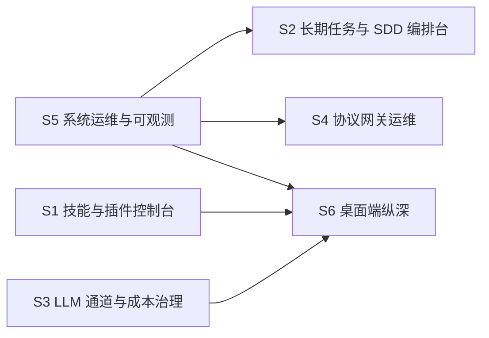

# ConsoleClosure 主工程子系统目录（SPECS_INDEX）

> 主工程：`ConsoleClosure`（三端能力补全）
> 维护落点：`specs/ConsoleClosure/SPECS_INDEX.md` —— 主工程目录内唯一权威账本
> 输出目录依据：铁律 1 冲突消解条款 —— **用户显式指定 `specs/ConsoleClosure/` 优先于默认 `specs/{feature_name}/`**
> 铁律依据：铁律 15（大工程拆分：颗粒度、可验收、可组合集成）
> 事实依据：`research.md`（三端能力盘点与缺口分析）
> 配套模板：`skills/sdd/templates/subsystem-contract-template.md`

> **append-only**：状态不原地覆盖；每次改动在 §8 修订记录留痕。

---

## 1. 工程总览

- **一句话定位**：把 AgentSkills-runtime 服务端已实现但**无人界面承接**的能力，按交付面拆成六个子系统，逐个在 Web 端补齐业务界面、在 PC 端按「核心运维原生 + 业务 iframe」混合模式落地，使三端能力对齐。
- **交付面**：技能控制台 / 任务编排台 / 成本治理台 / 协议网关运维 / 系统运维与可观测 / 桌面端纵深，共 **6 个**，每个均可独立上线、独立开关、独立回滚。
- **总规模**：子系统 N=**6** ｜ 覆盖缺口 **33 项**（P0 13 / P1 20，另有 P2 6 项）｜ 语言标签集合：**{cangjie, web, app}**
- **拆分判据与结论**：
  - 决定拆的时机：三端盘点完成、缺口矩阵成形后（research 步），预计 tasks 超 40 条即触发拆分评估。
  - 命中判据（SKILL.md「大工程拆分」）：
    1. **任务规模** ✅ 33 项缺口，预计 tasks **150+ 条**，远超 40 条红线；
    2. **语言/技术栈** ✅ 覆盖 cangjie（补 HTTP 路由）+ web（Vue 界面）+ app（Electron）3 条标签；
    3. **交付面** ✅ 6 个可独立上线/开关/回滚的边界，超过 3 个阈值；
    4. **上下文预算** ✅ 单工程 code 步远超两轮可收敛；
  - 不拆会怎样：单工程 150+ 任务无法分批验收，Web/PC/服务端三份改动互相阻塞，任一子系统缺陷都会阻塞整条流水线，`gate-code` 无法收敛。
- **PC 端定位（用户 2026-10-29 拍板）**：**核心运维原生 + 业务 iframe（混合模式）**。
  进程管理 / 内置 PostgreSQL / 更新 / 托盘 / 自启等底层能力保持 Electron 原生 UI；
  技能、智能体、LLM 通道、任务等业务界面以 iframe 深度集成页承载（保留桌面端侧边栏），不重复写第二套 Vue 业务页。
- **退出准则**：
  1. 全部子系统 `status=done`（或显式 `abandoned` 且有替代方案）；
  2. §5 L3 主工程端到端验收通过；
  3. 各子系统闸口 `confirm` 齐备（无 `abandon`）；
  4. §6 变更影响面登记表无未闭环的破坏性契约变更。

---

## 2. 子系统登记表

| ID | 中文名 | feature_name | 产物目录 | 上游依赖 | 契约摘要 | 标签 | status | 闸口 | 验收档位 | 备注 |
|---|---|---|---|---|---|---|---|---|---|---|
| **S5** | 系统运维与可观测 | `ConsoleClosure--ops-observability` | `specs/ConsoleClosure/ConsoleClosure--ops-observability/` | — | v1 / 12 接口 / 4 表 | cangjie+web | spec | — | L1+L2+L3 | **含横切前置：能力暴露**。优先开工 |
| **S1** | 技能与插件控制台 | `ConsoleClosure--skill-console` | `specs/ConsoleClosure/ConsoleClosure--skill-console/` | — | v1 / 14 接口 / 5 表 | web+app | spec | — | L1+L2+L3 | 承载 A1-A10（A9 详情页补全、A10 双语数据，2026-10-30 用户走查新增），**最高业务优先级** |
| **S3** | LLM 通道与成本治理 | `ConsoleClosure--llm-governance` | `specs/ConsoleClosure/ConsoleClosure--llm-governance/` | — | v1 / 9 接口 / 5 表 | web | spec | — | L1+L2+L3 | Web 已有较好基础，补齐 C1-C6 |
| **S2** | 长期任务与 SDD 编排台 | `ConsoleClosure--orchestration-desk` | `specs/ConsoleClosure/ConsoleClosure--orchestration-desk/` | S5 | v1 / 13 接口 / 6 表 | web | spec | — | L1+L2+L3 | 承载 B1-B8，人机回路门面 |
| **S4** | 协议网关运维 | `ConsoleClosure--protocol-gateway` | `specs/ConsoleClosure/ConsoleClosure--protocol-gateway/` | S5 | v1 / 11 接口 / 8 表 | cangjie+web | spec | — | L1+L2+L3 | 承载 D1-D8 |
| **S6** | 桌面端纵深 | `ConsoleClosure--desktop-depth` | `specs/ConsoleClosure/ConsoleClosure--desktop-depth/` | S1,S3,S5 | v1 / 8 接口 / 1 表 | app | spec | — | L1+L2+L3 | 混合模式落地；依赖上游先 done |

- `status` 枚举（与 `sdd_projects.current_stage` 对齐）：`init` / `research` / `spec` / `design` / `task` / `code` / `test` / `done` / `abandoned` / `blocked`
- `blocked` 必须写清阻塞原因与依赖对象，**不许裸挂**。
- **同步时机**：子系统闸门回执后 ≤ 1 个闸口周期回主工程更新本表；跨轮（revise）也要记 `round`。
- **并行建议**：S5 / S1 / S3 三者无依赖，可**并行**推进；S2 / S4 待 S5 达 `test` 后启动；S6 待 S1 / S3 / S5 均 `done` 后启动。

---

## 3. 集成契约汇总（全局接口表）

> 本表是跨子系统组合集成的**唯一**接口账本。变更一律按「先改契约 → 再改实现」，禁止单边先改。
> 方向必须**单向无环**；出现双向先判为拆得不对，回 §4 找边界。
> 状态：`已冻结` / `演进中(minor)` / `破坏性变更待双侧同轮` / `已废弃`

| 编号 | 接口/事件 | 提供方 | 消费方 | 方向 | 路径或标识 | 请求→响应形态 | 数据契约(表.字段) | 版本 | 冻结日 | 状态 |
|---|---|---|---|---|---|---|---|---|---|---|
| **C-001** | 技能列表查询 | runtime | S1 / S6 | 单向 | `GET /api/v1/uctoo/skills` | query(name,enabled,tag,page,limit) → {total,items:[{id,name,description,version,enabled,license}]} | `agent_skills.*` | v1 | 待 S1 spec 冻结 | 演进中(minor) |
| **C-002** | 技能安装/卸载 | runtime | S1 / S6 | 单向 | `POST /api/v1/uctoo/skills/{add,edit,del}` | {source,sourceType} → {success,skillId} | `agent_skills.id/name/status` | v1 | 待 S1 spec 冻结 | 演进中(minor) |
| **C-003** | 技能内容读取 | runtime | S1 | 单向 | `GET /api/v1/uctoo/skills/:name/content` | → {content:string} | `agent_skills.content` | v1 | 待 S1 spec 冻结 | 演进中(minor) |
| **C-004** | 技能合规校验 | runtime | S1 | 单向 | `POST /api/v1/uctoo/skill/validate*` | {skillName} → {passed,issues:[{level,message}]} | 无落表 | v1 | 待 S1 spec 冻结 | 演进中(minor) |
| **C-005** | 技能用量统计 | runtime | S1 | 单向 | `GET /api/v1/uctoo/skill_usage_stats/top-used` | query(limit) → {items:[{skillName,count}]} | `skill_usage_stats.*` | v1 | 待 S1 spec 冻结 | 演进中(minor) |
| **C-006** | 插件运行时自管理 | runtime | S1 | 单向 | `POST /api/v1/tools/:toolName`（`plugin_inspect/activate/deactivate/refresh`） | {pluginName} → {state,detail} | `plugin_state`（新增，需论证） | v1 | 待 S1 spec 冻结 | 演进中(minor) |
| **C-007** | LRT 任务树 | runtime | S2 | 单向 | `GET /api/v1/uctoo/long_running_task/tree/:rootId` | → {root:{id,title,state,children[]}} | `long_running_task.*` | v1 | 待 S2 spec 冻结 | 演进中(minor) |
| **C-008** | LRT 进度与检查点 | runtime | S2 | 单向 | `GET /api/v1/uctoo/long_running_task/{progress,checkpoints}/:taskId` | → {percent,currentStage,checkpoints[]} | `agent_contexts.*` | v1 | 待 S2 spec 冻结 | 演进中(minor) |
| **C-009** | LRT 人工干预 | runtime | S2 | 单向 | `POST /api/v1/uctoo/long_running_task/intervene` | {taskId,action,payload} → {accepted,reason} | `agent_approvals.*` | v1 | 待 S2 spec 冻结 | 演进中(minor) |
| **C-010** | LRT 演进与追踪 | runtime | S2 | 单向 | `POST /evolve/:agentId`、`GET /trace` | → {evolutionId,trace} | `long_running_task_evolution.*` | v1 | 待 S2 spec 冻结 | 演进中(minor) |
| **C-011** | SDD 流水线状态 | runtime | S2 | 单向 | `GET /api/v1/uctoo/sdd/status/:featureName` | → {stage,round,gate,waiting} | `sdd_projects.*` | v1 | 待 S2 spec 冻结 | 演进中(minor) |
| **C-012** | SDD 闸口回执 | runtime | S2 | 单向 | `POST /api/v1/uctoo/sdd/review` | {featureName,stage,decision} → {nextStage} | `agent_approvals.*` | v1 | 待 S2 spec 冻结 | 演进中(minor) |
| **C-013** | 计费与 Token 统计 | runtime | S3 | 单向 | `GET /api/v1/uctoo/{llm-usage-stats,billing-report}/*` | → {summary,series[],ranking[]} | `llm_usage_logs.*`/`model_pricing.*` | v1 | **已冻结**（现有 Web 已对接） | 已冻结 |
| **C-014** | MCP Server 运维 | runtime | S4 | 单向 | `POST /api/v1/uctoo/mcp/stream` | JSON-RPC → JSON-RPC | 无落表 | v1 | 待 S4 spec 冻结 | 演进中(minor) |
| **C-015** | MCP 开放工具调用 | runtime | S4 | 单向 | `POST /api/v1/uctoo/mcp/open/{call,tools}` | {toolName,args} → {result} | 无落表 | v1 | 待 S4 spec 冻结 | 演进中(minor) |
| **C-016** | AIP 身份与能力 | runtime | S4 | 单向 | `POST /api/v1/uctoo/aip/{identity,description}/*` | → {agentId,status} | `aip_agent_identity.*`/`aip_agent_description.*` | v1 | 待 S4 spec 冻结 | 演进中(minor) |
| **C-017** | AIP 发现与会话 | runtime | S4 | 单向 | `POST /api/v1/uctoo/aip/{discovery,interaction}/*` | → {sessions[],messages[]} | `aip_discovery_cache.*`/`aip_interaction_session.*` | v1 | 待 S4 spec 冻结 | 演进中(minor) |
| **C-018** | 工具网关联动 | runtime | S4 / S1 | 单向 | `GET /api/v1/tools/list`、`/tools/:toolName/info` | → {tools:[{name,desc,permission}]} | `permissions.*` | v1 | 待 S4 spec 冻结 | 演进中(minor) |
| **C-019** | 运行日志读取 | runtime | S5 / S6 | 单向 | `GET /api/v1/uctoo/ops/logs` | query(file,lines) → {lines[]} | 文件系统 | v1 | 待 S5 spec 冻结 | 演进中(minor) |
| **C-020** | 环境能力采集 | runtime | S5 | 单向 | `GET /api/v1/uctoo/ops/env` | → {capabilities:[{name,available}]} | 文件系统 | v1 | 待 S5 spec 冻结 | 演进中(minor) |
| **C-021** | crontab 运维操作 | runtime | S5 | 单向 | `POST /api/v1/uctoo/crontab/{trigger,pause,resume,reload}` | {taskId} → {success} | `crontab.*` | v1 | 待 S5 spec 冻结 | 演进中(minor) |
| **C-022** | 能力暴露（横切前置） | runtime | S2 / S3 / S4 | 单向 | `GET /api/v1/uctoo/{vector,retriever,memory,storage}/*`（**待新增**） | → 各类检索/读写结果 | 见 §7-R3 | v1 | 待 S5 spec 冻结 | 演进中(minor) |
| **C-023** | 桌面端 iframe 集成桥 | pc-client | S6 | 单向 | postMessage `uctoo://route-change` / `auth:token` | {route,token} → ack | localStorage + `safeStorage` | v1 | 待 S6 spec 冻结 | 演进中(minor) |
| **C-024** | 动态菜单登记 | runtime | 全部 Web 子系统 | 单向 | `POST /api/v1/uctoo/permissions/user/menu` | → menuTree（含 component） | `permissions.*` | v1 | **已冻结** | 已冻结 |

> **C-024 是硬约束**：web-admin 的管理后台路由全部由后端菜单树动态注入（`src/router/guard/menu.ts:79`）。
> 任何子系统新增业务界面，**必须同时登记菜单**，否则用户看不到入口（表现为"功能做了但找不到"）。

---

## 4. 子系统依赖 DAG

- 边方向 = 依赖方向（上游 → 下游）；节点 = 子系统 ID。
- **依赖理由**：
  - `S5 → S2` / `S5 → S4`：两者依赖 S5 的**横切能力暴露前置**（C-022），即把 `RetrieverController` 等未绑定路由的控制器暴露成 HTTP API。
  - `S1,S3,S5 → S6`：桌面端纵深依赖上游 Web 界面先 done，才能把成品 iframe 进去；否则桌面端集成的是半成品。
- **无回边自检**：拓扑序 S5=1、S1=1、S3=1 → S2=2、S4=2 → S6=3，编号递增，**无回边**。
- **并行策略**：S5 / S1 / S3 **并行**；S2 / S4 待 S5 达 `test` 后启动；S6 待 S1 / S3 / S5 均 `done` 后启动。
- 上游进 `code` 步前必须已达 `test`。

---

## 5. 组合集成验收基线

> **各子系统不得只跑自己的单测就报 done** —— L2 是硬档位，不是加分项。

| 档位 | 谁执行 | 在什么样的合并态上跑 | 通过判据 |
|---|---|---|---|
| **L1** 单子系统自测 | 子系统自身 test 步 | 本子系统 | 自身 spec 每条 EARS 验收条件通过；P0 缺陷清零 |
| **L2** 跨子系统集成 | 下游子系统 test 步 | 与**已 done 的上游**合并后的运行态 | 契约 §6 冒烟用例全绿；跨边界数据一致性校验通过 |
| **L3** 主工程端到端 | 主工程 test 步 / 总装验收 | 全量已 done 子系统在宿主上跑起 | §5.1 端到端用例全绿 + 权限/行级可见范围复核 |

### 5.1 L3 端到端用例（主工程总装）

1. 全新用户 → PC 端完成首次运行向导 → 在 iframe 中登录 → 进入技能控制台 → 安装一个技能 → **在 PC 原生技能页看到同一技能**（跨 S5→S1→S6）
2. 提交一个长程任务 → 在编排台看到任务树展开、进度推进 → 触发人工干预 → 闸口决策生效 → 任务继续（跨 S5→S2）
3. 配置两个 LLM 通道并设其中一条为默认 → 发起对话产生用量 → 在成本治理台看到该通道的 Token 与费用（跨 S3）
4. 注册一个 AIP 身份并发布能力描述 → 在协议网关运维页完成本地发现 → 建立会话并发送消息（跨 S5→S4）
5. 排障场景：制造一次 runtime 故障 → 在运维台看到健康告警、拉取运行日志定位 → 桌面端托盘状态同步变红（跨 S5→S6）

### 5.2 L2 最小冒烟清单（不少于 3 主干 + 1 异常）

1. **跨 S5→S2**：启动一个 SDD 工程 → 状态接口返回 `spec` 阶段 → 编排台正确渲染进度（主干）
2. **跨 S1→S6**：Web 端安装技能后，桌面端 iframe 深度集成页在同一账号下见到该技能（主干）
3. **跨 S5→S4**：为新暴露的能力接口加路由 → 协议网关页能列出该能力并完成一次调用（主干）
4. **异常**：低权限用户在 Web 端打开仅超管可见的技能安装页 → 返回 403 且界面无入口（依赖 C-024 菜单权限，异常）

### 5.3 环境 / 数据前置

| 前置 | 状态 | 缺什么 |
|---|---|---|
| 宿主 runtime 已起 | ✗ | 需用户启动（AI 不跑 `cjpm build`，按职责边界由用户处理） |
| DB 迁移 `sql/incremental/` 已执行 | ✗ | 各子系统 design 步产出增量 DDL 后执行 |
| 新增路由的 `permissions` / `role_has_permission` 授权 | ✗ | **必做**，否则新界面 403 |
| 动态菜单登记 | ✗ | 依赖 C-024，各子系统 authoritative 登记 |

- 任何子系统报 done 时若 L2 未跑，主工程闸口**不予确认**（硬闸）。

---

## 6. 变更影响面

| 日期 | 变更子系统 | 变更类型 | 影响子系统 | 是否需回归 L2 | 关联任务号 | 登记人 |
|---|---|---|---|---|---|---|
| 2026-10-29 | 全部（初始） | 契约建立 | — | — | — | 主工程闸口决策人 |

- `契约 major` 的行必须同时满足：双侧同轮完成 + §3 状态改为「待双侧同轮」+ 关闭后回写本行。
- 未登记就改代码 = 契约漂移，在子系统 `test-report.md` 缺陷分级里**升 P0**。

---

## 7. 风险与已知偏差

| 类型 | 描述 | 影响 | 缓解 | 归属子系统 |
|---|---|---|---|---|
| **R1 契约漂移** | 6 个子系统共享 C-001~C-024 契约，任一单边修改即漂移 | 集成期大面积返工 | 冻结日写进各子系统 `contract.md`；变更走 §6 登记 | 全部 |
| **R2 动态菜单未登记** | web-admin 管理路由靠后端菜单树注入（`menu.ts:79`），漏登记即"做了但看不到" | 用户找不到新功能，会被误判为没做 | 各子系统 tasks.md 强制包含「菜单登记」任务；L3 用例 1/4 显式校验入口可见 | S1-S5 |
| **R3 能力暴露缺失（横切 P0，性质已修正）** | `MemoryController` / `ModelController` / `StorageController` / `RetrieverController` / `ExecutorController` **存在但无任何路由绑定**。⚠️ **实读修正 M2**：其中 `RetrieverController.search` 与 `StorageController` 的 kv / vector 方法**实为占位桩，并未实现完** | 不是"补个路由"就能交付 —— 必须**先实现、再补路由**。若误判为前者，S2 / S4 将集成到空壳能力 | 归 S5 作前置，且 **须对外标注"已暴露但未真正接入"**，禁止向前端谎称可用；主工程以「能力真正实现」而非「路由绑定」作为里程碑口径 | S5（前置） |
| **R4 复用论证缺失** | 铁律 9 要求新建表/列必须写明"复用不成立"理由 | 打回返工 | 各子系统 spec/design 必须显式论证；优先复用既有 JSON 字段（如 `payload`/`config`） | 全部 |
| **R5 版本口径不一致** | CHANGELOG 最新为 `0.0.25`（2026-07-23），而部分资料提及 v0.0.30 | 对外宣传口径错误 | 写用户文章前由用户确认真实版本号；本 SDD 不替用户定版本 | 主工程（非代码） |
| **R6 权限 RBAC 双层** | API 层 `RequirePermissionMiddleware` + 菜单层 `getUserMenuTree` 双重把关；缺 permissions 登记表现为"看不到入口"而非 403 | 排障困难，易误判为前端 bug | 新路由必进 `permissions` + `role_has_permission`，且执行后 `loaddbinfo` | 全部 |
| **R7 桌面端双份实现** | 用户选混合模式，但若在 iframe 之外又写了原生业务页即违背定位 | 维护成本翻倍 | 在 S6 契约里明确一张「哪些必须原生、哪些必须 iframe」清单，两者互斥 | S6 |
| **R8 已有页面路由未挂载** | `user/role/permission/menu` 四个权限页 + `setup.vue` 已实现但 `constant.ts` 未 import（37 条未挂载） | 看似缺失实则已有 | S5 顺带挂载（低成本高收益） | S5 |
| **R9 双语数据模型缺位** | `agent_skills` 表 52 列**无任何多语言列**（全库仅 `permissions.locale` 相关），109 条技能全是单语 | 双语不是"填内容"而是"先建模"，若按内容缺口排期会直接返工；界面侧 i18n 半途而废（部分 key 未翻译、部分硬编码中文） | S1 在 design 步先定建模口径（优先复用，铁律 9），再谈补录；存量 109 条给迁移路径 | S1 |
| **R10 登录态与界面交互半成品** | 登录页「记住密码」复选框 `<TinyCheckbox>` **未绑定 v-model**，`rememberPassword` 仅为死字段，无任何持久化读写 | 用户勾选后无效，属"看起来有、实际没有"，最伤信任 | 走 §10 横切缺口登记；登录态持久化方案（含 PC 端 safeStorage 一致性）一并归口 S6 的 C-023 | 横切（S6 归口） |

---

## 8. 修订记录

| 日期 | 版本 | 触发来源 | 改动摘要 | 影响面 | 主工程闸口 |
|---|---|---|---|---|---|
| 2026-10-29 | v1.0 | research 步完成 + 用户拍板 | 命中拆分判据 4 条，拆出 6 个子系统（S1-S6），边界按交付面；PC 端定为混合模式 | 首次落表 | 待 gate-research 确认 |
| 2026-10-29 | v1.1 | 子系统 spec 撰写时源码实读复核（research.md §8 M1-M7） | 修正 R3 性质（占位桩而非已实现）；新增 R9；订正 C-021 路径 `scheduler/status`；M5/M6 两个服务端真实缺陷入账 | R3 风险等级维持 P0 但工作量口径上调；S5 里程碑改判 | 待 gate-research 一并确认 |
| 2026-10-30 | v1.2 | 用户以超管账号人工走查后台（W1-W3）+ 以 `DATABASE_URL` 直连核实库内数据量 | 新增 §10 横切缺口总账（W1 agent_detail 未完成 / W2 技能双语与页面完善 / W3 登录页记住密码未实现）；S1 新增需求 **A9、A10** 与数据约束 §6.6；新增风险 **R9 双语建模缺位**、**R10 登录态半成品**；撤回"演示环境无数据"的错误结论 | S1 需求由 A1-A8 扩为 A1-A10；A10 须在 design 步先定建模口径再排期；W3 登录态持久化归口 S6 与 C-023 一起谈 | 待 gate-spec 确认 |
| 2026-10-30 | v1.4 | 用户要求补齐 AI 分组三项裸 i18n key（`modelChannel` / `routeRule` / `shadowCompare`） | 新增 **§10.2 词条补齐进展**；AI 分组三项 + 已有 7 项共 **10 项菜单 key 补齐中英双语**（i18 表），SQL 幂等可复跑，浏览器验证菜单不再露 key | 仅数据层补录，无代码改动；`menu.ai`/`menu.api`/`menu.database` 与技能页 `agentSkills.*` 裸 key 仍开放（前者有前端 locale 兜底不露 key，后者归 A10） | 已执行并浏览器验证，无需闸口 |
| 2026-10-30 | v1.3 | 用户拍板：对话入口改为右下角悬浮 tiny-remoter 窗口，独立 chat 页面退场 | 独立 `/vue-pro/ai/chat` 菜单节点（`permission_name='Chat'`, `component='chat/index'`）**已软删除**（见 `sql/incremental/20261030_chat_menu_hide.sql`）；对话能力改由 `@opentiny/next-remoter` 悬浮窗承载 | **菜单项减少 1**（AI 分组 11→10）。后续子系统不得再向 `chat/index` 挂靠功能；对话类需求一律走悬浮窗，避免双入口 | 已执行并三层验证（SQL / 菜单 API / 浏览器），无需闸口 |

> **隐藏菜单的机制备忘（避免重复踩坑）**：菜单取数 SQL 为 `type=1 AND menu_type IS NOT NULL AND deleted_at IS NULL`
> （`PermissionsDAO.cj:476-482`），**`hidden` 字段不参与过滤**（现存 172 个菜单节点均为 `hidden=1`）；
> 且超管因持有通配权 `*` 走全量分支，**改 `role_has_permission` 对超管无效**。
> 隐藏菜单只有两条路：软删 `deleted_at`（推荐，可回滚）或把 `menu_type` 置 NULL。

---

## 9. spec 步浮现的服务端真实缺陷（非界面缺口）

> 这类问题**不在原始缺口矩阵里** —— 它们不是"缺界面"，而是"服务端逻辑本身没跑通"。
> 只有写到子系统 spec 层面才会被看见，记录于此以免在后续 steps 中丢失。

| 编号 | 缺陷 | 处置归属 | 严重度 |
|---|---|---|---|
| **M5** | `SkillUsageStatsService.incrementUsage()` **全仓无调用点** → `skill_usage_stats` 用量字段永不累加 | S1：先修埋点，再做 A5 可视化，否则界面永远空 | P1 |
| **M6** | 用量聚合端点**硬扫描 10000 条且忽略入参 limit** | S3：design 步处理分页与聚合下推 | P2 |
| **M3-附带** | `src/views/ai/data_flow/index.vue` 宣称展示文件↔库同步流，**实际未调用任何 sync 端点** | S5：E5 更正为全新建设；该页面既有表态缺陷一并修 | P2 |

---

## 10. 用户人工走查登记的界面完成度缺口（2026-10-30）

> **来源**：用户以超级管理员账号人工登录后台逐页走查，并与自动化截图结果比对后提出的三条。
> 本节的定位是**横切总账**：不重复子系统内部细节（铁律 15），只登记"用户亲眼看到没做完"的事实与归属。
> 详细的业务规则、交互流程与验收条件见对应子系统的 `spec.md`。

| 编号 | 页面 / 路径 | 用户反馈 | 实读取证 | 归属 | 严重度 |
|---|---|---|---|---|---|
| **W1** | `/vue-pro/ai/agent_detail` | 页面**未完成** | `views/ai/agent_detail/index.vue`（267 行）已写取数逻辑，但 `agentId = route.params.id`（`:12`）；不带 id 直接访问即为空串 → 渲染「Agent 未找到」。菜单里 `menu.ai.agentDetail` 是独立项，**无上游列表页带 id 跳入** | **S1 → A9**（见 `ConsoleClosure--skill-console/spec.md §5.6`） | P1 |
| **W2** | `/vue-pro/ai/agent_skills` | **缺少双语多语言数据**，且页面功能需要完善 | ① 数据模型层无存放处：`agent_skills` 表 52 列无任何多语言列，全库仅 `permissions.locale` 相关，库内 109 条全单语 → 属**建模缺口**而非内容缺口；② 界面层 i18n 半途而废：`agent_skills.vue:20-25` 前 3 项走 `t()` 但运行时取不到译文（显示裸 key `agentSkills.options.all`），后 2 项「服务端」「浏览器端」硬编码中文 | **S1 → A10**（见 `ConsoleClosure--skill-console/spec.md §5.7` 与数据约束 §6.6） | P1 |
| **W3** | 登录页（`views/login/components/login-mail.vue`、`login-info.vue`） | 「记住密码」等交互**未实现** | `login-mail.vue:59` 定义 `rememberPassword: true`，但 `:277` 的 `<TinyCheckbox>` **未绑定 v-model**，全文无任何读取与持久化逻辑 → 勾选不产生任何行为。同类问题见 `login-info.vue:47/:142` | **横切**（登录态持久化方案归口 S6 的 C-023，与 PC 端 `safeStorage` 保持一致） | P2 |

### 10.1 与自动化截图取数的偏差（环境侧教训，非产品缺陷）

自动化截图时统计类页面曾显示"暂无数据"，一度被记为"演示环境无数据"。
2026-10-30 以 `.env` 的 `DATABASE_URL` 直连核实：**库中数据充足**（`agent_skills` 109 / `agents` 9 / `agent_tasks` 615 / `agent_memories` 371），
且与人工截图中监控页的「执行任务 615」「记忆条目 371」完全吻合。
结论：该偏差源于**自动化注入登录态后取数未成功**，**不是产品功能缺失**，已从对外文章中撤回该表述。

后续自动化截图若复用"注入 token + 注入 `persisted-uctoo-user`"的方式，必须先校验列表类接口返回行数与库中一致，再采信截图。

### 10.2 词条补齐进展（2026-10-30 已办）

| 项目 | 处理 | 落地文件 |
|---|---|---|
| **AI 分组菜单裸 key**（`menu.ai.modelChannel` / `routeRule` / `shadowCompare`） | 已补中英双语词条，界面验证三项均显示中文（模型渠道 / 路由规则 / 影子对比） | `sql/incremental/20261030_ai_menu_i18n_terms.sql` |
| **AI 分组已有 7 项补齐英文** | 原有词条只有中文，切英文会显示 key；已补 Agent Skills / Agent Detail / Agent Monitor / Billing Report / Data Flow / Observability Timeline / Token Dashboard | 同上 |
| **`menu.ai` / `menu.api` / `menu.database` / `menu.database.nuanshou` 同样缺词条** | **未处理**——它们有 `web-admin/src/locale` 兜底译文，界面显示正常，不影响用户；入库留待统一治理 | — |
| **`agentSkills.*` 技能页裸 key 与硬编码中文**（`agent_skills.vue:20-25`） | **未处理**，仍属 A10 范围 —— 本次只清了菜单层，技能页界面层待 S1 design 步统一修 | S1 → A10 |

> 机制备注：`i18` 表**没有 `(key, lang_id)` 唯一约束**，补词条只能用 `INSERT ... WHERE NOT EXISTS(key + lang_id)`
> 保证幂等；重复形式推断式的 `ON CONFLICT` 在此表不可用。
> 另外「缺词条」不等于「界面显示 key」——判据是**同时**检查 i18 表与前端 locale 兜底，二者都缺才会露 key。

---

> 配套：各子系统另有 `spec.md` / `design.md` / `tasks.md` / `contract.md` / `test-report.md`；
> 本文件只做目录与集成口径，不重复子系统内部设计（铁律 15「主工程不重复实现子系统内部细节」）。
