# 需求规格说明书：RuntimeNativeInstaller

> feature_name = `RuntimeNativeInstaller`
> 上游研究：`research.md`（发行版安装，§一~§六）、`research-devenv.md`（开发者 DevKit 环境与初始化）、`research-seed-identity.md`（Seed 身份重绑定 SIR）、`research-seed-export.md`（Seed 导出机制 SEP）、`research-seed-content.md`（初始数据内容定档与脱敏）、`research-deployment.md`（发布形式与消费形式）。
> 需求编号：`REQ-RNI-NNN`。验收条件编号：`AC-NNN`。
> 本文档只写 **WHAT**（做什么、做到什么程度、如何验收），不写 **HOW**（实现方案、技术选型、代码结构、目录划分）——后者属 design 步产出。
>
> **EARS 书写约定**：固定引导词保留英文大写（`WHEN` / `IF` / `WHILE` / `WHERE` / `THEN THE SYSTEM SHALL` / `THE SYSTEM SHALL`），可变部分（触发条件、预期行为）使用中文。六型全覆盖：事件驱动（WHEN）、状态驱动（WHILE）、异常行为（IF）、可选特性（WHERE）、 ubiquitous（THE SYSTEM SHALL）、组合型（WHILE … WHEN …）。
>
> **闸口决议留痕（用户已拍板，本文档直接体现，不再列为待定）**：
> ① 形态 = Stage A「独立 install 应用（仓颉原生单二进制）」，**不做 L3 进程隔离轨 install 技能插件**；Stage B（L3 薄适配器）列为后续可选，本期不做。
> ② `create-admin` **只做真路径、删除假路径**：必须真实落库写 `uctoo_user`（bcrypt cost 10）；nestJs 中"返回 `admin-<timestamp>` 却不落库"的实现不予复刻。
> ③ R1 仓颉 SDK 分发 = 「**引导下载 + 校验和**」：不内置 SDK，安装器提供官方下载引导、SHA256 校验、断点续传，并支持 `--sdk-path` 手动指定已下载的本地包。
> ④ R2 离线介质 = 「**SDK 引导下载，其余离线**」：源码树、依赖库、sql 基线、std API 知识库、web 前端依赖全部离线预置；仅 SDK 需联网。
>
> **gate-design 追加留痕（2026-10-07）**：
> ⑤ **哈希前缀归一：改仓颉侧，不改 AC**。AC-112 的 `$2a$10$` 是目标口径，**保持不变**；`libs/blowfish-cj`（vendored 库）产出 `$2b$` 的事实差异，一律在**仓颉侧实现**中归一（由安装器在写库前改写前缀，或等价的仓颉侧归一手段），**禁止为对齐前缀去改动 vendored 第三方库**，亦不走需求变更。详见 §5.8.1 第 3 条末的实现口径说明。
> ⑥ **追加 gate-design 新需求：git clone 与开发目录选择**。DK-3 源码获取改为**开发者自选目录 + `git clone`**，并新增目标目录选择步骤。对应新增 §5.14（REQ-RNI-071~077 / AC-166~187），**已有 REQ/AC 的编号与内容一律不动**。
> 　　**2026-10-07 再修订（用户拍板）**：原"首选 `git clone`、离线介质复制兜底"的双路径**取消兜底**，只保留 `git clone` 一条路径。理由：离线复制的输入只能是本项目作者本机的源码目录，任何外部开发者都不持有该目录，该路径无受益方；git 不可用或地址不可达时按**明确失败**处理并给出处置指引，不以任何"降级副本"收尾。§5.14 相应条款（REQ-RNI-071 / AC-167~169 / AC-176~177 及交互流程、异常场景）已同步改写，**编号不变**。
> ⑦ **追加 gate-design 新需求：Seed 数据身份重绑定**。`sql/uctooDB.sql` 中大量身份列硬编码着来源环境超级管理员的账号标识，其他开发者建号后标识不同，导致初始数据归属错配；且 `uctoo_user` / `role_has_permission` / `user_has_roles` 三张表在基线中无数据，新环境即便结构导入成功也无法登录可见菜单。对应新增 §5.15（REQ-RNI-078~087 / AC-188~207）与 §6.7，取证见 `research-seed-identity.md`。
>
> **后续追加留痕（2026-10-07 第二轮，用户已拍板，直接体现）**：
> ⑧ **初始数据内容定档与脱敏**：同步/派生数据不进初始数据、`config` 表按 `env_key IS NULL` 行级分治、敏感值一律占位符化；`config.website.appid` 与 `config.site.API_URL` 属上一代框架历史配置项，**原样保留**（OQ-C1）。对应新增 §5.17（REQ-RNI-098~105 / AC-240~261）与 §6.10。
> ⑨ **流式进度契约与运维能力归位**：新增 NDJSON 流式进度接口（OQ-D1 拍板纳入）；确立 **M2（runtime 自述能力，冻结区有限豁免，仅限日志读取与环境检测两端点）+ M3（`serve --manage` 承接启停）** 的分工 —— 进程不能自举，启停必须由运行系统之外的管控者提供。对应新增 §5.18（REQ-RNI-106~109 / AC-262~276）与 §6.11 / §6.12，取证见 `research-deployment.md` §3.4 / §5.3。
> ⑩ **NestJS 全部退役**（OQ-D6 拍板）：退役范围不再是「仅 `setup` + `healthCheck`」，而是**全部 Controller**；退役前须逐 Controller 核对 runtime 侧已有等价能力（判据见 `design.md` §12.2 退役判据第 5 条）。

---

# 1. 组件定位

## 1.1 核心职责

本组件负责以**单一原生可执行程序**引导安装并初始化 `agentskills-runtime`（含最终用户的发行版安装与二次开发者的本地开发环境安装），实现「零 Node 依赖、断点续装、原子可回滚、端到端自校验、完成后自退役」的一次性引导闭环。

## 1.2 核心输入

1. **静态安装向导页的 HTTP 请求**：`apps/web-admin/public/install.js` 发起的 `GET /healthCheck` 与 **13 类** `/api/setup/*` 端点调用（`check-environment` / `service-status` / `save-config` / `load-config` / `test-config` / `create-admin` / `check-runtime` / `install-runtime` / `generate-ssl` / `save-ssl` / `save-runtime-env` / `read-runtime-env` / `start-runtime`）。来源地址硬编码为 `http://localhost:3000`（`install.js:4`）。
2. **Vue 管理组件的代理请求**：`EnvironmentCheck.vue` / `LogViewer.vue` / `ServiceMonitor.vue` / `ConfigManagement.vue` 使用相对路径 `/api/setup/*`，经 dev server 代理 `target: http://localhost:3000` 且 `pathRewrite: {'^/api': ''}` 转发（`farm.config.ts:49-63`）；四者合计调用 6 类端点（`check-environment` / `load-config` / `save-config` / `test-config` / `service-status` / `logs`）。
3. **常驻管理页的启停请求**：`apps/web-admin/src/views/setup.vue` 是**常驻**管理页（非安装期一次性页面），直接调用 `/api/setup/stop-runtime` 与 `/api/setup/restart-runtime`，同样打到 `:3000`。这是 §5.10「安装器自退役」与运维诉求的冲突根源（见 `research-deployment.md` §5.2 缺口 N-3），处置方案为 §5.18 的 M2 + M3 分工。
4. **命令行参数与开关**：`--port` / `--offline` / `--force` / `--rollback` / `--json` / `--truthful` 系列开关 / `--with-devkit` / `--devkit-only` / `--sdk-path` / `--auto-exit` / `--system-env` / `--progress=ndjson`（§5.18）/ `--source-dir`（§5.14）/ `--manage`（§5.18 M3）。
5. **目标机器环境事实**：`node` / `psql` / `redis-cli` / `openssl` 版本与可达性、端口占用、进程表、磁盘剩余空间、hosts 与证书现状、环境变量（`CANGJIE_HOME` / `CANGJIE_STDX_PATH` / `PATH`）。
6. **离线介质**：`release/agentskills-runtime-win-x64.tar.gz`、`sql/uctooDB.sql`（占位符化后为 `sql/uctooDB.seed.sql`）与 `sql/incremental/`、`sql/seed/` 下的主体清单与权限骨架脚本、`libs/cangjie-stdx-windows-x64-1.1.3.1`、`skills/CangjieSkills`、`.env.example`。
7. **用户输入**：数据库连接参数、管理员账号、对外域名、SSL 证书、模型 API Key、DevKit 组件勾选集合、开发源码目标目录。

## 1.3 核心输出

1. **HTTP 响应**：17 条端点契约（既有控制器共 16 条路由声明，`create-admin` 对应两条实现，本期归一为真路径）的 JSON 响应体；`GET /healthCheck` 的纯文本响应。
2. **静态资源字节流**：`install.html` / `install.js` / `install.css`。
3. **落盘产物**：`<cwd>/config.json`、`.install-state.json`、runtime 发行目录、`release/.env`、`release/ssl/` 证书与私钥、`previous/` 回滚快照、`<installRoot>/.installer-port`、runtime PID 文件、安装器诊断日志。
4. **数据库副作用**：向既有表 `uctoo_user` 写入一行管理员记录；初始数据导入时按主体清单向既有表写入初始数据并完成身份重绑定与权限骨架补种（**不新建任何表或列**，见 §5.15）。
5. **进程副作用**：拉起 / 停止 / 重启 `agentskills-runtime` 进程。
6. **开发者环境副作用**：仓颉环境变量与 PATH、`libcrypto-3-x64.dll` / `libssl-3-x64.dll` 文件名对齐、`db_info` 表信息缓存刷新、hosts 映射与本地证书部署。
7. **机器可读报告**：`--json` 形式的组件清单、安装结果、自检判据汇总（`{id,status,actual,expected,fix}`）与稳定退出码。

## 1.4 职责边界

明确**不做**的事项：

1. **不做业务后端**：不承载 `/api/v1/*` 业务路由，不承担 runtime 的日常运维、监控告警与容量管理。
2. **不做 L3 进程隔离轨插件**：本期形态为独立 install 应用；Stage B（把核心逻辑抽成静态库、由 L3 插件做薄适配器）为后续可选提案，不在本期范围。
3. **不执行编译**：不执行 `cjpm build`，不代用户编译任何仓颉源码。
4. **不新建数据库表或列**（SDD 铁律 9）：仅写既有 `uctoo_user` 与既有 `db_info`，不新增结构。
5. **不修改 `src/app/` 任何文件**，包含鉴权白名单；**不修改根 `cjpm.toml` 的 `output-type` 与 `compile-option`**。
6. **不修改前端 `install.js:4` 的硬编码地址**，不修改安装向导文案与交互结构。
7. **不做跨平台打包矩阵**：本期目标平台为 Windows x64（`x86_64-w64-mingw32`）。
8. **不代用户完成需人工介入的动作**：仓颉 SDK 下载授权确认、编译执行、管理员提权审批。
9. **不提供"假成功"**：除本文档 §5.3 明确列出的兼容复刻项外，任何步骤在缺乏成功证据时禁止返回成功。

---

# 2. 领域术语

**安装器（ucInstaller）**
: 本组件产出的单一原生可执行程序，在 3000 端口自托管安装向导与 setup 端点，完成 runtime 的发行版安装与开发者环境初始化。
: 备注：别名「引导程序 / installer」；替代对象是已退化的 `apps/web-admin/nestJs`。

**发行版安装**
: 面向最终用户的安装类型，把预编译的 runtime 发行包落地到目标目录并使其可运行，对应状态机 S0~S6。
: 备注：与 nestJs 现状逐端点对齐的部分。

**开发套件（DevKit）**
: 面向二次开发者的可选组件集合（DK-1~DK-8），使一台机器具备编译与二次定制 runtime 的能力，对应状态机 S7。

**闸口（Gate）**
: 状态机中两个相邻步骤之间的准入判据集合；闸口未通过时禁止推进到下一步骤。

**断点续装**
: 安装进程被中断（崩溃、被杀、浏览器刷新）后重新启动，能够从状态文件中记录的最后一个已完成步骤继续，且已完成步骤不产生重复副作用。

**原子安装**
: 介质先落地到临时过渡目录，校验通过后一次性切换到目标位置；切换前目标位置保持安装前状态。

**快照回滚（previous/）**
: 重装或升级前把既有安装目录整体保留为快照，配合 `--rollback` 可恢复到该快照。

**自退役**
: 安装器检测到被安装的 runtime 持续健康后，主动提示并可自行退出，兑现"引导程序可停止"的承诺。

**三级降级探测**
: 对同一依赖项依次采用「版本命令 → 端口监听探测 → 进程镜像探测」三种手段，前一手段不可用时回落到下一手段。

**optional 检测项**
: 检测项数据中带 `optional: true` 标记，未通过时不得阻断安装流程推进，仅作提示。

**真路径 / 假路径**
: `create-admin` 的两种 nestJs 实现。真路径真实连接数据库写入 `uctoo_user`；假路径仅返回合成 ID 不落库。本期只保留真路径。

**假成功行为**
: 在缺乏成功证据的情况下仍返回成功响应的既有实现，包括 `test-config` 三级兜底无条件成功、`service-status` 随机指标、`getLogs` 无日志时伪造两条日志、`generate-ssl` 降级伪 PEM。

**伪 PEM**
: 把域名做 base64 后直接拼进证书体的无效证书产物（`setup.service.ts:1127`），不可被 TLS 栈加载。

**PID 文件化**
: 把被启动进程的进程号与进程镜像名持久化到文件，作为后续停止/重启的唯一依据。

**安装介质**
: 用于落地 runtime 的可分发产物（离线预置的发行包或已编译可执行程序），以及开发者套件所需的 SDK、stdx、源码树、sql 基线、知识库。

**自检判据**
: 每个 DevKit 组件安装后用于判定"确实可用"的可执行命令与期望结果，形如 `{id, status, actual, expected, fix}`。

**机器可读契约**
: 所有检查类能力同时提供稳定结构的 `--json` 输出、稳定退出码与可执行修复建议命令。

**最终用户模式 / 开发者模式**
: 安装器的两种运行模式，前者到 S6 结束即自退出，后者继续执行 S7 与 S8；差异写入状态文件的 `mode` 字段。

---

# 3. 角色与边界

## 3.1 核心角色

1. **最终用户（安装运维人员）**：在本机执行安装器，通过浏览器向导完成 runtime 的发行版安装，关注"能不能装上、能不能起来"。
2. **二次开发开发者**：在发行版安装完成后选择继续安装开发套件，需要本机具备编译、调试与二次定制 runtime 的完整能力。
3. **人工编译执行者**：因项目红线，编译动作由该角色在独立终端执行并回传日志；安装器只生成待执行清单与判据，不代跑。
4. **人工确认决策人**：对法务授权（SDK / 知识库再分发）、介质格式变更、hosts 一键写入等需人工拍板的事项给出结论。

## 3.2 外部系统

1. **安装向导页（install.html / install.js / install.css）**：主消费方，硬编码 `http://localhost:3000`，启动即轮询 `GET /healthCheck` 并要求响应体 `trim()` 后严格等于 `success`（`install.js:20-25`），轮询 30 次 × 2 秒。
2. **Vue 管理组件（EnvironmentCheck / LogViewer / ServiceMonitor / ConfigManagement）**：次消费方，经 dev server 代理以相对路径访问 `/api/setup/*`。
3. **PostgreSQL**：管理员账号写入目标与开发者环境基线库；连通性由 `psql` 与端口探测判定。
4. **Redis**：optional 依赖项，检测结果仅作提示。
5. **agentskills-runtime（被安装对象）**：安装器拉起并探活 `GET /api/v1/health`（`src/app/main.cj:698`）作为安装完成与自退役判据；其默认监听端口为 8080，与安装器端口不冲突。
6. **仓颉官方 SDK 发布源**：DevKit 的 DK-1 组件来源，安装器只做下载引导与校验和校验。
7. **系统命令与设施**：`openssl`、`psql`、`redis-cli`、端口与进程查询能力、hosts 文件、用户/系统环境变量存储。
8. **web-admin 前端工程**：DK-7 勾选时的联调对象（`pnpm install` / `prebuild` / `start`，端口 3031）。

## 3.3 交互上下文

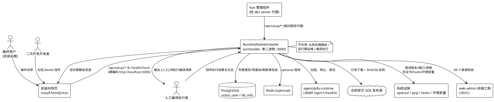

---

# 4. DFX 约束

> 本章为前置红线，直接约束 §5 的业务规则设计。每条约束可量化、可验证；工程红线以「禁止 / 必须」表述。

## 4.1 性能

1. **健康探测响应**：`GET /healthCheck` 的 P95 响应时间上限 **200 ms**（单机空载，不含端口争用时）。
   a. 验收条件（AC-001）：WHEN 向导页在 2 秒轮询周期内发起 `GET /healthCheck`，THEN THE SYSTEM SHALL 在 200 ms 内返回 HTTP 200 与纯文本响应体（P95）。

2. **环境检测总时长**：`check-environment` 全量探测上限 **15 s**。
   a. 验收条件（AC-002）：WHEN 收到 `GET /api/setup/check-environment`，THEN THE SYSTEM SHALL 在 15 s 内返回完整三项检测结果，且任一单项子进程的等待上限为 5 s。

3. **安装介质落地时长**：离线直装上限 **180 s**；需联网获取介质时上限 **300 s**（对齐 nestJs 原 `timeout: 300000`）。
   a. 验收条件（AC-003）：WHILE 执行 `install-runtime`，THEN THE SYSTEM SHALL 在离线介质可用时于 180 s 内完成落地，在需联网时于 300 s 内完成或明确超时失败。

4. **常驻资源占用**：安装器单实例常驻内存上限 **200 MB**。
   a. 验收条件（AC-004）：WHILE 安装器处于等待向导交互状态，THEN THE SYSTEM SHALL 保持常驻内存占用不超过 200 MB。

5. **口令哈希时延**：单次 bcrypt 哈希上限 **3 s**。
   a. 验收条件（AC-005）：WHEN 执行管理员口令哈希，THEN THE SYSTEM SHALL 在 3 s 内完成单次哈希运算（构建须沿用与宿主同等的优化等级，禁止在降级优化等级下交付）。

6. **冷启动时延**：从进程启动到可服务上限 **3 s**。
   a. 验收条件（AC-006）：WHEN 安装器进程启动，THEN THE SYSTEM SHALL 在 3 s 内使 `GET /healthCheck` 可返回 `success`。

## 4.2 可靠性

1. **安装原子性**：任一阶段失败不得留下半装状态。
   a. 验收条件（AC-007）：IF 介质落地过程在切换到目标位置之前被中断或失败，THEN THE SYSTEM SHALL 保持目标目录为安装前状态，且不得残留半成品目录文件。

2. **断点续装**：中断后可从最后一个已完成步骤继续。
   a. 验收条件（AC-008）：WHEN 安装器在任意步骤完成后被中断并重新启动，THEN THE SYSTEM SHALL 从状态文件记录的最后一个已完成步骤继续，且已完成的步骤不重复产生副作用。

3. **回滚有效性**：存在快照时必须可完整恢复。
   a. 验收条件（AC-009）：WHEN 用户执行 `--rollback`，THEN THE SYSTEM SHALL 从 `previous/` 快照恢复安装目录，并在恢复后校验关键产物存在；快照不存在时须明确报告"无可回滚快照"。

4. **状态文件写入原子性**：状态文件不得因中途失败而损坏。
   a. 验收条件（AC-010）：WHILE 写入安装状态文件，THEN THE SYSTEM SHALL 采用"临时文件写入 + 原子替换"的方式，使读取方永远不会读到半截内容。

5. **进程治理零误杀**：不得终止非本安装器启动的进程。
   a. 验收条件（AC-011）：WHEN 执行停止或重启 runtime，THEN THE SYSTEM SHALL 仅终止"PID 文件有记录且进程镜像名校验通过"的目标进程，且不得终止任何其他同名进程。

6. **失败不得宣告成功**：缺乏成功证据时禁止返回成功。
   a. 验收条件（AC-012）：IF 任一安装或初始化步骤缺少可验证的成功证据，THEN THE SYSTEM SHALL 返回非成功状态并给出修复建议，禁止以成功收尾。

## 4.3 安全性

1. **口令存储**：管理员口令必须以 bcrypt cost 10 的单向哈希落库。
   a. 验收条件（AC-013）：WHEN 创建管理员账号，THEN THE SYSTEM SHALL 仅以 bcrypt cost 10 的哈希形式保存口令，且禁止在任何文件、日志或响应中保存明文或可逆形式。

2. **口令不落标准输出**：诊断输出不得携带密文。
   a. 验收条件（AC-014）：WHILE 输出诊断信息或机器可读报告，THEN THE SYSTEM SHALL 对数据库口令、API Key、私钥内容做脱敏处理，禁止原样输出。

3. **敏感文件权限**：`.env` 与 SSL 私钥仅当前用户可读写。
   a. 验收条件（AC-015）：WHEN 写出 `.env`、证书私钥或含凭据的配置文件，THEN THE SYSTEM SHALL 将其访问权限限制为当前用户可读写，禁止对所有人可读。

4. **默认监听范围**：默认仅监听回环地址。
   a. 验收条件（AC-016）：WHILE 安装器未提供显式监听地址配置，THEN THE SYSTEM SHALL 仅绑定回环地址（localhost/127.0.0.1），禁止默认暴露到外部网络接口。

5. **数据结构冻结**：不新建表或列。
   a. 验收条件（AC-017）：WHILE 执行任何安装或初始化步骤，THEN THE SYSTEM SHALL 仅使用既有数据库结构，且不得产生任何新建表或新建列的动作（SDD 铁律 9）。

6. **凭据最小化暴露**：响应体不得回吐未要求的凭据。
   a. 验收条件（AC-018）：WHEN 返回数据库配置或环境变量读取结果，THEN THE SYSTEM SHALL 按既有契约返回所需字段，且不得在日志中记录完整凭据串。

## 4.4 可维护性

1. **诊断输出通道**：诊断日志走 stderr。
   a. 验收条件（AC-019）：WHILE 输出诊断日志，THEN THE SYSTEM SHALL 将其写到标准错误通道，且保持标准输出仅供机器可读结果使用（为未来可能的 L3 stdio RPC 独占通道留通路）。

2. **日志留存与滚动**：安装器日志落盘并可追溯。
   a. 验收条件（AC-020）：WHILE 安装器运行，THEN THE SYSTEM SHALL 将每个步骤的开始时间、结束时间、结果状态与失败原因落盘留存，并在同类日志超过容量上限时滚动归档。

3. **步骤可机读**：每个步骤的状态可被外部查询。
   a. 验收条件（AC-021）：WHEN 外部以机器可读方式查询安装进度，THEN THE SYSTEM SHALL 返回每个步骤的标识、状态、实际值与期望值。

4. **操作审计**：关键动作留痕。
   a. 验收条件（AC-022）：WHEN 执行写数据库、写环境变量、写 hosts、回滚、删除快照等关键动作，THEN THE SYSTEM SHALL 生成一条含时间戳与结果的结构化审计记录。

## 4.5 兼容性

1. **健康文本契约**：响应体严格等于 `success`。
   a. 验收条件（AC-023）：WHEN 收到 `GET /healthCheck`，THEN THE SYSTEM SHALL 返回 HTTP 200 与响应体 `success`，且该响应体不含引号、不含空白、不含 JSON 包装。

2. **默认端口**：默认监听 3000 且可配置。
   a. 验收条件（AC-024）：WHILE 未显式指定端口，THEN THE SYSTEM SHALL 监听 3000，且不得要求修改 `install.js:4` 的硬编码地址。

3. **端点契约逐条兼容**：17 条端点契约的路径、方法与返回体形状与 nestJs 现状一致。
   a. 验收条件（AC-025）：WHEN 任一既有 setup 端点被调用，THEN THE SYSTEM SHALL 返回与 nestJs 逐字段一致的状态码与返回体结构（含 `check-runtime` 不含 `code` 字段、`read-runtime-env` 无 `.env` 时返回 404 等特殊契约）。

4. **双前缀并存**：同时接受 `/api/setup/*` 与 `/setup/*`。
   a. 验收条件（AC-026）：WHEN 收到 `/api/setup/<x>` 或 `/setup/<x>` 任一形式的请求，THEN THE SYSTEM SHALL 返回相同结果，使硬编码前缀与代理去前缀两类消费方同时可用。

5. **配置读取 404 契约**：未安装与无 `.env` 的区分保持不变。
   a. 验收条件（AC-027）：IF 在未安装 runtime 时调用配置读取端点，THEN THE SYSTEM SHALL 返回 500；IF 已安装但 `.env` 不存在，THEN THE SYSTEM SHALL 返回 404。

6. **前端零改动**：不得要求修改既有前端。
   a. 验收条件（AC-028）：WHILE 替换现有引导程序，THEN THE SYSTEM SHALL 保证 `install.js` 与 4 个 Vue 组件在不做任何改动的前提下正常工作。

## 4.6 工程与交付约束

1. **编译红线**：AI 绝不运行 `cjpm build`。
   a. 验收条件（AC-029）：WHILE 本组件的任何阶段推进，THEN THE SYSTEM SHALL 不执行 `cjpm build`，编译须由人工在独立终端执行并回传日志后分析修复。

2. **全量重编红线**：改动依赖级编译选项必须全量重编。
   a. 验收条件（AC-030）：IF 任一依赖项的编译选项发生变更，THEN THE SYSTEM SHALL 要求执行清理后全量重编，且本期交付不得触碰既有依赖的编译选项。

3. **宿主冻结**：不改 `src/app/` 任何文件（含鉴权白名单）。
   a. 验收条件（AC-031）：WHILE 交付本组件，THEN THE SYSTEM SHALL 保证 `src/app/` 下无任何文件被修改或新增。

4. **根配置冻结**：不改根 `cjpm.toml` 的 `output-type` 与 `compile-option`。
   a. 验收条件（AC-032）：WHILE 交付本组件，THEN THE SYSTEM SHALL 保证根 `cjpm.toml` 的 `output-type` 与 `compile-option` 保持原值。

5. **单二进制交付**：交付物不依赖 Node 运行时与 `node_modules`。
   a. 验收条件（AC-033）：WHEN 交付本组件，THEN THE SYSTEM SHALL 提供单一可执行程序，且在不安装 Node 的机器上可直接运行向导与全部 setup 端点。

6. **L3 通道预留**：标准输出保持可独占。
   a. 验收条件（AC-034）：WHILE 输出诊断信息，THEN THE SYSTEM SHALL 使标准输出仅承载机器可读结果，为未来演进为 L3 进程隔离轨插件时独占 stdio 通道留出可行通路。

7. **子进程超时自实现**：长任务必须自带超时强杀能力。
   a. 验收条件（AC-035）：WHILE 拉起外部命令执行探测或安装，THEN THE SYSTEM SHALL 自行实现超时控制并在超时时强制终止子进程及其子进程树，禁止依赖不存在的超时入参。

## 4.7 未决缺口与人工确认路径

> 本章不使用占位符；未定事项一律表达为「缺口 + 人工确认路径 + 未确认时的默认行为」。

1. **缺口 G-A：归档介质解压能力**。仓颉标准库不提供 tar.gz 原生解压能力（research.md G6）。
   - 人工确认路径：确认目标机器系统 `tar` 命令可用；或批准改用 zip 介质；或批准以目录复制方式落地。
   - 未确认时的默认行为：按目录复制方式实现，且解压失败必须报错、清理临时产物、不留残骸。

2. **缺口 G-B：是否存在第三方调用方**。不确定除 `install.js` 与 4 个 Vue 组件外是否还有 CI 脚本、接口集合依赖 `/api/setup/*`（research.md G11）。
   - 人工确认路径：检索仓库内 CI 配置、脚本与接口集合，确认无第三方调用方。
   - 未确认时的默认行为：保留双前缀与全部既有端点，不删除任何端点。

3. **缺口 G-C：Vue 代理路径不一致**。代理会把 `/api/setup/logs` 重写为 `/setup/logs`，与主前缀不一致。
   - 人工确认路径：在 dev server 启动后点开 4 个 Vue 组件页面确认是否取到数据，再决定是否单独立项修正代理。
   - 未确认时的默认行为：双前缀并存，两组消费方均不受影响。

4. **缺口 G-D：std API 知识库再分发授权**（research-devenv.md R10）。
   - 人工确认路径：确认可否随开发套件分发 `skills/CangjieSkills`（19.1 MB / 7822 文件）。
   - 未确认时的默认行为：默认随开发套件安装；若授权不被批准，则该组件默认不勾选并在响应中给出获取说明。

5. **缺口 G-E：管理员账号创建响应体的下游消费方**。
   - 已核实结论：`apps/web-admin/public/install.js` 对 `create-admin` 的消费点仅两处（`:384` 与 `:1089`），其中 `:384` 所属方法 `createAdminAccount` 在全文件中无调用点，实际生效的消费点是 `:1089`，且只读取 `result.code` 与 `result.message`（`:1104-1107`）。全文件中不存在对 `data.id` 或 `user` 字段的读取。
   - 人工确认路径：如需引入新的下游消费方，须单独立项并同步契约。
   - 未确认时的默认行为：按 §5.8 固定的真路径返回体形状实现。

---

# 5. 核心能力

## 5.1 M1 引导服务与静态向导自托管

### 5.1.1 业务规则

1. **REQ-RNI-001 健康契约**：安装器必须提供 `GET /healthCheck`，返回 HTTP 200 且响应体为纯文本 `success`。
   a. 验收条件（AC-036）：WHEN 收到 `GET /healthCheck`，THEN THE SYSTEM SHALL 返回 HTTP 200 与响应体 `success`，且响应体经去除首尾空白后与该字符串严格相等。
   b. 验收条件（AC-037）：WHILE 向导页以 30 次 × 2 秒的策略轮询健康接口，THEN THE SYSTEM SHALL 在每一次轮询中都返回同一份纯文本响应，且不得附加 BOM、换行或 JSON 包装。

2. **REQ-RNI-002 端口与绑定**：默认监听 3000，可通过参数配置；端口不可用时必须明确失败。
   a. 验收条件（AC-038）：WHILE 未显式指定端口，THEN THE SYSTEM SHALL 在 3000 端口建立监听。
   b. 验收条件（AC-039）：IF 目标端口已被其他进程占用，THEN THE SYSTEM SHALL 以非零退出码退出并报告占用端口的进程信息，禁止静默改用其他端口。
   c. 验收条件（AC-040）：WHEN 监听建立成功，THEN THE SYSTEM SHALL 将实际监听端口写入安装根目录下的端口标记文件，供排障读取。

3. **REQ-RNI-003 跨域放行**：必须允许向导页的跨域直连。
   a. 验收条件（AC-041）：WHEN 收到携带来源头的跨域请求，THEN THE SYSTEM SHALL 在响应中返回允许任意来源的跨域头。
   b. 验收条件（AC-042）：WHEN 收到跨域预检请求，THEN THE SYSTEM SHALL 返回成功状态并携带允许的方法与请求头，使向导页的 JSON 提交不被拦截。

4. **REQ-RNI-004 静态向导自托管**：安装器必须自托管向导页三件套，单进程可达。
   a. 验收条件（AC-043）：WHEN 收到向导页主文档请求，THEN THE SYSTEM SHALL 返回 HTTP 200 与完整的页面内容。
   b. 验收条件（AC-044）：WHEN 收到根路径请求，THEN THE SYSTEM SHALL 返回向导页主文档，使浏览器打开根地址即可进入安装流程。
   c. 验收条件（AC-045）：WHEN 收到向导脚本或样式请求，THEN THE SYSTEM SHALL 返回对应内容与其正确的媒体类型，使浏览器能正常执行与渲染。

5. **REQ-RNI-005 双前缀路由**：同一套处理逻辑必须同时挂载带前缀与去前缀路径。
   a. 验收条件（AC-046）：WHEN 收到 `/api/setup/<x>` 或 `/setup/<x>`，THEN THE SYSTEM SHALL 交由同一处理逻辑返回相同结果。
   b. 验收条件（AC-047）：WHILE 服务启动完成，THEN THE SYSTEM SHALL 使全部 17 条端点契约在两种前缀下均可访问。

### 5.1.2 交互流程

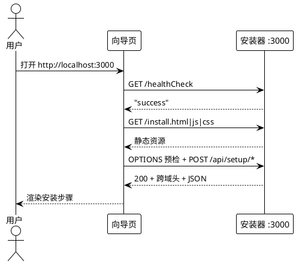

### 5.1.3 异常场景

1. **端口被占用**
   a. 触发条件：3000 端口已被其他进程监听。
   b. 系统行为：拒绝启动，报告占用进程标识与端口，不尝试随机换端口。
   c. 用户感知：非零退出码 + 明确指出端口冲突与可执行的释放/换端口建议。

2. **静态资源缺失**
   a. 触发条件：向导页三件套中任一文件不存在或不可读。
   b. 系统行为：对静态路径返回 404 并在诊断日志中记录缺失文件名；不得用占位内容冒充成功。
   c. 用户感知：浏览器加载失败 + 诊断日志中"静态资源缺失"条目。

3. **跨域预检不被允许**
   a. 触发条件：预检请求缺少必要的跨域响应头。
   b. 系统行为：按规则补齐允许来源、允许方法、允许请求头后返回成功。
   c. 用户感知：向导页可正常提交 JSON，不出现跨域拦截。

---

## 5.2 M2 环境检测与兼容性判定

### 5.2.1 业务规则

1. **REQ-RNI-006 检测项与返回结构**：必须返回三项检测（Node.js / PostgreSQL / Redis）的统一结构。
   a. 验收条件（AC-048）：WHEN 收到环境检测请求，THEN THE SYSTEM SHALL 返回状态值 200、消息"环境检测完成"，以及含三项元素的数组，每项含名称、展示名、是否通过、当前值、要求值五个字段。
   b. 验收条件（AC-049）：WHILE 任一单项探测抛出异常，THEN THE SYSTEM SHALL 仍返回状态值 200 的数组，而不是让整个端点失败。

2. **REQ-RNI-007 Node.js 判定**：主版本号下限 18。
   a. 验收条件（AC-050）：WHEN 解析 Node 版本输出，THEN THE SYSTEM SHALL 按三段式版本号提取主版本号，并在主版本号不小于 18 时判定通过，同时把解析到的完整版本串作为当前值返回。
   b. 验收条件（AC-051）：IF Node 命令不可用或输出无法解析，THEN THE SYSTEM SHALL 判定不通过并把当前值标记为未安装。

3. **REQ-RNI-008 PostgreSQL 判定（三级降级）**：主版本号下限 14。
   a. 验收条件（AC-052）：WHEN 探测 PostgreSQL，THEN THE SYSTEM SHALL 依次尝试版本命令、5432 端口监听探测、进程镜像探测，前一级不可用时回落到下一级，并把实际生效的探测手段记录下来。
   b. 验收条件（AC-053）：WHEN 任一级别解析到版本号，THEN THE SYSTEM SHALL 在主版本号不小于 14 时判定通过。

4. **REQ-RNI-009 Redis 判定（三级降级 + 可选）**：主版本号下限 6，且不得阻断流程。
   a. 验收条件（AC-054）：WHEN 探测 Redis，THEN THE SYSTEM SHALL 依次尝试版本命令、6379/6380/6381 端口监听探测、进程镜像探测。
   b. 验收条件（AC-055）：WHILE 返回 Redis 检测项，THEN THE SYSTEM SHALL 附带可选标记，且该项未通过时不得阻断安装流程推进。
   c. 验收条件（AC-056）：WHEN 解析到 Redis 版本号，THEN THE SYSTEM SHALL 在主版本号不小于 6 时判定通过。

5. **REQ-RNI-010 探测超时**：单项探测必须有上限。
   a. 验收条件（AC-057）：WHILE 执行任一子探测命令，THEN THE SYSTEM SHALL 在 5 秒上限内结束等待，超时即判定该级失败并进入下一级，禁止无限期挂起。

### 5.2.2 交互流程

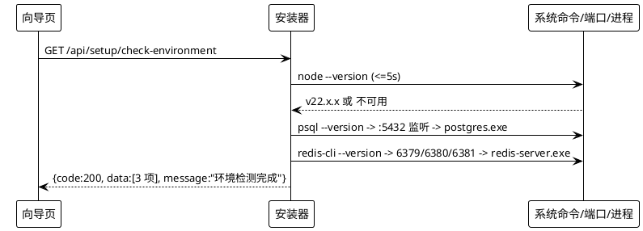

### 5.2.3 异常场景

1. **版本命令存在但输出非预期格式**
   a. 触发条件：命令执行成功但输出不匹配三段式版本号。
   b. 系统行为：判定该级失败并回落到下一级探测手段。
   c. 用户感知：该项显示实际探测到的原始值与要求值，不报端点错误。

2. **探测子进程超时**
   a. 触发条件：命令在 5 秒内未退出。
   b. 系统行为：强制终止该进程及其子进程树，回落到下一级。
   c. 用户感知：该项最终由端口或进程级探测给出结论。

3. **三级探测全部不可用**
   a. 触发条件：版本命令、端口、进程三种手段均未获得证据。
   b. 系统行为：判定不通过，当前值标记为未安装，并记录三级全部失败的事实。
   c. 用户感知：该项标红；Redis 因可选标记不阻断，Node/PostgreSQL 阻断后续闸口。

---

## 5.3 M3 配置与数据库连通性

> **必答项（假成功行为处置）**：本节对 `test-config`、`service-status`、`logs` 三处既有"假成功"行为逐条给出明确处置与独立需求。其余两处假成功（`generate-ssl` 伪 PEM、create-admin 假路径）分别在 §5.6 与 §5.8 给出。

### 5.3.1 业务规则

1. **REQ-RNI-011 保存配置**：四项必填，落盘并刷新内存，且不写 runtime 的 `.env`。
   a. 验收条件（AC-058）：IF 提交的配置缺少主机、端口、库名、用户中任一项，THEN THE SYSTEM SHALL 返回状态值 400 并指出缺失字段。
   b. 验收条件（AC-059）：WHEN 配置校验通过，THEN THE SYSTEM SHALL 将其写入工作目录下的配置文件，并同步刷新内存中的配置副本。
   c. 验收条件（AC-060）：WHILE 执行保存配置，THEN THE SYSTEM SHALL 不修改 runtime 的环境变量文件。

2. **REQ-RNI-012 加载配置**：读取失败仍返回成功并回吐内存副本。
   a. 验收条件（AC-061）：IF 配置文件不存在或不可解析，THEN THE SYSTEM SHALL 仍返回状态值 200 并回吐内存中的配置副本（含默认值），且不得抛出异常响应。

3. **REQ-RNI-013 连通性真实探测**：三级探测并给出真实结论。
   a. 验收条件（AC-062）：WHEN 收到连通性测试请求，THEN THE SYSTEM SHALL 依次尝试命令行查询、端口可达性探测，两级均无成功证据时判定不可达。
   b. 验收条件（AC-063）：WHEN 返回连通性测试结果，THEN THE SYSTEM SHALL 在响应中附带探测结论，含生效手段、是否可达与详细说明。

4. **REQ-RNI-014 `test-config` 假成功处置**：**默认保留不阻断语义，但必须暴露真实结论；提供真实语义开关**。
   a. 验收条件（AC-064）：WHILE 未启用真实语义开关，THEN THE SYSTEM SHALL 保持与现状一致的返回状态与消息形状，同时在响应中携带真实的探测结论字段，使调用方既能兼容又能读到真相。
   b. 验收条件（AC-065）：WHILE 启用真实语义开关，IF 探测结论为不可达，THEN THE SYSTEM SHALL 返回非成功状态并附可执行的修复建议。
   c. 验收条件（AC-066）：WHILE 生成连通性测试消息，THEN THE SYSTEM SHALL 禁止在没有任何成功证据的情况下把说明文字写成"成功"。

5. **REQ-RNI-015 `service-status` 随机指标处置**：**默认复刻随机指标，提供真实指标开关**。
   a. 验收条件（AC-067）：WHILE 未启用真实指标开关，THEN THE SYSTEM SHALL 返回与现状一致的随机化占用率与运行时长数值，以保持前端展示行为不变。
   b. 验收条件（AC-068）：WHILE 启用真实指标开关，THEN THE SYSTEM SHALL 返回实际采样得到的占用率与运行时长，且采样失败时标记该项不可读而非填入随机值。

6. **REQ-RNI-016 `logs` 伪造日志处置**：**默认不复刻伪造日志，提供复刻开关**。
   a. 验收条件（AC-069）：IF 无任何可用日志来源，THEN THE SYSTEM SHALL 返回空日志数组，且不得合成任何日志条目。
   b. 验收条件（AC-070）：WHILE 启用伪造日志复刻开关，THEN THE SYSTEM SHALL 返回与现状一致的两条占位日志条目，并在响应中显式标记这些数据为合成数据。

### 5.3.2 交互流程

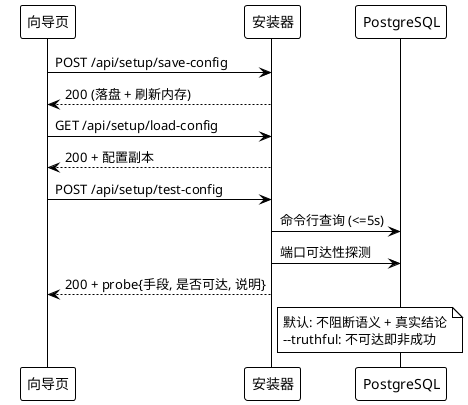

### 5.3.3 异常场景

1. **必填项缺失**
   a. 触发条件：提交的配置缺少任一必填项。
   b. 系统行为：拒绝保存，不写盘，返回 400 与缺失字段清单。
   c. 用户感知：提示需补全字段。

2. **配置文件不可解析**
   a. 触发条件：配置文件存在但格式损坏。
   b. 系统行为：保留内存副本，返回 200 与内存值，并在诊断日志中记录损坏事实。
   c. 用户感知：表单加载为默认值，不报错中断。

3. **数据库不可达**
   a. 触发条件：命令行查询与端口探测均无成功证据。
   b. 系统行为：标记不可达；默认模式下不阻断，真实语义模式下返回非成功并给出修复建议。
   c. 用户感知：默认模式给出告警提示，真实模式给出明确的失败与修复命令。

4. **连通性探测超时**
   a. 触发条件：命令行查询在 5 秒内未返回。
   b. 系统行为：强制终止子进程，回落到端口探测，并把超时事实写入说明。
   c. 用户感知：说明中可见"命令行探测超时，已改用端口探测"。

---

## 5.4 M4 服务状态与日志

### 5.4.1 业务规则

1. **REQ-RNI-017 服务状态**：返回三项服务的运行状态。
   a. 验收条件（AC-071）：WHEN 收到服务状态请求，THEN THE SYSTEM SHALL 返回状态值 200 与含三项元素的数组，每项含名称、状态、占用率、内存、运行时长，且状态取值区分运行中与非运行中。
   b. 验收条件（AC-072）：IF 某一项的探测失败或无法判定，THEN THE SYSTEM SHALL 将该项标记为非运行中，而不是让整个端点失败。

2. **REQ-RNI-018 日志聚合**：聚合五个来源并裁到最近 100 条。
   a. 验收条件（AC-073）：WHEN 收到日志请求，THEN THE SYSTEM SHALL 读取应用日志、运行时日志、错误日志、汇总日志与主服务日志五个来源，合并为一个统一结构的数组。
   b. 验收条件（AC-074）：WHEN 解析单行日志，THEN THE SYSTEM SHALL 依次尝试三种时间戳格式提取时间与级别，均不匹配时把整行作为消息并归入信息级别。
   c. 验收条件（AC-075）：WHEN 合并完成，THEN THE SYSTEM SHALL 按时间升序排列后返回最后 100 条。

### 5.4.2 交互流程

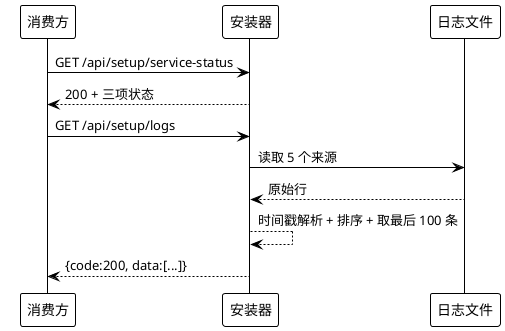

### 5.4.3 异常场景

1. **日志目录不存在**
   a. 触发条件：五个来源全部不可读。
   b. 系统行为：返回空数组（默认）或合成两条并标记（复刻开关下），同时记录"无可用日志来源"。
   c. 用户感知：日志面板为空，不出现误导性条目。

2. **日志文件被占用**
   a. 触发条件：读取时文件被其他进程独占。
   b. 系统行为：跳过该文件并在结果中标注该项不可读，不得因此让整个端点失败。
   c. 用户感知：其余来源的日志正常返回。

3. **状态探测命令不可用**
   a. 触发条件：进程查询手段在本机不可用。
   b. 系统行为：三项全部标记为非运行中并记录原因。
   c. 用户感知：状态面板显示未运行，端点仍返回 200。

---

## 5.5 M5 发行版安装介质与原子性

### 5.5.1 业务规则

1. **REQ-RNI-019 安装状态检测**：以发行产物文件是否存在为判据，返回裸对象。
   a. 验收条件（AC-076）：WHEN 收到安装状态检测请求，THEN THE SYSTEM SHALL 以目标目录下发行可执行文件是否存在作为已安装判据。
   b. 验收条件（AC-077）：WHEN 返回安装状态，THEN THE SYSTEM SHALL 返回不含状态字段的裸对象，含是否已安装、可执行文件路径、运行时目录、发行目录、版本、是否含环境文件、说明七个字段。
   c. 验收条件（AC-078）：WHEN 解析版本与是否含环境文件，THEN THE SYSTEM SHALL 从发行目录下的版本文件中提取版本键值，并以环境文件是否存在作为是否含环境文件的取值。

2. **REQ-RNI-020 安装幂等与强制重装**：已安装时默认跳过。
   a. 验收条件（AC-079）：WHILE 已安装且未指定强制重装，THEN THE SYSTEM SHALL 直接返回已安装信息且不重复落地介质。
   b. 验收条件（AC-080）：WHILE 已安装且指定强制重装，THEN THE SYSTEM SHALL 重新落地介质并在完成后复核安装状态。

3. **REQ-RNI-021 离线优先**：本地介质优先，缺失才联网。
   a. 验收条件（AC-081）：WHILE 本地已存在可用介质，THEN THE SYSTEM SHALL 优先使用本地介质，且不发起任何网络请求。
   b. 验收条件（AC-082）：IF 本地介质不可用，THEN THE SYSTEM SHALL 按既定顺序尝试远端来源，并在响应与日志中标明实际使用的介质来源。

4. **REQ-RNI-022 原子落地**：先过渡目录，再一次性切换。
   a. 验收条件（AC-083）：WHILE 落地安装介质，THEN THE SYSTEM SHALL 先完整落地到过渡目录并完成校验，再一次性切换到目标位置。
   b. 验收条件（AC-084）：WHEN 切换到目标位置完成，THEN THE SYSTEM SHALL 在此之后才更新安装状态文件中的该步骤记录。

5. **REQ-RNI-023 快照与回滚**：保留上一版本快照并支持一键回退。
   a. 验收条件（AC-085）：WHEN 对已存在的安装执行重装，THEN THE SYSTEM SHALL 先将既有安装目录整体保留为快照后再落地新介质。
   b. 验收条件（AC-086）：WHEN 用户执行回滚，THEN THE SYSTEM SHALL 从快照恢复安装目录，并在恢复后校验关键产物存在。
   c. 验收条件（AC-087）：WHEN 回滚成功，THEN THE SYSTEM SHALL 相应回退安装状态文件中的步骤记录；IF 快照不存在，THEN THE SYSTEM SHALL 明确报告无可回滚快照。

6. **REQ-RNI-024 介质落地能力约束**：落地失败必须报错且不留残骸。
   a. 验收条件（AC-088）：IF 介质落地（解包或复制）过程中失败，THEN THE SYSTEM SHALL 报错、清理本次过渡产物、保持目标目录为安装前状态，且不得把部分内容留在目标位置。

7. **REQ-RNI-025 环境文件生成**：安装完成后环境文件必须就位且不被覆盖。
   a. 验收条件（AC-089）：WHEN 介质落地完成，THEN THE SYSTEM SHALL 保证发行目录下存在环境文件；IF 该文件已存在，THEN THE SYSTEM SHALL 保留其原有内容。

### 5.5.2 交互流程

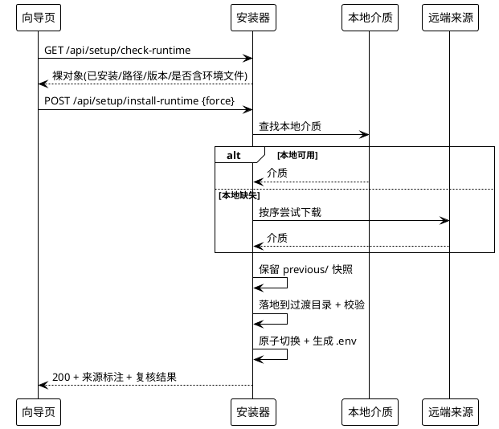

### 5.5.3 异常场景

1. **强制重装后新介质校验不通过**
   a. 触发条件：过渡目录产物校验失败。
   b. 系统行为：放弃切换，清理过渡目录，保留原安装与快照。
   c. 用户感知：明确失败并提示可重试或回滚。

2. **本地介质损坏**
   a. 触发条件：本地介质存在但校验不通过。
   b. 系统行为：标记为不可用并按规则回落远端来源，同时在响应中说明本地介质被弃用的原因。
   c. 用户感知：可见"本地介质校验失败，已改用远端来源"。

3. **网络获取超时**
   a. 触发条件：远端获取超过 300 秒上限。
   b. 系统行为：强制终止并清理临时文件，报告超时。
   c. 用户感知：失败提示 + 建议改用离线介质或指定本地介质路径。

4. **回滚目标快照缺失**
   a. 触发条件：请求回滚但无快照。
   b. 系统行为：拒绝回滚并明确报告无快照可回滚，不得删除现有安装。
   c. 用户感知：明确提示"无可回滚快照"。

---

## 5.6 M6 运行时配置与证书

> **必答项（generate-ssl 伪 PEM 是否复刻）**：**结论 = 不予复刻**。只保留系统证书工具单路径；工具不可用或执行失败时返回明确错误与安装指引，严禁产出无法被加载的占位证书。理由：该降级产物把域名做编码后拼进证书体（`setup.service.ts:1127`），属于不可用产物；而前端在证书生成失败时本就有错误分支可走（`install.js` 的失败提示路径），因此不复刻不破坏兼容性，且消除"装完 HTTPS 却起不来"的隐蔽故障。

### 5.6.1 业务规则

1. **REQ-RNI-026 读取运行时环境**：按既有解析规则返回配置与数据库配置。
   a. 验收条件（AC-090）：IF 尚未安装 runtime，THEN THE SYSTEM SHALL 返回 500；IF 已安装但环境文件不存在，THEN THE SYSTEM SHALL 返回 404；IF 读取成功，THEN THE SYSTEM SHALL 返回状态值 200 与原始键值对、解析后的数据库配置、环境文件路径。
   b. 验收条件（AC-091）：WHEN 解析环境文件，THEN THE SYSTEM SHALL 跳过注释行与空行，按首个等号切分键值，并剥离成对包裹的引号。
   c. 验收条件（AC-092）：WHEN 解析数据库配置，THEN THE SYSTEM SHALL 从连接串型配置项中解析出主机、端口、库名、用户与口令。

2. **REQ-RNI-027 保存运行时环境**：行级就地更新，保留注释与未改动行。
   a. 验收条件（AC-093）：WHEN 提交的键在环境文件中已存在，THEN THE SYSTEM SHALL 就地重写该行；IF 键不存在，THEN THE SYSTEM SHALL 追加到文件末尾。
   b. 验收条件（AC-094）：WHILE 写回环境文件，THEN THE SYSTEM SHALL 保留原有注释行、空行与未被本次修改的键值行。
   c. 验收条件（AC-095）：IF 提交的键名不符合环境文件键名的合法字符集，THEN THE SYSTEM SHALL 返回 400 并拒绝写入。

3. **REQ-RNI-028 生成自签证书**：仅系统证书工具单路径，禁止占位证书。
   a. 验收条件（AC-096）：WHEN 收到生成证书请求，THEN THE SYSTEM SHALL 调用系统证书工具生成证书与私钥到发行目录的证书子目录，并返回证书路径、私钥路径与域名。
   b. 验收条件（AC-097）：IF 系统证书工具不可用或执行失败，THEN THE SYSTEM SHALL 返回明确错误与安装指引，且不得写入任何证书文件。
   c. 验收条件（AC-098）：WHILE 生成证书，THEN THE SYSTEM SHALL 禁止把编码后的域名或任何占位内容拼进证书体充当证书。

4. **REQ-RNI-029 保存证书**：写入指定证书文件，覆盖前先备份。
   a. 验收条件（AC-099）：WHEN 收到保存证书请求，THEN THE SYSTEM SHALL 把证书与私钥分别写入发行目录证书子目录下的既有文件名。
   b. 验收条件（AC-100）：IF 目标证书文件已存在，THEN THE SYSTEM SHALL 先备份原文件再写入，并在失败时用备份恢复。

### 5.6.2 交互流程

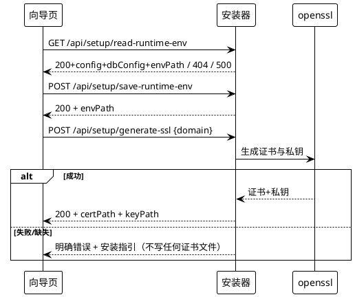

### 5.6.3 异常场景

1. **未安装即读取配置**
   a. 触发条件：runtime 尚未安装。
   b. 系统行为：返回 500 并说明未安装。
   c. 用户感知：明确的"尚未安装"错误。

2. **环境文件缺失**
   a. 触发条件：已安装但环境文件不存在。
   b. 系统行为：返回 404（与现状一致）。
   c. 用户感知：提示需先完成安装或生成环境文件。

3. **系统证书工具缺失**
   a. 触发条件：本机无证书生成工具。
   b. 系统行为：返回错误与安装指引，不产出任何证书文件。
   c. 用户感知：明确指出工具缺失与获取方式。

4. **证书写入目标只读**
   a. 触发条件：证书目录不可写或文件被占用。
   b. 系统行为：返回失败并说明具体路径与原因，已备份的原文件保持不变。
   c. 用户感知：明确的路径级错误提示。

---

## 5.7 M7 进程治理

### 5.7.1 业务规则

1. **REQ-RNI-030 启动运行时**：分离启动并返回进程标识。
   a. 验收条件（AC-101）：IF runtime 尚未安装，THEN THE SYSTEM SHALL 返回 500；IF 已安装，THEN THE SYSTEM SHALL 以与安装器解耦的方式启动 runtime 并返回进程号与可执行文件路径。
   b. 验收条件（AC-102）：WHEN runtime 启动成功，THEN THE SYSTEM SHALL 把进程号与进程镜像名一起写入进程标识文件。

2. **REQ-RNI-031 停止运行时**：精确终止，禁止按镜像名全杀。
   a. 验收条件（AC-103）：WHEN 收到停止请求，THEN THE SYSTEM SHALL 仅终止进程标识文件中有记录且进程镜像名校验通过的那个进程。
   b. 验收条件（AC-104）：WHILE 执行停止，THEN THE SYSTEM SHALL 禁止使用按进程镜像名批量终止的方式，且不得终止任何非本安装器启动的同名进程。

3. **REQ-RNI-032 重启运行时**：先精确停止再启动，优先沿用既有启动脚本。
   a. 验收条件（AC-105）：WHEN 收到重启请求，THEN THE SYSTEM SHALL 先按停止规则精确终止，再按启动规则重新拉起；IF 安装根目录下存在既有启动脚本，THEN THE SYSTEM SHALL 优先执行该脚本。

4. **REQ-RNI-033 陈旧进程标识**：不得误杀复用进程号的其他进程。
   a. 验收条件（AC-106）：IF 进程标识文件中的进程号已不存在或镜像名不匹配，THEN THE SYSTEM SHALL 清理该文件并报告"当前未运行"，且不得终止占用该进程号的其他进程。

### 5.7.2 交互流程

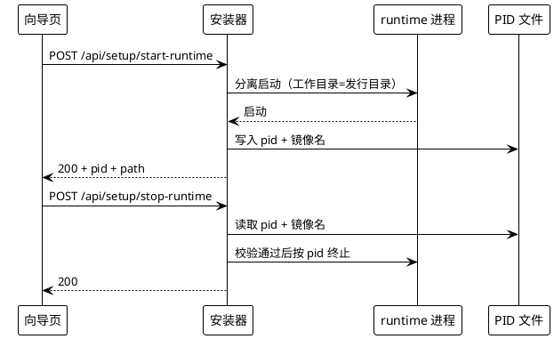

### 5.7.3 异常场景

1. **未安装即启动**
   a. 触发条件：runtime 未安装。
   b. 系统行为：返回 500 并说明需先安装。
   c. 用户感知：明确的"尚未安装"错误。

2. **进程号已被其他进程复用**
   a. 触发条件：标识文件中的进程号存在但镜像名不匹配。
   b. 系统行为：拒绝终止，清理标识文件，报告未运行。
   c. 用户感知：提示"未检测到运行中的 runtime"。

3. **启动后立即退出**
   a. 触发条件：进程拉起后短时间内自行退出。
   b. 系统行为：在启动结果中标记需人工确认，并给出最近可读取的失败线索（日志路径或退出线索）。
   c. 用户感知：启动失败提示 + 排障指引，不得直接宣告成功。

4. **停止目标无响应**
   a. 触发条件：终止请求发出后进程仍在。
   b. 系统行为：在有限等待后升级为强制终止，仍失败则报告失败与手工命令。
   c. 用户感知：明确失败与可执行的手工命令。

---

## 5.8 M8 管理员创建

> **必答项（create-admin 返回体形状）**：**结论 = 采用真路径返回体形状，前端无需同步改动**。
> - 依据一（代码事实）：真路径实现返回 `{code: 200, message: '管理员账号创建成功', user: {id, name, username, email}}`（`setup.service.ts:1285-1294`）。注意：`user` 与 `code` 同级，**并非**嵌套在 `data` 之下；闸口转述中的 `data.user{...}` 与代码证据不一致，以代码证据为准。假路径实现返回 `{code: 200, data: {id: 'admin-'+时间戳, email, name, role, createdAt}, message: '管理员账号创建成功'}`（`setup.service.ts:541-551`），该路径本期删除。
> - 依据二（消费点事实）：`apps/web-admin/public/install.js` 对 `create-admin` 只有两处调用点（`:384` 与 `:1089`）。`:384` 所属的 `AdminAccountManager.createAdminAccount` 方法在全文件中无任何调用点（仅 `validatePassword` / `calculateStrength` / `validateEmail` 被使用）；实际生效的 `:1089` 调用只读取 `result.code` 与 `result.message`（`:1104-1107`）。全文件不存在对 `data.id`、`data.user` 或 `user` 字段的读取。
> - 结论：删除假路径后，唯一生效消费点的判定逻辑不受影响，**前端零改动**。若未来新增需要读取账号标识的下游，须单独立项并同步契约。

### 5.8.1 业务规则

1. **REQ-RNI-034 只实现真路径并固定返回体形状**：必须真实落库，返回真路径形状。
   a. 验收条件（AC-107）：WHEN 管理员创建成功，THEN THE SYSTEM SHALL 返回状态值 200、消息"管理员账号创建成功"，以及与状态值同级的账号对象，含标识、姓名、登录账号、邮箱四个字段。
   b. 验收条件（AC-108）：WHILE 处理管理员创建，THEN THE SYSTEM SHALL 禁止返回未落库的合成标识（如时间戳拼接形式），且禁止存在任何不写库的分支。
   c. 验收条件（AC-109）：WHILE 既有前端以现状消费创建管理员响应，THEN THE SYSTEM SHALL 保证其仅依据状态值与消息即可判定成功，无需对前端做任何改动。

2. **REQ-RNI-035 入参校验**：沿用真路径的必填校验。
   a. 验收条件（AC-110）：IF 邮箱、登录账号、口令三者缺一，THEN THE SYSTEM SHALL 返回 400 与消息"请填写完整的管理员账号信息"。
   b. 验收条件（AC-111）：WHILE 校验口令，THEN THE SYSTEM SHALL 不在服务端重复施加前端已有的强度规则，以保证与现状服务端语义一致。

3. **REQ-RNI-036 口令哈希一致性**：cost 10 且与既有实现互认。
   a. 验收条件（AC-112）：WHEN 生成口令哈希，THEN THE SYSTEM SHALL 使用成本因子 10 的 bcrypt 哈希，且哈希串以 `$2a$10$` 开头。
   b. 验收条件（AC-113）：WHEN 同一明文口令分别由本组件与既有实现哈希，THEN THE SYSTEM SHALL 保证两者的哈希可被对方的校验逻辑互相验证通过。
   c. **实现口径（gate-design 拍板，2026-10-07）**：本条的两项验收条件**维持不变**，`$2a$10$` 即目标口径。仓颉侧 vendored 密码库 `libs/blowfish-cj` 的盐生成前缀为 `$2b$`（`libs/blowfish-cj/src/bcrypt.cj` 的 `genSalt` 位于 `:242-256`，其中 `:247` 为 `$2b$` 字面），该差异**由仓颉侧实现吸收**——推荐做法是安装器在**写库前**把哈希的版本前缀段归一为 `$2a$`（哈希体逐字符保留，禁止重算或截断），**不改动 vendored 第三方库**。归一化后的串仍须同时满足 AC-112 的字面要求与 AC-113 的双向互认要求。

4. **REQ-RNI-037 唯一性校验**：邮箱与登录账号分别查重。
   a. 验收条件（AC-114）：IF 该邮箱已存在于用户表，THEN THE SYSTEM SHALL 返回 400 与消息"该邮箱已被注册"，且不得写入。
   b. 验收条件（AC-115）：IF 该登录账号已存在于用户表，THEN THE SYSTEM SHALL 返回 400 与消息"该用户名已被使用"，且不得写入。

5. **REQ-RNI-038 写入契约**：只写既有列，常量取值固定。
   a. 验收条件（AC-116）：WHEN 写入管理员记录，THEN THE SYSTEM SHALL 仅写入姓名、登录账号、邮箱、口令、认证来源、状态、创建时间、更新时间、最后登录时间这些既有列，其中认证来源取 0、状态取 1、三个时间取当前时间。
   b. 验收条件（AC-117）：WHILE 写入管理员记录，THEN THE SYSTEM SHALL 不写入其他既有列，且不产生任何新建列或新建表的动作。

6. **REQ-RNI-039 写后回读自校验**：写库后必须自证。
   a. 验收条件（AC-118）：WHEN 插入成功，THEN THE SYSTEM SHALL 按返回的账号标识回读该行，并用口令校验逻辑确认哈希可验证通过。
   b. 验收条件（AC-119）：IF 回读不到该行或哈希校验不通过，THEN THE SYSTEM SHALL 返回 500 并明确失败原因，且不得宣告创建成功。

### 5.8.2 交互流程

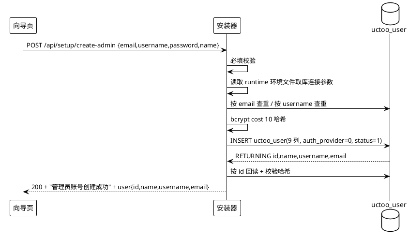

### 5.8.3 异常场景

1. **无法读取数据库配置**
   a. 触发条件：runtime 环境文件缺失或解析不出库连接参数。
   b. 系统行为：返回 500 与消息"无法读取数据库配置"，不写库。
   c. 用户感知：明确提示需先完成配置与安装。

2. **邮箱或登录账号重复**
   a. 触发条件：查重命中。
   b. 系统行为：返回对应 400 消息，不写库。
   c. 用户感知："该邮箱已被注册" 或 "该用户名已被使用"。

3. **数据库操作失败**
   a. 触发条件：连接、查询或插入抛出异常。
   b. 系统行为：捕获并返回 500 与错误消息，确保连接被释放。
   c. 用户感知：明确的数据库操作失败提示。

4. **写入后回读自校验不通过**
   a. 触发条件：回读不到行或哈希不匹配。
   b. 系统行为：返回 500 并给出失败原因，状态文件中该步骤不得标记为完成。
   c. 用户感知：创建失败提示，可重试。

---

## 5.9 M9 安装状态机与断点续装

### 5.9.1 业务规则

1. **REQ-RNI-040 状态与闸口定义**：九态顺序推进，闸口未过不得推进。
   a. 验收条件（AC-120）：WHILE 执行安装流程，THEN THE SYSTEM SHALL 按"环境探测 → 数据库配置与试连 → 证书准备 → 介质落地 → 环境文件写入 → 管理员创建 → 进程启动与健康确认 → 开发套件 → 环境初始化"九个状态的顺序推进，并记录每一状态的完成标记。
   b. 验收条件（AC-121）：IF 当前状态的闸口判据未通过，THEN THE SYSTEM SHALL 拒绝推进到下一状态并给出未通过的具体原因。

2. **REQ-RNI-041 断点续装**：每步完成即持久化，重启可续。
   a. 验收条件（AC-122）：WHEN 任一状态完成，THEN THE SYSTEM SHALL 立即把完成标记持久化到安装状态文件。
   b. 验收条件（AC-123）：WHEN 安装器重启且状态文件存在，THEN THE SYSTEM SHALL 从最后一个已完成状态继续，且默认不重复执行已完成状态。

3. **REQ-RNI-042 重复执行无副作用**：已完成步骤可安全重放。
   a. 验收条件（AC-124）：WHEN 用户显式重跑某个已完成状态，THEN THE SYSTEM SHALL 保证不产生重复账号、重复安装目录或重复的环境文件条目。

4. **REQ-RNI-043 状态文件损坏恢复**：禁止静默丢弃。
   a. 验收条件（AC-125）：IF 安装状态文件不可解析，THEN THE SYSTEM SHALL 先备份该损坏文件，再从初始状态重新开始，并在诊断日志中记录损坏事实。

### 5.9.2 交互流程

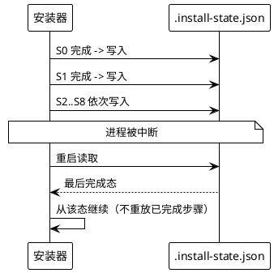

### 5.9.3 异常场景

1. **状态写入失败**
   a. 触发条件：状态文件所在目录不可写。
   b. 系统行为：报告写入失败并中止推进，不得在无持久化保障的情况下继续安装。
   c. 用户感知：明确提示状态文件不可写与修复建议。

2. **状态文件被外部篡改**
   a. 触发条件：状态文件内容与已知结构不符。
   b. 系统行为：备份后从初始状态重启，记录损坏事实。
   c. 用户感知：提示已从初始状态重新开始，并给出备份文件路径。

3. **闸口判据未通过**
   a. 触发条件：如数据库试连不可达、介质校验失败等。
   b. 系统行为：停留在当前状态并给出原因与修复建议。
   c. 用户感知：明确的闸门未通过说明，不进入下一步。

---

## 5.10 M10 安装器自退役

### 5.10.1 业务规则

1. **REQ-RNI-044 退役判据**：连续多次健康确认为成功。
   a. 验收条件（AC-126）：WHILE 已启动 runtime，THEN THE SYSTEM SHALL 周期性探测其健康端点，并在连续达到可配置次数（默认 3 次）的 200 响应后标记"可退役"。

2. **REQ-RNI-045 自动退出**：开关开启后自行退出且退出码为 0。
   a. 验收条件（AC-127）：WHILE 启用自动退出开关，WHEN 退役判据满足，THEN THE SYSTEM SHALL 以退出码 0 结束自身进程。

3. **REQ-RNI-046 退役语义边界**：退役不得破坏已安装成果。
   a. 验收条件（AC-128）：WHEN 安装器退出，THEN THE SYSTEM SHALL 保留全部安装产物、环境文件与状态文件，且不得停止已启动的 runtime 进程；WHEN 安装器再次启动，THEN THE SYSTEM SHALL 能从状态文件恢复到既有进度。

### 5.10.2 交互流程

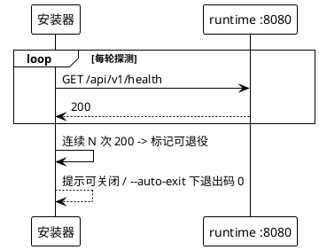

### 5.10.3 异常场景

1. **健康端点始终不可达**
   a. 触发条件：runtime 启动后健康探测持续失败或超时。
   b. 系统行为：不标记可退役，给出失败线索与排障指引。
   c. 用户感知：明确的启动未完成提示，不宣告安装成功。

2. **健康探测间歇性失败**
   a. 触发条件：连续计数被失败打断。
   b. 系统行为：重置连续计数并继续探测。
   c. 用户感知：进度提示停留在"等待服务就绪"。

3. **自动退出时仍有未完成步骤**
   a. 触发条件：退役判据满足但状态文件中存在未完成步骤。
   b. 系统行为：优先提示未完成步骤，不自动退出。
   c. 用户感知：明确列出未完成步骤。

---

## 5.11 M11 开发者套件 DevKit 安装

### 5.11.1 业务规则

1. **REQ-RNI-047 S7 可跳过**：发行版安装完成后询问，可跳过。
   a. 验收条件（AC-129）：WHEN 第六个状态完成，THEN THE SYSTEM SHALL 提供开发套件安装步骤，且该步骤可被跳过；IF 用户跳过，THEN THE SYSTEM SHALL 在状态文件中记录跳过标记并以退出码 0 正常结束。

2. **REQ-RNI-048 组件清单与子集安装**：八个可勾选组件，支持按标识子集安装。
   a. 验收条件（AC-130）：WHEN 查询开发套件组件清单，THEN THE SYSTEM SHALL 返回八个组件项，每项含标识、名称、作用、体量、必需性档位与自检判据说明。
   b. 验收条件（AC-131）：WHEN 指定按标识子集安装，THEN THE SYSTEM SHALL 仅安装子集中的组件，且不触碰未指定的组件。

3. **REQ-RNI-049 每组件自检判据**：装完即验，失败给出修复建议。
   a. 验收条件（AC-132）：WHILE 安装任一组件，THEN THE SYSTEM SHALL 在安装完成后立即执行该组件的自检判据并记录实际值。
   b. 验收条件（AC-133）：WHEN 以机器可读方式汇总自检结果，THEN THE SYSTEM SHALL 对每一项输出标识、状态、实际值、期望值与修复建议五个字段。
   c. 验收条件（AC-134）：IF 任一项自检未通过，THEN THE SYSTEM SHALL 使汇总命令返回非零退出码，且该未通过项的修复建议非空。

4. **REQ-RNI-050 探测驱动的推荐勾选**：默认勾选由环境探测结果决定并给出理由。
   a. 验收条件（AC-135）：WHEN 返回组件清单，THEN THE SYSTEM SHALL 为每个组件给出推荐标记与推荐理由，且理由中包含环境探测得到的实际值。
   b. 验收条件（AC-136）：IF 本机已存在符合要求版本的仓颉编译器，THEN THE SYSTEM SHALL 把该工具链组件的推荐标记置为不推荐，并在理由中引用探测到的版本号。

5. **REQ-RNI-051 同一状态机与回滚域**：开发套件复用主安装的原子性与回滚能力。
   a. 验收条件（AC-137）：WHILE 安装任一组件，THEN THE SYSTEM SHALL 复用与主安装相同的状态文件、过渡目录、原子切换与快照回滚机制，并支持单独重试与回滚。

6. **REQ-RNI-052 事后重入补装**：已装完 runtime 的机器仍可补装。
   a. 验收条件（AC-138）：WHEN 在已完成发行的机器上以独立模式或组件端点请求安装某一组件，THEN THE SYSTEM SHALL 成功补装该组件并更新状态文件。

7. **REQ-RNI-053 仓颉 SDK 分发策略（闸口决策③）**：引导下载 + 校验和，不内置。
   a. 验收条件（AC-139）：WHEN 需要仓颉 SDK 且本地不存在，THEN THE SYSTEM SHALL 提供官方下载来源指引与该文件对应的校验和，由用户或安装器下载，且不得把 SDK 内置进安装器交付物。
   b. 验收条件（AC-140）：WHEN SDK 包下载完成，THEN THE SYSTEM SHALL 校验其 SHA256；IF 校验不一致，THEN THE SYSTEM SHALL 报错、保留该文件供人工复查，且禁止继续使用该包。
   c. 验收条件（AC-141）：WHEN 用户通过路径参数指定已下载的本地 SDK 包，THEN THE SYSTEM SHALL 对该本地包执行同样的校验和校验后再使用。
   d. 验收条件（AC-142）：IF 下载过程中断，THEN THE SYSTEM SHALL 支持从中断处继续，且不得从头重下、不得产生重复临时文件。

8. **REQ-RNI-054 其余组件离线可得（闸口决策④）**：断网环境下除 SDK 外全部可装。
   a. 验收条件（AC-143）：WHILE 处于无网络环境，THEN THE SYSTEM SHALL 使除仓颉 SDK 外的全部组件可完成安装（源码树、依赖库、数据库基线、标准库 API 知识库、前端依赖均取自本地预置）。

9. **REQ-RNI-055 磁盘空间闸口**：安装前校验剩余空间。
   a. 验收条件（AC-144）：WHEN 进入开发套件安装步骤，THEN THE SYSTEM SHALL 先校验目标磁盘剩余空间；IF 空间不足，THEN THE SYSTEM SHALL 报错并逐组件给出体量预估与所需总量。

10. **REQ-RNI-056 组件清单可导出与回放**：支持团队基线复现。
    a. 验收条件（AC-145）：WHEN 以机器可读方式导出组件清单，THEN THE SYSTEM SHALL 产出可被回放的基线文件；WHEN 以该基线文件回放，THEN THE SYSTEM SHALL 得到与导出时一致的组件集合。

11. **REQ-RNI-057 模式可观测**：区分最终用户模式与开发者模式。
    a. 验收条件（AC-146）：WHILE 运行安装流程，THEN THE SYSTEM SHALL 在状态文件中记录运行模式（最终用户或开发者），且该模式可被自检汇总读出。

### 5.11.2 交互流程

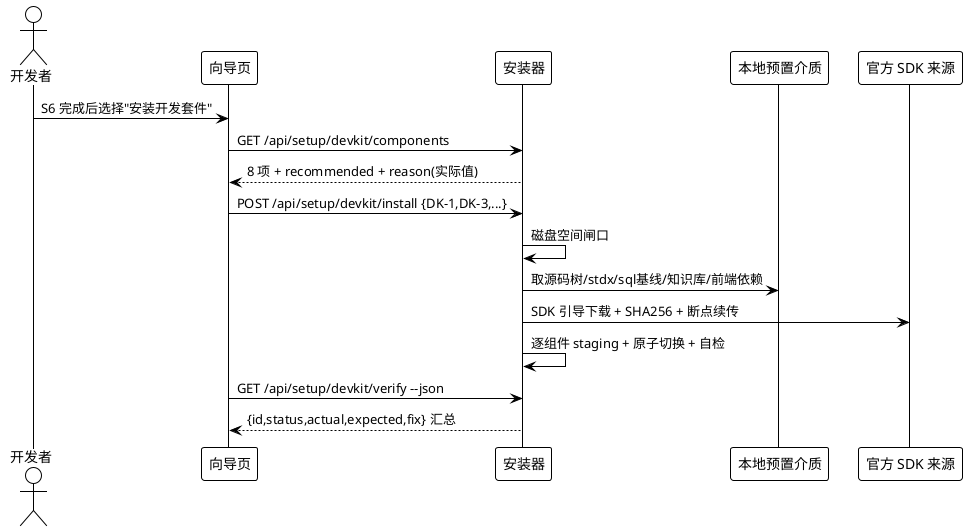

### 5.11.3 异常场景

1. **SDK 校验和不匹配**
   a. 触发条件：下载或指定的 SDK 包 SHA256 与预期不符。
   b. 系统行为：报错、保留文件、中止该组件安装并标记失败。
   c. 用户感知：明确的校验失败提示 + 重新下载或人工复核指引。

2. **磁盘空间不足**
   a. 触发条件：剩余空间低于所需总量。
   b. 系统行为：在进入组件安装前中止并给出逐组件体量预估。
   c. 用户感知：明确的容量不足报告与可选裁剪建议。

3. **单组件自检失败**
   a. 触发条件：某组件安装完成后判据不通过。
   b. 系统行为：标记该组件失败，允许单独重试或回滚，不影响其他已完成组件。
   c. 用户感知：该组件标红 + 修复建议命令。

4. **用户跳过开发套件**
   a. 触发条件：用户在 S7 选择不安装。
   b. 系统行为：写入跳过标记，正常结束且退出码 0，不安装任何组件。
   c. 用户感知：安装完成提示，后续可用独立模式补装。

---

## 5.12 M12 开发环境初始化

### 5.12.1 业务规则

1. **REQ-RNI-058 生成环境文件（I1）**：由模板生成并校验可连通。
   a. 验收条件（AC-147）：WHEN 生成开发环境文件，THEN THE SYSTEM SHALL 由模板文件复制并填入已收集的配置值，且键名符合环境文件键名字符集，值中若含注释符必须以引号包裹。
   b. 验收条件（AC-148）：WHEN 环境文件生成完成，THEN THE SYSTEM SHALL 验证其中的数据库连接串可连通，未连通时该项标记为未完成。

2. **REQ-RNI-059 导入数据库基线（I2/I3）**：按既有基线导入并按序应用增量脚本。
   a. 验收条件（AC-149）：WHEN 导入数据库基线完成，THEN THE SYSTEM SHALL 校验公开模式下的表数量达到基线预期规模（约 207 张）。
   b. 验收条件（AC-150）：WHEN 应用增量脚本，THEN THE SYSTEM SHALL 按名称顺序执行全部增量脚本，且执行过程幂等、不得包含删除类破坏性语句。

3. **REQ-RNI-060 刷新表信息缓存（I5）**：刷新成功方可标记通过，失败须如实降级。
   a. 验收条件（AC-151）：WHEN 刷新表信息缓存完成，THEN THE SYSTEM SHALL 校验表信息表中行数大于零且覆盖基线表规模。
   b. 验收条件（AC-152）：IF 命令行方式的刷新报出无法获得数据库连接，THEN THE SYSTEM SHALL 降级为引导用户在管理界面执行对应操作，并如实把该项标记为未完成，不得伪造成功。

4. **REQ-RNI-061 生成器冒烟（I6）**：以不编译的方式验证脚手架可用。
   a. 验收条件（AC-153）：WHEN 执行生成器冒烟，THEN THE SYSTEM SHALL 以空白模板生成一个冒烟工程，并在其说明文件与插件清单同时存在时判定通过。

5. **REQ-RNI-062 编译验证为人工项（I7）**：安装器不得代跑编译。
   a. 验收条件（AC-154）：WHILE 生成初始化清单，THEN THE SYSTEM SHALL 把编译验证列为人工执行项，且不得执行任何编译命令。
   b. 验收条件（AC-155）：WHEN 输出人工执行项，THEN THE SYSTEM SHALL 给出命令内容、工作目录、期望产物路径与判据，供人工执行后回传结果校验。

6. **REQ-RNI-063 本地域名与证书（I8）**：提权失败必须显式降级。
   a. 验收条件（AC-156）：IF 本地域名映射或证书部署因权限不足失败，THEN THE SYSTEM SHALL 显式降级为回环地址加明文访问的方案并给出手工执行命令，且不得静默跳过、不得以成功收尾。

7. **REQ-RNI-064 前端联调（I9）**：仅在勾选前端组件时执行。
   a. 验收条件（AC-157）：WHILE 未勾选前端开发组件，THEN THE SYSTEM SHALL 跳过前端联调；WHILE 已勾选，THEN THE SYSTEM SHALL 执行依赖安装与前端引用检查，且引用检查退出码为 0 方可判定通过。

8. **REQ-RNI-065 依赖路径与动态库对齐**：标准库路径写顶层，动态库文件名必须对齐。
   a. 验收条件（AC-158）：WHEN 写入标准库路径环境变量，THEN THE SYSTEM SHALL 写入标准库顶层目录，禁止写入其下的动态库子目录。
   b. 验收条件（AC-159）：WHEN 完成动态库对齐，THEN THE SYSTEM SHALL 保证可执行文件所在目录同时存在两个指定名称的加密库文件，缺一即判定该组件自检失败。

9. **REQ-RNI-066 环境变量写入与验证**：默认用户级，写入后必须新进程验证。
   a. 验收条件（AC-160）：WHILE 未指定系统级开关，THEN THE SYSTEM SHALL 将环境变量写入用户级；WHILE 指定系统级开关，THEN THE SYSTEM SHALL 写入系统级并在权限不足时明示失败。
   b. 验收条件（AC-161）：WHEN 环境变量写入完成，THEN THE SYSTEM SHALL 在新的进程中验证编译器命令可被解析；IF 验证失败，THEN THE SYSTEM SHALL 不得把该项标记为成功。

### 5.12.2 交互流程

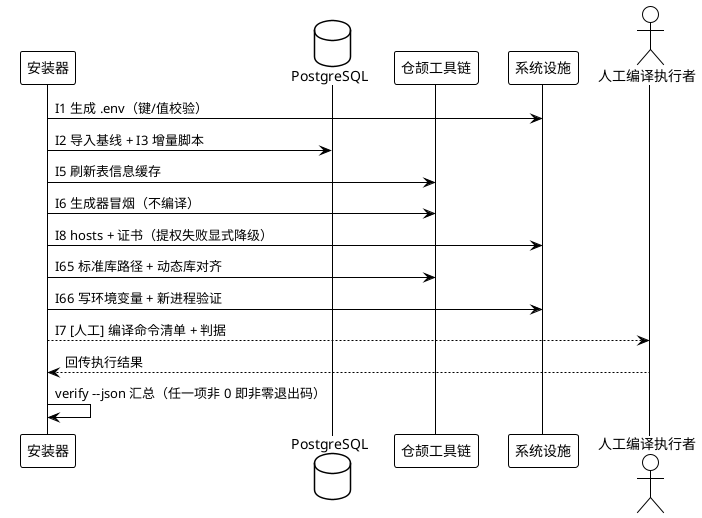

### 5.12.3 异常场景

1. **数据库基线导入中断**
   a. 触发条件：导入过程被中断或报错。
   b. 系统行为：如实标记该项未完成并给出可重跑的命令，不得伪造表数量。
   c. 用户感知：明确失败 + 重跑指引。

2. **表信息缓存刷新失败**
   a. 触发条件：命令行刷新报无法获得数据库连接。
   b. 系统行为：降级为引导管理界面操作，该项标记未完成。
   c. 用户感知：明确提示需手工刷新及操作路径。

3. **域名映射提权失败**
   a. 触发条件：写入系统域名映射文件被拒绝。
   b. 系统行为：显式降级为回环地址明文方案并给出手工命令，状态中记录降级事实。
   c. 用户感知：明确提示"域名映射未配置"及手工命令，不显示安装成功。

4. **环境变量写入后新进程验证失败**
   a. 触发条件：新进程中编译器命令无法解析。
   b. 系统行为：标记该项失败并给出排查建议（路径、级别、会话生效范围）。
   c. 用户感知：明确失败，不以"已写入"冒充可用。

5. **编译人工项未回传结果**
   a. 触发条件：人工编译清单已生成但未回传。
   b. 系统行为：在自检汇总中把该项标记为"待人工确认"，退出码非零。
   c. 用户感知：明确列出待人工执行的命令与判据。

---

## 5.13 M13 机器可读契约

### 5.13.1 业务规则

1. **REQ-RNI-067 结构化输出**：所有检查类能力提供机器可读输出。
   a. 验收条件（AC-162）：WHEN 任一检查类能力以机器可读方式被调用，THEN THE SYSTEM SHALL 输出结构稳定的结果，且不含用于人类阅读的装饰性文本。

2. **REQ-RNI-068 稳定退出码**：不同失败类别对应不同退出码。
   a. 验收条件（AC-163）：WHEN 进程结束，THEN THE SYSTEM SHALL 使用稳定的退出码区分成功、通用失败、参数错误、环境不满足、网络失败、校验失败与需人工介入七类结果，且同类失败在不同运行中退出码一致。

3. **REQ-RNI-069 可执行修复建议**：每个失败项给出可直接执行的命令。
   a. 验收条件（AC-164）：WHEN 报告任一项失败，THEN THE SYSTEM SHALL 给出可直接复制执行的修复命令或操作路径，禁止只给描述性文字。

4. **REQ-RNI-070 输出通道分离**：诊断与结果分离。
   a. 验收条件（AC-165）：WHILE 输出诊断信息，THEN THE SYSTEM SHALL 使其只走向标准错误通道，使标准输出可被结构化结果独占。

### 5.13.2 交互流程

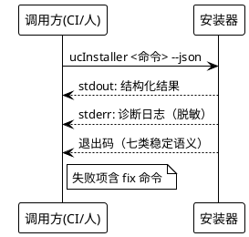

### 5.13.3 异常场景

1. **参数不合法**
   a. 触发条件：传入未知开关或非法取值。
   b. 系统行为：以参数错误退出码结束，并输出合法用法。
   c. 用户感知：明确的用法提示与参数错误退出码。

2. **输出被下游截断**
   a. 触发条件：结构化结果体积过大被截断。
   b. 系统行为：保持结构稳定，把超长字段截断并标注截断事实。
   c. 用户感知：结果仍可被解析，截断字段带标记。

3. **同时存在多种失败类别**
   a. 触发条件：一次运行同时出现环境不满足与校验失败。
   b. 系统行为：按既定优先级返回单一退出码，并在结构化结果中逐项列出全部失败。
   c. 用户感知：退出码可判定主类别，结果可看到全部问题。

---

## 5.14 M14 开发套件源码获取与开发目录选择

> **追加说明（gate-design，2026-10-07）**：本章由用户在 gate-design 提出「runtime 的开发套件是否从开源托管库 `git clone` 到本地建立开发目录？是否需要让开发者选择 `git clone` 到本地哪个目录？」后追加。
> 原 M11 的 DK-3 只定义了"落地源码树"，**未规定获取方式与目标目录选择**，导致二次开发者可能只得到一份无法回退、无法提 PR 的静态副本。本章补齐该部分需求；**M11/M12 已有条款不变**。
> 编号自 `REQ-RNI-071` / `AC-166` 起顺延，不与既有编号冲突。

### 5.14.1 业务规则

1. **REQ-RNI-071 源码获取单路径（`git clone`，无离线兜底）**：源码树（`src/` + `libs/` + `skills/` + 依赖清单文件）必须**且只能**以 `git clone` 方式从开源托管仓库获取，使开发者得到**带完整历史的工作副本**；git 不可用或全部候选仓库地址不可达时按**明确失败**处理，不得以任何无历史的替代副本收尾。

   a. 验收条件（AC-166）：WHEN 安装开发套件源码组件且 git 可用且仓库地址可达，THEN THE SYSTEM SHALL 以 `git clone` 方式获取源码树，且产出的目录中存在可用的版本元数据目录（可查询提交历史），使分支切换、版本回退与向上游提交变更成为可能。
   b. 验收条件（AC-167）：IF git 不可用，或全部候选仓库地址均不可达，THEN THE SYSTEM SHALL 判定该组件**安装失败**（退出码非 0），并**显式**告知开发者失败原因与可执行的处置指引（安装 git / 检查网络或代理后重跑）；THE SYSTEM SHALL NOT 产出任何"无 git 历史"的替代副本，亦不得宣称该组件安装成功。
   c. 验收条件（AC-168）：WHILE 源码获取未成功，THE SYSTEM SHALL 在结构化结果中记录本次失败原因（git 缺失 与 地址不可达 必须可区分），且**不得**在目标目录留下残缺源码树或来源标记文件。
   d. 验收条件（AC-169）：THE SYSTEM SHALL NOT 向开发者陈述任何"可回退到历史版本""可提交上游"的能力，除非该能力由本次成功的 `git clone` 产物实际提供。

2. **REQ-RNI-072 目标目录选择**：获取源码前必须让开发者指定 clone 到本机的哪个目录，不得在无询问的情况下擅自选定。

   a. 验收条件（AC-170）：WHEN 安装开发套件源码组件，THEN THE SYSTEM SHALL 提供目标目录指定途径（交互询问、目录选择控件或命令行显式指定其一即可），并在未显式指定时给出由本机环境推导的**默认建议路径**，且在执行写盘动作前把目标目录回显给开发者做一次确认。
   b. 验收条件（AC-171）：IF 目标目录**不存在**，THEN THE SYSTEM SHALL 允许直接在该路径获取源码。
   c. 验收条件（AC-172）：IF 目标目录**存在且为空**，THEN THE SYSTEM SHALL 允许在该路径获取源码。
   d. 验收条件（AC-173）：IF 目标目录**存在且非空、且已是本项目源码仓库且其远端地址与预期仓库匹配**，THEN THE SYSTEM SHALL 向开发者提示可复用该目录，并仅执行远端元数据更新，**不得重复拉取第二份副本**。
   e. 验收条件（AC-174）：IF 目标目录**存在且非空、且不是本项目的源码仓库**（含"是 git 仓库但远端地址不匹配"与"根本不是 git 仓库"两种情形），THEN THE SYSTEM SHALL 拒绝在该目录获取源码并要求开发者更换目录；仅在开发者**显式确认**后才允许继续，且必须明确记录该例外。
   f. 验收条件（AC-175）：IF 目标路径非法、当前权限不可写、剩余磁盘空间不足、或目标目录与本次安装的**目标安装目录**重叠（存在祖先或后代关系），THEN THE SYSTEM SHALL 报错并说明具体原因后退回目录选择步骤，不得在该目录继续执行安装。

3. **REQ-RNI-073 git 可用性前置检测**：获取源码前必须先检测本机 git 是否可用。

   a. 验收条件（AC-176）：WHEN 进入源码获取步骤，THEN THE SYSTEM SHALL 先检测 git 可执行文件可用性（如版本输出），仅在 git 可用时继续获取源码。
   b. 验收条件（AC-177）：IF 未检测到 git，THEN THE SYSTEM SHALL 终止该组件安装并**明确提示开发者先安装 git 后重新执行获取命令**，同时给出可复制重跑的命令行；严禁在无提示的情况下失败，亦严禁改用任何无历史的替代获取方式。
   c. 验收条件（AC-178）：WHILE 执行 git 子进程，THEN THE SYSTEM SHALL 采用受控的执行方式：既要限制单次等待上限以防悬挂，又要保证子进程继承完整环境（不得因传参导致可执行搜索路径等环境变量丢失）；且不得以缺少超时上限的方式调用。

4. **REQ-RNI-074 clone 参数取值**：默认取值须服务于"二次开发"而非"只读浏览"。

   a. 验收条件（AC-179）：WHEN 执行 `git clone`，THEN THE SYSTEM SHALL 默认获取**完整历史**（不做浅克隆）；浅克隆仅在开发者显式开启时才生效，且开启时必须如实标注该副本历史不完整。
   b. 验收条件（AC-180）：WHEN 定位仓库地址，THEN THE SYSTEM SHALL 以主仓库地址为首选，并在主地址不可达时自动回落到镜像地址后再决定是否降级。
   c. 验收条件（AC-181）：WHERE 开发者需要版本对齐，THEN THE SYSTEM SHALL 提供分支或标签选择能力（应包含与已安装发行版版本对齐的标签选项），默认取默认分支；若无法确认目标标签确实存在，THEN THE SYSTEM SHALL 退回默认分支并向开发者说明"未锁定版本"。
   d. 验收条件（AC-182）：WHILE 执行 clone，THEN THE SYSTEM SHALL 禁止读取 stdin 的交互行为（如凭据交互提示），凭据缺失时按失败处理而非悬挂等待。

5. **REQ-RNI-075 幂等性**：重复执行不得产生第二份副本。

   a. 验收条件（AC-183）：IF 在同一目标目录重复执行源码获取，THEN THE SYSTEM SHALL 识别已存在的本仓库工作副本并跳过重新 clone，**不得产生 `...-1` 之类的第二份副本目录**，且必须如实报告本次动作为"复用"。

6. **REQ-RNI-076 开发者工作区改动保护**：安装器不得销毁开发者的未提交成果。

   a. 验收条件（AC-184）：IF 目标仓库工作区存在未提交改动，THEN THE SYSTEM SHALL **如实报告**该状态（至少包含"存在未提交改动"事实与变更项数量）后方可继续，且**不得**执行丢弃本地改动的版本管理操作（如强制检出、硬重置、清理未跟踪文件）。
   b. 验收条件（AC-185）：WHILE 目标目录已是 git 工作副本，THEN THE SYSTEM SHALL 只允许"获取/更新"类版本管理操作，任何会覆盖或删除开发者本地改动的操作都必须先获得开发者确认。

7. **REQ-RNI-077 源码目录与安装目录的关系**：二者必须区分，初始化不得打错目录。

   a. 验收条件（AC-186）：WHILE 开发者模式已选定源码目录，THE SYSTEM SHALL 把该源码目录与发行版安装目录视为**两个不同目录**，在流程中分别记录，并在二者重叠时拒绝继续。
   b. 验收条件（AC-187）：WHEN 执行开发环境初始化（含生成环境文件、导入数据结构、刷新元信息、生成器冒烟等动作），THEN THE SYSTEM SHALL 以开发者所选的**源码目录**为工作目录执行，**不得**以发行版安装目录为工作目录，且产生的冒烟产物必须落在源码目录下。

### 5.14.2 交互流程

```
开始 DK-3 源码获取
      │
      ▼
D1 目标目录确定
      ├─ 开发者显式指定（--source-dir / 目录选择控件）→ 采用
      ├─ 交互询问 → 采用输入值
      └─ 均未指定 → 采用推导出的默认建议路径
      │
      ▼
D2 路径校验（非法字符/盘符/长度/可写/磁盘余量/与安装目录是否重叠）
      │ 任一不过 → 报具体原因 → 回 D1
      ▼
D3 目录状态三分
      ├─ 不存在            → 允许获取（git clone）
      ├─ 存在且为空        → 允许获取
      └─ 存在且非空
            ├─ 本仓库且远端匹配  → 提示可复用 → 更新远端元数据 → 计为「复用」
            ├─ 其它 git 仓库     → 拒绝 → 换目录 / 显式确认例外
            └─ 非 git 目录       → 拒绝 → 换目录 / 显式确认例外（仅在目录下新建子层再 clone）
      │
      ▼
D4 git 可用性与地址可达性检测
      ├─ git 可用 且 主地址/镜像可达 → git clone（主地址优先，不可达回落镜像）
      ├─ git 不可用                  → 失败终止 + 提示「请先安装 git，然后重跑 <命令>」（禁止静默/禁止替代路径）
      └─ 两者均不可达                → 失败终止 + 提示「请检查网络或代理后重跑 <命令>」，原因记为 networkUnreachable
      │
      ▼
D5 执行后自检
      ├─ 源码树要素齐备（依赖清单、关键子目录）
      └─ 存在版本元数据目录；远端地址与预期仓库匹配；报告工作区是否 dirty（dirty 不阻断）
      │
      ▼
D6 结果公示与记入状态（动作类型：clone / reuse / failed；失败原因逐项可见）
      │
      ▼
    S8 初始化以该源码目录为工作目录执行（受 AC-187 约束）
```

### 5.14.3 异常场景

1. **本机未安装 git**
   a. 触发条件：版本可用性检测未发现 git。
   b. 系统行为：终止该组件安装（退出码非 0），明确提示"未检测到 git —— 请先安装 git，然后重跑 `ucInstaller.exe devkit install DK-3 --source-dir <目录>`"，并在结果中标记 `gitMissing`，不写入任何源码文件。
   c. 用户感知：清楚知道源码没有装成、原因是什么、装好 git 后该执行哪条命令；不会得到一份看似成功却不可提交上游的副本。

2. **目标目录已有一份本仓库工作副本**
   a. 触发条件：目录非空、是本仓库且远端地址匹配。
   b. 系统行为：不重复 clone，更新远端元数据后按"复用"处理；存在未提交改动时如实报告但不阻断、不丢弃。
   c. 用户感知：不产生 `-1` 之类的重复目录，自己的改动不受威胁。

3. **目标目录是一份个人项目目录**
   a. 触发条件：目录非空且不是本项目的源码仓库。
   b. 系统行为：拒绝在该目录获取源码并要求更换目录；开发者显式确认例外时才继续，并记录该例外。
   c. 用户感知：个人文件不会被混入或覆盖。

4. **主仓库地址与镜像地址均不可达**
   a. 触发条件：联网获取连续失败。
   b. 系统行为：终止该组件安装（退出码非 0），并在结果中区分"未检测到 git"与"网络不可达"两种失败原因，给出"检查网络或代理后重跑"的处置指引。
   c. 用户感知：知道是网络问题而非工具缺失，也知道没有任何降级副本被偷偷落地。

5. **目标目录与发行版安装目录重叠**
   a. 触发条件：两目录存在祖先或后代关系。
   b. 系统行为：直接拒绝并要求更换目录，说明重叠会导致后续原子切换与初始化作用域混淆。
   c. 用户感知：不会把可编辑源码树与可被覆盖的发行版目录混为一谈。

6. **clone 过程遇到凭据交互提示**
   a. 触发条件：仓库要求认证而本机未提供凭据。
   b. 系统行为：按失败处理并返回可执行修复建议，不进入交互等待。
   c. 用户感知：安装器不会卡住不动。

---

## 5.15 M15 种子数据身份重绑定（Seed Identity Rebinding）

> **追加说明（gate-design，2026-10-07）**：本章由用户追加提出——「初始化数据库目前是导入开源项目中的 `sql/uctooDB.sql`，但其中很多数据表的 `creator` 列是我本地超管帐号的 `uctoo_user.id` uuid；其他开发者创建开发者帐号后是随机生成的 uuid，与文件中导出的超管 uuid 不一样。因此需要一套超越业界最佳实践的 seed 数据导入机制，把现有 `sql/uctooDB.sql` 中的初始数据正确匹配到开发者环境。」
> 经实测该缺口成立且更严重：基线中 **293 处身份单元格**（分布在 18 组「表.列」）指向 9 个主体，其中来源环境超管一主体占 215 处；且 `uctoo_user`、`role_has_permission`、`user_has_roles` 三张表在基线中**零行数据**，新环境即便结构导入成功也无人可登录、无菜单可见。完整取证与业界对标见 `research-seed-identity.md`。
> 编号自 `REQ-RNI-078` / `AC-188` 起顺延，不与既有编号冲突；**M11~M14 已有条款不变**。
> 本章不新建任何数据库表或列（遵守 SDD 铁律 9），身份映射以随仓库分发的**文件**承载。

### 5.15.1 业务规则

1. **REQ-RNI-078 身份引用外置与导出侧匿名化**：初始数据中"这一行属于哪个账号"不得以来源环境的真实账号标识表达，必须以**具名主体占位符**表达；并提供从来源环境生成该形态数据的手段。

   a. 验收条件（AC-188）：THE SYSTEM SHALL 使随仓库分发的初始数据中**不出现来源环境的真实账号标识**；身份列的取值一律为具名主体占位符或该列自身的合法取值。
   b. 验收条件（AC-189）：WHEN 从来源环境生成待分发的初始数据，THEN THE SYSTEM SHALL 把已声明主体的账号标识替换为具名占位符，并输出替换明细（至少包含被替换的「表.列」与各列替换处数）。
   c. 验收条件（AC-190）：IF 待分发数据中出现来源环境的真实账号标识却未在主体清单中声明，THEN THE SYSTEM SHALL 报出该清单供人工声明后重跑，**不得**静默保留该标识随仓库分发。

2. **REQ-RNI-079 主体清单**：必须存在一份声明"种子里都会提到哪些主体、各自怎么取得标识"的清单，未声明的主体不得出现在初始数据中。

   a. 验收条件（AC-191）：WHILE 执行初始数据导入，THE SYSTEM SHALL 读取主体清单，清单中每个主体必须声明引用名、种类（超级管理员 / 演示账号 / 服务账号）、登录名与标识来源；清单缺失、存在未声明引用或同一登录名重复声明时，导入不得继续。
   b. 验收条件（AC-192）：WHILE 主体为演示账号或服务账号，THE SYSTEM SHALL 为其赋予**跨环境稳定的确定标识**（由清单给定的固定值），使不同开发者环境、重复安装得到一致的标识值。
   c. 验收条件（AC-193）：WHILE 主体为超级管理员，THE SYSTEM SHALL **复用安装流程已创建的真实账号标识**作为其解析结果，**不得**另行创建第二个超管账号；该标识来源必须在结果中标明。

3. **REQ-RNI-080 导入期解析与重绑定**：导入时必须先把占位符解析为**本环境**的真实主体标识，再落库。

   a. 验收条件（AC-194）：WHEN 导入初始数据，THEN THE SYSTEM SHALL 在落库前完成占位符到本环境真实标识的解析，并按「表.列」维度记录本次重绑定的行数。
   b. 验收条件（AC-195）：IF 初始数据中存在未被主体清单声明的身份引用，THEN THE SYSTEM SHALL 按既定策略处理，**默认策略为判定导入失败**并逐条列出「表.列 = 标识」；仅当该引用在清单中被显式声明，或开发者显式选择了兜底策略（映射到指定主体 / 置空 / 建立占位账号）时，才允许改为非失败处理，且**每一处都必须在结果中可见**。
   c. 验收条件（AC-196）：WHILE 初始数据导入完成，THE SYSTEM SHALL 对全部身份列执行悬空引用检查；**悬空引用数必须为 0** 才允许判定导入成功。

4. **REQ-RNI-081 幂等与时序**：重复执行不得产生重复账号或重复数据；与建号步骤的先后不可颠倒。

   a. 验收条件（AC-197）：IF 在同一环境重复执行初始数据导入，THEN THE SYSTEM SHALL 识别已存在的主体与已导入的数据，**不得产生重复账号或重复业务行**，并如实报告本次动作为「复用」。
   b. 验收条件（AC-198）：WHILE 执行初始数据导入，THE SYSTEM SHALL 以「超级管理员账号已创建」为前提；该前提不满足时判定导入失败并说明需先完成建号，**不得**自行创建替代账号蒙混过关；导入工作目录为开发者所选源码目录（受 AC-187 约束）。

5. **REQ-RNI-082 权限骨架补种**：导入后的环境必须"能登录且能看到菜单"，而不只是"表都在"。

   a. 验收条件（AC-199）：WHILE 初始数据导入完成，THE SYSTEM SHALL 保证：超级管理员角色持有通配权限授权行、且新建的超管账号与超管角色之间存在绑定关系；缺失时以**只增不删**的方式补种（不得删除既有授权或绑定行）。
   b. 验收条件（AC-200）：WHILE 初始数据导入完成，THE SYSTEM SHALL 验证以超管身份可取得**非空**菜单树；取得空菜单树即判定导入未完成，不得以"表数达标"收尾。

6. **REQ-RNI-083 报告与可观测**：导入结果必须可机读、可追责。

   a. 验收条件（AC-201）：WHEN 初始数据导入结束，THEN THE SYSTEM SHALL 产出结构化报告，至少包含：各主体解析结果与其标识来源、按「表.列」的重绑定行数、逐条孤儿引用及其处置策略、权限骨架断言结果、悬空引用数与行数对账。
   b. 验收条件（AC-202）：THE SYSTEM SHALL NOT 在存在未解析成功的身份引用、或权限骨架断言不成立时，给出"导入成功"的结论。

7. **REQ-RNI-084 不新建数据库结构**：本机制不得改变数据库结构。

   a. 验收条件（AC-203）：WHILE 执行本机制的全部动作，THE SYSTEM SHALL NOT 新建数据库表或列；身份映射与逐次运行的记录一律以文件形式承载。

8. **REQ-RNI-085 演示与服务账号的口令处置**：不得引入可被猜测的静态口令。

   a. 验收条件（AC-204）：WHILE 由本机制创建演示账号或服务账号，THE SYSTEM SHALL 为其生成**随机**初始口令（口令强度与存储方式沿用管理员账号的既有要求），并在报告中一次性展示；**禁止**使用硬编码常量口令，且不得与超管口令相同。

9. **REQ-RNI-086 失败不留半截**：导入失败后不得留下归属未解析的数据。

   a. 验收条件（AC-205）：IF 初始数据导入在解析、落库或校验任一环节失败，THEN THE SYSTEM SHALL 撤销本轮已写入的数据，使库中**不存在**身份未解析的本轮产物，并给出可执行修复建议。

10. **REQ-RNI-087 解析实现的完整性**：对初始数据的解析必须尊重其文本结构。

   a. 验收条件（AC-206）：WHILE 解析初始数据中的标识取值，THE SYSTEM SHALL 按**文本形态一致**的方式比对（不得因列的类型差异而漏判或报错），且对含非 ASCII 字符的内容按字符而非字节处理。
   b. 验收条件（AC-207）：WHILE 切分初始数据中的语句，THE SYSTEM SHALL 采用能正确处理**字符串字面量内换行与转义**的方式，**禁止**按行读取或按语句分隔符朴素切分；含内嵌换行的文本列导入后必须与源一致。

### 5.15.2 交互流程

```
开始 初始数据导入（seed apply）
      │
      ▼
P0 解析主体标识
      ├─ 超管      ← 安装流程已创建的真实账号（缺失 → 失败：请先完成建号）
      ├─ 演示/服务 ← 按登录名幂等建立（已存在 → 回读标识；口令随机生成并入报告）
      └─ 清单校验失败 / 存在未声明引用 → 失败并列出
      │
      ▼
P1 结构与非身份数据导入（引号感知扫描，流式）
      │
      ▼
P2 身份重绑定（占位符 → 本环境真实标识，零 UPDATE）
      └─ 未命中清单的引用 → 计入孤儿 → 按策略处理（默认失败，逐条列出）
      │
      ▼
P3 权限骨架补种（只增不删）
      ├─ 超管角色 ← 通配权限授权行
      └─ 新超管   ← 与超管角色的绑定行
      │
      ▼
P4 校验
      ├─ 悬空引用扫描（全身份列，文本形态归一比对）
      ├─ 行数对账（应与源一致；被策略处理者单独列出）
      └─ 权限骨架断言（超管菜单树非空）
      │ 任一不过 → 撤销本轮写入 → 失败并给修复建议
      ▼
报告（主体 / 重绑定 / 孤儿逐条 / 权限断言 / 校验结果 / 一次性口令）
```

### 5.15.3 异常场景

1. **新建的开发者环境尚无超管账号**
   a. 触发条件：初始数据导入早于建号步骤执行，或建号未成功。
   b. 系统行为：判定导入失败并提示"请先完成管理员账号创建，再执行初始数据导入"；不创建替代账号，不写入任何初始数据。
   c. 用户感知：清楚知道顺序错了，而不是拿到一个"导入成功但没有归属"的库。

2. **种子中出现清单未声明的账号标识**
   a. 触发条件：有人往初始数据里塞了新的身份引用却未更新主体清单。
   b. 系统行为：默认策略下判定导入失败，逐条列出「表.列 = 标识」；开发者显式选择兜底策略后才继续，且每条处置都在报告中可见。
   c. 用户感知：看到确切的错处与受影响的行，而不是一个笼统的"导入错误"。

3. **来源环境本身就存在的悬空引用**
   a. 触发条件：初始数据里的某个标识在来源环境的用户表中也不存在（本项目实测 1 处）。
   b. 系统行为：按清单中的显式声明处置（默认映射至超管），并在报告中逐条列出该引用、处置策略与原因。
   c. 用户感知：知道这处历史遗留被归到了谁，且这不是静默发生的。

4. **导入后仍有悬空引用**
   a. 触发条件：校验阶段扫描到指向不存在账号的取值。
   b. 系统行为：判定导入失败，撤销本轮写入，报告列出每个「表.列」的悬空数量。
   c. 用户感知：不会拿到一个"表数达标但数据无归属"的库。

5. **导入后仍看不到菜单**
   a. 触发条件：权限骨架断言不通过（角色无通配授权行，或超管与角色未绑定）。
   b. 系统行为：补种缺失行（只增不删）后复检；复检仍不通过即判定导入未完成并给出手工修复命令。
   c. 用户感知：安装器不会在"能建表却不能用"的状态下宣告成功。

6. **重复执行导入**
   a. 触发条件：同一环境再次执行初始数据导入（如断点续装重放）。
   b. 系统行为：识别已存在的主体与已导入的数据，跳过重复建立与重复写入，报告本次动作为「复用」。
   c. 用户感知：不会产生第二个超管账号，也不会出现重行数据。

---

## 5.16 M16 初始数据范围、账号二元组与导出机制（REQ-RNI-088~097 / AC-208~239）

> 本节约 2026-10-07 追加，依据 `specs/RuntimeNativeInstaller/research-seed-export.md`。**已有 REQ/AC 的编号与内容一律不动**。§5.15 解决"身份怎么重绑定"，本节解决三个更靠前的问题：**库叫什么**、**初始环境该有几个账号**、**随仓库分发的初始数据文件本身怎么生成**。

### 5.16.1 业务规则

1. **REQ-RNI-088 默认数据库名**：安装流程使用的数据库名必须有确定默认值，且该默认值与项目既有约定一致。

   a. 验收条件（AC-208）：WHEN 进入数据库配置步骤，THEN THE SYSTEM SHALL 将数据库名默认填充为项目既有连接配置中所用的库名（本项目为 `uctoo`），开发者可修改但不得要求必填。
   b. 验收条件（AC-209）：IF 目标数据库中不存在该库，THEN THE SYSTEM SHALL 创建该库后再继续，**不得**要求开发者事先手工建库，也**不得**在未建库的情况下继续后续导入步骤。

2. **REQ-RNI-089 初始账号二元组**：初始环境必须建立**两个**账号——一个人类超级管理员账号，与一个主智能体（主 agent）账号——并按既有业务代码所要求的形态完成关联落库。

   a. 验收条件（AC-210）：WHILE 初始化账号，THE SYSTEM SHALL 建立且仅建立一个人类超级管理员账号，其账号类型标记为人类用户，可用于口令登录。
   b. 验收条件（AC-211）：WHILE 初始化账号，THE SYSTEM SHALL 建立且仅建立一个主智能体账号，其账号类型标记为智能体，且该账号**不可**用于口令登录；口令字段取值必须为不可登录的随机串，不得为可猜测常量。
   c. 验收条件（AC-212）：WHILE 建立主智能体账号，THE SYSTEM SHALL 同时建立其智能体实体记录，实体状态须为可自动登录所要求的取值（运行状态），实体类型须为主智能体。
   d. 验收条件（AC-213）：WHILE 建立主智能体账号，THE SYSTEM SHALL 建立该账号与智能体角色、智能体用户组之间的绑定关系，使自动登录链路的角色与用户组前置条件成立。
   e. 验收条件（AC-214）：WHILE 初始化账号完成，THE SYSTEM SHALL 保证账号→智能体与智能体→账号两个方向的关联字段**双向一致**且均非空；任一方向缺失即判定未完成，**不得**以"另一侧可兜底"为由放行。

3. **REQ-RNI-090 不创建演示与测试账号**：初始环境不得引入任何演示账号、示例账号或历史测试账号。

   a. 验收条件（AC-215）：THE SYSTEM SHALL NOT 在初始环境中创建除 REQ-RNI-089 规定的两个账号以外的任何账号，包括以演示、示例、测试、哨兵等用途命名的账号。
   b. 验收条件（AC-216）：IF 随仓库分发的初始数据中包含指向上述账号的行，THEN THE SYSTEM SHALL 按 REQ-RNI-080 的孤儿策略处理（默认判定失败），**不得**为使其通过而创建对应账号。

4. **REQ-RNI-091 身份占位符的双命名空间**：身份占位符必须区分"账号主键"与"智能体实体主键"两个命名空间，不得混用。

   a. 验收条件（AC-217）：WHILE 表达身份引用，THE SYSTEM SHALL 按引用所指向的表区分命名空间：指向用户账号表的引用与指向智能体实体表的引用必须使用**不同**的占位符形式。
   b. 验收条件（AC-218）：WHILE 解析占位符，THE SYSTEM SHALL 将指向智能体实体表的引用解析为智能体实体的标识，**不得**解析为用户账号的标识；反之亦然。
   c. 验收条件（AC-219）：WHILE 生成或校验身份引用，THE SYSTEM SHALL 正确识别"智能体标识列"指向智能体实体表而非用户账号表；误判导致标识写入错误列即判定失败。

5. **REQ-RNI-092 初始数据的导出分层与策略**：必须提供从开发环境生成随仓库分发的初始数据文件的手段，且"导出什么"由一份显式策略决定。

   a. 验收条件（AC-220）：WHEN 从开发环境生成待分发的初始数据文件，THEN THE SYSTEM SHALL 依据策略文件决定每张表的处理档位，档位至少包含：仅结构、导出引导数据、导出示例数据、由安装流程生成（不导出）、仅结构且排除业务数据。
   b. 验收条件（AC-221）：THE SYSTEM SHALL 将**未在策略中显式声明**的表一律按"仅结构"处理；**禁止**默认导出全部数据（即默认拒绝，非默认允许）。
   c. 验收条件（AC-222）：WHILE 导出，THE SYSTEM SHALL 导出全部表的结构定义、字段与表的注释、主键/唯一/索引约束。
   d. 验收条件（AC-223）：THE SYSTEM SHALL NOT 导出账号表、账号与角色/用户组的绑定表、智能体实体表的数据行；这些行由 REQ-RNI-089 在安装期真实建立。

6. **REQ-RNI-093 导出门禁**：导出过程必须有多重强制校验，任一不过即失败且不产出文件。

   a. 验收条件（AC-224）：WHILE 导出，THE SYSTEM SHALL 校验产物总体积与单表行数不超过策略给定上限；超限即判定导出失败。
   b. 验收条件（AC-225）：WHILE 导出，THE SYSTEM SHALL 扫描产物中是否出现破坏性语句（至少包含删除表、清空表、删除数据），出现即判定导出失败。
   c. 验收条件（AC-226）：WHILE 导出，THE SYSTEM SHALL 扫描产物中是否出现敏感形态内容（至少包含口令散列、令牌、私钥），命中即判定导出失败；仅在策略白名单中显式豁免者除外。
   d. 验收条件（AC-227）：WHILE 导出，THE SYSTEM SHALL 校验身份列中不再残留来源环境的真实标识；残留即判定导出失败。
   e. 验收条件（AC-228）：WHILE 导出，THE SYSTEM SHALL 校验产物内外键所引用的表均包含在同一产物中；引用缺失即判定导出失败。
   f. 验收条件（AC-229）：IF 任一门禁未通过，THEN THE SYSTEM SHALL 不覆盖既有产物文件，并逐条报出未通过的门禁项与对应位置。

7. **REQ-RNI-094 导出确定性**：相同来源重复导出必须得到相同产物。

   a. 验收条件（AC-230）：WHILE 导出数据行，THE SYSTEM SHALL 按主键或策略指定的稳定顺序输出，使同一来源库的两次导出产物逐字节一致。
   b. 验收条件（AC-231）：THE SYSTEM SHALL NOT 将导出时刻的时间戳写入产物的数据语句体内；时间信息只允许出现在文件头注释或独立的清单文件中。

8. **REQ-RNI-095 产物的非破坏性与去冗余**：产物必须可安全重复导入，且不含可重新生成的数据。

   a. 验收条件（AC-232）：THE SYSTEM SHALL NOT 在产物中输出删除表或清空表的语句；建表语句须为不存在才建立的形式，使产物可在已有库上重复执行而不破坏既有数据。
   b. 验收条件（AC-233）：THE SYSTEM SHALL NOT 导出可由工具重新生成的派生数据（至少包含数据库结构元数据表）；该类数据改为在导入完成后由既有工具重新生成。
   c. 验收条件（AC-234）：THE SYSTEM SHALL NOT 导出运行日志、审计日志、会话与令牌、以及运行期过程数据。

9. **REQ-RNI-096 导出清单**：产物必须附带可供核对与审计的清单文件。

   a. 验收条件（AC-235）：WHEN 导出成功，THEN THE SYSTEM SHALL 同时产出清单文件，至少包含：策略版本、每张表的档位与实际行数、产物校验和、主体清单。
   b. 验收条件（AC-236）：WHEN 导出成功，THEN THE SYSTEM SHALL 产出人类可读报告，逐表说明档位与判定理由、被孤儿策略处理的条目数与处置方式。

10. **REQ-RNI-097 导出产物的独立验真**：导出的产物必须在独立于来源库的环境上验证可用。

    a. 验收条件（AC-237）：WHEN 导出成功，THEN THE SYSTEM SHALL 将产物在临时库中完整重放一次。
    b. 验收条件（AC-238）：WHILE 重放后，THE SYSTEM SHALL 校验表总数与来源库一致、身份列悬空引用数为 0、以及超级管理员可取得非空菜单树；任一不成立即作废产物。
    c. 验收条件（AC-239）：IF 重放校验不通过，THEN THE SYSTEM SHALL 保留来源库不变、不覆盖既有产物，并给出失败项与修复建议。

### 5.16.2 交互流程

```
开始 生成待分发的初始数据（db export）
      │
      ▼
E0 读策略 sql/seed/export-policy.json（默认档 = 仅结构）
      │ 策略缺失/不合法 → 失败
      ▼
E1 连来源库（默认库名 uctoo）→ 枚举表/列序/注释/约束/索引/行数
      │
      ▼
E2 结构导出（全部表）
      ├─ CREATE TABLE IF NOT EXISTS（禁 DROP/TRUNCATE/DELETE）
      ├─ COMMENT ON TABLE / COLUMN
      └─ PK / UNIQUE / INDEX
      │
      ▼
E3 数据导出（仅 引导数据 + 示例数据 白名单）
      ├─ ORDER BY 主键（确定性）
      └─ 流式生成 INSERT（引号感知，禁按行切分）
      │
      ▼
E4 身份匿名化（双命名空间）
      ├─ 账号主键   → {{principal:<ref>}}
      ├─ 智能体主键 → {{agent:<ref>}}
      └─ 未命中清单 → 按孤儿策略（默认失败）
      │
      ▼
E5 门禁（任一不过 → 失败，不覆盖既有产物）
      ├─ 体积 / 单表行数上限
      ├─ 破坏性语句扫描
      ├─ 敏感内容扫描
      ├─ 身份列裸标识残留
      └─ 外键引用自洽
      │
      ▼
E6 落盘
      ├─ sql/uctooDB.sql
      ├─ sql/seed/seed-manifest.json
      └─ 报告（逐表档位/理由/孤儿处置）
      │
      ▼
E7 临时库重放验真
      ├─ 表总数一致
      ├─ 悬空身份引用 == 0
      └─ 超管菜单树非空
      │ 任一不过 → 作废产物，不覆盖
      ▼
完成
```

### 5.16.3 异常场景

1. **策略文件缺失或存在未声明的表**
   a. 触发条件：策略文件不存在、格式不合法，或来源库中出现了策略未覆盖的新表。
   b. 系统行为：策略缺失/不合法即失败；新表按"仅结构"处理并在报告中列出，提示如需导出其数据须修改策略（默认拒绝）。
   c. 用户感知：新增业务表不会在无人察觉的情况下被导出成公开数据。

2. **导出体积或单表行数超限**
   a. 触发条件：某张表被误放进引导数据白名单，或数据量增长超过阈值。
   b. 系统行为：判定导出失败，不覆盖既有产物，报出超限的表名、行数与字节数。
   c. 用户感知：不会得到一个"导出成功但巨大"的产物。

3. **产物中命中敏感内容扫描**
   a. 触发条件：某张被放行的表里含有口令散列、令牌或私钥形态的文本。
   b. 系统行为：判定导出失败并报出命中的表与列；确属必需时须在策略白名单中显式豁免。
   c. 用户感知：密钥不会因为"没人扫过一遍"而随仓库公开。

4. **两次导出产物不一致**
   a. 触发条件：未按顺序输出或把时间戳写进了数据语句。
   b. 系统行为：由确定性与稳定性门禁报出差异所在的表。
   c. 用户感知：产物可进版本库、可做代码评审，不会每次提交都产生无意义的大 diff。

5. **临时库重放验真不通过**
   a. 触发条件：表数不符、仍有悬空身份引用，或超管菜单树为空。
   b. 系统行为：作废本次产物，不覆盖既有文件，报出失败项与修复建议。
   c. 用户感知：不会把一个"能导进去但装起来不能用"的基线发布出去。

---

## 5.17 M17 初始数据内容定档与脱敏（REQ-RNI-098~105 / AC-240~261）

> 本节约 2026-10-07 第二轮追加，依据 `specs/RuntimeNativeInstaller/research-seed-content.md`。**已有 REQ/AC 的编号与内容一律不动**。§5.16 解决"初始数据文件怎么生成"，本节解决两件更细的事：**哪些表的数据根本不该进初始数据**（同步能再造的、运行时会给的），以及**留下来的数据必须怎么脱敏**。

### 5.17.1 业务规则

1. **REQ-RNI-098 同步与派生数据不进入初始数据**：凡由文件系统与数据库双向同步机制重新生成、或由工具重算得到的数据，**不得**随仓库分发的初始数据携带。

   a. 验收条件（AC-240）：THE SYSTEM SHALL NOT 导出由文件系统同步机制写入的智能体实体表与技能表的数据行；这些行在目标环境首次启动时由同步机制从文件系统重建。
   b. 验收条件（AC-241）：THE SYSTEM SHALL NOT 导出描述开发环境本机数据源的连接信息表的数据行；该表数据带有环境特定口令且对目标环境无意义。
   c. 验收条件（AC-242）：THE SYSTEM SHALL NOT 导出可由工具重算的派生表（至少包含数据库元信息表）的数据行。
   d. 说明（非验收）：上述表在策略中单列一档「同步/派生」，与"业务数据排除档"区分——前者是"会被再造"，后者是"不该分发"，判据与处置不同，不得合并。

2. **REQ-RNI-099 同步残留门禁**：导出过程必须能识别并拒绝"本应由同步生成的数据"混入产物。

   a. 验收条件（AC-243）：WHILE 导出，IF 被放行的表中存在带有非空来源路径字段的数据行，THEN THE SYSTEM SHALL 判定导出失败并报出表名与行数。
   b. 验收条件（AC-244）：IF 有人将同步目标表加入引导数据白名单，THEN THE SYSTEM SHALL 依据 AC-243 拦截，**不得**依赖人工记得不这样做。

3. **REQ-RNI-100 配置项表的双源分治**：配置项表中"由环境配置文件同步而来"的行与"纯初始配置"的行必须分别处理。

   a. 验收条件（AC-245）：WHILE 导出配置表，THE SYSTEM SHALL 仅导出**不带环境配置键**的行；**带有环境配置键**的行一律不导出。
   b. 验收条件（AC-246）：THE SYSTEM SHALL 在导出报告中分别列出被保留与被剔除的配置行数及剔除理由（由环境配置文件在启动时重建）。
   c. 验收条件（AC-247）：WHILE 导入初始数据，THE SYSTEM SHALL NOT 为配置项写入任何与环境配置文件相对应的值；该类值由运行时按目标环境自己的配置文件建立。

4. **REQ-RNI-101 初始数据脱敏**：随仓库分发的初始数据中**不得**包含任何真实凭据、密钥、令牌、口令或可定位到特定部署实例的环境标识。

   a. 验收条件（AC-248）：WHILE 导出，THE SYSTEM SHALL 将识别为凭据、口令、密钥、令牌的值替换为**显式占位符**，原值不得以任何形式进入产物。
   b. 验收条件（AC-249）：WHILE 导出，THE SYSTEM SHALL 将识别为环境标识的值（至少包含外部访问地址、应用标识、具体时间戳）归一为占位符或固定哨兵值，保留"此处有值"的结构语义，抹除"属于谁"的信息。
   c. 验收条件（AC-250）：IF 某值本身已是占位或未配置形态（如占位串、待填写标记），THEN THE SYSTEM SHALL 原样保留，**不得**二次替换成通用占位符而丢失"此处需配置"的语义。
   d. 验收条件（AC-251）：IF 某表的必需列既无法脱敏又不可置为空（例如非空约束的口令列），THEN THE SYSTEM SHALL 将该表**整体降级为仅导出结构**，**不得**产出"看似可用实则连不通"的假数据。
   e. 验收条件（AC-252）：WHILE 导出并启用脱敏后，THE SYSTEM SHALL 另设一条校验：凡命中敏感列清单的列，其导出值必须为占位符形态，否则判定导出失败（作为 AC-248/AC-251 未生效的兜底）。

5. **REQ-RNI-102 脱敏占位符不得被"猜值"填充**：脱敏占位符与身份占位符必须在形式上可区分，且导入期解析规则不同。

   a. 验收条件（AC-253）：THE SYSTEM SHALL 使用与身份占位符**不同前缀**的形式表达脱敏占位符，使二者在文本层面一眼可辨。
   b. 验收条件（AC-254）：WHILE 导入初始数据，THE SYSTEM SHALL NOT 为脱敏占位符推断或填充任何具体值；占位符应原样入库，由开发者在配置界面或环境配置文件中补齐。
   c. 验收条件（AC-255）：THE SYSTEM SHALL 在呈现层将占位符形态的值识别为"未配置"并给出补齐入口，**不得**将其当作可用字面值参与业务计算。

6. **REQ-RNI-103 敏感标记的回填**：导出初始数据时必须补齐"该值是否敏感"的元数据，使目标环境的界面能够正确遮蔽。

   a. 验收条件（AC-256）：WHILE 导出配置表，THE SYSTEM SHALL 依据敏感列判定结果回填敏感标记列，使被识别为敏感的配置项在目标环境中可被遮蔽显示。
   b. 验收条件（AC-257）：WHILE 回填，THE SYSTEM SHALL 在报告中列出被标记为敏感的条目，供人工复核；**不得**静默修改既有的敏感标记取值。

7. **REQ-RNI-104 敏感列的判定方式**：敏感列的识别必须以清单为主，正则为辅，且必须留人工复核痕迹。

   a. 验收条件（AC-258）：THE SYSTEM SHALL 以**显式清单**作为敏感列判定的首要依据，正则匹配仅作补充发现手段；**禁止**仅凭列名正则自动决定脱敏。
   b. 验收条件（AC-259）：WHEN 正则匹配命中但清单未收录，THEN THE SYSTEM SHALL 在报告中列出该列供人工确认，**不得**直接按敏感处理或静默忽略（实测存在"用量统计类"列名被"令牌类"正则误命中的情形）。

8. **REQ-RNI-105 需原样保留的历史配置项**：对于虽形式上命中环境标识特征、但属既有框架历史配置项且不随部署环境变化的值，必须提供**原样保留**的声明手段。

   a. 验收条件（AC-260）：THE SYSTEM SHALL 支持在脱敏策略中声明"原样保留"的条目清单（按表与配置键定位），清单内的值**不得**被置为占位符或被归一。
   b. 验收条件（AC-261）：WHILE 声明原样保留条目，THE SYSTEM SHALL 要求同时记录保留理由，并在导出报告中列出全部被保留的条目及其理由，供后续复审；**不得**允许无理由的保留声明。
   c. 说明（非验收）：本项目的首批保留条目为配置项表中 `website.appid` 与 `site.API_URL` 两项——它们源自上一代框架版本，当前版本暂未消费，但后续产品线需要沿用，故作为跨环境一致的常量保留，而非随部署实例变化的环境标识。

### 5.17.2 交互流程

```
C0 读导出策略 + 脱敏策略（敏感列清单、R1~R4 规则、扫描模式）
     │
C1 行级谓词过滤
     ├─ 配置表：仅保留「无环境配置键」的行（102 → 17）
     └─ 同步/派生档表：整表剔除数据，仅留结构
     │
C2 身份匿名化（principal / agent 双命名空间）
     │
C3 脱敏
     ├─ R3 先行：已是占位形态的值 → 原样保留
     ├─ R1 凭据/口令/密钥/令牌 → {{secret:<kind>}}
     ├─ R2 环境标识/时间戳     → {{env:<kind>}} / {{ts:epoch}}
     ├─ R4 不可脱敏且不可缺值  → 整表降级为仅结构
     └─ 回填配置项表的敏感标记
     │
C4 门禁（任一不过 → 失败，不落盘）
     ├─ 体积 / 行数
     ├─ 破坏性语句
     ├─ 敏感形态扫描
     ├─ 脱敏生效校验（敏感列值须为占位符）
     ├─ 同步残留校验（放行表中不得有非空来源路径的行）
     └─ 悬空身份引用 / 外键自洽
     │
C5 落盘 + 报告（逐项列出被脱敏、被剔除、被降级的条目）
```

### 5.17.3 异常场景

1. **同步目标表被误加入白名单**
   a. 触发条件：维护者为保留某张技能表的数据而将其加回引导数据白名单。
   b. 系统行为：同步残留门禁拦截，报出表名与带来源路径的行数，导出失败。
   c. 用户感知：不会把"启动即被覆盖/下线"的数据写进基线，也不会产生脱敏后的非法路径。

2. **配置项含真实密钥**
   a. 触发条件：开发环境的环境配置文件中配置了真实密钥，并已同步进配置表。
   b. 系统行为：带环境配置键的行整批剔除；若纯初始配置行中仍有疑似密钥，按 R1 置占位符，并在报告中列出条目供复核。
   c. 用户感知：开源仓库里不会出现开发者的真实凭据。

3. **占位符被当作真值使用**
   a. 触发条件：某模块读到一个尚未补齐的配置项。
   b. 系统行为：呈现层识别占位符形态并显示为"未配置"，提供补齐入口；不做任何推断填充。
   c. 用户感知：看到的是"这里需要你配置"，而不是一个看似合理实则错误的默认值。

4. **不可脱敏的非空列**
   a. 触发条件：某表必需列存凭据且不允许为空（如数据源连接口令）。
   b. 系统行为：该表整体降级为仅导出结构，报告中说明原因。
   c. 用户感知：目标环境不会出现一个"能选但连不通"的假数据源。

5. **敏感列正则误命中**
   a. 触发条件：列名含"用量/计数"等字样被"令牌"类正则命中。
   b. 系统行为：因清单未收录，不按敏感处理，但在报告中列出供人工确认。
   c. 用户感知：正常的统计数值不会被脱敏成占位符，同时人工有机会发现漏网之鱼。

---

## 5.18 M18 流式进度契约与运维能力归位（REQ-RNI-106~109 / AC-262~276）

> **来源**：`research-deployment.md` §3.4（NDJSON）与 §5.3.1（runtime 原生能力盘点）。OQ-D1 与 OQ-D7 已由用户拍板。

### 5.18.1 业务规则

1. **REQ-RNI-106 流式进度接口**：系统必须在**完整结果 JSON 之外**另提供一种**流式进度**输出形态，使宿主进程（图形外壳、远程运维、自动化脚本）能够在执行过程中持续获知进展，而不必等到执行结束。

   a. 验收条件（AC-262）：WHEN 调用方显式指定流式进度输出，THEN THE SYSTEM SHALL 在**标准输出**上逐事件输出**每行一个完整 JSON 对象**的序列，且每个对象可独立解析（不依赖前后行）。
   b. 验收条件（AC-263）：THE SYSTEM SHALL 使流式序列的**最后一行**包含本次执行的最终退出码与终态摘要，使消费方无需额外调用即可判定成败。
   c. 验收条件（AC-264）：WHILE 采用流式输出，THE SYSTEM SHALL 将**诊断、告警与错误详情**写入**标准错误**，不得混入标准输出的事件序列。
   d. 验收条件（AC-265）：IF 同一调用同时指定了流式进度与完整结果两种输出形态，THEN THE SYSTEM SHALL 判定为参数冲突并拒绝执行，且错误信息指明二者互斥。
   e. 验收条件（AC-266）：WHILE 采用流式输出，THE SYSTEM SHALL 保证事件序列**按发生顺序**输出且不因缓冲而整体滞留在执行结束时一次性吐出。

2. **REQ-RNI-107 运维能力归位**：为使引导安装程序得以完全退役，运行系统必须**自行提供**其运行状态的自述能力；其中缺失的能力应补充到运行系统中，已有能力不得重复实现。

   a. 验收条件（AC-267）：THE SYSTEM SHALL 提供**运行日志读取**能力，使运维界面可取得运行系统自身产生的日志内容；不得以"仅业务数据表可查"替代进程运行日志。
   b. 验收条件（AC-268）：THE SYSTEM SHALL 提供**运行环境检测**能力，覆盖数据库、版本管理工具、磁盘空间与端口占用等运维期需要确认的项。
   c. 验收条件（AC-269）：WHILE 提供运行状态与配置管理能力，THE SYSTEM SHALL **复用既有的健康检查与配置数据接口**，不得为同一语义另建第二套端点。
   d. 验收条件（AC-270）：THE SYSTEM SHALL 使运维界面展示的**服务存活状态与运行系统进程的实际存活一致**；不得采用按进程名字符串匹配的方式判定（既有实现按名称匹配已导致状态显示错误）。
   e. 验收条件（AC-271）：**进程的启动、停止与重启不在本条范围内**。该能力必须由**运行系统之外的管控者**提供；运行系统不得宣称可自行停止并重新启动自身。

3. **REQ-RNI-108 健康状态必须反映真实可用性**：健康检查输出的可用性结论必须来自对目标资源的**实际探测**，不得由"代理对象是否已构造"推断。

   a. 验收条件（AC-272）：WHEN 对外报告某一依赖（如大模型通道）是否可用，THEN THE SYSTEM SHALL 以**该依赖的实际可解析性或探测结果**为判据，**不得**以"惰性代理对象是否已存在"作为判据。
   b. 验收条件（AC-273）：IF 构造一个目标依赖全部失效的场景，THEN THE SYSTEM SHALL 报告该依赖**不可用**；若在该场景下仍报告可用，即判定本条不成立。
   c. 验收条件（AC-274）：WHEN 把某个成员从"真实实例"重构为"惰性代理/延迟解析"，THEN THE SYSTEM SHALL 同步复核**所有**依赖其"是否已就绪"语义的消费点；未复核即判定该重构未完成。

4. **REQ-RNI-109 环境探测实现唯一**：同一类环境探测能力在系统内**只能有一套实现**，不同消费方（人与智能体）复用同一采集结果。

   a. 验收条件（AC-275）：THE SYSTEM SHALL 使运维界面取得的环境信息与提供给智能体的环境能力清单**源自同一采集器**；运维侧仅可在此基础上补充运维特有的检测项，**禁止**另建并行探测实现。
   b. 验收条件（AC-276）：IF 环境采集过程本身部分失败，THEN THE SYSTEM SHALL 返回标注为"部分未知"的结果并**继续正常启动**，不得因采集失败阻断启动。

### 5.18.2 交互流程

```
宿主进程（图形外壳 / 运维界面 / CI）
   │
   ├─ 需要进度 → spawn 安装器，指定流式进度
   │        └─ stdout 逐行 JSON 事件 → 实时渲染进度
   │        └─ stderr 诊断信息 → 单独收集展示
   │        └─ 末行含 exitCode → 判定成败
   │
   └─ 需要结果 → 指定完整结果 JSON（一次性）

运维界面（安装完成之后）
   │
   ├─ 状态/配置 → 直接读运行系统既有接口（不新增端点）
   ├─ 日志/环境 → 读运行系统新增的两个端点
   └─ 启停/重启 → 交由运行系统之外的管控者（按需拉起），
                  不得由运行系统自行执行
```

### 5.18.3 异常场景

1. **流式输出中途进程异常终止**
   a. 触发条件：执行过程中安装器进程崩溃或被强制结束。
   b. 系统行为：不产出含退出码的末行事件。
   c. 用户感知：消费方据此判定"未正常结束"，而不是误读为成功。

2. **消费方按行解析遇到不完整行**
   a. 触发条件：输出被截断。
   b. 系统行为：由消费方按"行不完整即不解析"处理，不产出半成品状态。
   c. 用户感知：不会基于半截 JSON 渲染出错误进度。

3. **运维界面在管控者未运行时访问启停能力**
   a. 触发条件：安装已完成且管控者已自退役，用户点击"重启服务"。
   b. 系统行为：界面提示管控后端未运行并给出拉起入口，不做静默失败。
   c. 用户感知：知道需要先拉起管控后端，而不是点了没反应。

---

# 6. 数据约束

> 本章只定义**逻辑约束**（业务含义、取值范围、格式要求、必填与唯一性），不涉及数据库字段类型、存储方式、索引与外键。

## 6.1 安装状态记录

1. **当前状态标识**：取值集合固定为九个状态之一，必须唯一且必填；取值只能沿既定顺序推进或因回滚而回退。
2. **已完成状态集合**：为已完成状态的集合，元素必须属于九个状态标识；不得包含未完成状态。
3. **运行模式**：取值集合为「最终用户」与「开发者」两值之一，必填。
4. **开发套件标记**：取值集合为「未处理」「已安装」「已跳过」三值之一，必填；取「已跳过」时不得存在任何已安装组件记录。
5. **介质来源**：每次介质落地必须记录实际来源（本地预置或远端来源），必填；离线模式下不得出现远端来源取值。
6. **快照存在标记**：布尔值，标识是否存在可回滚快照；无快照时不得声称可回滚。
7. **每状态时间戳**：每个状态必须记录完成时间；未完成状态不得有完成时间。
8. **损坏恢复标记**：状态文件被判定不可解析并重建时，必须记录原文件备份位置。

## 6.2 管理员账号（写入 `uctoo_user` 的契约）

1. **name（姓名）**：必填；未单独提供时取登录账号的值；长度不超过该列既有长度限制。
2. **username（登录账号）**：必填；在同一表内必须唯一；由用户表单提供。
3. **email（邮箱）**：必填；格式必须满足"本地部分@域名部分.顶级部分"的基本邮箱形状；在同一表内必须唯一。
4. **password（口令哈希）**：必填；必须为成本因子 10 的 bcrypt 哈希串，且以 `$2a$10$` 开头；禁止保存明文或可逆形式。
5. **auth_provider（认证来源）**：必填；固定取值 0。
6. **status（状态）**：必填；固定取值 1。
7. **created_at / updated_at / last_login_time**：必填；三者均取写入时的当前时间。
8. **未提及列**：头像、创建者、删除时间、最后登录 IP、记住令牌、访问令牌、刷新令牌等列一律不写入，沿用其默认值。
9. **口令明文校验规则**（前端既有规则，服务端不重复施加）：长度不少于 8，须同时含大写字母、小写字母、数字与指定特殊字符集合中的符号。

## 6.3 环境检测项

1. **name（项标识）**：取值集合为 `nodejs`、`postgresql`、`redis`；必填且互不重复。
2. **label（展示名）**：必填；面向人类阅读的名称。
3. **passed（是否通过）**：布尔值，必填；由该项判定规则给出。
4. **current（当前值）**：必填；为探测到的实际版本串，或"未安装"标记；禁止在无证据时填入伪造版本。
5. **required（要求值）**：必填；Node.js 不低于 18、PostgreSQL 不低于 14、Redis 不低于 6。
6. **optional（可选标记）**：仅 Redis 项携带且取值为真；携带该标记的项未通过时不得阻断流程。
7. **探测手段记录**：每项必须记录实际生效的探测手段（版本命令 / 端口探测 / 进程探测 / 全部失败），供排障。

## 6.4 运行时环境配置项

1. **键名**：必须符合环境文件键名的合法字符集；提交非法键名必须被拒绝。
2. **值**：可为空；若包含注释符必须以成对引号包裹。
3. **数据库连接串**：必须可解析出主机、端口、库名、用户与口令五个部分；解析失败时该项不得标记为可连通。
4. **注释与空行**：读取时跳过，写回时必须原样保留。
5. **文件存在性状态**：未安装时该配置整体不可读；已安装但文件缺失时按缺失语义返回，不得返回空配置冒充成功。

## 6.5 开发套件组件

1. **组件标识**：取值集合为 `DK-1` 至 `DK-8`，必填且唯一。
2. **必需性档位**：取值集合为「必需」「推荐」「可选」三值之一，必填。
3. **体量预估**：必填；用于磁盘空间闸口的总量计算，单位统一。
4. **自检判据**：每个组件必须有且仅有一条可执行判据，必填；判据必须能给出实际值与期望值。
5. **推荐标记**：布尔值，必填；取值由环境探测结果推导。
6. **推荐理由**：必填；必须包含探测到的实际值（如实际版本号、实际路径），禁止使用不含事实的泛化理由。
7. **安装状态**：取值集合为「未安装」「安装中」「已安装」「失败」「已回滚」之一，必填。
8. **组件间依赖**：存在前置依赖的组件，其依赖组件必须处于「已安装」时才允许安装；依赖未满足时必须报出缺失的前置组件。
9. **SDK 组件校验和**：SDK 组件必须携带官方发布的校验和值，必填；实际文件校验和不一致时禁止使用。

## 6.6 安装介质与产物

1. **介质来源优先级**：本地预置优先于远端来源；本地介质可用时不得发起网络请求。
2. **介质完整性**：介质在使用前必须通过完整性校验；校验失败必须弃用并说明原因。
3. **过渡目录产物**：必须完整落地并校验通过后才允许切换到目标位置；切换前目标位置必须保持安装前状态。
4. **快照目录**：重装或升级前必须生成；同一目标位置仅保留最近一份快照。
5. **可执行文件**：安装完成的判据是目标位置存在可执行的 runtime 程序；仅存在目录或部分文件不得判定为已安装。
6. **版本标识**：取自发行目录下的版本文件；版本文件缺失时版本取值标记为空，不得编造版本号。
7. **证书与私钥**：证书必须为可加载的有效证书；禁止写入任何占位或编码拼装的无效内容。私钥文件访问权限仅限当前用户。
8. **进程标识文件**：必须同时记录进程号与进程镜像名；两者任一不匹配即判定为无效记录。
9. **端口标记文件**：必须记录实际监听端口；端口不可用时不得写入占位值。

## 6.7 种子身份契约（随仓库分发的初始数据）

> 本章只定义**逻辑约束**：主体清单与占位符的构成规则、取值范围与必填性，**不涉及**数据库字段类型、存储方式、索引与外键；本机制不新建任何数据库表或列。

1. **主体引用名**：必填；在同一清单内必须唯一；取值只能取自清单已声明的引用名集合；未声明的引用名不得出现在初始数据中。
2. **主体种类**：取值集合为「超级管理员」「演示账号」「服务账号」「智能体账号」之一，必填；不同种类决定标识来源的不同（超级管理员取安装流程已创建账号的标识，其余取清单给定的固定标识）。**本项目当前仅使用「超级管理员」与「智能体账号」两种**——按 REQ-RNI-090，不创建任何演示账号，清单中不得出现「演示账号」主体。
3. **登录名**：必填；在同一清单内必须唯一；用于在目标环境中幂等地定位或建立该主体。
4. **固定标识**：仅演示账号与服务账号携带，必填且必须为跨环境稳定的确定值；超级管理员主体**不得**携带固定标识。
5. **超级管理员标识来源**：取值固定为「安装流程已创建的账号」，必填；不得出现第二个超级管理员主体。
6. **占位符形态**：初始数据中的主体引用必须以统一的占位符形态出现（形如 `{{principal:<引用名>}}`），且出现在字符串字面量内部；不得出现任何来源环境的真实账号标识。
7. **孤儿引用声明**：可选；每条必须同时给出被处置的标识、处置策略与原因；未声明的引用一律按默认策略（导入失败）处理。
8. **孤儿处置策略**：取值集合为「导入失败」「映射到指定主体」「置空」「建立占位账号」之一；默认取「导入失败」；取「置空」时目标列必须可为空。
9. **重绑定规则**：每条必须给出「表」与「列」两个维度，必填；判定必须同时满足列名属身份类与取值命中主体清单两个条件，禁止仅凭"取值形似标识"判定。
10. **导入结果记录**：必填；必须包含悬空引用数（成功时取值恒为 0）、按「表.列」的重绑定行数、权限骨架断言结果与孤儿逐条处置明细；悬空引用数不为 0 时不得记录为成功。
11. **一次性口令**：由本机制创建的演示与服务账号必须各自携带一次随机生成的初始口令并在结果中展示；禁止出现硬编码常量口令，且不得与管理员口令相同。
12. **命名空间**：必填；取值集合为「账号」「智能体」之一。「账号」表示引用指向用户账号表的主键，「智能体」表示引用指向智能体实体表的主键；两者**不得混用**——标记为「智能体」的引用只能解析为智能体实体标识，反之亦然（REQ-RNI-091）。

## 6.8 初始账号二元组（REQ-RNI-089/090）

> 本节只定义**逻辑约束**：初始环境应有哪些账号、各自的类型与关联形态，**不涉及**具体字段名、类型与索引；账号与关联行的建立一律走既有业务代码路径（创建管理员 + 注册本地智能体身份），不由安装器自行拼装数据行。

1. **账号数量**：初始环境的账号数恒为 **2**，不多不少；一个为人类超级管理员，一个为主智能体。
2. **人类超管账号**：账号类型标记为人类；可用于口令登录；标识来源为安装流程已创建的账号。
3. **主智能体账号**：账号类型标记为智能体；**不可**用于口令登录；其口令字段必须为不可登录的随机串，不得为常量、空串或可猜测值。
4. **智能体实体记录**：主智能体必须同时存在一条智能体实体记录，其状态取值为"运行中"（自动登录前置条件），类型取值为"主智能体"。
5. **双向关联**：账号→智能体与智能体→账号两个方向的关联字段必须同时非空且取值一致；单向缺失即判定未完成。
6. **角色与用户组绑定**：主智能体账号必须绑定智能体角色与智能体用户组；两者缺失任一即判定未完成（自动登录链路的前置条件）。
7. **演示与测试账号**：初始环境**不得**存在上述两个账号以外的任何账号；以演示、示例、测试、哨兵等用途命名的账号一律不创建。
8. **建立顺序**：必须先建立智能体账号取得其标识，再建立智能体实体记录，最后回填账号侧的智能体关联字段；顺序颠倒导致任一关联字段为空即判定未完成。

## 6.9 初始数据导出策略与产物（REQ-RNI-092~097）

> 本节只定义**逻辑约束**：导出策略的构成规则与产物的性质，**不涉及**实现语言、命令形态与文件编码细节。

1. **策略版本**：必填；产物清单中记录的策略版本必须与生成该产物时使用的策略文件版本一致。
2. **默认档位**：必填且取值恒为「仅结构」；未在策略中显式声明的表一律按此档位处理，**禁止**存在"默认导出全部数据"的档位。
3. **表档位**：每张被显式声明的表必须给出唯一档位，取值集合为「仅结构」「引导数据」「示例数据」「由安装流程生成」「由运行时生成」「同步或派生」「排除业务数据」之一；同一表不得重复声明为不同档位。

   a. **「同步或派生」档**：适用于由文件系统与数据库双向同步机制重新生成、或由工具重算得到的表；声明为此档位的表**不得**导出任何数据行，且**必须**在策略中显式列出其表名，不得依赖"未被声明即仅结构"的默认规则代替。
   b. **「由运行时生成」档**：适用于其数据在每次启动时由环境配置文件重建的表（或表中的行）；此档位可作用于**行级谓词**，谓词命中行的判定依据必须写进策略。
4. **示例数据上限**：声明为「示例数据」的表必须给出行数上限与稳定排序依据，必填；实际导出行数不得超过该上限。
5. **由安装流程生成的表**：声明为此档位的表**不得**导出任何数据行；其数据由安装期真实建立。
6. **门禁阈值**：产物总体积上限与单表行数上限必填；超限即判定导出失败。
7. **禁用语句集合**：必填且至少包含删除表、清空表、删除数据三类；产物中出现任一即判定导出失败。
8. **敏感形态集合**：必填且至少包含口令散列、令牌、私钥三类；命中即判定导出失败，仅策略白名单显式豁免者除外。
9. **身份命名空间声明**：必填；必须分别声明"账号"与"智能体"两个命名空间各自对应的表与列集合；身份列的判定必须同时满足列名属于所声明集合与取值命中主体清单两个条件。
10. **清单文件内容**：必填且必须包含策略版本、每张表的档位与实际行数、产物校验和、主体清单；缺项即判定导出未完成。
11. **确定性**：同一来源库的两次导出，其数据语句部分必须逐字节一致；导出时刻的时间戳只允许出现在文件头注释或清单文件中。
12. **验真断言**：重放验真必须同时校验表总数一致、身份列悬空引用数为 0、超级管理员菜单树非空三条；任一不成立即作废产物。

## 6.10 初始数据内容与脱敏（REQ-RNI-098~105）

> 本节只定义**逻辑约束**：哪些数据不该进初始数据、留下来的数据必须满足什么性质，**不涉及**脱敏算法、占位符的具体字符编码或实现语言。

1. **同步与派生表清单**：必填且非空；必须至少包含由文件系统同步写入的智能体实体表、智能体技能表、开发环境数据源连接表、可由工具重算的元信息表；清单中的表**不得**导出任何数据行。
2. **来源路径字段**：必填；必须声明用于判定"该行由同步生成"的字段名（来源路径）。被放行的表中若存在该字段非空的行，即判定导出失败。
3. **配置表分治谓词**：必填；必须声明用于区分"由环境配置文件同步"与"纯初始配置"的谓词（本项目为"环境配置键是否为空"）。谓词命中的行**不得**导出。
4. **敏感列清单**：必填；以显式清单为首要判定依据，可附带正则作为补充发现手段；**禁止**仅以正则为唯一依据。
5. **脱敏占位符形态**：必填；脱敏占位符必须使用与身份占位符**不同**的前缀，使二者在文本层面可区分。
6. **占位符解析规则**：必填且必须明确——身份占位符在导入期解析为目标环境标识；脱敏占位符**不得**解析，**不得**被推断填充，应原样入库。
7. **保留占位值规则**：必填；必须声明"值本身已是未配置形态时原样保留"的判定模式集合，避免把"此处需配置"的语义抹掉。
8. **整表降级条件**：必填；必须声明"既不可脱敏又不可置空"时的处置（本项目为整表降级为仅导出结构），**禁止**产出占位符填充的不可用数据。
9. **敏感标记回填**：配置表的敏感标记列必须在导出期依据敏感列判定结果回填，并在报告中列出被标记的条目供人工复核。
10. **正则命中待确认项**：正则命中但清单未收录的列**不得**直接按敏感处理，**必须**在报告中列出供人工确认；报告缺失该项即判定导出未完成。
11. **脱敏生效校验**：导出门禁必须包含"敏感列清单命中的列其导出值必须为占位符形态"这一条；不满足即判定导出失败。
12. **脱敏报告项**：必填；报告必须逐项列出被置为占位符的条目、被归一的环境标识、被保留的未配置占位值、被整表降级的表及原因。
13. **原样保留清单**：必填时可为空，但一旦非空，其中每个条目必须同时给出表、配置键与保留理由三要素；缺任一要素即判定策略不合法。
14. **保留条目的复审提示**：保留条目在报告中必须单独成节并标注"需复审"，使后续版本在重新启用或废弃该配置项时能重新评估其是否仍应保留。

## 6.11 流式进度契约（REQ-RNI-106）

1. **事件行完整性**：标准输出的每一个事件必须是**单行完整的 JSON 对象**；禁止把单个事件跨行输出。
2. **通道分离**：事件序列只走标准输出；诊断、告警与错误详情只走标准错误。二者不得混用。
3. **终态行**：序列最后一行必须包含最终退出码；缺失终态行即视为执行未正常结束。
4. **形态互斥**：流式进度与完整结果 JSON 两种形态不得在同一次调用中同时指定。
5. **顺序保证**：事件必须按发生顺序输出，禁止缓冲至执行结束时一次性输出。

## 6.12 运维能力归位（REQ-RNI-107）

1. **自述能力边界**：运行系统提供**状态、配置、日志、环境**四类自述能力；**启停**不在其中。
2. **复用优先**：状态复用既有健康检查接口、配置复用既有配置数据接口；**不得**为同一语义另建第二套端点。
3. **新增端点范围**：本期仅允许新增**运行日志读取**与**运行环境检测**两类端点；超出该范围的补充须另行评审。
4. **日志来源**：运行日志读取必须覆盖运行系统自身产生的日志文件，**不得**以业务数据表查询替代。
5. **存活判定方式**：服务存活状态必须以运行系统自身的实际状态为准；**禁止**以进程名字符串匹配作为判定依据。
6. **启停归属**：启动、停止与重启由运行系统之外的管控者提供；运行系统不得提供或宣称"自行停止并重新启动"的能力。
7. **可用性判据**：健康状态中的可用性结论必须来自实际探测；**禁止**以"惰性代理对象是否已构造"作为判据。
8. **探测实现唯一**：环境探测只能有一套实现；运维消费方与智能体消费方必须复用同一采集结果，运维侧仅可补充特有项。
9. **采集失败不阻断**：环境采集部分失败时返回"部分未知"并继续启动，不得阻断。
