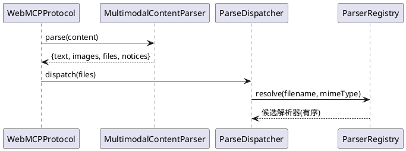
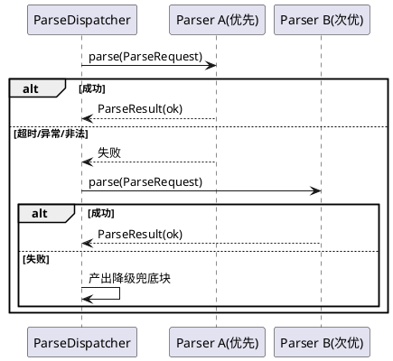

# 子系统需求规格：宿主附件消费内核（`host-attach-core`）

> 主工程：`multimodal-native-chat` ｜ 子系统 `feature_name`：`multimodal-native-chat--host-attach-core`
> 版本：v1 ｜ 日期：2026-10-15 ｜ 阶段：spec
> 上游：主工程 `spec.md` v2 §5.2 / §5.3、主工程 `design.md` v2 §4
> 契约：本目录 `contract.md`（v1，草案）
> 语言标签：cangjie

---

## 1. 组件定位

### 1.1 核心职责

本子系统负责在 runtime 宿主内完成「多类型文档附件的接收、归一化、解析调度与随聊天提交」，并把格式解析本身委托给宿主外插件。

### 1.2 核心输入

1. WebMCP `completion/complete` 请求中的 `content` 块数组（`text` / `image_url` / `file`）。
2. 宿主外解析插件登记的 `ParserDescriptor`。
3. 模型能力声明（`MultimodalCapability`）与请求级模型规格。

### 1.3 核心输出

1. 归一化后的 `Attachment` 列表（文档侧）与 `images` 列表（图片侧）。
2. 解析调度结果：`FilePart` 列表，或降级兜底块。
3. 提交给 `AgentRequest` / `Message` 的多模态载荷（图片直传 + 解析文本并入）。
4. 结构化日志与 `<attachment_notices>` 留痕文本。

### 1.4 职责边界

本子系统**不负责**：

1. **任何文档格式解析实现**（PDF/DOCX/PPTX/XLSX/文本族的字节级解析一律不在本子系统内）。
2. 图片像素级处理（只做形状透传与限流）。
3. 解析插件的实现语言、依赖与打包（插件作者自决）。
4. 插件进程/动态库的生命周期管理（复用 `plugin-system` 既有三轨机制，本子系统只消费注册与调用接口）。
5. 前端交互与门控 UI（归 `web-multimodal`）。
6. 附件元数据落库（归 `attachment-persistence`）。

---

## 2. 领域术语

**附件（Attachment）**
: 宿主归一化后的文档附件值对象，含 `filename` / `mimeType` / `data`(base64 dataURL)。
: 备注：与图片分离——图片不进 Attachment。

**解析调度器（ParseDispatcher）**
: 把 `Attachment` 转成一个或多个 `FilePart` 的宿主侧组件：命中解析器 → 下发 → 超时/失败 → 次优 → 兜底。
: 备注：它**不解析**，只调度。

**解析器注册表（ParserRegistry）**
: 宿主内「格式 → 解析器」装配表，按 MIME/扩展名 + 优先级命中，记录健康与统计。
: 备注：只持有可调用引用，不持有实现。

**降级兜底块（fallback part）**
: 无解析器或全部解析器失败时，由本子系统产出的告知性文本块。
: 备注：必须含文件名、MIME、失败原因分类；不得伪造内容。

**留痕（notice）**
: 附件被丢弃或无法处理时生成的说明文本，经 `<attachment_notices>` 回灌到用户消息。
: 备注：本工程全链路禁止静默丢弃。

---

## 3. 角色与边界

### 3.1 核心角色

- **终端用户**：上传附件并期待 agent 读得到内容。
- **运维/管理员**：安装/启停解析插件、覆盖优先级、查看解析统计。

### 3.2 外部系统

- **前端 tiny-remoter**（上游调用方）：提供 content 块数组。
- **文档解析插件**（下游被调用方）：实现 `DocumentParser` 契约。
- **ChatModel**（下游依赖方）：消费提交的多模态 content 块。
- **`plugin-system` 三轨机制**（同级基础设施）：提供插件注册与调用通道。

### 3.3 交互上下文

```plantuml
@startuml
skinparam rectangle { BackgroundColor #F5F5F5 BorderColor #333333 }
skinparam shadowing false

rectangle "终端用户" as User
rectangle "前端 tiny-remoter" as Fe
rectangle "宿主附件消费内核\n(本子系统)" as Core
rectangle "文档解析插件\n(L2/L3，宿主外)" as Plug
rectangle "plugin-system 三轨机制" as PS
rectangle "ChatModel" as LLM
rectangle "运维/管理员" as Ops

User --> Fe : 上传附件
Fe --> Core : WebMCP content 块数组
Plug --> PS : 注册插件
PS --> Core : 暴露解析器引用
Ops --> Core : 启停 / 优先级覆盖
Core --> Plug : parse(ParseRequest)
Plug --> Core : ParseResult(FilePart[])
Core --> LLM : content 块(image_url + text)
Core --> Fe : 回复 + 留痕
@enduml
```

---

## 4. DFX 约束

### 4.1 性能
1. 单附件解析总耗时上限 **10s**（含插件执行），超时即转降级。
2. 宿主侧调度自身开销 P95 ≤ **200ms**（不含插件执行）。
3. 单附件原始字节 > `maxFileSize`（默认 10MB）时拒绝并留痕，不下发解析。
4. 单附件解析文本累计 > **10 万字符**时截断并追加截断提示。

### 4.2 可靠性
1. 解析器抛错/超时/进程退出/返回非法结构，一律转降级，**不得**让请求失败或宿主退出。
2. 无匹配解析器时产出「未安装可解析该格式的插件」告知块，不得当作空内容。
3. 单插件崩溃不影响宿主与其它插件（L2 轨由宿主异常边界包裹，L3 轨天然隔离）。
4. 纯文本消息路径行为不得改变。

### 4.3 安全性
1. 解析插件只获得「文件名 + MIME + 字节」三要素，不获得会话令牌与 DB 凭据。
2. `ParserDescriptor.capabilities` 声明额外权限（`needs_fs` / `needs_net`）时，安装环节阻断待人工确认。
3. 附件仅在当前会话生命周期内有效，不越权访问其他会话。
4. 大 base64 不落库（落库归 `attachment-persistence`，且只落元数据）。

### 4.4 可维护性
1. 解析结果必须带 `source` 与 `parserId` / `parserVersion`，可溯源。
2. 注册表可被查询：已注册列表 / 命中率 / 失败 Top N / 平均耗时。
3. 降级行为必须记 warn 日志并回灌用户消息。

### 4.5 兼容性
1. 纯字符串 content 行为不变。
2. 图片块形状保持 OpenAI `image_url` 契约不变。
3. `DocumentParser` 契约 minor 演进不得破坏既有插件。
4. 存量抽取器搬迁为插件后，解析结果须与搬迁前等价。

---

## 5. 核心能力

### 5.1 附件接收与归一化

#### 5.1.1 业务规则

1. **入口解析**：必须能从 content 字符串或块数组中解析出 `text` / `image_url` / `file` 三类块
   a. 验收条件：When WebMCP 请求 content 为块数组, the 宿主附件消费内核 shall 解析出 text 拼接、images 列表与 files 列表
2. **纯文本兼容**：content 为纯字符串时行为与改造前完全一致
   a. 验收条件：When content 为纯文本字符串, the 宿主附件消费内核 shall 按历史纯文本链路处理
3. **附件限流**：单条消息图片 ≤ 8 张、单图 base64 ≤ 5MB 字符、单文件 base64 ≤ 20MB 字符
   a. 验收条件：When 附件数量或体积超限, the 宿主附件消费内核 shall 拒绝超限项并写入 notice
4. **只取最后一条 user 消息的附件**
   a. 验收条件：When 多轮对话存在历史附件, the 宿主附件消费内核 shall 仅保留最后一条 user 消息携带的附件
5. **禁止项**：禁止静默丢弃
   a. 验收条件：If 任何附件被丢弃, the 宿主附件消费内核 shall 生成 notice 并回灌用户消息

#### 5.1.2 交互流程



#### 5.1.3 异常场景

1. **content 形态未知**
   a. 触发条件：content 既非字符串也非数组
   b. 系统行为：按历史行为拍平为字符串，不报错
   c. 用户感知：无（兼容路径）
2. **附件 data 为空**
   a. 触发条件：`file` 块的 `data` 为空串
   b. 系统行为：跳过并写 notice
   c. 用户感知：提示「附件 X 内容为空」

### 5.2 解析调度

#### 5.2.1 业务规则

1. **注册表命中**：必须按 MIME → 扩展名 → 优先级 → 健康度顺序命中解析器
   a. 验收条件：When 附件进入调度, the 宿主附件消费内核 shall 命中优先级最高且健康的解析器
2. **逐次降级**：首选失败/超时后必须依次尝试次优解析器
   a. 验收条件：If 首选解析器失败, the 宿主附件消费内核 shall 按优先级依次尝试其余候选, 全部失败后才产出兜底块
3. **超时强制**：单次解析超过 10s 必须中断并换下一个
   a. 验收条件：When 解析超过 10 秒, the 宿主附件消费内核 shall 中断该次调用并转次优或兜底
4. **结果校验**：解析器返回无法反序列化为 `FilePart` 列表的数据时整份判无效
   a. 验收条件：If 解析结果结构非法, the 宿主附件消费内核 shall 判为无效并转兜底块
5. **禁止项**：禁止宿主内置格式解析实现
   a. 验收条件：If 需要解析某格式, the 宿主附件消费内核 shall 经注册表委托宿主外解析器, 不得在本子系统内实现格式解析

#### 5.2.2 交互流程



#### 5.2.3 异常场景

1. **无匹配解析器**
   a. 触发条件：注册表无候选
   b. 系统行为：产出「未安装可解析该格式的插件」兜底块
   c. 用户感知：提示已收到文件但未安装对应插件
2. **解析器进程崩溃（L3）**
   a. 触发条件：IPC 断连或子进程退出
   b. 系统行为：捕获异常、标记不健康、转次优或兜底
   c. 用户感知：提示解析插件异常
3. **L2 解析器抛出宿主内异常**
   a. 触发条件：同进程解析器 panic/抛异常
   b. 系统行为：由宿主异常边界包裹，标记不健康，宿主进程不退出
   c. 用户感知：同上

### 5.3 提交与留痕

#### 5.3.1 业务规则

1. **图片直传**：图片以 `image_url` 块随消息提交，不经解析器
   a. 验收条件：When 存在 image_url 块, the 宿主附件消费内核 shall 直接随消息提交且不下发解析
2. **解析文本并入**：`FilePart` 按 `source` 标注并入 `<uploaded_files>`
   a. 验收条件：When 解析完成, the 宿主附件消费内核 shall 将 FilePart 文本按来源标注并入用户消息
3. **留痕回灌**：notice 以 `<attachment_notices>` 并入用户消息
   a. 验收条件：When 存在丢弃或降级, the 宿主附件消费内核 shall 将 notice 并入用户消息使模型可如实告知
4. **双分支一致**：同步与流式两条分支行为必须一致
   a. 验收条件：When 同一请求分别走同步与流式, the 宿主附件消费内核 shall 产生一致的附件处理与留痕结果

#### 5.3.2 异常场景

1. **解析文本为空**
   a. 触发条件：解析器返回 `status=ok` 但 `parts` 为空
   b. 系统行为：产出「解析器未从该文件读到内容」告知块
   c. 用户感知：明确提示，不留空白

---

## 6. 数据约束

### 6.1 Attachment
1. **filename**：必填。
2. **mimeType**：必填，用于解析器分派。
3. **data**：base64 dataURL，必填。

### 6.2 ParseRequest
1. **filename**：必填。
2. **mimeType**：必填。
3. **bytes**：文档原始字节，必填（宿主剥离 dataURL 前缀后下发）。
4. **limits**：最大字符数与超时毫秒，必填；解析器必须遵守。

### 6.3 ParseResult
1. **status**：`ok` / `empty` / `error`，必填。
2. **parts**：`FilePart` 列表，可为空。
3. **error**：`status=error` 时必填。
4. **parserId** / **parserVersion**：必填，用于溯源。

### 6.4 FilePart
1. **source**：来源标注，必填。
2. **text**：可为空串。
3. **images**：可选页面渲染图（base64）。

### 6.5 ParserDescriptor
1. **parserId**：全局唯一，必填。
2. **formats**：MIME 列表 + 扩展名列表，至少一项非空。
3. **priority**：整数，越大越优先，必填。
4. **track**：`L2` / `L3`，必填。
5. **version**：必填。
6. **capabilities**：额外权限声明，可为空。

---

**文档状态**: spec **v1**（2026-10-15，子系统 spec 步产出）
**下一步**: `contract.md`（冻结）→ `design.md` → `tasks.md` → code → test（L1 + L2）
