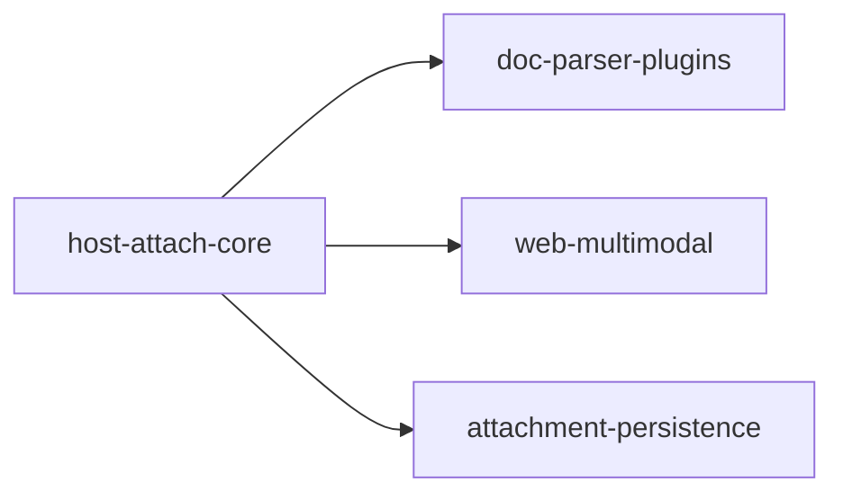

# 主工程子系统 SDD 工程目录（SPECS_INDEX）

> 主工程：`multimodal-native-chat`
> 维护落点：`specs/multimodal-native-chat/SPECS_INDEX.md` —— 主工程目录内唯一权威账本
> 维护人：主工程闸口决策人（每个子系统闸门确认后**必须**回到本表更新一次）
> 铁律依据：**铁律 15**（大工程拆分：颗粒度、可验收、可组合集成、主工程维护子系统目录）
> 配套模板：`subsystem-contract-template.md`（各子系统的集成契约）
> **append-only**：状态不原地覆盖，旧状态按时间记一笔；每次改动在 §8 修订记录留痕。

---

## 1. 工程总览

- **一句话定位**：打通聊天中「图片 / 文档」附件到模型理解回复的端到端链路，**宿主只做附件的接收、消费与随聊天提交，具体文档格式解析全部外置为宿主外 L2/L3 轨插件**。
- **交付面**（能独立上线/独立开关/独立回滚的一块 = 一个候选子系统）：
  1. 宿主附件消费内核（runtime 内，开关：`MULTIMODAL_ATTACH_ENABLED`）
  2. 文档解析插件（可逐个安装/卸载/回滚，不重编不重启宿主）
  3. 前端上传与门控（前端独立发版）
  4. 附件持久化与审计（独立 DDL + 独立管理界面，可独立回滚）
- **总规模**：子系统 N=4 ｜ 覆盖表 2 张（`agent_messages` / `messages`，均为**加列**而非新建，见 §7 RISK 行）｜ 语言标签集合：{cangjie, web}
- **拆分判据与结论**：
  - 什么时候决定拆：2026-10-15，用户在第二轮开发中指出「doc 与 docx 虽同族但解析完全不是一回事，解析应全部外置为技能插件，并复用技能生态」。
  - 命中判据（SKILL.md「大工程拆分」触发判据）：**5 条全中** —— 任务规模（预计 90+ 条 > 40）、语言标签（cangjie + 脚本 + web + SQL ≥ 3）、交付面（4 个 ≥ 3）、上下文预算（解析实现按格式膨胀，单轮不可收敛）、人回路（平台侧与能力侧把关人不同）。
  - 不拆会怎样：① 每新增一种格式都要改宿主源码 + 全量重编（与 `src/app/` 存量冻结红线冲突）；② 解析失败/崩溃直接拖垮宿主进程；③ 无法复用非仓颉生态的成熟解析库；④ 单次 code 步上下文必然触顶。
- **退出准则**：
  1. 全部子系统 `status=done`（或显式 `abandoned` 且有替代方案）
  2. §5 L3 主工程端到端验收（AC1~AC8）通过
  3. 各子系统闸口 `confirm` 齐备（无 `abandon`）
  4. §6 变更影响面登记表无未闭环的破坏性契约变更

## 2. 子系统登记表

| ID | 中文名 | feature_name | 产物目录 | 上游依赖 | 契约摘要 | 标签 | status | 闸口 | 验收档位 | 备注 |
|---|---|---|---|---|---|---|---|---|---|---|
| `host-attach-core` | 宿主附件消费内核 | `multimodal-native-chat--host-attach-core` | `specs/multimodal-native-chat--host-attach-core/` | — | v1 / 9 接口（IF-01a~04g）/ 0 新表 | cangjie | code | 契约已冻结（2026-10-16），code 步待 confirm | L1+L2+L3 | SPI+注册表+调度降级+事件均已落地并接线；剩 T-HAC-10/12/13/14 |
| `doc-parser-plugins` | 文档解析插件轨 | `multimodal-native-chat--doc-parser-plugins` | `specs/multimodal-native-chat--doc-parser-plugins/` | `host-attach-core v1` | v1 / 3 接口 / 0 表 | cangjie + 脚本 | code | 待 confirm | L1+L2+L3 | 存量抽取器已搬迁为 `builtin.*` 参考解析器（L2 轨）；真·外部 L3 插件安装尚未演示 |
| `web-multimodal` | 前端多模态交互 | `multimodal-native-chat--web-multimodal` | `specs/multimodal-native-chat--web-multimodal/` | `host-attach-core v1` | v1 / 3 接口（wire 契约） / 0 表 | web | code | 待 confirm | L1+L2+L3 | P0 已落地（上传/门控/归一化）；留痕呈现待收口 |
| `attachment-persistence` | 附件持久化与审计 | `multimodal-native-chat--attachment-persistence` | `specs/multimodal-native-chat--attachment-persistence/` | `host-attach-core v1` | v1 / 5 接口 / 2 表（加列） | cangjie + web | code | 待 confirm | L1+L2+L3 | DDL(`20261015_attachment_metadata_columns.sql`)+Service+Controller+bridge 接线已完成；事件总线 IF-07a 已有发布但无订阅者（实际走 `AttachmentSummary` 直传落库） |

- `status` 枚举（与 `sdd_projects.current_stage` 对齐，外扩两个）：
  `init` / `research` / `spec` / `design` / `task` / `code` / `test` / `done` / `abandoned` / `blocked`
- `blocked` 必须写清阻塞原因与依赖对象，**不许裸挂**。
- **同步时机**：子系统闸门回执后 ≤ 1 个闸口周期内回主工程更新；跨轮（revise）也要记 `round`。
- **当前阶段说明（2026-10-16 更新）**：四个子系统均已产出 `spec.md` + `contract.md` + `tasks.md`；且**代码实现已先行落地并接线**（cjc 1.1.3 下 `cjpm build` 已于 2026-10-15 通过），故 §2 `status` 由 `spec` 记为 `code`。
  - `host-attach-core` 契约已于 2026-10-16 **冻结**（按已实现代码反推对齐，非事后漂移），T-MAIN-01 闸口解除，下游可按冻结版开发。
  - 各自的 `design.md` **已于 2026-10-16 补齐**（按「实现即现状 + 差距」反推撰写，不另起一套设计）；详见各子系统 `design.md`。
  - **流程偏差登记**：本工程实际是「实现先行、契约后冻结」（实现先于 T-MAIN-01 闸口）。已在 §8 留痕；后续新子系统仍应按「契约冻结 → code」正序执行。

## 3. 集成契约汇总（全局接口表）

| 编号 | 接口/事件 | 提供方 | 消费方 | 方向 | 路径或标识 | 请求 → 响应形态 | 数据契约 | 版本 | 冻结日 | 状态 |
|---|---|---|---|---|---|---|---|---|---|---|
| IF-01 | `DocumentParser.descriptor()` | `doc-parser-plugins` | `host-attach-core` | 单向 | SPI 方法 / L3 `parser.descriptor` | `()` → `ParserDescriptor` | 无表 | v1 | 2026-10-16 | 已冻结 |
| IF-02 | 格式命中（**声明式**：`ParserRegistry.resolve` 经 `formatMatches` 依 `descriptor.formats` 匹配） | `host-attach-core` | `host-attach-core`（调度器） | 单向 | 进程内调用 | `(descriptor.formats, filename, mimeType)` → `Bool`；命中列表按「优先级降序、失败率升序」 | 无表 | v1 | 2026-10-16 | 已冻结（原拟 `DocumentParser.supports()` **未实现**，以声明式命中替代，见 §3 注） |
| IF-03 | `DocumentParser.parse()` | `doc-parser-plugins` | `host-attach-core` | 单向 | SPI 方法 / L3 `parser.parse` | `ParseRequest` → `ParseResult` | 无表 | v1 | 2026-10-16 | 已冻结 |
| IF-04 | `ParserRegistry.register/unregister/resolve/report/list/stats/size` | `host-attach-core` | `doc-parser-plugins`（注册侧）、管理界面（查询侧） | 单向 | 进程内调用 / `host.parser.*` 代理 | 见 `host-attach-core` contract §1 IF-04a~g | 无表 | v1 | 2026-10-16 | 已冻结 |
| IF-05 | WebMCP content 块数组 wire 契约 | `host-attach-core` | `web-multimodal` | 单向 | WebMCP `completion/complete` | `text` / `image_url` / `file` 块 | 无表 | v1 | 2026-10-15 | 已冻结（P0 已落地） |
| IF-06 | `<attachment_notices>` 留痕回灌 | `host-attach-core` | `web-multimodal` | 单向 | 随响应 / 用户消息块 | 文本块 | 无表 | v1 | 2026-10-16 | 已冻结（T-HAC-09 同步+流式双分支已落地） |
| IF-07 | 附件解析摘要事件（`AttachmentParsed`） | `host-attach-core` | `attachment-persistence` | 单向 | 进程内事件 / `host.event` | `{sessionId, messageId, attachmentCount, parseSummary, attachments: AttachmentMeta[]}` | `agent_messages.attachments` / `messages.attachments` | v1 | 2026-10-16 | 已冻结（注：事件已发布，但持久化实际走 `AttachmentSummary` 直传落库，事件为冗余通道） |

- 本表是跨子系统组合集成的**唯一**接口账本；新增/变更一律按铁律 15：「先改契约 → 再改实现」，禁止单边先改。
- 方向**全部单向**（7/7）；出现双向先判为拆得不对，回 §4 找边界。
- 状态：`已冻结` / `演进中(minor)` / `破坏性变更待双侧同轮` / `已废弃`

## 4. 子系统依赖 DAG

- 边方向 = 依赖方向（上游 → 下游）；节点 = 子系统 ID。
- **无回边自检**：拓扑序 A=1，B/C/D=2，编号严格递增 ✓ 无回边。
- 并行策略：`doc-parser-plugins` / `web-multimodal` / `attachment-persistence` 三者无相互依赖，可并行推进；
  `host-attach-core` 进 `code` 步前其契约必须已冻结（下游闸口才放行）。

## 5. 组合集成验收基线

> **各子系统不得只跑自己的单测就报 done** —— L2 是硬档位，不是加分项。

| 档位 | 谁执行 | 在什么样的合并态上跑 | 通过判据 |
|---|---|---|---|
| **L1** 单子系统自测 | 子系统自身 test 步 | 本子系统 | 自身 spec 每条验收条件通过；P0 清零 |
| **L2** 跨子系统集成 | 下游子系统 test 步 | 与**已 done 的上游**合并后的运行态 | 各 contract §6 冒烟用例全绿；跨边界数据一致性校验通过 |
| **L3** 主工程端到端 | 主工程 test 步 / 总装验收 | 全量已 done 子系统在宿主上跑起 | AC1~AC8 全绿 + 权限/行级可见范围复核 |

- **L2 最小冒烟清单**（3 条主干 + 1 条异常）：
  1. 跨 `host-attach-core` → `doc-parser-plugins`：上传 DOCX，注册表命中插件，解析文本带 `[slide N]`/`[p.N]` 并入消息并出现在模型回复依据中。
  2. 跨 `host-attach-core` → `web-multimodal`：上传超限图片，前端显示留痕提示，模型侧收到 `<attachment_notices>`。
  3. 跨 `host-attach-core` → `attachment-persistence`：一轮含附件对话结束后，`attachments` 元数据落库且管理界面可见（不含大 base64）。
  4. **异常**：卸载全部解析插件后上传 PDF —— 宿主不崩溃、产出「未安装可解析该格式的插件」告知块、日志含 parserId 缺失原因。
- **环境/数据前置**：宿主已起 ✓/✗ ｜ DB 迁移已执行 ✓/✗ ｜ 缺什么 → 【人工】
- 任何子系统报 done 时若 L2 未跑，主工程闸口**不予确认**（硬闸）。

## 6. 变更影响面

| 日期 | 变更子系统 | 变更类型 | 影响子系统 | 是否需回归 L2 | 关联任务号 | 登记人 |
|---|---|---|---|---|---|---|
| 2026-10-15 | 主工程 | 契约 major（v1→v2 架构调整：解析外置） | `host-attach-core`、`doc-parser-plugins`、`web-multimodal`、`attachment-persistence` | 是（全部） | 待各子系统 tasks 落号 | 主工程闸口 |

- `契约 major` 的行必须同时满足：双侧同轮完成 + §3 状态改为「待双侧同轮」+ 关闭后回写本行。
- 未登记就改代码 = 契约漂移，在子系统 `test-report.md` 缺陷分级里**升 P0**。

## 7. 风险与已知偏差

| 类型 | 描述 | 影响 | 缓解 | 归属子系统 |
|---|---|---|---|---|
| 契约漂移 | `DocumentParser` 宿主侧与插件侧单边改动 | 解析链路整体失效 | 契约冻结 + 先改契约后改实现 + §6 登记 | 主工程 / 全子系统 |
| 铁律 9（复用优先） | `attachment-persistence` 拟给 `agent_messages` / `messages` 加 `attachments` 列 | 新增列需论证复用不成立 | 在子系统 spec/design 写明：既有列均为标量文本，无法承载「多附件 + 解析摘要」结构化数据，且 `payload` 类字段在本项目两表不存在 ⇒ 复用不成立；仍优先加列而非新建表 | `attachment-persistence` |
| 交付面争抢 | 前端留痕 UX 与宿主留痕数据可能重复实现 | 双份提示、口径不一致 | §3 IF-06 明确宿主产出数据、前端只负责呈现 | `host-attach-core` / `web-multimodal` |
| ~~已知偏差（已解除）~~ | v1 宿主内抽取器 `src/app/services/multimodal/` 待迁出 | — | **2026-10-16 已解除**：该目录已清空，抽取器搬迁至 `src/plugin/multimodal/builtin/`（`pdf_text/office_text/zip_lite/xml_text.cj`）并包装为 `DocumentParser` 实现，以 `builtin.text/pdf/docx/pptx` 注册进 `ParserRegistry` | `doc-parser-plugins` |
| 已知偏差 | 上述 `builtin.*` 参考解析器仍在**宿主源码树**（`src/plugin/`）内，非可独立装卸的外部插件 | 与 v2「解析全部外置」的终态仍有差距：新增格式目前仍需改宿主源码并重编 | 定位为「零依赖场景的首个参考实现」；`doc-parser-plugins` 需演示真实 L2/L3 外部插件安装（AC4/AC5 要实际证据，不接受"设计上支持"） | `doc-parser-plugins` |
| 已知偏差 | IF-07a 事件总线已发布 `AttachmentParsed`，但**无订阅者** | 事件通道闲置，易误以为持久化靠它 | 持久化实际走 `AttachmentSummary` 随 `AgentRequest` 透传 → `agent_persistence_event_handler` 落库；二选一收口（建议保留直传、事件留给前端留痕） | `attachment-persistence` / `host-attach-core` |
| 已知偏差 | 图片链路已落地但 `attachment-persistence` 未覆盖图片元数据 | 图片不落库 | S5 阶段覆盖；P2 优先级 | `attachment-persistence` |

## 8. 修订记录

| 日期 | 版本 | 触发来源 | 改动摘要 | 影响面 | 主工程闸口 |
|---|---|---|---|---|---|
| 2026-10-15 | v1.0 | 用户第二轮反馈（解析应外置 + 复用技能生态） | 拆分决策：命中 5 条判据，拆出 4 个子系统；边界依据 = 交付面（解析插件可独立装卸）→ 语言标签 → 数据/领域；旧 `sdd.md` 归档为 `archive/sdd-v1-legacy.md`；`spec.md` / `design.md` 升 v2（架构调整版） | 全子系统 | 待 confirm |
| 2026-10-16 | v1.1 | runtime `cjpm build` 通过（cjc 1.1.3）+ 进度盘点 | ① §2 四子系统 `status` spec→code（代码已落地接线）；② §3 IF-01/02/03/04/06/07 草案→**已冻结**（2026-10-16）；③ **IF-02 口径修正**：`DocumentParser` 无 `supports()`，改为 `ParserRegistry` 依 `descriptor.formats` 声明式命中；④ IF-04 增 `stats`/`size`；⑤ §7 解除「v1 抽取器待迁出」偏差、新增「builtin 参考实现仍在宿主源码树」「IF-07a 无订阅者」两条偏差；⑥ 登记流程偏差：实现先于契约冻结 | 全子系统（下游按冻结版开发） | 契约已冻结，code 步待 confirm |
| 2026-10-16 | v1.2 | T-MAIN-03 收口 | ① T-MAIN-03 置 `[x]`：4 个子系统 `design.md` 全部补齐（按「实现即现状 + 差距」反推）；② §2 现状说明更新（design 已产出）；③ 关键澄清——`attachment-persistence` 实际落库走 `AttachmentSummary` 直传写 `agent_messages.attachments` JSON 列，而非订阅 IF-07a 事件（事件无订阅者）；且 `attachments` 通用 COS 上传表与本子系统无关 | 全子系统 | design 步收口，剩余验证侧（L2/L3）待 runtime 运行 |

---

> 配套：各子系统另有 `spec.md` / `design.md` / `tasks.md` / `contract.md` / `code-summary.md` / `test-report.md`；
> 本文件只做**目录与集成口径**，不重复子系统内部设计（铁律 15「主工程不重复实现子系统内部细节」）。
