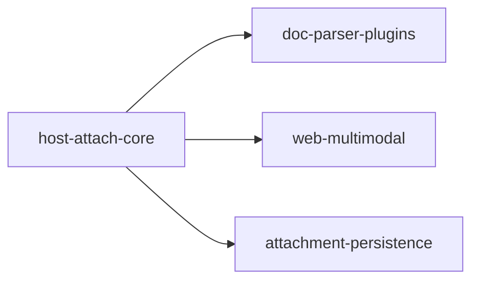

# Agent 聊天原生多模态支持 技术设计文档（主工程）

> **工程目录**: `apps/agentskills-runtime/specs/multimodal-native-chat/`
> **版本**: v2（2026-10-15，**架构调整版**）
> **上游文档**: `spec.md` v2、`problem-analysis.md`、`research-opentiny-official.md`、`research-doc-parser-ecosystem.md`
> **技术栈**: 后端 Cangjie + cjpm + fountain（`apps/agentskills-runtime/src/`）；前端 Vue3 + TypeScript + OpenTiny/tiny-remoter（`apps/web-admin`）；解析插件 L2 动态库轨 / L3 进程隔离轨（cordis-cj）
> **设计定位**: 本文件是**主工程**设计，只做三件事——① 总体架构与端到端数据流；② 子系统拆分决策与边界；③ 跨子系统的接口约定与验收基线。**各子系统内部实现细节不在这里展开**，见 `specs/multimodal-native-chat--{子系统ID}/design.md`。

---

# 一、设计概述

## 1.1 设计目标

- **DG1** 打通「图片上传 → agent 看图回复」端到端链路（P0，已落地待联调，架构不变）。
- **DG2** 打通「文档上传 → agent 读内容回复」链路，但**解析能力不落在宿主体内**：宿主只做接收、归一化、调度、提交。
- **DG3**（v2 核心）把「多格式文档解析」从宿主剥离为**宿主外插件能力**（L2/L3 轨），使新增/替换一种格式的解析**无需改动与重编宿主**，并可直接复用智能体技能市场既有实现。
- **DG4** 多模态消息与既有技能注入、`profile_context` 注入并行共存；纯文本链路行为不变。
- **DG5** 上传 UI 受模型能力门控，并对齐 OpenTiny 官方 OpenAI 兼容内容块契约。

## 1.2 为什么必须做这次架构调整（设计动因）

| 观察 | 证据 | 推论 |
|---|---|---|
| 同族格式解析完全不是一回事 | `.doc` 是 OLE 复合文档、`.docx` 是 ZIP+OOXML+deflate；`.ppt` 与 `.pptx` 同理 | 用「一套抽取器」覆盖「一族格式」的假设不成立，格式维度会无限膨胀 |
| 宿主内自研解析成本失控 | v1 为覆盖 PDF/DOCX/PPTX 已新增 `pdf_text.cj` / `office_text.cj` / `zip_lite.cj` / `xml_text.cj` 四个文件、千余行字节级代码，且 CID 编码中文 PDF 仍读不准 | 每新增一种格式都要改宿主源码 + 全量重编宿主，边际成本不收敛 |
| 解析是"重依赖、易出错、可独立"的能力 | PDF 需要 CMap/ToUnicode、DOCX 需要 ZIP、XLSX 又是另一套 OOXML | 天然适合进程隔离（崩溃不影响宿主），天然适合用成熟生态库实现 |
| 生态里已有大量成熟实现 | Python 侧 `pdfplumber` / `python-docx` / `python-pptx` / `markitdown`，以及技能市场既有解析技能 | L3 进程隔离轨允许非仓颉实现 ⇒ **不必全部自研** |
| 宿主是存量冻结面 | 项目红线：`src/app/` 只减不增，功能拓展优先做成插件 | 把解析留在宿主体内与工程红线相悖 |

**结论**：宿主保留的是**稳定的契约与调度**（变化频率低），把**不稳定的格式实现**（变化频率高、依赖重、故障面大）推到宿主外。这是典型的「稳定依赖倒置」切分。

## 1.3 设计原则

1. **宿主只做消费侧**：接收 → 归一化 → 调度 → 提交 → 留痕。宿主内**不得**出现任何按文件魔数/格式分支的解析代码。
2. **图片是通道能力，不是解析能力**：图片以 dataURL 直传 `image_url` 块，无解析过程，故继续留在宿主内（这是"保持 runtime 内沿用"的依据，不是例外）。
3. **契约先行、实现后补**：`DocumentParser` SPI 与 `ParserDescriptor` 在开工前冻结；插件按契约实现，宿主按契约调度。
4. **装配可插拔**：插件安装/卸载不触发宿主重编与重启；注册表是唯一装配点。
5. **失败可感知、永不静默**：无解析器、解析失败、附件超限一律产出告知块并回灌用户消息（针对历史 bug「非图片附件被无声丢弃」）。
6. **复用优先于自研**：解析能力优先复用技能市场/成熟生态；v1 自研抽取器降级为"首个参考实现插件"，不是唯一实现。
7. **存量冻结**：宿主新增代码只落 `src/plugin/` 与必要的 `core` 值对象扩展；`src/app/` 不新增模块。

## 1.4 技术选型

| 组件 | 技术选型 | 说明 |
|---|---|---|
| 运行时代码 | Cangjie（.cj）+ cjpm + fountain | 宿主消费侧、SPI、注册表 |
| 前端框架 | Vue3 + TypeScript + OpenTiny/tiny-remoter | SDK 为本地 vendored `@opentiny/{next-remoter,next-sdk}` |
| 内容块契约 | OpenAI 兼容 content 块数组 | `text` / `image_url` / `file` 三类 |
| 解析插件 L2 轨 | 预编译动态库 + `PackageInfo.load` 热加载 | 同进程，零 IPC，适合仓颉实现的轻量解析器 |
| 解析插件 L3 轨 | cordis-cj 子进程 + stdio/jsonrpc | 跨语言、故障隔离、可用 Python/Node 生态 |
| 技能适配 | `SkillAdapter` 包装 agentskills 标准技能 | 复用技能市场既有实现，无需改写其实现 |
| 图片序列化 | 各 `ChatModel.messageList2Json` | `openai`/`tokendance`/`stepfun` 同构；`ollama` 独立 `images` 数组 |

## 1.5 设计范围与非目标

**范围内**：图片链路收口；文档附件的接收/调度/提交；`DocumentParser` SPI 与注册表；解析插件轨的接入与装配；能力门控；降级与留痕；子系统拆分与集成契约。

**非目标**：不做独立文件管理/知识库；不训练/微调模型；不强制 provider 支持原生文件块；**不在宿主内实现任何文档格式解析**；不重构 tiny-remoter 为 `GenuiChat`；不重复设计各子系统内部实现（见各自 `design.md`）。

---

# 二、需求与存量功能关系分析

> 匹配度口径：100%=可直接复用；75%=核心已有需小改；50%=骨架已有需较大改造；25%=仅占位；0%=需新建。

## 2.1 存量资产盘点（按新架构重新定性）

| 存量资产 | 原定位 | v2 定性 | 处置 |
|---|---|---|---|
| `MultimodalContentParser` | 入口多模态解析 | **保留在宿主**（纯协议解析，不是格式解析） | 沿用并加固限流/留痕 |
| `Attachment` / `FilePart` / `Message.images` / `AgentRequest.files` | 领域值对象 | **保留在宿主**（跨子系统共享契约） | 保留，随契约演进 |
| `ChatModel.messageList2Json` 多图 + 文本块序列化 | 模型序列化 | **保留在宿主** | 保留 |
| 图片链路（前端 + 序列化 + 执行器消费） | P0 主链路 | **保留在宿主** | 沿用 |
| `document_ingestion.cj`（分发器） | 宿主内抽取入口 | **改造为调度器**（保留分发骨架，去掉抽取实现） | 重构 |
| `pdf_text.cj` / `office_text.cj` / `zip_lite.cj` / `xml_text.cj` | 宿主内抽取实现 | **迁出宿主**，作为 `--doc-parser-plugins` 首个参考实现 | 搬迁 |
| `WebMCPProtocol` 双分支接入 | 入口 | **保留** | 沿用 |
| 前端 `normalizeContentForWebMCP` / `convertAttachmentsToContent` / 门控 | 前端 | **保留** | 沿用 |
| `plugin-system` 三轨机制（sync/dylib/process） | 插件底座 | **直接复用**，解析插件不做第四套机制 | 复用 |
| `plugingen` | 插件脚手架 | **复用**，新增解析器插件用它生成骨架 | 复用 |

## 2.2 需要新增的能力

| 能力 | 归属子系统 | 说明 |
|---|---|---|
| `DocumentParser` SPI（进程内接口 + L3 RPC 双形态） | `host-attach-core` | 宿主定义、插件实现 |
| `ParserRegistry`（注册/发现/优先级/健康/统计） | `host-attach-core` | 唯一装配点 |
| 解析调度器（命中 → 下发 → 超时 → 次优 → 兜底） | `host-attach-core` | 取代 v1 的 `DocumentIngestion.ingest` 实现体 |
| 解析插件（PDF / DOCX / PPTX / XLSX / 文本族 …） | `doc-parser-plugins` | L2 或 L3 轨，语言自决 |
| `SkillAdapter`（标准技能 → `DocumentParser`） | `doc-parser-plugins` | 复用生态 |
| 前端上传/门控/丢弃留痕 UX | `web-multimodal` | 沿用已落地改造并补齐 |
| 附件元数据持久化与管理界面 | `attachment-persistence` | P2，独立交付面 |

---

# 三、总体架构

## 3.1 分层架构（v2）

```
┌──────────────────────────────────────────────────────────────┐
│  前端 web-admin / tiny-remoter（子系统 web-multimodal）        │
│  上传 UI · 能力门控 · AI-SDK 形状 → WebMCP 形状归一化 · 留痕 UX │
└───────────────────────────┬──────────────────────────────────┘
                            │ WebMCP completion/complete（content 块数组）
┌───────────────────────────▼──────────────────────────────────┐
│  runtime 宿主消费侧（子系统 host-attach-core）                 │
│  ┌────────────┐ ┌──────────────┐ ┌────────────────────────┐  │
│  │ 入口解析    │→│ 附件归一化/限流│→│ 解析调度器              │  │
│  │(协议层,不是 │ │ (Attachment) │ │ 命中→下发→超时→次优→兜底 │  │
│  │ 格式解析)   │ └──────────────┘ └───────────┬────────────┘  │
│  └────────────┘                               │                │
│  ┌───────────────────────────────────────────┐│                │
│  │ ParserRegistry（注册/发现/优先级/健康/统计）││                │
│  └───────────────────────────────────────────┘│                │
│  ┌───────────────────────────────────────────┐│                │
│  │ 提交层：图片 image_url 直传 + 文本块并入     ││                │
│  └───────────────────────────────────────────┘│                │
└───────────────────────────────────────────────┼────────────────┘
                                                │ DocumentParser 契约
                        ┌───────────────────────┴───────────────┐
                        │  宿主外解析插件（子系统 doc-parser-plugins）│
                        │  L2 动态库轨（同进程） / L3 进程隔离轨     │
                        │  PDF · DOCX · PPTX · XLSX · 文本族 · …   │
                        │  SkillAdapter：标准技能 → DocumentParser  │
                        └─────────────────────────────────────────┘
```

**依赖方向（严格单向）**：宿主 → 契约 → 插件实现。宿主**不 import** 任何插件代码；插件**不 import** 宿主私有模块（只经契约与宿主服务代理）。

## 3.2 端到端数据流

```
[用户] 在 tiny-remoter 选中 图片 / 文档
   │  TrUploadButton(@select) → 门控 hasMultimodalSupport + accept
   ▼
[前端] convertAttachmentsToContent
   │  图片 → {type:'image', image:dataURL, filename}       （AI-SDK 形状，保持不变）
   │  文档 → {type:'file-pending', filename, mimeType, data}（不要求前端知道格式怎么办）
   ▼
[前端] handleSendMessage → engine.send({role:'user', content:[text块, ...附件块]})
   ▼
[前端 SDK] normalizeContentForWebMCP（WebMCP 边界唯一形状转换点）
   │  图片 → {type:'image_url', filename, image_url:{url}}
   │  文档 → {type:'file', file:{filename, mimeType, data}}
   ▼
[宿主] MultimodalContentParser.parse(content)
   │  text 累积 · images 收集（限流：≤8 张 / 单张 ≤5MB base64）
   │  files 收集（限流：单文件 ≤20MB base64）· 超限写 notices
   ▼
[宿主] 入口双分支（同步 / 流式）保持一致：只取最后一条 user 消息的附件
   ▼
[宿主] 图片：直接随 AgentRequest.images 下行（不解析、不过解析器）
[宿主] 文档：解析调度器
   │  ① 查 ParserRegistry：按 mimeType → 扩展名 → 优先级，取健康候选列表
   │  ② 依次下发 ParseRequest(filename, mimeType, bytes, limits)
   │  ③ 超时 10s / 异常 → 换次优；全部失败 → 降级兜底块
   │  ④ 收齐 FilePart → 按 source 标注并入 <uploaded_files>
   ▼
[宿主] userMessage = 原文本 + <uploaded_files> + <attachment_notices>
   ▼
[宿主] Message.user(text, images, fileParts) → ChatModel.messageList2Json
   ▼
[LLM] image_url 块 + text 块 → 推理回复
```

## 3.3 图片与文档的分界线（架构关键）

| 维度 | 图片 | 文档 |
|---|---|---|
| 是否需解析 | 否，像素数据由模型侧视觉编码器处理 | 是，必须先转成文本 |
| 宿主内动作 | 限流 + 形状透传 | 调度 + 兜底 |
| 实现落点 | **宿主内**（不变） | **宿主外插件** |
| 失败形态 | dataURL 非法 → 丢弃并留痕 | 无解析器/超时/报错 → 告知块 |

这条分界线是本架构唯一保留在宿主内的"内容处理"，理由是它**不产生新的格式依赖**，属于通道能力。

---

# 四、核心契约（跨子系统唯一权威）

> 契约全文与各子系统条目见各子系统 `contract.md`，主工程汇总见 `SPECS_INDEX.md` §3。

## 4.1 `DocumentParser` SPI（宿主定义，插件实现）

```
// 进程内形态（L2 轨）
public interface DocumentParser {
    func descriptor(): ParserDescriptor          // 格式/优先级/轨别/版本/权限声明
    func supports(filename: String, mimeType: String): Bool
    func parse(request: ParseRequest): ParseResult
}

// 跨进程形态（L3 轨）：同名方法经 stdio/jsonrpc IPC 暴露，
// 载荷为 JSON：{ filename, mimeType, bytes(base64), limits }
// 响应：{ status, parts:[{source,text,images}], error, parserId, parserVersion }
```

**硬约束**：
- 解析器**无状态**（同一输入可重复调用，结果幂等）；
- 解析器**不得**访问会话上下文、DB、宿主私有表；需要宿主能力时经 `host.*` 服务代理；
- L3 轨插件 **stdout 是 RPC 独占通道**，日志走 stderr；
- `limits` 由宿主统一下发（最大字符数、超时），解析器必须遵守并自行截断。

## 4.2 `ParserRegistry`（宿主提供）

| 接口 | 语义 |
|---|---|
| `register(descriptor, handle)` | 插件注册；同 `parserId` 重复注册按版本覆盖 |
| `unregister(parserId)` | 卸载 |
| `resolve(filename, mimeType): Array<ParserHandle>` | 按优先级返回健康候选有序列表 |
| `report(parserId, ok, costMs)` | 回写健康度与统计 |
| `list(): Array<ParserDescriptor>` | 可被运维/管理界面查询 |

命中顺序：`mimeType` 精确匹配 → 扩展名匹配 → 优先级降序 → 健康者优先 → 同优先级按 `parserId` 字典序稳定裁决。

## 4.3 降级链条（宿主保证）

```
有候选解析器？ ─否─→ 「未安装可解析该格式的插件」告知块
      │是
   逐个尝试（超时 10s / 异常 → 下一个）
      │全部失败
   「解析失败/超时」告知块 + 日志（含 parserId、错误、耗时）
```

告知块必须包含：文件名、MIME、失败原因分类；**不得**伪造内容。

---

# 五、子系统拆分决策

## 5.1 命中判据（铁律 15）

| 判据 | 阈值 | 本工程情况 |
|---|---|---|
| 任务规模 | 单工程 tasks > 40 条 | 预计 90+ 条（4 个交付面 × 各 15~25 条）→ **命中** |
| 语言/技术栈 | ≥3 条语言标签 | cangjie（宿主）+ cangjie/脚本（插件）+ web（前端）+ SQL/DDL（持久化）→ **命中** |
| 交付面 | ≥3 个可独立上线/开关/回滚边界 | 宿主内核 / 解析插件 / 前端 / 持久化，各自可独立开关回滚 → **命中** |
| 上下文预算 | code 步两轮内跑不完 | 解析实现按格式膨胀，单轮不可收敛 → **命中** |
| 人回路 | ≥2 个独立把关人 | 宿主（平台侧）与解析插件（能力侧）把关人不同 → **命中** |

## 5.2 切分维度（按优先级）

1. **交付面优先**：解析插件可独立安装/卸载/回滚 ⇒ 必须与宿主内核切开（这是本次调整的第一诉求）。
2. **技术栈边界**：前端 web 与宿主 cangjie 天然分离。
3. **数据/领域边界**：附件持久化涉及新表/列与五层 CRUD，独立成面。
4. **不按文件目录切、不按格式个数平均分**（PDF/DOCX/PPTX 解析同属一个子系统，因为它们共享同一套插件机制与契约）。

## 5.3 子系统清单

| ID | 中文名 | feature_name | 标签 | 职责一句话 |
|---|---|---|---|---|
| `host-attach-core` | 宿主附件消费内核 | `multimodal-native-chat--host-attach-core` | cangjie | 接收 + 归一化 + 调度 + 提交 + 留痕 + 兜底，定义 `DocumentParser` SPI 与注册表 |
| `doc-parser-plugins` | 文档解析插件轨 | `multimodal-native-chat--doc-parser-plugins` | cangjie / 脚本 | 各格式解析器插件（L2/L3）+ 技能适配器 + 存量抽取器搬迁 |
| `web-multimodal` | 前端多模态交互 | `multimodal-native-chat--web-multimodal` | web | 上传 UI、能力门控、形状归一化、丢弃留痕 UX |
| `attachment-persistence` | 附件持久化与审计 | `multimodal-native-chat--attachment-persistence` | cangjie + web | 附件元数据落库、增量 DDL、五层 CRUD、管理界面、回放 |

颗粒度自检：每个子系统均 ≥3 条可独立验收任务、tasks ≤40 条、一级子系统 4 个（≤6）、双向接口 0 个（全部单向）。

## 5.4 依赖 DAG



- 边方向 = 依赖方向（上游 → 下游）。
- `host-attach-core` 是所有下游的契约来源，必须先冻结契约再开工。
- `doc-parser-plugins` / `web-multimodal` / `attachment-persistence` 三者之间**无依赖**，可并行。
- 无回边自检：拓扑序 A=1，B/C/D=2，编号严格递增 ✓。

---

# 六、分阶段实施

| 阶段 | 内容 | 涉及子系统 | 出口条件 |
|---|---|---|---|
| **S0 契约冻结** | `DocumentParser` / `ParseRequest` / `ParseResult` / `ParserDescriptor` / `FilePart` 契约定稿并落各 `contract.md` | 主工程 + 全子系统 | 主工程闸口 confirm |
| **S1 宿主内核** | 调度器 + 注册表 + 降级链 + 留痕；移除宿主内抽取实现 | `host-attach-core` | L1 通过 |
| **S2 首个解析插件** | 存量抽取器搬迁为 L2 插件（PDF/DOCX/PPTX/文本族），解析结果与搬迁前等价 | `doc-parser-plugins` | L1 + L2（与 S1 合并态） |
| **S3 前端收口** | 门控/归一化/留痕 UX 补齐，与宿主契约对齐 | `web-multimodal` | L1 + L2 |
| **S4 生态扩展** | `SkillAdapter` 接入技能市场既有实现；L3 轨承载非仓颉生态解析器 | `doc-parser-plugins` | L1 |
| **S5 持久化** | 附件元数据落库 + 管理界面 + 权限登记 | `attachment-persistence` | L1 + L2 |
| **S6 总装** | 主工程 L3 端到端验收（AC1~AC7） | 主工程 | 全绿 |

**并行策略**：S2 / S3 / S5 可并行；S4 依赖 S2；S6 依赖全部。

---

# 七、风险与对策

| 编号 | 风险 | 影响 | 对策 | 归属 |
|---|---|---|---|---|
| RISK-A1 | 契约漂移（宿主与插件单边改） | 解析链路整体失效 | 契约冻结 + 先改契约后改实现；major 双侧同轮；SPECS_INDEX §6 登记 | 主工程 |
| RISK-A2 | L3 轨 IPC 开销与超时 | 大文档解析拖慢会话 | 10s 超时 + 次优解析器 + L2 轨承载轻量解析；宿主侧限流先行 | `doc-parser-plugins` |
| RISK-A3 | 插件权限滥用（落盘/外网） | 安全面扩大 | `ParserDescriptor.capabilities` 显式声明 + 安装时人工确认 + 默认最小权限 | `host-attach-core` |
| RISK-A4 | 存量抽取器搬迁引入回归 | AC3 解析质量下降 | fixtures 集 + 搬迁前后等价校验（文本块划分与 source 一致） | `doc-parser-plugins` |
| RISK-A5 | 无解析器时用户体验差 | 用户以为传了但没读到 | 兜底块必须含「未安装插件」语义与安装指引；前端明示 | `host-attach-core` + `web-multimodal` |
| RISK-A6 | 持久化新增列未论证复用 | 违反铁律 9 | 先在 spec/design 写明复用不成立理由；优先复用 `payload` 类 JSON 字段 | `attachment-persistence` |
| RISK-A7 | 多解析器优先级冲突 | 命中不稳定 | 同优先级按 parserId 字典序稳定裁决 + warn 日志 + 允许管理员覆盖 | `host-attach-core` |
| RISK-A8 | 图片链路被误迁出 | P0 已落地能力受损 | 架构文档明确「图片不经解析器」；验收清单加一条反向用例 | 主工程 |

---

# 八、验收标准（主工程 L3 端到端）

| 编号 | 验收项 | 判据 |
|---|---|---|
| **AC1** | 图片上传端到端 | 选中 vision 模型 → 上传图片 → agent 基于图片回复 |
| **AC2** | 多图与并行共存 | 多图 + 技能注入 + profile_context 同轮，三者互不覆盖 |
| **AC3** | 文档上传端到端 | 上传 DOCX/PPTX/PDF → agent 引用文档具体内容作答（含 `source` 出处） |
| **AC4** | 解析能力外置 | 新增一种格式解析**不需要改动宿主源码、不需要重编宿主**；卸载插件后宿主正常降级 |
| **AC5** | 生态复用 | 至少一个来自技能市场/非仓颉生态的解析器经适配器或 L3 轨接入并可用 |
| **AC6** | 契约一致 | 图片块形状与 OpenTiny 官方 OpenAI 兼容契约一致（`image_url` + `filename`） |
| **AC7** | 不静默丢弃 | 任何附件被丢弃/无法解析时，模型侧与用户侧都能看到明确说明 |
| **AC8** | 纯文本不回归 | 纯文本消息链路行为与改造前完全一致 |

---

# 附录 A 参考文档

- `spec.md` v2 —— 需求规格
- `problem-analysis.md` —— 现状与断点
- `research-opentiny-official.md` —— OpenTiny 官方契约
- `research-doc-parser-ecosystem.md` —— 解析生态与技能市场
- `SPECS_INDEX.md` —— 子系统目录与集成契约汇总
- `docs/ref/cangjie-plugin-system-feasibility.md` —— 三轨机制（sync / dylib / process）可行性
- `archive/sdd-v1-legacy.md` —— v1 合并版设计存档

# 附录 B 变更历史

| 版本 | 日期 | 变更说明 |
|---|---|---|
| v1 | 2026-10-15 | 初版：图片 + 文档端到端打通，文档解析自研落在宿主内 |
| v2 | 2026-10-15 | **架构调整**：文档解析全部外置到 L2/L3 插件轨，宿主只做接收/消费/提交；图片链路保持不变；拆分为 4 个子系统 SDD 工程；旧 `sdd.md` 归档为 `archive/sdd-v1-legacy.md` |
