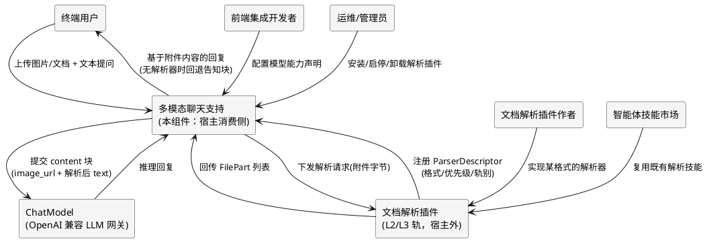
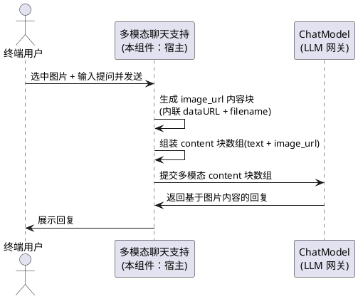
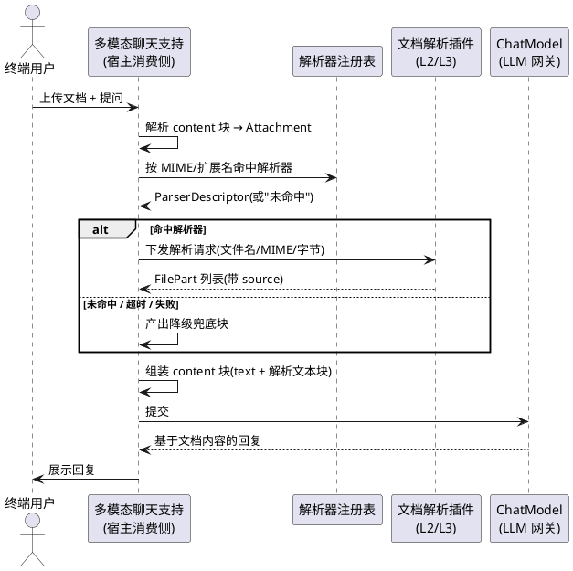
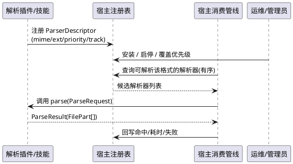
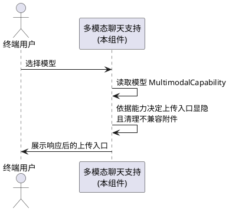
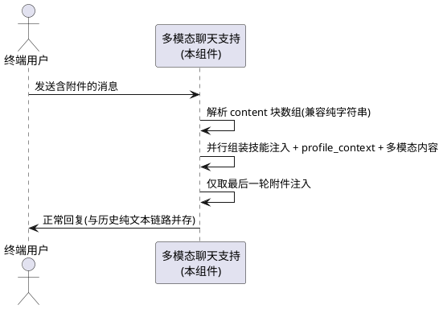

# Agent 聊天原生多模态支持需求规格

> **工程目录**: `apps/agentskills-runtime/specs/multimodal-native-chat/`
> **版本**: v2（2026-10-15，**架构调整版**）
> **上游文档**: `problem-analysis.md`（现状调研与断点 B1/B2/B3 + 新增断点 B4）、`research-opentiny-official.md`（OpenTiny 官方多模态契约）、`research-doc-parser-ecosystem.md`（文档解析生态与技能市场复用调研）、`tasks.md`（P0 已落地待联调）
> **适用范围**: 本文件是**主工程**级需求规格，覆盖整体目标、端到端验收与子系统边界划分；各子系统内部需求见 `specs/multimodal-native-chat--{子系统ID}/spec.md`，集成契约见同目录 `contract.md`，目录账本见 `SPECS_INDEX.md`。
> **v1 → v2 架构调整（本版核心变更）**：
> 1. **文档解析能力全部外置**：宿主（runtime）只保留「多类型文档附件的**接收、消费、随聊天提交**」，具体格式解析（PDF/DOCX/PPTX/XLSX/文本族…）一律以 **L2 动态库轨 / L3 进程隔离轨插件**形态在宿主外实现。
> 2. **图片链路保持在宿主内**：图片是**通道能力**（dataURL 直传 `image_url` 块，无解析过程），不涉及格式解析，继续沿用 runtime 内已实现链路。
> 3. **解析生态可复用**：解析器不要求全部自研，允许复用智能体技能市场既有实现（Python/Node 生态的成熟库亦可，由 L3 进程隔离轨承载），宿主侧通过 `DocumentParser` SPI + 注册表装配。
> 4. v1 中已落地的宿主内抽取器（`document_ingestion.cj` / `pdf_text.cj` / `office_text.cj` / `zip_lite.cj` / `xml_text.cj`）**不再作为宿主内置能力**，搬迁到 `--doc-parser-plugins` 子系统作为首个参考实现，宿主侧只留调度 + 兜底。

---

# **1. 组件定位**

## **1.1 核心职责**

本组件负责打通聊天中「图片 / 文档」附件上传到模型理解回复的端到端链路：**宿主负责附件接收、归一化、调度与提交，文档格式解析由宿主外插件提供**。

## **1.2 核心输入**

1. **用户上传的图片附件**：来源为前端 tiny-remoter 聊天组件的上传选择，内容为内联 base64 dataURL 的图片文件。
2. **用户上传的文档附件**：来源为前端聊天组件的上传选择，内容为 PDF / DOCX / PPTX / XLSX / 文本族等文档的内联 base64 dataURL。
3. **用户输入的文本消息**：来源为用户在聊天框输入的文字提问，可与附件同一条消息提交。
4. **选中模型的能力声明**：来源为前端选中的模型配置（`MultimodalCapability`），含 `supportImages` / `maxFileSize` / `supportedMimeTypes`，用于决定上传入口可见性。
5. **文档解析器注册声明**：来源为宿主外插件（L2/L3 轨）启动时向注册表登记的 `ParserDescriptor`（格式标识、MIME/扩展名、优先级、轨别、健康状态）。

## **1.3 核心输出**

1. **基于附件的 agent 回复**：返回给用户，内容基于上传的图片或文档内容生成（流式与非流式均可）。
2. **发送给模型的上下文消息**：以 OpenAI 兼容的多模态内容块数组（`text` / `image_url` / 解析后的文本）提交给模型。
3. **解析降级提示**：当文档无可用解析器或解析失败时，返回告知「文件已收到但内容读不到」的文本提示块，不中断对话。
4. **解析装配可观测数据**：解析器命中/未命中、耗时、失败原因、被丢弃附件及原因，以结构化日志与（P2）落库字段输出。

## **1.4 职责边界**

本组件**不负责**以下事项（这是 v2 架构调整的硬边界）：

1. **不内置任何文档格式解析器**——PDF/DOCX/PPTX/XLSX/文本族的具体解析全部由宿主外插件提供；宿主内唯一保留的"兜底"不是解析器，而是「无解析器可用时产出告知块」的降级策略。
2. 独立文件管理 / 知识库系统（仅处理随聊天即时上传、随会话生命周期存在的临时附件）。
3. 多模态模型的训练或微调（仅做通道 + 协议 + 装配的打通）。
4. 强制所有 provider 支持原生文件块（本工程统一由宿主外解析插件把文档转成文本/图像块后再提交，不依赖 provider 自身的文件块能力，因而对 provider 透明）。
5. 将 tiny-remoter 聊天组件重构或替换为 GenUI SDK 的 `GenuiChat`（仅对齐其多模态 wire 契约）。
6. 解析插件内部的语言/生态选型与实现（插件作者自决，宿主只约束 SPI 与契约）。
7. 解析器进程/动态库的生命周期管理细节（归 `plugin-system` 既有三轨机制，本组件只消费其注册与调用接口）。

---

# **2. 领域术语**

**多模态内容块（content block）**
: 一条聊天消息 `content` 的组成单元，类型限定为 `text`、`image_url`、`file` 三种。
: 备注：消息的 `content` 既可是纯文本字符串（兼容旧链路），也可是内容块数组。

**image_url 块**
: 表示一张图片的内容块，形状为 `{ type:"image_url", filename, image_url:{ url } }`，`url` 为内联 base64 dataURL。
: 备注：图片走**通道直传**，宿主不做像素级解析。

**file 块**
: 表示一份文档附件的内容块，形状为 `{ type:"file", file:{ filename, mimeType, data } }`，`data` 为内联 base64 dataURL。
: 备注：官方文档契约之外的自研扩展；宿主接收后**必须**经解析器转为文本块再提交，不把原始 dataURL 塞给模型。

**文档解析器（DocumentParser）**
: 把一份文档附件转换为若干「带来源标注的文本块」的**宿主外**能力单元，是宿主定义的 SPI 契约，由插件实现。
: 备注：别名「解析器」；与 v1 宿主内 `DocumentIngestion` 的区别是——v2 宿主只做**调度**，不做**抽取**。

**解析器注册表（ParserRegistry）**
: 宿主内维护的「格式标识 → 解析器」装配表，按 MIME/扩展名 + 优先级命中，并记录解析器健康状态。
: 备注：注册表不持有解析实现，只持有可调用引用（进程内函数 / L2 符号 / L3 RPC 端点）。

**解析轨（parser track）**
: 解析器插件在宿主中的承载形态，取 `L2 动态库轨`（预编译动态库热加载）或 `L3 进程隔离轨`（子进程 + stdio/jsonrpc IPC）二者之一。
: 备注：L3 轨允许解析器使用 Python/Node 等其它语言生态实现，是复用外部成熟解析库的关键前提。

**技能适配器（SkillAdapter）**
: 把 agentskills 标准技能（含 `SKILL.md` + 脚本）包装成 `DocumentParser` 契约实现的适配层。
: 备注：用于直接复用技能市场既有文档解析技能，无需改写其实现。

**解析结果块（FilePart）**
: 解析器输出的最小交付单元，含 `source`（来源标注，如 `[PDF p.3]`）、`text`、`images`（可选页面渲染图）。

**降级兜底块（fallback part）**
: 无解析器命中或解析失败时，由**宿主**产出的告知性文本块，说明「文件已收到但内容读不到」。
: 备注：这是宿主侧唯一允许自己生成的"内容"，且必须是告知性而非伪造内容。

**模型能力门控**
: 根据选中模型声明的多模态能力决定上传入口显隐与可传附件类型的机制。

**形状归一化**
: 将前端 SDK 内部的 AI-SDK 形状图片块（`{type:"image",image}`）转换为 OpenAI 官方 `image_url` 块的处理。
: 备注：归一化限定在 WebMCP 边界，避免破坏 AI-SDK 直连路径。

**静默丢弃（silent drop）**
: 附件被系统接收后未进入模型上下文、且未向用户/模型留下任何痕迹的情形。
: 备注：历史 bug 的根因形态，本工程**全链路禁止**静默丢弃。

---

# **3. 角色与边界**

## **3.1 核心角色**

- **终端用户**：在聊天框上传图片 / 文档附件并输入提问，查看基于附件内容的 agent 回复。
- **前端集成开发者**：为模型配置多模态能力声明（`MultimodalCapability`）。
- **文档解析插件作者**（v2 新增角色）：按 `DocumentParser` 契约实现某一种或几种格式的解析插件，可来自团队内部，也可来自技能市场的第三方。
- **运维/管理员**（v2 新增角色）：安装、启停、卸载解析插件，观察解析命中率与失败原因。

## **3.2 外部系统**

- **ChatModel（OpenAI 兼容 LLM 网关）**：消费本组件提交的多模态内容块，返回基于附件的推理回复。为下游依赖方。
- **前端 tiny-remoter 聊天组件（web-admin）**：用户交互入口，采集附件与文本并以 content 块数组提交。为上游调用方。
- **文档解析插件（L2/L3 轨）**：实现 `DocumentParser` 契约，接收宿主下发的解析请求并回传 `FilePart` 列表。**为宿主的下游被调用方，但宿主不依赖其具体实现**——只依赖契约与注册表。
- **智能体技能市场**：既有文档解析技能的来源，经 `SkillAdapter` 适配后接入。为可选上游供给方。

## **3.3 交互上下文**

---

# **4. DFX约束**

## **4.1 性能**

1. **解析总耗时上限**：单份文档从「下发解析请求」到「收齐 FilePart」应在 **10 秒**内完成（不含模型推理）。超过即判定超时并转降级。
2. **附件体积上限**：单附件原始字节超过模型声明的 `maxFileSize`（默认 10MB）时必须拒绝并留痕，不得下发解析、不得发送。
3. **解析结果截断**：单个附件解析产出的文本累计超过 **10 万字符**时必须截断并追加截断提示。
4. **宿主调度开销**：宿主侧「命中解析器 + 下发 + 收齐」的**自身**开销（不含插件执行）应 ≤ 200ms（P95）。

## **4.2 可靠性**

1. **解析失败不崩溃**：解析器抛错、超时、进程退出、返回非法结构，宿主必须一律转降级兜底块，**不得**让请求失败或进程退出。
2. **无解析器不静默**：某格式没有任何已注册解析器时，必须产出「该文件类型暂无可用解析器」告知块，不得当作空内容处理。
3. **插件故障隔离**：单个解析插件崩溃不得影响宿主进程与其它插件（L3 轨天然满足；L2 轨须由宿主做异常边界包裹）。
4. **传输失败可感知**：附件上传 / 提交失败时必须返回明确错误或提示，不得静默丢弃。
5. **无损兼容旧链路**：纯文本消息路径在改造后行为不得改变。

## **4.3 安全性**

1. **附件内联传输**：图片 / 文档以内联 base64 dataURL 传输，不暴露独立上传接口的攻击面。
2. **会话隔离**：即时上传附件仅存在于当前会话生命周期，不得越权访问其他会话的附件内容。
3. **插件最小权限**：解析插件只获得「附件字节 + 文件名 + MIME」三要素，不获得会话令牌、不获得 DB 直连凭据；需要落盘/外网的解析器须在 `ParserDescriptor` 中显式声明并在安装时经人确认。
4. **大 base64 不落库**：早期阶段不得将大体积 base64 数据持久化（P2 只存元数据与解析摘要）。
5. **L3 轨 stdout 独占**：解析插件进程的 stdout 是 stdio RPC 通道，诊断日志必须走 stderr（沿用 `plugin-system` 既有约束）。

## **4.4 可维护性**

1. **解析可溯源**：解析文本必须带 `source` 标注（如 `[PDF p.3]`），并记录命中了哪个解析器、哪个版本。
2. **装配可观测**：解析器注册表必须可被查询（已注册列表 / 命中率 / 失败 Top N / 平均耗时），并记结构化日志。
3. **降级可追踪**：解析失败、格式不支持、附件超限等降级行为必须记入日志，并回灌到用户消息使模型可如实告知。
4. **插件可热插拔**：安装/卸载解析插件无需重新编译宿主、无需重启宿主（L2/L3 轨各自按其机制满足）。

## **4.5 兼容性**

1. **向后兼容纯文本链路**：content 为纯字符串的历史链路行为不得改变。
2. **对齐 OpenAI 兼容契约**：图片块必须符合 OpenAI 兼容 `image_url` 形状。
3. **旧单图字段兼容**：历史单图字段（`image`）与新多图列表必须合并可见。
4. **解析器契约向后兼容**：`DocumentParser` 契约的 minor 演进（新增可选字段）不得破坏既有插件；major 变更须宿主与全部已注册插件同轮完成。
5. **存量抽取器平滑迁移**：v1 宿主内抽取器搬迁为插件后，对同一份文档的解析结果应与搬迁前**等价**（验收口径：同一 fixtures 集，文本块划分与 `source` 标注一致）。

---

# **5. 核心能力**

## **5.1 图片上传与理解（宿主内实现，沿用既有链路）

### **5.1.1 业务规则**

1. **图片上传入口可见**：仅当选中模型声明支持图片能力时，聊天框应显示图片上传入口
   a. 验收条件：When 用户选中声明 supportImages 的模型, the 多模态聊天服务 shall 在聊天框显示图片上传入口
2. **图片随消息发送**：用户选中图片后，图片必须随文本消息一并提交，不得丢弃
   a. 验收条件：When 用户选中图片并发送消息, the 多模态聊天服务 shall 将图片与文本组装为同一条多模态消息提交
3. **图片内容块契约**：图片必须以内联 dataURL 的 `image_url` 块传递，并携带原始文件名
   a. 验收条件：When 图片随消息发送, the 多模态聊天服务 shall 以 `{type:"image_url", filename, image_url:{url}}` 形状传递图片内容
4. **多图支持**：同一条消息允许携带多张图片
   a. 验收条件：When 用户在同一条消息中选中多张图片, the 多模态聊天服务 shall 将全部图片作为多个 image_url 块一并提交
5. **图片注入模型**：图片内容必须被注入模型上下文，使 agent 能基于图片回复
   a. 验收条件：When 用户上传图片并提问, the 多模态聊天服务 shall 将图片内容注入模型上下文, 使 agent 回复基于图片内容
6. **禁止项**：禁止在发送时将附件强制降级为纯文本（丢弃图片）
   a. 验收条件：If 用户选中图片后发送消息, the 多模态聊天服务 shall 不得丢弃图片仅发送纯文本
7. **图片不经解析器**：图片是通道直传内容，宿主不得把图片下发给文档解析器
   a. 验收条件：When 收到 image_url 块, the 多模态聊天服务 shall 直接随消息提交, 不得送入文档解析器

### **5.1.2 交互流程**

### **5.1.3 异常场景**

1. **图片尺寸超限**
   a. 触发条件：图片大小超过模型声明的 `maxFileSize`
   b. 系统行为：拒绝该图片并写入丢弃留痕，保留文本消息与其余图片
   c. 用户感知：提示「图片 X 超过大小上限，未发送」
2. **图片 dataURL 非法**
   a. 触发条件：图片 dataURL 无法识别为有效图片数据
   b. 系统行为：丢弃该图片块并留痕，保留有效文本与其余图片
   c. 用户感知：提示「图片 X 格式无效」
3. **图片数量超限**
   a. 触发条件：单条消息图片数超过上限（默认 8 张）
   b. 系统行为：保留前 N 张，超出的丢弃并留痕
   c. 用户感知：提示「图片数量超过上限，超出的未发送」

## **5.2 文档附件接收与消费（宿主核心职责）

### **5.2.1 业务规则**

1. **文档上传入口可见**：仅当选中模型声明支持文档类型时，聊天框应显示文档上传入口
   a. 验收条件：When 用户选中声明支持文档 MIME 的模型, the 多模态聊天服务 shall 显示文档上传入口
2. **文档附件接收**：宿主必须能接收任意 MIME 的文档附件并进入消费管线，不得以「宿主不认识该格式」为由在入口拒收
   a. 验收条件：When 收到任意 MIME 的 file 块, the 多模态聊天服务 shall 接收该附件并进入解析调度流程
3. **解析调度**：宿主必须按 MIME/扩展名从注册表命中解析器并下发解析请求
   a. 验收条件：When 文档附件进入消费管线且有匹配解析器, the 多模态聊天服务 shall 命中优先级最高的可用解析器并下发解析请求
4. **解析结果并入消息**：解析产出的文本必须作为 text 块并入用户消息，使 agent 能引用具体内容作答
   a. 验收条件：When 文档解析完成, the 多模态聊天服务 shall 将 FilePart 文本按来源标注并入用户消息
5. **无解析器兜底**：注册表无匹配解析器时，必须产出「该文件类型暂无可用解析器」告知块
   a. 验收条件：If 文档格式在注册表中无匹配项, the 多模态聊天服务 shall 产出告知性兜底块并保留文件名与 MIME 信息
6. **解析失败兜底**：解析器返回失败/超时/非法结构时，必须转兜底块，不得让请求失败
   a. 验收条件：If 解析器执行失败或超时, the 多模态聊天服务 shall 产出告知性兜底块并继续对话
7. **禁止项**：禁止宿主内置任何文档格式解析实现
   a. 验收条件：If 需要解析某类文档, the 多模态聊天服务 shall 通过注册表委托给宿主外解析器, 不得在宿主体内实现格式解析
8. **禁止项**：禁止把文档原始 dataURL 直接作为 `image_url` 块发给模型
   a. 验收条件：If 收到文档附件, the 多模态聊天服务 shall 不得将文档原始 dataURL 作为 image_url 块提交

### **5.2.2 交互流程**

### **5.2.3 异常场景**

1. **无可用解析器**
   a. 触发条件：附件格式在注册表中无任何匹配项
   b. 系统行为：产出「暂不支持解析」告知块，记日志（含文件名 + MIME）
   c. 用户感知：回复中提示「已收到文件 X，但当前未安装可解析该格式的插件」
2. **解析器超时**
   a. 触发条件：解析器在 10 秒内未返回结果
   b. 系统行为：中断调用、标记该解析器不健康、转兜底块
   c. 用户感知：提示「文件 X 解析超时，内容未读取」
3. **解析器进程崩溃（L3 轨）**
   a. 触发条件：解析子进程异常退出或 IPC 断连
   b. 系统行为：宿主捕获、标记插件不可用、转兜底块，宿主与其它插件不受影响
   c. 用户感知：提示「文件 X 解析插件异常，内容未读取」
4. **解析返回非法结构**
   a. 触发条件：解析器返回无法反序列化为 `FilePart` 列表的数据
   b. 系统行为：整份结果判为无效、转兜底块并记 warn 日志
   c. 用户感知：同上

## **5.3 文档解析能力外置与装配（v2 新增核心模块）

### **5.3.1 业务规则**

1. **解析器契约稳定**：宿主必须提供 `DocumentParser` SPI，插件按契约实现，宿主不得依赖插件内部实现
   a. 验收条件：When 新解析插件接入, the 多模态聊天服务 shall 仅凭契约与注册表完成装配, 无需改动宿主代码
2. **注册与发现**：解析插件必须能向宿主注册格式能力（MIME / 扩展名 / 优先级 / 轨别），宿主启动时与插件热加载时均可发现
   a. 验收条件：When 解析插件被安装或启用, the 多模态聊天服务 shall 在注册表中登记其格式能力并可被命中
3. **多解析器优先级**：同一格式存在多个解析器时，必须按声明优先级命中，且允许管理员覆盖
   a. 验收条件：When 同一格式有多个已注册解析器, the 多模态聊天服务 shall 命中优先级最高且健康者
4. **故障降级到次优解析器**：最高优先级解析器失败时，应尝试次优解析器，全部失败才兜底
   a. 验收条件：If 首选解析器执行失败, the 多模态聊天服务 shall 按优先级依次尝试其余可用解析器, 全部失败后才产出兜底块
5. **解析轨自由**：解析器可选 L2 动态库轨或 L3 进程隔离轨，宿主不得限制其实现语言
   a. 验收条件：When 解析插件以 L2 或 L3 任一轨接入, the 多模态聊天服务 shall 同等装配并调用, 不区分实现语言
6. **技能生态复用**：agentskills 标准技能形态的既有解析实现，必须能经 `SkillAdapter` 装配为解析器
   a. 验收条件：When 接入一个标准技能形态的文档解析技能, the 多模态聊天服务 shall 经适配器将其装配为可用解析器
7. **禁止项**：禁止解析器反向依赖宿主私有模块或直连宿主私有表
   a. 验收条件：If 解析插件需要宿主数据, the 多模态聊天服务 shall 仅经契约暴露的宿主服务代理获取, 不得直连私有表

### **5.3.2 交互流程**

### **5.3.3 异常场景**

1. **插件未注册即被引用**
   a. 触发条件：注册表条目存在但插件已卸载/停用
   b. 系统行为：跳过该条目，继续找次优；全部失效则兜底
   c. 用户感知：与「无可用解析器」一致
2. **插件注册冲突**
   a. 触发条件：两个插件声明同一格式且同一优先级
   b. 系统行为：按插件 ID 字典序稳定裁决，并记 warn 日志提示管理员显式配置优先级
   c. 用户感知：无（解析正常进行）
3. **插件声明危险能力**
   a. 触发条件：`ParserDescriptor` 声明需要落盘/外网等额外权限
   b. 系统行为：安装时阻断并提示，需人工确认后才可启用
   c. 用户感知：管理界面提示该插件申请了额外权限

## **5.4 模型能力门控**

### **5.4.1 业务规则**

1. **图片能力门控**：模型未声明图片能力时，隐藏图片上传入口
   a. 验收条件：While 选中模型的 supportImages 为 false, the 多模态聊天服务 shall 隐藏图片上传入口
2. **文档能力门控**：模型未声明文档 MIME 支持时，隐藏文档上传入口
   a. 验收条件：While 选中模型的 supportedMimeTypes 不含文档 MIME, the 多模态聊天服务 shall 隐藏文档上传入口
3. **无能力模型全隐藏**：模型无任何多模态能力时，隐藏所有上传入口
   a. 验收条件：While 选中模型既无图片能力也无文档能力, the 多模态聊天服务 shall 不显示任何上传入口
4. **后端兜底门控**：后端收到多模态块但目标模型不支持时，必须返回明确错误并留痕，不得崩溃
   a. 验收条件：If 后端收到多模态内容但目标模型不支持, the 多模态聊天服务 shall 返回明确错误、记结构化日志且不崩溃
5. **切模型清理附件**：切换模型后，与新模型能力不兼容的已选附件应被清理
   a. 验收条件：When 用户切换模型, the 多模态聊天服务 shall 清理与新模型能力不兼容的已选附件

### **5.4.2 交互流程**

### **5.4.3 异常场景**

1. **目标模型不支持多模态内容**
   a. 触发条件：后端收到 image_url / file 块，但目标模型实例的 `MultimodalCapability` 声明不支持该内容类型（注意：能力按模型实例判定，例如 `deepseek-flash` 已支持原生视觉，不应被误判为纯文本）
   b. 系统行为：拒绝请求并记录结构化告警日志
   c. 用户感知：明确错误「当前模型不支持此类内容」

## **5.5 向后兼容与并行共存**

### **5.5.1 业务规则**

1. **纯文本链路不变**：content 为纯字符串时，行为与改造前完全一致
   a. 验收条件：When 消息 content 为纯文本字符串, the 多模态聊天服务 shall 按历史纯文本链路处理, 行为不变
2. **多模态与技能注入并行**：多模态消息不得与技能注入机制互相覆盖
   a. 验收条件：When 多模态消息与技能注入同轮发生, the 多模态聊天服务 shall 两者并存互不覆盖
3. **多模态与 profile_context 并行**：多模态消息不得与 `<profile_context>` 注入互相覆盖
   a. 验收条件：When 多模态消息与 profile_context 注入同轮发生, the 多模态聊天服务 shall 两者并存互不覆盖
4. **历史附件不重复注入**：附件只取最后一条用户消息携带的，不得把历史附件重复注入
   a. 验收条件：When 多轮对话中存在历史附件, the 多模态聊天服务 shall 仅注入最后一轮用户消息携带的附件
5. **存量抽取器迁移等价**：v1 宿主内抽取器搬迁为插件后，解析结果须与搬迁前等价
   a. 验收条件：When 对同一组 fixtures 执行迁移后解析, the 多模态聊天服务 shall 产出与迁移前一致的文本块划分与来源标注

### **5.5.2 交互流程**

### **5.5.3 异常场景**

1. **历史附件重复注入**
   a. 触发条件：多轮对话中，上一轮已上传过附件
   b. 系统行为：仅取最后一轮用户消息携带的附件
   c. 用户感知：无异常（历史附件仅最后一次生效）

---

# **6. 数据约束**

## **6.1 多模态内容块（content block）**
1. **type**：内容块类型，取值 `text` / `image_url` / `file` 三类之一，必填。
2. **content**：消息正文，可为纯文本字符串或内容块数组，二者必选其一。

## **6.2 图片内容块（image_url 块）**
1. **type**：固定为 `image_url`。
2. **filename**：原始文件名，用于溯源与展示，必填。
3. **image_url.url**：图片地址，为内联 base64 dataURL，必填且须为合法图片数据。

## **6.3 文件内容块（file 块）**
1. **type**：固定为 `file`。
2. **file.filename**：原始文件名，必填。
3. **file.mimeType**：文件 MIME 类型，必填，用于解析器分派。
4. **file.data**：文件内容，为内联 base64 dataURL，必填。

## **6.4 附件对象（Attachment）**
1. **filename**：原始文件名，必填。
2. **mimeType**：MIME 类型，必填，用于解析器分派。
3. **data**：内联 base64 dataURL，必填。

## **6.5 解析请求（ParseRequest）**
1. **filename**：原始文件名，必填（解析器可据此取扩展名）。
2. **mimeType**：MIME 类型，必填。
3. **bytes**：文档原始字节，必填；由宿主剥离 dataURL 前缀后下发。
4. **limits**：截断与超时约束（最大字符数 / 超时毫秒），必填，由宿主统一下发，解析器必须遵守。

## **6.6 解析结果（ParseResult）**
1. **parts**：`FilePart` 列表，可为空（空表示解析器判定无内容）。
2. **status**：取值 `ok` / `empty` / `error`，必填。
3. **error**：失败原因简述，`status=error` 时必填。
4. **parserId** / **parserVersion**：产出该结果的解析器标识与版本，必填，用于溯源。

## **6.7 解析结果块（FilePart）**
1. **source**：来源标注，如 `[PDF p.3]` / `[PPT slide 5]`，必填，用于溯源。
2. **text**：解析出的文本内容，必填（可为空串）。
3. **images**：可选的页面渲染图（base64），可为空。
4. **关联约束**：一份文档可产出 0~N 个 FilePart；解析失败时由**宿主**产出 1 个降级兜底块。

## **6.8 解析器描述（ParserDescriptor）**
1. **parserId**：解析器全局唯一标识，必填。
2. **formats**：支持的格式声明（MIME 列表 + 扩展名列表），必填，至少一项非空。
3. **priority**：命中优先级，整数，越大越优先，必填。
4. **track**：承载轨别，取值 `L2` / `L3`，必填。
5. **version**：解析器版本，必填。
6. **capabilities**：额外能力/权限声明（如 `needs_fs` / `needs_net`），可为空；非空时安装需人工确认。

## **6.9 模型能力声明（MultimodalCapability）**
1. **supportImages**：是否支持图片输入，布尔，缺失按 false 处理。
2. **maxFileSize**：单附件大小上限（MB），正整数，缺失按默认值处理。
3. **supportedMimeTypes**：模型支持的 MIME 类型列表，用于推导文档上传能力。

---

# 附录 A：v1 → v2 架构变更对照

| 维度 | v1（已实现/已设计） | v2（本版） | 变更性质 |
|---|---|---|---|
| 文档解析落点 | 宿主内 `app/services/multimodal/`（自研 pdf/office/zip/xml 抽取器） | 宿主外插件（L2/L3 轨），宿主只留调度 + 兜底 | **架构 major** |
| 宿主职责 | 接收 + 解析 + 提交 | 接收 + 调度 + 提交 | 职责收窄 |
| 图片链路 | 宿主内 | 宿主内（不变） | 无变更 |
| 解析生态 | 只能自研（仓颉） | 可复用技能市场既有实现，L3 轨允许其它语言生态 | 能力扩展 |
| 新增解析器成本 | 改宿主源码 + 重编宿主 | 装插件（不重编、不重启宿主） | 架构收益 |
| 无解析器时行为 | 「内容无法解析」兜底块 | 「未安装可解析该格式的插件」兜底块 + 安装提示 | 语义细化 |

# 附录 B：参考文档

- `problem-analysis.md` —— 现状调研与断点（含 v2 新增断点 B4：解析能力内聚宿主）
- `research-opentiny-official.md` —— OpenTiny 官方多模态契约研究
- `research-doc-parser-ecosystem.md` —— 文档解析生态与技能市场复用调研
- `SPECS_INDEX.md` —— 子系统目录与集成契约汇总
- `archive/sdd-v1-legacy.md` —— v1 合并版设计（已由 spec/design/SPECS_INDEX 取代，存档备查）

---

**文档状态**: spec.md **v2**（2026-10-15，架构调整版）
**下一步**: `design.md`（总体架构 + 拆分决策）→ `SPECS_INDEX.md`（子系统目录）→ `tasks.md`（主工程总装任务）→ 各子系统各自六步
