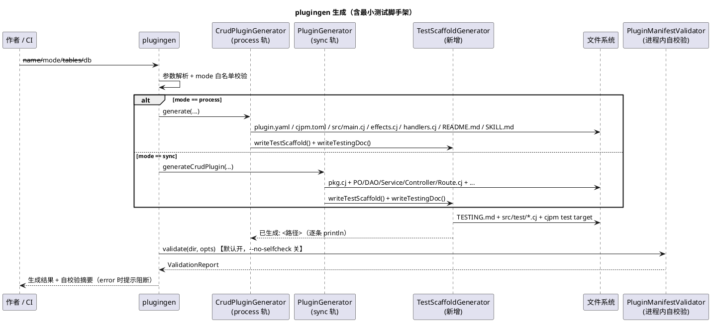
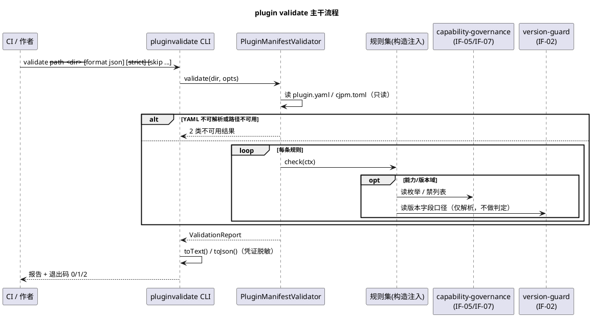
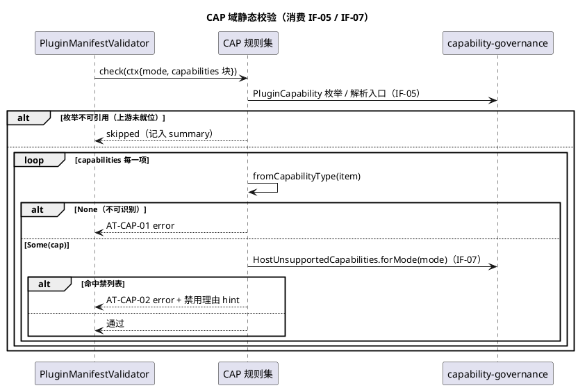

# 插件创作工具链增强（authoring-toolchain）组件规格

> 子系统 ID：`authoring-toolchain` ｜ `feature_name`：`plugin-system-enhancement--authoring-toolchain`
> 所属主工程：`plugin-system-enhancement`（账本：`specs/plugin-system-enhancement/SPECS_INDEX.md` §2 登记行：v1 / 4 接口 / 0 新表）
> 关联契约：本文目录 `contract.md`（IF-12 = IF-12.1~IF-12.4，**接口编号以其为准**，本文不新增全局接口号）
> 上游依赖（**消费，不重定义**）：`capability-governance v1` IF-05（能力枚举与缺省策略）/ IF-07（跨进程禁列表）；`version-guard v1` IF-02（清单版本字段解析）
> 验收档位：L1 + L2 + L3 ｜ 语言：仓颉（Cangjie）｜ 新建数据库表：**0 张**
> 需求来源：`docs/ref/plugin-mechanism-comparison-wx.html` §9 第 7 条（创作工具链）；`SPECS_INDEX.md` §1 交付面 6
> 证据基线：本仓 2026-10-19 工作区快照；所有行号以该快照为准，行号漂移时以标识符为准

---

## 1. 组件定位

### 1.1 核心职责

本组件负责把「`plugingen` 生成模板」与「清单静态校验」两条腿补齐成闭环，让第三方插件作者在不启动宿主的前提下**敢改**，`output` 是可运行的脚手架产物与可机读的校验报告。

一句话口径：**脚手架自带「跑得起的最小测试」+ 独立 `plugin validate` CLI（IF-12），前者保证改得动，后者保证错得明。**

### 1.2 核心输入

| 输入 | 来源 | 内容概要 |
|---|---|---|
| 生成命令 | 插件作者（人）／CI 脚本 | `cjpm run --skip-build --name magic.plugin.tools.plugingen --run-args "--name demo --db uctoo --table entity"`；参数面沿用 `plugingen.cj:54-111`（`--name` / `--db` / `--table` / `--mode` / `--tables` / `--contract` / `--contract-only` / `--blank` / `--help`）；**缺省为 process 轨**（`plugingen.cj:48` `var mode = "process"`，内嵌 sync 轨须显式 `--mode sync`） |
| 校验命令 | 插件作者（人）／CI 门禁 | `plugin validate --path <插件目录> [--format text\|json] [--min-level error\|warn\|info] [--strict] [--skip <规则号前缀>]`（IF-12.1） |
| 插件清单文件 | 文件系统只读 | `skills/{name}/plugin.yaml`、`skills/{name}/cjpm.toml`、`skills/{name}/src/**`、`TESTING.md` |
| 上游能力语义 | `capability-governance`（进程内） | `PluginCapability` 枚举与 `CapabilityPolicy`（IF-05）、`HostUnsupportedCapabilities` 禁列表（IF-07） |
| 上游版本口径 | `version-guard`（进程内） | `PluginManifestEntry.pluginApi` / `hostVersionRange` 字段与同一套版本解析内核（IF-02） |

### 1.3 核心输出

| 输出 | 目标 | 内容概要 |
|---|---|---|
| 脚手架测试产物 | 插件作者（人）、后续 CI | `skills/{name}/TESTING.md` + process 轨 `src/test/smoke_test.cj` 与其 `cjpm.toml` test 目标；sync 轨 `src/test/{name}_smoke_test.cj` 与宿主 `cjpm.toml` test 目标（IF-12.2） |
| 生成日志 | 作者终端 | 沿用 `println("已生成: ${path}")` 风格（`CrudPluginGenerator.cj:198` / `:243` / `:288` 同构） |
| 校验报告（text / json） | CI 机器、作者终端 | `ValidationReport`：插件名、`passed`、按规则编号排序的 `diagnostics[]`（`ruleId` / `level` / `location` / `message` / `hint`）与 `summary{errors,warns,infos,skipped}`（IF-12.4） |
| 进程退出码 | Shell / CI | `0` 无 error；`1` 存在 ≥1 条 error；`2` 输入不可用（`2` 优先于 `1`） |
| 存量体检报告 | 主工程 §5.1 用例 5、`lifecycle-observability`（只读消费数据，据契约 §1 下游 5） | 全量 `--format json` 汇总 |

### 1.4 职责边界

本组件**明确不做**：

1. **不修改宿主加载 / 门禁 / 握手实现** —— 版本拒绝归 `version-guard`（IF-03），能力门禁归 `capability-governance`（IF-06），握手比对归 `capability-handshake`（IF-08/09）。本组件只落在**生成器侧**与**离线静态校验侧**两侧。
2. **不自定义能力枚举** —— 能力含义一律向 IF-05 / IF-07 索取；本组件不允许出现自造的能力字符串集合。
3. **不做兼容性判定** —— 不调用 `VersionGuard.check`，不给出「会被拒」结论，不在任何诊断文案里出现「拒绝加载」类措辞。
4. **不提供 RSI 常驻自进化循环** —— 报告 §9 第 8 条「每 N 轮后台自评触发器」整条移交既有 `specs/RSI`；本组件**不提供每 N 轮后台自评触发器与 LRT 五环节编排**，也不提供任何定时 / 常驻进程。
5. **不复活 `dylib` 轨**（`SPECS_INDEX` §7 R-01）—— 对 `mode: dylib` 只报 `AT-MODE-02` 提示该轨当前无落点。
6. **不改 `pluginuninstall`**（`src/plugin/tools/pluginuninstall/pluginuninstall.cj`）—— 其「未在 `cjpm.toml` 注册 executable」与「`--mode` 行级字符串匹配 `pluginuninstall.cj:295-317` 仅 warn」两处缺口，建议由主工程登记为 R-09，不在本组件修。
7. **不新增 `plugingen --validate` 选项** —— 现 `printHelp()` 选项清单（`plugingen.cj:345-354`）无该项；校验能力只走独立 `plugin validate`，`plugingen` 侧仅做生成末尾进程内自校验（默认开，`--no-selfcheck` 关），避免一个能力两个入口。
8. **不建库表、不建宿主 HTTP 路由** —— 故无 `sql/incremental/` DDL、无 `permissions` / `role_has_permission` 登记。
9. **不执行被校验插件的任何代码**、不拉起插件进程、不连 DB、不联网。
10. **不提供插件的运行时 / 端到端测试执行** —— 脚手架只提供离线纯函数级最小测试。

---

## 2. 领域术语

**plugingen**
: 本仓插件脚手架生成器 CLI，源码 `src/plugin/tools/plugingen/plugingen.cj`，`main(args)` 位于 `:40-310`，以 `cjpm.toml:146-147` 登记为 executable 目标 `magic.plugin.tools.plugingen`。

**process 轨（L3 进程隔离轨）**
: `mode: process` 的插件形态，宿主以独立进程 + cordis JSON-RPC 方式托管；`plugingen` 的**缺省轨**（`plugingen.cj:48`）。

**sync 轨（内嵌轨）**
: `mode: sync` 的插件形态，编译进宿主二进制并在宿主进程内反射加载；须显式 `--mode sync` 才走该轨。

**plugin validate**
: 本组件新增的**独立** CLI（IF-12.1），对插件目录做离线只读静态校验并输出报告与退出码。与既有的 `PluginLoader.validate`（`src/plugin/plugin_loader.cj:111-117`，仅检查 `getName().isEmpty()`）**无实现复用关系**——后者是加载期对已实例化 `Plugin` 对象的复查，且目前经 grep 未发现有调用点（**待核实**，不作为本组件依赖）。

**规则编号（Rule ID）**
: 形如 `AT-<域>-<序号>` 的工具链私有诊断编号，domain ∈ {`IO`,`CORE`,`MODE`,`EXE`,`RT`,`CAP`,`VER`,`DOC`}（契约 §1 错误约定）。它不进宿主 HTTP API 错误码空间，不与 `PluginError` 混用。

**严重级（level）**
: `error` / `warn` / `info` 三档。`error` 决定退出码 `1`；`warn` / `info` 不影响退出码（`--strict` 模式下 `warn` 升级为阻断，见 5.2.1）。

**skipped**
: 某条规则因前置不可用（典型：上游 IF-05 不可引用）而未执行。skipped **必须**在 `summary` 中显式计数，**禁止**以「通过」蒙混（契约 §5 降级策略）。

**最小测试脚手架**
: 生成器随插件产出的离线纯函数级测试：**不连 DB、不起宿主、不联网**，断言对象为纯函数（如 handler 参数解析、消息拼装、配置读取），执行入口是一个 formal test target。

**AutoCreateCode 保护区**
: `TemplateEngine.updateFileWithMarkers`（`src/plugin/tools/plugingen/TemplateEngine.cj:84-116`）维护的标记区机制：区内在重生成时被覆盖，区外的二次开发代码保留。本组件的测试文件与 `TESTING.md` 沿用同一机制实现重生成幂等。

---

## 3. 角色与边界

### 3.1 核心角色

- **插件作者（人类，第三方）**：用 `plugingen` 生成插件、按 `TESTING.md` 跑自带测试、改完清单后用 `plugin validate` 自检。核心诉求是「敢改」——改错了要立刻知道错在哪一行。
- **主工程 CI / 准入门禁**：在 CI 中离线调用 `plugin validate`，以退出码与 json 报告作为门禁判据。
- **主工程闸口 / 集成验收方**：执行 `SPECS_INDEX` §5 L2 冒烟清单第 3 条与 §5.1 用例 1 / 用例 5。

### 3.2 外部系统

- **`capability-governance`**：提供 IF-05（能力枚举 + `CapabilityPolicy` 缺省策略）与 IF-07（跨进程禁列表）。本组件**单向只读消费**，不得被其反向 import。
- **`version-guard`**：提供 IF-02（清单版本字段解析口径）。本组件**单向只读消费**，不调用 IF-03 `VersionGuard.check`。
- **`lifecycle-observability`**：只读消费本组件产出的存量清单体检报告数据，**不调用本组件接口**（契约 §1 下游 5，防回退锚点 R-04）。
- **既有集成自检脚本**：`src/plugin/integration/plugin_system_check.cj`（24KB）/ `cordis_l3_check.cj`（8.8KB）。二者是**框架自身的集成自检**，在宿主构建图上执行，**不是**可分发给插件作者的脚手架产物；本组件不复用它们作为模板，也不改动它们。

### 3.3 交互上下文

```plantuml
@startuml
title authoring-toolchain 上下文图
actor "插件作者（人）" as Author
participant "CI / 门禁" as CI
rectangle "authoring-toolchain" {
}
component "plugingen\n(既有 CLI，本组件扩展)" as PGEN
component "plugin validate\n(新增 CLI，IF-12.1)" as PVAL
rectangle "skills/{name}/\nplugin.yaml + src + TESTING.md" as FILES
component "capability-governance\n(IF-05 / IF-07)" as CG
component "version-guard\n(IF-02)" as VG
component "主工程集成验收" as VERIFY
component "lifecycle-observability\n(只读消费体检数据)" as LO

Author --> PGEN : "生成请求 --name/--mode/--table"
Author --> PVAL : "validate --path"
Author ..> FILES : "运行自带测试 target"
CI --> PVAL : "validate --format json"
PGEN --> FILES : "写插件源码 + 最小测试脚手架(IF-12.2)"
PGEN --> PVAL : "生成末尾进程内自校验(同一实现)"
PVAL --> FILES : "只读扫描（不写不改）"
PVAL --> CG : "读能力枚举 / 跨进程禁列表"
PVAL --> VG : "读清单版本字段口径"
PVAL --> CI : "text/json 报告 + 退出码"
PVAL --> VERIFY : "存量体检报告（json）"
LO ..> VERIFY : "消费体检数据（无接口调用）"
@enduml
```

---

## 4. DFX 约束

### 4.1 性能

| 编号 | 约束 | 验证方式 |
|---|---|---|
| P-01 | 单个插件目录校验端到端（含 YAML 解析 + 全规则）**≤ 500 ms**（冷启动后） | CI 计时断言；不含进程启动时间 |
| P-02 | `skills/` 下既有 51 个 skill 插件全量体检（≈51 份清单）**≤ 30 s** | 批量脚本计时（S-05） |
| P-03 | `plugin validate` 全程**零网络、零 DB、零进程拉起**；IO 仅限读取 `skills/{name}/` 下文件 | 规则实现不得出现 socket / ORM / `launch` 类调用；代码评审 + strace 级抽查（待核实是否有工具） |
| P-04 | 向 `plugingen` 新增「测试脚手架 + 自校验」两步后，生成总耗时增量 **≤ 基线 10%** | 同一组入参前后计时对比 |

### 4.2 可靠性

| 编号 | 约束 | 验证方式 |
|---|---|---|
| A-01 | **只读幂等**：`plugin validate` 不写任何文件（含临时文件）、不改被扫描文件内容、不创建目录；同一目录内容重复执行结果完全一致 | 校验前后对目录做文件树 + 内容哈希比对（S-04 / S-05） |
| A-02 | **单规则容错**：任一规则抛出未捕获异常时，降级为该规则 `skipped`，其余规则继续执行，**不中断整体校验** | 注入抛异常规则做替身测试 |
| A-03 | **输入不可用优先**：目录不存在 / `plugin.yaml` 缺失 / YAML 不可解析 / 参数非法 → 退出码 `2`，优先于 `1` | S-04 |
| A-04 | **进程正常退出**：任何路径下均无未捕获栈、无挂起、无子进程残留 | S-04 观察 + 返回后 shell `$?` 可读 |
| A-05 | 生成失败时与既有生成器一致：`println` 失败原因并返回 `false`，**不抛异常、不半途留残文件** | 复用 `CrudPluginGenerator` 现有失败语义（见 `:151-195` 分支风格） |

### 4.3 安全性

| 编号 | 约束 | 验证方式 |
|---|---|---|
| S-01 | **凭证脱敏**：报告中出现 `config:` 段、`env:` 段、secret 相关键名时，其值一律输出为 `<redacted>`，**不回显明文** | 构造含 `connectionString` / `token` 键值的清单跑 `--format json`，grep 明文应 0 命中 |
| S-02 | **不执行被校验方代码**：只做文本扫描与解析，不 import / 不加载 / 不反射任何插件符号，不起子进程 | 代码评审；对恶意清单（含可执行同名 junk 文件）跑校验，进程行为正常 |
| S-03 | **路径不越界**：`command` 等字段若解析出越界路径只作**提示**，本组件不据此打开文件，也不向报告外泄露宿主目录结构 | 相对路径 / `..` 用例（AT-EXE-02） |
| S-04 | 诊断文案统一不含被扫描机器的绝对路径以外的宿主敏感信息；`<hint>` 只给修复动作，不给具体宿主配置值 | 人工评审 json 样例 |

### 4.4 可维护性

| 编号 | 约束 | 验证方式 |
|---|---|---|
| M-01 | **规则编号稳定**：已发布的 `AT-*` 编号不得复用、不得撤销；新增规则走末位追加 | 契约 §5 minor 档 + 代码评审 |
| M-02 | 每条 error / warn 诊断**必须**带非空 `hint`，写明「怎么改」 | 规则单元测试断言 `hint` 非空 |
| M-03 | json 报告字段名稳定；变更属 **minor**，须同步 `contract.md` §1 IF-12.4 与本文件 | 契约评审 |
| M-04 | 上游依赖**单点收口**：只有「上游收口规则模块」（design §3.4 `rules_upstream.cj`）允许 import `magic.security.capability` / version-guard 版本解析内核，其余文件不得引入（防第二处事实来源、防依赖漂移） | grep 逆向检查 import 面 |

### 4.5 兼容性

| 编号 | 约束 | 验证方式 |
|---|---|---|
| C-01 | **存量零回归（R-04）**：既有 51 个 skill 插件 + 4 个 sync 锚点清单，在**默认**选项下不得因「新增必填项」而产生 error；历史未声明字段一律降为 `warn` / `info` | S-05 + 主工程 §5.1 用例 5 |
| C-02 | `parseMode` 的静默降级行为（`plugin_config.cj:270-277`，未知值 → Sync）归属本组件在**静态侧**先行报出（`AT-MODE-01`）；**本组件不改 `parseMode` 实现**（宿主侧口径修改若需要，须回主工程登记） | S-01 / S-04 |
| C-03 | 上游未就位时（IF-05 不可引用）`AT-CAP-*` 置 `skipped` 并计入 `summary.skipped`，退出码仍按其余规则计算 | 契约 §5 降级策略演练任务 |
| C-04 | 退出码语义、规则号撤销、子命令改名属 **major**，须双侧同轮 + 主工程 §6 登记 | 契约评审 |

---

## 5. 核心能力

### 5.1 自带测试的插件脚手架生成（IF-12.2）

#### 5.1.1 业务规则

1. **规则（必有测试）**：任何通过 `plugingen` 生成的插件，**必须**同时产出可运行的测试 target 与 `TESTING.md`。
   a. 验收条件（EARS）：**When** 作者执行 `plugingen --name demo --db uctoo --table entity`（process 轨）**且** 生成返回成功，**the `plugingen` shall** 在 `skills/demo/` 下生成 `TESTING.md` 与 `src/test/smoke_test.cj`，并在 `skills/demo/cjpm.toml` 内写入 `[package.package-configuration."skill_demo.test"] output-type = "executable"`。
2. **规则（sync 轨同等待遇）**：内嵌 sync 轨同样必须产出测试，**不得**只给 process 轨。
   a. 验收条件（EARS）：**When** 执行 `plugingen --name demo --mode sync ...` 生成成功，**the `plugingen` shall** 生成 `skills/{name}/src/test/{name}_smoke_test.cj`，并在宿主 `cjpm.toml` 登记 `[package.package-configuration."magic.plugins.{name}.test"]`。
3. **规则（离线可执行）**：生成的测试**必须**在不连 DB、不起宿主、不联网的条件下跑通（纯函数级断言）。
   a. 验收条件（EARS）：**While** 测试进程运行在无 DB / 无宿主 / 无网络的环境中，**when** 作者执行该 test target，**the 脚手架测试 shall** 以退出码 `0` 结束，且输出中含 ≥3 项断言通过标记。
4. **规则（重生成幂等）**：测试文件整体落在 AutoCreateCode 保护区内，二次开发区保留。
   a. 验收条件（EARS）：**When** 对同一 `--name` 二次执行成功生成，**the `plugingen` shall** 覆盖保护区内容但保留作者写在区外的自定义测试代码，且校验/测试仍通过。
5. **规则（日志口径一致）**：新增产物沿用 `println("已生成: ${path}")` 日志。
   a. 验收条件（EARS）：**When** 测试脚手架写入成功，**the `plugingen` shall** 打印一条形如 `已生成: <路径>` 的日志（与 `CrudPluginGenerator.cj:198` 同风格）。
6. **禁止项**：**禁止**把既有框架集成自检（`src/plugin/integration/plugin_system_check.cj` / `cordis_l3_check.cj`）当作脚手架测试模板。
   a. 验收条件（EARS）：**If** 发现脚手架测试依赖宿主进程或 `db_info`，**the 本组件 shall** 判为验收不通过（该断言由 S-06 用例覆盖）。

#### 5.1.2 交互流程



#### 5.1.3 异常场景

1. **测试目标登记与源文件不匹配（如 `cjpm.toml` 有 test 段但 `src/test/` 为空）**
   a. 触发条件：作者手工删了测试源码后再次调用生成；或生成器写文件失败被吞。
   b. 系统行为：生成阶段把两者作为**同一原子单元**写入，任一失败则整体失败；`plugin validate` 侧另有 `AT-DOC-03` 兜底报不匹配。
   c. 用户感知：生成日志中出现失败原因行 + 返回 `false`；后续 `plugin validate` 报 `AT-DOC-03`（error）。
2. **`--blank` 空模板分支也必须有测试**
   a. 触发条件：`plugingen.cj:217-225` 走 `generateBlankPlugin` 分支。
   b. 系统行为：同样产出最小测试脚手架与 `TESTING.md`（空模板的测试断言退化为「占位 + 结构存在性」级别）。
   c. 用户感知：生成成功且 `plugin validate` 退出码 `0`。
3. **contract-only 分支**
   a. 触发条件：`--contract-only`（`plugingen.cj:96`）只产出契约文件。
   b. 系统行为：**不**产出测试脚手架（无插件工程形态），生成日志显式说明原因。
   c. 用户感知：仅契约产物；文档（`TESTING.md`）说明契约模式下无運行形态。

---

### 5.2 清单静态校验执行与退出码（IF-12.1 / IF-12.3）

#### 5.2.1 业务规则

1. **规则（双入口同一实现）**：`plugin validate` CLI 与 `plugingen` 生成末尾自校验**必须**共用 `PluginManifestValidator` 同一实现。
   a. 验收条件（EARS）：**When** 同一份清单分别经 CLI 与生成末尾自校验，**the 本组件 shall** 产出完全一致的 `diagnostics` 集合（同 ruleId / 同 location / 同 level）。
2. **规则（退出码）**：`0` = 无 error；`1` = ≥1 条 error；`2` = 输入不可用，`2` 优先于 `1`。
   a. 验收条件（EARS）：**If** `--path` 指向不存在目录或 `plugin.yaml` 缺失/不可解析，**the `plugin validate` shall** 以退出码 `2` 结束并输出 `AT-IO-0x` error 诊断，不创建任何文件。
3. **规则（`--min-level` 过滤不影响结论）**：`--min-level` 只做**显示**过滤，不改变 `passed` 与退出码判定。
   a. 验收条件（EARS）：**While** 存在 1 条 error 与 2 条 warn，**when** 以 `--min-level error` 执行，**the `plugin validate` shall** 仍返回退出码 `1` 且 `summary.errors` 为 `1`。
4. **规则（`--strict` 升级）**：`--strict` 下 `warn` 计入阻断判定。
   a. 验收条件（EARS）：**While** `--strict` 生效，**when** 报告中存在 ≥1 条 warn 且无 error，**the `plugin validate` shall** 返回退出码 `1` 并在摘要注明 strict 生效。
5. **规则（`--skip` 前缀匹配）**：`--skip AT-CAP` 跳过该域全部规则，被跳过的规则计入 `summary.skipped`。
   a. 验收条件（EARS）：**When** 以 `--skip AT-CAP` 执行，**the `plugin validate` shall** 不产出任何 `AT-CAP-*` 诊断且 `summary.skipped` ≥ CAP 域规则总数。
6. **禁止项**：**禁止**在校验中执行任何自动修复（auto-fix）动作。
   a. 验收条件（EARS）：**If** 校验发现可修复项（缺 `pluginApi` 等），**the `plugin validate` shall** 仅在 `hint` 中给出修复建议，**不得**落盘修改被校验清单。

#### 5.2.2 交互流程



#### 5.2.3 异常场景

1. **单规则内部异常**
   a. 触发条件：某规则对畸形输入抛异常。 b. 系统行为：捕获后标记该规则 `skipped`，继续其余规则。 c. 用户感知：退出码按其余规则计算，报告 summary 中 `skipped` ≥ 1。
2. **上游 `capability-governance` 未达 code（IF-05 枚举不可引用）**
   a. 触发条件：编译期或运行期无法获得 IF-05。 b. 系统行为：`AT-CAP-*` 全部置 `skipped` 并显式计数。 c. 用户感知：报告中出现 skipped 说明，退出码仍由其余规则决定（契约 §5）。
3. **`plugin.yaml` 顶层无 `plugins:` 数组**
   a. 触发条件：非清单 YAML。 b. 系统行为：报 `AT-IO-03`，退出码 `2`。 c. 用户感知：不出现 YAML 解析器原始栈。

---

### 5.3 加载轨与可执行文件校验（MODE / EXE 域）

#### 5.3.1 业务规则

1. **规则（mode 白名单）**：`mode` 取值**必须** ∈ {`sync`, `dylib`, `process`}；宿主 `parseMode`（`plugin_config.cj:270-277`）对未知值静默降级为 Sync，静态侧须先报出。
   a. 验收条件（EARS）：**If** 清单 `mode` 取值不在白名单内，**the `plugin validate` shall** 报 `AT-MODE-01`（error，退出码 `1`），hint 写明「宿主将静默降级为 sync（`plugin_config.cj:270-277`）」。
2. **规则（process 轨必填 command）**：`mode: process` **必须**声明非空 `command`。
   a. 验收条件（EARS）：**While** `mode == process`，**when** `command` 缺失或为空串，**the `plugin validate` shall** 报 `AT-CORE-04`（error）。
3. **规则（sync/dylib 轨必填 className）**：`mode: sync|dylib` **必须**声明非空 `className`。
   a. 验收条件（EARS）：**While** `mode == sync`，**when** `className` 缺失，**the `plugin validate` shall** 报 `AT-CORE-03`（error）。
4. **规则（可执行文件存在性）**：process 轨 `command` 指向的文件**必须**存在。
   a. 验收条件（EARS）：**While** `mode == process`，**if** `command` 指向路径不存在，**the `plugin validate` shall** 报 `AT-EXE-01`（error，退出码 `1`），且**不**尝试执行该文件。
5. **规则（相对路径提示）**：`command` 为相对路径时给出 warn，提示宿主实际工作目录口径差异。
   a. 验收条件（EARS）：**When** `command` 解析为相对路径，**the `plugin validate` shall** 报 `AT-EXE-02`（warn），hint 建议改绝对或宿主 CWD 相对路径。
6. **规则（`dylib` 提示）**：`mode: dylib` 报 `AT-MODE-02`（error），hint 指出该轨当前无落点（R-01）。
   a. 验收条件（EARS）：**When** 清单声明 `mode: dylib`，**the `plugin validate` shall** 报 `AT-MODE-02`，文案含「该轨当前无落点」，**不得**出现「已接线 / 已支持」措辞。

#### 5.3.2 交互流程

`读 mode 字段 → 白名单判断 → 按轨校验必填组合（command / className） → process 轨额外做 command 路径存在性与路径形态检查 → 汇总 3 个域的诊断`。

#### 5.3.3 异常场景

1. **`command` 字段类型非字符串**：→ `AT-CORE-06`（error，类型不符），不进入路径解析。
2. **`command` 路径不可读（权限不足）**：→ `AT-EXE-03`（warn），hint 提示检查读取权限；**不**因权限异常中断整体校验。
3. **process 轨缺 `cjpm.toml` 或其 `[package]` 段不可解析**：→ `AT-IO-04`（error），因为 process 轨独立工程的构建描述缺失意味着不可编译。

---

### 5.4 HTTP 路由声明校验（RT 域）

> 事实基线：process 轨插件的路由由 `plugin.yaml` 的 `routes` 声明，解析结果落在 `PluginManifestEntry.httpRoutes`（`plugin_config.cj:106-108`），元素类型为 `ExternalRoute{method: HttpMethod, path: String}`（`external_plugin_route_gateway.cj:565-573`）；sync/dylib 轨的路由经 `routeClass` 反射注册，该字段在这些模式下为空。

#### 5.4.1 业务规则

1. **规则（method 合法）**：`routes[].method` **必须**可被宿主侧同一套 `HttpMethod` 口径解析。
   a. 验收条件（EARS）：**If** `method` 取值无法解析为合法 HTTP 方法，**the `plugin validate` shall** 报 `AT-RT-01`（error）。
2. **规则（path 形态）**：`path` **必须**以 `/` 开头，不含空白字符、不含连续 `//`、不以 `/` 结尾（`path == "/"` 的根路径除外）。
   a. 验收条件（EARS）：**If** `path` 违反上述任一形态约束，**the `plugin validate` shall** 报 `AT-RT-02`（error）并在 location 给出该条目的清单行号。
3. **规则（同清单内唯一）**：同一份清单内 `(method, path)` 组合**不得**重复。
   a. 验收条件（EARS）：**When** 同一清单内出现重复的 `(method, path)`，**the `plugin validate` shall** 报 `AT-RT-03`（error）。
4. **规则（误声明提示）**：`sync` / `dylib` 轨声明 `routes` 属无效声明（该模式下 `httpRoutes` 恒空）。
   a. 验收条件（EARS）：**While** `mode != process`，**when** 清单声明了 `routes`，**the `plugin validate` shall** 报 `AT-RT-04`（warn），hint 指向改用 `routeClass`。
5. **禁止项**：**禁止**在静态期校验路由与**宿主既有路由表**的全局冲突（那需要宿主运行态信息，越界）。
   a. 验收条件（EARS）：**If** 某路由与宿主既有路由前缀重叠，**the `plugin validate` shall** 不做 error 判定；是否给出 info 级提示由规则表实现决定，**不得**引入宿主运行态依赖。

#### 5.4.2 交互流程

`解析 routes 数组 → 逐条校验 method/path → 聚合 (method,path) 去重 → 按 mode 判定是否属无效声明`。

#### 5.4.3 异常场景

1. **`routes` 非数组**（如写成对象/字符串）：→ `AT-CORE-06`（error，类型不符），**不**逐条下钻。
2. **`ExternalRoute` 缺 `path` 或 `method` 键**：→ `AT-RT-01` / `AT-RT-02`（error），location 指向该条目起始行。

---

### 5.5 能力声明静态校验（CAP 域，消费 IF-05 / IF-07）

> **本组件不定义能力枚举**（硬边界）：能力的取值集合、YAML 块形态、`resource` 单位一律来自 `capability-governance` 的 IF-05（`PluginCapability` + `CapabilityPolicy`）与 IF-07（`HostUnsupportedCapabilities`）。

#### 5.5.1 业务规则

1. **规则（枚举合法性）**：清单能力声明中的每一项**必须**能被 IF-05 的 `PluginCapability` 解析，无法识别的串即非法。
   a. 验收条件（EARS）：**When** 作者在 `plugin.yaml` 的 `capabilities` 里写入一项不在 IF-05 枚举内的值并跑 `plugin validate`，**the `plugin validate` shall** 报 `AT-CAP-01`（error，退出码 `1`），且**不**把它报成加载期错误码形态。
2. **规则（跨进程禁列表）**：`mode: process` 清单**不得**声明 IF-07 禁列表中的能力。
   a. 验收条件（EARS）：**While** `mode == process`，**when** 清单声明命中 `HostUnsupportedCapabilities.forMode(Process)`，**the `plugin validate` shall** 报 `AT-CAP-02`（error），hint 复用 IF-07 自带的禁用理由说明串。
3. **规则（缺失提示，非阻断）**：既无 `capabilities` 又无 `tableWhitelist` 时，给出 warn 说明它将走向 CG-06 降级推导结果，**不替 `capability-governance` 下结论**。
   a. 验收条件（EARS）：**When** 两者皆缺，**the `plugin validate` shall** 报 `AT-CAP-03`（warn）且文案明确「实际策略由 `capability-governance` 在加载期推导」。
4. **规则（降级可观测）**：上游不可用时该域整体 `skipped` 并在 `summary` 计数。
   a. 验收条件（EARS）：**If** IF-05 / IF-07 不可引用，**the `plugin validate` shall** 将 `AT-CAP-*` 全部置 skipped 并在 summary 显式列出，其余域照常计算退出码。
5. **禁止项**：**禁止**在静态校验中调用任何运行时门禁判定（IF-06 `CapabilityGate.check`），静态期只做**声明合法性**判断。
   a. 验收条件（EARS）：**If** 实现中出现对 IF-06 判定函数的调用，**the 主工程闸口 shall** 判为契约越界并打回整改（评审阻塞项）。

#### 5.5.2 交互流程



#### 5.5.3 异常场景

1. **`capabilities` 块形态非法（非对象/非数组）**：→ `AT-CORE-06`（error，类型不符），能力域规则不再下钻。
2. **资源清单为空数组 / 非数组**：→ `AT-CAP-04`（warn），hint 提示按 IF-05 的资源单位口径声明；**本组件不定义单位语义**。
3. **既缺 `capabilities` 又缺 `tableWhitelist`（存量 51 插件典型形态）**：→ `AT-CAP-03`（warn），退出码保持 `0`（C-01 存量零回归）。

---

### 5.6 版本声明静态校验（VER 域，消费 IF-02）

> 事实基线：生成器已写出 `version: 1.0.0`（`CrudPluginGenerator.cj:156`、`:371`；`PluginGenerator.cj:339`），宿主侧从不读取 —— 该**读取缺口归 `version-guard`**（其 design §1.1 G3）。本组件只在静态侧校验**存在性与格式**。

#### 5.6.1 业务规则

1. **规则（缺失仅 warn）**：未声明 `pluginApi` 时报 warn，**不**阻断、**不**暗示会被拒绝。
   a. 验收条件（EARS）：**When** 清单删除/未写 `pluginApi` 字段并跑 `plugin validate`，**the `plugin validate` shall** 报 `AT-VER-01`（warn），退出码 `0`，且报告中**不出现**「拒绝加载」类措辞。
2. **规则（格式非法即 error）**：`version` / `pluginApi` / `hostVersionRange` 存在但无法被版本解析内核接受时报错。
   a. 验收条件（EARS）：**When** 清单写成 `pluginApi: "abc"` 并跑 `plugin validate`，**the `plugin validate` shall** 报 `AT-VER-02`（error，退出码 `1`），hint 写明合法形如 `X` / `X.Y` / `X.Y.Z`。
3. **规则（不做兼容性判定）**：**禁止**调用 `VersionGuard.check`、**禁止**输出「与宿主不兼容 / 将被拒绝」结论。
   a. 验收条件（EARS）：**When** 校验版本字段，**the `plugin validate` shall** 仅产出存在性/格式类诊断，并在 `AT-VER-02` 的 hint 中注明「兼容性由 `version-guard` 在加载前判定」。
4. **规则（字段存在性提示）**：存在 `version` 字段时报 info，提示该字段当前由宿主忽略、消费方为 `version-guard`。
   a. 验收条件（EARS）：**When** 清单含 `version` 字段，**the `plugin validate` shall** 报 `AT-VER-03`（info）。

#### 5.6.2 交互流程

`读 version / pluginApi / hostVersionRange（IF-02 字段口径） → 存在性判定 → 存在则用同一套版本解析内核做格式解析（仅 parse，不做 satisfies/拒绝） → 产出 warn/error/info`。

#### 5.6.3 异常场景

1. **字段类型非字符串**（如 `pluginApi: 1`）：→ `AT-CORE-06`（error，类型不符），并提示版本字段须加引号，避免 YAML 隐式类型转换。
2. **上游 `version-guard` 未达 code / IF-02 不可引用**：→ 该域置 `skipped` 并计入 summary，退出码按其余域计算。

---

### 5.7 诊断报告输出（IF-12.4）

#### 5.7.1 业务规则

1. **规则（text 形态）**：单行格式为 `规则号 [级] 位置: 消息 → 建议`。
   a. 验收条件（EARS）：**When** 以默认 `--format text` 输出，**the 报告渲染器 shall** 每条诊断占一行且含上述四要素，末尾附 `Summary`。
2. **规则（json 形态）**：结构为 `{plugin, passed, summary, diagnostics[]}`，`diagnostics[]` 元素含 `ruleId` / `level` / `location` / `message` / `hint`。
   a. 验收条件（EARS）：**When** 以 `--format json` 输出，**the 报告渲染器 shall** 产出可被标准 JSON 解析器读取的单一对象（`不含` schemaVersion 字段，追加属 minor）。
3. **规则（脱敏）**：任何位置的值 plausibly 属凭证一律 `<redacted>`。
   a. 验收条件（EARS）：**If** 诊断文案需引用 `config:` / `env:` / secret 键的值，**the 报告渲染器 shall** 输出 `<redacted>` 而非明文。
4. **规则（排序稳定）**：诊断按 `ruleId` 升序、同级按 `location` 升序排列，保证同输入同输出。
   a. 验收条件（EARS）：**When** 同一输入重复执行，`the 报告渲染器 shall` 逐字节一致（除 report 中不引入时间戳等易变量）。

#### 5.7.2 交互流程

`ValidationReport → 选择渲染器(text/json) → 脱敏过滤 → 排序 → 输出 + 退出码`。

#### 5.7.3 异常场景

1. **json 序列化失败**：→ 降级为 text 输出并在 stderr 打印一行原因，**不**改变退出码。
2. **stdout 被截断 / 管道关闭**：→ 进程正常退出，退出码按原判定给出（不因 IO 失败改变语义）。

---

### 5.8 存量清单体检与防回退（R-04）

#### 5.8.1 业务规则

1. **规则（全量体检只读）**：对 `skills/` 下既有 51 个 skill 插件批量执行校验，**不得**修改/删除任何被扫描文件。
   a. 验收条件（EARS）：**When** 批量执行体检，**the `plugin validate` shall** 产出全量 json 汇总，且执行前后文件树与内容哈希一致。
2. **规则（存量友好默认档）**：默认选项下历史清单不因新增校验项而转 error；`DOC` 域建议以 `--skip AT-DOC` 关闭以免噪声。
   a. 验收条件（EARS）：**When** 以默认选项体检既有插件（不含 `--skip`）或显式 `--skip AT-DOC`，**the `plugin validate` shall** 不产出存量无关新增 error（新信息一律 warn/info）。
3. **规则（报告可被下游消费）**：体检 json 可直接作为主工程 §5.1 用例 5 与 `lifecycle-observability` 的输入。
   a. 验收条件（EARS）：**When** 体检完成，**the 本组件 shall** 提供每插件一条记录、含 `plugin` / `passed` / `summary` 字段的汇总数据。

#### 5.8.2 交互流程

`遍历 skills/*/plugin.yaml → 逐个 validate(json) → 合并为汇总数组 + 统计计数 → 输出`。

#### 5.8.3 异常场景

1. **个别清单无 `plugin.yaml`（非插件目录）**：→ 跳过该目录并记 `AT-IO-01` info 级，**不**影响其余目录，整体退出码按被校验成功的部分计算。
2. **扫描过程中目录被占用 / 权限不足**：→ 该目录记 `AT-IO-01`，继续其余目录，退出码仍由已读到的 error 决定。

---

## 6. 数据约束

> **铁律 9 复用优先结论：本组件 0 新表、0 新列、0 新宿主 HTTP 路由。** 输入面是文件系统，报告生命周期等于一次进程执行，故无持久化载体（论证见契约 §2.4）。

### 6.1 规则编号与严重级（诊断）

1. **`ruleId`**：必须匹配 `AT-(IO|CORE|MODE|EXE|RT|CAP|VER|DOC)-\d{2}`，一经发布不得复用或撤销（M-01）。
2. **`level`**：枚举 `error` / `warn` / `info`；`error` 决定退出码 `1`。
3. **`location`**：形如 `<相对文件路径>:<行号>`；无法定位行号时退化为文件名。
4. **`message`**：陈述事实，不含凭证明文（S-01）。
5. **`hint`**：error / warn 级**必须**非空且给出可执行的修复动作（M-02）。

### 6.2 `ValidateOptions`（IF-12.3 入参）

1. **`path`**：必填；插件目录路径。不存在或不是目录 → 退出码 `2`。
2. **`format`**：`text` | `json`，缺省 `text`。
3. **`minLevel`**：`error` | `warn` | `info`，缺省 `info`；**仅显示过滤**，不影响 `passed` 与退出码。
4. **`strict`**：Bool，缺省 `false`；为 true 时 `warn` 计入阻断。
5. **`skipPrefixes`**：规则号前缀数组；命中的规则置 `skipped` 并计入 summary。

### 6.3 `ValidationReport` / `Summary`（IF-12.4）

1. **`plugin`**：插件名（取自清单 `name`；不可得时为目录名）。
2. **`passed`**：Bool；等价于 `summary.errors == 0 && summary.errors + summary.warns(strict 下) 无阻断项`。
3. **`summary`**：`{errors, warns, infos, skipped}` 四个非负整数，四者之和 ≥ 实际诊断条数中被跳过的部分。
4. **`diagnostics`**：诊断数组，排序稳定（5.7.1 规则 4）。
5. **`skipped` 语义**：**不得**以「通过」填充；它与上游降级、显式 `--skip`、规则异常三种来源一一可辨（summary 附来源说明串）。

### 6.4 测试脚手架产物契约（IF-12.2）

1. **`TESTING.md`**：必须包含「如何运行测试」的命令行、测试范围声明、**离线可执行声明**（不连 DB / 不起宿主 / 不联网）。
2. **process 轨测试源码**：`src/test/smoke_test.cj`，包名与宿主 `cjpm.toml` 的 test target 对齐 —— 生成包名规则为 `skill_{name}`（`CrudPluginGenerator.cj:207`），故 target 名为 `skill_{name}.test`。
3. **sync 轨测试源码**：`src/test/{name}_smoke_test.cj`，target 名 `magic.plugins.{name}.test`（登记于宿主 `cjpm.toml`）。
4. **断言数量**：默认脚手架**必须**至少 3 项断言（对应 S-06 通过判据）。
5. **幂等**：所有脚手架写入走 `TemplateEngine.updateFileWithMarkers`（`TemplateEngine.cj:84-116`），二次开发区保留。

### 6.5 被消费的上游数据口径（**引用，不定义**）

1. **IF-02 版本字段**：`PluginManifestEntry.version`（String，缺省 `""`）/ `pluginApi`（`Option<String>`）/ `hostVersionRange`（`Option<String>`）；三者均为清单可选字段，缺省一律向后兼容（version-guard design §3.5.1 / ADR-VG-3）。本组件**只读 + 只做格式解析**。
2. **IF-05 能力枚举**：`PluginCapability` 的能力串取值集合由 `capability-governance` 定义（其 design §4.1.1）；本组件不得硬编码任何枚举成员。
3. **IF-07 禁列表**：`HostUnsupportedCapabilities`（跨进程恒禁集合 + 每条目禁用理由串）；本组件直接取用其理由串作为 `AT-CAP-02` 的 hint 来源。
4. **明确不消费**：IF-06（运行时门禁判定）、IF-03（`VersionGuard.check`）、IF-08/IF-09（握手）。

### 6.6 规则总表（首版）

| 规则号 | 域 | 级别 | 触发条件 | hint 要点 |
|---|---|---|---|---|
| `AT-IO-01` | IO | error(退出码 `2`) | `--path` 不存在 / 非目录 / `plugin.yaml` 缺失 | 给出期望路径形态 |
| `AT-IO-03` | IO | error(退出码 `2`) | `plugin.yaml` 不可解析或顶层无 `plugins` 数组 | 检查缩进与顶层键 |
| `AT-IO-04` | IO | error | process 轨 `cjpm.toml` 缺失或 `[package]` 段不可解析 | 重跑 `plugingen` 生成，或手工补齐 `[package]` 段 |
| `AT-CORE-01` | CORE | error | `name` 缺失或为空 | 补 `name`，须与包名规则一致（`plugingen.cj:127-139` `NameRules`） |
| `AT-CORE-02` | CORE | error | 同一清单内插件重名 | 改名或拆分为独立清单文件 |
| `AT-CORE-03` | CORE | error | sync/dylib 轨缺 `className` | 补全限定类名 |
| `AT-CORE-04` | CORE | error | process 轨缺 `command` | 补可执行文件路径 |
| `AT-CORE-06` | CORE | error | 已知字段类型不符 | 宿主侧会静默降级为缺省值（`plugin_config.cj:156-165`），须显式修正 |
| `AT-MODE-01` | MODE | error | `mode` 取值不在 {sync,dylib,process} | 宿主将静默降级为 sync（`plugin_config.cj:270-277`） |
| `AT-MODE-02` | MODE | error | `mode: dylib` | 该轨当前无落点（R-01），勿依赖 |
| `AT-EXE-01` | EXE | error | process 轨 `command` 文件不存在 | 先编译产物再校验 |
| `AT-EXE-02` | EXE | warn | `command` 为相对路径 | 宿主工作目录口径差异，建议显式化 |
| `AT-EXE-03` | EXE | warn | `command` 路径不可读/权限不足 | 检查读取权限 |
| `AT-RT-01` | RT | error | 路由 `method` 不可解析 | 使用宿主 `HttpMethod` 支持的方法名 |
| `AT-RT-02` | RT | error | 路由 `path` 形态非法 | 以 `/` 开头、无空白、无 `//`、不以 `/` 结尾 |
| `AT-RT-03` | RT | error | 同清单内 `(method,path)` 重复 | 注册阶段会冲突 |
| `AT-RT-04` | RT | warn | 非 process 轨声明 `routes` | 该模式下 `httpRoutes` 恒空，改用 `routeClass` |
| `AT-CAP-01` | CAP | error | 能力串不在 IF-05 枚举内 | 参照 `capability-governance` 枚举清单修正 |
| `AT-CAP-02` | CAP | error | process 轨命中 IF-07 禁列表 | 附 IF-07 自带禁用理由 |
| `AT-CAP-03` | CAP | warn | 既无 `capabilities` 又无 `tableWhitelist` | 实际策略由 CG-06 在加载期推导 |
| `AT-CAP-04` | CAP | warn | 资源清单为空或非数组 | 按 IF-05 资源单位口径声明（本组件不定义单位） |
| `AT-VER-01` | VER | warn | 未声明 `pluginApi` | 建议补，兼容性由 version-guard 加载前判定 |
| `AT-VER-02` | VER | error | 版本字段格式非法 | 合法形如 `X` / `X.Y` / `X.Y.Z` |
| `AT-VER-03` | VER | info | 存在 `version` 字段 | 宿主当前忽略，消费方为 `version-guard` |
| `AT-DOC-01` | DOC | warn | process 轨缺 `TESTING.md` 或测试源码 | 重跑 `plugingen` 或补脚手架 |
| `AT-DOC-02` | DOC | warn | sync 轨缺对应测试源码 | 同上 |
| `AT-DOC-03` | DOC | error | 测试 target 与测试源码不匹配 | 两者同属一个原子写入单元 |

> 新增规则一律末位追加；因为规则总量增加属 minor，须同步更新本表、契约 §5 与主工程 §3（M-01 / C-04）。

---

## 附录 A：需求溯源

| 来源 | 条目 | 本文承接 |
|---|---|---|
| 报告 §9 第 7 条 | 插件创作工具链（模板带测试 + validate CLI） | §5.1 / §5.2 全文 |
| `SPECS_INDEX.md` §1 交付面 6 | 插件创作工具链 | §1.1 |
| `SPECS_INDEX.md` §5 L2 冒烟第 3 条 | `plugingen` 生成 → validate 全绿；删一项能力声明 → 报对应错 | 契约 §6 S-01 / S-02；本文 5.5.1 规则 1 与 §5 硬验收 |
| `SPECS_INDEX.md` §5.1 用例 1 / 用例 5 | 端到端主干 + 存量零回归 | §5.8 / C-01 |
| `SPECS_INDEX.md` §7 R-04 | 防回退锚点 | §5.8 |
| `SPECS_INDEX.md` §7 R-01 | dylib 轨无落点 | `AT-MODE-02`（5.3.1 规则 6） |
| `SPECS_INDEX.md` §1.1 | RSI 自评循环移交 `specs/RSI` | §1.4 第 4 条（明确不提供） |

## 附录 B：参考文档

| 文档 | 用途 |
|---|---|
| `specs/plugin-system-enhancement--authoring-toolchain/contract.md` | 接口编号与边界（IF-12.1~12.4、S-01~S-06）权威口径 |
| `specs/plugin-system-enhancement/SPECS_INDEX.md` | 边界账本、IF-12、R-01/R-04 |
| `specs/plugin-system-enhancement--capability-governance/{contract,design}.md` | IF-05 / IF-07 消费口径 |
| `specs/plugin-system-enhancement--version-guard/design.md` | IF-02 字段与「缺省放行」口径 |
| `src/plugin/tools/plugingen/plugingen.cj`、`:40-310`、`:48`、`:54-111`、`:113-118`、`:127-139`、`:338-372` | 生成器入口与参数面基线 |
| `src/plugin/tools/plugingen/{CrudPluginGenerator,PluginGenerator,TemplateEngine}.cj` | 产物清单、保护区机制、`version: 1.0.0` 写出点 |
| `src/plugin/plugin_config.cj:72-112`、`:270-277`、`src/plugin/plugin_loader.cj:111-117`、`src/plugin/external_plugin_route_gateway.cj:565-573` | 清单字段、mode 降级、既有 validate、ExternalRoute |
| `cjpm.toml:146-147` | executable 目标登记范式（本组件新增段镜像此写法） |
| `skills/uctoo-dev-manual/` + `docs/uctoo-v4/*.md` | 规范源（铁律 14） |
| `skills/sdd/templates/{spec_template,ears-format,design_template,tasks-template}.md` | 模板 |
