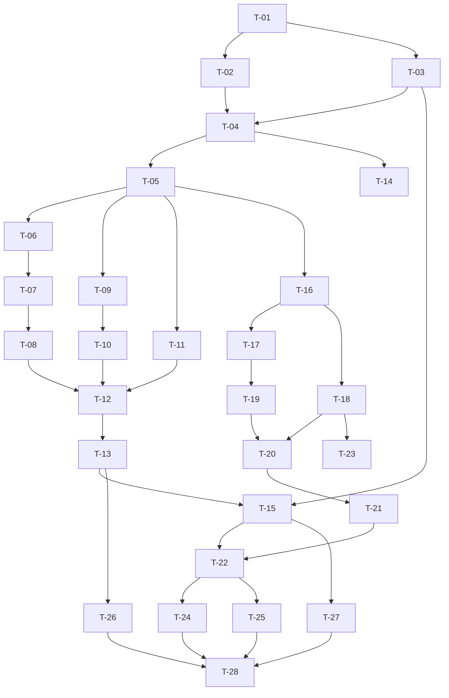

# 任务规划文档（authoring-toolchain）

> 基于 `spec.md` 与 `design.md` 生成。实施原则：**复用优先**、**确定性优先**、**铁律 15 大工程拆分边界**。
> 仓颉代码编写须使用 `cangjie-coder` 技能；**严禁运行 `cjpm build`**（编译与回传由人工在独立 cmd 环境完成）。
> 本文件 task 数目：**28 条**（满足 ≥3 且 ≤40）。

## 文档信息

| 项 | 值 |
|---|---|
| 关联需求 | `specs/plugin-system-enhancement--authoring-toolchain/spec.md` |
| 关联设计 | `specs/plugin-system-enhancement--authoring-toolchain/design.md` |
| 关联契约 | `specs/plugin-system-enhancement--authoring-toolchain/contract.md`（IF-12 = IF-12.1~IF-12.4；编号以其为准） |
| 主工程账本 | `specs/plugin-system-enhancement/SPECS_INDEX.md`（§2 登记行：v1 / 4 接口 / 0 新表；§5 L2 冒烟第 3 条；§7 R-01 / R-04） |
| 上游依赖 | `capability-governance v1`（IF-05 / IF-07）、`version-guard v1`（IF-02） |
| 生成日期 | 2026-10-19 |
| 版本 | v1 |
| 状态 | 草稿（待主工程闸口放行开工） |
| 验收档位 | L1 + L2 + L3 |

### 需求编号口径

本文追踪矩阵使用的需求编号与 spec 章节的对应关系：

| 需求编号 | spec 章节 | 一句话 |
|---|---|---|
| FR-AT-01 | §5.1 | 自带测试的插件脚手架生成（IF-12.2） |
| FR-AT-02 | §5.2 | 清单静态校验执行与退出码（IF-12.1 / IF-12.3） |
| FR-AT-03 | §5.3 | 加载轨与可执行文件校验（MODE / EXE） |
| FR-AT-04 | §5.4 | HTTP 路由声明校验（RT） |
| FR-AT-05 | §5.5 | 能力声明静态校验（CAP，消费 IF-05 / IF-07） |
| FR-AT-06 | §5.6 | 版本声明静态校验（VER，消费 IF-02） |
| FR-AT-07 | §5.7 | 诊断报告输出（IF-12.4） |
| FR-AT-08 | §5.8 | 存量清单体检与防回退（R-04） |
| DFX-AT | §4 全部 | 性能 P-01~04 / 可靠 A-01~05 / 安全 S-01~04 / 可维护 M-01~04 / 兼容 C-01~04 |

---

## 开发规范（全任务强制遵守）

- **语言与工具绑定**：仓颉 → `cangjie-coder`；本子系统无前端、无原生 App 产物。
- **二次开发底座优先（本仓 runtime / uctoo 强制，铁律 14）**：
  1. **规范源**：先加载 `skills/uctoo-dev-manual/`，按要做的事读对应 `docs/uctoo-v4/*.md`
     （接口→`uctoo-v4-api-specification`；表/字段→`uctoo-database-design-specification`；CRUD→`uctoo-v4-module-development`
     + `uctoo-v4-orm-specification`；中间件→`uctoo-v4-middleware-guide`；权限→`user-permission-system` /
     `row-level-permission-system`；分层与统一错误响应→legacy `design-principles.md`）。
  2. **脚手架优先确定性代码生成工具**：本子系统**无新增表/列、无新增宿主 HTTP 路由**，因此**不触发**
     `loaddbinfo → crudgen → crudweb` 链。本子系统改动对象本身就是工具链：`plugingen`（既有，扩展）
     与新增 `pluginvalidate`（新建 CLI）。命令一律 `cjpm run --skip-build --name <包名> --run-args "<参数>"`。
  3. **生成后必补**：本轮**无** `sql/incremental/` DDL 产出、**无** `permissions` / `role_has_permission` 登记
     （理由见 T-02）；此结论不得被后续任务隐式推翻。若实现中发现确需新列，必须**先停下**、回主工程
     `SPECS_INDEX.md` §6 登记并写明复用不成立理由，禁止手写 DDL。
  4. **工具链坑位**：`plugingen` 缺省为 process 轨（`plugingen.cj:48`），要生成内嵌插件须显式 `--mode sync`；
     未知参数一律 `printHelp` + return（`plugingen.cj:106-109`）——新增 CLI 沿用同一风格（T-13）。
- **大工程拆分态（铁律 15，本任务是子系统级，强制）**：
  1. 已读主工程 `SPECS_INDEX.md`；本子系统 `feature_name = plugin-system-enhancement--authoring-toolchain`，
     上游依赖 `capability-governance`（IF-05/IF-07）与 `version-guard`（IF-02）；本子系统账本口径：`v1 / 4 接口 / 0 新表`。
  2. **边界写进任务**：每条任务显式标注 **「本子系统负责」/「不碰（移交 / 调用上游）」**；跨子系统一律落成
     「调用上游契约接口」或「提供接口等下游消费」，禁止写成"顺手也改一下 X 模块"。
  3. **跨子系统接口成对成条**：本次 IF-12 的**提供方**全在本子系统；其**消费方**（CI 接入、
     `lifecycle-observability` 数据消费、主工程 §5.1 用例 5）**不在本任务列表内**，由各自承接。
  4. **契约先行**：T-04~T-14 逐条标注契约条目编号；本子系统本轮**无 major 变更**，规则新增与 json 字段追加属
     **minor**，须同步 `contract.md` §5 与主工程 §3。
  5. **验收带跨边界冒烟**：终验清单含 ≥3 条跨子系统主干（S-01/S-02/S-03）+ 1 条异常（S-04）。
  6. **禁止跨界手写**：
     - 不修改 `src/plugin/plugin_config.cj` / `plugin_loader.cj` / `plugin_host_manager.cj` / `cordis_host_manager.cj`
       / `cordis_host_services.cj` / `libs/cordis-cj/**`（分属宿主、`version-guard`、`capability-governance`）；
     - 不 import `CapabilityGate`（IF-06）、`VersionGuard.check`（IF-03）、`HandshakeVerifier`（IF-09）；
     - 不自定义能力枚举、不自建 semver 解析器。
- **RSI 移交**：明确**不做**报告 §9 第 8 条「RSI 每 N 轮后台自评触发器」与 LRT 五环节编排（已移交既有 `specs/RSI`）；
  本子系统也不提供任何定时 / 常驻进程。
- **编译约束**：**AI 不运行 `cjpm build`**；编译、类型检查、lint 由人工在独立 cmd 环境执行并回传（T-28）。
- **复用原则**：复用 `TemplateEngine.updateFileWithMarkers`（`TemplateEngine.cj:84-116`）的保护区机制实现重生成幂等；
  复用 `PluginManifestEntry` / `ExternalRoute` 既有语义做清单视图（**只读引用，不改源码**，见 design §3.2.2）。
- **事实纪律**：所有代码结论必须带 `文件:行号` 证据；查不到的标 **「待核实」**（汇总见 `design.md` §10.2 O-1~O-7），
  **禁止编造 API**。
- **命名 / 注释 / 错误处理**：遵循 `uctoo-dev-manual` 与 legacy `design-principles.md`；
  诊断编号 `AT-<域>-<序号>` 一经发布不得复用。
- **进度与日志**：遵循既有日志/进度通道约定；多轮修订须在文末留痕。

---

## 任务总览

| 编号 | 任务 | 关联需求(spec §) | 关联设计(design §) | 本子系统/外 | 状态 | 预计产出 |
|---|---|---|---|---|---|---|
| T-01 | 基线复核：确证两条 GAP（生成无测试 / 无独立 validate）并留证 | FR-AT-01/02 | §1.1 G1/G2 | 本子系统 | 待开始 | 证据记录 |
| T-02 | 数据侧自检：确认 0 新表 0 新列 0 新路由并留证 | DFX-AT（铁律 9） | §4.2 | 本子系统 | 待开始 | 结论记录（无 DDL） |
| T-03 | `cjpm.toml` 包/源码目录登记约定核实（O-1） | DFX-AT M-04 | §9.1、O-1 | 本子系统 | 待开始 | 登记结论 |
| T-04 | `validation_types.cj`：类型与选项（IF-12.4） | FR-AT-07、§6.2/6.3 | §3.2.1 | 本子系统 | 待开始 | 新文件 |
| T-05 | `validation_rule.cj`：规则接口 + `RuleContext` + 默认规则表（IF-12.3） | FR-AT-02、§6.1 | §3.2.2 | 本子系统 | 待开始 | 新文件 |
| T-06 | `rules_manifest.cj`：IO + CORE 规则 | FR-AT-02/03、§6.6 AT-IO/AT-CORE | §3.3 | 本子系统 | 待开始 | 新文件 |
| T-07 | MODE / EXE 规则（含 dylib 提示） | FR-AT-03 | §3.3、ADR-AT-6 | 本子系统 | 待开始 | 同文件追加 |
| T-08 | RT 规则（HTTP 路由） | FR-AT-04 | §3.3 | 本子系统 | 待开始 | 同文件追加 |
| T-09 | `rules_upstream.cj`：CAP 规则（消费 IF-05 / IF-07，含降级 skip） | FR-AT-05 | §3.4.1、ADR-AT-3 | 本子系统 | 待开始 | 新文件（唯一上游收口点） |
| T-10 | VER 规则（消费 IF-02，仅 parse） | FR-AT-06 | §3.4.2、ADR-AT-5 | 本子系统 | 待开始 | 同文件追加 |
| T-11 | DOC 规则（测试脚手架完整性） | FR-AT-01/08 | §3.7.5 | 本子系统 | 待开始 | 新文件 |
| T-12 | `plugin_manifest_validator.cj`：编排 + 异常降级 + skip 计数 | FR-AT-02/08 | §3.5 | 本子系统 | 待开始 | 新文件 |
| T-13 | `pluginvalidate.cj`：CLI 参数解析与退出码（镜像 `plugingen.cj:54-118`） | FR-AT-02 | §3.1 | 本子系统 | 待开始 | 新文件 |
| T-14 | `report_renderer.cj`：text / json 渲染 + 凭证脱敏 + 稳定排序 | FR-AT-07、S-01 | §3.6 | 本子系统 | 待开始 | 新文件 |
| T-15 | `cjpm.toml` 登记 `magic.plugin.tools.pluginvalidate` executable（镜像 `:146-147`） | FR-AT-02 | §9.1 | 本子系统 | 待开始 | `cjpm.toml` 改造 |
| T-16 | `TestScaffoldGenerator.cj`：process 轨测试源码 + test target + `TESTING.md` | FR-AT-01 | §3.7 | 本子系统 | 待开始 | 新文件 |
| T-17 | `TestScaffoldGenerator`：sync 轨形态（含 O-4 核实） | FR-AT-01 | §3.7.2/3.7.3、O-4 | 本子系统 | 待开始 | 同文件追加 |
| T-18 | `CrudPluginGenerator` 接线（process 轨：CRUD / blank / `--blank` 三分支） | FR-AT-01 | §3.8 | 本子系统 | 待开始 | `CrudPluginGenerator.cj` 改造 |
| T-19 | `PluginGenerator` 接线（sync 轨默认 CRUD 分支） | FR-AT-01 | §3.8 | 本子系统 | 待开始 | `PluginGenerator.cj` 改造 |
| T-20 | 生成末尾进程内自校验（默认开 / `--no-selfcheck` 关），与 CLI 共用实现 | FR-AT-01/02 | §2.3 主干①、ADR-AT-2 | 本子系统 | 待开始 | 生成器改造 |
| T-21 | `plugingen` 帮助文本更新（补充 `--no-selfcheck`；**不新增 `--validate`**） | FR-AT-02、§1.4 第 7 条 | §3.8 | 本子系统 | 待开始 | `plugingen.cj:345-354` 改造 |
| T-22 | **S-01 主干**：生成 → 自测 → validate 全绿（含 SPECS_INDEX §5 冒烟第 3 条前半） | FR-AT-01/02 | §2.3、契约 §6 S-01 | 本子系统 | 待开始 | L1 用例与报告 |
| T-23 | **S-06**：脚手架可跑（离线纯函数级测试通过，≥3 断言） | FR-AT-01、P-03 | §3.7.3、O-3 | 本子系统 | 待开始 | 执行记录 |
| T-24 | **S-02 跨 capability-governance**：破坏能力声明 → 报 `AT-CAP-0x` | FR-AT-05 | §3.4.1 | 跨子系统（消费 IF-05/07） | 待开始 | L2 用例与报告 |
| T-25 | **S-03 跨 version-guard**：删 `pluginApi` → warn；写成非法值 → error | FR-AT-06 | §3.4.2 | 跨子系统（消费 IF-02） | 待开始 | L2 用例与报告 |
| T-26 | **S-04 异常/边界**：路径不存在 / `command` 指向空 → 退出码 `2` / `AT-EXE-01`，且零写盘 | FR-AT-02/03、A-01/A-03/A-04 | §3.1.3 | 本子系统 | 待开始 | 执行记录 + 哈希比对 |
| T-27 | **S-05 存量体检 + R-04**：51 个 skill 插件全量 json 报告，只读不改 | FR-AT-08、C-01 | §3.5、O-7 | 本子系统 | 待开始 | 全量 json + 哈希比对结论 |
| T-28 | 上游未就位降级演练 + 文档/契约一致性回写 + 编译交接（**人工编译**） | FR-AT-05/06、DFX-AT | §9.3、契约 §5 | 本子系统 | 待开始 | 用例 + 回写 + 编译回执位 |

---

## 任务依赖关系图

**并行机会**：T-06/T-07/T-08（本地规则）、T-09/T-10（上游收口规则）、T-16/T-17（脚手架）三组之间只要各自的
前置（T-05 / T-05 / T-05）就位即可并行；**T-24 / T-25 必须在 `capability-governance` / `version-guard` 达
`test` 以上才可开工**（主工程 §4「上游进 code 步前其上游必须已达 test」）。

---

## 任务详细说明（按编号展开）

### T-01 基线复核：确证两条 GAP 并留证
- **目标**：把 design §1.1 G1 / G2 的两条实证在本轮开工时复核一遍，避免基线漂移导致任务落空。
- **本子系统负责**：核对 ①五条生成分支的产出清单确无 `test/` 与 `*_test.cj`、无 `TESTING.md`；
  ②全仓唯一 `validate` 是 `plugin_loader.cj:111-117` 且只查 `getName().isEmpty()`；③`printHelp()`（`:338-372`）
  选项清单（`:345-354`）无 `--validate`。
- **不碰（移交/调用上游）**：**不改** `plugin_loader.cj`（其浅校验若需加强不由本子系统决定，见 O-2）；
  **不动** `src/plugin/integration/*`（框架自检，非脚手架模板）。
- **步骤**：1) 逐分支读 `plugingen.cj:151-309`；2) grep `*_test.cj` / `TESTING.md` 于 `skills/**` 模板路径；
  3) grep `func validate` 于 `src/plugin/**`；4) 结论写入本文件修订记录。
- **产出物**：证据记录（行号清单）。
- **验收**：三条实证各有一处可复现命令。
- **风险**：后续提交可能已引入校验能力 → 若发现，立即回主工程登记并调整本列表（不得静默忽略）。

### T-02 数据侧自检：0 新表 0 新列 0 新路由
- **目标**：落实铁律 9（复用优先），把「无 DDL / 无权限登记」作为可核结论固定下来。
- **本子系统负责**：确认无任何新表新列需求；报告生命周期=一次进程，不落表。
- **不碰**：不写 `sql/incremental/`；不做 `permissions` / `role_has_permission` 登记（无新路由）。
- **步骤**：1) 列候选持久化需求并逐项论证（design §4.2 表）；2) 结论写进 design §4.2 与本文修订记录。
- **产出物**：结论记录（无文件产出）。
- **验收**：后续任务若发现确需新列，必须先回主工程 §6 登记，否则按 P0 计。
- **风险**：CI 希望留存历史报告 → 明确归属 CI 自身（契约 §2.4）。

### T-03 `cjpm.toml` 包 / 源码目录登记约定核实（O-1）
- **目标**：消解 O-1 —— 新包 `magic.plugin.validator` 与 `magic.plugin.tools.pluginvalidate` 是否须显式登记源码目录。
- **本子系统负责**：读 `cjpm.toml` 现有 `[package]` 与 `[package.package-configuration.*]` 约定，确认新包是否自动纳入编译。
- **不碰**：不改既有 `plugingen` 段（`cjpm.toml:146-147`），只在 T-15 追加新段。
- **步骤**：1) 确认包路径与 `src-dir` 约定；2) 确认 `output-type = "executable"` 的登记范式；3) 结论回 design §10.2 O-1。
- **产出物**：登记结论（可能零改动）。
- **验收**：后续新增文件在人工编译（T-28）时被确认参与编译。
- **风险**：不登记导致「文件在但不编译」—— 必须在 T-04 之前闭环。

### T-04 `validation_types.cj`（IF-12.4 类型）
- **目标**：落地 `Severity` / `Diagnostic` / `Summary` / `ValidationReport` / `ValidateOptions`（design §3.2.1）。
- **本子系统负责**：类型定义 + `passed(opts)` 语义 + `skipSources` 来源串。
- **不碰**：不引入任何持久化；不引用宿主编排/日志组件以外的东西。
- **步骤**：1) 按 design §3.2.1 骨架实现；2) `hint` 非空在渲染/校验侧双重保障（M-02）；
  3) 与 spec §6.1~6.3 的字段约束逐条对齐。
- **产出物**：`src/plugin/validator/validation_types.cj`。
- **验收**：类型 compile 通过（人工）；`AT-*` 正则约束可在单测中断言。
- **风险**：O-1 未闭环则文件不参与编译。

### T-05 `validation_rule.cj`（规则接口 + `RuleContext` + 默认规则表）
- **目标**：把「新增规则 = 新增实现 + 注册」结构化，落实 IF-12.3 的构造注入。
- **本子系统负责**：`ValidationRule` 接口、`RuleContext` 只读视图、默认规则表（按 `IO→CORE→MODE→EXE→RT→CAP→VER→DOC` 顺序）。
- **不碰**：`RuleContext` **不持有**任何宿主运行态对象（不起宿主、不连 DB）；不 import 上游符号（收口在 T-09/T-10）。
- **步骤**：1) 定义接口与 ctx（design §3.2.2）；2) 默认规则表构造；3) 注入空规则数组的替身测试点预留。
- **产出物**：`src/plugin/validator/validation_rule.cj`。
- **验收**：可用空规则数组构造 Validator（替身测试），产出空报告。
- **风险**：`ctx.lineOf` 的行号定位精度（design §3.3 行号定位策略）影响 `location` 质量 → 不可定位时退化为文件名。

### T-06 `rules_manifest.cj`：IO + CORE 规则
- **目标**：`AT-IO-01/03/04` + `AT-CORE-01/02/03/04/06`。
- **本子系统负责**：路径/文件存在性与 YAML 可解析性；必填组合与类型体检；重名检测。
- **不碰**：**不修改** `plugin_config.cj` 的 `fromJsonValue`（`:122-208`）对类型不符的静默降级行为 ——
  本任务是在静态侧**补报**（`AT-CORE-06`），宿主侧行为变更若需要须回主工程登记。
- **步骤**：1) 原始 YAML 节点逐字段类型体检；2) 必填组合按 `mode` 分流；3) 行号定位。
- **产出物**：`src/plugin/validator/rules_manifest.cj`。
- **验收**：缺 `name` → `AT-CORE-01`；process 缺 `command` → `AT-CORE-04`；`enabled: yes-ish 非 bool` → `AT-CORE-06`。
- **风险**：YAML 隐式类型转换（如 `version: 1.0` 被解析为浮点）须一并捕获。

### T-07 MODE / EXE 规则
- **目标**：`AT-MODE-01/02` + `AT-EXE-01/02/03`。
- **本子系统负责**：mode 白名单比较（**独立实现，不调用 private `parseMode`**）；`command` 存在性与路径形态检查。
- **不碰**：**不执行** `command` 指向的可执行文件（S-02）；**不复活** `dylib` 轨（R-01，ADR-AT-6）。
- **步骤**：1) 白名单 {sync,dylib,process}；2) dylib → error + 「该轨当前无落点」hint；3) 存在性 + 相对/越界提示。
- **产出物**：追加进 `rules_manifest.cj`。
- **验收**：`mode: procss`（拼错）→ `AT-MODE-01`；`mode: dylib` → `AT-MODE-02`；`command` 指向不存在 → `AT-EXE-01`。
- **风险**：相对路径基准在不同执行语境下不同 → 只报 warn，不自行解析到绝对路径。

### T-08 RT 规则（HTTP 路由）
- **目标**：`AT-RT-01/02/03/04`。
- **本子系统负责**：method 可解析性、path 形态四条子约束、同清单 `(method,path)` 唯一、非 process 轨声明 `routes` 的 warn。
- **不碰**：**不做**与宿主既有路由表的全局冲突判定（需运行态，越界）；**不改** `ExternalRoute`（`external_plugin_route_gateway.cj:565-573`）。
- **步骤**：1) 复用既有 `HttpMethod` 口径；2) 形态正则/字符串约束；3) 去重（同为字典保证 determinism）。
- **产出物**：追加进 `rules_manifest.cj`。
- **验收**：`path: demo/list`（缺首斜杠）→ `AT-RT-02`；重复组合 → `AT-RT-03`。
- **风险**：`HttpMethod` 解析入口的确切导出形态 —— **待核实**，以宿主既有实现为准，禁止臆造。

### T-09 `rules_upstream.cj`：CAP 规则（消费 IF-05 / IF-07）
- **目标**：`AT-CAP-01/02/03/04` + 上游降级 skip。
- **本子系统负责**：调用 IF-05 的串→枚举解析入口；命中 IF-07 禁列表时**直接取用其自带禁用理由串**做 hint；
  两者皆缺时按 CG-06 语义提示（不替 `capability-governance` 下结论）。
- **不碰（移交/调用上游）**：**不调用** IF-06 `CapabilityGate.check`（运行时门禁，spec 5.5.1 规则 5，违反即越界 P0）；
  **不 import** `capability-governance` 的任何私有包/内部接口；**不自定义**能力枚举。
- **步骤**：1) 按 design §3.4.1 流程实现；2) 上游不可引用 → 整组返回 skipped + `upstream-missing` 来源串；
  3) import 面收口grep 校验。
- **产出物**：`src/plugin/validator/rules_upstream.cj`（**唯一允许 import `magic.security.capability` 的文件**）。
- **验收**：S-02（T-24）通过；主源码 grep 无能力字符串字面量。
- **风险**：O-5 —— `PluginCapability` 串解析入口的确切导出名以 `capability-governance` 最终 code 为准，**禁止臆造 API**。

### T-10 VER 规则（消费 IF-02，仅 parse）
- **目标**：`AT-VER-01/02/03`。
- **本子系统负责**：存在性判定 + 用 IF-02 同口径的 parse 入口做格式校验。
- **不碰（移交/调用上游）**：**不调用** `VersionGuard.check`（IF-03）；**不做** `satisfies` / 兼容性判定；
  文案**禁止**出现「拒绝加载 / 将被拒绝 / 不兼容」措辞（兼容性判定归 `version-guard`）。
- **步骤**：1) `pluginApi == None` → warn；2) 三个字段存在时逐个 parse；3) `version` 存在 → info 提示消费方。
- **产出物**：追加进 `rules_upstream.cj`。
- **验收**：S-03（T-25）通过；缺 `pluginApi` 退出码 `0`，`pluginApi: "abc"` 退出码 `1`。
- **风险**：O-6 —— 版本 parse 入口的确切导出名以 `version-guard` 最终 code 为准；**禁止自建 semver 解析器**。

### T-11 DOC 规则（测试脚手架完整性）
- **目标**：`AT-DOC-01/02/03`。
- **本子系统负责**：检测测试源码与 cjpm test target 是否成对存在（两者同属一个原子写入单元，spec 6.4）。
- **不碰**：不自动补文件（禁止 auto-fix，spec 5.2.1 规则 6）。
- **步骤**：1) 按 mode 选择期望产物；2) 源码缺失 → warn（target 存在但对不上 → error）；3) target 缺失 → error。
- **产出物**：`src/plugin/validator/rules_doc.cj`（或并入 `rules_manifest.cj`，以实现期包布局为准）。
- **验收**：手工删测试源码保留 target → `AT-DOC-03`（error）。
- **风险**：存量 51 插件大多无测试 → 默认体检建议 `--skip AT-DOC`（T-27）。

### T-12 `plugin_manifest_validator.cj`（编排，IF-12.3）
- **目标**：规则遍历、异常降级（A-02）、`--skip` 前缀匹配、`summary` 聚合、`skipSources` 三分溯源。
- **本子系统负责**：design §3.5.1 六步编排；「不可用」短路语义（退出码 `2`）。
- **不碰**：不起宿主、不连 DB、不写盘（A-01 / P-03）。
- **步骤**：1) 前置可用性检查；2) try/catch 包裹每条规则；3) skip 前缀匹配；4) 聚合 + 稳定排序。
- **产出物**：`src/plugin/validator/plugin_manifest_validator.cj`。
- **验收**：注入抛异常规则 → 该规则 skipped 且其余照跑；`--skip AT-CAP` → CAP 计数进 skipped。
- **风险**：catch 过宽吞掉真实缺陷 → `skipSources` 必须带 `exception` 标记，便于 CI 识别。

### T-13 `pluginvalidate.cj`（CLI，IF-12.1）
- **目标**：参数解析 + 渲染调用 + 退出码（design §3.1.2 / §3.1.3）。
- **本子系统负责**：`validate` 子命令位、`--path` / `--format` / `--min-level` / `--strict` / `--skip` / `--help|-h`；
  未知 token → `printHelp()` + 退出码 `2`（对齐 `plugingen.cj:106-109`）。
- **不碰**：**不新增** `--fix` / `--write` 类选项（只读契约）；**不复用** `plugin_loader.cj:111-117` 的 validate。
- **步骤**：1) 手写解析镜像生成器风格；2) 退出码映射表实现；3) `--help` 文本覆盖全部选项。
- **产出物**：`src/plugin/tools/pluginvalidate/pluginvalidate.cj`。
- **验收**：`--path skills/not-exist` → 退出码 `2` + 不抛栈（T-26）。
- **风险**：退出码 `2` 与 `1` 的优先级顺序必须按 design §3.1.3 实现，反向会被 CI 误判。

### T-14 `report_renderer.cj`（IF-12.4）
- **目标**：text / json 双形态输出 + 凭证脱敏 + 稳定排序。
- **本子系统负责**：text 单行格式 `规则号 [级] 位置: 消息 → 建议`；json `{plugin, passed, summary, diagnostics[]}`；
  脱敏在渲染层统一处理（`<redacted>`，S-01）。
- **不碰**：json 首版**不含** `schemaVersion`（追加属 minor，须同步契约 §5）。
- **步骤**：1) 双渲染器；2) 脱敏谓词（覆盖 `config` / `env` / secret 类键）；3) 排序（ruleId → location）。
- **产出物**：`src/plugin/validator/report_renderer.cj`。
- **验收**：含 `connectionString: "postgres://u:p@h/db"` 的清单 → 输出 `<redacted>`，明文 0 命中。
- **风险**：json 序列化失败 → 降级 text + stderr 一行，**不改变退出码**。

### T-15 `cjpm.toml` 登记 executable
- **目标**：让 `plugin validate` 成为可分发形态（IF-12.1）。
- **本子系统负责**：新增 `[package.package-configuration."magic.plugin.tools.pluginvalidate"]` +
  `output-type = "executable"`，**镜像 `cjpm.toml:146-147` 写法**。
- **不碰**：不动既有 `plugingen` 段、`crudgen`/`crudweb`/`loaddbinfo` 段（`cjpm.toml:134-139`）；
  **不改** `pluginuninstall` 的登记状态（建议由主工程登记 R-09，契约 §4）。
- **步骤**：1) 追加新段；2) 与 T-03 结论核对包路径。
- **产出物**：`cjpm.toml` 改造。
- **验收**：人工编译后出现 `magic.plugin.tools.pluginvalidate` 可执行目标。
- **风险**：包名与包的物理路径不一致 → 编译不通过，须与 T-03 结论一致。

### T-16 `TestScaffoldGenerator.cj`：process 轨
- **目标**：`skills/{name}/TESTING.md` + `src/test/smoke_test.cj` + test target 登记（IF-12.2）。
- **本子系统负责**：三类产物写入；**离线纯函数级**测试内容（≥3 断言）；`println("已生成: ...")` 日志风格；
  写入经 `TemplateEngine.updateFileWithMarkers`（`TemplateEngine.cj:84-116`）保证重生成幂等。
- **不碰**：**不复制**框架集成自检（`src/plugin/integration/*`）作为模板；测试**不连 DB / 不起宿主 / 不联网**。
- **步骤**：1) 内容模板（三项断言：清单自洽 / 声明存在性 / 纯函数行为）；2) target 登记写入 `package-configuration`；
  3) `TESTING.md` 含运行命令 + 离线声明；4) 原子失败语义（失败返回 `false`，不留半截文件）。
- **产出物**：`src/plugin/tools/plugingen/TestScaffoldGenerator.cj`。
- **验收**：S-06（T-23）通过。
- **风险**：O-3 —— test target 的实际运行命令需与宿主导出约定核对（`cjpm run --skip-build --name skill_{name}.test`，包名规则见 `CrudPluginGenerator.cj:207`）。

### T-17 `TestScaffoldGenerator`：sync 轨形态
- **目标**：sync 轨同等获得测试（`src/test/{name}_smoke_test.cj` + 宿主 `cjpm.toml` 登记）。
- **本子系统负责**：产物形态与 O-4 核实。
- **不碰**：若为登记方便而想把测试源码写进 `src/plugins/` —— **禁止**。
- **步骤**：1) 核实 O-4（能否在宿主 `cjpm.toml` 挂 `magic.plugins.{name}.test`）；2) 可行则登记，不可行则退化为
  `TESTING.md` 中给出手工编译命令（并回写 O-4 结论）。
- **产出物**：同文件追加 + O-4 结论。
- **验收**：sync 轨生成后存在测试源码，且 `TESTING.md` 的步骤可执行。
- **风险**：污染宿主主包编译单元 → 若无法避免，采用退化方案并在文档明示。

### T-18 `CrudPluginGenerator` 接线（process 轨）
- **目标**：process + CRUD（`plugingen.cj:151-195`）、process blank（`:204-214`）、`--blank`（`:217-225`）三分支产出测试脚手架。
- **本子系统负责**：在既有产物写入完毕后调用 T-16，保持既有失败语义（println 原因 + 返回 `false`，A-05）。
- **不碰**：**不改**既有产物内容、`plugin.yaml` 保护区划分（`CrudPluginGenerator.cj:146-149`）与 `version: 1.0.0` 写出点（`:156`/`:371`）
  —— 该字段的宿主侧读取归 `version-guard`（G3）。
- **步骤**：1) 三分支统一挂接点；2) 日志接入；3) 与 T-20 自校验衔接。
- **产出物**：`src/plugin/tools/plugingen/CrudPluginGenerator.cj` 改造。
- **验收**：三分支各自生成后均有 `TESTING.md` + 测试源码。
- **风险**：合同分支（`--contract-only`，`plugingen.cj:96`）无工程形态 → **不产出**测试，日志说明原因。

### T-19 `PluginGenerator` 接线（sync 轨）
- **目标**：sync CRUD 生成分支（`plugingen.cj:301-309`，需显式 `--mode sync`，因 `plugingen.cj:48` 缺省 process）产出测试。
- **本子系统负责**：调用 T-17 的 sync 形态。
- **不碰**：不改 sync 轨既有的 `pkg.cj` / PO / DAO / Service / Controller / Route 产物结构。
- **步骤**：1) 挂接；2) 宿主 target 登记写入（若 O-4 可行）。
- **产出物**：`src/plugin/tools/plugingen/PluginGenerator.cj` 改造。
- **验收**：`--mode sync` 生成后存在 `src/test/{name}_smoke_test.cj`。
- **风险**：宿主 `cjpm.toml` 被反复改写的合并冲突 → 写入走既有覆盖/标记保护机制，不引入新格式。

### T-20 生成末尾进程内自校验
- **目标**：生成完成后默认跑一次 `PluginManifestValidator`（`--no-selfcheck` 关闭），**与 CLI 共用同一实现**（ADR-AT-2）。
- **本子系统负责**：调用、摘要输出（error 计数 + 前 N 条规则号）。
- **不碰**：**不因此新增 `plugingen --validate`**；自校验**不阻断生成成功与否**（生成成功与「清单待补全」是两回事）。
- **步骤**：1) 默认开 / `--no-selfcheck` 关；2) 摘要输出；3) 与 CLI 结果一致性验证（spec 5.2.1 规则 1）。
- **产出物**：生成器改造（两处调用点）。
- **验收**：同一清单经 CLI 与自校验产出**完全一致**的 diagnostics 集合。
- **风险**：自校验耗时影响 P-04 → 生成末尾只跑本机规则，IO 复用已读内容。

### T-21 `plugingen` 帮助文本更新
- **目标**：在 `printHelp()`（`plugingen.cj:338-372`，选项清单 `:345-354`）补充 `--no-selfcheck` 一行。
- **本子系统负责**：文案维护。
- **不碰**：**不新增 `--validate`** 选项（契约 §4 明确不做）。
- **步骤**：1) 追加一行；2) 说明 Validate CLI 的存在（指引到 `pluginvalidate` 包名，而非新选项）。
- **产出物**：`plugingen.cj` 改造。
- **验收**：`--help` 输出含 `--no-selfcheck`，不含 `--validate`。
- **风险**：无。

### T-22 S-01 主干（含 SPECS_INDEX §5 冒烟第 3 条前半）
- **目标**：`plugingen --name demo --db uctoo --table entity` 生成完毕 → 立即 `plugin validate --path skills/demo`。
- **本子系统负责**：执行与取证。
- **不碰（移交/调用上游）**：不在此重复 S-02 / S-03 的破坏性验证（分立为 T-24 / T-25）。
- **步骤**：1) 生成；2) 断言 `skills/demo/TESTING.md` 与 `skills/demo/src/test/smoke_test.cj` 存在；
  3) `plugin validate` → 退出码 `0` 且 `errors=0`。
- **产出物**：L1 用例执行记录 + 报告样例。
- **验收**：退出码 `0`、`errors=0`、两个脚手架文件存在（契约 §6 S-01）。
- **风险**：生成器产物缺少某必填声明导致用例立即转红 → 这正是本用例要暴露的问题（届时判定为预期不符 → 回到 T-16/T-18 修复）。

### T-23 S-06 脚手架可跑
- **目标**：对 T-22 生成的插件执行测试目标，离线跑通且 ≥3 项断言通过。
- **本子系统负责**：命令与退出码取证。
- **不碰**：测试**不连 DB、不起宿主、不联网**（P-03 / spec 5.1.1 规则 3）。
- **步骤**：1) 按 `TESTING.md` 命令执行；2) 统计断言通过标记；3) 若 O-3 命令形态不同，回写 tasks.md 用例。
- **产出物**：执行记录。
- **验收**：退出码 `0` 且输出含 ≥3 项断言通过标记（契约 §6 S-06）。
- **风险**：O-3 命令形态偏差。

### T-24 S-02 跨 `capability-governance`
- **目标**：在 T-22 生成的 `plugin.yaml` 里把 `capabilities` 改成一项非枚举值 → 再跑 `plugin validate`。
- **本子系统负责**：断言报出 `AT-CAP-01`（枚举非法）或 `AT-CAP-02`（禁列表命中），退出码 `1`，且**不**报成加载期错误码。
- **不碰（移交/调用上游）**：能力取值集合与禁列表**取自 IF-05 / IF-07**，本任务不定义；
  **不调用** IF-06 运行时门禁。
- **前置**：`capability-governance` 达 `test` 以上（否则按契约 §5 降级，用例标注 skipped）。
- **步骤**：1) 破坏清单；2) `--format json` 跑；3) 断言规则号与退出码。
- **产出物**：L2 用例报告。
- **验收**：契约 §6 S-02 判据全满足。
- **风险**：这是 **SPECS_INDEX §5 L2 冒烟第 3 条**的后半段，fail 则主工程 L2 不予确认。

### T-25 S-03 跨 `version-guard`
- **目标**：删 `pluginApi` → 跑；写成 `pluginApi: "abc"` → 再跑。
- **本子系统负责**：断言前者 `AT-VER-01` warn + 退出码 `0`；后者 `AT-VER-02` error + 退出码 `1`；
  两次报告**均不出现**「拒绝加载」类措辞。
- **不碰（移交/调用上游）**：**不调用** `VersionGuard.check`（IF-03）；兼容性判定归 `version-guard`。
- **前置**：`version-guard` 至少达 `test`（契约 §6 上游就位前提）。
- **步骤**：1) 两种清单；2) json 报告断言；3) 文案关键字黑名单扫描。
- **产出物**：L2 用例报告。
- **验收**：契约 §6 S-03 判据全满足。
- **风险**：文案里误写「会被拒」→ 即第二处事实来源，评审阻塞。

### T-26 S-04 异常 / 边界
- **目标**：`--path skills/not-exist`；以及 `command` 指向不存在文件的 process 清单。
- **本子系统负责**：断言前者退出码 `2` + `AT-IO-01`，不抛栈、**不创建任何文件**；后者 `AT-EXE-01`（error，退出码 `1`）。
- **不碰**：不得因权限/IO 异常改变退出码语义。
- **步骤**：1) 两个场景；2) 进程行为观察；3) **执行前后文件树 + 内容哈希比对**（A-01 硬证据）。
- **产出物**：执行记录 + 哈希比对结论。
- **验收**：契约 §6 S-04 判据全满足（含「两种情况下进程均正常退出，无残留、无挂起」）。
- **风险**：Windows 下路径与权限语义差异。

### T-27 S-05 存量体检 + R-04 防回退
- **目标**：对 `skills/` 下既有 51 个 skill 插件批量跑 `--format json`。
- **本子系统负责**：产出全量 json 汇总；**过程中不修改、不删除任何被扫描文件**（read-only 契约）。
- **不碰（移交/调用上游）**：**不代修**存量清单（即便报出问题，也只出报告，由主工程决定归属，O-7）；
  报告供主工程 §5.1 用例 5 与 `lifecycle-observability` 消费（后者只读消费数据，无接口调用）。
- **步骤**：1) 批量脚本；2) 默认档 + `--skip AT-DOC` 两档都跑；3) 哈希比对；4) 统计是否有 `mode: dylib`。
- **产出物**：全量 json 报告 + 结论记录。
- **验收**：契约 §6 S-05 判据全满足；默认档 51 份清单不因新增校验项产生新增 error（C-01）。
- **风险**：O-7 —— 若存量存在异常 `mode`，由主工程决定是否登记 R-09 或修清单。

### T-28 降级演练 + 文档/契约一致性回写 + 编译交接
- **目标**：收口。
- **本子系统负责**：
  1. **上游未就位降级演练**：模拟 IF-05 不可引用 → `AT-CAP-*` 全 skipped + `summary.skipped` 显式计数，退出码按其余规则计算（契约 §5）。
  2. **一致性回写**：`spec.md` / `design.md` / `contract.md` / 本文件与最终实现无漂移；若有规则新增，按 minor 同步契约 §5 与主工程 §3。
  3. **编译交接**：整理待编译文件清单 + 自检项，**由人工在独立 cmd 环境执行 `cjpm build` 并回传结果**。
- **不碰**：AI **不运行 `cjpm build`**；不改主工程 `SPECS_INDEX.md` 的 IF-12 行状态（由主工程闸口更新；本子系统只提供回写请求）。
- **步骤**：1) 降级演练；2) 文档差异扫描；3) 编译交接清单。
- **产出物**：用例记录 + 回写请求清单 + 编译回执位。
- **验收**：文末修订记录完整；spec / design / tasks / contract 四份文档的一致性核对全过。
- **风险**：契约漂移未登记 → 在 `test-report.md` 缺陷分级里升 P0。

---

## 需求覆盖追踪矩阵

| spec 需求编号/条目 | 覆盖任务 | 覆盖状态 | 备注 |
|---|---|---|---|
| FR-AT-01（§5.1 自带测试脚手架，IF-12.2） | T-16、T-17、T-18、T-19、T-20、T-21、T-22、T-23 | 全覆盖 | 含 process/sync/`--blank` 三分支与 `--contract-only` 不产出的例外 |
| FR-AT-02（§5.2 校验执行与退出码，IF-12.1/12.3） | T-04、T-05、T-12、T-13、T-15、T-20、T-26 | 全覆盖 | CLI 与生成器自校验共用实现（ADR-AT-2） |
| FR-AT-03（§5.3 MODE / EXE） | T-06、T-07、T-26 | 全覆盖 | `AT-MODE-01/02`、`AT-EXE-01/02/03` |
| FR-AT-04（§5.4 RT） | T-08 | 全覆盖 | `AT-RT-01~04` |
| FR-AT-05（§5.5 CAP，IF-05/IF-07） | T-09、T-24、T-28 | 全覆盖 | 依赖上游；降级路径由 T-28 演练 |
| FR-AT-06（§5.6 VER，IF-02） | T-10、T-25 | 全覆盖 | 依赖上游；只 parse 不判定 |
| FR-AT-07（§5.7 报告输出，IF-12.4） | T-04、T-14 | 全覆盖 | text/json + 脱敏 + 稳定排序 |
| FR-AT-08（§5.8 存量体检 R-04） | T-11、T-27 | 全覆盖 | 只读体检 + 哈希比对 |
| DFX-AT 性能 P-01~P-04 | T-23、T-26、T-27 | 全覆盖 | 计时与零 IO 取证分别在 S-06 / S-04 / S-05 |
| DFX-AT 可靠 A-01~A-05 | T-12、T-13、T-18、T-26、T-27 | 全覆盖 | A-02 由 T-12 替身测试；A-01 由哈希比对取证 |
| DFX-AT 安全 S-01~S-04 | T-14、T-07、T-13 | 全覆盖 | 脱敏在渲染层；不执行被校验方代码 |
| DFX-AT 可维护 M-01~M-04 | T-05、T-09、T-10、T-28 | 全覆盖 | M-04 import 收口由 T-09/T-10 保证 |
| DFX-AT 兼容 C-01~C-04 | T-27、T-28 | 全覆盖 | C-01 由 S-05 默认档取证；C-04 由 T-28 回写流程保证 |
| 明确不做项 | — | 不适用 | RSI 自评循环（移交 `specs/RSI`）、dylib 复活、`pluginuninstall` 改造、`plugin_loader.validate` 改造、`--validate` 选项 —— **均无任务承接（正确）** |

> **游离任务自检**：本列表无「指向 spec 之外」的任务；T-01 / T-02 / T-03 属基线与约定核实，服务于 spec DFX 与铁律 9/15 的合规性取证。

---

## 验收检查清单（终验）

**功能与跨边界**

- [ ] **S-01**：`plugingen` 生成的插件 → 自带测试存在 → `plugin validate` 退出码 `0`、`errors=0`（T-22）
- [ ] **S-02**：破坏能力声明 → 报 `AT-CAP-01` / `AT-CAP-02`，退出码 `1`，非加载期错误码形态（T-24，**跨 capability-governance 主干**）
- [ ] **S-03**：删 `pluginApi` → warn / 退出码 `0`；写成非法值 → error / 退出码 `1`；文案无「拒绝加载」（T-25，**跨 version-guard 主干**）
- [ ] **S-04**：路径不存在 → 退出码 `2`；`command` 不存在 → `AT-EXE-01` 退出码 `1`；零写盘（哈希比对）（T-26，**异常**）
- [ ] **S-05**：51 个存量 skill 全量体检 json 产出 + 只读取证（T-27）
- [ ] **S-06**：脚手架离线跑通，≥3 项断言通过（T-23）
- [ ] **SPECS_INDEX §5 冒烟第 3 条**：由 S-01 + S-02 联合覆盖（T-22 + T-24）
- [ ] **破坏性反向验收**：手工破坏一项声明（能力 / 版本 / mode / 路由 任一）后，validate 均报**对应**错，不是笼统失败（T-24/T-25/T-26 抽样）

**DFX**

- [ ] 性能 P-01~P-04 已度量或标注豁免（单插件 ≤500ms、51 份 ≤30s、零网络/DB/进程、生成增量 ≤10%）
- [ ] 可靠 A-01~A-05 已验证（只读幂等 / 单规则降级 / 退出码优先级 / 正常退出 / 生成失败不留残件）
- [ ] 安全 S-01~S-04 已验证（凭证 `<redacted>`、不执行被校验方代码、路径不越界、文案不含宿主敏感值）
- [ ] 可维护 M-01~M-04 已验证（规则号稳定且可追加、hint 非空、json 字段稳定、上游 import 单点收口）
- [ ] 兼容 C-01~C-04 已验证（存量默认档零新增 error、`parseMode` 不改、上游降级 skip、minor/major 分级）

**工程纪律**

- [ ] 0 新表 / 0 新列 / 0 新宿主 HTTP 路由（无 DDL、无 permissions 登记）—— 结论与设计一致（T-02）
- [ ] 未自定义能力枚举、未自建 semver 解析器、未调用 IF-03 / IF-06 / IF-09（grep 取证）
- [ ] 未改动宿主加载/门禁/握手/清单解析源码；未改 `pluginuninstall`；未新增 `plugingen --validate`
- [ ] 未提供任何 RSI 自评触发器 / LRT 编排 / 常驻进程
- [ ] `contract.md` / `spec.md` / `design.md` / `tasks.md` 四份与最终实现一致，偏差已归因到具体契约条目（T-28）
- [ ] 编译 / 类型检查 / lint 通过（**人工执行并回传**，AI 未跑 `cjpm build`）

---

## 修订记录 / 多轮迭代

| 日期 | 轮次 | 触发来源 | 改动文件清单 | 验证结果 |
|---|---|---|---|---|
| 2026-10-19 | R0 | 主工程 `SPECS_INDEX.md` v1.0（IF-12 草案）+ 报告 §9 第 7 条 + 基线快照 | 首版 tasks：28 条；T-01~T-03 取证；T-04~T-15 校验侧；T-16~T-21 生成器侧；T-22~T-27 六条冒烟；T-28 收口 | 待执行（状态：草稿） |

**已知开放项（实现步必须先核实，汇总见 `design.md` §10.2）**：O-1 包登记约定 / O-2 既有 validate 调用点 /
O-3 process test target 运行命令 / O-4 sync test target 可行性 / O-5 IF-05 导出名 / O-6 IF-02 导出名 / O-7 存量异常 `mode`。

**防回归锚点**：既有 51 个 skill 插件 + 4 个 sync 锚点 —— 清单零修改、行为零变化（R-04），由 T-27 取证；
`plugin.yaml` 既有的 `version: 1.0.0`（`CrudPluginGenerator.cj:156` / `:371`、`PluginGenerator.cj:339`）继续写出不变，
其宿主侧读取归 `version-guard`。
