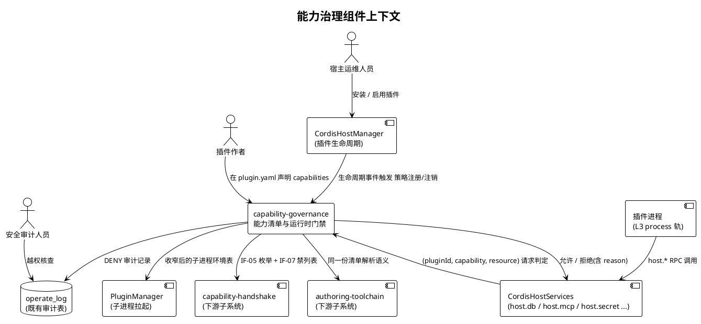
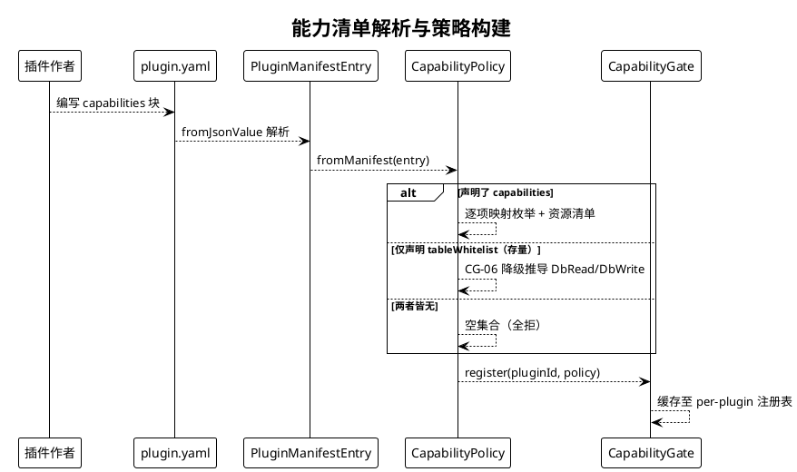
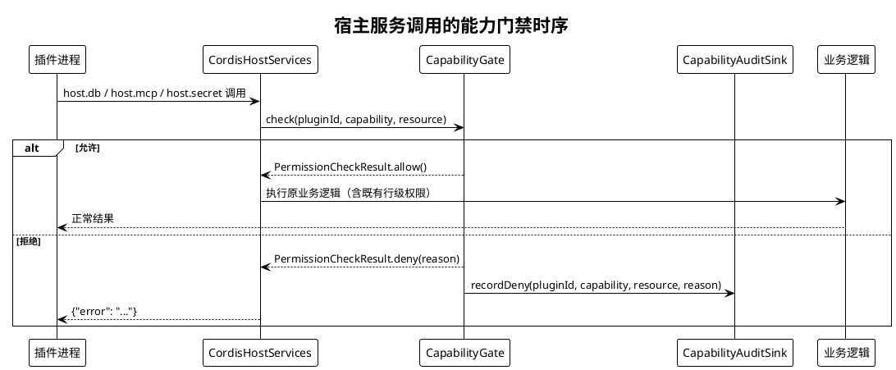
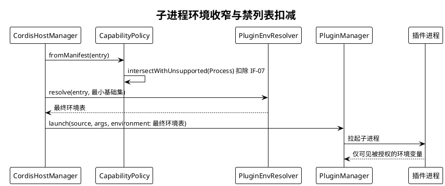
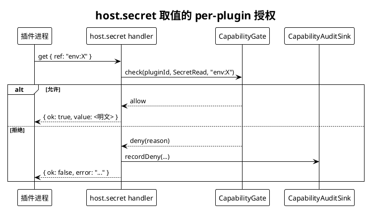
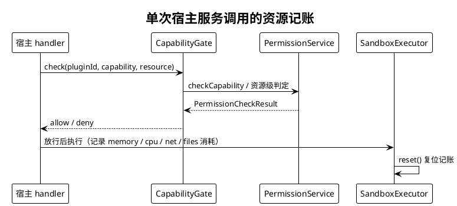
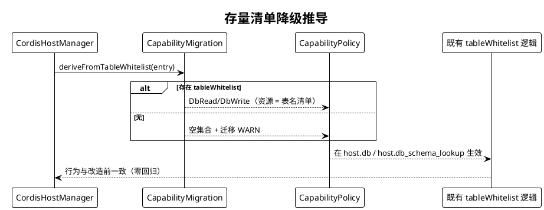

# 能力清单与运行时门禁（capability-governance）组件规格

> 所属主工程：`plugin-system-enhancement` ｜ 子系统 `feature_name`：`plugin-system-enhancement--capability-governance`
> 契约版本 `v1`（冻结状态：草案）｜ 配套：`contract.md` / `design.md` / `tasks.md`
> 需求来源：`docs/ref/plugin-mechanism-comparison-wx.html` §9 建议 2 ｜ 关联条款：`SPECS_INDEX.md` §7 R-02 / R-03 / R-04
> 验收档位：L1（本子系统自测）+ L2（跨子系统集成）+ L3（主工程端到端）
> 验收条件统一采用 **EARS** 句式（见 `templates/ears-format.md`）；触发词保持英文，可变部分中文化。

---

# 1. 组件定位

## 1.1 核心职责

本组件负责**判定插件可以使用哪些宿主能力**，实现「未声明即不可用、跨进程拿不到的一律不给」的缺省全拒安全边界。

## 1.2 核心输入

| 输入 | 来源 | 内容概要 |
|---|---|---|
| 插件清单能力声明 | `plugin.yaml` 的 `capabilities` 块（经 `PluginManifestEntry.fromJsonValue` 解析） | 每个能力维度下的资源允许清单（表名 / MCP alias+tool / env 名 / secret 引用名 / 路径前缀） |
| 存量降级声明 | `plugin.yaml` 的 `tableWhitelist`（CG-06 迁移通道） | 历史仅有的 DB 表白名单，用于推导等价的 DB 读/写能力 |
| 宿主服务调用请求 | `CordisHostServices` 六个 `host.*` handler 收到的 `JsonValue` 参数 | `host.db` / `host.db_schema_lookup` / `host.mcp` / `host.secret` / `host.log` / `host.cache` / `host.event` |
| 插件实例生命周期事件 | `CordisHostManager` 的 Active 状态钩子（`cordis_host_manager.cj:87-108`） | 触发注册/注销某 pluginId 的 `CapabilityPolicy` |
| 插件进程启动请求 | `PluginManager.launchStdio`（`libs/cordis-cj/cordis_host/src/plugin_manager.cj:91`） | 待过滤/构造的子进程环境变量表 |

## 1.3 核心输出

| 输出 | 目标 | 内容概要 |
|---|---|---|
| 允许/拒绝判定 | 各 `host.*` handler 内部 | `PermissionCheckResult`（`allowed` / `reason` / `deniedOperations`） |
| 统一拒绝错误结构 | 发起调用的插件进程 | `{"error": "<reason>"}`（与既有 `dbError` / `mcpError` / `secretError` 同构） |
| 收窄后的子进程环境 | `launch(entry, environment:)` | 仅含最小基础集 + 声明且授权的 env |
| DENY 审计记录 | `operate_log`（经 CG-03） | pluginId / capability / resource / reason / 时间 |
| 能力枚举与禁列表常量 | `capability-handshake`、`authoring-toolchain` | `PluginCapability` 枚举、`HostUnsupportedCapabilities` 集合 |

## 1.4 职责边界

本组件**不负责**：

1. **不负责**判定插件「实际注册了什么能力」—— 标量比对与拒绝挂载归 `capability-handshake`（IF-08/IF-09）。
2. **不负责**版本协商与加载前拒绝 —— 归 `version-guard`（IF-01/IF-03）。
3. **不负责**插件模板生成与 `plugin validate` CLI —— 归 `authoring-toolchain`（IF-12）。
4. **不负责**崩溃退避 / 重启计数 / 风暴熔断 —— 归 `lifecycle-observability`。`ResourceLimits` 的 CPU/内存/超时是**单次执行额度**，与之不共享计数器。
5. **不负责**依赖拓扑推导 —— 归 `dependency-graph`。
6. **不负责** OS 级进程强制（cgroup / Windows Job Object）。`SandboxExecutor` 仅做**记账与异常捕获**（`sandbox_executor.cj:104-136`），无 OS 级强制能力，本轮不承诺。
7. **不负责** `dylib` 轨接线 —— 该轨运行时不可达（`SPECS_INDEX` R-01）。
8. **不负责**行级权限判定本身 —— 沿用宿主侧既有附加（`cordis_host_services.cj:470-473`），本组件只在它之前多一道能力门禁。

---

# 2. 领域术语

**能力（Capability）**
: 插件可以请求宿主代为执行的一类受控动作，用一个稳定的枚举要素（`PluginCapability`）表示，承载契约 IF-05。
: 备注：本轮覆盖六个维度 —— 数据库表、网络出口、文件访问、子进程派生、环境变量、凭证取值。

**资源适应度（Resource Scope）**
: 某一能力被授予时允许操作的对象清单，如 `db.read` 的允许表名集合、`net.egress` 的允许 `mcpAlias/tool` 集合。
: 备注：能力 grant ≠ 资源 grant；能力未声明时资源清单被整体忽略。

**能力策略（CapabilityPolicy）**
: 一个插件被授予的全部能力及其资源适应度的集合，是 `CapabilityGate` 做判定的唯一依据；缺省为**空集**（全拒）。

**缺省全拒（Deny by Default）**
: 未在清单中显式声明的能力一律不允许，无论其资源清单是否填写；列表为空与列表缺失等价。

**能力门禁（CapabilityGate）**
: 宿主侧的判定点（Policy Decision Point），输入 `(pluginId, capability[, resource])`，输出允许/拒绝；承载契约 IF-06。

**跨进程禁列表（HostUnsupportedCapabilities）**
: 宿主在当前传输层（stdio + JSON-RPC）下**无法强制**或**无对应宿主服务**的能力集合；对 `mode: process` 插件恒拒。承载契约 IF-07。

**宿主环境泄漏（Host Environment Leak）**
: 插件子进程被发现接收了宿主进程全部环境变量的现象（`libs/cordis-cj/cordis_host/src/plugin_manager.cj:98-101` 全量 `getVariables()`），违反 `plugin.yaml.env` 字段注释声明的语义（`src/plugin/plugin_config.cj:100-101`）。

**凭证引用名（Secret Reference）**
: 插件向 `host.secret` 索取凭证时使用的间接标识，形如 `env:NAME` 或通道 code；插件不得直接获得 `.env` 明文。

**降级推导（Migration Derivation）**
: 对未声明 `capabilities` 但有 `tableWhitelist` 的存量清单，推导出等价 DB 读/写能力以保持零回归（CG-06）。

---

# 3. 角色与边界

## 3.1 核心角色

- **插件作者**：在 `plugin.yaml` 的 `capabilities` 块声明所需能力及其资源适应度；声明不全即运行期被拒。
- **宿主运维人员**：安装/启用插件，依据 DENY 审计日志定位插件为何拿不到某项能力。
- **安全审计人员**：读取 `operate_log` 中的 DENY 记录，核查是否存在越权尝试。

## 3.2 外部系统

- **`CordisHostServices`**：宿主侧六个宿主服务 handler 的集合，是本组件唯一的运行时判定点调用方。
- **`CordisHostManager`**：插件宿主生命周期管理，提供 Active 钩子用于注册/注销策略。
- **`PluginManager`（vendored cordis-cj）**：拉起插件子进程，本组件需要它按 CG-04 输出的环境表启动。
- **`capability-handshake`（下游子系统）**：消费 IF-05 枚举与 IF-07 常量表做宣告比对。
- **`authoring-toolchain`（下游子系统）**：消费同一份清单解析语义做静态校验。

## 3.3 交互上下文

---

# 4. DFX约束

## 4.1 性能

1. **P-01**：`CapabilityGate.check` 单次判定（不含 I/O）必须 < 1 ms（P99），且**不得**触发数据库查询或网络调用。
2. **P-02**：策略结构必须在插件 Active 时**一次性构建**并缓存；hot path 上只允许内存集合查找，**禁止**每次调用重新解析 `plugin.yaml`。
3. **P-03**：资源适应度集合的成员查找必须走哈希结构，禁止对列表做线性扫描导致 O(n) 随注册表规模放大。
4. **P-04**：宿主启动加载全部插件（既有 51 skill 插件 + 4 sync 插件）时，策略构建总耗时增加不得超过基线 5%。

## 4.2 可靠性

1. **R-01（失败即关闭）**：清单解析失败、未知能力名、未知 pluginId 一律按**拒绝**处理，**禁止** fail-open。
2. **R-02（不阻断宿主）**：门禁内部任何异常都必须被捕获并转成拒绝 + `ERROR` 日志，**禁止**向上抛到 cordis RPC 层导致宿主崩溃或插件进程残留。
3. **R-03（审计不阻断）**：CG-03 审计写入失败只记 `ERROR`，**不得**改变判定结果或阻断调用。
4. **R-04（幂等）**：同一 `pluginId` 重复注册以最后一次为准；注销后再次 `check` 必须拒绝。

## 4.3 安全性

1. **S-01（缺省全拒）**：未显式声明的能力一律拒绝；空列表与缺失等价。
2. **S-02（宿主环境收窄）**：插件子进程**不得**继承未声明的宿主环境变量；已知可利用者（如 `orm_connectionUrl`、LLM key）必须在回归用例中显式验证为不可见。
3. **S-03（凭证按插件授权）**：`host.secret` 必须按 `secret.read` 资源清单做 per-plugin 授权；拒绝响应**不得**包含任何明文片段。
4. **S-04（可逆无误导）**：拒绝原因串可以说明「缺哪个能力 / 哪个资源不在清单」，**不得**回显被保护对象的实际值。
5. **S-05（拒绝必审计）**：每一次 DENY 必须产生一条审计记录，包含 pluginId、能力、资源、原因。
6. **S-06（不自行解释权限）**：行级权限判定沿用既有宿主实现，本组件**不得**覆盖或放宽其结果。

## 4.4 可维护性

1. **M-01**：拒绝原因为机器可读的固定格式，至少包含 `capability` 与 `resource` 两个可提取片段。
2. **M-02**：同一结构化原因串同时供给日志、`operate_log` 与下游 `plugin validate`，避免三处各写一套文案。
3. **M-03**：新增能力维度时必须同时更新 `PluginCapability` 枚举、`CapabilityPolicy` 与 IF-07 常量表三处，缺一视为未完成。

## 4.5 兼容性

1. **C-01（存量零回归）**：既有 51 个 skill 插件与 4 个 sync 插件在**不修改清单**的前提下行为不得变化（`SPECS_INDEX` §5.1 用例 5）。经 CG-06 降级推导的结果必须与历史 `tableWhitelist` 语义等价。
2. **C-02（新字段可选）**：`capabilities` 为可选字段；旧清单不带该字段时**不得**解析失败。
3. **C-03（不改变宿主服务协议）**：`host.*` 六类 RPC 的方法名与既有请求/响应字段不得因本组件而变动；仅新增拒绝分支。

---

# 5. 核心能力

## 5.1 能力清单声明与缺省全拒策略（IF-05）

### 5.1.1 业务规则

1. **能力维度覆盖规则**：能力枚举必须至少覆盖以下六个维度，**缺任何一个维度视为未完成**：
   | 维度 | 枚举要素 | 资源适应度的单位 |
   |---|---|---|
   | 数据库表读取 | `DbRead` | 表名 |
   | 数据库表写入 | `DbWrite` | 表名 |
   | 网络出口 | `NetEgress` | `mcpAlias` 或 `mcpAlias/tool` |
   | 文件访问 | `FileRead` / `FileWrite` | 路径前缀 |
   | 子进程派生 | `ProcessSpawn` | 可执行名白名单 |
   | 环境变量 | `EnvRead` | 环境变量名 |
   | 凭证取值 | `SecretRead` | `env:NAME` 或 通道 code |

   a. 验收条件：When 一份清单声明了上表七个枚举要素中的任意真子集, the CapabilityPolicy shall 只授予该子集，其余全部标记为拒绝。

2. **缺省全拒规则**：未在 `capabilities` 中显式声明的能力一律拒绝；空列表与字段缺失等价。
   a. 验收条件：When 清单缺失 `capabilities` 块（且无 `tableWhitelist`）, the CapabilityPolicy shall 返回空的能力集合，且对该插件的任何 `host.db` / `host.mcp` / `host.secret` 请求返回拒绝。

3. **资源适应度规则**：能力已授予但目标资源不在其资源清单内时仍须拒绝。
   a. 验收条件：While 插件已获得 `DbRead` 且其资源清单为 `["agent_skills"]`, when 该插件请求访问表 `agent_tasks`, the CapabilityGate shall 返回拒绝并在原因中指明该表名。

4. **清单格式非法即关闭规则**：能力名不在枚举内、资源清单类型错误等情形按解析失败处理。
   a. 验收条件：If 清单中的能力名不属于 `PluginCapability` 枚举, the CapabilityPolicy shall 忽略该项、记为拒绝并输出 `WARN`，且**不得**因此使整个清单解析失败。

5. **禁止项**：禁止出现「能力未声明但因其资源清单非空而放行」的语义。
   a. 验收条件：When 清单中某能力的资源清单非空但能力本身未被列入授予集合, the CapabilityGate shall 返回拒绝。

### 5.1.2 交互流程

### 5.1.3 异常场景

1. **能力名不在枚举内**
   a. 触发条件：清单出现 `PluginCapability` 未定义的字符串。
   b. 系统行为：忽略该项，其余能力照常解析，输出 `WARN`，解析不失败。
   c. 用户感知：运行期日志输出 `WARN` 并指明该能力名无效；随后对该能力的调用返回 `{"error": ...}`。

2. **既有清单不带 `capabilities`（防回退场景）**
   a. 触发条件：存量 51 个 skill 插件与 4 个 sync 插件的原清单被加载。
   b. 系统行为：走 CG-06 降级推导，产出与 `tableWhitelist` 等价的 DB 能力，**不**追加任何新能力。
   c. 用户感知：行为与改造前一致，仅日志多一条迁移提示 `WARN`。

## 5.2 运行时能力门禁判定（IF-06）

### 5.2.1 业务规则

1. **统一前置判定规则**：宿主服务 handler 必须在执行业务逻辑**之前**调用 `CapabilityGate.check`。
   a. 验收条件：When 任一 `host.db` / `host.db_schema_lookup` / `host.mcp` / `host.secret` handler 收到请求, the 对应 handler shall 在查询/调用之前先完成一次能力门禁判定。

2. **DB 读写分离规则**：既有 `tableWhitelist` 对 query/execute/count 三种操作一律放行（`cordis_host_services.cj:476-482`），本轮须拆分为读能力与写能力。
   a. 验收条件：While 插件仅获得 `DbRead`, when 该插件发起 `operation="execute"` 的写操作, the CapabilityGate shall 返回拒绝。

3. **网络出口按 alias/tool 授权规则**：`host.mcp` 现有实现只校验 alias 与 tool 非空（`cordis_host_services.cj:1162-1173`），本轮须按资源清单拦截。
   a. 验收条件：While 插件获得 `NetEgress` 且资源清单为 `["tianyancha/company_info"]`, when 该插件调用 alias 为 `tianyancha`、tool 为 `risk_scan`, the CapabilityGate shall 返回拒绝。

4. **未知插件从严规则**：未在注册表中的 pluginId 一律拒绝。
   a. 验收条件：If `check` 收到的 `pluginId` 不在注册表中, the CapabilityGate shall 返回拒绝且不抛异常。

5. **行级权限不覆盖规则**：能力门禁放行后，既有行级权限附加逻辑必须照旧执行。
   a. 验收条件：When 能力门禁对一次 DB 查询放行, the CordisHostServices shall 继续执行既有宿主侧行级权限附加（`cordis_host_services.cj:470-473`），不得跳过或放宽。

6. **禁止项**：禁止门禁拒绝时向上抛异常穿过 cordis RPC 层。
   a. 验收条件：If 门禁返回拒绝, the 对应 handler shall 返回该 handler 既有的错误结构而非抛出异常。

### 5.2.2 交互流程

### 5.2.3 异常场景

1. **插件请求未声明的能力**
   a. 触发条件：插件调用其 policy 中不存在的能力。
   b. 系统行为：判定拒绝，写 DENY 审计，返回统一错误结构。
   c. 用户感知：`{"error": "..."}`，错误串含缺失的能力标识；插件进程不崩溃、不残留。

2. **审计写入失败**
   a. 触发条件：`operate_log` 写入抛出异常。
   b. 系统行为：捕获并记录 `ERROR`，判定结果与响应不受影响。
   c. 用户感知：与正常拒绝一致，无额外报错。

## 5.3 跨进程能力禁列表与宿主环境收窄（IF-07）

### 5.3.1 业务规则

1. **禁列表恒拒规则**：对 `mode: process` 插件，`HostUnsupportedCapabilities` 中的能力必须被剔除，与该能力在清单中的声明无关。
   a. 验收条件：When 一份 process 模式清单声明了属于 `HostUnsupportedCapabilities` 的能力, the CapabilityPolicy shall 在构建阶段将其剔除并输出 `WARN`。

2. **禁列表构成规则**：禁列表必须至少包含以下宿主**无 Enforcement 通道**的能力：直接文件读写跨越任意路径、跨进程代为派生子进程、继承宿主全部环境、直接套字节直连网络、无限制资源消耗。
   a. 验收条件：When `capability-handshake` 读取该常量表, the HostUnsupportedCapabilities shall 返回上述类别对应的枚举要素全集，且与 `authoring-toolchain` 静态审计所用为同一份集合。

3. **宿主环境收窄规则**：插件子进程的环境变量集 = 宿主最小基础集 ∪ （清单 `env` 声明项 ∩ `EnvRead` 资源清单）。
   a. 验收条件：When 拉起一个 process 模式插件, the PluginEnvResolver shall 输出一份不包含任何未声明宿主环境变量的环境表。

4. **环境变量 confinement 与 DLL 加载共存规则**：收窄后的环境必须仍保证 Windows 下子进程能加载依赖 DLL（既有 PATH 注入机制见 `libs/cordis-cj/cordis_host/src/plugin_manager.cj:92-154`）。
   a. 验收条件：While 宿主运行在 Windows, when 拉起既有 process 插件, the 子进程 shall 仍能成功加载依赖库并完成启动。

5. **禁止项**：禁止为图省事把宿主环境全量继承后再做黑名单过滤。
   a. 验收条件：When 构造子进程环境, the PluginEnvResolver shall 以最小基础集为起点做白名单叠加，而非从宿主全量环境做扣减。

### 5.3.2 交互流程

### 5.3.3 异常场景

1. **清单声明了 `env` 项但未声明 `EnvRead` 能力**
   a. 触发条件：`plugin.yaml.env` 非空而 `capabilities.env.read` 未列出同名变量。
   b. 系统行为：该变量不进入子进程环境，记 `WARN`。
   c. 用户感知：插件读取该环境变量得到空值；日志可查到未注入原因。

2. **收窄后子进程因 PATH 缺失而启动失败**
   a. 触发条件：最小基础集遗漏了依赖库搜索路径所需的变量。
   b. 系统行为：插件启动失败，宿主记 `ERROR` 并按既有 reconcile 语义处理，**不得**因此回退到全量继承。
   c. 用户感知：插件状态异常，日志指出 PATH 相关变量缺失，引导在 `capabilities.env.read` 中补齐。

## 5.4 凭证取值授权（host.secret 修复）

### 5.4.1 业务规则

1. **Per-plugin 授权规则**：`host.secret` 的 `env:NAME` 分支（`cordis_host_services.cj:116-128`）必须先过 `SecretRead` 的资源清单校验，再取值。
   a. 验收条件：While 插件的 `SecretRead` 资源清单为 `["env:OPENAI_API_KEY"]`, when 该插件索取 `env:DB_PASSWORD`, the CordisHostServices shall 返回拒绝且响应中不含任何明文。

2. **通道 code 同理规则**：非 `env:` 前缀的引用按通道 code 解析（`cordis_host_services.cj:132-141`），同样受 `SecretRead` 资源清单约束。
   a. 验收条件：When 插件索取一个不在其资源清单内的通道 code, the CordisHostServices shall 返回拒绝。

3. **`has` 与 `get` 同权规则**：只判断存在性的 `method="has"` 也不得绕过授权。
   a. 验收条件：When 插件对未授权引用名发起 `method="has"`, the CordisHostServices shall 返回拒绝而非布尔结果。

4. **禁止项**：禁止任何分支在未过门禁的情况下返回凭证明文。
   a. 验收条件：If `SecretRead` 门禁返回拒绝, the host.secret handler shall 返回既有 `secretError` 结构且响应体中不出现 `value` 字段。

### 5.4.2 交互流程

### 5.4.3 异常场景

1. **插件索取任意环境变量**
   a. 触发条件：插件在未获授权情况下遍历式索取 `env:*`。
   b. 系统行为：逐次拒绝并审计；连续拒绝达到阈值时记 `WARN`（阈值取值为默认策略的一部分，具体数值待 design §4 确定前以 `WARN` 单次记录为兜底）。
   c. 用户感知：`{"ok": false, "error": "..."}`，无明文泄漏。

2. **引用名缺参或格式非法**
   a. 触发条件：`ref` 为空串或缺少 `env:` / code 形式。
   b. 系统行为：沿用既有参数校验（`cordis_host_services.cj:111-113`），先于门禁返回参数错误。
   c. 用户感知：`{"ok": false, "error": "缺少参数 ref..."}`（维持既有文案不变）。

## 5.5 资源限额与沙箱记账

### 5.5.1 业务规则

1. **单次执行限额规则**：必须存在 CPU 时间、内存、网络字节数、文件操作数的限额定义，缺省值沿用既有 `ResourceLimits.default()`（`src/skill/domain/models/capability.cj:122-129`：内存 100 MB、CPU 30 s、网络 10 MB、文件操作数 100）。
   a. 验收条件：When 未显式指定限额, the CapabilityPolicy shall 采用上述既有缺省值，不得另设一套不同的默认数。

2. **超时判定规则**：单次宿主服务调用超过策略超时（缺省 30 s，同源于 `SecurityPolicy.default()` 的 `executionTimeoutMs`）必须被拒。
   a. 验收条件：If 一次宿主服务调用的执行时长超过 `executionTimeoutMs`, the CapabilityGate shall 返回拒绝并记审计。

3. **记账 Reset 规则**：执行结束后必须复位 Usage，不得跨调用累积导致误拒。
   a. 验收条件：When 一次宿主服务调用完成, the SandboxExecutor shall 调用既有 `reset()`（`sandbox_executor.cj:142-145`）复位记账。

4. **禁止项**：禁止把资源限额与崩溃自愈的重启计数混用同一计数器。
   a. 验收条件：When 记录一次资源限额拒绝, the CapabilityGate shall 不修改任何属于 `lifecycle-observability` 的计数状态（本组件不持有该状态）。

### 5.5.2 交互流程

### 5.5.3 异常场景

1. **超限被拒**
   a. 触发条件：累计用量超过 `ResourceLimits` 任一上限。
   b. 系统行为：拒绝本次调用并审计；已记账用量按 §5.5.1 规则 3 复位。
   c. 用户感知：`{"error": "..."}` 表明超限类型与阈值。

2. **宿主无法采集子进程用量**
   a. 触发条件：跨平台缺少统一用量采集手段。
   b. 系统行为：该项用量保持 0 且**不做**基于它的拒绝（避免无据拒绝），记 `WARN`。
   c. 用户感知：无感知；拒绝行为与今日一致（不回归）。

## 5.6 存量清单迁移兼容（CG-06）

### 5.6.1 业务规则

1. **降级推导规则**：清单未声明 `capabilities` 但声明了 `tableWhitelist` 时，推导 `DbRead` + `DbWrite` 且资源清单 = `tableWhitelist`。
   a. 验收条件：When 加载一份仅含 `tableWhitelist: ["agent_skills"]` 的存量清单, the CapabilityMigration shall 推导出 `DbRead`/`DbWrite` 且资源清单恰为 `["agent_skills"]`。

2. **无声明即全拒规则**：两者皆无时推导结果为空并输出迁移提示。
   a. 验收条件：When 加载一份既无 `capabilities` 也无 `tableWhitelist` 的清单, the CapabilityMigration shall 返回空集合且产生一条迁移 `WARN`。

3. **新声明优先规则**：一旦清单声明了 `capabilities`，`tableWhitelist` **不再**参与推导。
   a. 验收条件：While 清单同时声明了 `capabilities` 与 `tableWhitelist`, when 构建策略, the CapabilityPolicy shall 仅依据 `capabilities`，忽略 `tableWhitelist`。

4. **禁止项**：禁止在降级推导中「顺手」额外授予清单未隐含的能力（如一并授予 `NetEgress`）。
   a. 验收条件：When 走降级推导路径, the CapabilityMigration shall 最多只产出 DB 读/写两类能力。

### 5.6.2 交互流程

### 5.6.3 异常场景

1. **存量清单的 `tableWhitelist` 为空列表**
   a. 触发条件：清单显式写了 `tableWhitelist: []`。
   b. 系统行为：推导出的资源清单为空，**沿用**既有「无白名单即拒绝」的行为（`cordis_host_services.cj:464-467`）。
   c. 用户感知：DB 调用被拒，原因串语义与改造前一致。

2. **宿主配置为「强制要求显式声明」**
   a. 触发条件：宿主开启严格模式后的过渡期内尚有存量未迁移。
   b. 系统行为：仅 `WARN`，不阻断加载；阻断与否由 `authoring-toolchain` 的 `plugin validate` 决定，本组件不参与。
   c. 用户感知：功能不受影响，仅在日志/体检报告中提示待迁移。

---

# 6. 数据约束

## 6.1 CapabilityPolicy（能力策略）

1. **pluginId**：宿主内唯一标识，取值必须与 `plugin.yaml` 的 `name` 一致；作为注册幂等键；空串非法。
2. **mode**：取值枚举 `Sync` / `Dylib` / `Process`；决定是否参与 IF-07 扣减。`Dylib` 轨运行时不可达，其能力行为不保证（`SPECS_INDEX` R-01）。
3. **grantedCapabilities**：已被授予的能力集合，元素必须来自 `PluginCapability` 枚举；缺省为空集合。
4. **resourceScopes**：以能力为键、资源字符串集合为值的映射；能力未出现在 `grantedCapabilities` 时对应资源集合被忽略。
5. **resourceLimits**：`maxMemory` / `maxCpuTime` / `maxNetworkBytes` / `maxFileOperations` 四项，缺省取既有 `ResourceLimits.default()` 数值。
6. **executionTimeoutMs**：单次执行超时毫秒数，缺省 30000；必须为正整数。
7. **derivedFromLegacy**：布尔标记，标识该策略是否由 CG-06 降级推导产生；为真时禁止再叠加任何非 DB 能力。

## 6.2 CapabilityDecision（拒绝结果）

1. **pluginId**：触发判定的插件标识，必填非空。
2. **capability**：被判定的能力枚举要素，必填。
3. **resource**：被判定的具体资源标识；能力级判定时为空串，**不得**为 none 值。
4. **reason**：机器可读的原因串，必须可解析出 `capability` 与 `resource` 片段；**禁止**包含被保护对象的实际值。
5. **deniedAt**：判定时刻毫秒时间戳。
6. **source**：归属的宿主服务名，取值限定为 `host.db` / `host.db_schema_lookup` / `host.mcp` / `host.secret` / `host.log` / `host.cache` / `host.event` / `plugin-launch` 之一。

## 6.3 子进程环境条目（EnvEntry）

1. **name**：环境变量名；不得与宿主最小基础集之外、且未被清单声明的宿主变量同名。
2. **value**：变量值；来源只能是「清单 `env` 块原文」或「宿主最小基础集计算值」，**禁止**为宿主任意环境变量的透传。
3. **origin**：取值 `base`（最小基础集）或 `declared`（清单声明），用于审计区分。
4. **约束**：`base` 类变量的函数集合必须在 `design.md` 中固化清单，新增成员需说明必要性，**禁止**把宿主业务变量放入 `base`。

## 6.4 清单 capabilities 块（输入配置）

1. **格式**：映射结构，键为能力标识串（`db.read` / `db.write` / `net.egress` / `fs.read` / `fs.write` / `proc.spawn` / `env.read` / `secret.read`），值为字符串列表（资源适应度）。
2. **可选性**：整块可选；缺失时按 §5.6 降级或全拒处理。
3. **未知键**：不在上述八项内的键按 §5.1.1 规则 4 忽略并 `WARN`，**不得**导致解析失败。
4. **与 `tableWhitelist` 的关系**：同时出现时 `capabilities` 优先（§5.6.1 规则 3）；`tableWhitelist` 在本轮**不移除**，仅降级为迁移输入。
