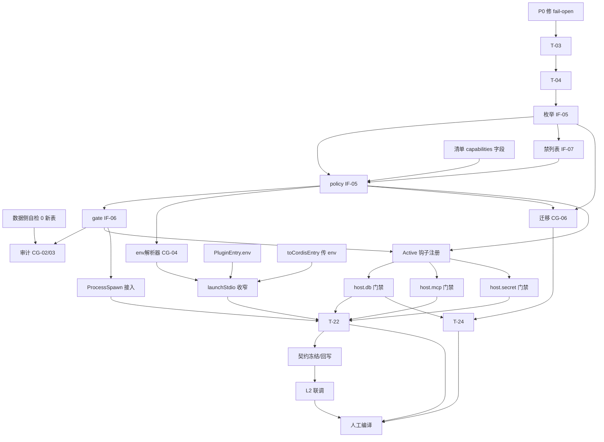

# 任务规划文档（capability-governance）

> 基于 `spec.md` 与 `design.md` 生成。实施原则：**复用优先**、**确定性优先**、**L3 进程隔离**（如适用）。
> 仓颉代码编写须使用 cangjie-coder 技能；**严禁运行 cjpm build**（编译与回传由人工在独立 cmd 环境完成）。
> 本文件 task 数目：**25 条**（满足 ≥3 且 ≤40）。

## 文档信息

| 项 | 值 |
|---|---|
| 关联需求 | `specs/plugin-system-enhancement--capability-governance/spec.md` |
| 关联设计 | `specs/plugin-system-enhancement--capability-governance/design.md` |
| 关联契约 | `specs/plugin-system-enhancement--capability-governance/contract.md`（IF-05/06/07 + CG-01~06） |
| 主工程账本 | `specs/plugin-system-enhancement/SPECS_INDEX.md`（§2 登记行：v1 / 9 接口 / 0 新表；§7 R-02/R-03/R-04） |
| 生成日期 | 2026-10-19 |
| 版本 | v1 |
| 状态 | 草稿（待主工程闸口放行开工） |
| 验收档位 | L1 + L2 + L3 |

---

## 开发规范（全任务强制遵守）

- **语言与工具绑定**：仓颉 → `cangjie-coder`；前端（HTML/CSS/TS）→ `web-coder` / `fullstack-codegen`；原生 App → `app-coder`。本子系统无前端产物。
- **二次开发底座优先（本仓 runtime / uctoo 强制）**：
  1. **规范源**：先加载 `skills/uctoo-dev-manual/`，按要做的事读对应 `docs/uctoo-v4/*.md`
     （权限口径 → `user-permission-system.md` / `row-level-permission-system.md`；表/字段判定 → `uctoo-database-design-specification.md`；
     中间件 → `uctoo-v4-middleware-guide.md`；分层与统一错误响应 → legacy `design-principles.md`）。
  2. **脚手架优先确定性代码生成工具**：本子系统**无新增表/列、无新增宿主 HTTP 路由**，因此**不触发**
     `loaddbinfo → plugingen/crudgen → crudweb` 链。**任何实现中若发现确需新列，必须先停下、回主工程
     `SPECS_INDEX.md` §6 登记并写明复用不成立理由**，再走上述链使用确定性生成，禁止手写 DDL。
  3. **生成后必补**：本轮**无** `sql/incremental/` 产出、**无** `permissions` / `role_has_permission` 登记
     （理由见 T-02 的结论记录）；此结论不得由后续任务隐式推翻。
- **大工程拆分态（铁律 15，本任务是子系统级，强制）**：
  1. 已读主工程 `SPECS_INDEX.md`；本子系统 `feature_name = plugin-system-enhancement--capability-governance`，
     上游依赖 `version-guard(minor)`，下游 `capability-handshake` / `authoring-toolchain`。
  2. **边界写进任务**：每条任务显式标注 **「本子系统负责」/「不碰（移交 / 调用上游）」**；跨子系统一律落成
     「调用上游契约接口」或「提供接口等下游消费」，禁止写成"顺手也改一下 X 模块"。
  3. **跨子系统接口改动成对成条**：本次 IF-05/06/07 的提供方侧在本子系统（T-05~T-09、T-21），
     消费方侧（`capability-handshake` 的宣告比对、`authoring-toolchain` 的 validate）**不在本任务列表内**，
     由各自子系统自行承接。
  4. **契约先行**：T-05~T-09 逐条标注契约条目编号；IF-06 的资源级重载属 **minor**（向后兼容），
     需显式更新 `contract.md` §5 与 SPECS_INDEX §3。
  5. **验收带跨边界冒烟**：验收清单须含 ≥3 条跨子系统主干 + 1 条异常（见文末终验清单）。
  6. **禁止跨界手写**：不直连其他子系统私有表/私有目录；vendored `libs/cordis-cj/` 的改动需在回滚面登记（T-15/T-16）。
- **编译约束**：**AI 不运行 `cjpm build`**；编译、类型检查、lint 由人工在独立 cmd 环境执行并回传（T-25）。
- **复用原则**：优先复用 `design.md` §2.2 清单所列既有设施（`Capability` / `SecurityPolicy` / `ResourceLimits` /
  `PermissionCheckResult` / `PermissionService` / `SandboxManager` / `SandboxExecutor` / `LogUtils` / `operate_log`），
  **不重新实现**。`design.md` §2.4 已裁定「改造复用」，任务不得偏离该结论。
- **命名/注释/错误处理**：遵循 `uctoo-dev-manual` 与 legacy `design-principles.md`（分层、RESTful、软删除、统一错误响应）。
- **事实纪律**：所有代码结论必须带 `文件:行号` 证据；查不到的标 **「待核实」**（汇总见 `design.md` §11.2 O-1~O-6），
  **禁止编造 API**。
- **进度与日志**：遵循既有日志/进度通道约定；多轮修订须在文末留痕。

---

## 任务总览

| 编号 | 任务 | 关联需求(spec §) | 关联设计(design §) | 本/外子系统 | 状态 | 预计产出 |
|---|---|---|---|---|---|---|
| T-01 | 修复 `checkCapability` 未知类型 fail-open（G-0） | §4.2 R-01、§5.1.1 规则 2 | §2.3 G-0 | 本子系统 | 待开始 | `permission_service.cj` 改造 |
| T-02 | 数据侧自检：确认 0 新表 0 新列并留证 | §4 全部、§6 | §5.2 | 本子系统 | 待开始 | 结论记录（无 DDL 产出） |
| T-03 | `checkFileSystemAccess` / `checkNetworkAccess` / `checkCommandExecution` 补资源级匹配（G-1） | §5.1.1 规则 3 | §2.3 G-1 | 本子系统 | 待开始 | `permission_service.cj` 改造 |
| T-04 | 能力类型集合扩展到八项（G-2） | §5.1.1 规则 1、§6.4 | §2.3 G-2、§4.1 | 本子系统 | 待开始 | `permission_service.cj` + `capability.cj` 注释口径 |
| T-05 | `plugin_capability.cj`：枚举 + 双向映射（IF-05） | §5.1.1 规则 1 | §4.1 | 本子系统 | 待开始 | 新文件 |
| T-06 | `capability_policy.cj`：`fromManifest` + `intersectWithUnsupported`（IF-05 / CG-05） | §5.1.1、§5.3.1 规则 1 | §4.2 | 本子系统 | 待开始 | 新文件 |
| T-07 | `capability_gate.cj`：`register` / `unregister` / `check`（IF-06 / CG-01） | §5.2.1 | §4.3 | 本子系统 | 待开始 | 新文件 |
| T-08 | `host_unsupported_capabilities.cj`：IF-07 常量表 + 理由说明表 | §5.3.1 规则 2 | §4.5 | 本子系统 | 待开始 | 新文件 |
| T-09 | `plugin_env_resolver.cj`：子进程环境白名单构造（CG-04） | §5.3.1 规则 3/4/5 | §4.4 | 本子系统 | 待开始 | 新文件 |
| T-10 | `CapabilityDecision` + `CapabilityAuditSink`：DENY 落 `operate_log`（CG-02/CG-03/G-6） | §4.3 S-05、§4.4 M-01/M-02 | §2.3 G-6、§4.3.3 | 本子系统 | 待开始 | 新文件 + `OperateLogService` 形参扩展 |
| T-11 | `CapabilityMigration`：存量 `tableWhitelist` 降级推导（CG-06） | §5.6.1、§4.5 C-01 | §4.2.2 | 本子系统 | 待开始 | 新文件 |
| T-12 | `plugin_config.cj` 新增 `capabilities` 字段与解析 | §5.1.1、§6.4 | §3.2、§4.2.3 | 本子系统 | 待开始 | `plugin_config.cj` 改造 |
| T-13 | `CordisHostManager` Active 钩子注册/注销策略（CG-01 接线） | §5.2.1 规则 1 | §4.3.2 | 本子系统 | 待开始 | `cordis_host_manager.cj` 改造 |
| T-14 | `toCordisEntry` 传入 `entry.env`（消除解析后未消费的死字段） | §5.3.1 规则 3 | §4.4.1、§4.4.3 | 本子系统 | 待开始 | `cordis_host_manager.cj` 改造 |
| T-15 | vendored `PluginEntry` 增加 `env` 字段并纳入序列化（G-7） | §5.3.1 规则 3 | §2.3 G-7、§4.4.3 | 本子系统 | 待开始 | `libs/cordis-cj/cordis_core/src/config.cj` 改造 |
| T-16 | `launchStdio` 改为接收外部提供的基底环境（R-03a 修复） | §4.3 S-02、§5.3.1 | §4.4.2、§4.4.3 | 本子系统 | 待开始 | `libs/cordis-cj/cordis_host/src/plugin_manager.cj` 改造 |
| T-17 | `host.secret` per-plugin 授权门禁（R-03b 修复） | §5.4.1 | §4.6 | 本子系统 | 待开始 | `cordis_host_services.cj` 改造 |
| T-18 | `host.db` / `host.db_schema_lookup` 门禁接入 + 读写分离 | §5.2.1 规则 2/5 | §4.6 | 本子系统 | 待开始 | `cordis_host_services.cj` 改造 |
| T-19 | `host.mcp` 按 alias/tool 白名单拦截 | §5.2.1 规则 3 | §4.6 | 本子系统 | 待开始 | `cordis_host_services.cj` 改造 |
| T-20 | `ProcessSpawn` 派生点门禁接入（含 O-5 归属核实） | §5.1.1 规则 1、§5.5 | §4.6、§11.2 O-5 | 本子系统 | 待开始 | 门禁 API 就绪 + 落地点核实结论 |
| T-21 | 冻结 IF-05/06/07 契约并回写主工程 §3 / §6 | 全部 | §7.2、`contract.md` §5 | 本子系统提供 / 下游消费 | 待开始 | `contract.md` 更新 + SPECS_INDEX 回写 |
| T-22 | L1 子系统自测（含 T-23 之前的单元/集成用例） | 全部 | §9.1 | 本子系统 | 待开始 | `test-report.md` 草稿 |
| T-23 | L2 跨子系统冒烟（与 handshake / toolchain 联调配合） | §4、5 全部 | `contract.md` §6 | 本子系统配合 / **下游主导** | 待开始 | L2 结论记录 |
| T-24 | 防回退回归 R-04（51 skill 插件 + 4 sync 插件） | §4.5 C-01、§5.6 | §10.3 | 本子系统 | 待开始 | 回归结论记录 |
| T-25 | 编译 / 类型检查 / lint（**人工执行**，AI 不跑 cjpm build） | §4 | §10.3 | 本子系统 + 人工 | 待开始 | 编译回传结果 |

---

## 任务依赖关系图

**并行/顺序判据**：

- **必须顺序**：T-01 → T-03 → T-04 → T-05 → T-06 → T-07（复用改造链，任何一环跳过都会让后续建立在 fail-open/无资源匹配的底座上）。
- **可并行**：T-09 与 T-11（均只依赖 T-06）；T-18 / T-19 / T-17 三者彼此独立（均只依赖 T-13）。
- **跨仓 hard 依赖**：T-16 必须等 T-15（字段先存在）与 T-09（解析器先就绪）与 T-14（宿主侧先传值）三者齐备，缺一会造成插件启动失败。
- **下游依赖**：T-23 要求 T-21 已回写契约，且要求下游子系统自身已进 code 步；**本子系统不等待下游开工**（契约先行即可）。

---

## 任务详细说明（按编号展开）

### T-01 修复 `checkCapability` 未知能力类型的 fail-open（G-0）

- **目标**：spec §4.2 R-01（失败即关闭）、§5.1.1 规则 2（缺省全拒）；`design.md` §2.3 G-0。
- **输入**：`design.md` §2.2/§2.3 的证据；基线 `src/security/permission_service.cj:292-322`。
- **步骤**：
  1. 确认现状语义：`checkCapability` 的 `match`（`:295-310`）只识别 `filesystem` / `network` / `command`；
     `case _`（`:308-309`）仅打 info 日志，随后 `deniedOps` 为空落到 `:321 return PermissionCheckResult.allow()`。
  2. 将 `case _` 改为 `deniedOps.add(capability.type)`，使未知类型落到 `:312-319` 的 deny 分支。
  3. 保持 `:314-318` 的 `PermissionCheckResult` 构造形态不变（不新建 Result 类型）。
- **产出物**：`src/security/permission_service.cj`（改造）。
- **验收**：传入 `type="db.write"`（改造前未知）→ 返回 `allowed=false` 且 `reason` 非空；传入 `type="filesystem"` 且策略允许 → 仍为 allow（不回归既有三类语义）。
- **本子系统负责**：本文件的这一处 fail-closed 改造。
- **不碰（移交/调用上游）**：不改既有 fs/net/cmd 三类的**判定条件**（那是 T-03）；不改 `SecurityPolicy` 字段结构（G-3 已裁定不加）。
- **风险**：**P0**。此项不修，后续全部新能力名义上授权、实际全放行，本子系统安全价值归零。

### T-02 数据侧自检：确认 0 新表 0 新列并留证

- **目标**：铁律 9 复用优先 + 底座优先；`design.md` §5.2。
- **输入**：spec §6 的全部领域对象约束。
- **步骤**：
  1. 逐一核对三个候选持久化项（能力授权集 / 运行时授权态 / DENY 审计），确认分别由「声明式配置」「派生态」「既有 `operate_log`」承接。
  2. 确认本子系统无新增宿主 HTTP 路由 → 无 `permissions` / `role_has_permission` 登记需求；
     若发现需要新路由，立即回主工程 SPECS_INDEX §6 登记并停下。
  3. 产出书面结论（放进本文档修订记录 + 后续 `test-report.md`）。
- **产出物**：无 DDL、无 SQL；结论段落。
- **验收**：`sql/incremental/` 下无本子系统新增文件；`permissions` 表无本子系统新增行；结论可被 CODE REVIEW 复核。
- **本子系统负责**：本次自检与本结论。
- **不碰（移交/调用上游）**：不触碰任何既有表的语义；不借机调整 `agent_skills` 的列。
- **风险**：若实现中途发现确需新列，必须回到 T-02 重跑，不得在其它任务里隐式加列。

### T-03 三类既有判定补资源级与读写级匹配（G-1）

- **目标**：spec §5.1.1 规则 3（资源适应度）；`design.md` §2.3 G-1。
- **输入**：T-01 已完成；基线 `permission_service.cj:163-189`（fs，收到 `path` 与 `requiredPermission` 但从未参与判定）、`:191-215`（net）、`:231-248`（cmd）。
- **步骤**：
  1. `checkFileSystemAccess`：让 `path` 参与判定；用既有形参 `requiredPermission`（`:166`）承载 `read` / `write` 语义，避免新增形参。
  2. `checkNetworkAccess`：保留 host/port 判定，把目标串标准化为 `"host:port"`，供上层 alias/tool 语义复用。
  3. `checkCommandExecution`：把 `command` 纳入判定（供 T-20 的可执行名白名单使用）。
  4. 三处均**保持现有 DENY 审计打点**（`:171/184/203/224/239/271` 一带）不删。
- **产出物**：`src/security/permission_service.cj`（改造）。
- **验收**：fs 传入不在允许前缀内的 path → deny；既有 `DENY: fs:...` 审计文案形态不变。
- **本子系统负责**：判定逻辑补全。
- **不碰（移交/调用上游）**：不改 `PermissionService` 的构造签名与 `getPolicy()`/`getLimits()`/`getUsage()` 对外读取方法（`:147-161`）。
- **风险**：既有 audit 文案若被下游或日志检索依赖，改动会破坏可观测性——只许增补不许改写。

### T-04 能力类型集合扩展到八项（G-2）

- **目标**：spec §5.1.1 规则 1 的六维度 / 八个清单键；`design.md` §2.3 G-2、§4.1。
- **输入**：T-03。
- **步骤**：
  1. 在 `checkCapability` 的 `match`（`:295-310`）中补上 `db.read` / `db.write` / `net.egress` / `fs.read` / `fs.write` / `proc.spawn` / `env.read` / `secret.read` 八类分支。
  2. 每类分支与既有 `SecurityPolicy` 三个开关的映射关系按 §4.2.2 确定（新五类不在 `SecurityPolicy` 里，映射到 `PermissionService` 内部策略判定由 §4.3.2 第 4 步承载）。
  3. 在 `src/skill/domain/models/capability.cj` 补充注释口径（不要为「八类型」改类结构；已裁定不加字段）。
- **产出物**：`src/security/permission_service.cj`（改造）+ `capability.cj` 注释。
- **验收**：八类 str → `checkCapability` 均有明确 allow/deny 路径；无一类落到 `case _`（除非走 T-01 的 deny）。
- **本子系统负责**：类型集合与分支。
- **不碰（移交/调用上游）**：不改 `SecurityPolicy` / `ResourceLimits` / `Capability` 的字段结构。
- **风险**：八类与既有三类的命名并存（旧 `filesystem`/`network`/`command` 与新 `fs.read` 等），须在注释中固化别名映射，避免双轨误用。

### T-05 `plugin_capability.cj`：能力枚举与双向映射（IF-05）

- **目标**：契约 IF-05 的枚举部分；`design.md` §4.1。
- **输入**：T-04 的类型集合。
- **步骤**：
  1. 新建 `public enum PluginCapability`，八个要素（`DbRead`/`DbWrite`/`NetEgress`/`FileRead`/`FileWrite`/`ProcessSpawn`/`EnvRead`/`SecretRead`）。
  2. 实现 `toCapabilityType()` / `fromCapabilityType(String): Option<PluginCapability>` / `all()`。
  3. 未知串一律返回 `None`（fail-closed 的一端）。
- **产出物**：`src/security/capability/plugin_capability.cj`（新文件）。
- **验收**：`fromCapabilityType("__nope__") == None`；`all().size == 8`；枚举 ↔ 串往返一致。
- **本子系统负责**：枚举定义与映射。
- **不碰（移交/调用上游）**：不在此文件内写任何策略判定逻辑（那是 T-06/T-07）；不引用 `capability-handshake` 的任何符号。
- **风险**：`design.md` §11.2 **O-1** —— 新子包是否需在 `cjpm.toml` 登记源码目录，**待核实**，T-25 前必须确认，否则文件不参与编译。

### T-06 `capability_policy.cj`：策略构建与禁列表扣减（IF-05 / CG-05）

- **目标**：契约 IF-05 的策略部分、CG-05；spec §5.1.1、§5.3.1 规则 1；`design.md` §4.2。
- **输入**：T-05；T-12 的清单字段（可先按接口约定并行开发）。
- **步骤**：
  1. 定义 `CapabilityPolicy`（字段见 spec §6.1）。
  2. `fromManifest(entry)`：解析 `capabilities` 块 → `resourceScopes`；未知键按 spec §5.1.1 规则 4 忽略 + `WARN`，**不整份失败**。
  3. `intersectWithUnsupported(mode)`：仅对 `PluginMode.Process` 扣除 IF-07 集合，差异记 `WARN`。
  4. `SecurityPolicy` 用既有 `default()`（`capability.cj:74-81`）构造；`ResourceLimits` 用既有 `default()`（`:122-129`）。
- **产出物**：`src/security/capability/capability_policy.cj`（新文件）。
- **验收**：全缺省清单 → 空 `resourceScopes`（全拒）；声明受禁能力 → 被剔除且 `WARN` 有记录。
- **本子系统负责**：策略结构与构建。
- **不碰（移交/调用上游）**：不做「实际注册了什么」的比对（移交 `capability-handshake`）；不做静态报告呈现（移交 `authoring-toolchain`）。
- **风险**：与 `version-guard` 共用 `plugin_config.cj`（SPECS_INDEX §4 R-05 类冲突）——本任务只**读** `PluginManifestEntry`，字段解析落 T-12，不在此处改该文件。

### T-07 `capability_gate.cj`：能力门禁判定入口（IF-06 / CG-01）

- **目标**：契约 IF-06 + CG-01；spec §5.2.1；`design.md` §4.3。
- **输入**：T-06；已改造的 `PermissionService`（T-01/T-03/T-04）。
- **步骤**：
  1. 定义 `CapabilityGate`：`policies: HashMap<String, CapabilityPolicy>`、`sandboxes: SandboxManager`、`sandboxOf: HashMap<String,String>`。
  2. `register` / `unregister`：内部委托既有 `SandboxManager.createSandbox(permissionService)`（`sandbox_executor.cj:169-174`）与 `removeSandbox()`（`:185-197`），不自写生命周期容器。
  3. `check(pluginId, cap)` 与 `check(pluginId, cap, resource)`（**minor 演进**，需在 T-21 同步更新契约 §5）。
  4. 固定判定顺序（§4.3.2 五步），其中第 4 步必须委托 `PermissionService.checkCapability`，保留既有三类粗粒度开关作为第二道。
  5. 拒绝一律返回 `PermissionCheckResult`（复用 `permission_service.cj:30-72`），**不抛异常**。
- **产出物**：`src/security/capability/capability_gate.cj`（新文件）。
- **验收**：`contract.md` M-03（资源级收窄）与 M-07（幂等 / 未知 pluginId 从严）通过。
- **本子系统负责**：Gate 与其委托逻辑。
- **不碰（移交/调用上游）**：不自行执行任何行级权限（沿用 `cordis_host_services.cj:470-473`）；不改 `SandboxExecutor` 源码。
- **风险**：`SandboxManager` 只按默认 `PermissionService` 建沙箱（`:162-167`），必须走带参重载（`:169-174`）才能 per-plugin 差异化，走错重载会导致所有插件共用一份策略。

### T-08 `host_unsupported_capabilities.cj`：跨进程能力禁列表（IF-07）

- **目标**：契约 IF-07；spec §5.3.1 规则 2；`design.md` §4.5。
- **输入**：宿主服务清单实证（`cordis_host_services.cj:70-81`：db / log / cache / mcp / event / db_schema_lookup / secret 七类）；
  `grep '"host.fs"' src/ libs/cordis-cj/` → **0 命中**。
- **步骤**：
  1. 定义 `HostUnsupportedCapabilities.forMode(mode)`：对 `Process` 返回 `{FileRead, FileWrite, ProcessSpawn, 宿主环境全量继承语义, SecretRead 泛匹配引用}`。
  2. 每个条目附带**机器可读的禁用理由串**，供 `capability-handshake` 直接取用（避免下游自己编文案）。
  3. 明确 `Sync` / `Dylib` 不扣 fs/proc（在宿主进程内可被 PDP 直接检查）；`Dylib` 轨按 R-01 标注未验证。
- **产出物**：`src/security/capability/host_unsupported_capabilities.cj`（新文件）。
- **验收**：`contract.md` M-04 通过；与 spec §5.3.1 规则 2 列举的类别一一对应、无遗漏。
- **本子系统负责**：常量表与理由串。
- **不碰（移交/调用上游）**：不做宣告比对判定本身；不修改宿主服务注册列表（不新增 `host.fs`）。
- **风险**：若下游认为需新增 `host.fs` 宿主服务，属**新增能力提供方**，须回主工程 §6 登记立项，不在本任务范围。

### T-09 `plugin_env_resolver.cj`：子进程环境白名单构造（CG-04）

- **目标**：契约 CG-04；spec §5.3.1 规则 3/4/5；`design.md` §4.4。
- **输入**：T-06；`design.md` §4.4.2 的 `BaseMinimalSet`。
- **步骤**：
  1. 实现 `resolve(entry, base)`：**以最小基础集为起点做白名单叠加**（禁止先全量继承再黑名单扣减）。
  2. 依次叠加：既有 cordis 元数据三变量（`plugin_manager.cj:158-160`，必须保留）、既有 PATH 注入结果（`:125-151`，Windows DLL 加载依赖，必须保留）、`entry.env` 中命中 `EnvRead` 资源清单的项。
  3. 命中不了的一律丢弃 + `WARN`。
- **产出物**：`src/security/capability/plugin_env_resolver.cj`（新文件）。
- **验收**：输出集合不包含任何未声明的宿主变量；既有 process 插件仍能拉起（不得因缺变量而启动失败）。
- **本子系统负责**：Resolver 与 BaseMinimalSet 的固化。
- **不碰（移交/调用上游）**：不在这里执行 `launch`（落 T-16）；不改 cordis 协议本身的握手字段（属 `capability-handshake` IF-08）。
- **风险**：**O-2** —— `BaseMinimalSet` 是否完备属**待核实**。回归判据是「既有插件能启动」；**禁止**用「恢复全量继承」兜底。

### T-10 拒绝决策结构与 DENY 审计落地（CG-02 / CG-03 / G-6）

- **目标**：契约 CG-02 / CG-03；spec §4.3 S-05、§4.4 M-01/M-02；`design.md` §2.3 G-6。
- **输入**：T-02 的 0 新表结论；T-07。
- **步骤**：
  1. 定义 `CapabilityDecision`（字段严格按 spec §6.2；`resource` 空用空串、不得为 null-like 值）。
  2. `CapabilityAuditSink.recordDeny(decision)` → 复用 `OperateLogService.recordPluginLog`（`OperateLogService.cj:1021-1041`）。
  3. 处理 `source` 硬编码问题（`:1039` 当前固定 `"host.db"`）：按 **O-3** 倾向**新增 `source!` 可选形参、缺省保持 `"host.db"`**，保证既有调用点不破。
  4. 审计写失败仅 `ERROR`，不改变判定结果（spec §5.2.3 异常 2）。
- **产出物**：新增不超过一个文件（建议并入 `capability_gate.cj`，避免过度拆分）+ `OperateLogService.cj` 形参扩展。
- **验收**：一次 DENY → `operate_log` 有一条对应记录且 `source` 正确；审计写失败时拒绝响应不变。
- **本子系统负责**：决策结构与审计出口。
- **不碰（移交/调用上游）**：不新建审计表；不改 `operate_log` 结构；不清理既有 `PermissionService._auditLog`（保留作短周期调试，见 G-6）。
- **风险**：**O-3** 二选一尚未定稿，实现前须确认；给公共 static 方法加可选形参需确认不影响其既有调用点（人工编译阶段验证）。

### T-11 `CapabilityMigration`：存量清单降级推导（CG-06）

- **目标**：契约 CG-06；spec §5.6.1、`§4.5 C-01`（存量零回归 R-04）；`design.md` §4.2.2。
- **输入**：T-06 的策略结构；既有 `tableWhitelist` 解析（`plugin_config.cj:106-108` / `:191-194`）。
- **步骤**：
  1. `deriveFromTableWhitelist(entry)`：仅产出 `DbRead` + `DbWrite`，资源清单 = `tableWhitelist`，并置 `derivedFromLegacy=true`。
  2. 两者皆无 → 空集合 + 迁移 `WARN`。
  3. 一旦清单声明了 `capabilities`，`tableWhitelist` **不再参与推导**（spec §5.6.1 规则 3）。
  4. **禁止**在降级路径上额外授予清单未隐含的能力（规则 4）。
- **产出物**：建议并入 `capability_policy.cj`（或独立小文件，由实现步决定，不强制）。
- **验收**：仅含 `tableWhitelist: ["agent_skills"]` → 恰好产出两类能力、资源清单正确；既有 CI 语义等价。
- **本子系统负责**：迁移通道与兼容性。
- **不碰（移交/调用上游）**：不实现「强制显式声明」的严格模式（spec §5.6.3 明确由 `authoring-toolchain` 的 validate 决定）。
- **风险**：既有样例 `tableWhitelist: []`（`src/plugin/tools/plugingen/templates/plugin.yaml.tpl:11`）会推导出空资源清单，须与既有「无白名单即拒绝」语义一致（`cordis_host_services.cj:464-467`）——这正是期望行为，需在用例中固化。

### T-12 `plugin_config.cj` 新增 `capabilities` 字段与解析

- **目标**：spec §5.1.1、§6.4；`design.md` §3.2。
- **输入**：上游 `version-guard` 的 IF-02 解析同源口径。
- **步骤**：
  1. 在 `PluginManifestEntry` 增加 `capabilities` 字段（可选，缺省空）。
  2. 在 `fromJsonValue`（`:122-208`）内、`autoRestart`（`:185-189`）之后、`tableWhitelist`（`:191-194`）之前追加解析，保持解析顺序稳定。
  3. **不改** `tableWhitelist` 的既有解析与语义（它是 CG-06 的输入）。
- **产出物**：`src/plugin/plugin_config.cj`（改造）。
- **验收**：不带该字段的旧清单解析不失败；带未知键时该项被忽略并可被 T-06 记录 `WARN`。
- **本子系统负责**：本字段的声明与解析。
- **不碰（移交/调用上游）**：**不碰** `pluginApi` / `hostVersionRange` 等版本字段（属 `version-guard` IF-02）；若与上游同轮改动该文件，须串行、先让上游冻结。
- **风险**：SPECS_INDEX §4 **R-05** 类共享文件冲突——本任务与 `version-guard` 可能同改 `plugin_config.cj`，必须串行。

### T-13 `CordisHostManager` Active 钩子注册/注销策略（CG-01 接线）

- **目标**：契约 CG-01 生命周期绑定；spec §5.2.1 规则 1。
- **输入**：T-06 / T-07。
- **步骤**：
  1. 在既有 `installHostServicesHook()`（`cordis_host_manager.cj:87-108`）的 Active 分支内，于注册 handler 之后调用 `CapabilityGate.register(pluginId, policy)`。
  2. 保留既有 `setTableWhitelist` 调用（`:97-99`）作为第二道，不删除。
  3. 补充注销路径：状态离开 Active（如 Terminated/Error）时调用 `unregister`。
     > 现有钩子只监听 `onStatusChange` 且仅处理 `Active`，注销的确切挂点（何处得到非 Active 事件）**待核实**，实现时以既有状态枚举可达性为准。
- **产出物**：`src/plugin/cordis_host_manager.cj`（改造）。
- **验收**：插件 Active 后立即具备策略；卸载后 `check` 一律 deny（`contract.md` M-07）。
- **本子系统负责**：注册/注销调用。
- **不碰（移交/调用上游）**：不改 `healCrashed` 与重启/退避语义（属 `lifecycle-observability`，R-07/R-08）；不改 `processEntries` 的并发锁语义。
- **风险**：`synchronized(this.processLock)` 块内调用外部组件需避免锁粒度扩大——注册动作建议**移出**锁外执行。

### T-14 `toCordisEntry` 传入 `entry.env`

- **目标**：spec §5.3.1 规则 3；`design.md` §4.4.1/§4.4.3。
- **输入**：T-12 解析出的 `env`；T-15 的 `PluginEntry.env` 字段。
- **步骤**：在 `toCordisEntry`（`cordis_host_manager.cj:263-274`）中把 `entry.env` 赋给 `cordisEntry.env`，消除「解析了但从未使用」的死字段。
- **产出物**：`src/plugin/cordis_host_manager.cj`（改造，与 T-13 同文件，建议同轮）。
- **验收**：`plugin.yaml` 声明的 env 项到达 `PluginEntry`；未声明项不出现。
- **本子系统负责**：本字段的传递。
- **不碰（移交/调用上游）**：不改 `resolvePluginCommand` 的路径解析逻辑（`:287`）。
- **风险**：必须与 T-15/T-16 同轮，单独落地会造成半成品状态（字段传了但下游不消费或被全量继承覆盖）。

### T-15 vendored `PluginEntry` 增加 `env` 字段（G-7）

- **目标**：`design.md` §2.3 G-7、§4.4.3。
- **输入**：基线 `libs/cordis-cj/cordis_core/src/config.cj:16-37`（字段）、`:39-48`（serialize）、`:50-76`（deserialize）。
- **步骤**：新增 `public var env: HashMap<String,String>`，并在 `serialize()` / `deserialize()` 中对称登记；保持既有 `init(...)` 签名兼容（追加字段用默认空值，不强制调用方传参）。
- **产出物**：`libs/cordis-cj/cordis_core/src/config.cj`（**vendored 库改造**）。
- **验收**：TOML/JSON 双向读写 `env` 不丢；既有不带 `env` 的配置仍可反序列化。
- **本子系统负责**：本字段。
- **不碰（移交/调用上游）**：不改该文件的其它字段与 `CordisConfig`（`:93`）逻辑。
- **风险**：**vendored 库偏差（高危）** —— 该文件将来若从上游 cordis-cj 拉取新版本会被静默覆盖。必须在本文档修订记录与最终报告中登记「回上游存在偏差」，并建议在上游提 issue/PR。

### T-16 `launchStdio` 改为接收外部提供的基底环境（R-03a 修复）

- **目标**：spec §4.3 S-02、§5.3.1；`design.md` §4.4.2。
- **输入**：T-09 的 Resolver；T-15 的字段；T-14 的传值。
- **步骤**：
  1. 将 `launchStdio`（`libs/cordis-cj/cordis_host/src/plugin_manager.cj:91`）中「`for ((k,v) in getVariables()) { envMap[k]=v }`」（`:98-101`）的全量继承，**替换为**接收宿主侧经 T-09 计算后的基底。
  2. **保留**既有 PATH 注入（`:125-151`）与 cordis 元数据变量下发（`:158-160`）两段逻辑——它们是 DLL 加载与协议所依赖的。
  3. **保留**既有 stderr `Inherit` 的启动挂死修复注释与行为（`:165` 一带），不得因重构丢失。
- **产出物**：`libs/cordis-cj/cordis_host/src/plugin_manager.cj`（**vendored 库改造**）。
- **验收**：`contract.md` M-05 通过（子进程枚举 env 不得出现 `orm_connectionUrl` / LLM key）；既有 process 插件正常启动。
- **本子系统负责**：环境收窄接入。
- **不碰（移交/调用上游）**：不改 `terminate` / `isExited` / crash reconcile 语义（属 `lifecycle-observability`）。
- **风险**：**P0 回归面最广的一条**。Windows DLL 加载依赖 PATH 注入，收窄后若基础集不全会导致**全部 process 插件启动失败**。必须先在全部既有 process 插件上回归，通过后再合入。

### T-17 `host.secret` per-plugin 授权门禁（R-03b 修复）

- **目标**：spec §5.4.1 四条规则 + 禁止项；`design.md` §4.6。
- **输入**：T-13（策略已注册）；基线 `cordis_host_services.cj:103-146`。
- **步骤**：
  1. 在 `createSecretHandler` 中，于 `ref` 空串校验（`:111-113`）之后、`env:` 分支（`:116-128`）与通道 code 分支（`:132-141`）**之前**，插入 `CapabilityGate.check(pluginId, SecretRead, ref)`。
  2. 拒绝时返回既有 `secretError(...)`（`:165-170`），**不得**返回 `secretValue`（`:149-154`）或任何明文片段。
  3. `method == "has"` 与 `get` 同权（规则 3）：先验再答，不因只看存在性而放行。
- **产出物**：`src/plugin/cordis_host_services.cj`（改造）。
- **验收**：未授权 ref → `{"ok": false, "error": ...}` 且响应体无 `value` 字段；`has` 同样被拒且有 DENY 审计。
- **本子系统负责**：授权门禁。
- **不碰（移交/调用上游）**：不改 `resolveChannelSecret`（`:178-184`）对 `ChannelRegistry.resolveSecret` 的复用；不改宿主引用 resolving 规则。
- **风险**：该 handler 的既有点位常被业务插件依赖，**拒绝务必早于 `getEnv` 调用**（`magic.utils.getEnv`，见 `:120`），否则明文已被读出。

### T-18 `host.db` / `host.db_schema_lookup` 门禁接入 + 读写分离

- **目标**：spec §5.2.1 规则 1/2/5；`design.md` §4.6。
- **输入**：T-13；基线 `cordis_host_services.cj:450-501`（db）、`:287-324`（schema lookup）。
- **步骤**：
  1. 在 `executeDbOperation` 的表白名单校验（`:457-467`）**之前**插入能力门禁；按 operation 分流：`query`/`count` → `DbRead`，`execute` → `DbWrite`（修正现状 `:476-482` 三种一律放行的语义）。
  2. `executeSchemaLookup` 的同位置（`:293-302` 之前）插入 `check(pluginId, DbRead, table)`。
  3. **保留**既有白名单与行级权限附加（`:470-473`）作为第二道与第三道。
- **产出物**：`src/plugin/cordis_host_services.cj`（改造）。
- **验收**：仅有 `DbRead` 的插件发起 `execute` 被拒；白名单内的 `query` 行为与改造前完全一致（M-06 零回归）。
- **本子系统负责**：门禁插入与读写分流。
- **不碰（移交/调用上游）**：不改 SQL 构造与 `row_to_json` 取数方式；不改 `OperateLogService` 的写入失败留痕逻辑（`:487-498`）。
- **风险**：既有 51 个插件经 CG-06 推导获得读写两类，因此**不会被本任务拒绝**；但若某插件清单未来显式只声明 `DbRead`，其写行为会开始被拒——属预期行为，需在迁移 `WARN` 中说明。

### T-19 `host.mcp` 按 alias / tool 白名单拦截

- **目标**：spec §5.2.1 规则 3；`design.md` §4.6。
- **输入**：T-13；基线 `cordis_host_services.cj:1142-1197`（现状只校验 alias 非空 `:1162-1164` 与 tool 非空 `:1169-1172`）。
- **步骤**：在 `executeMcpOperation` 的非空校验之后、`mcpOpenService.callWithJsonString`（`:1182-1185`）与 `listTools`（`:1188`）之前插入门禁：`call` → `check(pluginId, NetEgress, "<alias>/<tool>")`；`listTools` → `check(pluginId, NetEgress, "<alias>")`。拒绝返回既有 `mcpError`（`:1226-1230`）。
- **产出物**：`src/plugin/cordis_host_services.cj`（改造）。
- **验收**：`contract.md` M-02（未声明 → 拒）与 spec §5.2.1 规则 3（工具粒度假例）通过。
- **本子系统负责**：门禁插入。
- **不碰（移交/调用上游）**：不改 `McpOpenService` 的凭证集中管理逻辑与既有审计（`:1179-1184`）。
- **风险**：既有 process 插件若有未在清单声明的 MCP 调用，会开始被拒——属预期，按 R-04 回归矩阵逐插件补齐清单。

### T-20 `ProcessSpawn` 派生点门禁接入（含 O-5 归属核实）

- **目标**：spec §5.1.1 规则 1（子进程派生维度）、§5.5；`design.md` §4.6、§11.2 **O-5**。
- **输入**：T-07 的门禁 API。
- **步骤**：
  1. 核实 `LrtCompositionRunner` 的 `newProcess` 派生点（`src/skill/lrt_composition_runner.cj:745`，导入见 `:32`）是否能归属到某个 `pluginId`。
  2. **若可达**：在派生前插入 `check(pluginId, ProcessSpawn, <可执行名>)`。
  3. **若不可达**：本轮**只保证「策略 + 门禁 API」就绪**，落地点标注**「待核实」**，并在 `test-report.md` 明确「子进程派生维度已建模但未接线」，**严禁**臆造归属关系。
  4. 明确**不接入**宿主侧一等工具自身的派生（`CrudGenService.cj:154`、`PluginGenService.cj:277`、`WebCrudGenService.cj:118` 等属宿主行为，不是插件行为）。
- **产出物**：核实结论 +（若可达）接入代码。
- **验收**：API 层面对 `ProcessSpawn` 具备完整判定能力（`contract.md` M-01 口径）；无论是否接线，结论均有据可查。
- **本子系统负责**：能力位 + 门禁 API + 核实结论。
- **不碰（移交/调用上游）**：不改 `LrtCompositionRunner` 的编排/拓扑/缓存语义；不改宿主工具进程的进程管理。
- **风险**：**O-5 待核实**。不得在核实前先写入口代码。

### T-21 冻结 IF-05 / IF-06 / IF-07 契约并回写主工程账本

- **目标**：铁律 15「先改契约 → 再改实现」的收口；`contract.md` §5 minor 登记。
- **输入**：T-05~T-09 的稳定实现。
- **步骤**：
  1. 将 IF-06 的资源级重载作为 **minor 演进**写入 `contract.md` §5 与修订记录。
  2. 回写 `SPECS_INDEX.md` §3（IF-05/06/07 状态由「草案」转「已冻结」）与 §6（变更影响面登记表）。
  3. 在 `contract.md` §1 明示：CG-* 六个为子系统内接口，下游如需消费须提升为 `IF-xx` 并过闸口。
- **产出物**：`contract.md` 更新 + `SPECS_INDEX.md` §3/§6 更新。
- **验收**：两处文档无漂移；下游子系统依据本文开工不会走岔。
- **本子系统负责**：契约冻结与回写。
- **不碰（移交/调用上游）**：不改下游 `capability-handshake` / `authoring-toolchain` 的契约行与文档（各自维护）。
- **风险**：漏回写即造成契约漂移，在 `test-report.md` 缺陷分级里按 **P0** 计（SPECS_INDEX §6 明文规定）。

### T-22 L1 子系统自测

- **目标**：SPECS_INDEX §5 的 L1 档位。
- **输入**：T-17 ~ T-20 全部完成。
- **步骤**：按 `contract.md` §6 的 M-01~M-07 编写并执行用例；覆盖主干 + 异常（权限不足 / 上游参数缺失 / 审计写失败）。产出 `test-report.md`（用 `templates/test-report-template.md`）。
- **产出物**：本目录 `test-report.md`（文档步之外的产物，编码步产出）。
- **验收**：M-01~M-07 全绿；P0 清零。
- **本子系统负责**：自身 L1 用例与结论。
- **不碰（移交/调用上游）**：不执行 L2（由下游主导，见 T-23）。
- **风险**：不允许「只跑自己单测就报 done」——SPECS_INDEX §5 明文要求 L2 为硬档位。

### T-23 L2 跨子系统冒烟（联调配合）

- **目标**：SPECS_INDEX §5 的 L2 档位与 §5「L2 最小冒烟清单」第 2、3、4 条。
- **输入**：T-21 契约已冻结；下游子系统各自已进 code 步。
- **步骤**：配合 `capability-handshake`（第 2 条：声明 vs 实际不符 → 拒绝挂载）与 `authoring-toolchain`（第 3 条：生成清单 → validate 全绿 / 删一项 → 报错）联调；第 4 条（门禁拒绝时宿主统一错误结构、插件进程不残留）由本子系统主导验证。
- **产出物**：L2 结论记录（并入 `test-report.md`）。
- **验收**：≥3 条跨子系统主干 + 1 条异常全绿。
- **本子系统负责**：提供稳定的 IF-05/06/07 并配合排查。
- **不碰（移交/调用上游）**：**不代写**下游的用例与实现；下游未开工则本任务阻塞，须在 SPECS_INDEX §2 标 `blocked` 并写明依赖对象，**不许裸挂**。
- **风险**：在上游未 done 的下游半成品态上跑，会拿到假失败——必须遵守 `contract.md` §6 的「上游就位前提」。

### T-24 防回退回归（R-04：51 skill 插件 + 4 sync 插件）

- **目标**：spec §4.5 C-01、§5.6；SPECS_INDEX §5.1 用例 5。
- **输入**：T-11（降级推导）+ T-18（DB 门禁）完成。
- **步骤**：在**不修改任何存量 `plugin.yaml`** 的前提下加载全部插件，逐项比对 DB 访问行为与改造前一致；特别验证 `generated_anchors.cj` 锚定的 `EntityPlugin/EntityRoute/FeedbackPlugin/FeedbackRoute`。
- **产出物**：回归结论记录（`test-report.md` 章节）。
- **验收**：`tableWhitelist` 内表的 query/execute/count 全部放行；不在其内照旧被拒；无插件因本次改造出现行为差异。
- **本子系统负责**：本次回归执行与结论。
- **不碰（移交/调用上游）**：不改存量插件清单（迁移由插件作者/`authoring-toolchain` 负责）；不改锚点文件。
- **风险**：这是主工程 SPECS_INDEX §5.1 用例 5 的硬锚点。任何差异必须归因到具体任务而非笼统描述。

### T-25 编译 / 类型检查 / lint（人工执行）

- **目标**：确认全部改动可编译、无类型错误。
- **输入**：T-01 ~ T-24 全部产出。
- **步骤**：
  1. **AI 不运行 `cjpm build`**；由人工在独立 cmd 环境执行编译、类型检查、lint 并回传结果。
  2. 先确认 **O-1**：新子包 `magic.security.capability` 是否在 `cjpm.toml` 中需要显式登记源码目录。
  3. 确认 **O-3** 给 `OperateLogService.recordPluginLog` 加可选形参未破坏既有调用点。
  4. 把回传结果记入本文档修订记录与 `test-report.md`。
- **产出物**：编译回传结果记录。
- **验收**：编译通过、lint 无新增错误；若失败，回到对应任务修复后重跑。
- **本子系统负责**：提供可编译的代码与开放项的核实信息。
- **不碰（移交/调用上游）**：不代跑编译；不改构建脚本。

---

## 需求覆盖追踪矩阵

| spec 条目 | 内容摘要 | 覆盖任务 | 覆盖状态 | 备注 |
|---|---|---|---|---|
| §1.4 职责边界 1 | 不做宣告比对 | T-06 / T-21 显式排除 | 全覆盖 | 移交 `capability-handshake` |
| §1.4 职责边界 2 | 不做版本协商 | T-12 显式排除 | 全覆盖 | 移交 `version-guard` |
| §1.4 职责边界 3 | 不做 validate CLI | T-06 / T-11 显式排除 | 全覆盖 | 移交 `authoring-toolchain` |
| §1.4 职责边界 4 | 不做崩溃自愈 | T-13 / T-16 显式排除 | 全覆盖 | 移交 `lifecycle-observability`；不得共享计数器 |
| §1.4 职责边界 6 | 不做 OS 级强制 | T-07 不改 `SandboxExecutor` | 全覆盖 | G-5 已声明范围外 |
| §1.4 职责边界 8 | 不改行级权限 | T-18 保留 `:470-473` | 全覆盖 | 第二/三道保留 |
| §4.1 P-01~P-04 | 性能 | T-07（内存 + 零 I/O）、T-13（一次性构建） | 全覆盖 | T-22 实测 |
| §4.2 R-01 | 失败即关闭 | **T-01**、T-05（`None`）、T-07（未注册从严） | 全覆盖 | **P0** |
| §4.2 R-02 | 不阻断宿主 | T-07（不抛异常）、T-17（`secretError` 结构） | 全覆盖 | — |
| §4.2 R-03 | 审计不阻断 | T-10 | 全覆盖 | — |
| §4.2 R-04 | 幂等 | T-07（`pluginId` 为幂等键） | 全覆盖 | M-07 |
| §4.3 S-01 | 缺省全拒 | T-01 / T-06 / T-07 | 全覆盖 | — |
| §4.3 S-02 | 宿主环境收窄 | **T-09 / T-14 / T-15 / T-16**（四连同轮） | 全覆盖 | R-03a |
| §4.3 S-03 | 凭证 per-plugin 授权 | **T-17** | 全覆盖 | R-03b |
| §4.3 S-04 | 不回显被保护值 | T-07（决策串规则）、T-17（无 `value`） | 全覆盖 | — |
| §4.3 S-05 | 拒绝必审计 | T-10 | 全覆盖 | — |
| §4.3 S-06 | 不自行解释行级权限 | T-18 | 全覆盖 | — |
| §4.4 M-01/M-02 | 机器可读原因 / 单一文案源 | T-10、T-08（理由串） | 全覆盖 | — |
| §4.4 M-03 | 新增能力须同步三处 | T-04 / T-05 / T-08 成对 | 全覆盖 | 由 T-21 复核 |
| §4.5 C-01 | 存量零回归（R-04） | **T-11 / T-18 / T-24** | 全覆盖 | 硬锚点 |
| §4.5 C-02 | `capabilities` 可选不失败 | T-12 | 全覆盖 | — |
| §4.5 C-03 | 不改 `host.*` 协议 | T-17 / T-18 / T-19（仅新增拒绝分支） | 全覆盖 | — |
| §5.1.1 规则 1 | 六维度 / 八键覆盖 | T-04 / T-05 | 全覆盖 | — |
| §5.1.1 规则 2 | 缺省全拒 | T-06 | 全覆盖 | M-02 |
| §5.1.1 规则 3 | 资源适应度 | T-03 / T-07 | 全覆盖 | M-03 |
| §5.1.1 规则 4 | 未知键忽略 + WARN | T-06 / T-12 | 全覆盖 | fail-closed 而非整份失败 |
| §5.2.1 规则 1 | handler 统一前置 | T-17 / T-18 / T-19 | 全覆盖 | — |
| §5.2.1 规则 2 | DB 读写分离 | **T-18** | 全覆盖 | 修正 `:476-482` |
| §5.2.1 规则 3 | MCP alias/tool 白名单 | **T-19** | 全覆盖 | 现状无白名单 |
| §5.2.1 规则 4 | 未知 pluginId 从严 | T-07 | 全覆盖 | — |
| §5.2.1 规则 5 | 行级权限不覆盖 | T-18 | 全覆盖 | — |
| §5.3.1 规则 1 | 禁列表恒拒 | T-08 | 全覆盖 | M-04 |
| §5.3.1 规则 2 | 禁列表构成 | T-08 | 全覆盖 | 双子系统共用同一份 |
| §5.3.1 规则 3 | 环境白名单公式 | T-09 / T-16 | 全覆盖 | M-05 |
| §5.3.1 规则 4 | 与 DLL 加载共存 | T-09 / T-16（保留 PATH 注入） | 全覆盖 | **高回归风险** |
| §5.3.1 规则 5 | 禁止黑名单扣减 | T-09 | 全覆盖 | — |
| §5.4.1 规则 1~3 + 禁止项 | secret 授权（含 `has` 同权） | **T-17** | 全覆盖 | R-03b |
| §5.5.1 规则 1 | 沿用既有缺省限额 | T-06 | 全覆盖 | 不另设默认值 |
| §5.5.1 规则 2 | 超时拒绝 | T-07（委托 `checkExecutionTimeout`） | 全覆盖 | 复用 `:278-290` |
| §5.5.1 规则 3 | 记账复位 | T-07（调用 `reset()`） | 全覆盖 | 复用 `:142-145` |
| §5.5.1 规则 4 | 不与自愈计数混用 | T-13 / T-20 显式排除 | 全覆盖 | — |
| §5.6.1 规则 1~3 + 禁止项 | 降级推导 | **T-11** | 全覆盖 | 防回退主通道 |
| §6.1~§6.4 数据约束 | policy / decision / env / 清单格式 | T-06 / T-10 / T-09 / T-12 | 全覆盖 | — |
| `contract.md` §6 M-01~M-07 | 集成验收 | T-22（M-01~M-07）、T-23（L2） | 全覆盖 | L3 由主工程执行 |
| `design.md` §11.2 O-1 | 新包是否登记 cjpm | **T-25** | 部分（待人工核实） | 实现步第一步确认 |
| `design.md` §11.2 O-2 | BaseMinimalSet 完备性 | T-09 / T-16 / T-25 | 部分（回归驱动） | 禁止全量继承兜底 |
| `design.md` §11.2 O-3 | `recordPluginLog` 形参方案 | **T-10 / T-25** | 部分（方案二选一待定） | 倾向加可选形参 |
| `design.md` §11.2 O-5 | `ProcessSpawn` 归属可达性 | **T-20** | 部分（核实后定） | 不得先写入口代码 |
| `design.md` §11.2 O-6 | dylib 轨未验证 | T-08 标注 | 全覆盖（已声明范围外） | R-01 |

> **未覆盖项声明**：无游离任务；「部分覆盖」的四项（O-1 / O-2 / O-3 / O-5）为**待核实开放项**，均已有明确核实动作与核实前禁止先写代码的约束，不属遗漏。

---

## 验收检查清单（终验）

- [ ] 全部 spec 功能需求有对应实现并通过其验收条件（矩阵全覆盖，无「未覆盖」行）
- [ ] **P0 清零**：T-01（fail-open 修复）已完成并有用例锚定；SPECS_INDEX §7 R-03 的两个安全缺陷（T-09+T-14+T-15+T-16、T-17）已闭环并有回归证据
- [ ] DFX 约束（性能 P-01~P-04 / 可靠 R-01~R-04 / 安全 S-01~S-06 / 可维护 M-01~M-03 / 兼容 C-01~C-03）已验证或标注豁免
- [ ] 复用项未被重新实现（对齐 `design.md` §2.4：未新建策略引擎 / Result / 限额类 / 审计表）
- [ ] **0 新表 0 新列**：`sql/incremental/` 无本子系统产出；`permissions` / `role_has_permission` 无本子系统登记
- [ ] vendored `libs/cordis-cj/` 的偏差已在文档与报告中登记（T-15 / T-16）
- [ ] **跨边界冒烟 ≥3 条跨子系统主干 + 1 条异常**：M-01（toolchain 联合）✅ / M-04（handshake 禁列表）✅ / T-23 第 2 条（handshake 拒绝挂载）✅ / M-05（异常：环境泄漏 + 未授权凭证）✅
- [ ] L1 全绿、L2 已跑（未跑不予确认 done）、L3 由主工程执行
- [ ] 编译 / 类型检查 / lint 通过（**人工确认**，AI 不跑 cjpm build）
- [ ] spec / design / tasks / contract 四份文档与最终实现一致，无漂移；IF-05/06/07 已回写 SPECS_INDEX §3 / §6

---

## 修订记录 / 多轮迭代

| 日期 | 轮次 | 触发来源 | 改动文件清单 | 验证结果 |
|---|---|---|---|---|
| 2026-10-19 | R1 | `SPECS_INDEX.md` §2 登记 + §7 R-02/R-03/R-04 + 基线侦察 | 首次产出：`contract.md` / `spec.md` / `design.md` / `tasks.md` 四份 | 文档步完成。25 条任务落在 [3,40] 区间；复用论证结论=**改造复用**（`design.md` §2.4）；头号改造点识别为 `permission_service.cj:292-322` 的 fail-open（G-0，P0） |

### P0 / P1 / P2 待办表（编码步开工前必须清零 P0）

| 级别 | 项 | 证据 | 承接任务 |
|---|---|---|---|
| **P0** | `checkCapability` 对未知 capability type 走 **fail-open**（`:308-309` warn 后落到 `:321` allow） | `src/security/permission_service.cj:295-322` | T-01 |
| **P0** | 插件子进程全量继承宿主环境（含 `orm_connectionUrl`、LLM key 明文） | `libs/cordis-cj/cordis_host/src/plugin_manager.cj:98-101` | T-09 / T-14 / T-15 / T-16 |
| **P0** | `host.secret` 的 `env:NAME` 分支无 per-plugin 授权，直接返明文 | `src/plugin/cordis_host_services.cj:116-128` | T-17 |
| P1 | `host.mcp` 无 alias/tool 白名单，只校验非空 | `cordis_host_services.cj:1162-1173` | T-19 |
| P1 | `host.db` 三类 operation 一律放行，无读写分离 | `cordis_host_services.cj:476-482` | T-18 |
| P1 | `plugin.yaml.env` 解析后从未被使用（死字段） | `plugin_config.cj:182-184` + `cordis_host_manager.cj:263-274` | T-14 |
| P1 | 无文件访问 / 子进程 / 资源限额任一维度的门禁 | 无 `host.fs`；`lrt_composition_runner.cj:745` 无门禁 | T-20 |
| P2 | `_auditLog` 无上界且不落盘 | `permission_service.cj:131/324-329` | T-10 |

### 防回归锚点

1. **既有 51 个 skill 插件 + 4 个 sync 插件：清单零修改、行为零变化**（R-04）——由 T-24 守护，任何差异必须归因到具体任务。
2. **Windows process 插件 DLL 加载链路不被环境收窄破坏**（必须保留 `plugin_manager.cj:125-151` 的 PATH 注入）——由 T-16 守护。
3. **`generated_anchors.cj` 锚定的四个插件**行为不变——由 T-24 守护。

---

> 配套：本目录另应使用 `templates/test-report-template.md`（测试验收报告，编码/测试步产出）。
