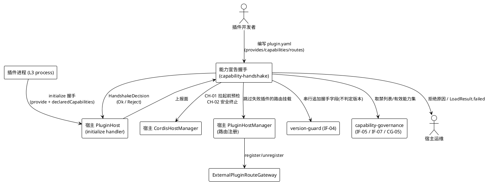
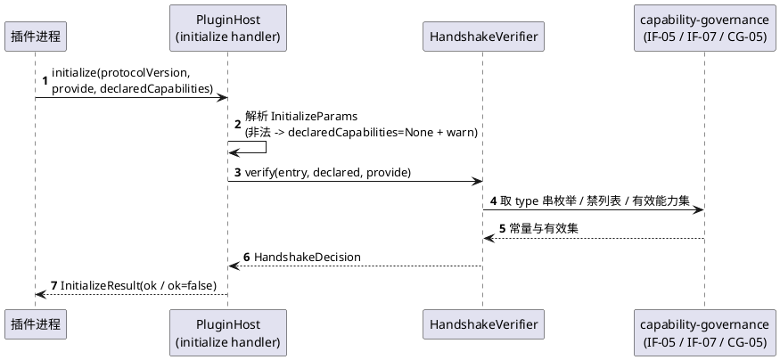
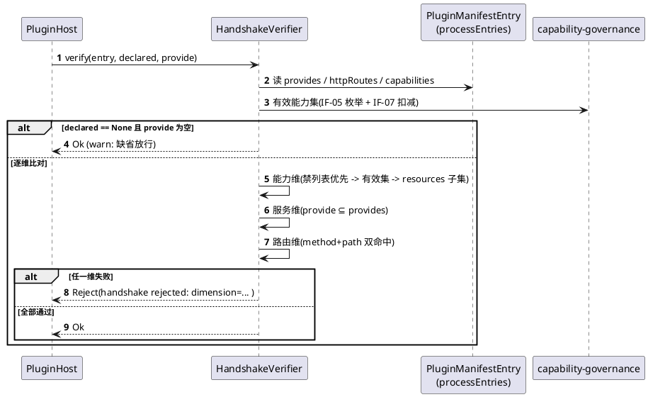
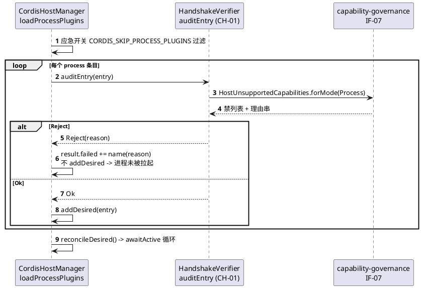
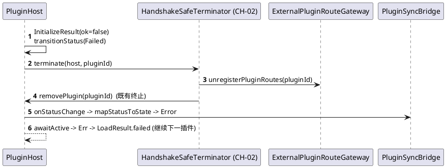
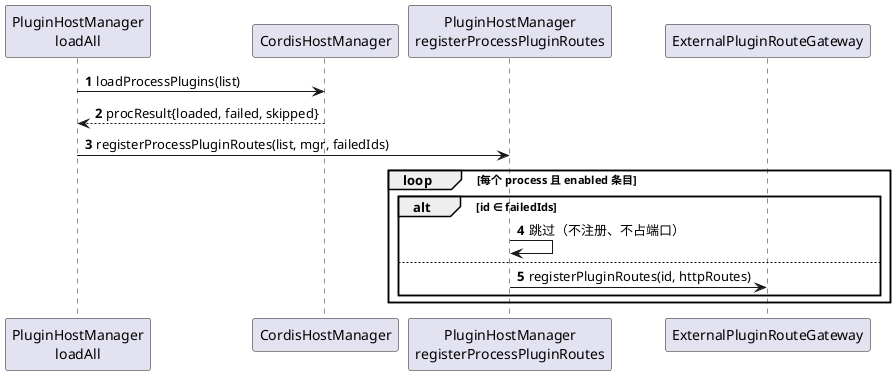

# 能力宣告握手（capability-handshake）需求规格说明书

> 模板：`skills/sdd/templates/spec_template.md`（结构）+ `skills/sdd/templates/ears-format.md`（验收句式）
> 所属主工程：`plugin-system-enhancement` ｜ 子系统 ID：`capability-handshake`
> `feature_name`：`plugin-system-enhancement--capability-handshake`
> 契约基线：`./contract.md`（IF-08 / IF-09 / CH-01 / CH-02）
> 验收句式：**EARS**（触发关键字 `When` / `While` / `If` / `Where` / `The ... shall` 保留英文，变量部分本地化）
> 全部 `文件:行号` 取自 2026-10-19 工作区快照；行号漂移时以标识符为准。查不到的标「**待核实**」。

---

# 1. 组件定位

## 1.1 核心职责

本组件负责在 L3（`mode: process`）插件进程启动后的 `initialize` 握手环节，收集插件**自报的将注册面**（Service 键 / HTTP 路由 / 能力项），与 `plugin.yaml` 的声明逐项比对，不符即拒绝挂载，实现「声明即契约、超声明即拒绝」。

## 1.2 核心输入

| 输入 | 来源 | 内容概要 |
|---|---|---|
| 握手上报载荷 `InitializeParams.declaredCapabilities` | 插件进程 → 宿主，经 `Methods.INITIALIZE`（`methods.cj:7`），宿主 handler 在 `plugin_host.cj:105-138` | 将注册的 HTTP 路由（`method` + `path`）与能力项（`type` + `resources`） |
| 既有上报面 `InitializeParams.provide` | 同上（`message.cj:13`） | 将注册的服务键（Service key）数组 |
| 握手协议版本 `InitializeParams.protocolVersion` | `version-guard` IF-04（上游，本组件只读不做判定） | 协议版本；本组件在其**之后**追加字段，串行 |
| 声明面 `PluginManifestEntry` | `plugin.yaml` → `plugin_config.cj:122-208`；宿主侧按 pluginId 保存在 `processEntries`（`cordis_host_manager.cj:66`、`:184-185`） | `httpRoutes`（`:112`）、`capabilities`（由 capability-governance IF-05 解析）、`provides`（本组件新增） |
| 跨进程禁列表 `HostUnsupportedCapabilities` | `capability-governance` IF-07（只读常量表） | L3 跨进程恒禁能力集 + 每项禁用理由串 |
| 有效能力集 | `capability-governance` CG-05 `intersectWithUnsupported(Process)` | 清单声明经禁列表扣减后**真正可授予**的能力集 |

## 1.3 核心输出

| 输出 | 目标 | 内容概要 |
|---|---|---|
| `HandshakeDecision`（`Ok` / `Reject(reason)`） | 宿主 `PluginHost` 的 initialize handler（`plugin_host.cj:105-138`） | 比对结论；`reason` 统一 `handshake rejected:` 前缀 |
| 握手响应 `InitializeResult(ok=false)` | 插件进程 | 拒绝时返回（`message.cj:60-69` 既有结构，不新增方法常量） |
| 实例状态 `InstanceStatus.Failed` | cordis `HostState` | 拒绝后**置 `Failed` 而非 `Pending`**（避免插件周期重发形成握手风暴） |
| 安全终止动作 | CH-02 → `PluginHost.removePlugin`（`plugin_host.cj:867`）+ `ExternalPluginRouteGateway.unregisterPluginRoutes`（`external_plugin_route_gateway.cj:524`） | 进程终止 + 已挂载路由撤销 |
| 加载结果 `LoadResult.failed` | 宿主启动流程（`cordis_host_manager.cj:226-231`） | 被拒插件名 + 原因，宿主继续加载其余插件 |
| 状态回写 | 既有 `installStatusListener` → `PluginSyncBridge` → `agent_skills.runtime_status` / `last_error` | `Failed` → `PluginState.Error`（复用既有 `mapStatusToState`，`:473-482`） |

## 1.4 职责边界

本组件**不负责**：

1. **能力枚举的定义与运行时门禁执行** —— 归 `capability-governance`（IF-05 / IF-06）。本组件只**消费**其枚举 type 串与禁列表，不定义、不扩展、不调用 `CapabilityGate.check`。
2. **版本协商与版本字段判定** —— 归 `version-guard`（IF-01~IF-04）。本组件在 `message.cj` 上与其**串行**追加字段，不解释 `protocolVersion` 语义。
3. **依赖拓扑推导与 `PluginEntry` 字段补齐** —— 归 `dependency-graph`（IF-10）。已知 `toCordisEntry`（`cordis_host_manager.cj:263-274`）只设 id/source/args，导致 `topoSort`（`plugin_host.cj:984-1010`）对宿主恒为 no-op；本组件**不修**它，改走 `processEntries` 取完整清单。
4. **崩溃退避 / 重启计数 / 风暴熔断** —— 归 `lifecycle-observability`（IF-11）。握手失败置 `Failed` 是**避免**风暴，不是自愈策略。
5. **`plugin validate` CLI / 存量清单体检** —— 归 `authoring-toolchain`（IF-12）。
6. **路由转发、请求代理、路由鉴权** —— 复用既有 `ExternalPluginRouteGateway`，本组件只判「该不该挂载」。
7. **新增数据库表 / 列** —— 0 新表 0 新列（铁律 9）。
8. **`dylib` 轨握手** —— 该轨运行时不可达（`SPECS_INDEX` R-01），本组件对其直接放行。

---

# 2. 领域术语

**能力宣告（Capability Declaration / Handshake）**
: L3 插件进程在 `initialize` 握手中，向宿主自报「本进程接下来将注册哪些服务、挂载哪些 HTTP 路由、使用哪些能力」的一次性上行声明。
: 备注：与 `plugin.yaml` 的**静态声明**相对，前者是插件自报的**运行期事实**，后者是宿主认可的**授权边界**。

**声明面（Declared Surface）**
: `plugin.yaml` 中宿主认可的能力/服务/路由集合，是比对的**基准集**（`entry.capabilities` / `entry.provides` / `entry.httpRoutes`）。

**上报面（Reported Surface）**
: 插件在握手中实际上报的集合（`declaredCapabilities.routes` / `declaredCapabilities.capabilities` / `InitializeParams.provide`）。

**有效能力集（Effective Capability Set）**
: 清单声明的能力集，经 `capability-governance` CG-05 用 IF-07 禁列表扣减后**真正可授予**的子集。
: 备注：比对的基准是**有效集**而非原始声明集，因为声明了但跨进程拿不到的能力同样不可授予。

**超声明（Over-declaration）**
: 上报面中存在声明面/有效集之外的项。是本组件**唯一**的拒绝触发条件（少报无害）。

**缺省放行（Default-Allow，防回退）**
: 插件未上报 `declaredCapabilities` 且其 `provide` 为空时，一律放行并告警。
: 备注：存量 51 个 skill 插件 + 4 个 sync 锚点均无此上报（`SPECS_INDEX` R-04），缺省即拒绝将造成全量回归。

**安全终止（Safe Termination）**
: 握手被拒后，宿主主动终止该 L3 进程并撤销其已挂载资源，且不抛异常、不残留僵尸进程、不影响宿主自身启动。

**路由挂载（Route Mounting）**
: process 插件的 `httpRoutes` 经 `ExternalPluginRouteGateway.registerPluginRoutes`（`plugin_host_manager.cj:280-298`）注册进宿主 Router，使其对外可达。
: 备注：**本工程最高危面** —— 挂载即暴露 HTTP 攻击面，故路由是本组件比对的三个维度中判定最严的一项（method + path 双命中）。

---

# 3. 角色与边界

## 3.1 核心角色

- **插件开发者**：在 `plugin.yaml` 中声明 `provides` / `capabilities` / `routes`，并在插件侧实现握手上报；声明不完整会导致插件被拒。
- **宿主运维 / 管理员**：通过宿主日志、`inspectRoutes()`、`LoadResult.failed` 观察哪些插件因何被拒；通过 `CORDIS_SKIP_PROCESS_PLUGINS`（`cordis_host_manager.cj:149-167`）应急隔离。

## 3.2 外部系统

- **`version-guard`（上游）**：提供 `InitializeParams.protocolVersion` 字段（IF-04）；本组件在其之后追加字段，串行。
- **`capability-governance`（上游）**：提供能力枚举 type 串（IF-05）、跨进程禁列表及理由串（IF-07）、按 mode 扣减后的有效能力集（CG-05）。
- **宿主 `PluginHost`（`libs/cordis-cj/cordis_host/src/plugin_host.cj`）**：握手的承载者；本组件通过构造注入挂上判定回调。
- **宿主 `CordisHostManager`（`src/plugin/cordis_host_manager.cj`）**：拉起前静态预检（CH-01）与拒绝后安全终止（CH-02）的调用方。
- **宿主 `PluginHostManager`（`src/plugin/plugin_host_manager.cj`）**：路由注册方；须跳过握手失败的插件。
- **`ExternalPluginRouteGateway`（`src/plugin/external_plugin_route_gateway.cj`）**：既有路由挂载/撤销实现，本组件复用。
- **插件进程（L3 `mode: process`）**：握手的对端，负责上报宣告。
- **`authoring-toolchain`（下游，可选）**：其 `plugin validate` 可复用 CH-01 做静态体检（须先按契约提升接口等级）。

## 3.3 交互上下文

---

# 4. DFX 约束

## 4.1 性能

- **DFX-CH-P1**：握手比对必须在**单次** `initialize` 请求内完成，比对复杂度为上报项数量的线性阶；**禁止**引入任何周期性或常驻的比对线程。
  - 验收：`When` 一个上报 100 项路由 + 50 项能力的插件发起握手，`the HandshakeVerifier shall` 在单次请求内完成全部比对，且不在 `awaitActive` 之后留下任何常驻任务。
- **DFX-CH-P2**：握手比对**不得**延长既有启动超时。既有 `awaitActive(ce.id, timeout: 30 * Duration.second)`（`cordis_host_manager.cj:216`）保持不变。
  - 验收：`When` 全量 process 插件加载完成，`the CordisHostManager shall` 使总耗时相对基线**无显著增加**（比对耗时 < 单插件握手往返的 5%）。

## 4.2 可靠性

- **DFX-CH-R1**：被拒实例必须置 `InstanceStatus.Failed` 而**非** `Pending`。
  - 验收：`If` 握手被拒，`the PluginHost shall` 将实例状态置为 `Failed`，使插件侧的周期重发**不会**形成握手风暴。
- **DFX-CH-R2（硬条件）**：被拒插件的 L3 进程必须处于「未被拉起」或「已被安全终止」二态之一，宿主启动不受影响。
  - 验收：`If` 插件被拒绝，`the CordisHostManager shall` 保证该插件的 L3 进程**未被拉起**（静态预检阶段拒绝）或**已被安全终止且无僵尸残留**（握手阶段拒绝），且宿主主流程继续、其余插件照常加载、宿主进程不崩溃。
- **DFX-CH-R3**：比对与终止过程中的任何异常都不得穿透到 cordis RPC 层。
  - 验收：`If` 比对或终止过程抛出未预期异常，`the PluginHost shall` 捕获并按「拒绝 + 记 `LogUtils.error`」处理，返回 `InitializeResult(ok=false)`，不使宿主崩溃。

## 4.3 安全性

- **DFX-CH-S1**：**禁列表单一真源**。跨进程不可授予的能力只能来自 `capability-governance` 的 IF-07；本组件**禁止**另建第二张表，且必须在「拉起前静态预检」与「握手比对」**两处复用同一张表**。
  - 验收：`When` 对同一份清单分别执行拉起前静态预检与握手比对，`the HandshakeVerifier shall` 给出**完全一致**的拒绝结论与**同一条理由串**；`When` 全仓检索跨进程禁能力常量，`the` 代码库 `shall` 只存在 IF-07 一处定义。
- **DFX-CH-S2**：**未知从严（fail-closed）**。
  - 验收：`If` 上报的 `capabilities[].type` 无法被 IF-05 的 `fromCapabilityType` 识别，`the HandshakeVerifier shall` 判定为 `Reject`（不得因解析异常而放行）。
  - 验收：`If` 上报的 `routes[]` 存在清单未声明项，`the HandshakeVerifier shall` 判定为 `Reject`，且该路由**不得**被挂载到宿主 Router。
- **DFX-CH-S3**：拒绝原因串**不得回显敏感明文**（凭证明文、环境变量值、宿主敏感路径）。
  - 验收：`When` 生成任何拒绝原因串，`the HandshakeVerifier shall` 只输出能力 type / 服务 key / 路由 method+path 等**标识**，不输出任何取值内容。
- **DFX-CH-S4**：**路由挂载必须晚于握手结论**。
  - 验收：`If` 某 process 插件握手失败或拉起前被拒，`the PluginHostManager shall` **不**为其注册任何 HTTP 路由；`If` 该插件此前已注册（增量调谐路径），`the ExternalPluginRouteGateway shall` 撤销其全部路由。

## 4.4 可维护性

- **DFX-CH-M1**：每一次拒绝都必须留痕，且留痕走**既有**通道。
  - 验收：`When` 发生一次拒绝，`the` 宿主 `shall` 产生：① 一条含 `handshake rejected:` 前缀的 `LogUtils.error`；② 一条既有 `plugin.error` 生命周期事件（`plugin_host_manager.cj:499-506`）；③ 一条 `agent_skills.runtime_status` / `last_error` 回写（复用既有 `PluginSyncBridge` 通道）。**不新增列、不新增表**。
- **DFX-CH-M2**：拒绝原因必须可定位到「哪个维度、哪一项」。
  - 验收：`When` 输出拒绝原因，`the HandshakeVerifier shall` 使原因串包含 `dimension=<capability|service|route>` 与具体项标识。

## 4.5 兼容性

- **DFX-CH-C1（防回退硬约束，R-04）**：存量插件零回归。
  - 验收：`While` 插件未上报 `declaredCapabilities` 且 `provide` 为空，`the HandshakeVerifier shall` 返回 `Ok` 并记一条 `LogUtils.warn`；`When` 对存量 51 个 skill 插件 + 4 个 sync 锚点执行回归，`the` 宿主 `shall` 使 100% 条目握手通过、行为零变更。
- **DFX-CH-C2**：契约与字段追加向后兼容。
  - 验收：`When` 追加 `declaredCapabilities` 字段，`the` 握手载荷 `shall` 以**尾部命名默认参数**形式追加，使既有构造点（插件侧与宿主侧）零改动即可编译通过。

---

# 5. 核心能力

## 5.1 能力宣告载荷（IF-08）

### 5.1.1 业务规则

1. **规则（载荷形状）**：`DeclaredCapabilities` 必须只承载 **routes** 与 **capabilities** 两个维度；**服务维度复用既有 `InitializeParams.provide`**（`message.cj:13`），IF-08 **不得**重复承载服务键。
   - a. 验收条件：`When` 插件构造握手载荷，`the` 载荷 `shall` 使服务键只出现在 `provide` 字段中，`declaredCapabilities` 中不存在服务键副本。
2. **规则（可选字段）**：`declaredCapabilities` 必须是**可选**字段，缺省为 `None`。
   - a. 验收条件：`While` 插件未上报该字段，`the InitializeParams shall` 使其值为 `None` 且握手流程正常继续（不缺字段即报错）。
3. **规则（载荷解析容错）**：载荷解析失败必须回落 `None` 并告警，**不得**抛异常、**不得**直接拒绝。
   - a. 验收条件：`If` `declaredCapabilities` 为非法 JSON 或类型不符，`the` 宿主 `shall` 回落到 `None`、记一条 `LogUtils.warn`，并继续后续比对（按缺省放行处理）。
4. **规则（type 串同源）**：`capabilities[].type` 必须取自 `capability-governance` IF-05 的 type 串集合（`db.read` / `db.write` / `net.egress` / `fs.read` / `fs.write` / `proc.spawn` / `env.read` / `secret.read`）。
   - a. 验收条件：`When` 插件填写能力 type，`the` 插件 `shall` 只使用 IF-05 枚举对应的 type 串；`If` 使用了集合外的串，`the HandshakeVerifier shall` 判为 `Reject`（未知从严，`fromCapabilityType` 返回 `None`）。
5. **禁止项**：本组件**禁止**定义新的能力 type 串、禁止扩展能力枚举。
   - a. 验收条件：`When` 需要支持一种新能力，`the` 变更 `shall` 首先落在 `capability-governance` 的 IF-05 枚举上，本组件代码零改动即可支持。

### 5.1.2 交互流程

### 5.1.3 异常场景

1. **载荷非法 JSON**
   - a. 触发条件：`declaredCapabilities` 结构非法或字段类型不符。
   - b. 系统行为：回落 `None` + `warn`，按缺省放行继续。
   - c. 用户感知：插件正常挂载；宿主日志出现一条 `[HandshakeVerifier] declared capabilities unparsable, fallback to none` 告警。
2. **未知能力 type 串**
   - a. 触发条件：`capabilities[].type` 不在 IF-05 集合内。
   - b. 系统行为：`Reject`，dimension=capability，fail-closed。
   - c. 用户感知：`InitializeResult(ok=false)`；原因串含 `dimension=capability` 与该 type 串；实例 `Failed`。

## 5.2 宣告比对与拒绝（IF-09）

### 5.2.1 业务规则

1. **规则（判定口径）**：判定必须是「**上报 ⊆ 声明**」，**不是**相等。
   - a. 验收条件：`When` 上报项是声明面/有效集的子集，`the HandshakeVerifier shall` 返回 `Ok`；`When` 上报项少于声明项（少报），`the HandshakeVerifier shall` 同样返回 `Ok`。
2. **规则（能力维度）**：每项上报能力的 `type` 必须在**有效能力集**内，且其 `resources` 必须是该 type 授予清单的子集。
   - a. 验收条件：`If` 上报 `db.read` 的 `resources` 含清单外的表名，`the HandshakeVerifier shall` 返回 `Reject` 且原因串含该表名。
3. **规则（服务维度）**：`provide` 中每个服务键必须在清单 `provides` 内。
   - a. 验收条件：`If` `provide` 含清单 `provides` 之外的键，`the HandshakeVerifier shall` 返回 `Reject` 且原因串含该键。
4. **规则（路由维度，最严）**：每条上报路由必须同时命中清单 `httpRoutes` 中的 **method（大写归一）与 path（精确串）**。
   - a. 验收条件：`If` 上报路由的 method 或 path 任一与清单不符，`the HandshakeVerifier shall` 返回 `Reject`，且该路由不得被挂载。
5. **规则（禁列表优先）**：任一上报能力命中 IF-07 禁列表，无论清单是否声明，一律 `Reject`。
   - a. 验收条件：`If` 上报能力属 `HostUnsupportedCapabilities.forMode(Process)`，`the HandshakeVerifier shall` 返回 `Reject`，且原因串**直接取用** IF-07 说明表提供的理由文案。
6. **规则（缺省放行，R-04）**：`declaredCapabilities == None` 且 `provide` 为空 → 放行 + `warn`。
   - a. 验收条件：`While` 插件未上报任何宣告，`the HandshakeVerifier shall` 返回 `Ok` 并产生一条 `warn`。
7. **规则（非 process 轨不比对）**：`mode != Process` 的条目一律直接 `Ok`。
   - a. 验收条件：`When` 对 `Sync` 或 `Dylib` 条目调用 `verify`，`the HandshakeVerifier shall` 返回 `Ok` 且不读取任何上报面。
8. **规则（幂等）**：同一 `(entry, declared, provide)` 组合的判定结果必须恒定。
   - a. 验收条件：`When` 同一插件因周期重发而重复握手，`the HandshakeVerifier shall` 给出与首次完全一致的决策，且不产生重复拒绝风暴。
9. **禁止项**：本组件**禁止**调用 `capability-governance` 的 `CapabilityGate.check`（IF-06）。
   - a. 验收条件：`When` 检索本子系统代码，`the` 实现 `shall` 不包含任何 `CapabilityGate.check` 调用点。

### 5.2.2 交互流程

### 5.2.3 异常场景

1. **能力超出资源清单**
   - a. 触发条件：清单声明 `db.read:["agent_skills"]`，握手上报 `db.read:["agent_tasks"]`。
   - b. 系统行为：`Reject`（dimension=capability），实例 `Failed`，进程安全终止。
   - c. 用户感知：`LoadResult.failed` 含该插件与原因；`agent_skills.runtime_status` 置 `Error`。
2. **上报未声明路由**
   - a. 触发条件：清单声明 2 条 `httpRoutes`，握手上报第 3 条。
   - b. 系统行为：`Reject`（dimension=route）；已注册路由（若有）撤销。
   - c. 用户感知：原因串含 `dimension=route` 与未声明的 method+path；`inspectRoutes()` 中不含该路由。
3. **上报未声明服务**
   - a. 触发条件：清单 `provides:["svc.a"]`，握手 `provide:["svc.a","svc.b"]`。
   - b. 系统行为：`Reject`（dimension=service）；`state.servicesOf(pluginId)` 保持为空。
   - c. 用户感知：原因串含 `dimension=service` 与 `svc.b`。
4. **禁列表命中**
   - a. 触发条件：上报 `fs.write` / `proc.spawn`（跨进程恒禁）。
   - b. 系统行为：`Reject`，理由串取自 IF-07 说明表。
   - c. 用户感知：原因串含 `unsupported capability across process boundary` 前缀。
5. **存量插件未上报**
   - a. 触发条件：51 个 skill 插件 / 4 个 sync 锚点不上报宣告。
   - b. 系统行为：`Ok` + `warn`（缺省放行）。
   - c. 用户感知：无拒绝、无回归；日志出现告警。

## 5.3 拉起前静态预检（CH-01，复用 IF-07）

### 5.3.1 业务规则

1. **规则（预检时机）**：静态预检必须在 `addDesired` **之前**执行。
   - a. 验收条件：`When` 遍历 process 条目构建期望态时，`the CordisHostManager shall` 在 `addDesired`（`cordis_host_manager.cj:198`）之前对每条目调用 `auditEntry`；`If` 命中禁列表，`the CordisHostManager shall` 不将该条目加入 `desired`，使其**进程未被拉起**。
2. **规则（同一张表）**：预检必须复用 IF-07，不得另建禁列表。
   - a. 验收条件：`When` 预检判定某能力不可跨进程，`the HandshakeVerifier shall` 使判定来源唯一为 `HostUnsupportedCapabilities`（IF-07），且理由串与握手比对阶段逐字一致。
3. **规则（结果落地）**：预检拒绝必须记入 `LoadResult.failed`，且不中断整批加载。
   - a. 验收条件：`If` 某条目被预检拒绝，`the CordisHostManager shall` 将其加入 `result.failed` 并继续处理后续条目。
4. **规则（应急开关优先）**：`CORDIS_SKIP_PROCESS_PLUGINS` 命中的插件先被跳过，不进入预检与握手。
   - a. 验收条件：`While` 环境变量 `CORDIS_SKIP_PROCESS_PLUGINS` 含该插件名，`the CordisHostManager shall` 保持既有跳过行为（`:149-167`），不因本组件改动而改变。

### 5.3.2 交互流程

### 5.3.3 异常场景

1. **清单声明跨进程恒禁能力**
   - a. 触发条件：`plugin.yaml` 声明 `fs.write`（无 `host.fs` handler，宿主无法代理也无法验证）。
   - b. 系统行为：`Reject`，进程未拉起，端口未占用。
   - c. 用户感知：`LoadResult.failed` 含 `unsupported capability across process boundary` 前缀理由；进程列表无对应 pid。
2. **上游 IF-07 不可用**
   - a. 触发条件：`capability-governance` 未达 done，禁列表不可读。
   - b. 系统行为：**不得**静默放行；按「未知从严」判为 `Reject` 并记 `LogUtils.error`。
   - c. 用户感知：所有 process 插件被拒并附带上游缺失说明（属**阻塞态**，不得在该状态下报 done）。

## 5.4 拒绝后的安全终止与状态回写（CH-02）

### 5.4.1 业务规则

1. **规则（硬条件）**：拒绝后必须安全终止，且宿主启动不受影响。
   - a. 验收条件：`If` 握手被拒，`the CordisHostManager shall` 调用安全终止使该 L3 进程退出且无僵尸残留，并使宿主主流程继续、`awaitActive` 以 `Err` 记入 `LoadResult.failed`、宿主进程不崩溃、HTTP 端口正常监听。
2. **规则（复用既有终止能力）**：终止必须复用 `PluginHost.removePlugin`（`plugin_host.cj:867`）与 `ExternalPluginRouteGateway.unregisterPluginRoutes`（`external_plugin_route_gateway.cj:524`），**不新增**进程管理代码。
   - a. 验收条件：`When` 执行安全终止，`the HandshakeSafeTerminator shall` 调用上述两个既有入口，且不包含自实现的 kill / 进程句柄管理逻辑。
3. **规则（状态回写复用）**：`Failed` → `PluginState.Error` 的映射必须复用既有 `mapStatusToState`（`cordis_host_manager.cj:473-482`）与既有 `installStatusListener` 通道（`:73-81`），**不新增**列、**不新增**状态枚举值。
   - a. 验收条件：`When` 实例置 `Failed`，`the` 宿主 `shall` 经既有通道回写 `agent_skills.runtime_status`，且 `agent_skills` 表结构零变更。
4. **规则（终止失败不得穿透）**：终止过程中的异常必须被捕获。
   - a. 验收条件：`If` 进程已退出或实例不存在导致终止失败，`the HandshakeSafeTerminator shall` 记 `LogUtils.error` 后正常返回，不抛异常。
5. **规则（幂等）**：重复终止无副作用。
   - a. 验收条件：`When` 对同一 pluginId 重复调用 terminate，`the HandshakeSafeTerminator shall` 保持无副作用且无异常。

### 5.4.2 交互流程

### 5.4.3 异常场景

1. **进程已崩溃后再终止**
   - a. 触发条件：插件进程在握手前已自行退出。
   - b. 系统行为：捕获异常，记 `error`，按「已终止」继续。
   - c. 用户感知：无异常抛出；日志一条 `error`。
2. **路由已挂载后拒绝（增量调谐路径）**
   - a. 触发条件：插件在 `reconcile` 增量路径中先完成路由注册、随后握手被拒。
   - b. 系统行为：调用 `unregisterPluginRoutes` 撤销其全部路由。
   - c. 用户感知：`inspectRoutes()` 中不含该插件任何路由。

## 5.5 路由注册联动（防止失败插件仍挂载路由）

### 5.5.1 业务规则

1. **规则（跳过失败集）**：路由注册必须跳过本轮 `LoadResult.failed` 中的插件。
   - a. 验收条件：`When` `registerProcessPluginRoutes`（`plugin_host_manager.cj:280-298`）执行，`the PluginHostManager shall` 跳过 `procResult.failed`（`:148-150` 收集的失败集）中的全部条目，不为其注册任何路由。
   - 备注（基线 GAP）：当前 `:154-155` 在 `loadProcessPlugins` 返回后**无条件**遍历 `list.plugins` 注册路由，未排除失败插件 —— 失败插件的 HTTP 路由仍会被挂到宿主 Router，属本组件必须闭环的安全缺口。
2. **规则（拒绝即撤销）**：握手被拒时已挂载的路由必须撤销。
   - a. 验收条件：`If` 插件握手被拒，`the ExternalPluginRouteGateway shall` 撤销其全部已注册路由，使 `inspectRoutes()` 输出中不含该插件条目。
3. **规则（不新增权限登记面）**：本组件不新增任何宿主 HTTP 路由，故不产生 `permissions` / `role_has_permission` 新增登记。
   - a. 验收条件：`When` 本子系统交付，`the` 变更集 `shall` 不包含任何新增 HTTP 端点与任何新增权限登记行。
   - 备注：**待核实**：process 插件自有路由（`httpRoutes`）是否需逐条登记 `permissions` 属存量行为，本轮不改；若后续要求显式登记，须回主工程 §6 登记后另立任务。

### 5.5.2 交互流程

### 5.5.3 异常场景

1. **握手失败但路由已声明**
   - a. 触发条件：插件声明了 5 条 `httpRoutes`，握手被拒。
   - b. 系统行为：5 条路由一条都不注册。
   - c. 用户感知：`inspectRoutes()` 无该插件路由；对应 URL 请求返回宿主既有未注册响应（**不得**转发到已终止进程）。
2. **增量调谐路径的先注册后拒绝**
   - a. 触发条件：`reconcile`（`plugin_host_manager.cj:250`）先注册路由，随后该插件握手失败。
   - b. 系统行为：`unregisterPluginRoutes` 撤销。
   - c. 用户感知：路由不可达，日志含撤销记录。

---

# 6. 数据约束

## 6.1 领域对象：`DeclaredCapabilities`（IF-08 载荷）

1. **routes**：路由声明数组；元素为 `{method, path}`；允许为空数组（表示不注册任何路由）。
2. **routes[].method**：HTTP 方法串；比对前**必须大写归一**（`get`/`post`/`put`/`delete`），与清单 `ExternalRoute.method` 同域。
3. **routes[].path**：路由路径串；**精确匹配**（不做前缀/通配，通配属 v2 候选）；必须与清单 `httpRoutes[].path` 逐字一致。
4. **capabilities**：能力声明数组；元素为 `{type, resources}`；允许为空数组（表示不使用任何宿主代管能力）。
5. **capabilities[].type**：**必须**取自 IF-05 定义的 type 串集合；集合外取值一律导致 `Reject`（未知从严）。
6. **capabilities[].resources**：资源标识数组（表名 / `alias/tool` / `env:NAME` 等，语义由 IF-05 定义）；必须是该 type 授予清单的**子集**；空数组表示仅申请能力级、不申请具体资源。
7. **服务键（service key）**：**不在** `DeclaredCapabilities` 中承载，必须只出现在既有 `InitializeParams.provide` 中。

## 6.2 领域对象：`HandshakeDecision`（IF-09 / CH-01 输出）

1. **Ok**：比对通过（含缺省放行路径）；**不携带**额外字段。
2. **Reject**：比对失败，携带 `reason`。
3. **reason**：**必非空**；统一前缀 `handshake rejected:`；必须含 `dimension=<capability|service|route>` 与具体项标识；**禁止**含凭证明文、环境变量值、宿主敏感路径。
4. **唯一性**：一次判定只产出一个 `Reject` 原因（首个失败项），其余失败项由 WARN 逐条记录。

## 6.3 领域对象：`PluginManifestEntry.provides`（新增清单字段）

1. **provides**：字符串数组，声明本插件**将注册的服务键**；缺省为空数组。
2. **约束**：缺省为空即表示「不注册任何服务」；此时插件握手上报的 `provide` **必须**也为空，否则 `Reject`。
3. **兼容性**：存量清单无该字段时解析为空数组，**不得**因字段缺失而拒绝清单条目（R-04）。
4. **解析位置**：必须在 `plugin_config.cj:122-208` 既有解析函数内追加，与 `version-guard`（`version`/`pluginApi`）和 `capability-governance`（`capabilities`）**串行**落字段，互不影响。

## 6.4 领域对象：`agent_skills` 状态回写（复用，不新增列）

1. **runtime_status**：复用既有列承载握手失败态，取值沿用既有 `PluginState` 枚举（`Error`），**不新增**枚举值。
2. **last_error**：复用既有列承载拒绝原因串；写入内容必须已按 §6.2 第 3 条脱敏。
3. **约束**：本子系统**不新增**任何表、任何列；一切观测需求优先复用既有通道（`SPECS_INDEX` R-06）。

---

## 附录 A：需求编号索引

| 编号 | 需求一句话 | 章节 |
|---|---|---|
| FR-CH-01 | 载荷形状与字段承载（服务维复用 `provide`） | §5.1.1-1 |
| FR-CH-02 | 载荷可选与解析容错 | §5.1.1-2、3 |
| FR-CH-03 | type 串同源 IF-05、未知从严 | §5.1.1-4，§5.1.3-2 |
| FR-CH-04 | 禁止自造能力枚举 | §5.1.1-5 |
| FR-CH-05 | 判定口径「上报 ⊆ 声明」 | §5.2.1-1 |
| FR-CH-06 | 能力维比对（含禁列表优先） | §5.2.1-2、5 |
| FR-CH-07 | 服务维比对 | §5.2.1-3 |
| FR-CH-08 | 路由维比对（method+path 双命中） | §5.2.1-4 |
| FR-CH-09 | 缺省放行（R-04 防回退） | §5.2.1-6 |
| FR-CH-10 | 非 process 轨不比对 | §5.2.1-7 |
| FR-CH-11 | 判定幂等、不调用 IF-06 | §5.2.1-8、9 |
| FR-CH-12 | 拉起前静态预检（CH-01，复用 IF-07） | §5.3 |
| FR-CH-13 | 安全终止与状态回写（CH-02） | §5.4 |
| FR-CH-14 | 路由注册联动（跳过失败集 / 拒绝即撤销） | §5.5 |
| DFX-CH-P1/P2 | 单次线性比对 / 不延长启动超时 | §4.1 |
| DFX-CH-R1/R2/R3 | 置 `Failed` / **硬条件：未拉起或已安全终止** / 异常不穿透 | §4.2 |
| DFX-CH-S1~S4 | 禁列表单一真源两处复用 / 未知从严 / 不回显明文 / 路由挂载晚于握手结论 | §4.3 |
| DFX-CH-M1/M2 | 拒绝留痕走既有通道 / 原因可定位维度 | §4.4 |
| DFX-CH-C1/C2 | 存量零回归 / 字段追加向后兼容 | §4.5 |
