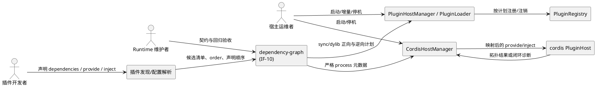
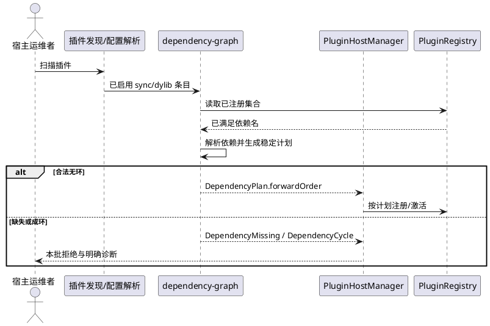
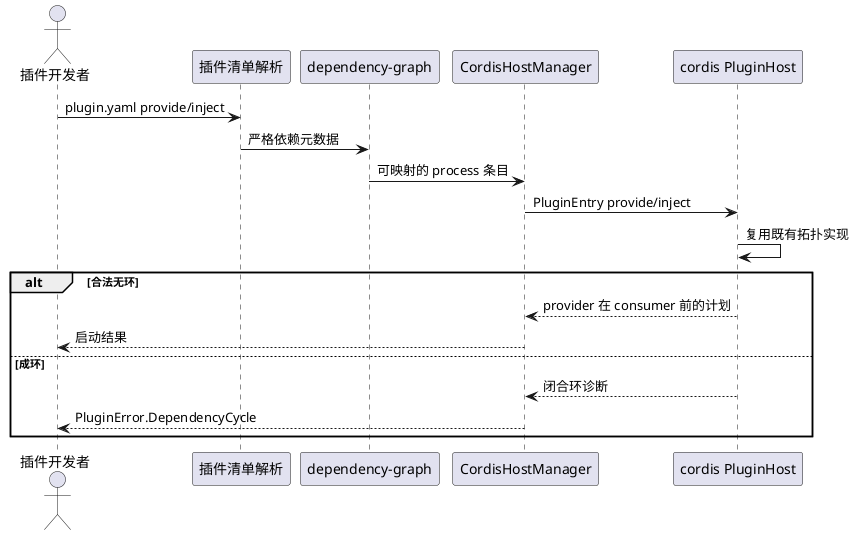
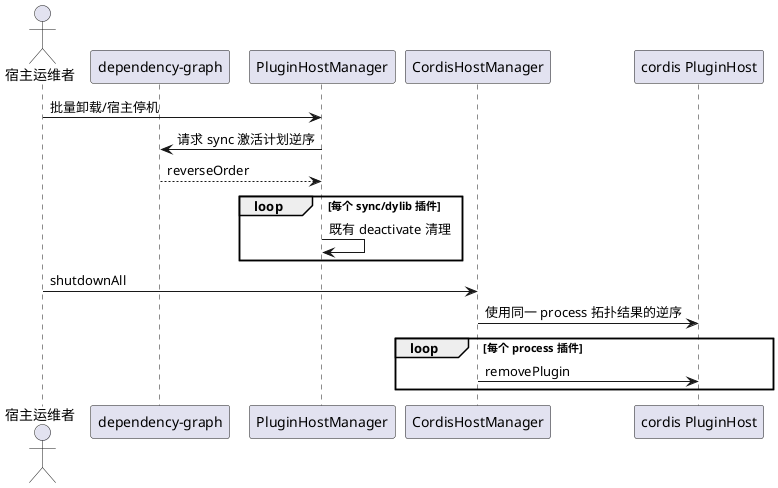

# dependency-graph 需求规格说明

> 子系统：`plugin-system-enhancement--dependency-graph`
> 契约：`IF-10`（v1，4 个子项）
> 状态：草案
> 日期：2026-10-19
> 权威边界：`specs/plugin-system-enhancement--dependency-graph/contract.md:9-19`、`specs/plugin-system-enhancement/SPECS_INDEX.md:49-58,66-83`

# **1. 组件定位**

## **1.1 核心职责**

本组件负责解析插件依赖并生成确定性正逆拓扑序，使依赖先加载、依赖方先卸载。

现状仅按 `order` 升序稳定排序，sync/dylib 加载时才事后检查依赖是否已经注册，process 轨虽有 cordis 拓扑函数但宿主未映射其输入字段，因此本组件补齐 IF-10，而不重写整个插件系统（`src/plugin/plugin_config.cj:337-350`；`src/plugin/plugin_loader.cj:68-73,119-149`；`src/plugin/cordis_host_manager.cj:253-274`；`libs/cordis-cj/cordis_host/src/plugin_host.cj:829-840,980-1031`）。

## **1.2 核心输入**

| 输入 | 来源 | 内容概要 | 证据 |
|---|---|---|---|
| 已启用插件清单 | `PluginDiscoveryService` / `PluginConfigParser` | `PluginManifestEntry` 的 `name/mode/enabled/order/className` 及声明顺序；现有两条解析路径均在返回前执行 `sortByOrder()` | `src/plugin/plugin_discovery_service.cj:66-81`；`src/plugin/plugin_config_parser.cj:45-60` |
| sync/dylib 依赖声明 | `@PluginAnnotation.dependencies` | 逗号分隔插件名字符串；因仓颉 const Array 限制而采用 String | `libs/plugin-spi/src/plugin_annotation.cj:25-49` |
| process 依赖声明 | `plugin.yaml` | 可选 `provide` / `inject` 字符串数组；当前清单对象和解析器尚无这两个字段 | `src/plugin/plugin_config.cj:72-112,122-208`；`specs/plugin-system-enhancement--dependency-graph/contract.md:25-30` |
| 当前已注册 sync 插件集合 | `PluginRegistry` | 增量发现时用于判定依赖是否已由既有 Active/Pending 插件满足；注册表按注册顺序维护 | `src/plugin/plugin_registry.cj:20-55,79-112` |
| 已成功激活的拓扑计划 | 宿主加载阶段 | 批量卸载和宿主停机时生成逆序；现有 sync 只有单插件清理，process `shutdownAll` 只是顺序遍历 `startedIds` | `src/plugin/plugin_host_manager.cj:414-454`；`src/plugin/cordis_host_manager.cj:418-438` |

## **1.3 核心输出**

1. 向 sync/dylib 宿主加载器输出 `DependencyPlan`：包含稳定正向拓扑序、逆向拓扑序和声明序索引；接口编号为 IF-10.1 / IF-10.4（`specs/plugin-system-enhancement--dependency-graph/contract.md:25-30,39-50`）。
2. 向 process 宿主输出已校验的 `PluginManifestEntry.provide/inject`，并映射到 cordis `PluginEntry.provide/inject`；cordis 已有字段和拓扑消费点（`libs/cordis-cj/cordis_core/src/config.cj:16-37`；`libs/cordis-cj/cordis_host/src/plugin_host.cj:980-1031`）。
3. 对缺失依赖输出既有 `PluginError.DependencyMissing`；对闭环输出新增 `PluginError.DependencyCycle`，消息包含闭合插件路径；既有统一错误枚举位置见 `libs/plugin-spi/src/plugin_types.cj:53-84`，新增约定见 `specs/plugin-system-enhancement--dependency-graph/contract.md:25-30`。
4. 向批量停机调用方输出依赖方在前、被依赖方在后的逆序计划；单插件清理失败不得阻断后续清理（`specs/plugin-system-enhancement--dependency-graph/contract.md:27-30,86-100`）。

## **1.4 职责边界**

- 不提供宿主/插件 API 版本协商；归属 `version-guard`（`specs/plugin-system-enhancement/SPECS_INDEX.md:68-74`）。
- 不提供能力清单、运行时门禁、环境/密钥治理；归属 `capability-governance`（`specs/plugin-system-enhancement/SPECS_INDEX.md:74-77,153-154`）。
- 不提供 L3 能力宣告或握手比对；归属 `capability-handshake`。双方可能相邻修改 `src/plugin/cordis_host_manager.cj:263-274`，本组件只映射 `provide/inject`，不得修改 capabilities、协议版本或拒绝逻辑（`specs/plugin-system-enhancement--dependency-graph/contract.md:52-60,62-72`）。
- 不提供崩溃退避、重启计数、熔断或观测事件；归属 `lifecycle-observability`（`specs/plugin-system-enhancement/SPECS_INDEX.md:80-81,157-159`）。
- 不提供 `plugin validate`、模板或生成器增强；归属 `authoring-toolchain`（`specs/plugin-system-enhancement/SPECS_INDEX.md:79-81`）。
- 不复活未接通的 dylib 运行轨；只保证进入现有 Sync/Dylib 分支的条目使用同一排序计划（`specs/plugin-system-enhancement/SPECS_INDEX.md:39-45,150-153`；`src/plugin/plugin_host_manager.cj:133-138`）。
- 不定义 sync 与 process 之间的跨轨依赖转换；sync/dylib 以插件名为依赖键，process 以 cordis 服务 Key 为依赖键（`specs/plugin-system-enhancement--dependency-graph/contract.md:27-30,44-50`）。
- 不新增数据库表、列、HTTP API、权限点或前端页面。因 IF-10 是纯进程内编排且登记为 0 新表，本次不运行 `loaddbinfo` / `plugingen` / `crudgen` / `crudweb`，不产生 `sql/incremental/`、`permissions`、`role_has_permission` 变更（`specs/plugin-system-enhancement--dependency-graph/contract.md:39-50,62-72`；`skills/uctoo-dev-manual/SKILL.md:18-38,227-237`）。

# **2. 领域术语**

**依赖边**
: 若插件 B 声明依赖插件 A，则边方向为 A → B，加载时 A 必须先于 B，批量卸载时 B 必须先于 A（`specs/plugin-system-enhancement--dependency-graph/contract.md:32-37,86-100`）。

**零入度节点**
: 在尚未输出的候选集合中，不再依赖其他候选插件的节点；多个节点同时可调度时按 `order` 升序、再按输入声明顺序稳定选择（`specs/plugin-system-enhancement--dependency-graph/contract.md:32-37`）。

**DependencyPlan**
: IF-10 新增的只读设计对象，保存正向拓扑序、逆向拓扑序和声明序索引；内部邻接表与入度表不对外暴露（`specs/plugin-system-enhancement--dependency-graph/contract.md:39-50`）。

**sync/dylib 依赖**
: 由 `@PluginAnnotation.dependencies` 表达的插件名依赖，按逗号拆分、trim 并过滤空项（`libs/plugin-spi/src/plugin_annotation.cj:25-49`；`src/plugin/plugin_loader.cj:132-149`）。

**process 依赖**
: 由 `plugin.yaml.inject` 消费服务 Key、`plugin.yaml.provide` 提供服务 Key形成的编排关系；cordis `PluginEntry` 已具备相应字段（`libs/cordis-cj/cordis_core/src/config.cj:16-37`）。

**稳定回退**
: 当没有依赖边时，新计划逐项等于现有 `sortByOrder()` 结果，同 `order` 保持声明顺序（`src/plugin/plugin_config.cj:337-350`；`specs/plugin-system-enhancement--dependency-graph/contract.md:32-37`）。

**闭合环路径**
: 以同一插件 ID 开头和结尾的循环依赖诊断，例如 `A -> B -> A`；不得只返回“可能有环”的模糊信息（`specs/plugin-system-enhancement--dependency-graph/contract.md:25-30,90-94`）。

# **3. 角色与边界**

## **3.1 核心角色**

- 插件开发者：在 sync/dylib 插件注解中声明插件名依赖，或在 process 插件 `plugin.yaml` 中声明 `provide/inject`；插件自描述是去中心化发现的唯一配置源（`skills/uctoo-dev-manual/specs/plugin-system-design.md:31-66`）。
- Runtime 维护者：维护 IF-10 契约、实现排序与错误诊断，并核对 4 个 sync 锚点和 51 个 skill 插件防回退（`specs/plugin-system-enhancement/SPECS_INDEX.md:127-155`）。
- 宿主运维者：启动、增量调谐或关闭宿主，观察依赖错误和逆序清理结果；process 插件由 `CordisHostManager` 通过 stdio 拉起（`skills/uctoo-dev-manual/specs/plugin-system-design.md:107-123`）。

## **3.2 外部系统**

- `PluginDiscoveryService` / `PluginConfigParser`：提供带稳定声明顺序和 `order` 的候选清单（`src/plugin/plugin_discovery_service.cj:66-81`；`src/plugin/plugin_config_parser.cj:45-60`）。
- `PluginHostManager` / `PluginLoader`：消费 sync/dylib 正向计划并执行既有生命周期；当前依赖检查只是注册存在性断言（`src/plugin/plugin_host_manager.cj:114-160,301-381`；`src/plugin/plugin_loader.cj:68-73,119-149`）。
- `CordisHostManager`：消费 process 声明、完成 `PluginEntry` 映射并保存停机所需计划（`src/plugin/cordis_host_manager.cj:127-239,253-274,416-438`）。
- cordis `PluginHost`：提供且仅提供 process 轨的拓扑实现基座；当前在环上回退原序，需要由 IF-10 改造成明确错误而非另写第二套算法（`libs/cordis-cj/cordis_host/src/plugin_host.cj:829-840,980-1031`；`specs/plugin-system-enhancement--dependency-graph/contract.md:52-60`）。
- `PluginRegistry`：按注册顺序输出插件列表，因此加载计划会直接决定 `listAll()` / `list(state)` 的可观察顺序（`src/plugin/plugin_registry.cj:20-24,39-55,79-112`）。

## **3.3 交互上下文**

上下文只展示 IF-10 的调用者和消费者；本子系统在主工程 DAG 中无上游子系统，可独立实施（`specs/plugin-system-enhancement/SPECS_INDEX.md:89-105`）。

# **4. DFX约束**

## **4.1 性能**

- **DG-NFR-001 算法上界**：单次解析与拓扑计算的时间复杂度不得劣于 `O(V² + E)`，额外空间不得劣于 `O(V + E)`；V 为候选插件数、E 为依赖边数。该约束允许用仓颉现有集合类型实现稳定就绪队列，不要求引入新的数据结构 API；可复用范式已有入度表、邻接表与有界循环（`src/skill/composition_executor.cj:286-345`；`src/skill/lrt_composition_runner.cj:359-423`）。
  - 验收条件：`When 输入 V 个插件与 E 条依赖边, the dependency-graph shall 在不出现无界循环的前提下完成排序，测试计数上界不超过二次扫描加边遍历。`
- **DG-NFR-002 单次解析**：同一候选批次不得重复反射读取同一 sync/dylib 插件注解；当前注解读取位于加载路径（`src/plugin/plugin_loader.cj:46-73`）。
  - 验收条件：`When 解析一个包含 N 个唯一 className 的候选批次, the dependency-graph shall 对每个 className 至多读取一次依赖元数据。`

## **4.2 可靠性**

- **DG-NFR-003 确定性**：同一清单、同一声明序、同一已注册集合必须得到逐项相同的正逆计划；IF-10.1 契约定义为幂等（`specs/plugin-system-enhancement--dependency-graph/contract.md:25-30`）。
  - 验收条件：`When 对同一输入连续解析两次, the dependency-graph shall 返回逐项相同的 forwardOrder、reverseOrder 与错误诊断。`
- **DG-NFR-004 原子拒绝非法图**：发现环时不得启动本次候选批次中的任何插件（`specs/plugin-system-enhancement--dependency-graph/contract.md:90-94`）。
  - 验收条件：`If 候选依赖图包含闭环, the dependency-graph shall 在生命周期钩子执行前返回 DependencyCycle，并保持本次候选插件均未进入 Active。`
- **DG-NFR-005 清理尽力完成**：一个插件的清理失败不得阻断逆序中的其他插件（`specs/plugin-system-enhancement--dependency-graph/contract.md:27-30,94-100`）。
  - 验收条件：`If 逆序停机中的一个插件清理失败, the dependency-graph shall 记录该失败并继续处理计划中的其余插件，每个插件至多处理一次。`

## **4.3 安全性**

- **DG-NFR-006 严格清单类型**：`provide/inject` 只接受字符串数组，不得把非字符串元素自动 `toString` 后继续；当前通用 `parseStringArray` 会静默忽略非数组并转换非字符串元素，不能直接作为 IF-10.2 的严格解析器（`src/plugin/plugin_config.cj:279-295`；`specs/plugin-system-enhancement--dependency-graph/contract.md:27-30`）。
  - 验收条件：`If plugin.yaml 的 provide 或 inject 不是字符串数组或含非字符串元素, the dependency-graph shall 返回 PluginError.ConfigInvalid，并且不得启动该 process 插件。`
- **DG-NFR-007 零权限扩张**：本组件不得新增 HTTP 路由、数据库访问或 RBAC 权限；V4 权限对象为 `permissions` 与 `role_has_permission`，但 IF-10 不消费它们（`docs/uctoo-v4/user-permission-system.md:22-39`；`specs/plugin-system-enhancement--dependency-graph/contract.md:39-50,62-72`）。
  - 验收条件：`The dependency-graph shall 产生 0 个新增 HTTP 端点、0 个数据库迁移、0 条 permissions 与 role_has_permission 登记。`

## **4.4 可维护性**

- **DG-NFR-008 复用优先**：sync 借鉴 `CompositionExecutor` / `LrtCompositionRunner` 的入度表和环检测范式；process 必须改造并复用 cordis 既有 `topoSort`，禁止另写第二套 process 排序（`src/skill/composition_executor.cj:286-345`；`src/skill/lrt_composition_runner.cj:359-423`；`libs/cordis-cj/cordis_host/src/plugin_host.cj:980-1031`）。
  - 验收条件：`When process 轨需要排序或环检测, the dependency-graph shall 仅调用或演进 cordis 既有拓扑实现，静态审查不得发现宿主侧第二套 process 拓扑算法。`
- **DG-NFR-009 单一拆分规则**：sync 依赖字符串必须沿用“逗号拆分、trim、过滤空项”的既有语义（`src/plugin/plugin_loader.cj:132-149`）。
  - 验收条件：`When dependencies 分别为 ""、"a, b"、"a,, b ", the dependency-graph shall 解析为 []、[a,b]、[a,b]，且 PluginLoader 与 DependencyResolver 使用同一规则。`
- **DG-NFR-010 可诊断性**：环错误必须含闭合路径，缺失错误必须含依赖方与缺失名（`specs/plugin-system-enhancement--dependency-graph/contract.md:25-30,90-94`）。
  - 验收条件：`If 输入包含 A 依赖 B 且 B 依赖 A, the dependency-graph shall 返回包含 "A -> B -> A" 或等价闭合方向的 DependencyCycle 消息。`

## **4.5 兼容性**

- **DG-NFR-011 `order` 共存**：依赖边优先于 `order`；同一时刻可调度节点按 `order` 升序、再按声明序稳定选择；`order` 默认值保持 0（`src/plugin/plugin_config.cj:88-89,337-350`；`specs/plugin-system-enhancement--dependency-graph/contract.md:32-37`）。
  - 验收条件：`When B 依赖 A 且 B.order 小于 A.order, the dependency-graph shall 仍把 A 排在 B 之前。`
  - 验收条件：`When 多个零入度插件具有相同 order, the dependency-graph shall 保持它们的输入声明顺序。`
- **DG-NFR-012 R-04 防回退**：无依赖时必须逐项等于现有 `sortByOrder()`；4 个 sync 锚点 `EntityPlugin/EntityRoute/FeedbackPlugin/FeedbackRoute` 与既有 51 个 skill 插件加载顺序和行为零回归（`src/plugins/generated_anchors.cj:1-16`；`specs/plugin-system-enhancement/SPECS_INDEX.md:127-155`）。
  - 验收条件：`When 运行无依赖存量基线, the dependency-graph shall 使 4 个 sync 锚点与 51 个 skill 插件的加载顺序、注册顺序和可观察行为逐项保持不变。`
- **DG-NFR-013 可选字段兼容**：旧 `plugin.yaml` 缺少 `provide/inject` 时按空数组处理，不要求迁移；`order` 字段保留（`specs/plugin-system-enhancement--dependency-graph/contract.md:74-84`）。
  - 验收条件：`When 旧 process plugin.yaml 未声明 provide 与 inject, the dependency-graph shall 按两个空数组处理，并保持原启动行为。`

# **5. 核心能力**

## **5.1 sync/dylib 依赖编排**

### **5.1.1 业务规则**

1. **DG-REQ-001 依赖声明解析**：本组件必须从已启用 sync/dylib 条目对应的 `@PluginAnnotation.dependencies` 读取依赖，使用统一拆分规则规范化；注解是该轨的权威依赖来源（`libs/plugin-spi/src/plugin_annotation.cj:25-49`；`src/plugin/plugin_loader.cj:56-73,132-149`）。
   - 验收条件：`When 已启用 sync/dylib 插件声明逗号分隔 dependencies, the dependency-graph shall 按逗号拆分、trim 并过滤空项后建立插件名依赖边。`
2. **DG-REQ-002 依赖优先、order 同层稳定**：本组件必须先满足依赖边，再用 `order` 与声明序决定同层顺序；不得删除或重新解释 `order` 默认值（`src/plugin/plugin_config.cj:88-89,337-350`；`specs/plugin-system-enhancement--dependency-graph/contract.md:32-37`）。
   - 验收条件：`When 依赖方 order 更小但声明依赖被依赖方, the dependency-graph shall 输出被依赖方在前、依赖方在后。`
   - 验收条件：`When 候选图无依赖边, the dependency-graph shall 输出与 sortByOrder() 逐项一致的顺序。`
3. **DG-REQ-003 缺失依赖拒绝**：依赖名既不在本次候选集合、也不在已注册集合时，必须复用 `DependencyMissing`（`libs/plugin-spi/src/plugin_types.cj:53-84`；`specs/plugin-system-enhancement--dependency-graph/contract.md:25-30`）。
   - 验收条件：`If 插件 B 声明依赖 A 且 A 不在候选集合和已注册集合, the dependency-graph shall 在加载 B 前返回 PluginError.DependencyMissing，消息包含 B 与 A。`
4. **DG-REQ-004 环检测与原子拒绝**：本组件必须在生命周期执行前检测自环和多节点环，并返回包含闭合路径的 `DependencyCycle`（`specs/plugin-system-enhancement--dependency-graph/contract.md:90-94`）。
   - 验收条件：`If A.dependencies 包含 A, the dependency-graph shall 返回包含 "A -> A" 的 PluginError.DependencyCycle。`
   - 验收条件：`If A 依赖 B、B 依赖 C、C 依赖 A, the dependency-graph shall 返回闭合环路径，并且 A、B、C 均不进入 Active。`
5. **禁止项**：不得以“先按 order 加载、失败后再报 DependencyMissing”替代事前编排；现状正是该缺口（`src/plugin/plugin_host_manager.cj:126-139,301-381`；`src/plugin/plugin_loader.cj:68-73,119-130`）。
   - 验收条件：`When 合法依赖图与 order 冲突, the dependency-graph shall 在首个 onLoad 执行前完成整批计划，而不是依赖 PluginLoader 的事后存在性断言来碰运气。`

### **5.1.2 交互流程**

注册表的 `orderedNames` 决定 `listAll()` / `list(state)` 的可观察顺序，因此正向计划必须在注册前生效（`src/plugin/plugin_registry.cj:20-24,39-55,79-112`）。

### **5.1.3 异常场景**

1. **依赖插件缺失**
   - 触发条件：依赖名不在候选集合和已注册集合。
   - 系统行为：停止生成该候选批次计划，不执行其生命周期钩子。
   - 用户感知：`PluginError.DependencyMissing`，含依赖方和缺失名（`libs/plugin-spi/src/plugin_types.cj:56-81`）。
2. **依赖图成环**
   - 触发条件：存在自环或多个插件构成闭环。
   - 系统行为：整批拒绝，不允许部分插件先进入 Active。
   - 用户感知：`PluginError.DependencyCycle`，含闭合路径（`specs/plugin-system-enhancement--dependency-graph/contract.md:90-94`）。
3. **类或注解不可读取**
   - 触发条件：`className` 无法反射或缺少 `@PluginAnnotation`。
   - 系统行为：沿用既有 `InstantiationFailed` / `AnnotationInvalid`，不得伪装成依赖缺失。
   - 用户感知：既有统一错误消息；现有错误路径见 `src/plugin/plugin_loader.cj:46-67`、`libs/plugin-spi/src/plugin_types.cj:56-81`。

## **5.2 process 服务依赖编排**

### **5.2.1 业务规则**

1. **DG-REQ-005 严格声明解析**：`plugin.yaml.provide/inject` 必须是可选字符串数组，缺省为空；错误类型必须为 `ConfigInvalid`（`specs/plugin-system-enhancement--dependency-graph/contract.md:25-30,39-50`）。
   - 验收条件：`When process plugin.yaml 声明合法 provide 与 inject 字符串数组, the dependency-graph shall 原序保留每个服务 Key。`
   - 验收条件：`If provide 或 inject 类型非法, the dependency-graph shall 返回 PluginError.ConfigInvalid，不得静默忽略或转换元素。`
2. **DG-REQ-006 完整映射**：宿主必须把 `PluginManifestEntry.provide/inject` 原样映射到 cordis `PluginEntry.provide/inject`；当前 `toCordisEntry` 只映射 id/source/args，是 process 拓扑恒 no-op 的直接缺口（`src/plugin/cordis_host_manager.cj:253-274`；`libs/cordis-cj/cordis_core/src/config.cj:16-37`）。
   - 验收条件：`When provider 提供服务 Key 且 consumer 注入同一 Key, the dependency-graph shall 使映射后的 PluginEntry 完整携带双方声明。`
3. **DG-REQ-007 复用 cordis 拓扑**：process 轨必须复用 cordis 既有 `topoSort` 并将其“有环按原序追加”行为改为明确错误；不得在 `CordisHostManager` 另写第二套排序（`libs/cordis-cj/cordis_host/src/plugin_host.cj:980-1031`；`specs/plugin-system-enhancement--dependency-graph/contract.md:52-60`）。
   - 验收条件：`When consumer.order 小于 provider.order 且 consumer.inject 命中 provider.provide, the dependency-graph shall 通过 cordis 既有拓扑实现先启动 provider、后启动 consumer。`
   - 验收条件：`If process 服务依赖形成闭环, the dependency-graph shall 在任何相关进程拉起前返回 PluginError.DependencyCycle 和闭合插件路径。`
4. **禁止项**：不得把 capabilities、协议版本或握手拒绝字段塞入 IF-10 映射；这些字段归 `capability-handshake`（`specs/plugin-system-enhancement--dependency-graph/contract.md:58-60,62-72`）。
   - 验收条件：`The dependency-graph shall 只修改 provide/inject 依赖元数据，不修改 capability-handshake 的能力字段或握手语义。`

### **5.2.2 交互流程**

cordis 现有 `computeToAdd` 已调用 `topoSort`，服务就绪还会消费 `provide`；本需求只补齐输入映射、明确错误与同一结果的逆序消费（`libs/cordis-cj/cordis_host/src/plugin_host.cj:829-840,593-652,980-1031`）。

### **5.2.3 异常场景**

1. **清单字段类型非法**
   - 触发条件：`provide/inject` 不是字符串数组或含非字符串元素。
   - 系统行为：解析失败，不进入 cordis desired 状态。
   - 用户感知：`PluginError.ConfigInvalid`（`specs/plugin-system-enhancement--dependency-graph/contract.md:27-29`）。
2. **服务依赖闭环**
   - 触发条件：候选 process 插件的 provide/inject 形成闭环。
   - 系统行为：cordis 同一拓扑实现返回错误，不按原顺序兜底，不拉起相关进程。
   - 用户感知：`PluginError.DependencyCycle` 和闭合插件路径；当前需替换的错误行为见 `libs/cordis-cj/cordis_host/src/plugin_host.cj:1025-1028`。
3. **无候选 provider 的 inject**
   - 触发条件：某服务 Key 未由本批候选插件提供。
   - 系统行为：保持 cordis 既有“可能由外部或已存在服务满足”的语义，不擅自判为插件缺失。
   - 用户感知：后续沿用 cordis 的 Pending/服务就绪行为；现有判断见 `libs/cordis-cj/cordis_host/src/plugin_host.cj:1003-1011`、服务检查见 `libs/cordis-cj/cordis_host/src/plugin_host.cj:731-756`。

## **5.3 逆序卸载、停机与防回退**

### **5.3.1 业务规则**

1. **DG-REQ-008 逆序批量清理**：批量卸载和宿主停机必须使用成功激活计划的反序，使依赖方先于被依赖方清理；单插件 `deactivate(name)` 既有语义保持不变（`src/plugin/plugin_host_manager.cj:414-454`；`specs/plugin-system-enhancement--dependency-graph/contract.md:27-30`）。
   - 验收条件：`When 正向计划为 A、B、C 且 C 依赖 B、B 依赖 A, the dependency-graph shall 按 C、B、A 执行批量卸载或 terminate。`
2. **DG-REQ-009 清理容错与去重**：空计划必须安全；每个插件至多处理一次；一个插件失败后继续其余插件（`specs/plugin-system-enhancement--dependency-graph/contract.md:27-30,94-100`）。
   - 验收条件：`When 逆序计划为空, the dependency-graph shall 安全返回且不调用任何插件清理。`
   - 验收条件：`If B 清理失败且逆序为 C、B、A, the dependency-graph shall 在记录 B 的错误后继续清理 A。`
3. **DG-REQ-010 存量零回归**：无依赖的 4 个 sync 锚点和 51 个 skill 插件必须保持原加载/注册顺序与行为（`src/plugins/generated_anchors.cj:1-16`；`specs/plugin-system-enhancement/SPECS_INDEX.md:127-155`）。
   - 验收条件：`When 执行存量无依赖黄金基线, the dependency-graph shall 使 4 个 sync 锚点与 51 个 skill 插件的加载顺序、注册顺序和行为零回归。`
4. **DG-REQ-011 无持久化变更**：本能力只改变进程内编排，不得创建数据表、迁移、权限或路由（`specs/plugin-system-enhancement--dependency-graph/contract.md:39-50,62-72`）。
   - 验收条件：`The dependency-graph shall 保持新建数据库表数为 0、新增权限点为 0、新增 HTTP API 数为 0。`

### **5.3.2 交互流程**

process 当前注释承诺逆序但实现只是正向遍历 `startedIds`，这是 IF-10.4 必须消除的实现漂移（`src/plugin/cordis_host_manager.cj:416-438`）。

### **5.3.3 异常场景**

1. **单插件清理异常**
   - 触发条件：生命周期钩子、cleanup 或 terminate 抛出异常。
   - 系统行为：记录错误并继续逆序；sync 既有 `deactivate` 已对钩子异常采用“记录并继续”语义（`src/plugin/plugin_host_manager.cj:414-454`）。
   - 用户感知：停机日志包含失败插件，其他插件仍完成清理。
2. **计划与实际激活集合不一致**
   - 触发条件：某候选插件未成功激活或已被单独卸载。
   - 系统行为：逆序停机只处理仍存活且已成功激活的插件，每个 ID 至多一次。
   - 用户感知：已不存在的插件不重复清理；process 状态入口现有 `getInstance` / `removePlugin` 行为见 `src/plugin/cordis_host_manager.cj:375-388`、`libs/cordis-cj/cordis_host/src/plugin_host.cj:864-889`。
3. **人工编译验收未执行**
   - 触发条件：AI 文档/代码步骤完成但人工尚未在独立环境验证。
   - 系统行为：不得宣称编译通过；AI 不运行 `cjpm build`。
   - 用户感知：任务保持待人工确认；约束来源 `skills/sdd/templates/tasks-template.md:1-5,38-41`。

# **6. 数据约束**

## **6.1 PluginManifestEntry**

1. **name**：所有轨道必填且在单个候选图中唯一；现有解析在 name 为空时拒绝（`src/plugin/plugin_config.cj:72-80,122-137`）。
2. **mode**：只决定依赖语义分轨；Sync/Dylib 使用插件名边，Process 使用服务 Key 边（`src/plugin/plugin_config.cj:79-83,139-154`；`specs/plugin-system-enhancement--dependency-graph/contract.md:25-30`）。
3. **order**：默认 0；仅作为同时可调度节点的稳定优先级，不能覆盖依赖边（`src/plugin/plugin_config.cj:88-89,337-350`；`specs/plugin-system-enhancement--dependency-graph/contract.md:32-37`）。
4. **provide**：目标态为可选 `ArrayList<String>`，缺省空数组，元素原序保留；只对 process 有编排意义（`specs/plugin-system-enhancement--dependency-graph/contract.md:27-29,39-50`）。
5. **inject**：目标态为可选 `ArrayList<String>`，缺省空数组，元素原序保留；未由本批插件提供的 Key 保持 cordis 外部/既有服务语义（`libs/cordis-cj/cordis_host/src/plugin_host.cj:1003-1011`）。
6. **声明序索引**：由解析后的输入位置派生，不持久化，用于同 `order` 稳定选择；现有冒泡排序同序不交换（`src/plugin/plugin_config.cj:337-350`）。

## **6.2 PluginAnnotation**

1. **dependencies**：逗号分隔 String；空串表示无依赖（`libs/plugin-spi/src/plugin_annotation.cj:25-49`）。
2. **规范化依赖名**：每项 trim 后非空；不得把 `version` 解释为版本范围，版本协商不属于本组件（`src/plugin/plugin_loader.cj:132-149`；`specs/plugin-system-enhancement--dependency-graph/contract.md:62-72`）。

## **6.3 DependencyPlan**

1. **forwardOrder**：每个候选插件恰好出现一次；每条 A → B 依赖边满足 A 在 B 之前（`specs/plugin-system-enhancement--dependency-graph/contract.md:25-37`）。
2. **reverseOrder**：严格等于成功激活 `forwardOrder` 的反序，不另行重算另一张图（`specs/plugin-system-enhancement--dependency-graph/contract.md:27-30,39-50`）。
3. **declarationIndex**：仅供稳定决胜，不对外修改清单。
4. **非法图**：不得产生部分计划；返回 `DependencyMissing` 或 `DependencyCycle`（`specs/plugin-system-enhancement--dependency-graph/contract.md:25-30,90-94`）。

## **6.4 PluginError.DependencyCycle**

1. **路径**：消息至少包含一个闭合插件 ID 路径，首尾相同。
2. **确定性**：同一输入必须选择同一条环路径，便于测试和日志比对。
3. **边界**：只表达依赖闭环，不承载版本、能力或生命周期崩溃错误（`specs/plugin-system-enhancement--dependency-graph/contract.md:62-72`）。

## **6.5 持久化与权限**

1. 本组件数据库读写均为 0，不存在行级权限、软删除或迁移对象（`specs/plugin-system-enhancement--dependency-graph/contract.md:39-50`）。
2. `sql/incremental/`、`permissions`、`role_has_permission` 的补齐规则仅在新增表/列或宿主路由时触发；本组件不触发该条件（`skills/uctoo-dev-manual/SKILL.md:24-38,219-237`；`docs/uctoo-v4/user-permission-system.md:22-39`）。
