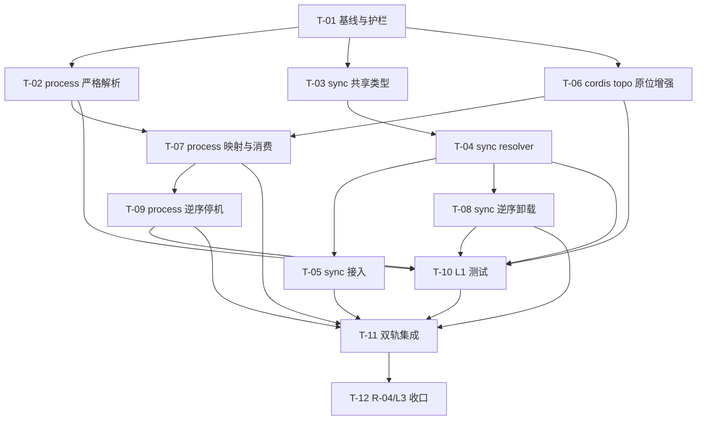

# 任务规划文档（dependency-graph）

> 基于 `spec.md` 与 `design.md` 生成。实施原则：复用优先、确定性优先、L3 进程隔离。
> 仓颉代码任务必须先加载 `cangjie-coder`；AI 严禁运行 `cjpm build`，编译与回传由人工在独立环境完成（`skills/sdd/templates/tasks-template.md:1-5,38-41`）。

## 文档信息

- **子系统**：`plugin-system-enhancement--dependency-graph`
- **关联契约**：`specs/plugin-system-enhancement--dependency-graph/contract.md`（IF-10.1～IF-10.4）
- **关联需求**：`specs/plugin-system-enhancement--dependency-graph/spec.md`
- **关联设计**：`specs/plugin-system-enhancement--dependency-graph/design.md`
- **主工程账本**：`specs/plugin-system-enhancement/SPECS_INDEX.md`
- **生成日期**：2026-10-19
- **版本**：1.0
- **状态**：草稿
- **任务总数**：12（满足 3～40 条约束）

## 开发规范（全任务强制遵守）

1. **语言与技能绑定**：所有 `.cj` 修改前必须加载 `cangjie-coder`，先核实仓颉语法、`Result` 类型/import 和集合 API，禁止凭其他语言经验编造接口；本工程技术栈为仓颉（`docs/uctoo-v4/uctoo-v4-architecture.md:163-174`）。
2. **契约先行**：IF-10 语义、错误或边界变更必须先更新 `contract.md` 与主工程 `SPECS_INDEX.md`，再改实现；当前全局接口账本只允许 IF-10，不新增编号（`specs/plugin-system-enhancement--dependency-graph/contract.md:7-19,74-84`；`specs/plugin-system-enhancement/SPECS_INDEX.md:66-85`）。
3. **主工程边界**：本子系统无上游，可独立开工；不反向依赖 `version-guard`、`capability-governance`、`capability-handshake`、`lifecycle-observability`、`authoring-toolchain`（`specs/plugin-system-enhancement/SPECS_INDEX.md:89-105`；`contract.md:52-72`）。
4. **复用优先**：sync 借鉴 `CompositionExecutor` / `LrtCompositionRunner` 的入度表和环检测范式；process 只演进 cordis 既有 `topoSort`，禁止在 `CordisHostManager` 另写一套（`src/skill/composition_executor.cj:286-345`；`src/skill/lrt_composition_runner.cj:359-423`；`libs/cordis-cj/cordis_host/src/plugin_host.cj:980-1031`）。
5. **`order` 共存**：依赖边高于 `order`；同层按 `order` 升序、声明序稳定；无依赖必须逐项等于现有 `sortByOrder()`（`src/plugin/plugin_config.cj:337-350`；`contract.md:32-37`）。
6. **共享文件边界**：修改 `src/plugin/cordis_host_manager.cj:263-274` 时，本子系统只写 `provide/inject` 与依赖计划；capabilities、协议版本、握手拒绝逻辑移交 `capability-handshake`，同文件合并必须按字段复核（`contract.md:58-60`）。
7. **dylib 边界**：只排序进入现有 Sync/Dylib 分支的条目，不接通 `PluginDylibLoader`，不修复 dylib 轨架构偏差（`specs/plugin-system-enhancement/SPECS_INDEX.md:150-153`；`src/plugin/plugin_host_manager.cj:133-138`）。
8. **底座优先**：先读 `skills/uctoo-dev-manual/SKILL.md` 和 `skills/uctoo-dev-manual/specs/plugin-system-design.md`；如任务后来引入表/列或路由，必须先停工回契约评审，再按 `sql/incremental/ → loaddbinfo → plugingen（优先）/crudgen → crudweb → permissions/role_has_permission` 补齐。当前 IF-10 为 0 表/0 路由，因此这些产物均应为 0（`skills/uctoo-dev-manual/SKILL.md:14-38,219-237`；`contract.md:39-50,62-72`）。
9. **最小改动**：不顺手收紧 `args/tableWhitelist` 的宽松数组解析，不改 process command/env、host.db、能力门禁、崩溃自愈或 validate CLI。
10. **验证约束**：AI 只做静态检查、测试代码编写和必要的非 `cjpm build` 检查；仓颉编译、类型检查、lint、可执行集成检查由人工独立运行并回传。未回传不得标“编译通过”。
11. **证据要求**：每次提交说明必须带 `文件:行号`；无法从源码或契约核实的项标“待核实”，不得猜测 API。

## 任务总览

| 编号 | 任务 | 关联需求(spec §) | 关联设计(design §) | 负责子 agent | 状态 | 预计产出 |
|---|---|---|---|---|---|---|
| T-01 | 冻结实现基线与契约护栏 | §1.4、§4.4～4.5 | §1、§10.3 | dependency-graph | [ ] 待开始 | 基线清单、调用面与待核实项结论 |
| T-02 | 补齐 process 依赖字段与严格解析 | DG-REQ-005、DG-NFR-006/013 | §3.1、§3.4 | dependency-graph | [ ] 待开始 | `provide/inject` 字段、Result 错误通道、解析测试 |
| T-03 | 建立 IF-10 sync 共享类型与统一拆分规则 | DG-REQ-001/003/004、DG-NFR-009/010 | §3.1～3.2、§3.6 | dependency-graph | [ ] 待开始 | `DependencyPlan`、`DependencyCycle`、共享拆分实现 |
| T-04 | 实现稳定 sync/dylib DependencyResolver | DG-REQ-001～004、DG-NFR-001～004/011 | §3.2 | dependency-graph | [ ] 待开始 | 稳定正逆拓扑、缺失/环诊断 |
| T-05 | 接入 sync 启动与增量调谐 | DG-REQ-002～004/010 | §2.3.1～2.3.2、§3.3 | dependency-graph | [ ] 待开始 | `loadAll/reconcile` 消费 IF-10.1、注册顺序回归 |
| T-06 | 原位增强 cordis 唯一拓扑实现 | DG-REQ-006/007、DG-NFR-001/003/008/010/011 | §3.4 | dependency-graph | [ ] 待开始 | 稳定 desired 序、结果型 topoSort、process 环路径 |
| T-07 | 映射并消费 process 依赖计划 | DG-REQ-005～007、DG-NFR-013 | §3.4.2～3.4.3、§6 | dependency-graph | [ ] 待开始 | `toCordisEntry` 映射、错误转换、启动顺序 |
| T-08 | 实现 sync 批量逆序卸载 | DG-REQ-008/009、DG-NFR-005 | §3.5 | dependency-graph | [ ] 待开始 | 活跃计划记录、批量逆序复用 `deactivate` |
| T-09 | 修正 process 逆序停机 | DG-REQ-008/009、DG-NFR-005 | §3.4～3.5 | dependency-graph | [ ] 待开始 | `shutdownAll` 反向计划、容错与去重 |
| T-10 | 完成 L1 单元测试 | 全部功能规则与 DFX | §3、§8 | dependency-graph | [ ] 待开始 | 解析/拓扑/环/逆序/复杂度测试 |
| T-11 | 完成 IF-10 双轨集成冒烟 | DG-REQ-002～010 | §2.3、§6 | dependency-graph | [ ] 待开始 | DG-CT-01～05 集成测试扩展 |
| T-12 | 执行 R-04/L3 人工验收与文档收口 | DG-REQ-010/011、全部 DFX | §8～§10 | dependency-graph + 人工 | [ ] 待开始 | DG-CT-06、51 skill/4 sync 回归、人工回传、文档同步 |

## 任务依赖关系图

- T-02、T-03、T-06 在 T-01 后可并行。
- IF-10.1 提供/消费成对：T-03/T-04 提供计划，T-05 消费。
- IF-10.2/10.3 提供/消费成对：T-02 提供清单字段，T-06 提供 cordis 拓扑结果，T-07 完成宿主映射和消费。
- IF-10.4 双轨并行：T-08（sync）与 T-09（process）完成后，T-11 才能验收逆序停机。

## 任务详细说明（按编号展开）

### T-01 冻结实现基线与契约护栏

- **目标**：在改代码前固定 IF-10 调用面、存量顺序黄金基线、共享文件边界和待核实 API，防止实现越界。
- **关联**：spec §1.4、§4.4～4.5；design §1、§10.3。
- **输入**：`contract.md`、`SPECS_INDEX.md`、本目录 `spec.md/design.md`。
- **步骤**：
  1. 复核 IF-10.1～IF-10.4 仍为 v1 / 4 接口 / 0 新表（`contract.md:9-19,23-30`）。
  2. 记录 `sortByOrder()` 两个调用点、`PluginLoader.checkDependencies`、`toCordisEntry`、cordis `topoSort`、两条停机路径的当前行号（`src/plugin/plugin_discovery_service.cj:79-81`；`src/plugin/plugin_config_parser.cj:58-60`；`src/plugin/plugin_loader.cj:119-149`；`src/plugin/cordis_host_manager.cj:253-274,416-438`；`libs/cordis-cj/cordis_host/src/plugin_host.cj:980-1031`）。
  3. 记录 4 个 sync 锚点和 51 个 skill 插件黄金序；黄金序获取方式与快照落点由现有测试设施决定，查不到标“待核实”（`src/plugins/generated_anchors.cj:1-16`；`SPECS_INDEX.md:127-155`）。
  4. 核实 cordis 包已有 `Result` 类型/import、`reconcileDesired` 全部调用点和 HostState 锁约束，禁止凭文档直接定语法。
- **本子系统负责**：IF-10 调用面和测试基线清单、待核实项闭环。
- **不碰（移交/调用上游）**：不修改任何其他子系统契约；不改 capability/version/lifecycle/authoring 代码；不复活 dylib。
- **产出物**：实现提交说明中的基线表；必要时仅更新本目录三份 SDD 文档的证据行号。
- **验收**：所有后续任务都能指向已核实调用面；无“猜测的仓颉 API”；契约无未登记变更。
- **风险**：主工程或 capability-handshake 并行修改同文件；必须在 T-07 前重新核对 diff（`contract.md:58-60`）。

### T-02 补齐 process 依赖字段与严格解析

- **目标**：实现 IF-10.2，使 `plugin.yaml.provide/inject` 成为可选严格字符串数组并显式返回 `ConfigInvalid`。
- **关联**：spec DG-REQ-005、DG-NFR-006/013；design §3.1、§3.4.1。
- **输入**：T-01 基线；当前 `PluginManifestEntry` 与解析调用面。
- **步骤**：
  1. 在 `PluginManifestEntry` 增加缺省空的 `provide/inject`；不改变 `order` 默认 0（`src/plugin/plugin_config.cj:72-112`）。
  2. 增加单一严格字符串数组解析逻辑：非数组或非字符串元素返回 `ConfigInvalid`，消息含插件/字段/索引。
  3. 演进 `fromJsonValue` 错误通道并同步 `PluginConfigParser`、`fromPluginYaml`、`PluginDiscoveryService` 调用者（`src/plugin/plugin_config_parser.cj:45-52`；`src/plugin/plugin_config.cj:216-267`；`src/plugin/plugin_discovery_service.cj:64-75`）。
  4. 旧清单字段缺失时保持空数组；不要复用宽松 `parseStringArray`（`src/plugin/plugin_config.cj:279-295`）。
  5. 添加合法、缺失、非数组、混合类型四类解析测试。
- **本子系统负责**：`provide/inject` 模型、严格解析、错误传播和兼容测试。
- **不碰（移交/调用上游）**：不收紧 `args/tableWhitelist`；不修改模板/plugingen（移交 `authoring-toolchain`）；不改 capabilities、env、secret、command。
- **产出物**：`src/plugin/plugin_config.cj`、必要调用者与解析测试。
- **验收**：合法数组原序保留；缺失字段为空；非法字段明确 `ConfigInvalid`；旧 plugin.yaml 行为不变。
- **风险**：由 `Option` 向错误 Result 的签名演进会影响调用者；必须以 T-01 全调用面为准，不做兼容 shim。

### T-03 建立 IF-10 sync 共享类型与统一拆分规则

- **目标**：建立 `DependencyPlan`、`DependencyCycle` 和唯一依赖字符串拆分实现，为 IF-10.1/10.4 提供稳定基础。
- **关联**：spec DG-REQ-001/003/004、DG-NFR-009/010；design §3.1～3.2、§3.6。
- **输入**：T-01 的包依赖与 API 核实结果。
- **步骤**：
  1. 在不造成 `plugin-spi → magic.plugin` 反向依赖的位置定义 `DependencyPlan`；最终归属按 T-01 结果确定（`contract.md:39-50,52-60`）。
  2. 在统一 `PluginError` 增加 `DependencyCycle(String)` 并补 `message()` 分支（`libs/plugin-spi/src/plugin_types.cj:53-84`）。
  3. 将 `PluginLoader` 私有拆分规则提升为同包单一实现，保持逗号拆分、trim、过滤空项语义（`src/plugin/plugin_loader.cj:132-149`）。
  4. 让 `PluginLoader` 与后续 resolver 调用同一实现，删除重复逻辑。
  5. 添加错误消息和 `"" / "a, b" / "a,, b "` 单测。
- **本子系统负责**：IF-10 共用类型、错误分支与依赖字符串规范化。
- **不碰（移交/调用上游）**：不增加版本范围、能力字段或 validate 诊断；不改变其他 `PluginError` 文案。
- **产出物**：共享类型/函数、`plugin_types.cj` 最小变更、单测。
- **验收**：两个消费者只存在一份拆分语义；`DependencyCycle` 可携带闭合路径；包依赖保持单向。
- **风险**：共享类型错误放置会产生循环 import；一旦出现，优先放宿主包而不是引入适配层。

### T-04 实现稳定 sync/dylib DependencyResolver

- **目标**：实现 IF-10.1 的事前依赖编排、缺失校验、稳定拓扑和明确环路径。
- **关联**：spec DG-REQ-001～004、DG-NFR-001～004/011；design §3.2。
- **输入**：T-03 的共享类型与拆分函数；`PluginRegistry` 已注册集合。
- **步骤**：
  1. 顺序读取候选条目和 `PluginAnnotation`，每个唯一 className 最多反射一次；沿用现有类/注解错误（`src/plugin/plugin_loader.cj:46-67`）。
  2. 建立 name 索引、邻接表、入度表；候选外但已注册的依赖视为已满足，其他返回 `DependencyMissing`。
  3. 用 `(order, declarationIndex)` 稳定选择 ready 节点；不得假设未核实的 PriorityQueue API。
  4. 成功时生成 forward/reverse；无依赖结果逐项等于旧 `sortByOrder()`。
  5. 失败时在剩余子图提取确定性闭合路径；覆盖自环、二节点环、多节点环。
  6. 保证不返回部分计划，复杂度不劣于 `O(V² + E)`。
- **本子系统负责**：sync/dylib 图构建、排序、缺失与环诊断。
- **不碰（移交/调用上游）**：不实现 process serviceKey 拓扑；不复活 dylib loader；不做版本/能力协商。
- **产出物**：`DependencyResolver` 实现及单元测试基座。
- **验收**：B 依赖 A 且 B.order 更小时仍输出 A、B；同 order 保持声明序；错误含完整实体名。
- **风险**：重复依赖若重复增加入度会造成假环，必须按首次出现去重。

### T-05 接入 sync 启动与增量调谐

- **目标**：让 `PluginHostManager.loadAll/reconcile` 在生命周期前消费 IF-10.1，并让注册表顺序反映拓扑计划。
- **关联**：spec DG-REQ-002～004/010；design §2.3.1～2.3.2、§3.3。
- **输入**：T-04 的 resolver；当前 `loadAll/reconcile/loadSingle`。
- **步骤**：
  1. `loadAll` 对 enabled sync/dylib 候选先 resolve，成功后按 forwardOrder 调用既有 `loadSingle`（`src/plugin/plugin_host_manager.cj:114-160,301-381`）。
  2. 环/缺失错误发生时，确保本轨没有任何候选进入生命周期；把统一错误写入现有 `LoadResult` 表达，不发明新 HTTP 接口。
  3. `reconcile` 只排序 freshList，并把 registry 现有插件作为已满足集合（`src/plugin/plugin_host_manager.cj:186-255`）。
  4. 保留 `PluginLoader.checkDependencies` 作为防御性断言，不再依赖其决定顺序（`src/plugin/plugin_loader.cj:119-130`）。
  5. 断言 `PluginRegistry.listAll/list(state)` 顺序与 forwardOrder 一致（`src/plugin/plugin_registry.cj:79-112`）。
- **本子系统负责**：IF-10.1 消费侧、启动前原子拒绝、增量依赖满足和注册顺序。
- **不碰（移交/调用上游）**：不实现目录删除自动卸载或配置热更新；不改变 process 生命周期、自愈和状态回写。
- **产出物**：`src/plugin/plugin_host_manager.cj` 最小接入、相关集成断言。
- **验收**：主工程 §5.1 用例 4 通过；无依赖黄金序不变；增量新插件可依赖已注册插件。
- **风险**：跨轨全局事务语义未冻结；只保证出错轨不部分启动，其他轨策略标“待核实”。

### T-06 原位增强 cordis 唯一拓扑实现

- **目标**：在 cordis 既有 `topoSort` 内完成稳定服务依赖排序和闭合环错误，不产生第二套 process 算法。
- **关联**：spec DG-REQ-006/007、DG-NFR-001/003/008/010/011；design §3.4。
- **输入**：T-01 核实的 cordis Result/import 与调用面。
- **步骤**：
  1. 为 `HostState.desired` 同步维护稳定 ID 顺序；`addDesired/removeDesired/reconcile(configPath)` 成对更新（`libs/cordis-cj/cordis_host/src/host_state.cj:10-33`；`libs/cordis-cj/cordis_host/src/plugin_host.cj:766-782`）。
  2. `computeToAdd` 按稳定序取条目，禁止依赖 HashMap 枚举顺序（`libs/cordis-cj/cordis_host/src/plugin_host.cj:829-840`）。
  3. 原位改造 `topoSort`：复用 serviceKey provider 建图，使用输入位置稳定选择；无候选 provider 继续视为外部/既有服务（`:984-1011`）。
  4. 把剩余节点从“按原序追加”改为返回确定性闭合插件路径（`:1025-1028`）。
  5. 让 `computeToAdd/reconcileDesired` 传播结果；更新全部现有调用者和 cordis tests。
  6. 静态审查 `CordisHostManager` 不得出现第二份 providerOf/入度算法。
- **本子系统负责**：cordis 既有算法的结果化、稳定化、环诊断和 desired 顺序。
- **不碰（移交/调用上游）**：不修改 cordis JSON-RPC、服务注册、notify、自愈、进程 manager；不 import `plugin-spi`。
- **产出物**：`host_state.cj`、`plugin_host.cj` 与 cordis 单测。
- **验收**：provider 总在 consumer 前；环明确失败且不 launch；无 provider 的 inject 保持既有语义；只有一套 process 拓扑实现。
- **风险**：HostState 锁和 `reconcileDesired` 是启动关键路径，必须遵循现有“不持锁调用外部对象”约束（`libs/cordis-cj/cordis_host/src/plugin_host.cj:917-947`）。

### T-07 映射并消费 process 依赖计划

- **目标**：完成 IF-10.2/10.3 消费侧，把严格清单字段映射给 cordis并在拉起前处理环错误。
- **关联**：spec DG-REQ-005～007、DG-NFR-013；design §3.4.2～3.4.3、§6。
- **输入**：T-02 `PluginManifestEntry.provide/inject`；T-06 cordis 结果型拓扑。
- **步骤**：
  1. 在 `toCordisEntry` 原序复制 `entry.provide/inject` 到 `PluginEntry`（`src/plugin/cordis_host_manager.cj:253-274`；`libs/cordis-cj/cordis_core/src/config.cj:16-37`）。
  2. 在 `loadProcessPlugins` 写入 desired/拉起前消费 cordis 拓扑结果；环错误转换为 `PluginError.DependencyCycle` 等价宿主失败结果（`src/plugin/cordis_host_manager.cj:181-238`）。
  3. 记录实际 process forward plan，供 T-09 使用。
  4. 保持 command/args/path 解析和 awaitActive 逻辑不变。
  5. 与 capability-handshake 并行变更按字段分区合并；只修改 provide/inject 相关行。
- **本子系统负责**：IF-10.3 映射、cordis 错误转换、process 正向计划记录。
- **不碰（移交/调用上游）**：capabilities/协议/握手归 `capability-handshake`；autoRestart/熔断归 `lifecycle-observability`；模板/validate 归 `authoring-toolchain`。
- **产出物**：`src/plugin/cordis_host_manager.cj` 最小变更与集成断言。
- **验收**：consumer.order 更小仍后启动；环上 0 相关进程拉起；旧清单空数组行为不变。
- **风险**：同文件冲突；实施前后必须复核 `cordis_host_manager.cj:263-274` 实际最新内容。

### T-08 实现 sync 批量逆序卸载

- **目标**：实现 IF-10.4 的 sync/dylib 批量反序清理，复用既有 `deactivate(name)`。
- **关联**：spec DG-REQ-008/009、DG-NFR-005；design §3.5。
- **输入**：T-04 forward/reverse plan；T-05 实际成功激活结果。
- **步骤**：
  1. 只记录成功激活且仍注册的 sync/dylib ID，不把 failed/skipped 计入活跃计划。
  2. 批量停机按活跃正序严格反转，逐项调用 `deactivate`（`src/plugin/plugin_host_manager.cj:414-454`）。
  3. 空计划安全返回；重复 ID 去重；已不存在插件跳过。
  4. 单项错误记录后继续，保持每个插件至多处理一次。
  5. 单插件 `deactivate(name)` 行为不变，不隐式级联。
- **本子系统负责**：sync/dylib 批量逆序入口与活跃计划维护。
- **不碰（移交/调用上游）**：不修改 `pluginuninstall` 的静态资产/数据库痕迹清理；不定义强制级联卸载 CLI。
- **产出物**：`plugin_host_manager.cj` 批量清理能力和顺序探针测试。
- **验收**：A←B←C 时 C、B、A；B 清理失败仍继续 A；空集合无副作用。
- **风险**：`deactivate` 的 snapshot/restore 语义可能影响连续调用，必须以集成测试验证，不能绕开其既有清理链。

### T-09 修正 process 逆序停机

- **目标**：让 `CordisHostManager.shutdownAll` 使用同一 cordis 正向计划的反序，而非 `startedIds` 原序。
- **关联**：spec DG-REQ-008/009、DG-NFR-005；design §3.4～3.5。
- **输入**：T-07 保存的实际 process forward plan；cordis actual 状态。
- **步骤**：
  1. 将正向计划与实际已启动/仍存活 ID 求交，反向遍历。
  2. 每个 ID 调用既有 `removePlugin`，保持逐项 try/catch（`src/plugin/cordis_host_manager.cj:418-438`；`libs/cordis-cj/cordis_host/src/plugin_host.cj:864-889`）。
  3. 每个 ID 至多一次；空计划安全；单项 terminate 错误后继续。
  4. 全部插件处理后再关闭 `cordisManager`，保持现有收尾位置。
  5. 清理过期 `startedIds` 或让其不再充当顺序真源，避免两套计划漂移。
- **本子系统负责**：process 批量停机顺序、容错和计划一致性。
- **不碰（移交/调用上游）**：不修改单插件 `deactivateProcessPlugin`、崩溃重启、restartCount 或事件观测。
- **产出物**：`cordis_host_manager.cj` 停机改造、terminate 顺序测试。
- **验收**：A←B←C 时 C、B、A；异常继续；注释与实现一致。
- **风险**：awaitActive 顺序不是启动拓扑真源，必须使用 T-06/T-07 返回计划，不能简单 `startedIds.reverse()`（`src/plugin/cordis_host_manager.cj:206-238`）。

### T-10 完成 L1 单元测试

- **目标**：覆盖所有功能规则与 DFX，先在单组件级证明确定性、错误和兼容性。
- **关联**：spec 全部 DG-REQ / DG-NFR；design §3、§8。
- **输入**：T-02、T-04、T-06、T-08、T-09 实现。
- **步骤**：
  1. sync：空图、单点、同 order 稳定、order 冲突依赖、已注册依赖、缺失、自环、二/多节点环、重复依赖。
  2. process：字段缺失/合法/非法；provider-consumer；多 provider；外部 Key；自环/多节点环。
  3. 逆序：空集合、线性链、分叉 DAG、单项失败继续、重复/不存在 ID。
  4. 确定性：同输入多次输出逐项一致；无依赖与旧 `sortByOrder()` 黄金序一致。
  5. 性能：计数型测试验证无无界循环，复杂度不劣于 `O(V²+E)`；每 className 反射 ≤1。
  6. 静态断言只有 cordis 一处 process serviceKey 拓扑实现。
- **本子系统负责**：L1 测试代码与静态证据。
- **不碰（移交/调用上游）**：不运行 `cjpm build`；编译/类型检查由人工；不测试其他子系统私有能力。
- **产出物**：相关仓颉测试文件、L1 用例清单。
- **验收**：spec 每个 DG-REQ/DG-NFR 至少有一个断言或明确静态审查项。
- **风险**：仓颉测试入口命名约束；既有集成说明指出 `_test.cj` 可能被构建规则排除，新增文件须遵循现有包模式（`src/plugin/integration/plugin_system_check.cj:21-34`）。

### T-11 完成 IF-10 双轨集成冒烟

- **目标**：扩展既有集成入口，完成 contract DG-CT-01～05 和跨边界消费验收。
- **关联**：spec DG-REQ-002～010；design §2.3、§6。
- **输入**：T-05、T-07～T-10。
- **步骤**：
  1. 在 `plugin_system_check.cj` 覆盖 sync B 依赖 A 且 B.order 更小，断言激活与 `PluginRegistry.listAll()` 为 A、B（`contract.md:88-95`；`src/plugin/plugin_registry.cj:99-112`）。
  2. 对无依赖不同/相同 order 做新旧黄金序逐项对比。
  3. 在 `cordis_l3_check.cj` 覆盖 provider/consumer 映射与 consumer.order 更小仍后启动；既有 process 测试基座在 `src/plugin/integration/cordis_l3_check.cj:126-197`。
  4. 两轨分别覆盖环：明确 `DependencyCycle`、闭合路径、0 Active/0 相关进程。
  5. 两轨覆盖 A←B←C 逆序清理和单项失败继续。
- **本子系统负责**：IF-10 提供方到 sync/process 消费方的 L2 冒烟。
- **不碰（移交/调用上游）**：不等待不存在的上游子系统；不把 capability/version/lifecycle 场景混入本测试。
- **产出物**：两个既有 integration 入口扩展、DG-CT-01～05 结果模板。
- **验收**：至少 3 条跨组件主干（resolver→sync host、manifest→CordisHostManager→cordis、plan→批量停机）和 1 条异常（cycle/invalid config）全绿。
- **风险**：process 实进程夹具可能依赖环境；无法自动执行时保留可重复人工步骤和预期日志，不虚报通过。

### T-12 执行 R-04/L3 人工验收与文档收口

- **目标**：完成 DG-CT-06、主工程 §5.1 用例 4/5、人工编译回传和文档一致性收口。
- **关联**：spec DG-REQ-010/011、全部 DFX；design §8～§10。
- **输入**：T-11 集成代码与 L1/L2 结果。
- **步骤**：
  1. 人工在独立环境执行仓颉编译、类型检查、lint 和既有插件集成检查；AI 不运行 `cjpm build`。
  2. 执行主工程用例 4：依赖方 order 更小仍后加载（`SPECS_INDEX.md:127-133`）。
  3. 执行 R-04：4 个 sync 锚点与 51 个 skill 插件加载/注册顺序、行为逐项对比黄金基线（`src/plugins/generated_anchors.cj:1-16`；`SPECS_INDEX.md:133,148-155`）。
  4. 静态确认 0 数据库迁移、0 HTTP API、0 permissions/role_has_permission；若出现任一项，判定越界并回契约评审。
  5. 复核 `cordis_host_manager.cj` 与 capability-handshake 的字段级冲突；本子系统只保留 provide/inject。
  6. 更新 `spec.md/design.md/tasks.md/test-report.md`（若测试步要求）与主工程状态/修订记录，确保实现无漂移。
- **本子系统负责**：回归证据、IF-10 验收收口和文档同步。
- **不碰（移交/调用上游）**：不代替主工程裁决其他子系统状态；不修改 51 个 skill 业务逻辑来“适配”排序；不跳过失败测试。
- **产出物**：人工回传记录、DG-CT-06/L3 结果、文档与账本更新。
- **验收**：L1/L2/L3 证据齐全；R-04 零回归；无越界产物；所有待核实项闭环或明确阻塞。
- **风险**：人工未回传时任务保持进行中/阻塞，不得标完成。

## 需求覆盖追踪矩阵

### 功能需求覆盖

| spec 需求编号/条目 | 覆盖任务 | 覆盖状态 | 备注 |
|---|---|---|---|
| DG-REQ-001 sync 依赖声明解析 | T-03、T-04、T-10 | 全覆盖 | 单一拆分语义 + 注解读取 |
| DG-REQ-002 依赖优先、order 同层稳定 | T-04、T-05、T-10、T-11 | 全覆盖 | 主工程用例 4 |
| DG-REQ-003 缺失依赖拒绝 | T-03、T-04、T-05、T-10 | 全覆盖 | 复用 DependencyMissing |
| DG-REQ-004 环检测与原子拒绝 | T-03、T-04、T-05、T-10、T-11 | 全覆盖 | 自环/多节点环/0 Active |
| DG-REQ-005 process 严格声明解析 | T-02、T-07、T-10、T-11 | 全覆盖 | ConfigInvalid + 旧清单空数组 |
| DG-REQ-006 process 完整映射 | T-02、T-07、T-11 | 全覆盖 | provide/inject 原序映射 |
| DG-REQ-007 复用 cordis 拓扑 | T-06、T-07、T-10、T-11 | 全覆盖 | 禁止宿主第二套算法 |
| DG-REQ-008 逆序批量清理 | T-08、T-09、T-10、T-11 | 全覆盖 | sync/process 两轨 |
| DG-REQ-009 清理容错与去重 | T-08、T-09、T-10、T-11 | 全覆盖 | 空计划/单项失败继续 |
| DG-REQ-010 存量零回归 | T-01、T-05、T-10～T-12 | 全覆盖 | 4 sync + 51 skill |
| DG-REQ-011 无持久化变更 | T-01、T-12 | 全覆盖 | 0 SQL/权限/路由 |

### DFX 覆盖

| spec DFX 编号 | 覆盖任务 | 覆盖状态 | 备注 |
|---|---|---|---|
| DG-NFR-001 算法上界 | T-04、T-06、T-10 | 全覆盖 | `O(V²+E)` / `O(V+E)` |
| DG-NFR-002 单次解析 | T-04、T-10 | 全覆盖 | 每 className ≤1 次 |
| DG-NFR-003 确定性 | T-04、T-06、T-10 | 全覆盖 | 重复运行逐项一致 |
| DG-NFR-004 非法图原子拒绝 | T-05、T-07、T-10、T-11 | 全覆盖 | 生命周期前拒绝 |
| DG-NFR-005 清理尽力完成 | T-08～T-11 | 全覆盖 | 单项失败继续 |
| DG-NFR-006 严格清单类型 | T-02、T-10、T-11 | 全覆盖 | 不使用宽松 toString |
| DG-NFR-007 零权限扩张 | T-01、T-12 | 全覆盖 | 静态产物审计 |
| DG-NFR-008 复用优先 | T-03、T-04、T-06、T-10 | 全覆盖 | sync 借鉴、process 原位复用 |
| DG-NFR-009 单一拆分规则 | T-03、T-10 | 全覆盖 | loader/resolver 共用 |
| DG-NFR-010 可诊断性 | T-03、T-04、T-06、T-10、T-11 | 全覆盖 | 闭合路径、缺失名 |
| DG-NFR-011 order 共存 | T-04～T-07、T-10、T-11 | 全覆盖 | 依赖边优先 |
| DG-NFR-012 R-04 防回退 | T-01、T-05、T-10～T-12 | 全覆盖 | 主工程硬锚点 |
| DG-NFR-013 可选字段兼容 | T-02、T-07、T-10、T-12 | 全覆盖 | 缺省空数组 |

### 契约覆盖

| 契约 | 提供方任务 | 消费方任务 | 验收任务 | 状态 |
|---|---|---|---|---|
| IF-10.1 `DependencyResolver.resolve` | T-03、T-04 | T-05 | T-10、T-11、T-12 | 全覆盖 |
| IF-10.2 process 字段解析 | T-02 | T-07 | T-10、T-11 | 全覆盖 |
| IF-10.3 `toCordisEntry` / cordis topo | T-06 | T-07 | T-10、T-11 | 全覆盖 |
| IF-10.4 `reverseOrder` / 批量停机 | T-04、T-06 | T-08、T-09 | T-10～T-12 | 全覆盖 |

## 验收检查清单（终验）

### 文档与契约

- [ ] `contract.md`、`spec.md`、`design.md`、`tasks.md` 与实现一致，IF-10 编号和边界无漂移。
- [ ] 主工程 `SPECS_INDEX.md` 的状态、§6 影响面和修订记录已按闸口要求更新。
- [ ] capability-handshake 共享文件按字段分区合并：本子系统只改 `provide/inject` 与依赖计划。
- [ ] 所有结论和提交说明都有 `文件:行号`；待核实项已闭环或明确阻塞。

### L1 单子系统

- [ ] sync 拆分、缺失、稳定拓扑、自环/多节点环、逆序测试通过。
- [ ] process 严格解析、映射、provider-consumer、外部 Key、环检测测试通过。
- [ ] 同一输入重复运行结果逐项一致，复杂度和反射次数约束通过。
- [ ] 静态审查确认 process serviceKey 拓扑只有 cordis 一套实现。

### L2 跨边界冒烟

- [ ] 主干 1：`DependencyResolver → PluginHostManager → PluginRegistry`，B 依赖 A 且 B.order 更小时，激活和列表均为 A、B。
- [ ] 主干 2：`plugin.yaml parser → toCordisEntry → cordis topoSort`，provider 先于 consumer。
- [ ] 主干 3：`forward plan → reverseOrder → sync/process 批量停机`，A←B←C 按 C、B、A。
- [ ] 异常 1：sync/process 环均在启动前返回含闭合路径的 `DependencyCycle`，0 Active/0 相关进程。
- [ ] 异常 2：非法 `provide/inject` 返回 `ConfigInvalid`，不进入 desired。
- [ ] 异常 3：单插件清理失败后其余插件继续，且每个 ID 至多处理一次。

### L3 主工程与防回退

- [ ] 主工程 §5.1 用例 4：依赖方 `order` 更小仍后加载（`SPECS_INDEX.md:127-133`）。
- [ ] R-04：4 个 sync 锚点加载/注册/行为零回归（`src/plugins/generated_anchors.cj:1-16`）。
- [ ] R-04：51 个 skill 插件加载顺序与行为零回归（`SPECS_INDEX.md:133,148-155`）。
- [ ] 旧 process `plugin.yaml` 缺少 `provide/inject` 时行为不变。
- [ ] 0 新数据库表/列，0 `sql/incremental/`，0 HTTP API，0 `permissions/role_has_permission`。

### 工具与人工确认

- [ ] 实现阶段所有仓颉任务已加载 `cangjie-coder`。
- [ ] AI 未运行 `cjpm build`。
- [ ] 人工已在独立环境确认编译、类型检查、lint 和集成可执行检查结果。
- [ ] 若人工结果失败，相关任务保持进行中/阻塞，未绕过检查或虚报通过。

## 修订记录 / 多轮迭代

| 日期 | 轮次 | 触发来源 | 改动文件清单 | 验证结果 |
|---|---|---|---|---|
| 2026-10-19 | R1 | IF-10 文档步；主工程 §5.1 用例 4、§7 R-04 | `spec.md`、`design.md`、`tasks.md` | 完成文档规划；代码/人工编译尚未执行 |

### 问题分级与防回归锚点

| 级别 | 判定 | 当前锚点 |
|---|---|---|
| P0 | 契约漂移、process 第二套拓扑、环上仍启动、R-04 回归、越界改 capability/version/security | IF-10、DG-CT-04、R-04 |
| P1 | order 同层不稳定、逆序停机错误、清理异常中断、非法数组被静默接受 | DG-CT-01/02/03/05 |
| P2 | 错误文案缺少实体/索引、测试或文档证据不完整 | DG-NFR-009/010、文档收口 |

固定防回归锚点：

1. `sortByOrder()` 无依赖黄金序（`src/plugin/plugin_config.cj:337-350`）。
2. `PluginRegistry.orderedNames/listAll/list` 注册顺序（`src/plugin/plugin_registry.cj:20-24,79-112`）。
3. 4 个 sync 反射锚点（`src/plugins/generated_anchors.cj:1-16`）。
4. 51 个 skill 插件主工程硬验收（`specs/plugin-system-enhancement/SPECS_INDEX.md:127-155`）。
5. cordis 唯一 `topoSort`（`libs/cordis-cj/cordis_host/src/plugin_host.cj:980-1031`）。
6. process 逆序停机承诺与实现（`src/plugin/cordis_host_manager.cj:416-438`）。
