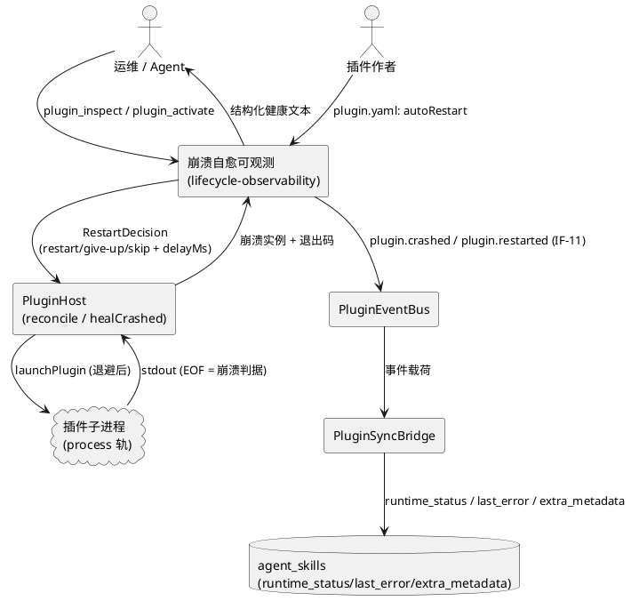
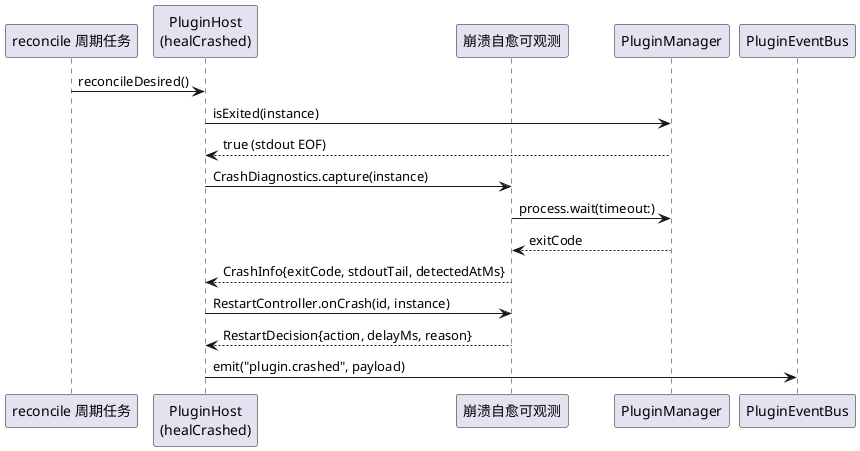
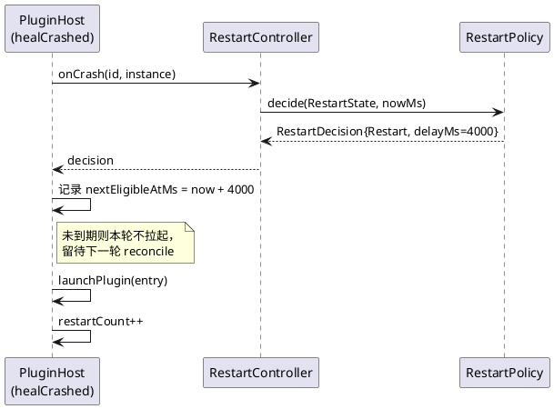
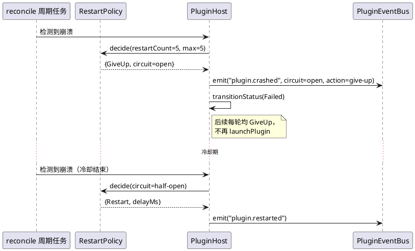
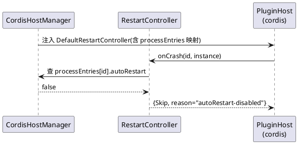
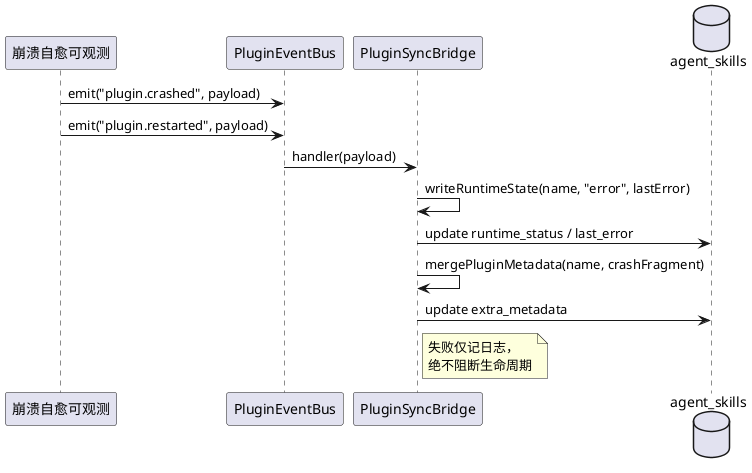
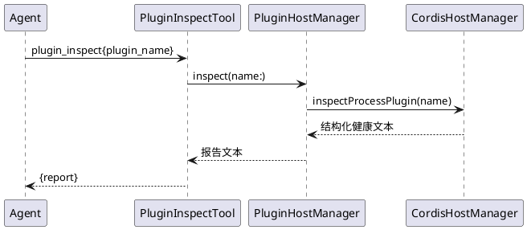

# 崩溃自愈可观测（lifecycle-observability）需求规格

> 所属主工程：`plugin-system-enhancement` ｜ 子系统 ID：`lifecycle-observability`
> 集成契约：`./contract.md`（v1，LO-01~LO-06）｜ 主工程账本：`../plugin-system-enhancement/SPECS_INDEX.md`
> 验收句式：**EARS**（`skills/sdd/templates/ears-format.md`）

---

# 1. 组件定位

## 1.1 核心职责

本组件负责**裁决与记录 L3 进程轨插件的崩溃重启行为**，实现「崩溃可诊断、重启有节制、风暴能熔断、全程可观测」。

## 1.2 核心输入

1. **崩溃信号**：周期性 `reconcile` 触发 `healCrashed()`（主工程入口 `src/app/main.cj:946-961`，间隔 `PLUGIN_RECONCILE_INTERVAL_SECONDS` 默认 60s），经 `manager.isExited(instance)`（stdout EOF，`libs/cordis-cj/cordis_host/src/plugin_manager.cj:78-80`）判定插件进程已退出。
2. **配置输入**：`plugin.yaml` 的 `autoRestart`（`src/plugin/plugin_config.cj:103-104`，解析 :185-189）+ 宿主环境变量 `PLUGIN_RESTART_*`（contract §1.2）。
3. **子进程退出信息**：`SubProcess.wait(timeout:)` 返回的退出码（范式见 `src/app/services/tool/CrudGenService.cj:170`）。
4. **插件 stdout 流**：既有日志转发通道 `LogUtils.info("[cordis][id] ...")`（`src/plugin/cordis_host_manager.cj:60-65`）。
5. **人工指令**：Agent 工具 `plugin_activate` / `plugin_deactivate` / `plugin_refresh`（`src/plugin/plugin_agent_tools.cj:191/268/352`）—— 熔断后的人工恢复入口。

## 1.3 核心输出

1. **重启裁决**：`RestartDecision{action, delayMs, reason}` —— 决定「立即退避重启 / 放弃并熔断 / 跳过不重启」。
2. **崩溃/重启事件**：`plugin.crashed` / `plugin.restarted`，经 `PluginEventBus`（`libs/plugin-spi/src/plugin_event_bus.cj:121`）广播（= IF-11）。
3. **运行态回写**：由消费方 `PluginSyncBridge` 写 `agent_skills.runtime_status` / `last_error` / `extra_metadata`（`src/plugin/plugin_sync_bridge.cj:67-97 / 104-130`）。
4. **结构化诊断文本**：`inspectProcessPlugin` 输出，经既有 `plugin_inspect` 工具暴露给 Agent（`src/plugin/plugin_agent_tools.cj:113`）。
5. **宿主日志**：`[CordisHostManager]` 前缀的 LogUtils 记录（`plugin_host.cj:959/971/973` 既有通道保留并增强）。

## 1.4 职责边界

**不做**：
1. **不做依赖逆序停机**（归 `dependency-graph`）；不改动 `shutdownAll`（`cordis_host_manager.cj:421-438`）的排序逻辑。
2. **不接线圈周期性 ping 探活**（`Methods.PING`，`libs/cordis-cj/cordis_core/src/methods.cj:13`）—— 崩溃判据保持 stdout EOF 单一来源。
3. **不改 stderr 重定向**：`stdErr: ProcessRedirect.Inherit`（`plugin_manager.cj:174`）是启动挂死修复产物，本组件不得改回 Pipe，因此**不提供 stderr 尾帧落库**。
4. **不新建表/列承载观测数据**（铁律 9 / R-06）；不新建可观测 UI 面板、不新增 metrics 端点。
5. **不新增 Agent 工具**（不做 `plugin_restart` / `plugin_logs` / `plugin_health`），复用 `plugin_inspect` 输出扩展。
6. **不做版本协商 / 能力门禁 / 能力握手 / 依赖拓扑 / validate CLI**（分归其余 5 个子系统）。
7. **不把观测面变成控制面**：回写失败只记日志，绝不阻断插件生命周期（`plugin_sync_bridge.cj:25-27` 红线）。

---

# 2. 领域术语

**崩溃（Crash）**
: 插件进程在 `desired` 中仍存在、但 `isExited(instance)` 为 true（stdout EOF）的状态。

**重启（Restart）**
: 崩溃后由 `healCrashed` 调用 `launchPlugin(entry)` 重新拉起同一插件进程的一次动作（现状 `plugin_host.cj:970`）。

**重启计数（restartCount）**
: 计数窗口内该插件已发生的重启次数；插件连续 Active 超过稳定窗口后归零。

**退避（Backoff）**
: 两次重启之间的强制等待时长，按 `base × 2^n` 指数增长并封顶（复用 `src/interaction/error_recovery_manager.cj:95-103` 范式）。

**重启风暴（Restart Storm）**
: 插件反复崩溃导致宿主在短时间内持续拉起进程、消耗 PID/内存/线程池的现象。

**熔断（Circuit Open）**
: 重启次数达到上限后，在冷却期内**停止一切自动重拉**的保护状态。

**冷却（Cooldown）**
: 熔断后禁止自动重拉的时长；到期后进入半开，允许一次试探性重拉。

**半开（Half-Open）**
: 冷却结束后的试探状态；该次重拉后若插件稳定运行则闭合计数，若再次崩溃则重新熔断。

**崩溃诊断（CrashInfo）**
: 一次崩溃的结构化快照：`{exitCode, signal, stdoutTail, detectedAtMs}`。

**autoRestart**
: `plugin.yaml` 中的崩溃自愈开关（`plugin_config.cj:103-104`，缺省 true）。**本轮之前全仓无读取点**（R-07），本组件为其唯一消费方。

**稳定窗口（Stability Window）**
: 插件连续处于 Active 的时长阈值；超过则判定"已自愈"，`restartCount` 归零（对应 `PLUGIN_RESTART_WINDOW_S`）。

---

# 3. 角色与边界

## 3.1 核心角色

- **运维 / Agent**：通过 `plugin_inspect` 查看插件健康与熔断状态；通过 `plugin_activate` 人工恢复已熔断的插件。
- **插件作者**：在 `plugin.yaml` 中声明 `autoRestart`（不希望被无限重拉的插件置 `false`）。

## 3.2 外部系统

- **cordis 宿主协调器 `PluginHost`**：提供崩溃检测与 `launchPlugin`，消费本组件的重启裁决（LO-02）。
- **插件子进程**：被拉起/被观测的对象；其 stdout 经既有通道转发宿主日志。
- **`PluginSyncBridge`**：IF-11 事件消费方，单向回写 `agent_skills`（消费方侧与本轮同轮改造）。
- **`PluginEventBus`**：事件广播总线（既有，不改造）。

## 3.3 交互上下文

---

# 4. DFX 约束

## 4.1 性能

1. **REQ-LO-DFX-01**：单插件单次崩溃裁决 + 诊断采集的 CPU 耗时必须 ≤ 5ms（纯内存计算 + 一次 `wait(timeout:)`）。
   - 验收条件：When 单轮 reconcile 处理 ≤ 20 个崩溃插件, the 崩溃自愈可观测组件 shall 在 100ms 内完成全部裁决。
2. **REQ-LO-DFX-02**：stdout 环形缓冲总内存占用必须 ≤ 512KB（按 `PLUGIN_RESTART_TAIL_LINES=20` × 单截断 1KB × 插件数上限估算）。

## 4.2 可靠性

1. **REQ-LO-DFX-03**：本组件**不得**引入新的启动阻塞点——`healCrashed` 的 `state.lock.tryLock()` 失败即整轮跳过的死锁红线（`plugin_host.cj:921-940`）必须原样保留。
   - 验收条件：While state.lock 被占用, when reconcile 进入 healCrashed, the 组件 shall 立即跳过本轮且不得持锁等待。
2. **REQ-LO-DFX-04**：观测面非控制面——事件广播失败、回写失败、诊断采集失败均只记日志，不得阻断 `launchPlugin` / `removePlugin` / 状态迁移。
3. **REQ-LO-DFX-05**：退避等待**不得**在持有 `state.lock` 或 `instance.settleLock` 时进行（防死锁回归）。

## 4.3 安全性

1. **REQ-LO-DFX-06**：`stdoutTail` 在写入 `last_error` / `extra_metadata` 前必须做**长度截断**（单帧 ≤ 1KB、总帧 ≤ `PLUGIN_RESTART_TAIL_LINES`），防止插件 stdout 刷爆导致 DB 写入失败或日志膨胀。
2. **REQ-LO-DFX-07**：`last_error` 中的 crash 载荷**不得**包含宿主环境变量、命令行中的密钥明文（仅取插件 stdout 尾帧与退出码；命令行不入载荷）。
   - 注：宿主环境全量泄漏问题（R-03）归 `capability-governance`，本组件只在自身载荷侧保证不新增泄漏面。

## 4.4 可维护性

1. **REQ-LO-DFX-08**：每次崩溃与每次重启必须产出**至少一条**结构化日志，字段含 `pluginId / restartCount / action / delayMs / exitCode`。
2. **REQ-LO-DFX-09**：`inspectProcessPlugin` 输出必须与 docstring 逐字段一致（消灭 R-08 漂移）；新增/删除输出字段必须同步改 docstring。

## 4.5 兼容性

1. **REQ-LO-DFX-10**：存量 51 个 skill 插件 + 4 个 sync 插件行为零回归（R-04）；sync 轨完全不经过本组件。
2. **REQ-LO-DFX-11**：所有 `PLUGIN_RESTART_*` 环境变量缺省值下，process 插件的**重启行为**必须与改造前保持一致（仅多出退避延迟与熔断上限），不得出现"缺省下不重启"。
3. **REQ-LO-DFX-12**：环境变量解析非法值必须退回缺省并 warn，**不得让宿主启动失败**（复用 `main.cj:929-944` 范式）。

---

# 5. 核心能力

## 5.1 崩溃检测与诊断捕获

### 5.1.1 业务规则

1. **规则：崩溃判据单一化**
   - 组件必须且只能以 `manager.isExited(instance)`（stdout EOF）作为崩溃判据，不得新增 ping 超时等第二判据。
   - a. 验收条件：When 插件进程 stdout 关闭, the 崩溃自愈可观测组件 shall 判定该实例为崩溃。
   - b. 验收条件：While 插件进程存活且 stdout 未关闭, the 组件 shall 不将其判定为崩溃。

2. **规则：退出码捕获**
   - 判定崩溃后必须调用一次 `process.wait(timeout:)` 取退出码，写入 `CrashInfo.exitCode`；超时/异常置 `None`。
   - a. 验收条件：When 插件进程退出码为 1, the 组件 shall 在 CrashInfo.exitCode 中记录 1。
   - b. 验收条件：If `wait(timeout:)` 超时或抛异常, then the 组件 shall 将 exitCode 置为 None 且继续后续流程（不抛、不阻断）。

3. **规则：stdout 尾帧捕获（stderr 的等价替代）**
   - 组件必须在既有 stdout 日志转发通道（`cordis_host_manager.cj:60-65`）上挂环形缓冲，保留每插件最近 `PLUGIN_RESTART_TAIL_LINES` 行，崩溃时快照进 `CrashInfo.stdoutTail`。
   - a. 验收条件：When 插件崩溃, the 组件 shall 把该插件最近 N 行 stdout 写入 CrashInfo.stdoutTail（N 缺省 20）。
   - b. 验收条件：If 某行 stdout 超过 1KB, then the 组件 shall 截断该行至 1KB 后再入缓冲。

4. **禁止项：不得改 stderr 重定向**
   - 禁止把 `stdErr: ProcessRedirect.Inherit`（`plugin_manager.cj:174`）改回 `Pipe`。
   - a. 验收条件：When 本组件改动落地, the 组件 shall 保持 plugin_manager.cj:174 的 stdErr 重定向不变。

5. **规则：结构化错误取代固定串**
   - `instance.error`（`plugin_instance.cj:31`）必须写入含退出码与摘要的结构化文本，取代现行固定串 `"process exited unexpectedly"`（`plugin_host.cj:964`）。
   - a. 验收条件：When 插件以 exitCode=3 崩溃, the 组件 shall 使 `instance.error` 含 "exitCode=3"。

### 5.1.2 交互流程

### 5.1.3 异常场景

1. **退出码不可得**
   - a. 触发条件：`wait(timeout:)` 超时或平台不支持。
   - b. 系统行为：`exitCode=None`，继续裁决；日志记 `exitCode unavailable`。
   - c. 用户感知：`plugin_inspect` 的 `lastExitCode=(none)`；`last_error` 中 `exitCode: null`。

2. **环形缓冲未初始化（插件启动即崩、从未产生 stdout）**
   - a. 触发条件：插件拉起后 0 行 stdout 即退出。
   - b. 系统行为：`stdoutTail` 为空数组，不得报错。
   - c. 用户感知：`plugin.crashed` 中 `stdoutTail: []`。

---

## 5.2 退避重启与计数

### 5.2.1 业务规则

1. **规则：指数退避**
   - 组件必须在每次重拉前等待 `min(base × 2^restartCount, maxBackoff)` 毫秒（缺省 base=1000、max=30000）。
   - a. 验收条件：When 第 1 次重启被裁决, the 组件 shall 使 delayMs 等于 1000（缺省配置下）。
   - b. 验收条件：When 累计重启次数使 `base × 2^n` 超过 30000, then the 组件 shall 将 delayMs 封顶为 30000。

2. **规则：重启计数递增与窗口清零**
   - 每次实际执行重拉必须使 `restartCount` +1；插件连续 Active 时长超过 `PLUGIN_RESTART_WINDOW_S`（缺省 300s）必须使 `restartCount` 归零。
   - a. 验收条件：When 组件执行一次重拉, the 组件 shall 使该实例 restartCount 增加 1。
   - b. 验收条件：When 插件连续 Active 超过 300 秒, the 组件 shall 将 restartCount 重置为 0。

3. **规则：崩溃计数**
   - `crashCount` 为插件生命周期内累计崩溃次数，**不因稳定而清零**（与 `restartCount` 区分）。
   - a. 验收条件：When 插件发生一次崩溃, the 组件 shall 使 crashCount 增加 1 且永不自动归零（除非实例被销毁重建）。

4. **规则：退避等待不得持锁**
   - 组件必须在释放 `state.lock` 与 `instance.settleLock` 之后再 sleep 退避时长。
   - a. 验收条件：While 执行退避等待, the 组件 shall 不持有 state.lock 与 settleLock 中的任何一个。

5. **禁止项：退避不得延长 reconcile 周期任务的阻塞时间至影响其他插件**
   - a. 验收条件：When 多个插件同时崩溃, the 组件 shall 串行裁决但把各自的退避等待下沉到"下一次 reconcile 才拉起"的判定（不阻塞本轮）。

### 5.2.2 交互流程

### 5.2.3 异常场景

1. **重拉本身失败**
   - a. 触发条件：`launchPlugin` 抛异常（现状 `plugin_host.cj:972-973` 仅 log）。
   - b. 系统行为：记错误日志 + 发 `plugin.restarted{success:false}`；`restartCount` **仍然递增**（防止异常路径绕过熔断）。
   - c. 用户感知：`last_error` 含 `restart failed: <msg>`。

2. **配置非法**
   - a. 触发条件：`PLUGIN_RESTART_BASE_MS=abc`。
   - b. 系统行为：warn + 退回缺省 1000，宿主继续启动。
   - c. 用户感知：启动日志一条 warn。

---

## 5.3 重启风暴熔断

### 5.3.1 业务规则（**硬验收所在**）

1. **规则：次数上限熔断**
   - 当 `restartCount >= PLUGIN_RESTART_MAX`（缺省 5）时，组件必须裁决 `action=GiveUp`，置 `circuitState=Open`，并**停止一切自动重拉**。
   - a. **验收条件（硬验收 HA-LO-01）**：**When 一个"启动即崩"的插件被反复拉起, the 崩溃自愈可观测组件 shall 在第 N 次（N=PLUGIN_RESTART_MAX，缺省 5）重启后触发熔断、停止重拉，且全过程事件可观测。**
   - b. 验收条件：When 熔断已打开, the 组件 shall 使后续每一轮 reconcile 对该插件的裁决恒为 GiveUp 且不调用 launchPlugin。
   - c. 验收条件：When 熔断触发, the 组件 shall 使实例状态为 Failed（映射为 `PluginState.Error`，见 `cordis_host_manager.cj:473-482`）且 `plugin.crashed` 的 `restart.circuit` 为 `"open"`。

2. **规则：冷却与半开**
   - 熔断后进入 `cooldownUntilMs = now + PLUGIN_RESTART_COOLDOWN_S`（缺省 300s）；到期转 `HalfOpen` 并允许**一次**试探重拉。
   - a. 验收条件：While 处于冷却期, when reconcile 检测到该插件崩溃, the 组件 shall 不执行重拉。
   - b. 验收条件：When 冷却期结束, the 组件 shall 将 circuitState 置为 half-open 并允许恰好 1 次重拉。
   - c. 验收条件：When 半开的试探重拉后插件再次崩溃, the 组件 shall 立即重新置为 open 并重置冷却计时。
   - d. 验收条件：Where `PLUGIN_RESTART_COOLDOWN_S` 配置为 0, the 组件 shall 熔断后永不自动半开（须人工 `plugin_activate` 恢复）。

3. **规则：人工恢复**
   - 熔断状态下，运维执行 `plugin_activate` 必须能重置 `restartCount=0`、`circuitState=Closed` 并重新拉起。
   - a. 验收条件：When 对已熔断插件执行 plugin_activate, the 组件 shall 将其 restartCount 归零、circuitState 置为 closed 并尝试重新拉起。

4. **禁止项：熔断不得静默**
   - a. 验收条件：When 熔断触发, the 组件 shall 在同轮内广播 `plugin.crashed`（含 `circuit=open`、`action=give-up`）并写一条 error 级日志。

### 5.3.2 交互流程

### 5.3.3 异常场景

1. **熔断期间插件目录被删除 / 被 deactivate**
   - a. 触发条件：熔断后运维执行 `plugin_deactivate`。
   - b. 系统行为：实例从 `desired` 移除，`healCrashed` 不再看到该 id；观测状态随实例销毁。
   - c. 用户感知：`plugin_inspect` 报 `process plugin not found`。

2. **系统时钟回拨**
   - a. 触发条件：`nextEligibleAtMs` 判定用到单调时钟，宿主改用墙钟导致回拨。
   - b. 系统行为：以"到期或已过"判定（回拨时视为已到期），不得永久卡死。
   - c. 用户感知：最多多一次重启。

---

## 5.4 `autoRestart` 真正消费

### 5.4.1 业务规则

1. **规则：开关生效**
   - 组件必须在裁决前读取宿主侧 `PluginManifestEntry.autoRestart`（`plugin_config.cj:104`）；为 `false` 时一律裁决 `action=Skip`。
   - a. 验收条件：Where plugin.yaml 声明 `autoRestart: false`, the 组件 shall 在该插件崩溃时不执行重拉。
   - b. 验收条件：Where plugin.yaml 未声明 `autoRestart`, the 组件 shall 按缺省 true 处理并执行退避重拉。
   - c. 验收条件：When `autoRestart: false` 的插件崩溃, the 组件 shall 广播 `plugin.crashed` 且 `restart.action` 为 `"skip"`、`reason` 为 `"autoRestart-disabled"`。

2. **规则：开关与熔断互不替代**
   - `autoRestart=false` 是"永不自动重拉"，熔断是"达到上限后停止"；两者独立判定，`autoRestart` 优先。
   - a. 验收条件：When `autoRestart=false` 且 restartCount=0, the 组件 shall 裁决 Skip 且不递增 restartCount。

3. **禁止项：不得让 cordis 库解析 plugin.yaml**
   - a. 验收条件：When 本组件落地, the 组件 shall 通过宿主侧注入的 RestartController 传递 autoRestart 语义，不在 `libs/cordis-cj/cordis_core/src/config.cj` 的 PluginEntry 上新增 plugin.yaml 专属字段。

### 5.4.2 交互流程

### 5.4.3 异常场景

1. **`processEntries` 中查不到该插件（宿主侧未登记）**
   - a. 触发条件：cordis 侧 desired 有该 id，宿主 `processEntries`（`cordis_host_manager.cj:47`）无对应条目。
   - b. 系统行为：按缺省 `autoRestart=true` 处理并 warn 一次。
   - c. 用户感知：日志一条 warn；行为与改造前一致（不会因缺失而拒绝重拉）。

---

## 5.5 崩溃与重启事件上报（IF-11）与运行态回写

### 5.5.1 业务规则

1. **规则：事件成对与去重**
   - 每次崩溃必须广播**恰好一条** `plugin.crashed`；若裁决为 Restart 则随后广播**恰好一条** `plugin.restarted`。
   - a. 验收条件：When 一次崩溃被裁决为 restart, the 组件 shall 广播 1 条 plugin.crashed 与 1 条 plugin.restarted，且两者 crashSeq 相同。
   - b. 验收条件：When 一次崩溃被裁决为 give-up 或 skip, the 组件 shall 仅广播 1 条 plugin.crashed 且不广播 plugin.restarted。

2. **规则：载荷结构**
   - 载荷必须遵循 contract §1.1 的 JSON 结构，字段缺失按缺省处理。
   - a. 验收条件：When 广播 plugin.crashed, the 组件 shall 使载荷含 name/error/crashSeq/crash/restart 五个顶层字段。

3. **规则：回写复用既有列（铁律 9 / R-06）**
   - 消费方 `PluginSyncBridge` 必须把 crash 摘要写 `last_error`、把结构化载荷合并进 `extra_metadata`，**不得新建表或列**。
   - a. 验收条件：When PluginSyncBridge 收到 plugin.crashed, the 消费方 shall 将对应 agent_skills 行的 runtime_status 置为 error 且 last_error 含退出码与重启次数。
   - b. 验收条件：When 回写完成, the 消费方 shall 不创建任何新表或新列。

4. **规则：观测面非控制面**
   - a. 验收条件：If 事件广播或 DB 回写抛异常, then the 组件 shall 仅记日志并继续生命周期流程。

5. **禁止项：不得新建可观测 UI 面板**
   - a. 验收条件：When 本组件落地, the 组件 shall 不新增任何前端页面、metrics 端点或 Agent 工具。

### 5.5.2 交互流程

### 5.5.3 异常场景

1. **`agent_skills` 无对应行**
   - a. 触发条件：插件尚未被首扫建行。
   - b. 系统行为：跳过回写并 info 记日志（既有一致行为，`plugin_sync_bridge.cj:85-88`）。
   - c. 用户感知：事件仍可观测于宿主日志。

---

## 5.6 检视输出对齐（`inspectProcessPlugin`）

### 5.6.1 业务规则

1. **规则：docstring 与实现逐字段一致（R-08）**
   - `inspectProcessPlugin`（`cordis_host_manager.cj:395-414`）必须输出 contract §1.3 全部字段，docstring 与实际输出一一对应。
   - a. 验收条件：When 调用 inspectProcessPlugin, the 组件 shall 输出 status/command/pid/restartCount/crashCount/circuit/nextRestartAtMs/lastExitCode/lastError 全部字段。
   - b. 验收条件：If 仓颉 `SubProcess` 不暴露 pid 属性（**待核实**）, then the 组件 shall 改为修改 docstring 移除 pid 承诺，而非输出占位假值。

2. **规则：接线进既有 `plugin_inspect`**
   - 现状 `PluginHostManager.inspect(name:)`（`plugin_host_manager.cj:461-492`）只覆盖 registry 中的 sync 插件，**process 插件在 `plugin_inspect` 中不可见**。本组件必须把 process 插件健康段接入该输出。
   - a. 验收条件：When 对 process 插件调用 plugin_inspect, the Agent 工具 shall 返回含该插件 restartCount/circuit/lastError 的健康段。
   - b. 验收条件：When 对不存在的插件名调用 plugin_inspect, the Agent 工具 shall 返回 `process plugin not found: <name>`。

3. **禁止项：不得新增 Agent 工具**
   - a. 验收条件：When 本组件落地, the 组件 shall 不注册 plugin_restart / plugin_logs / plugin_health 等新工具名。

### 5.6.2 交互流程

### 5.6.3 异常场景

1. **插件未启动（实例不存在）**
   - a. 触发条件：实例已被 removeInstance。
   - b. 系统行为：返回 `process plugin not found: <name>`。
   - c. 用户感知：Agent 收到该文本（isError=true）。

---

# 6. 数据约束

## 6.1 `CrashInfo`（进程内结构，不落库为独立列）

1. **exitCode**：`?Int64`；取值来自 `SubProcess.wait(timeout:)`；不可得为 `None`。
2. **signal**：`?String`；Windows 平台恒 `None`（无 POSIX signal 语义）；跨平台取值为**待核实**。
3. **stdoutTail**：`ArrayList<String>`；长度 ≤ `PLUGIN_RESTART_TAIL_LINES`（缺省 20）；单行截断至 1KB。
4. **detectedAtMs**：`Int64` epoch 毫秒；必须单调递增判定用（时钟回拨时按"已到期"处理）。

## 6.2 `RestartState`（进程内结构）

1. **restartCount**：`Int64`，≥0；窗口内累计重启次数，稳定窗口后归零。
2. **crashCount**：`Int64`，≥0；累计崩溃次数，不自动归零。
3. **lastRestartAtMs**：`Int64`；0 表示从未重启。
4. **firstCrashAtMs**：`Int64`；计数窗口起点。
5. **circuitState**：枚举 `Closed | Open | HalfOpen`。
6. **cooldownUntilMs**：`Int64`；仅 `Open` 有效。
7. **nextEligibleAtMs**：`Int64`；早于该时刻不得拉起。

## 6.3 `agent_skills` 承载字段（复用，0 新列）

1. **runtime_status**：取值沿用既有 `active/inactive/error` 三值（`plugin_sync_bridge.cj:43/47/53`）；崩溃与熔断均写 `error`。
2. **last_error**：单行文本，必须含 `exitCode` 与 `restartCount`；总长 ≤ 2KB（超出截断）。
3. **extra_metadata**：JSON 字符串；经既有 `mergePluginMetadata` 读-改-写合并（`plugin_sync_bridge.cj:104-130`），fragment 键前缀 `lifecycle.`（如 `lifecycle.crash` / `lifecycle.restart`），合并后保留其他键与 `plugin:true` 标记。
4. **约束**：本组件**只读/写上述三列**，不新增、不修改其他列的语义。

---

# 7. 验收条件清单（EARS 汇总）

| 编号 | EARS 验收条件 | 类型 | 硬验收 |
|---|---|---|---|
| HA-LO-01 | **When 一个"启动即崩"的插件被反复拉起, the 崩溃自愈可观测组件 shall 在第 N 次（N=PLUGIN_RESTART_MAX，缺省 5）重启后触发熔断、停止重拉，且全过程事件可观测** | 事件驱动 | **是** |
| AC-LO-02 | When 插件进程 stdout 关闭, the 组件 shall 判定该实例为崩溃 | 事件驱动 | |
| AC-LO-03 | When 插件以 exitCode=3 崩溃, the 组件 shall 使 `instance.error` 含 "exitCode=3" | 事件驱动 | |
| AC-LO-04 | When 第 1 次重启被裁决, the 组件 shall 使 delayMs 等于 1000（缺省配置下） | 事件驱动 | |
| AC-LO-05 | When 累计重启次数使 `base × 2^n` 超过 30000, then the 组件 shall 将 delayMs 封顶为 30000 | 异常行为 | |
| AC-LO-06 | When 插件连续 Active 超过 300 秒, the 组件 shall 将 restartCount 重置为 0 | 事件驱动 | |
| AC-LO-07 | When 熔断已打开, the 组件 shall 使后续每一轮 reconcile 对该插件的裁决恒为 GiveUp 且不调用 launchPlugin | 状态驱动 | |
| AC-LO-08 | When 冷却期结束, the 组件 shall 将 circuitState 置为 half-open 并允许恰好 1 次重拉 | 事件驱动 | |
| AC-LO-09 | Where `PLUGIN_RESTART_COOLDOWN_S` 配置为 0, the 组件 shall 熔断后永不自动半开 | 可选特性 | |
| AC-LO-10 | Where plugin.yaml 声明 `autoRestart: false`, the 组件 shall 在该插件崩溃时不执行重拉 | 可选特性 | |
| AC-LO-11 | When 一次崩溃被裁决为 restart, the 组件 shall 广播 1 条 plugin.crashed 与 1 条 plugin.restarted 且 crashSeq 相同 | 事件驱动 | |
| AC-LO-12 | When PluginSyncBridge 收到 plugin.crashed, the 消费方 shall 将对应 agent_skills 行 runtime_status 置为 error 且 last_error 含退出码与重启次数 | 事件驱动 | |
| AC-LO-13 | When 调用 inspectProcessPlugin, the 组件 shall 输出 contract §1.3 全部字段 | 普遍 | |
| AC-LO-14 | When 对 process 插件调用 plugin_inspect, the Agent 工具 shall 返回含 restartCount/circuit/lastError 的健康段 | 事件驱动 | |
| AC-LO-15 | While state.lock 被占用, when reconcile 进入 healCrashed, the 组件 shall 立即跳过本轮且不得持锁等待 | 状态驱动 | |
| AC-LO-16 | While 执行退避等待, the 组件 shall 不持有 state.lock 与 settleLock 中的任何一个 | 状态驱动 | |
| AC-LO-17 | If 事件广播或 DB 回写抛异常, then the 组件 shall 仅记日志并继续生命周期流程 | 异常行为 | |
| AC-LO-18 | The 组件 shall 不创建任何新表或新列 | 普遍 | |
| AC-LO-19 | The 组件 shall 保持 `plugin_manager.cj:174` 的 stdErr 重定向不变 | 普遍 | |
| AC-LO-20 | The 组件 shall 不注册 plugin_restart / plugin_logs / plugin_health 等新 Agent 工具 | 普遍 | |
| AC-LO-21 | When 全部 PLUGIN_RESTART_* 取缺省值, the 组件 shall 保持存量 51 个 skill 插件与 4 个 sync 插件行为零回归 | 事件驱动 | |
