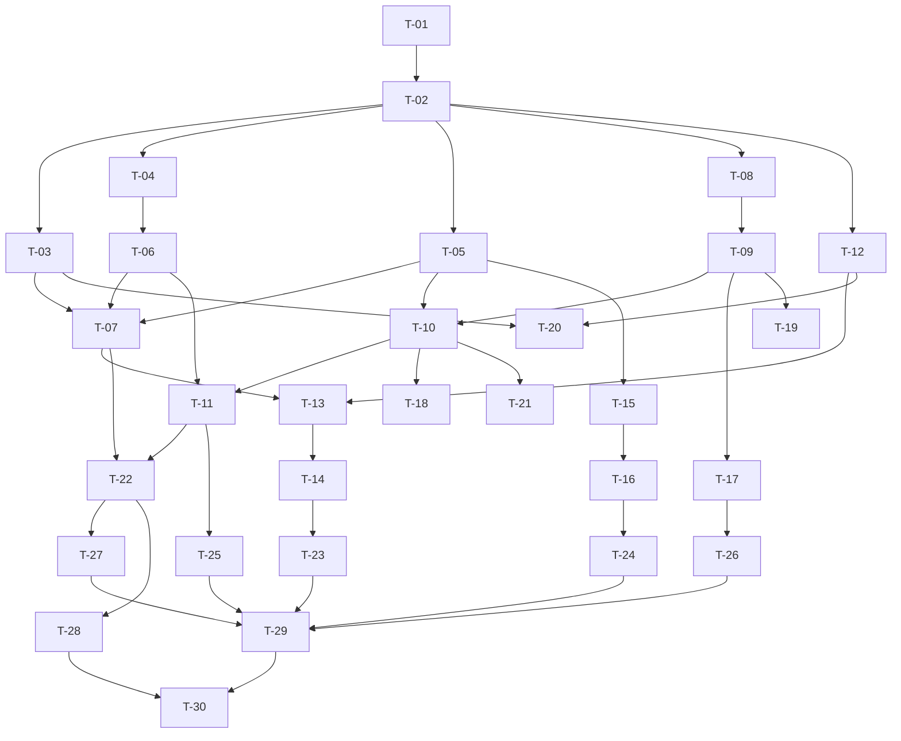

# 任务规划：崩溃自愈可观测（lifecycle-observability）

> 基于 `./spec.md` 与 `./design.md` 生成。实施原则：**复用优先**、**确定性优先**、**L3 进程隔离**。
> 仓颉代码编写须使用 **cangjie-coder** 技能；**严禁运行 cjpm build**（编译与回传由人工在独立 cmd 环境完成）。

## 文档信息
- 关联需求：`specs/plugin-system-enhancement--lifecycle-observability/spec.md`
- 关联设计：`specs/plugin-system-enhancement--lifecycle-observability/design.md`
- 关联契约：`specs/plugin-system-enhancement--lifecycle-observability/contract.md`（v1，LO-01~LO-06）
- 主工程账本：`specs/plugin-system-enhancement/SPECS_INDEX.md`
- 生成日期：2026-10-19 ｜ 版本：v1.0 ｜ 状态：草稿
- 子系统 `feature_name`：`plugin-system-enhancement--lifecycle-observability`

---

## 开发规范（全任务强制遵守）

- **语言与工具绑定**：仓颉 → `cangjie-coder`。本子系统**无**前端/原生改动。
- **二次开发底座优先（铁律 14）**：
  1. **规范源**：先加载 `uctoo-dev-manual`（`skills/uctoo-dev-manual/`），按要做的事读对应 `docs/uctoo-v4/*.md`
     （表/字段→`uctoo-database-design-specification`；CRUD→`uctoo-v4-module-development` + `uctoo-v4-orm-specification`；
     权限→`user-permission-system` / `row-level-permission-system`）。
  2. **脚手架优先**：本子系统 **0 新表 0 新列**，因此**不触发** `loaddbinfo`→`crudgen`→`crudweb` 链路；
     若任一任务在执行中判定"复用不成立需要新列"，**必须停下**并回 contract §2 走完整论证 + 主工程 §6 登记，不得私自加列。
  3. **生成后必补**：本子系统**不新增宿主路由**，因此**不触发** `permissions` / `role_has_permission` 登记（已在 design §5.1 显式声明，避免漏项误判）。
  4. **只在生成物上做最小适配**：cordis 库改动只加"注入点 + 字段"，策略实现全部落宿主侧。
- **大工程拆分态（铁律 15）** —— 本子系统是 6 子系统 SDD 工程之一：
  1. 开工前已读主工程 `SPECS_INDEX.md`：子系统 ID = `lifecycle-observability`，**无上游依赖**（§4），可并行开工；契约摘要「v1 / 6 接口 / 0 新表」；验收档位 L1+L2+L3。
  2. **每条任务标注「本子系统负责」与「不碰（移交/调用上游）」**；跨边界一律落成"调用上游契约接口"或"等下游消费"。
  3. **跨子系统接口改动成对成条**：T-13（提供方）+ T-14（消费方）必须同轮完成。
  4. **契约先行**：涉及 LO-01~LO-06 的任务在步骤里写明契约条目编号；v1 为首次冻结，本轮无 major 演进。
  5. **验收带跨边界冒烟**：T-22~T-26 覆盖 5 条跨边界冒烟 + 异常分支。
  6. **禁止跨界手写**：不直连 `dependency-graph` / `version-guard` / `capability-*` 的私有目录与私有表。
- **编译约束**：AI **不运行 `cjpm build`**；编译、类型检查、lint 由人工执行并回传结果。
- **复用原则**：优先复用 design §10.1 清单所列基础设施（事件总线 / 同步桥 / 退避范式 / 配置解析范式），不重新实现。
- **禁止编造 API**：遇无佐证的仓颉 API → 走 T-02 待核实裁定，禁止凭空假设。

---

## 任务总览

| 编号 | 任务 | 关联需求(spec §) | 关联设计(design §) | 负责子 agent | 状态 | 预计产出 |
|---|---|---|---|---|---|---|
| T-01 | 开工前置：读主工程账本 + 契约，确认边界 | 全部 | §1.1 | 主 agent | [ ] | 边界确认清单 |
| T-02 | 裁定 design §10.2 待核实项 Q-01~Q-06 | §5.6.1b / §4 | §10.2 | 主 agent | [ ] | 裁定结论表 |
| T-03 | 新增 `CrashInfo` / `CrashDiagnostics`（cordis 侧） | §5.1.1 规则 2/3 | §3.1 | cangjie-coder | [ ] | `crash_diagnostics.cj` |
| T-04 | 新增 `RestartDecision` / `RestartController` / `AlwaysRestartController` | §5.2 / §5.3 | §3.2 | cangjie-coder | [ ] | `restart_controller.cj` |
| T-05 | `PluginInstance` 观测字段扩展 | §5.2.1 规则 2/3 | §3.6 | cangjie-coder | [ ] | `plugin_instance.cj` 改 |
| T-06 | `PluginHost` 增加 `setRestartController` 注入点 | §5.2 / §5.4.1 禁止项 | §3.2.2 | cangjie-coder | [ ] | `plugin_host.cj` 改 |
| T-07 | `healCrashed` 改造：capture + 结构化 error + 裁决 + 退避门 | §5.1 / §5.2 / §5.3 | §2.3 / §3.3 | cangjie-coder | [ ] | `plugin_host.cj` 改 |
| T-08 | `RestartPolicyConfig.fromEnv`（6 个环境变量） | §5.2.1 / DFX-12 | §3.3.1 / §9.2 | cangjie-coder | [ ] | `plugin_restart_policy.cj` |
| T-09 | `RestartPolicy.decide` 纯函数（退避/计数/熔断/冷却/半开） | §5.3.1 | §3.3.1 | cangjie-coder | [ ] | `plugin_restart_policy.cj` |
| T-10 | `DefaultRestartController`（**autoRestart 真正消费点**） | §5.4.1（R-07） | §3.4 | cangjie-coder | [ ] | `plugin_restart_policy.cj` |
| T-11 | 注入装配 + `PLUGIN_RESTART_ENABLED` 总开关 | §5.4.1 / DFX-11 | §3.2.2 / §9.2 | cangjie-coder | [ ] | `cordis_host_manager.cj` 改 |
| T-12 | `StdoutTailBuffer` 实现并挂到既有 stdout 转发闭包 | §5.1.1 规则 3 | §3.1.3 | cangjie-coder | [ ] | `plugin_stdout_tail.cj` |
| T-13 | `LifecycleEventEmitter`：`plugin.crashed` / `plugin.restarted`（**IF-11 提供方**） | §5.5.1 规则 1/2 | §3.5 | cangjie-coder | [ ] | `plugin_lifecycle_events.cj` |
| T-14 | `PluginSyncBridge` 新增两订阅（**IF-11 消费方，与 T-13 同轮**） | §5.5.1 规则 3/4 | §3.8 | cangjie-coder | [ ] | `plugin_sync_bridge.cj` 改 |
| T-15 | `inspectProcessPlugin` 输出对齐 + docstring 同步（含 pid 分支 A/B） | §5.6.1 规则 1（R-08） | §3.7 | cangjie-coder | [ ] | `cordis_host_manager.cj` 改 |
| T-16 | 接线进既有 `plugin_inspect`（process 插件可见） | §5.6.1 规则 2 | §3.7 | cangjie-coder | [ ] | `plugin_host_manager.cj` 改 |
| T-17 | `activeSinceMs` 记录 + 稳定窗口清零 | §5.2.1 规则 2b | §3.3.1 末段 | cangjie-coder | [ ] | `cordis_host_manager.cj` 改 |
| T-18 | 人工恢复：`plugin_activate` 重置熔断计数 | §5.3.1 规则 3 | §3.3.1 | cangjie-coder | [ ] | `plugin_agent_tools.cj` / manager 改 |
| T-19 | 单测：`RestartPolicy` 纯函数全分支 | AC-04/05/06/07/08/09 | §3.3.1 | cangjie-coder | [ ] | 单测文件 |
| T-20 | 单测：`CrashDiagnostics` + `StdoutTailBuffer` | AC-03 / DFX-01/02/06 | §3.1 | cangjie-coder | [ ] | 单测文件 |
| T-21 | 单测：`DefaultRestartController` 的 `autoRestart=false` → Skip | AC-10 | §3.4 | cangjie-coder | [ ] | 单测文件 |
| T-22 | **集成 SMOKE-LO-01：硬验收 HA-LO-01（启动即崩 → N 次 → 熔断）** | **HA-LO-01** | §3.3 | 主 agent + 人工 | [ ] | 冒烟报告 |
| T-23 | 集成 SMOKE-LO-02：崩溃事件 → `agent_skills` 回写 + 0 新列核查 | AC-12 / AC-18 | §3.8 / §4.2 | 主 agent + 人工 | [ ] | 冒烟报告 |
| T-24 | 集成 SMOKE-LO-03：`plugin_inspect` 输出健康段 | AC-13 / AC-14 | §3.7 | 主 agent | [ ] | 冒烟报告 |
| T-25 | 集成 SMOKE-LO-04：`autoRestart: false` 边界 | AC-10 | §3.4 | 主 agent | [ ] | 冒烟报告 |
| T-26 | 集成 SMOKE-LO-05：冷却半开 + 稳定窗口清零 | AC-06 / AC-08 / AC-09 | §3.3.1 | 主 agent | [ ] | 冒烟报告 |
| T-27 | 防回归 R-04：存量 51 skill + 4 sync 插件零回归 | AC-21 / DFX-10 | §9.2 | 人工 | [ ] | 回归报告 |
| T-28 | 防回归：死锁红线 `tryLock` 分支不回退 | AC-15 / AC-16 / DFX-03/05 | §2.3 | 人工 + 主 agent | [ ] | 回归报告 |
| T-29 | 文档收口：回主工程 SPECS_INDEX 更新状态 + §6 登记 | 全部 | §10.3 | 主 agent | [ ] | SPECS_INDEX 更新 |
| T-30 | 产出 `test-report.md`（缺陷归因到具体契约条目） | 全部 | contract §5 | 主 agent | [ ] | `test-report.md` |

---

## 任务依赖关系图

- **可并行**：T-03 / T-04 / T-05 / T-08 / T-12 在 T-02 裁定后彼此独立，可并行。
- **强串行**：T-13 → T-14（IF-11 双侧同轮，铁律 15）；T-15 → T-16（输出对齐后才能接线）。
- **阻塞**：T-22（硬验收）被 T-07 + T-11 阻塞；T-29 被全部集成任务阻塞。

---

## 任务详细说明（按编号展开）

### T-01 开工前置：读主工程账本 + 契约，确认边界
- **目标**：确认子系统 ID / feature_name / 无上游 / 验收档位，避免越界开工。
- **步骤**：(1) 读 `specs/plugin-system-enhancement/SPECS_INDEX.md` §2/§3/§4/§7；(2) 读本目录 `contract.md` §1~§4；(3) 输出边界确认清单（含"不提供依赖逆序停机 / 不接线 ping / 不改 stderr 重定向 / 不新表新列"四条）。
- **产出物**：边界确认清单（写入本文件修订记录）。
- **验收**：清单覆盖 R-06/R-07/R-08 三条风险的落点。
- **本子系统负责**：读账本、确认边界。
- **不碰（移交/调用上游）**：不改 SPECS_INDEX（改账本归 T-29）；不读其他子系统内部文档。

### T-02 裁定 design §10.2 待核实项 Q-01~Q-06
- **目标**：消灭"编造 API"风险，编码前给出确定结论。
- **输入**：design §10.2 的 6 个待核实项。
- **步骤**：(1) Q-01 查仓颉 std.process 是否暴露 pid → 决定 T-15 走分支 A（输出 pid）还是分支 B（改 docstring 去掉 pid 承诺）；(2) Q-02 实测 `wait(timeout:)` 对已回收子进程语义；(3) Q-03 确认 Windows signal 恒 None；(4) Q-04 查 `CordisHostManager` 创建点，确定 `bus()` 注入方式；(5) Q-05 确定 epoch 毫秒 API（若无 → 契约 §1.1 的 `*Ms` 字段改相对毫秒，需回改契约）；(6) Q-06 与产品确认 `COOLDOWN_S=0` 语义。
- **产出物**：裁定结论表（写回 design §10.2）。
- **验收**：6 项全部有明确结论与证据（文件:行号 或 官方文档引用），无"待核实"残留。
- **风险**：Q-05 若改相对毫秒属**契约 minor 变更**，须同步改 contract §1.1 与 §1.3。
- **本子系统负责**：全部 6 项裁定。
- **不碰**：不因裁定结论去改 `libs/cordis-cj` 的对外协议（需改则回主工程登记）。

### T-03 新增 `CrashInfo` / `CrashDiagnostics`（cordis 侧）
- **目标**：崩溃一次性快照（contract LO-04）。
- **输入**：T-02 的 Q-02/Q-03/Q-05 结论。
- **步骤**：(1) 新建 `libs/cordis-cj/cordis_host/src/crash_diagnostics.cj`；(2) 定义 `CrashInfo{exitCode:?Int64, signal:?String, stdoutTail:ArrayList<String>, detectedAtMs:Int64}`；(3) `capture(instance)` 内 `try { instance.process.wait(timeout:) }` 取退出码，异常→None；(4) stdout 尾帧由宿主侧注入的 provider 提供（cordis 不直接依赖宿主类，用函数回调 `(String)->ArrayList<String>` 注入）。
- **产出物**：`crash_diagnostics.cj`。
- **验收**：spec AC-LO-03（exitCode=3 → error 含 exitCode=3）；异常路径不抛。
- **本子系统负责**：cordis 侧采集骨架 + 退出码。
- **不碰**：不修改 `plugin_manager.cj:161-188` 的 stdErr/Pipe 重定向（spec §5.1.1 禁止项 4）。

### T-04 新增 `RestartDecision` / `RestartController` / `AlwaysRestartController`
- **目标**：cordis 侧重启裁决注入点（contract LO-02）。
- **步骤**：(1) 新建 `libs/cordis-cj/cordis_host/src/restart_controller.cj`；(2) 定义 enum `RestartAction{Restart|GiveUp|Skip}`、`RestartDecision{action,delayMs,reason}`、`interface RestartController{onCrash(id, instance)->RestartDecision}`；(3) `AlwaysRestartController` 恒返回 `{Restart,0,"default"}`。
- **产出物**：`restart_controller.cj`。
- **验收**：未注入时 cordis 行为与改造前完全一致（DFX-11）。
- **本子系统负责**：接口 + 默认实现。
- **不碰**：不在 `libs/cordis-cj/cordis_core/src/config.cj:16-48` 的 `PluginEntry` 上加 `autoRestart` 字段（spec §5.4.1 禁止项 3）。

### T-05 `PluginInstance` 观测字段扩展
- **目标**：contract LO-05。
- **步骤**：在 `plugin_instance.cj:18-31` 之后追加 `restartCount/crashCount/lastRestartAtMs/firstCrashAtMs/nextEligibleAtMs/activeSinceMs/cooldownUntilMs/circuitState/lastCrash`（类型见 design §3.6）；不改既有 9 个字段语义，不新增锁。
- **产出物**：`plugin_instance.cj` 改。
- **验收**：既有构造函数 `:33-42` 兼容（新字段均有缺省）；sync 轨不构造 `PluginInstance`，不受影响。
- **本子系统负责**：字段扩展。
- **不碰**：不改 `transitionTo`（:49-58）与 `settleLock` 语义（防死锁回归归 T-28）。

### T-06 `PluginHost` 增加 `setRestartController` 注入点
- **步骤**：`plugin_host.cj` 新增私有字段（缺省 `AlwaysRestartController`）+ `public func setRestartController(c: RestartController): Unit`。
- **验收**：未调用 setter 时 `healCrashed` 行为不变。
- **本子系统负责**：注入点。
- **不碰**：不改 `reconcileDesired`（:787）的 diff/拓扑逻辑；不动 `topoSort`（:984）—— 依赖拓扑归 `dependency-graph`。

### T-07 `healCrashed` 改造（核心）
- **目标**：spec §5.1/§5.2/§5.3 主落点；contract LO-02 调用点。
- **输入**：T-03、T-04、T-05、T-06。
- **步骤**：
  1. **保留** `:935-940` 的 `tryLock` + 整轮跳过 + `diag` 日志（死锁红线，一字不改）；
  2. **保留** `:941-954` 的快照与 `isExited` 判定（崩溃判据单一化，不加 ping）；
  3. 崩溃实例：调 `CrashDiagnostics.capture`（锁外）；
  4. `instance.error` 写结构化串（取代 `:964` 固定串）；
  5. 调 `restartController.onCrash(id, inst)` 拿 `RestartDecision`（锁外，try/catch 兜底为 Skip）；
  6. `action==Restart` 时先判 `nowMs < nextEligibleAtMs` → 未到期**本轮不拉起**（不 sleep，避免阻塞 reconcile）；到期才 `launchPlugin(e)`（`:970`）并 `restartCount++`、`lastRestartAtMs=now`；
  7. `action==GiveUp/Skip` → 不拉起；GiveUp 时置 `circuitState=Open`；
  8. `:963-966` 的 `transitionStatus(Failed)` 保留；`:967-968` 的 `removeInstance`/`clearServicesByProvider` 保留；`:972-973` 的失败 log 保留并增强。
- **产出物**：`plugin_host.cj` 改。
- **验收**：AC-LO-02 / AC-LO-07 / AC-LO-15 / AC-LO-16；`:972` 的"直接无退避重拉"消失。
- **风险**：任何在持锁区内调用 `onCrash` / `capture` 的写法都会触发 AB-BA 死锁（`:921-934` 注释）→ 必须在锁外。
- **本子系统负责**：healCrashed 全部改造。
- **不碰**：不改 `shutdownAll`（`cordis_host_manager.cj:421-438`）排序 —— **不提供依赖逆序停机，归 `dependency-graph`（IF-10）**；不接线圈 `Methods.PING` 探活。

### T-08 `RestartPolicyConfig.fromEnv`
- **步骤**：`src/plugin/plugin_restart_policy.cj` 定义 `RestartPolicyConfig`（6 字段）；`fromEnv()` 严格复用 `src/app/main.cj:929-944` 范式（`getVariable` → `Int64.parse` → try/catch → warn + 退回缺省）。
- **验收**：DFX-12（`PLUGIN_RESTART_BASE_MS=abc` → warn + 退回 1000 + 宿主正常启动）。
- **本子系统负责**：6 个 `PLUGIN_RESTART_*` 变量。
- **不碰**：不改 `main.cj:929-944` 的 `PLUGIN_RECONCILE_INTERVAL_SECONDS` 缺省值（影响启动期诊断现场，`cordis_host_manager.cj:133-134`）。

### T-09 `RestartPolicy.decide` 纯函数
- **步骤**：实现 design §3.3.1 的 4 步裁决伪码 + 稳定窗口清零判定；退避公式 `min(base × 2^restartCount, maxBackoff)`（复用 `src/interaction/error_recovery_manager.cj:95-103` 范式）。
- **验收**：AC-04（第 1 次 delayMs=1000）/ AC-05（封顶 30000）/ AC-07（熔断后恒 GiveUp）/ AC-08（冷却结束转 half-open 且仅 1 次）/ AC-09（COOLDOWN_S=0 永不半开）。
- **本子系统负责**：策略纯函数（无 IO、无锁，易测）。
- **不碰**：不引用任何 DB / DAO / 事件总线（保持纯函数，便于 T-19 单测）。

### T-10 `DefaultRestartController`（autoRestart 真正消费点）
- **目标**：R-07 闭环 —— 让 `plugin_config.cj:103-104` 声明的开关真正生效。
- **步骤**：(1) 宿主侧实现 `DefaultRestartController`；持有 `RestartPolicy` + `processEntries: HashMap<String, PluginManifestEntry>`（`cordis_host_manager.cj:47`）；(2) `onCrash` 先查 `entries[id].autoRestart`，为 `false` → `{Skip,0,"autoRestart-disabled"}` 且**不递增** `restartCount`；(3) 查不到 → warn + 按 true 处理；(4) 整体 try/catch 兜底 `{Skip,0,"controller-error"}`。
- **验收**：AC-10；`plugin.crashed` 的 `restart.action=skip`、`reason=autoRestart-disabled`。
- **本子系统负责**：autoRestart 的唯一消费实现。
- **不碰**：不改 `plugin_config.cj` 的解析逻辑（`:185-189` 已正确）；**不消费** `capability-governance` 的任何门禁接口。

### T-11 注入装配 + `PLUGIN_RESTART_ENABLED` 总开关
- **步骤**：(1) `CordisHostManager.init()`（`cordis_host_manager.cj:57-70`）在 `installStatusListener()` 之后调 `cordisHost.setRestartController(DefaultRestartController(...))`；(2) 用 `match (getVariable("PLUGIN_RESTART_ENABLED"))` 包一层，缺省 `true`，置 `false` 即不注入（自动回落到 `AlwaysRestartController` = 改造前行为，一键回滚）。
- **验收**：DFX-11；置 false 后行为与改造前一致。
- **本子系统负责**：装配 + 回滚开关。
- **不碰**：不改 `CordisHostManager` 的 `shutdownAll` / 期望状态构造（`:125-210`）。

### T-12 `StdoutTailBuffer` 实现并挂到既有 stdout 转发闭包
- **步骤**：(1) 新建 `src/plugin/plugin_stdout_tail.cj`：`ConcurrentHashMap<pluginId, ArrayList<String>>`，`push`（行截断 1KB + 环形覆盖到 `PLUGIN_RESTART_TAIL_LINES`）、`snapshot`、`clear`；(2) 在 `cordis_host_manager.cj:60-65` 的两个 logger 闭包内各追加一行 `StdoutTailBuffer.push(pluginId, line)`；(3) 卸载/移除插件时 `clear`。
- **验收**：DFX-02（内存 ≤512KB）/ DFX-06（单帧 ≤1KB）；不新增线程、不新增阻塞读。
- **本子系统负责**：stdout 尾帧缓冲。
- **不碰**：**不改 `plugin_manager.cj:174` 的 `stdErr: ProcessRedirect.Inherit`**（改回 Pipe 会重现启动挂死，注释 `:163-173`）；stderr 尾帧落库移交后续立项。

### T-13 `LifecycleEventEmitter`（IF-11 提供方）
- **步骤**：(1) 新建 `src/plugin/plugin_lifecycle_events.cj`；(2) 持有 `PluginEventBus`（经 `PluginHostManager.bus()`，`plugin_host_manager.cj:507`；注入方式按 T-02/Q-04 结论）；(3) `crashed(...)` / `restarted(...)` 按 contract §1.1 组装 `JsonObject` 并 `emit`；(4) `crashSeq` 单调自增（`synchronized`）；(5) 全程 try/catch，失败只记日志。
- **验收**：AC-11（1 次崩溃裁决 restart → 恰好 1 条 crashed + 1 条 restarted，crashSeq 相同）；裁决 give-up/skip 时只发 crashed；AC-17。
- **本子系统负责**：事件载荷与发射。
- **不碰**：不改 `PluginEventBus` 本身（`libs/plugin-spi/src/plugin_event_bus.cj`）；不新增事件类型以外的总线语义。

### T-14 `PluginSyncBridge` 新增两订阅（IF-11 消费方）
- **⚠ 与 T-13 同轮完成（铁律 15 双侧同轮）**。
- **步骤**：在 `plugin_sync_bridge.cj:41-60` 的 `bind()` 内追加 `plugin.crashed` / `plugin.restarted` 两个订阅；复用既有 `writeRuntimeState`（:67-97）写 `runtime_status='error'` + `last_error` 摘要（≤2KB，含 exitCode/restartCount），复用既有 `mergePluginMetadata`（:104-130）合并 `extra_metadata` 的 `lifecycle.crash` / `lifecycle.restart` fragment。
- **验收**：AC-12 / AC-18（`agent_skills` 无新表新列）；单向红线（:29）保持。
- **本子系统负责**：消费方订阅 + 摘要构建。
- **不碰**：不改 `AgentSkillsDAO` / `AgentSkillsPO`；不反向写 `plugin.yaml`（:29 红线）；不新建表或列。

### T-15 `inspectProcessPlugin` 输出对齐 + docstring 同步
- **目标**：R-08 闭环。
- **步骤**：(1) 改 `cordis_host_manager.cj:395-414`，按 contract §1.3 输出 10 行（`process plugin/status/command/pid/restartCount/crashCount/circuit/nextRestartAtMs/lastExitCode/lastError`）；(2) **同步改 `:391` 的 docstring** 使其与实际输出逐字段一致；(3) pid 按 T-02/Q-01 裁定：分支 A 输出真值；分支 B **不输出 pid 行**并同步从 docstring 移除 pid 承诺（**禁止输出占位假值**）。
- **验收**：AC-13 / AC-13b；docstring 与实现零漂移。
- **本子系统负责**：输出与文档对齐。
- **不碰**：不改 `mapStatusToState`（:473-482）映射表。

### T-16 接线进既有 `plugin_inspect`
- **步骤**：改 `plugin_host_manager.cj:461-477`：`registry.get(n)` 为 `None` 时，先查 process 轨（经 `CordisHostManager.inspectProcessPlugin(n)`），命中则拼进返回文本；仍 `None` 才返回 `plugin not found: ${n}`。
- **验收**：AC-14（process 插件在 `plugin_inspect` 可见）；AC-20（**不注册** `plugin_restart`/`plugin_logs`/`plugin_health` 新工具）。
- **本子系统负责**：复用既有工具扩展输出。
- **不碰**：不改 `PluginInspectTool` 的工具名/参数/描述（`plugin_agent_tools.cj:113-183`）；不新建任何 UI 面板。

### T-17 `activeSinceMs` 记录 + 稳定窗口清零
- **步骤**：在 `cordis_host_manager.cj:71-80` 的 `onStatusChange` 回调中，`newStatus == Active` 时写 `instance.activeSinceMs = nowMs`；`RestartPolicy.decide` 入口判 `nowMs - activeSinceMs > windowSeconds*1000` → `restartCount=0`、`firstCrashAtMs=nowMs`（`crashCount` 不清零）。
- **验收**：AC-06（连续 Active 超 300s → restartCount 归 0）。
- **本子系统负责**：稳定窗口。
- **不碰**：不改 `onStatusChange` 的注册与回写主链路。

### T-18 人工恢复：`plugin_activate` 重置熔断计数
- **步骤**：在 `plugin_activate` 的激活路径（`plugin_agent_tools.cj:191` → manager）中，若目标 process 插件 `circuitState != Closed`，先 `restartCount=0 / circuitState=Closed / cooldownUntilMs=0 / nextEligibleAtMs=0` 再走既有激活逻辑；不改工具签名。
- **验收**：§5.3.1 规则 3（熔断插件可被人工恢复）。
- **本子系统负责**：熔断重置。
- **不碰**：不改 `plugin_activate` 的依赖校验语义（依赖校验归 `dependency-graph`）。

### T-19 单测：`RestartPolicy` 纯函数全分支
- **步骤**：覆盖退避序列（1000/2000/4000/8000/16000 封顶 30000）、计数递增、上限熔断、冷却期内 GiveUp、冷却结束 HalfOpen 且仅 1 次、COOLDOWN_S=0 永不半开、稳定窗口清零、时钟回拨。
- **验收**：AC-04/05/06/07/08/09 全绿；纯函数无 IO 依赖。
- **本子系统负责**：策略单测。
- **不碰**：不启真实子进程（不跑 `cjpm build`，编译由人工回传）。

### T-20 单测：`CrashDiagnostics` + `StdoutTailBuffer`
- **验收**：exitCode 正常/超时/异常三路径；行截断 1KB；环形覆盖上限；内存上界。
- **本子系统负责**：诊断与缓冲单测。
- **不碰**：不改 `plugin_manager.cj` 的重定向（本单测用假 SubProcess 替身）。

### T-21 单测：`DefaultRestartController` 的 `autoRestart=false` → Skip
- **验收**：AC-10；`restartCount` 不递增；`entries` 缺失时 warn + 按 true 处理。
- **本子系统负责**：开关单测。
- **不碰**：不消费 `capability-governance` / `version-guard` 任何接口。

### T-22 **集成 SMOKE-LO-01：硬验收 HA-LO-01**
- **目标**：**一个"启动即崩"的插件在 N 次重启后触发熔断、停止重拉，且事件可观测（防重启风暴）**。
- **输入**：T-07 + T-11 + T-13 完成。
- **步骤**：(1) 造一个 `main` 立即 `exit(1)` 的 process 插件；(2) 设 `PLUGIN_RESTART_MAX=3`、`PLUGIN_RESTART_BASE_MS=200`、`PLUGIN_RESTART_COOLDOWN_S=600`（避免半开干扰计数）；(3) 手动/周期触发 4 轮 reconcile；(4) 断言：恰好 3 次 `launchPlugin`；第 4 轮裁决 `give-up`；进程数 0；`circuit=open`；`plugin.crashed` 收到 4 条且最后一条 `action=give-up, circuit=open`。
- **产出物**：冒烟报告 + 日志片段。
- **验收**：**HA-LO-01 通过**（不通过则本子系统不得报 done）。
- **本子系统负责**：用例设计与执行。
- **不碰**：不改 `dependency-graph` 的拓扑逻辑；不改 `version-guard` 的加载前校验（本用例插件应已通过版本协商，或本轮未启用 version-guard 时直接加载）。

### T-23 集成 SMOKE-LO-02：崩溃事件 → `agent_skills` 回写 + 0 新列核查
- **步骤**：触发 T-22 场景后查 `agent_skills` 对应行：`runtime_status='error'`；`last_error` 含 exitCode 与 restartCount；`extra_metadata` 含 `lifecycle.crash` fragment；**用 `loaddbinfo` 侧或 DDL 核查确认无新表新列**。
- **验收**：AC-12 / AC-18 / contract §2。
- **本子系统负责**：回写正确性验证。
- **不碰**：不改 `AgentSkillsPO` 字段；不加列（加列须回主工程登记并走 `loaddbinfo`→`crudgen`/`crudweb` + `sql/incremental/`）。

### T-24 集成 SMOKE-LO-03：`plugin_inspect` 输出健康段
- **步骤**：对 process 插件调 Agent 工具 `plugin_inspect`；断言输出含 `status/restartCount/crashCount/circuit/lastError`（pid 按 Q-01 结论）；对不存在插件名断言 `process plugin not found: <name>`。
- **验收**：AC-13 / AC-14。
- **本子系统负责**：Agent 观测通道验证。
- **不碰**：不新增 Agent 工具（AC-20）。

### T-25 集成 SMOKE-LO-04：`autoRestart: false` 边界
- **步骤**：plugin.yaml 置 `autoRestart: false`；kill 插件进程；断言 `plugin.crashed.action=skip`、`reason=autoRestart-disabled`、`restartCount` 保持 0、进程数保持 0、状态 Error。
- **验收**：AC-10 端到端。
- **本子系统负责**：开关端到端。
- **不碰**：不改 `plugin_config.cj` 解析。

### T-26 集成 SMOKE-LO-05：冷却半开 + 稳定窗口清零
- **步骤**：`PLUGIN_RESTART_COOLDOWN_S=2` + 一个"崩 3 次后自愈"的插件；断言冷却后 `circuit=half-open` 且允许恰好 1 次重拉；自愈后连续 Active 超 `PLUGIN_RESTART_WINDOW_S` → `restartCount` 归 0，`crashCount` 保留。
- **验收**：AC-06 / AC-08 / AC-09。
- **本子系统负责**：半开与窗口验证。
- **不碰**：不改 `PLUGIN_RECONCILE_INTERVAL_SECONDS` 缺省 60s。

### T-27 防回归 R-04：存量 51 skill + 4 sync 插件零回归
- **步骤**：(1) `PLUGIN_RESTART_ENABLED` 缺省（true）与显式 false 两种配置下各跑一次全量加载；(2) 断言 51 个 skill 插件与 4 个 sync 插件加载/激活行为与改造前一致；(3) sync 轨完全不经过 `PluginInstance`，确认零影响。
- **验收**：AC-21 / DFX-10。
- **本子系统负责**：回归设计与结果归集。
- **不碰**：不改存量插件清单与 `src/plugins/generated_anchors.cj`。

### T-28 防回归：死锁红线 `tryLock` 分支不回退
- **步骤**：(1) 确认 `plugin_host.cj:935-940` 的 `tryLock` + `diag` + 整轮跳过代码未被改写；(2) 构造 `state.lock` 占用场景，断言 `healCrashed` 立即返回且不持锁等待；(3) 确认 `capture` / `onCrash` / 退避判定全部在锁外。
- **验收**：AC-15 / AC-16 / DFX-03 / DFX-05。
- **本子系统负责**：红线回归。
- **不碰**：不"优化"掉 `tryLock`（历史上该处是 P0 挂死的根因，`plugin_host.cj:921-934`）。

### T-29 文档收口：回主工程 SPECS_INDEX 更新状态 + §6 登记
- **步骤**：(1) 子系统状态 `init → done`（或实际档位）；(2) §3 的 IF-11 行状态改「已冻结」（或按实际）；(3) §6 变更影响面登记一行；(4) §7 R-07/R-08 标注已闭环；(5) §8 修订记录留痕。
- **验收**：账本与实现一致；无未闭环的破坏性契约变更。
- **本子系统负责**：回写本子系统相关行。
- **不碰**：不改其他子系统的行（各子系统闸口各自回写）。

### T-30 产出 `test-report.md`
- **步骤**：按 `skills/sdd/templates/test-report-template.md` 产出；L1/L2/L3 三档结论齐全；**所有偏差必须归因到具体契约条目**（LO-01~LO-06 或 §2 行），禁止笼统写"实现与文档略有差异"（contract §5）。
- **验收**：验收检查清单全绿。
- **本子系统负责**：报告。
- **不碰**：L3 主工程端到端由主工程 test 步执行（本子系统只提供 L1/L2 结论与 SPECS_INDEX §5.1 第 3 条所需证据）。

---

## 需求覆盖追踪矩阵

| spec 需求编号/条目 | 覆盖任务 | 覆盖状态 | 备注 |
|---|---|---|---|
| REQ 硬验收 **HA-LO-01**（启动即崩 N 次→熔断→可观测） | T-07, T-09, T-11, **T-22** | 全覆盖 | 不通过不得报 done |
| AC-LO-02 崩溃判据单一化 | T-07 | 全覆盖 | 不加 ping 判据 |
| AC-LO-03 结构化 error 取代固定串 | T-03, T-07, T-20 | 全覆盖 | 取代 `plugin_host.cj:964` |
| AC-LO-04 首次退避 =1000ms | T-09, T-19 | 全覆盖 | |
| AC-LO-05 退避封顶 30000ms | T-09, T-19 | 全覆盖 | |
| AC-LO-06 稳定窗口后 restartCount 归零 | T-09, T-17, T-19, T-26 | 全覆盖 | crashCount 不清零 |
| AC-LO-07 熔断后恒 GiveUp 且不 launch | T-07, T-09, T-22 | 全覆盖 | |
| AC-LO-08 冷却结束转 half-open 且仅 1 次 | T-09, T-19, T-26 | 全覆盖 | |
| AC-LO-09 COOLDOWN_S=0 永不半开 | T-09, T-19, T-26 | 全覆盖 | 依赖 T-02/Q-06 产品确认 |
| AC-LO-10 `autoRestart:false` 不重拉（R-07） | T-10, T-21, T-25 | 全覆盖 | 唯一消费点 |
| AC-LO-11 事件成对且 crashSeq 相同（IF-11） | T-13, T-22 | 全覆盖 | |
| AC-LO-12 回写 runtime_status/last_error | T-14, T-23 | 全覆盖 | 与 T-13 同轮 |
| AC-LO-13 inspectProcessPlugin 全字段（R-08） | T-15, T-24 | 全覆盖 | pid 按 Q-01 分支 |
| AC-LO-14 plugin_inspect 输出 process 健康段 | T-16, T-24 | 全覆盖 | 复用既有工具 |
| AC-LO-15 tryLock 占用即跳过 | T-07, T-28 | 全覆盖 | 死锁红线 |
| AC-LO-16 退避等待不持锁 | T-07, T-28 | 全覆盖 | 退避下沉到下一轮判定，不 sleep |
| AC-LO-17 观测失败仅记日志 | T-13, T-14 | 全覆盖 | |
| AC-LO-18 不创建新表新列（R-06） | T-14, T-23 | 全覆盖 | 0 新表 0 新列 |
| AC-LO-19 不改 stderr 重定向 | T-03, T-12, T-20 | 全覆盖 | `plugin_manager.cj:174` 禁止改 |
| AC-LO-20 不注册新 Agent 工具 | T-16, T-24 | 全覆盖 | |
| AC-LO-21 存量 51+4 插件零回归（R-04） | T-27 | 全覆盖 | |
| DFX-01 裁决性能（≤100ms/20 插件） | T-09, T-20 | 全覆盖 | 纯函数无 IO |
| DFX-02 缓冲内存 ≤512KB | T-12, T-20 | 全覆盖 | |
| DFX-03 tryLock 红线不回退 | T-07, T-28 | 全覆盖 | |
| DFX-04 观测面非控制面 | T-13, T-14 | 全覆盖 | |
| DFX-05 退避不持锁 | T-07, T-28 | 全覆盖 | |
| DFX-06 stdout 尾帧双截断 | T-12, T-20 | 全覆盖 | |
| DFX-07 载荷不含密钥/命令行 | T-13, T-14 | 全覆盖 | R-03 主体归 capability-governance |
| DFX-08 结构化日志 | T-07, T-13 | 全覆盖 | |
| DFX-09 docstring 与实现一致 | T-15, T-24 | 全覆盖 | |
| DFX-10 sync 轨零影响 | T-27 | 全覆盖 | |
| DFX-11 缺省下行为兼容 | T-04, T-11, T-27 | 全覆盖 | AlwaysRestartController 兜底 |
| DFX-12 非法配置退回缺省不起不来 | T-08, T-27 | 全覆盖 | |
| contract LO-01（=IF-11） | T-13, T-14 | 全覆盖 | 双侧同轮 |
| contract LO-02 | T-04, T-06, T-07 | 全覆盖 | |
| contract LO-03 | T-08, T-09 | 全覆盖 | |
| contract LO-04 | T-03 | 全覆盖 | |
| contract LO-05 | T-05 | 全覆盖 | |
| contract LO-06 | T-15, T-16 | 全覆盖 | |
| contract §4 不提供：依赖逆序停机 | T-01, T-07 | 全覆盖 | 归 `dependency-graph`(IF-10)，不改 `shutdownAll` |
| contract §4 不提供：ping 探活接线 | T-01, T-07 | 全覆盖 | 判据保持 stdout EOF |
| contract §4 不提供：stderr 尾帧落库 | T-03, T-12 | 全覆盖 | 改回 Pipe 会重现挂死 |

---

## 验收检查清单（终验）

- [ ] 全部 spec 功能需求（HA-LO-01 + AC-LO-02~21）有对应实现并通过其验收条件
- [ ] **硬验收 HA-LO-01 通过**：启动即崩插件 N 次后熔断、停止重拉、事件可观测
- [ ] DFX 约束（性能/可靠/安全/可维护/兼容）已验证或标注豁免
- [ ] 复用项未被重新实现：事件总线 / `PluginSyncBridge` / 退避范式 / 配置解析范式 / 既有 Agent 工具
- [ ] **0 新表 0 新列**（contract §2 / R-06）
- [ ] `autoRestart` 真正生效（R-07 闭环）
- [ ] `inspectProcessPlugin` docstring 与实现零漂移（R-08 闭环）
- [ ] 死锁红线 `tryLock` 分支未被改写（DFX-03）
- [ ] `plugin_manager.cj:174` stderr 重定向未被改动
- [ ] 未注册新 Agent 工具、未新建 UI 面板、未新增 HTTP 路由（故无 permissions 登记项）
- [ ] 编译 / 类型检查 / lint 通过（**人工确认，AI 不跑 cjpm build**）
- [ ] spec / design / tasks / contract 四份文档与最终实现一致（无漂移）
- [ ] 待核实项 Q-01~Q-06 全部裁定完毕，无"待核实"残留
- [ ] 主工程 SPECS_INDEX 已同步（T-29）

---

## 修订记录 / 多轮迭代

| 日期 | 轮次 | 触发来源 | 改动文件清单 | 验证结果 |
|---|---|---|---|---|
| 2026-10-19 | R1 | 基线侦察 + SPECS_INDEX §7 R-06/R-07/R-08 | 首版：contract.md / spec.md / design.md / tasks.md 四件套落盘；30 条任务 | 文档步产出，待编码步执行 |

**防回归锚点（每轮修复必须复跑）**：
1. T-22 硬验收 HA-LO-01（重启风暴熔断）
2. T-27 存量 51 skill + 4 sync 插件零回归
3. T-28 死锁红线 `tryLock` 分支不回退
4. T-23 `agent_skills` 0 新表 0 新列核查
