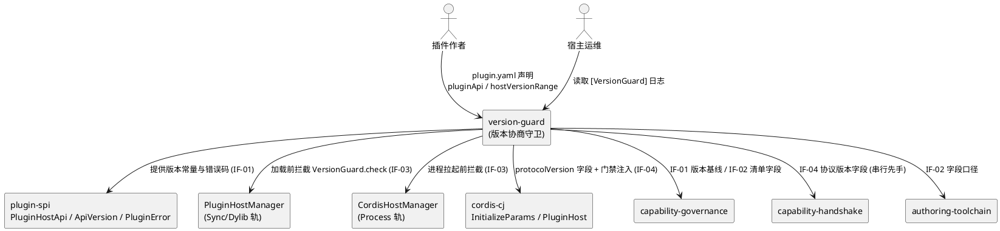
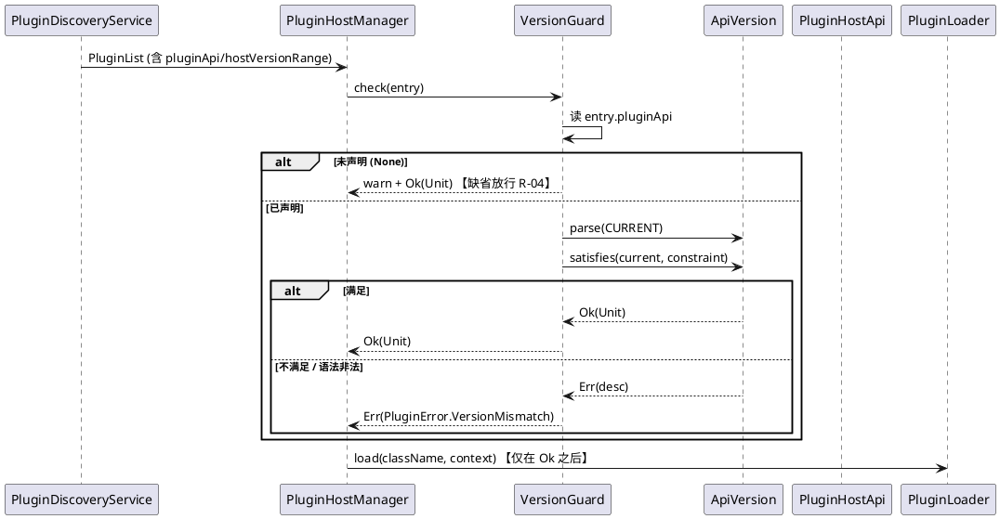
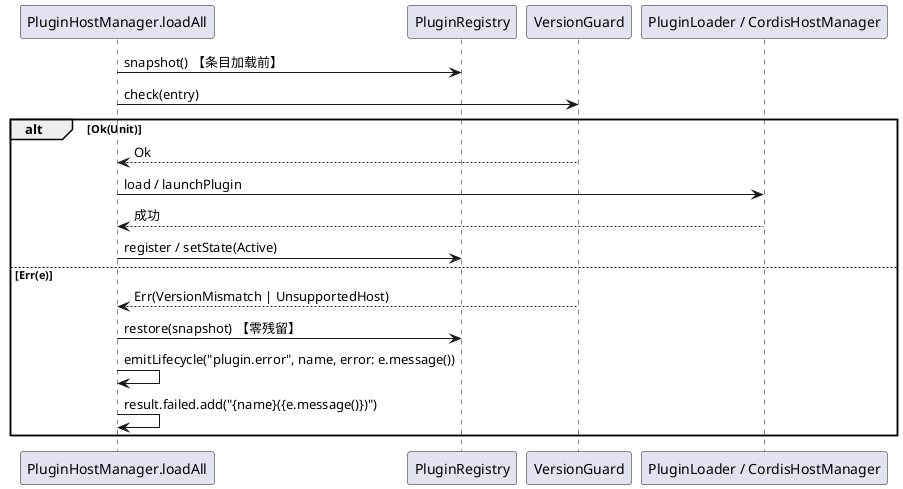
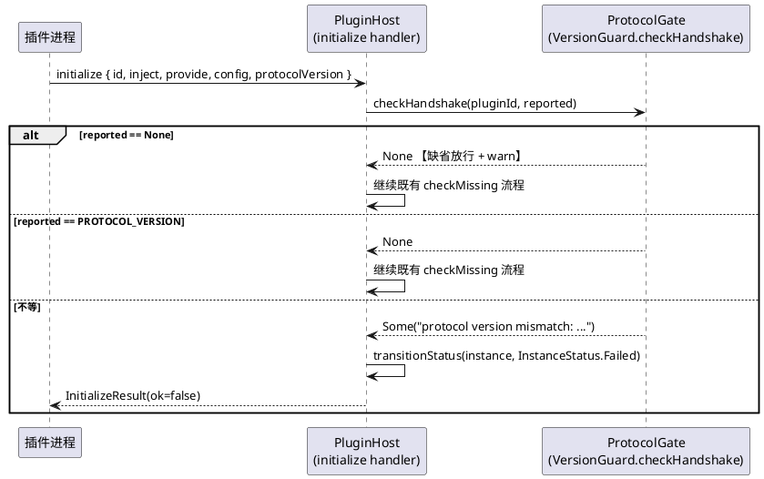

# 组件需求规格说明书（version-guard · 版本协商守卫）

> 模板：`skills/sdd/templates/spec_template.md`（验收句式遵循 `ears-format.md`）
> 主工程：`plugin-system-enhancement` ｜ 子系统 ID：`version-guard`
> `feature_name`：`plugin-system-enhancement--version-guard`
> 配套：`contract.md`（集成契约，接口编号 IF-01~IF-04 以此为准）、`design.md`、`tasks.md`
> 铁律依据：铁律 9（复用优先，0 新表）、铁律 12（落盘优先）、铁律 14（底座优先）、铁律 15（大工程拆分）

## 1. 组件定位

### 1.1 核心职责

本组件负责**加载前判定插件与宿主的版本兼容性**，实现「不兼容插件进不来、进来就被明确拒绝」的准入闸门。

### 1.2 核心输入

| 输入 | 来源 | 内容概要 |
|---|---|---|
| 插件清单条目 | `plugin.yaml` → `magic.plugin.PluginManifestEntry`（`src/plugin/plugin_config.cj:72-112`） | `name` / `mode` / `command` 及本次新增的 `version` / `pluginApi` / `hostVersionRange` |
| L3 握手载荷 | 插件进程 → `ystyle::cordis_core.InitializeParams`（`libs/cordis-cj/cordis_core/src/message.cj:10-53`） | `id` / `inject` / `provide` / `config` 及本次新增的 `protocolVersion` |
| 宿主版本真源 | `plugin_spi.PluginHostApi`（新增） | `CURRENT` / `MIN_COMPAT` / `PROTOCOL_VERSION` / `HOST_VERSION` |

### 1.3 核心输出

| 输出 | 目标 | 内容概要 |
|---|---|---|
| 准入判定结果 | `PluginHostManager.loadSingle`（`plugin_host_manager.cj:302`）/ `CordisHostManager.loadProcessPlugins`（`cordis_host_manager.cj:137`） | `Result<Unit, PluginError>`：`Ok` 放行 / `Err` 拒绝 |
| 握手判定结果 | `PluginHost` initialize handler（`libs/cordis-cj/cordis_host/src/plugin_host.cj:104-138`） | `InitializeResult(ok=false)` + 实例置 `InstanceStatus.Failed` |
| 失败登记与观测 | `LoadResult.failed`（`plugin_types.cj:105-130`）+ `plugin.error` 生命周期事件（`plugin_host_manager.cj:499-506`） | 含插件名 / 期望 / 实际三要素的文案 |
| 版本常量与字段 | 下游 `capability-governance` / `capability-handshake` / `authoring-toolchain` | 见 `contract.md` §1 |

### 1.4 职责边界

本组件**不负责**：

1. **不复活 `dylib` 轨、不接线 `PluginDylibLoader`**（`src/plugin/plugin_dylib_loader.cj` 全仓零调用；`PluginHostManager.loadAll` 对 Dylib 走与 Sync 相同的 `loadSingle`，`plugin_host_manager.cj:135`；`unloadDylib` 空实现 `:146-151`）。见 SPECS_INDEX §7 **R-01**：仅预留 `VersionGuard.checkDylib`，运行时零调用。
2. **不定义能力语义**：`PluginCapability` 枚举、缺省策略 `CapabilityPolicy`、运行时能力门禁、跨进程能力禁列表 —— 归 `capability-governance`（IF-05~IF-07）。
3. **不做能力宣告比对**：`declaredCapabilities` 载荷与宣告比对 —— 归 `capability-handshake`（IF-08 / IF-09）。本组件只冻结 `protocolVersion` 并**串行先手**，对方随后追加（R-05）。
4. **不做依赖拓扑排序**：归 `dependency-graph`（IF-10）。版本校验发生在依赖解析之前，两者不交叉。
5. **不做崩溃自愈 / 退避 / 熔断**：归 `lifecycle-observability`（IF-11）。握手被拒置 `Failed` 是为**避免**握手风暴，不是自愈策略。
6. **不提供 CLI**：`plugin validate` 与存量清单体检 —— 归 `authoring-toolchain`（IF-12）。本组件只暴露可被调用的 `VersionGuard.check`，不改生成器模板与 `plugingen` 产物。
7. **不做整份 `plugin.yaml` 的严格 schema 校验**（`plugin_config.cj:161-165` 类型不符静默跳过的既有行为不动）、**不修未知 `mode` 静默降级**（`:275`）。
8. **不读写任何数据库表 / 列**（铁律 9）。

---

## 2. 领域术语

**插件 API 版本（Plugin API Version）**
: 宿主向插件暴露的编程接口契约所采用的语义化版本号，其唯一真源是 `plugin_spi.PluginHostApi.CURRENT`。

**宿主版本（Host Version）**
: agentskills-runtime 宿主运行时自身的语义化版本号，取值与 `cjpm.toml:18` 的 `version = "0.0.29"` 人工同步。
: 备注：同步未自动化，本组件只提供常量与文案，不改构建流程。

**握手协议版本（Protocol Version）**
: L3 进程隔离轨 `initialize` 请求/响应载荷的线格式版本号，为单调递增整数（当前 `1`）。
: 备注：与插件 API 版本（语义化三段式）是两套独立编号，禁止混用。

**版本约束串（Constraint String）**
: 插件在 `plugin.yaml` 中以比较运算符表达「可接受版本区间」的字符串，如 `">=1.0.0 <2.0.0"`。

**加载前校验（Pre-load Check）**
: 在反射实例化（Sync/Dylib 轨）或子进程拉起（Process 轨）**之前**执行的纯函数式准入判定。
: 备注：「之前」是硬要求——版本不兼容时不得产生任何实例化/进程副作用。

**握手门禁（Protocol Gate）**
: 以构造注入方式挂载在 `PluginHost` 上的回调，用于判定插件上报的 `protocolVersion` 是否被接受。

**注册表快照（Registry Snapshot）**
: `PluginRegistry.snapshot()`（`plugin_registry.cj:143`）产出的插件名与状态副本，可经 `restore()`（`:160`）回滚。

**加载轨（Plugin Mode）**
: 插件进入宿主的三条通道：`Sync`（内嵌编译进宿主）/ `Dylib`（L2 动态库）/ `Process`（L3 进程隔离，cordis-cj）。

---

## 3. 角色与边界

### 3.1 核心角色

- **插件作者（第三方开发者）**：在 `plugin.yaml` 中声明 `pluginApi` / `hostVersionRange`，据错误信息修正版本声明。
- **宿主集成/运维工程师**：观察 `[VersionGuard]` 日志与 `LoadResult` 判定线上插件准入情况。
- **主工程闸口决策人**：确认契约冻结与跨子系统串行顺序（R-05）。

### 3.2 外部系统

- **`magic.plugin.PluginHostManager`**：Sync/Dylib 轨加载驱动，消费 IF-03。
- **`magic.plugin.CordisHostManager`**：Process 轨加载驱动，消费 IF-03，并注入 IF-04 门禁。
- **`libs/cordis-cj`（`cordis_core` / `cordis_host`）**：握手协议结构体与 `PluginHost`，承载 IF-04 字段与门禁注入点。
- **`plugin-spi`（`libs/plugin-spi`）**：承载 IF-01 常量与 `PluginError` 扩展。
- **`capability-governance`（下游）**：消费 IF-01 / IF-02。
- **`capability-handshake`（下游）**：在 IF-04 之后追加 IF-08。
- **`authoring-toolchain`（下游）**：消费 IF-02 做静态校验。

### 3.3 交互上下文

---

## 4. DFX约束

### 4.1 性能

1. `VersionGuard.check` 单条目耗时 ≤ **1 ms**（纯字符串解析，禁止 IO / 反射 / DB）。
2. 全量加载（51 个 skill + 4 个 sync 锚点 + process 插件）版本校验引入的总耗时增量 ≤ **10 ms**，且不得改变 `loadAll` 的既有时间复杂度。
3. `VersionGuard.checkHandshake` 单次调用 ≤ **0.1 ms**（整数比较 + 一次日志）。
4. 禁止在版本校验路径上做字符串拼接以外的任何分配型重活；日志文案拼接仅在**失败/告警分支**执行（通过路径零拼接）。

### 4.2 可靠性

1. `VersionGuard.check` / `checkDylib` / `checkHandshake` **禁止抛异常**：所有错误一律经 `Result` / `?String` 返回。
2. 版本模块内部任何意外异常必须被就地捕获并降级为**放行 + `LogUtils.error`**，禁止让异常穿透到 `loadAll` 导致宿主启动失败。
3. 被拒条目必须在注册表中**零残留**：不置 `Loading`、不 `register`、不写 `contexts` / `classNames` / `routeClasses`（兑现 REQ-PS-010「报错并回滚注册表」）。
4. `check` 必须是**幂等纯函数**：不写注册表、不读写 DB、不产生跨进程副作用；同输入必得同输出。

### 4.3 安全性

1. 错误信息与日志**只含**插件名、期望版本、实际版本三要素；**禁止**回显宿主环境变量、密钥、数据库连接串（`plugin_manager.cj:98-100` 全量继承宿主环境是 R-03 既有缺陷，本组件不放大也不修复，归 `capability-governance`）。
2. 不新增任何数据库访问；不引入新的外部输入反序列化面（握手侧仅取 `?Int32` / `?String`）。
3. 版本字符串解析必须防畸形输入（超长、空段、非数字、负数 → `None`），禁止 `Int` 解析异常外溢。

### 4.4 可维护性

1. 日志统一前缀 `[VersionGuard]`；级别约定：拒绝 = `error`，缺省声明 = `warn`，通过 = `info`（批量加载时仅汇总一条 `info`，避免刷屏）。
2. 错误文案三要素固定模板：`"{name}(version mismatch: required {constraint}, host api {CURRENT})"` / `"{name}(unsupported host: required {range}, host {HOST_VERSION})"`。
3. 常量与语法的唯一出处是 `PluginHostApi` 与 `ApiVersion.satisfies` 文档注释；任何子系统**禁止**自建第二份版本常量。

### 4.5 兼容性

1. **硬验收（防回退 R-04）**：存量 51 个 skill 插件 + 4 个 sync 锚点（`src/plugins/generated_anchors.cj:10-17` 锚定 `EntityPlugin` / `EntityRoute` / `FeedbackPlugin` / `FeedbackRoute`）的清单无 `pluginApi` 声明 → `VersionGuard.check` 必须 100% 返回 `Ok`，不得因缺字段拒绝加载。
2. `InitializeParams` / `InitializeResult` 的新字段**必须**是尾部命名默认参数（`protocolVersion!: ?Int32 = None` 等），既有字段顺序、名称、语义零改动，存量 cordis 插件与宿主序列化路径不受影响。
3. 不新增 `Methods` 常量、不新增 `hello` / `negotiate` 方法、不改 `initialize` 方法名与参数必填性。
4. `PluginError` 只**追加**构造器，不改既有 7 个构造器的参数与 `message()` 文案。

---

## 5. 核心能力

## 5.1 版本真源与清单版本字段（IF-01 / IF-02）

### 5.1.1 业务规则

1. **版本真源唯一**：宿主插件 API 版本必须且只能由 `plugin_spi.PluginHostApi` 提供。

   a. 验收条件：任意代码引用宿主插件 API 版本 → 必须来自 `PluginHostApi.CURRENT`，全仓 `src/` grep 无第二份硬编码版本号。

2. **禁止第二份常量**：任何子系统（含下游）禁止自建宿主版本常量或将版本硬编码进插件模板。

   a. 验收条件：新增子系统代码出现第二份版本常量 → 闸口判 P1，回退。

3. **清单三字段可解析**：`plugin.yaml` 条目的 `version` / `pluginApi` / `hostVersionRange` 必须被解析进 `PluginManifestEntry`。

   a. 验收条件：条目声明三字段 → `entry.version` / `entry.pluginApi` / `entry.hostVersionRange` 得到对应值；未声明 → 分别为 `""` / `None` / `None`。

4. **类型不符降级而非拒绝**：`pluginApi` / `hostVersionRange` 类型不是字符串时回落缺省值并告警。

   a. 验收条件：声明 `pluginApi: 123` → `entry.pluginApi == None` + 一条 `LogUtils.warn`，条目**仍可被加载**。

5. **禁止项**：禁止因为 `pluginApi` / `hostVersionRange` 字段缺失或类型不符而拒绝清单条目（R-04）。

   a. 验收条件：55 个存量条目全部 `Ok`，且每个未声明条目产生一条 warn。

6. **版本解析口径**：`ApiVersion.parse` 支持 `X` / `X.Y` / `X.Y.Z` 三段式，缺段补 0；非法输入返回 `None`。

   a. 验收条件：`"1"` → 1.0.0；`"1.2"` → 1.2.0；`"1.2.3-beta"` / `"abc"` / `""` → `None`。

7. **约束语法最小集**：仅支持 `>=` `<` `<=` `>` `==` `!=`，空格分隔表示 AND；不支持 `^` `~` `||` 与通配符。

   a. 验收条件：`">=1.0.0 <2.0.0"` 正确求值；含 `^1.0.0` → `Err`。

8. **禁止项（语法非法不得静默放行）**：约束串不可解析时视为不兼容并拒绝。

   a. 验收条件：`pluginApi: ">>1.0"` → `Err(PluginError.VersionMismatch(...))`，文案含 `unparsable constraint` 与原文。

### 5.1.2 交互流程

### 5.1.3 异常场景

1. **约束语法非法**

   a. 触发条件：`pluginApi: ">>1.0"` 或 `hostVersionRange: "^2"`。

   b. 系统行为：`ApiVersion.satisfies` 返回 `Err`；`VersionGuard.check` 包装为 `VersionMismatch` / `UnsupportedHost`，`LogUtils.error` 输出。

   c. 用户感知：`LoadResult.failed` 含 `"{name}(version mismatch: unparsable constraint '>>1.0')"`。

2. **字段类型不符**

   a. 触发条件：`pluginApi: 123`（YAML 整数）。

   b. 系统行为：回落缺省 `None`，`LogUtils.warn`，**放行**。

   c. 用户感知：插件正常加载，日志一条 warn。

3. **宿主版本常量与 `cjpm.toml` 漂移**

   a. 触发条件：`cjpm.toml:18` 升版但未同步 `PluginHostApi.HOST_VERSION`。

   b. 系统行为：按常量值判定（常量即真源），启动期输出一条 `info` 摘要含 `HOST_VERSION`，便于人工比对。

   c. 用户感知：日志可见；不阻断启动。

---

## 5.2 加载前版本校验（IF-03 / IF-03R 预留）

### 5.2.1 业务规则

1. **校验必须前置**：Sync/Dylib 轨在 `loader.load` 之前、Process 轨在 `launchPlugin` 之前完成校验。

   a. 验收条件：构造 `pluginApi: ">=2.0.0"` 的 process 插件 → 校验失败 → 子进程**未被拉起**（进程列表无对应进程）。

2. **`pluginApi` 不满足即拒**：判定口径唯一为 `ApiVersion.satisfies(PluginHostApi.CURRENT, entry.pluginApi)`。

   a. 验收条件：宿主 `CURRENT = 1.0.0`、条目 `pluginApi: ">=2.0.0"` → `Err(VersionMismatch)`。

3. **`hostVersionRange` 不满足即拒**：判定口径唯一为 `ApiVersion.satisfies(PluginHostApi.HOST_VERSION, entry.hostVersionRange)`。

   a. 验收条件：条目 `hostVersionRange: "<0.0.20"` → `Err(UnsupportedHost)`。

4. **错误文案三要素**：必须含插件名、期望（约束串）、实际（`CURRENT` / `HOST_VERSION`）。

   a. 验收条件：`PluginError.message()` 字符串同时包含这三项。

5. **拒绝后零副作用与注册表回滚（兑现 REQ-PS-010）**：被拒条目在 `PluginRegistry` 中不残留任何状态；宿主在 `loadSingle` 入口取快照、失败出口 `restore`。

   a. 验收条件：被拒后 `registry.get(name)` 仍为 `None`，`contexts` / `classNames` 无该插件键；批次内其它兼容插件照常进入 `LoadResult.loaded`。

6. **单插件失败不阻断批次**：拒绝只影响该条目。

   a. 验收条件：混入 1 个不兼容插件后，其余全部加载成功，宿主无崩溃。

7. **`MIN_COMPAT` 不参与判定（v1）**：`PluginHostApi.MIN_COMPAT` 仅作为对外公告的最低兼容基线与信息展示，v1 判定不使用它，避免与约束串语义二义。

   a. 验收条件：仅修改 `MIN_COMPAT` 不改变任何 `check` 结果。

8. **dylib 轨只预留不接线**：`mode == Dylib` 走与 Sync 完全相同的校验路径；`VersionGuard.checkDylib` 仅提供签名与单测覆盖，**运行时零调用**（R-01）。

   a. 验收条件：`check` 对 dylib 条目不抛异常；全仓 grep `checkDylib` 仅命中定义处与单测文件。

9. **纯函数 / 幂等**：`check` 不写注册表、不读写 DB、不发网络请求。

   a. 验收条件：同一 `entry` 连续调用 N 次结果一致，且调用前后注册表快照相同。

### 5.2.2 交互流程

### 5.2.3 异常场景

1. **版本不兼容（process 轨）**

   a. 触发条件：process 条目 `pluginApi: ">=2.0.0"`。

   b. 系统行为：在 `loadProcessPlugins`（`cordis_host_manager.cj:137`）遍历阶段即拒绝，不调用 `launchPlugin`，不写 `HostState`。

   c. 用户感知：`LoadResult.failed` 含 `"{name}(version mismatch: ...)"`；子进程未被拉起；宿主启动不受影响。

2. **版本不兼容（sync 轨）**

   a. 触发条件：sync 条目 `pluginApi: ">=2.0.0"`。

   b. 系统行为：在 `loadSingle`（`plugin_host_manager.cj:302`）的 `setState(Loading)` 之前拒绝，快照回滚，`plugin.error` 事件上报。

   c. 用户感知：`LoadResult.failed` 记录原因；注册表无该条目。

3. **宿主版本不在插件声明区间**

   a. 触发条件：`hostVersionRange: ">=1.0.0"`。

   b. 系统行为：`Err(PluginError.UnsupportedHost(...))`，文案含 `HOST_VERSION = 0.0.29`。

   c. 用户感知：同 1，区别仅在错误码。

4. **版本模块内部异常**

   a. 触发条件：`ApiVersion` 解析路径出现未预期异常。

   b. 系统行为：就地 `catch`，降级为放行 + `LogUtils.error`（可靠性约束 2）。

   c. 用户感知：插件正常加载，日志一条 error。

---

## 5.3 L3 握手协议版本协商（IF-04）

### 5.3.1 业务规则

1. **协议字段只增不改**：`InitializeParams` 追加尾部命名默认参数 `protocolVersion!: ?Int32 = None`；`InitializeResult` 追加 `protocolVersion!: ?Int32 = None` 与 `hostApiVersion!: ?String = None`。既有 `id` / `inject` / `provide` / `config` / `ok` / `providers` 字段顺序与语义零改动。

   a. 验收条件：`libs/cordis-cj/cordis_core/src/message.cj` 的 `InitializeParams.init` 签名仅在**尾部**新增参数，既有位置参数调用点编译通过。

2. **不上报即放行（防回退）**：插件未上报 `protocolVersion`（`None`）时必须放行并 `warn`。

   a. 验收条件：存量 cordis 插件握手零回归。

3. **上报不等即拒**：`reported != PluginHostApi.PROTOCOL_VERSION` → 拒绝挂载。

   a. 验收条件：上报 `99` → `InitializeResult(ok=false)` + 实例 `InstanceStatus.Failed`。

4. **拒绝置 `Failed` 而非 `Pending`**：避免插件周期重发 initialize 形成握手风暴。

   a. 验收条件：`libs/cordis-cj/cordis_host/src/plugin_host.cj:115-130` 分支中，门禁拒绝路径调用 `transitionStatus(instance, InstanceStatus.Failed)`，不复用「依赖未满足 → Pending」分支。

5. **门禁以构造注入挂载，未注入默认放行**：`CordisHostManager` 构造 `PluginHost` 后调用 `setProtocolGate`；未注入时不得阻断既有启动路径（保持向后兼容与可测试替身）。

   a. 验收条件：不调 `setProtocolGate` 时握手行为与改造前一致。

6. **禁止项**：禁止新增 `Methods` 常量、禁止改 `initialize` 方法名、禁止把 `protocolVersion` 改为必填位置参数（否则判 major，破坏 R-05 串行约定）。

   a. 验收条件：`libs/cordis-cj/cordis_core/src/methods.cj:5-22` 内容不变（或仅追加不删改）。

7. **串行先手**：本子系统先冻结 IF-04，`capability-handshake` 之后才在其上追加 IF-08 `declaredCapabilities`。

   a. 验收条件：本子系统 code 步合入并标记 `protocolVersion` 字段冻结后，下游才开工；`message.cj` 同一时段只有一个子系统在改。

### 5.3.2 交互流程

### 5.3.3 异常场景

1. **握手上报未知协议版本**

   a. 触发条件：上报 `protocolVersion: 99`。

   b. 系统行为：gate 返回 `Some(reason)`，宿主拒绝挂载并置 `Failed`，日志 `[VersionGuard] handshake rejected`。

   c. 用户感知：`InitializeResult(ok=false)`；后续周期重发不会形成握手风暴（状态非 `Pending`）。

2. **握手载荷无 `protocolVersion`（存量插件）**

   a. 触发条件：cordis 插件未升级，载荷无该字段。

   b. 系统行为：`fromJson` 取默认值 `None` → 放行 + `warn`。

   c. 用户感知：握手正常通过，行为与改造前一致。

3. **门禁未注入**

   a. 触发条件：`CordisHostManager` 未调用 `setProtocolGate`（如单测环境）。

   b. 系统行为：默认 gate 返回 `None`，走既有 `checkMissing` 逻辑。

   c. 用户感知：无变化。

---

## 6. 数据约束

### 6.1 `PluginManifestEntry`（`src/plugin/plugin_config.cj:72-112`，本次增列）

1. **version**：插件自身语义化版本，字符串；缺省 `""`；**不参与**兼容性判定，仅用于日志 / 错误信息 / 展示。
2. **pluginApi**：插件可接受的宿主插件 API 版本约束串，`Option<String>`；缺省 `None`；取值须为 §5.1.1 规则 7 的最小语法集，否则视为不兼容。
3. **hostVersionRange**：插件可接受的宿主运行时版本约束串，`Option<String>`；缺省 `None`；语法同 `pluginApi`。
4. **关联性**：三个字段均为可选；缺失任何组合都不影响条目被 `fromJsonValue` 接受（`:122-208`）。

### 6.2 `ApiVersion`（`libs/plugin-spi/src/api_version.cj`，新增）

1. **major**：主版本号，非负整数。
2. **minor**：次版本号，非负整数，缺省 `0`。
3. **patch**：修订号，非负整数，缺省 `0`。
4. **比较口径**：先 major，再 minor，再 patch；返回 `-1` / `0` / `1`。
5. **解析口径**：仅接受十进制非负整数段，段数 1~3；任何非法输入返回 `None`。

### 6.3 `PluginHostApi`（`libs/plugin-spi/src/plugin_host_api.cj`，新增）

1. **CURRENT**：宿主插件 API 语义化版本，`String`，`v1 = "1.0.0"`。
2. **MIN_COMPAT**：宿主仍向下兼容的最低插件 API 版本，`String`，`v1 = "1.0.0"`；**v1 不参与判定**。
3. **PROTOCOL_VERSION**：L3 握手协议版本，`Int32`，`v1 = 1`。
4. **HOST_VERSION**：宿主运行时版本，`String`，`v1 = "0.0.29"`（与 `cjpm.toml:18` 人工同步）。
5. **唯一性**：全仓仅此一份；新增常量属 minor，改值语义属 major。

### 6.4 握手协议字段（`libs/cordis-cj/cordis_core/src/message.cj`）

1. **InitializeParams.protocolVersion**：`?Int32`，尾部命名默认参数，缺省 `None`。
2. **InitializeResult.protocolVersion**：`?Int32`，尾部命名默认参数，缺省 `None`；宿主回显自身 `PROTOCOL_VERSION`。
3. **InitializeResult.hostApiVersion**：`?String`，尾部命名默认参数，缺省 `None`；宿主回显 `PluginHostApi.CURRENT`。
4. **兼容性**：三字段均为可选，存量载荷反序列化不受影响。

### 6.5 `PluginError` 扩展（`libs/plugin-spi/src/plugin_types.cj:56-83`）

1. **VersionMismatch(String)**：插件声明的 `pluginApi` 与宿主不兼容（含约束串语法非法）。
2. **IncompatibleApi(String)**：握手协议版本与宿主不一致。
3. **UnsupportedHost(String)**：插件声明的 `hostVersionRange` 与宿主运行时版本不匹配。
4. **约束**：`message()`（`:66-83`）追加对应分支，文案含插件名 + 期望 + 实际；既有 7 个构造器与文案不动。

---

## 7. 附录

### 7.1 需求编号索引

| 编号 | 需求 | 契约接口 |
|---|---|---|
| REQ-VG-001 / 002 | 版本真源唯一且唯一 | IF-01 |
| REQ-VG-003 ~ 007 | 清单三字段解析与缺省降级 | IF-02 |
| REQ-VG-008 ~ 010 | 版本解析与约束语法口径 | IF-02 / IF-03 |
| REQ-VG-011 ~ 017 | 加载前置校验、拒绝、零残留与注册表回滚 | IF-03 |
| REQ-VG-018 | dylib 轨预留不接线 | IF-03R |
| REQ-VG-019 | `MIN_COMPAT` 不参与判定 | IF-01 |
| REQ-VG-020 ~ 024 | 握手协议字段与门禁注入、串行先手 | IF-04 |

### 7.2 证据索引（本次基线核实结论）

| 结论 | 证据 |
|---|---|
| 全仓无版本协商实现 | `src/`（含 `libs/plugin-spi/`、`libs/cordis-cj/`）grep `pluginApi`/`apiVersion`/`hostVersion`/`handshake` → 0 命中（已验证基线） |
| 注解有 `version` 但从未被读 | `libs/plugin-spi/src/plugin_annotation.cj:37`（const init 必填 `:42-50`）；`src/plugin/plugin_loader.cj:64` 只读 `anno.name`、`:69` 只读 `anno.dependencies` |
| 清单无 version 字段 | `src/plugin/plugin_config.cj:72-112`；解析 `fromJsonValue` `:122-208` 从不读 version |
| 生成器写了 version 但没人读（死字段） | `src/plugin/tools/plugingen/CrudPluginGenerator.cj:156`、`:371`；`PluginGenerator.cj:339`；模板 `plugin.yaml.tpl:4` |
| 无版本类错误码 | `libs/plugin-spi/src/plugin_types.cj:56-63`（7 个构造器），`message()` `:66-83` |
| 握手无版本字段 | `libs/cordis-cj/cordis_core/src/message.cj:10-53`（`InitializeParams` 仅 id/inject/provide/config） |
| 无 hello/negotiate 方法 | `libs/cordis-cj/cordis_core/src/methods.cj:5-22` |
| 宿主 initialize 只 checkMissing | `libs/cordis-cj/cordis_host/src/plugin_host.cj:104-138`（`checkMissing` 在 `:115`） |
| 无宿主静态版本常量 | 全仓 `src/` 无 `HOST_API_VERSION` 类常量 |
| 存量 4 个 sync 锚点 | `src/plugins/generated_anchors.cj:10-17`（`EntityPlugin`/`EntityRoute`/`FeedbackPlugin`/`FeedbackRoute`） |
| 注册表快照/回滚已存在 | `src/plugin/plugin_registry.cj:143`（`snapshot()`）、`:160`（`restore()`） |
| dylib 轨是死代码 | `src/plugin/plugin_dylib_loader.cj`（零调用）；`plugin_host_manager.cj:135`（Dylib 走 Sync 同款 `loadSingle`）；`:146-151`（`unloadDylib` 空实现） |
| 宿主版本号口径 | `cjpm.toml:18` → `version = "0.0.29"`（本次已复核） |
| SPI 转发层位置 | `src/plugin/spi_reexport.cj:16-30`（`public import plugin_spi.{...}`） |
| 既有需求未兑现 | `.codeartsdoer/specs/plugin-system/spec.md:179` REQ-PS-010「版本不兼容时明确报错并回滚注册表」 |

### 7.3 待核实项

1. `PluginHost`（`libs/cordis-cj/cordis_host/src/plugin_host.cj`）是否已存在 `setProtocolGate` 之类的注入点：按契约 §1 该方法是本次**新增**，实现前须再核一次文件现状，避免重复定义。
2. `cjpm.toml` 中 `cordis_host` / `cordis_core` 与 `plugin_spi` 的包依赖方向：门禁采用构造注入正是为规避 `cordis_core` 反向依赖 `plugin_spi`；若实际依赖允许，仍需保持「协议结构体不承载语义」的设计不变。
3. 51 个 skill 插件清单的实际字段全集：本次按「无 `pluginApi` 声明」处置；若个别清单存在同名字段，解析侧须按 §6.1 约束处理（待 `authoring-toolchain` 的 `plugin validate` 体检确认）。

---

## 修订记录

| 日期 | 版本 | 触发来源 | 改动摘要 |
|---|:---:|---|---|
| 2026-10-19 | v1.0 | 主工程 `SPECS_INDEX.md` §3 接口账本 + 基线侦察（P0 GAP） | 首次落 spec：§5 三大核心能力，验收统一用 EARS 句式；§4.5 写入存量 55 条目零回归硬验收；§7.2 附证据索引，§7.3 留待核实项 |
