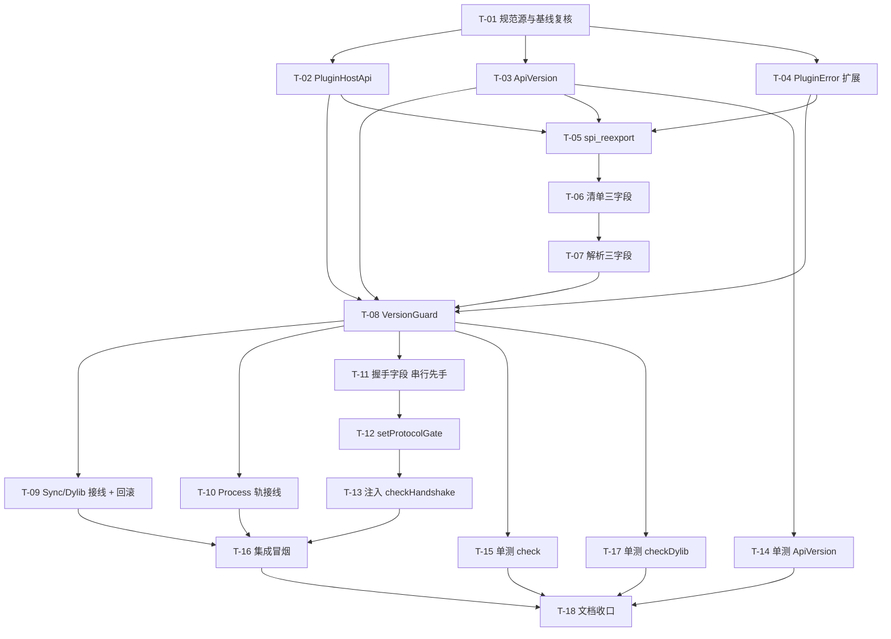

# 任务规划文档（version-guard · 版本协商守卫）

> 基于 `spec.md` 与 `design.md` 生成。实施原则：**复用优先**、**确定性优先**、**L3 进程隔离**。
> 仓颉代码编写须使用 `cangjie-coder` 技能；**严禁运行 `cjpm build`**（编译与回传由人工在独立 cmd 环境完成）。
> 本子系统是主工程 `plugin-system-enhancement` DAG 的**拓扑序 1 号节点**，无上游子系统依赖。

## 文档信息

- **关联需求**：`specs/plugin-system-enhancement--version-guard/spec.md`（REQ-VG-001 ~ REQ-VG-024）
- **关联设计**：`specs/plugin-system-enhancement--version-guard/design.md`（M1~M10，ADR-VG-1~8）
- **关联契约**：`specs/plugin-system-enhancement--version-guard/contract.md`（IF-01 ~ IF-04 + IF-03R 预留）
- **生成日期**：2026-10-19
- **版本**：v1.0
- **状态**：草稿（code 步开工后转「进行中」）

---

## 开发规范（全任务强制遵守）

- **语言与工具绑定**：仓颉 → `cangjie-coder`；前端（HTML/CSS/TS）→ `web-coder` / `fullstack-codegen`；原生 App → `app-coder`。
- **二次开发底座优先（迭代 runtime / uctoo 时强制）**：
  1. **规范源**：先加载 `uctoo-dev-manual`（`skills/uctoo-dev-manual/`），按要做的事读对应 `docs/uctoo-v4/*.md`
     （接口→`uctoo-v4-api-specification`；表/字段→`uctoo-database-design-specification`；
     CRUD→`uctoo-v4-module-development` + `uctoo-v4-orm-specification`；中间件→`uctoo-v4-middleware-guide`；
     权限→`user-permission-system` / `row-level-permission-system`）。
  2. **脚手架优先确定性代码生成工具**：`loaddbinfo`（灌表结构到 `db_info`）→ `plugingen`（**功能拓展优先做成插件**，默认 L3 进程隔离轨 process，
     需退回内嵌 sync 轨显式加 `--mode sync`）／`crudgen`（**仅**往宿主 `src/app/` 补公共基础设施）／`crudweb`（管理界面）；
     下线插件用对称的 `pluginuninstall`，不要手动删 `skills/{name}` 目录。命令一律 `cjpm run --skip-build --name <包名> --run-args "<参数>"`。
  3. **工具链坑位**：`loaddbinfo` 命令行模式有未修问题（见 `skills/uctoo-dev-manual/tools/loaddbinfo.md` 顶部 TODO），
     退到 Web 端「数据库管理 → 加载数据库信息」；`crudgen` 生成后编译报 `@DAO` 一堆错，看 `docs/uctoo-v4/crud-generator-v2.md`。
  4. **生成后必补**：新增表/列的 DDL 放 `sql/incremental/`（新增须先论证复用不成立 → **本子系统 0 新表 0 新列，本条不适用**）；
     新增宿主路由必做 `permissions` + `role_has_permission` 登记（**本子系统无新增路由，本条不适用**）。
  5. **只在生成物上做最小适配**，不要另起炉灶重写一遍生成出来的结构。
- **大工程拆分态（铁律 15，本工程强制）**：
  1. 开工前已读主工程 `specs/plugin-system-enhancement/SPECS_INDEX.md`：子系统 ID = `version-guard`，
     `feature_name = plugin-system-enhancement--version-guard`，契约 v1 草案，上游依赖 = 无，验收档位 = L1+L2+L3。
  2. **边界写进任务**：每条任务标注「本子系统负责」与「不碰（移交/调用上游）」；跨子系统的一律落成
     "调用上游契约接口" 或 "等下游消费" 的动作，不许写成"顺手也改一下 X 模块"。
  3. **跨子系统接口改动成对成条**：本子系统只做**提供方侧**，消费方侧（下游 tasks）不在本文件内派单；
     上游就位（本子系统 `test` 步通过）后下游才放行 `code` 步。
  4. **契约先行**：契约条目编号写进每条任务；v1 全为新增（minor 档），无 major。
  5. **验收带跨边界冒烟**：见「验收检查清单」S-VG-02 / S-VG-04 / S-VG-06。
  6. **禁止跨界手写**：本子系统不触达任何 DB 表、不新增路由、不改生成器产物。
- **编译约束**：AI 不运行 `cjpm build`；编译、类型检查、lint 由人工执行并回传结果。
- **复用原则**：复用 `plugin_config.cj` / `plugin_types.cj` / `spi_reexport.cj` / `message.cj` 既有载体，不新建清单文件、不新建表。
- **命名/注释/错误处理**：遵循 `uctoo-dev-manual` 与 legacy `design-principles.md`（分层、软删除、统一错误响应等）。
- **进度与日志**：日志统一前缀 `[VersionGuard]`；多轮修订留痕。

---

## 任务总览

| 编号 | 任务 | 关联需求(spec §) | 关联设计(design §) | 负责子 agent | 状态 | 预计产出 |
|---|---|---|---|---|---|---|
| T-01 | 规范源加载与基线复核 | §7.2 证据索引 | §1.2 / §10.3 | 主 agent | `[ ]` | 复核记录（文件:行号） |
| T-02 | 新增 `plugin_spi.PluginHostApi` 版本真源常量 | REQ-VG-001/002/019 | §3.1 (M1) | cangjie-coder | `[ ]` | `libs/plugin-spi/src/plugin_host_api.cj` |
| T-03 | 新增 `plugin_spi.ApiVersion` 解析/比较/约束内核 | REQ-VG-008/009/010 | §3.2 (M2) | cangjie-coder | `[ ]` | `libs/plugin-spi/src/api_version.cj` |
| T-04 | `PluginError` 追加 3 个版本类构造器 + `message()` 分支 | §6.5 | §3.3 (M3) | cangjie-coder | `[ ]` | `libs/plugin-spi/src/plugin_types.cj`（改） |
| T-05 | `spi_reexport.cj` 转发新增类型 | §6.2 / §6.3 | §2.2 (M4) | cangjie-coder | `[ ]` | `src/plugin/spi_reexport.cj`（改） |
| T-06 | `PluginManifestEntry` 增列 `version` / `pluginApi` / `hostVersionRange` | REQ-VG-003 | §3.5.1 / §6.1 | cangjie-coder | `[ ]` | `src/plugin/plugin_config.cj`（改） |
| T-07 | `fromJsonValue` 解析三字段（含类型降级 + warn） | REQ-VG-004/005/006 | §3.5.2 | cangjie-coder | `[ ]` | `src/plugin/plugin_config.cj`（改） |
| T-08 | 新增 `magic.plugin.VersionGuard` | REQ-VG-011~018 | §3.6 (M6) | cangjie-coder | `[ ]` | `src/plugin/version_guard.cj` |
| T-09 | Sync/Dylib 轨接线 + 注册表快照回滚（REQ-PS-010） | REQ-VG-012/013/014/015 | §3.7 (M7) | cangjie-coder | `[ ]` | `src/plugin/plugin_host_manager.cj`（改） |
| T-10 | Process 轨接线（拒绝即不拉起进程） | REQ-VG-016/017 | §3.8 (M8) | cangjie-coder | `[ ]` | `src/plugin/cordis_host_manager.cj`（改） |
| T-11 | cordis-cj 握手字段：追加 `protocolVersion` / `hostApiVersion`（**串行先手**） | REQ-VG-020 | §3.9.1 (M9) | cangjie-coder | `[ ]` | `libs/cordis-cj/cordis_core/src/message.cj`（改） |
| T-12 | `PluginHost` 新增 `setProtocolGate` + 门禁拒绝置 `Failed` | REQ-VG-021/023 | §3.9.2 (M10) | cangjie-coder | `[ ]` | `libs/cordis-cj/cordis_host/src/plugin_host.cj`（改） |
| T-13 | `CordisHostManager` 注入 `VersionGuard.checkHandshake` | REQ-VG-024 | §3.9.3 | cangjie-coder | `[ ]` | `src/plugin/cordis_host_manager.cj`（改） |
| T-14 | 单测：`ApiVersion` 解析 / 比较 / 约束（含非法语法） | REQ-VG-008/009/010 | §3.2.4 | cangjie-coder | `[ ]` | 单测文件 |
| T-15 | 单测：`VersionGuard.check` 三分支 + 存量 55 条目向后兼容 | REQ-VG-003~007/011~015/018/019 | §3.6.3 | cangjie-coder | `[ ]` | 单测文件 |
| T-16 | 集成冒烟：S-VG-01 ~ S-VG-07 | REQ-VG-011~024 | §2.3 | 主 agent + 人工 | `[ ]` | `src/plugin/integration/` 冒烟脚本 + 日志 |
| T-17 | 单测：`checkDylib` 预留接口 + 运行时零调用断言 | REQ-VG-018 | §3.6.5 | cangjie-coder | `[ ]` | 单测文件 + grep 断言脚本 |
| T-18 | 文档与账本收口（三份文档定稿 + 回主工程登记 + contract 转已冻结） | 全部 | §10.3 | 主 agent | `[ ]` | 文档修订记录 + SPECS_INDEX §3/§6/§8 更新 |

- 状态：`[ ]` 待开始 / 进行中 / 已完成 / 阻塞

---

## 任务依赖关系图

- **可并行**：T-02 / T-03 / T-04 三者互不依赖；T-14 与 T-15 可与 T-09/T-10/T-11 并行。
- **必须串行**：**T-11 → T-12 → T-13**（R-05 共享 `message.cj`）；且 T-11 合入并冻结后，`capability-handshake` 才能在其上追加 IF-08。
- **强阻塞**：T-08 依赖 T-02/T-03/T-04 全部完成；T-16 依赖 T-09/T-10/T-13 全部完成。

---

## 任务详细说明（按编号展开）

### T-01 规范源加载与基线复核

- **目标**：加载 `uctoo-dev-manual` 与 `docs/uctoo-v4/*.md` 规范源，复核 spec §7.2 全部证据行号，确认无漂移。
- **输入**：无（本子系统无上游）。
- **步骤**：
  1. 加载 `skills/uctoo-dev-manual/`，按任务类型读对应 `docs/uctoo-v4/*.md`（接口/表字段/CRUD/中间件/权限）。
  2. 逐条复核 spec §7.2 证据索引的 `文件:行号`（重点：`plugin_types.cj:56-63`、`message.cj:10-53`、`plugin_host_manager.cj:302/135`、`plugin_registry.cj:143/160`、`cjpm.toml:18`）。
  3. 复核 spec §7.3 三条待核实项（尤其 `PluginHost` 是否已存在 `setProtocolGate`）。
  4. 复核既有 REQ-PS-010（`.codeartsdoer/specs/plugin-system/spec.md:179`）原文口径。
- **产出物**：复核记录（追加到 spec §7.2 / §7.3）。
- **验收**：证据索引每条都对得上；待核实项全部有结论或保持"待核实"标注；未编造任何 API。
- **风险**：`libs/cordis-cj` 是 vendored 库，行号随上游更新漂移 → 复核时以当前工作树为准。
- **本子系统负责**：规范源加载、证据复核、待核实项结论。
- **不碰（移交/调用上游）**：无上游子系统；不修改 `.codeartsdoer/specs/plugin-system/spec.md`（仅读取其需求口径）。

### T-02 新增 `plugin_spi.PluginHostApi` 版本真源常量（IF-01）

- **目标**：REQ-VG-001 / 002 / 019 —— 建立宿主版本唯一真源。
- **输入**：T-01 复核结论。
- **步骤**：
  1. 新建 `libs/plugin-spi/src/plugin_host_api.cj`，package `plugin_spi`。
  2. 按 contract §1.1 冻结签名实现 4 个 `public static let`（`CURRENT` / `MIN_COMPAT` / `PROTOCOL_VERSION` / `HOST_VERSION`）。
  3. 类注释写明「唯一真源，禁止第二份常量」及 `HOST_VERSION` 与 `cjpm.toml:18` 人工同步约定。
- **产出物**：`libs/plugin-spi/src/plugin_host_api.cj`。
- **验收**：REQ-VG-001 / 002 / 019 通过；不引入任何运行时依赖。
- **风险**：`HOST_VERSION` 与 `cjpm.toml` 人工同步存在漂移风险 → 已登记为已知 v2 候选③，v1 不处理。
- **本子系统负责**：常量定义与文档注释。
- **不碰（移交/调用上游）**：不改 `cjpm.toml`；不改构建流程；不改生成器模板。

### T-03 新增 `plugin_spi.ApiVersion` 解析 / 比较 / 约束内核

- **目标**：REQ-VG-008 / 009 / 010 —— 提供纯函数式版本解析与约束求值。
- **输入**：T-01。
- **步骤**：
  1. 新建 `libs/plugin-spi/src/api_version.cj`，package `plugin_spi`，不可变值对象（major/minor/patch）。
  2. `parse`：仅接受十进制非负整数段、段数 1~3，缺段补 0；非法返回 `None`。
  3. `compare`：major → minor → patch，返回 `-1` / `0` / `1`。
  4. `satisfies`：按 design §3.2.3 流程实现（六个运算符 + 空格 AND + 不支持语法 → `Err`）。
  5. `toString`：输出 `X.Y.Z`。
- **产出物**：`libs/plugin-spi/src/api_version.cj`。
- **验收**：REQ-VG-008 / 009 / 010 通过；design §3.2.4 边界表逐行覆盖（由 T-14 承接）。
- **风险**：仓颉字符串切片/整数解析的具体 API 需由 `cangjie-coder` 在实现时确认，禁止凭空写 API。
- **本子系统负责**：解析 / 比较 / 约束求值内核。
- **不碰（移交/调用上游）**：不实现 semver 预发布/构建元数据；不支持 `^` `~` `||` 通配符（v2 候选②）。

### T-04 `PluginError` 追加 3 个版本类构造器 + `message()` 分支

- **目标**：补齐版本类错误码（硬约束）。
- **输入**：T-01。
- **步骤**：
  1. 在 `libs/plugin-spi/src/plugin_types.cj:56-63` 枚举体**尾部**追加 `VersionMismatch(String)` / `IncompatibleApi(String)` / `UnsupportedHost(String)`。
  2. 在同文件 `message()`（`:66-83`）的 `match` 中追加三个分支，文案模板见 spec §6.5。
  3. 既有 7 个构造器与文案一字不改。
- **产出物**：`libs/plugin-spi/src/plugin_types.cj`（改）。
- **验收**：spec §6.5 全部条目通过；既有错误码文案零改动。
- **风险**：枚举新增构造器后，全仓对 `PluginError` 的 `match` 若非穷尽且无 `_` 分支会编译失败 → 编译由人工回传，出现即定位补全。
- **本子系统负责**：三个构造器 + `message()` 分支。
- **不碰（移交/调用上游）**：不改既有 7 个构造器的语义与文案。

### T-05 `spi_reexport.cj` 转发新增类型

- **目标**：让存量 `import magic.plugin.{...}` 使用方零改动即可拿到新类型。
- **输入**：T-02 / T-03 / T-04。
- **步骤**：在 `src/plugin/spi_reexport.cj:16-30` 的 `public import plugin_spi.{...}` 内追加 `PluginHostApi` 与 `ApiVersion`。
- **产出物**：`src/plugin/spi_reexport.cj`（改）。
- **验收**：新类型可经 `magic.plugin` 路径引用；存量 import 不受影响。
- **风险**：`ApiVersion` 若与宿主其它同名类型冲突需改名 → 实现时确认（待核实）。
- **本子系统负责**：转发清单维护。
- **不碰（移交/调用上游）**：不改 `plugin-spi` 内其它文件。

### T-06 `PluginManifestEntry` 增列三字段（IF-02）

- **目标**：REQ-VG-003 —— 给清单条目增加版本承载位。
- **输入**：T-05。
- **步骤**：在 `src/plugin/plugin_config.cj:72-112` 的字段区追加 `version: String = ""` / `pluginApi: Option<String> = None` / `hostVersionRange: Option<String> = None`，并补注释（含「不参与判定」等口径）。
- **产出物**：`src/plugin/plugin_config.cj`（改）。
- **验收**：spec §6.1 全部条目通过。
- **风险**：无。
- **本子系统负责**：字段定义与注释。
- **不碰（移交/调用上游）**：不动 `init()`（`:114`）与既有字段缺省值。

### T-07 `fromJsonValue` 解析三字段（含类型降级 + warn）

- **目标**：REQ-VG-004 / 005 / 006 —— 把 `plugin.yaml` 的版本声明读进来，且永不因缺字段/类型错而拒绝条目。
- **输入**：T-06。
- **步骤**：
  1. 在 `fromJsonValue`（`:122-208`）中、`routeClass` 解析（`:169-173`）之后追加三段解析。
  2. `version` 走既有 `jsonToString`（`:319-324`）；`pluginApi` / `hostVersionRange` 仅在 `is JsonString` 时取 `Some(...)`。
  3. 类型不符或缺省（且条目确实"看起来有版本声明意图"时）输出 `LogUtils.warn("[VersionGuard] ...")`，**不** `return None`、**不**抛异常。
  4. 同步更新类注释里的 YAML 示例（`:43-67`），展示 `version` / `pluginApi` / `hostVersionRange` 写法。
- **产出物**：`src/plugin/plugin_config.cj`（改）。
- **验收**：REQ-VG-003 ~ 007 通过；`fromPluginYaml`（`:216-267`）无需改动即自动获得三字段。
- **风险**：YAML 中 `version: 1.0.0` 可能被 `yaml4cj` 解析为 `JsonString`（预期），但 `version: 1.0` 可能被解析为浮点 → 交给 `jsonToString` 兜底，不特殊处理（待核实解析行为）。
- **本子系统负责**：解析逻辑 + 告警 + 文档注释。
- **不碰（移交/调用上游）**：不动 `parseMode`（`:270-277`）降级行为、不动 `enabled`/`order` 的类型不符跳过行为。

### T-08 新增 `magic.plugin.VersionGuard`（IF-03 / IF-03R / IF-04 门禁）

- **目标**：REQ-VG-011 ~ 018 —— 提供准入闸门与握手门禁。
- **输入**：T-02（常量）、T-03（内核）、T-04（错误码）、T-07（清单字段）。
- **步骤**：
  1. 新建 `src/plugin/version_guard.cj`，package `magic.plugin`，全静态方法。
  2. `check(entry)`：按 design §3.6.3 流程实现；包一层 `try/catch`，异常 → `error` 日志 + `Ok(Unit)`。
  3. `checkDylib(entry)`：实现体与 `check` 一致，注释显著标注「预留，运行时零调用（R-01）」。
  4. `checkHandshake(pluginId, reported)`：按 design §3.6.4 实现。
  5. 错误文案严格含「插件名 + 期望 + 实际」三要素。
- **产出物**：`src/plugin/version_guard.cj`。
- **验收**：REQ-VG-011 ~ 019 通过；`check` 幂等纯函数（连续 N 次结果一致、注册表快照不变）。
- **风险**：`Result<Unit, PluginError>` 在仓颉中需从 `std.core` 引入，写法与 `plugin_loader.cj:46` 的既有用法保持一致。
- **本子系统负责**：三个静态方法的实现与注释。
- **不碰（移交/调用上游）**：不在本文件调用任何加载器/注册表；`checkDylib` 不在运行时被接线。

### T-09 Sync/Dylib 轨接线 + 注册表快照回滚（兑现 REQ-PS-010）

- **目标**：REQ-VG-012 / 013 / 014 / 015 —— 在反射实例化之前拦截，并保证被拒条目在注册表零残留。
- **输入**：T-08。
- **步骤**：
  1. 在 `src/plugin/plugin_host_manager.cj:302` `loadSingle` 的**最前部**（`setState(Loading)` 之前，`registry.get(name)` 幂等判断之后）插入 `let snap = this.registry.snapshot()` 与 `VersionGuard.check(entry)` 分支。
  2. 拒绝分支：`this.registry.restore(snap)` → `LogUtils.error` → `emitLifecycle("plugin.error", ...)` → `result.failed.add(...)` → `return`。
  3. 通过分支：照常走既有流程（`:313` 起）。
- **产出物**：`src/plugin/plugin_host_manager.cj`（改）。
- **验收**：REQ-VG-012 / 013 / 014 / 015 通过；混入 1 个不兼容 sync 插件时，其余全部进入 `LoadResult.loaded`，`registry` 中无不兼容条目残留。
- **风险**：`restore(snap)` 的返回值为 `Bool`，需检查失败分支并记录；若快照为空（未加载任何插件）应为空操作（待核实 `plugin_registry.cj:160` 实现细节）。
- **本子系统负责**：`loadSingle` 的前置校验与回滚接线。
- **不碰（移交/调用上游）**：不改既有 `Err` 分支（`:326-331`）的 `Error` 态语义；不改 `loadAll` 的 `hasProcess` 分支与路由注册；不接线 `PluginDylibLoader`。

### T-10 Process 轨接线（拒绝即不拉起进程）

- **目标**：REQ-VG-016 / 017 —— 不兼容的 process 插件不得产生子进程副作用。
- **输入**：T-08。
- **步骤**：
  1. 在 `src/plugin/cordis_host_manager.cj:137` `loadProcessPlugins` 的遍历循环内、`launchPlugin` 之前插入 `VersionGuard.check(entry)`。
  2. `Err` → `LogUtils.error` + `result.failed.add("${entry.name}(${err.message()})")` + `continue`。
  3. `Ok` → 照常构造 `PluginEntry` / `launchPlugin` / `awaitActive`。
- **产出物**：`src/plugin/cordis_host_manager.cj`（改）。
- **验收**：REQ-VG-016 / 017 通过；不兼容 process 插件在 `ps` 中无对应进程。
- **风险**：`continue` 语义在仓颉循环中的写法需由 `cangjie-coder` 确认（可用 `match` + 提前分支替代）。
- **本子系统负责**：Process 轨前置校验接线。
- **不碰（移交/调用上游）**：不改 `awaitActive` / `reconcile` / `healCrashed`；不改 `ExternalPluginRouteGateway` 路由注册。

### T-11 cordis-cj 握手字段：追加 `protocolVersion` / `hostApiVersion`（**串行先手**）

- **目标**：REQ-VG-020 —— 冻结 IF-04 协议字段，供 `capability-handshake` 在其上追加。
- **输入**：T-01（确认 `message.cj` 现状）。
- **步骤**：
  1. `InitializeParams`（`libs/cordis-cj/cordis_core/src/message.cj:10-53`）：`init` 尾部追加 `protocolVersion!: ?Int32 = None`；`toJson` 追加条件写入；`fromJson` 追加 `case "protocolVersion"`。
  2. `InitializeResult`（`:60-97`）：同法追加 `protocolVersion!: ?Int32 = None` 与 `hostApiVersion!: ?String = None`。
  3. 更新相关 doc 注释，标明「version-guard 冻结，capability-handshake 串行追加」。
- **产出物**：`libs/cordis-cj/cordis_core/src/message.cj`（改）。
- **验收**：REQ-VG-020 通过；既有字段参数位置/键名/必填性零改动；存量调用点继续编译通过。
- **风险**：**R-05 串行红线**——本任务未冻结前，`capability-handshake` 不得动 `message.cj`。
- **本子系统负责**：`protocolVersion` / `hostApiVersion` 两处结构体的字段追加。
- **不碰（移交/调用上游）**：不改 `Methods`（`methods.cj:5-22`）；不新增 `hello` / `negotiate`；不改 `provide` / `dispose` 等其它载荷。

### T-12 `PluginHost` 新增 `setProtocolGate` + 门禁拒绝置 `Failed`

- **目标**：REQ-VG-021 / 023 —— 挂载握手门禁并正确置状态。
- **输入**：T-11。
- **步骤**：
  1. 在 `libs/cordis-cj/cordis_host/src/plugin_host.cj` 新增字段 `protocolGate: ?(String, ?Int32) -> ?String = None` 与 `public func setProtocolGate(gate: (String, ?Int32) -> ?String): Unit`。
  2. 在 initialize handler（`:104-138`）读完 `params`（`:109`）之后、调 `checkMissing`（`:115`）之前执行门禁；gate 未注入时默认放行。
  3. 拒绝路径：`transitionStatus(instance, InstanceStatus.Failed)`（**非** `Pending`）+ `logger` 输出 + 返回 `InitializeResult(ok=false)`，并在响应中回显 `protocolVersion` / `hostApiVersion`。
- **产出物**：`libs/cordis-cj/cordis_host/src/plugin_host.cj`（改）。
- **验收**：REQ-VG-021 / 023 / 024 通过；未注入 gate 时行为与改造前一致。
- **风险**：仓颉函数类型作为参数/字段的写法需由 `cangjie-coder` 确认；`?` 与 `Option<>` 混用需统一为文件既有风格。
- **本子系统负责**：注入点与拒绝分支。**仅冻结协议版本判定**，能力宣告判定归 `capability-handshake`。
- **不碰（移交/调用上游）**：不改 `checkMissing` 与「依赖未满足 → Pending」分支；不解析 `declaredCapabilities`。

### T-13 `CordisHostManager` 注入 `VersionGuard.checkHandshake`

- **目标**：REQ-VG-024 —— 完成门禁接线。
- **输入**：T-12。
- **步骤**：在 `src/plugin/cordis_host_manager.cj:38` `CordisHostManager` 构造 `PluginHost` 之后调用 `setProtocolGate { id, v => VersionGuard.checkHandshake(id, v) }`。
- **产出物**：`src/plugin/cordis_host_manager.cj`（改）。
- **验收**：宿主启动后 process 插件握手走门禁；日志可见 `[VersionGuard] handshake rejected`（拒绝场景）。
- **风险**：若 `PluginHost` 有多处构造点需逐一确认不漏（待核实）。
- **本子系统负责**：注入语句。
- **不碰（移交/调用上游）**：不改 `PluginHost` 内部状态机与 `Reconciler`。

### T-14 单测：`ApiVersion`

- **目标**：REQ-VG-008 / 009 / 010 的自动化证明。
- **输入**：T-03。
- **步骤**：
  1. `parse` 用例：`"1"` / `"1.2"` / `"1.2.3"` / `""` / `"abc"` / `"1.2.3-beta"` / `"-1"` / `"1."` / `".1"` / `"1.2.3.4"`。
  2. `compare` 用例：major/minor/patch 三档各一组 + 相等组。
  3. `satisfies` 用例：六个运算符各一组、空格 AND 组合、非法语法（`^1.0.0` / `~1` / `1.x` / `>>1.0` / 空串）。
- **产出物**：单测文件（落 `src/plugin/` 既有测试组织方式下）。
- **验收**：design §3.2.4 边界表逐行覆盖。
- **风险**：测试框架与断言风格需对齐仓内既有单测。
- **本子系统负责**：`ApiVersion` 全部用例。
- **不碰（移交/调用上游）**：不测试下游能力语义。

### T-15 单测：`VersionGuard.check` 三分支 + 存量向后兼容

- **目标**：REQ-VG-003~007 / 011~015 / 018 / 019 的自动化证明。
- **输入**：T-07 / T-08。
- **步骤**：
  1. 通过分支：`pluginApi: ">=1.0.0 <2.0.0"`、`hostVersionRange: ">=0.0.1"`。
  2. 拒绝分支：`pluginApi: ">=2.0.0"` → `VersionMismatch`；`hostVersionRange: "<0.0.20"` → `UnsupportedHost`；语法非法 → 拒绝而非静默。
  3. 缺省分支：`pluginApi == None` → `Ok` + warn（**硬验收**：构造 55 个无声明条目全部 `Ok`）。
  4. 幂等断言：同一 entry 连续调用 5 次结果一致，前后 `PluginRegistry` 快照一致。
  5. dylib 条目：走 Sync 同款路径返回 `Ok`，不抛异常。
  6. `MIN_COMPAT` 不参与判定：仅改 `MIN_COMPAT` 用例下 `check` 结果不变。
- **产出物**：单测文件。
- **验收**：REQ-VG-003~007 / 011~015 / 018 / 019 全覆盖；spec §4.5.1 硬验收条目通过。
- **风险**：`MIN_COMPAT` 为编译期常量，单测无法运行时改值 → 改为断言「`check` 实现中不引用 `MIN_COMPAT`」的静态检查或走 code review。
- **本子系统负责**：`check` 全部用例。
- **不碰（移交/调用上游）**：不构造真实子进程。

### T-16 集成冒烟：S-VG-01 ~ S-VG-07

- **目标**：contract §6 七条冒烟用例全绿（L1 + L2 档位）。
- **输入**：T-09 / T-10 / T-13。
- **步骤**：
  1. S-VG-01 主干：process 插件 `pluginApi: ">=1.0.0 <2.0.0"` → 通过 → 进程拉起 → 握手 `protocolVersion: 1` → 实例 `Active`。
  2. S-VG-02 异常（跨子系统主干）：`pluginApi: ">=2.0.0"` → 加载前被拒；校验 `LoadResult.failed` 文案三要素、**进程未被拉起**、宿主无崩溃、其余插件照常。
  3. S-VG-03 异常：`pluginApi: ">>1.0"` → 拒绝加载。
  4. S-VG-04 异常（跨子系统）：握手上报 `99` → `InitializeResult(ok=false)` + `InstanceStatus.Failed`（非 `Pending`）+ 日志 `handshake rejected`。
  5. S-VG-05 防回退（R-04）：51 个 skill + 4 个 sync 锚点清单无 `pluginApi` → 100% `Ok` + 每条一条 warn。
  6. S-VG-06 下游消费：`capability-governance` 侧能读到 `entry.pluginApi` 与 `PluginHostApi.CURRENT` 一致口径。
  7. S-VG-07 边界：`mode: dylib` 条目 `Ok`；`checkDylib` 单测可直调且运行时零调用。
- **产出物**：`src/plugin/integration/` 冒烟脚本 + 执行日志。
- **验收**：7/7 全绿；S-VG-05 为**硬验收**，失败即 P0。
- **风险**：冒烟需人工在独立 cmd 环境执行（AI 不跑 `cjpm build`）；51 个 skill 清单路径需先确认（待核实）。
- **本子系统负责**：S-VG-01 ~ S-VG-07 全部。
- **不碰（移交/调用上游）**：不跑 `capability-handshake` 的能力比对用例（归其 L2）；不跑 `plugin validate`（归 `authoring-toolchain`）。

### T-17 单测：`checkDylib` 预留接口 + 运行时零调用断言

- **目标**：REQ-VG-018 —— 证明"预留但未接线"，防止后续误接线造成范围蔓延。
- **输入**：T-08。
- **步骤**：
  1. `checkDylib` 通过 / 拒绝两条路径的直调单测。
  2. 静态断言：全仓 grep `checkDylib` 仅命中 `src/plugin/version_guard.cj`（定义处）与本单测文件；`src/plugin/plugin_dylib_loader.cj` 中**无**调用。
- **产出物**：单测文件 + grep 断言脚本。
- **验收**：REQ-VG-018 通过；断言失败即 P0（判定为偷偷复活 dylib 轨）。
- **风险**：grep 结果需人工复核，避免测试文件路径变动导致误报。
- **本子系统负责**：预留接口单测与静态断言。
- **不碰（移交/调用上游）**：**不接线 `PluginDylibLoader`**；不修改 `plugin_dylib_loader.cj`；不修 `unloadDylib` 空实现。

### T-18 文档与账本收口

- **目标**：三份文档与实现一致（无漂移），账本同步。
- **输入**：T-14 / T-15 / T-16 / T-17。
- **步骤**：
  1. 回填 `spec.md` §7.2 证据索引行号、清空/更新 §7.3 待核实项结论。
  2. 回填 `design.md` §10.4 变更历史；如实现与契约有偏差，逐条归因到 contract 条目并走 §5 演进档位。
  3. `contract.md` 冻结状态由「草案」转「已冻结」。
  4. 回主工程 `SPECS_INDEX.md` §2（`status=done`）/ §3（接口状态）/ §6（变更影响面）/ §8（修订记录）登记。
- **产出物**：三份文档定稿 + 主工程账本更新。
- **验收**：spec / design / tasks 与最终实现一致；主工程账本已同步。
- **风险**：跨文件同步遗漏 → 用「验收检查清单」逐条打勾。
- **本子系统负责**：本目录三份文档 + 回主工程登记。
- **不碰（移交/调用上游）**：不代改下游子系统文档；不代改 `SPECS_INDEX.md` §1 / §4 / §5 / §7（主工程闸口决策人职责）。

---

## 需求覆盖追踪矩阵

| spec 需求编号 | 需求摘要 | 覆盖任务 | 覆盖状态 | 备注 |
|---|---|---|:---:|---|
| REQ-VG-001 | 版本真源唯一（`PluginHostApi`） | T-02 | 全覆盖 | IF-01 |
| REQ-VG-002 | 禁止第二份版本常量 | T-02, T-18 | 全覆盖 | 由 T-18 静态检查 + 闸口把关 |
| REQ-VG-003 | 清单三字段可解析 | T-06, T-07, T-15 | 全覆盖 | IF-02 |
| REQ-VG-004 | 类型不符降级不拒绝 | T-07, T-15 | 全覆盖 | R-04 |
| REQ-VG-005 | 缺字段不得拒绝条目 | T-07, T-15 | 全覆盖 | R-04 硬验收 |
| REQ-VG-006 | 降级时输出 warn | T-07, T-15 | 全覆盖 | |
| REQ-VG-007 | 未声明 `pluginApi` 放行并告警 | T-08, T-15 | 全覆盖 | |
| REQ-VG-008 | 版本解析口径 X / X.Y / X.Y.Z | T-03, T-14 | 全覆盖 | |
| REQ-VG-009 | 约束语法最小集 | T-03, T-14 | 全覆盖 | |
| REQ-VG-010 | 语法非法拒绝而非静默放行 | T-03, T-08, T-14 | 全覆盖 | S-VG-03 |
| REQ-VG-011 | 校验前置（实例化/拉起之前） | T-09, T-10, T-16 | 全覆盖 | IF-03 |
| REQ-VG-012 | `pluginApi` 不满足 → VersionMismatch | T-08, T-09, T-15 | 全覆盖 | |
| REQ-VG-013 | `hostVersionRange` 不满足 → UnsupportedHost | T-08, T-09, T-15 | 全覆盖 | |
| REQ-VG-014 | 拒绝登记 `LoadResult.failed` + `plugin.error` | T-09, T-10, T-16 | 全覆盖 | |
| REQ-VG-015 | 注册表快照回滚、零残留（REQ-PS-010） | T-09, T-16 | 全覆盖 | 硬验收 |
| REQ-VG-016 | process 拒绝即不拉起进程 | T-10, T-16 | 全覆盖 | S-VG-02 判据③ |
| REQ-VG-017 | `check` 纯函数 / 幂等 | T-08, T-15 | 全覆盖 | |
| REQ-VG-018 | dylib 预留不接线 | T-08, T-17 | 全覆盖 | R-01 |
| REQ-VG-019 | `MIN_COMPAT` 不参与判定 | T-02, T-08, T-15 | 全覆盖 | 防二义 |
| REQ-VG-020 | 握手字段只增不改（尾部默认参数） | T-11 | 全覆盖 | R-05 串行先手 |
| REQ-VG-021 | 上报不等即拒（IncompatibleApi） | T-12, T-16 | 全覆盖 | |
| REQ-VG-022 | 不上报即放行 + warn | T-12, T-16 | 全覆盖 | R-04 |
| REQ-VG-023 | 拒绝置 Failed 非 Pending | T-12, T-16 | 全覆盖 | 防握手风暴 |
| REQ-VG-024 | 门禁构造注入，未注入默认放行 | T-12, T-13, T-16 | 全覆盖 | |
| §4.1 性能 | check ≤1ms / 全量增量 ≤10ms | T-08, T-15 | 全覆盖 | 由人工压测回传 |
| §4.2 可靠性 | 禁抛异常 / 零残留 / 幂等 | T-08, T-09, T-15 | 全覆盖 | |
| §4.3 安全性 | 文案三要素、不触 env/secret、无 DB | T-04, T-08 | 全覆盖 | R-03 归 CG |
| §4.4 可维护性 | `[VersionGuard]` 前缀与级别 | T-07, T-08, T-12 | 全覆盖 | |
| §4.5 兼容性 | 存量 55 条目零回归 | T-15, T-16 | 全覆盖 | **硬验收** |

- 无游离任务：T-01~T-18 每条均对应上表至少一行。
- 无遗漏需求：REQ-VG-001~024 与 §4 DFX 五类全部有任务承接。

---

## 验收检查清单（终验）

- [ ] 全部 spec 功能需求（REQ-VG-001~024）有对应实现并通过其验收条件
- [ ] DFX 约束（性能 / 可靠 / 安全 / 可维护 / 兼容）已验证或标注豁免
  - [ ] 性能：check ≤1ms、全量增量 ≤10ms（人工压测回传）
  - [ ] 可靠：禁抛异常、被拒条目零残留、幂等
  - [ ] 安全：错误文案仅三要素、无 env/secret 访问、无 DB 访问
  - [ ] 可维护：日志前缀 `[VersionGuard]` 与级别约定
  - [ ] 兼容：存量 51 skill + 4 sync 插件零回归
- [ ] 复用项未被重新实现：0 新表 0 新列；复用 `PluginManifestEntry` / `InitializeParams` / `PluginError` / `PluginRegistry.snapshot()` 既有载体
- [ ] **硬验收**：4 个 sync 插件（`src/plugins/generated_anchors.cj:10-17` 锚定 `EntityPlugin` / `EntityRoute` / `FeedbackPlugin` / `FeedbackRoute`）与 51 个 skill 插件加载零回归，存量清单默认无版本声明 → 100% 放行
- [ ] **硬验收**：REQ-PS-010 兑现 —— 版本不兼容时明确报错（`VersionMismatch` / `UnsupportedHost`），且注册表回滚到加载前快照、被拒条目零残留
- [ ] **硬验收**：`mode: dylib` 不接线 —— 全仓 grep `checkDylib` 仅命中定义处与单测；`PluginDylibLoader` 仍为零调用
- [ ] **硬验收**：R-05 串行 —— 本子系统 `protocolVersion` 字段已冻结后，`capability-handshake` 才动 `message.cj`
- [ ] 跨子系统主干冒烟 ≥3 条：S-VG-01（主干）、S-VG-02（version-guard→capability-handshake 异常）、S-VG-04（跨子系统异常）全绿
- [ ] 编译 / 类型检查 / lint 通过（人工在独立 cmd 环境执行并回传）
- [ ] spec / design / tasks 三份文档与最终实现一致（无漂移）；主工程 `SPECS_INDEX.md` §2/§3/§6/§8 已同步

---

## 修订记录 / 多轮迭代

| 日期 | 轮次 | 触发来源 | 改动文件清单 | 验证结果 |
|---|---|---|---|---|
| 2026-10-19 | 第 1 轮 | 主工程 `SPECS_INDEX.md` §3 接口账本 + 基线侦察（P0 GAP：`pluginApi`/`apiVersion`/`hostVersion`/`handshake` 全仓 `src/` 0 命中） | 新建 `spec.md`、`design.md`、`tasks.md`（本目录）；`contract.md` 已存在，本次不重写 | 待 code 步执行后回填；防回归锚点 = 存量 55 条目零回归（S-VG-05） |

- **防回归锚点**：51 个 skill 插件 + 4 个 sync 锚点（`generated_anchors.cj:10-17`）加载零回归（R-04）。
- **P0 问题表**（code/test 步回填）：空。
- **P1/P2 问题表**（code/test 步回填）：空。

---

> 配套：本目录另有 `contract.md`（集成契约）；模板目录下另有 `test-report-template.md`（test 步使用）。
