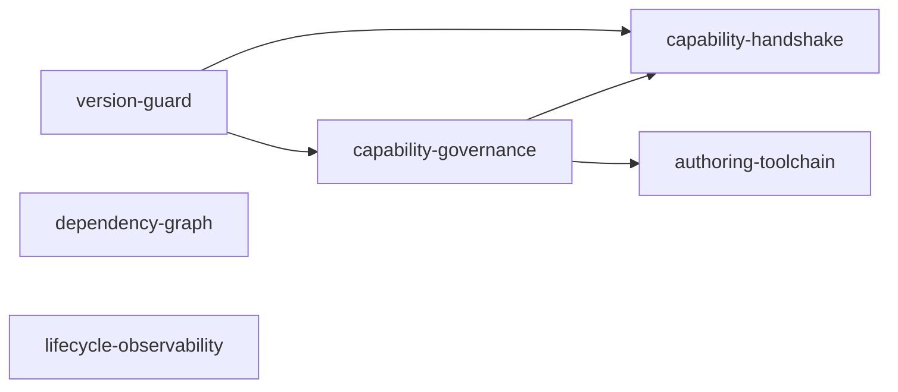

# 主工程子系统 SDD 工程目录（SPECS_INDEX）

> 主工程：`plugin-system-enhancement`（插件系统增强迭代）
> 维护落点：`specs/plugin-system-enhancement/SPECS_INDEX.md` —— 主工程目录内唯一权威账本
> 维护人：主工程闸口决策人（每个子系统闸门确认后**必须**回到本表更新一次）
> 铁律依据：**铁律 15**（大工程拆分：颗粒度、可验收、可组合集成、主工程维护子系统目录）
> 配套模板：`subsystem-contract-template.md`（各子系统的集成契约，落各子系统目录 `contract.md`）
> 需求来源：`docs/ref/plugin-mechanism-comparison-wx.html` §9「对 ASR 的启示」（P0/P1/P2 建议表）
> 存量基线：`.codeartsdoer/specs/plugin-system/{spec,design}.md` + `src/plugin/**` 源码实证

> **append-only**：状态不原地覆盖；每次改动在 §8 修订记录留痕。

---

## 1. 工程总览

- **一句话定位**：把 agentskills-runtime 插件系统从"能加载、能跑"推进到"敢让第三方二进制进来"——补齐版本协商、能力治理、依赖编排、崩溃自愈可观测、创作工具链五类硬缺口。
- **交付面**（能独立上线 / 独立开关 / 独立回滚的一块 = 一个候选子系统）：
  1. 加载前版本协商（拒绝不兼容插件）
  2. 能力清单与运行时门禁（缺省全拒）
  3. L3 启动能力宣告握手（声明 vs 实际注册比对）
  4. 依赖推导替代 `order` 数字排序
  5. L3 崩溃自愈可观测（退避 / 计数 / 风暴熔断）
  6. 插件创作工具链（模板带测试 + `plugin validate` CLI）
- **总规模**：子系统 N=6 ｜ 覆盖表 0 张新建（默认复用 `agent_skills` 既有列与 JSON 承载字段）｜ 语言标签集合：{cangjie}
- **拆分判据与结论**：
  - 什么时候决定拆：完成基线侦察（2026-10-19）后，确认 8 条建议分布在 6 个互不相同的代码落点（`plugin_config.cj` / `cordis_host_services.cj` / `libs/cordis-cj/.../message.cj` / `plugin_loader.cj` / `plugin_host.cj` / `plugingen`），且彼此可独立开关。
  - 命中的判据（SKILL.md「大工程拆分」触发判据）：
    - **交付面 ≥ 3 个**（实际 6 个，各自可独立开关与回滚）✅
    - **任务规模 > 40 条**（6 子系统合计预计 60~80 条）✅
    - **人回路**：P0 两条属"安全硬前置"，需与 P1/P2 分开把关 ✅
  - 不拆会怎样：单工程 `tasks.md` 将超 60 条且横跨 6 个互不相关的失败域，任一子系统返工都会污染其余闸口；P0 安全前置无法单独提前验收。
- **退出准则**：
  1. 全部子系统 `status=done`（或显式 `abandoned` 且有替代方案）
  2. §5 L3 主工程端到端验收通过
  3. 各子系统闸口 `confirm` 齐备（无 `abandon`）
  4. §6 变更影响面登记表无未闭环的破坏性契约变更

### 1.1 与非本工程范围的邻接项（明确移交，避免范围蔓延）

| 邻接项 | 归属 | 本工程态度 |
|---|---|---|
| RSI「每 N 轮后台自评」常驻自进化循环 | 既有工程 `specs/RSI` | **不纳入**。本工程只交付"确定性代码腿工具链"侧（见 `authoring-toolchain`）；自评循环触发器与 LRT 五环节编排属 RSI 主线，移交 `specs/RSI`。 |
| `dylib` 轨接通（`PluginDylibLoader` 现为孤儿代码） | 需单独立项 | **不纳入**。见 §7 R-01。`version-guard` 只预留 dylib 版本校验接口并标注未接线，不复活该轨。 |
| `SKILL.md` → LLM 工具桥接 / 技能层三维一体 | 既有能力 | **保持**，不改动（报告 §9「保持」项）。 |

---

## 2. 子系统登记表

| ID | 中文名 | feature_name | 产物目录 | 上游依赖 | 契约摘要 | 标签 | status | 闸口 | 验收档位 | 备注 |
|---|---|---|---|---|---|---|---|---|---|---|
| `version-guard` | 版本协商守卫 | `plugin-system-enhancement--version-guard` | `specs/plugin-system-enhancement--version-guard/` | — | v1 / 5 接口 / 0 新表 | cangjie | task | gate-task | L1+L2+L3 | P0；报告 §9 第 1 条 |
| `capability-governance` | 能力清单与运行时门禁 | `plugin-system-enhancement--capability-governance` | `specs/plugin-system-enhancement--capability-governance/` | version-guard(minor) | v1 / 9 接口 / 0 新表 | cangjie | task | gate-task | L1+L2+L3 | P1；含 env/secret 泄漏修复 |
| `capability-handshake` | L3 能力宣告握手 | `plugin-system-enhancement--capability-handshake` | `specs/plugin-system-enhancement--capability-handshake/` | version-guard, capability-governance | v1 / 4 接口 / 0 新表 | cangjie | task | gate-task | L1+L2+L3 | P0；报告 §9 第 2 条 |
| `dependency-graph` | 依赖拓扑编排 | `plugin-system-enhancement--dependency-graph` | `specs/plugin-system-enhancement--dependency-graph/` | — | v1 / 4 接口 / 0 新表 | cangjie | task | gate-task | L1+L2+L3 | P2；报告 §9 第 5 条 |
| `lifecycle-observability` | 崩溃自愈可观测 | `plugin-system-enhancement--lifecycle-observability` | `specs/plugin-system-enhancement--lifecycle-observability/` | — | v1 / 6 接口 / 0 新表 | cangjie | task | gate-task | L1+L2+L3 | P2→按 P1 排期；报告 §9 第 6 条 |
| `authoring-toolchain` | 插件创作工具链增强 | `plugin-system-enhancement--authoring-toolchain` | `specs/plugin-system-enhancement--authoring-toolchain/` | capability-governance | v1 / 4 接口 / 0 新表 | cangjie | task | gate-task | L1+L2+L3 | P1；报告 §9 第 7 条 |

- `status` 枚举（与 `sdd_projects.current_stage` 对齐）：`init` / `research` / `spec` / `design` / `task` / `code` / `test` / `done` / `abandoned` / `blocked`
- `blocked` 必须写清阻塞原因与依赖对象，**不许裸挂**。
- **同步时机**：子系统闸门回执后 ≤ 1 个闸口周期内回主工程更新本表。

---

## 3. 集成契约汇总（全局接口表）

| 编号 | 接口/事件 | 提供方 | 消费方 | 方向 | 路径或标识 | 请求→响应形态 | 数据契约(表.字段) | 契约版本 | 冻结日 | 状态 |
|---|---|---|---|---|---|---|---|---|---|---|
| IF-01 | 宿主插件 API 版本常量 | version-guard | 全部子系统 | 单向 | `PluginHostApi.CURRENT` (const) | 常量读取 | — | v1 | 2026-10-19 | 草案 |
| IF-02 | 清单版本字段解析 | version-guard | capability-governance, authoring-toolchain | 单向 | `PluginManifestEntry.pluginApi/hostVersionRange` | manifest 字段 | — | v1 | 2026-10-19 | 草案 |
| IF-03 | 加载前版本校验 | version-guard | 宿主 `PluginHostManager` | 单向 | `VersionGuard.check(entry)` | entry → `Ok`/`Err(PluginError)` | — | v1 | 2026-10-19 | 草案 |
| IF-04 | L3 握手协议版本字段 | version-guard | capability-handshake | 单向 | `InitializeParams.protocolVersion` | 握手载荷字段 | — | v1 | 2026-10-19 | 草案 |
| IF-05 | 能力枚举与缺省策略 | capability-governance | capability-handshake, authoring-toolchain | 单向 | `PluginCapability` enum + `CapabilityPolicy` | 枚举/策略对象 | — | v1 | 2026-10-19 | 草案 |
| IF-06 | 能力门禁判定 | capability-governance | `CordisHostServices` 各 handler | 单向 | `CapabilityGate.check(pluginId, cap)` | (id, cap) → allow/deny | — | v1 | 2026-10-19 | 草案 |
| IF-07 | 跨进程能力禁列表 | capability-governance | capability-handshake, 静态审计 | 单向 | `HostUnsupportedCapabilities` 常量表 | 常量读取 | — | v1 | 2026-10-19 | 草案 |
| IF-08 | 能力宣告载荷字段 | capability-handshake | 宿主状态监听 | 单向 | `InitializeParams.declaredCapabilities` | 握手载荷字段 | — | v1 | 2026-10-19 | 草案 |
| IF-09 | 宣告比对与拒绝 | capability-handshake | `CordisHostManager` | 单向 | `HandshakeVerifier.verify(entry, declared)` | → `Ok`/拒绝挂载 | — | v1 | 2026-10-19 | 草案 |
| IF-10 | 依赖声明解析 | dependency-graph | 宿主加载器 | 单向 | `DependencyResolver.resolve(entries)` | entries → 拓扑序 | — | v1 | 2026-10-19 | 草案 |
| IF-11 | 重启/崩溃事件 | lifecycle-observability | 观测端点、`PluginSyncBridge` | 单向 | `plugin.crashed` / `plugin.restarted` 事件 | 事件 payload | `agent_skills.runtime_status` / `last_error`（复用） | v1 | 2026-10-19 | 草案 |
| IF-12 | 清单静态校验 | authoring-toolchain | CLI / CI | 单向 | `plugin validate` 子命令 | 路径 → 校验报告 | — | v1 | 2026-10-19 | 草案 |

- 本表是跨子系统组合集成的**唯一**接口账本；新增/变更一律按铁律 15「先改契约 → 再改实现」，禁止单边先改。
- 方向**必须单向无环**；出现双向先判为拆得不对，回 §4 找边界。
- 状态：`已冻结` / `演进中(minor)` / `破坏性变更待双侧同轮` / `已废弃`

---

## 4. 子系统依赖 DAG

- 边方向 = 依赖方向（上游 → 下游）；`dependency-graph`、`lifecycle-observability` 无上游，可**并行**开工。
- **无回边自检**：拓扑序编号 `version-guard(1) → capability-governance(2) → {capability-handshake(3), authoring-toolchain(3)}`，编号单调递增，无回边。
- 上游进 `code` 步前，其上游必须已达 `test`（下游闸口才放行）。
- **共享文件冲突预警**：`version-guard` 与 `capability-handshake` 都会改 `libs/cordis-cj/cordis_core/src/message.cj` 的 `InitializeParams`。
  约定：version-guard 先冻结 IF-04（`protocolVersion` 字段），capability-handshake 再在其上追加 IF-08（`declaredCapabilities`），**串行**、不许并行改同一结构体。

---

## 5. 组合集成验收基线

> **各子系统不得只跑自己的单测就报 done** —— L2 是硬档位。

| 档位 | 谁执行 | 在什么样的合并态上跑 | 通过判据 |
|---|---|---|---|
| **L1** 单子系统自测 | 子系统自身 test 步 | 本子系统 | 自身 spec 每条验收条件通过；P0 清零 |
| **L2** 跨子系统集成 | 下游子系统 test 步 | 与**已 done 的上游**合并后的运行态 | 契约 §6 冒烟用例全绿；跨边界数据一致性校验通过 |
| **L3** 主工程端到端 | 主工程 test 步 / 总装验收 | 全量已 done 子系统在宿主上跑起 | §5.1 端到端用例全绿 + 权限/行级可见范围复核 |

- **L2 最小冒烟清单**：
  1. 跨 `version-guard → capability-handshake`：装一个 `pluginApi` 不兼容的 process 插件 → 加载前被拒，L3 进程**未被拉起**，宿主无崩溃。
  2. 跨 `capability-governance → capability-handshake`：装一个声明 `network` 但实际注册被调用的插件 → 握手比对失败 → 拒绝挂载。
  3. 跨 `capability-governance → authoring-toolchain`：`plugingen` 生成的插件直接 `plugin validate` → 全绿；手工删除一项能力声明 → validate 报对应错。
  4. 异常：能力门禁拒绝时，宿主返回统一错误结构，插件进程不残留、无僵尸进程。
- **环境/数据前置**：宿主已起 ✓/✗ ｜ DB 迁移已执行（本工程默认 0 新表）✓ ｜ 缺什么 → 【人工】
- 任何子系统报 done 时若 L2 未跑，主工程闸口**不予确认**。

### 5.1 L3 端到端用例（主工程）

1. 一个全新 process 轨插件从 `plugingen` 生成 → `plugin validate` 通过 → 安装 → 版本协商通过 → 能力握手通过 → 正常运行。
2. 同一插件把 `pluginApi` 改成不兼容值 → 加载被拒，宿主启动不受影响。
3. 插件进程被 `kill -9` → 退避重启 N 次 → 触发风暴熔断 → 状态置 `Error` 且事件可观测。
4. 带依赖的两个 sync 插件，依赖方 `order` 更小 → 拓扑排序后依赖方仍后加载。
5. 全量既有 51 个 skill 插件**行为零回归**（防回退锚点，见 §7 R-04）。

---

## 6. 变更影响面

| 日期 | 变更子系统 | 变更类型 | 影响子系统 | 是否需回归 L2 | 关联子系统任务号 | 登记人 |
|---|---|---|---|---|---|---|
| 2026-10-19 | 全部 | 契约 v1 首次冻结 | — | — | — | 主工程 |

- `契约 major` 的行必须同时满足：双侧同轮完成 + §3 状态改为「待双侧同轮」+ 关闭后回写本行。
- 未登记就改代码 = 契约漂移，在子系统 `test-report.md` 缺陷分级里**升 P0**。

---

## 7. 风险与已知偏差

| 编号 | 类型 | 描述 | 影响 | 缓解 | 归属子系统 |
|---|---|---|---|---|---|
| R-01 | 已知偏差（架构级） | **`dylib` 轨在运行时根本不存在**：`PluginDylibLoader`（`src/plugin/plugin_dylib_loader.cj`）全仓零调用，`PluginHostManager.loadAll` 对 `Dylib` 走的是与 Sync 完全相同的 `loadSingle`（`plugin_host_manager.cj:135`），`unloadDylib` 是空实现（`:146-151`）。报告 §9 P0 第 1 条"给 Dylib/Process 两轨补版本协商"中，**Dylib 那一半当前无处可挂**。 | P0 建议的一半无落点；若不澄清会导致 version-guard 范围虚胖 | 本工程**只交付 Process 轨版本协商**；`version-guard` 预留 dylib 校验接口并显式标注"待 dylib 轨复活后接线"。dylib 复活单独立项（建议 `specs/plugin-dylib-track`），需产品决策是否值得投入 | version-guard |
| R-02 | 复用机会（重要） | **`src/security/` 是零引用死代码**：`permission_service.cj`（含 fs/net/cmd/memory/cpu/timeout 六类策略 + DENY 审计）与 `sandbox_executor.cj` 已实现完整能力模型，但 `grep "import magic.security" src/` → **0 命中**。 | 若忽略而另建能力模型 = 重复实现，违反铁律 9 | `capability-governance` **必须先评估复用 `src/security/`**（改造复用优先于新建）；只有在论证"语义不可直接复用"后才新建，并把理由写进其 design.md | capability-governance |
| R-03 | 安全缺陷（顺带暴露） | **宿主环境全量泄漏给插件进程**：`plugin.yaml.env`（`plugin_config.cj:100-101`）声明"宿主侧不自动注入宿主环境"且从未被使用，但 `plugin_manager.cj:98-100` 实际 `getVariables()` **全量继承**宿主环境后 launch，含 `orm_connectionUrl`、LLM key 等明文；`host.secret` 的 `env:NAME` 分支（`cordis_host_services.cj:116-128`）对任意 env 名直接返明文，无 per-plugin 授权。 | 插件可读取宿主全部密钥，架构红线 | 由 `capability-governance` 承接修复（env 白名单 + secret per-plugin 授权），**不另立子系统** | capability-governance |
| R-04 | 防回退 | 增强不得破坏既有 51 个 skill 插件与 4 个 sync 插件（`src/plugins/generated_anchors.cj` 仅锚定 `EntityPlugin/EntityRoute/FeedbackPlugin/FeedbackRoute`） | 存量回归风险 | §5.1 用例 5 作为硬锚点；`authoring-toolchain` 提供 `plugin validate` 做存量清单体检 | 全部 |
| R-05 | 契约漂移 | `InitializeParams` 被两个子系统改（见 §4 预警） | 合并冲突、握手字段不一致 | 强制串行：version-guard 冻结 IF-04 后 capability-handshake 才动 IF-08 | version-guard → capability-handshake |
| R-06 | 复用优先（铁律 9） | 观测类字段（重启次数、崩溃时间）倾向新建列 | 违反复用优先 | 默认复用 `agent_skills.runtime_status` / `last_error` 与其 JSON 承载字段；确需新列须写明复用不成立理由 + 走 `loaddbinfo` → `crudgen`/`crudweb` + `sql/incremental/` | lifecycle-observability |
| R-07 | 已知偏差 | `autoRestart`（`plugin_config.cj:103-104`）解析但**无任何消费点** → `autoRestart: false` 当前完全无效，崩溃一律重拉 | 配置项语义与实现不符 | `lifecycle-observability` 必须真正消费该字段 | lifecycle-observability |
| R-08 | 已知偏差 | `healCrashed`（`plugin_host.cj:920-980`）已存在但无退避/计数/熔断；`inspectProcessPlugin` docstring（`cordis_host_manager.cj:391`）承诺输出 `pid`/`restartCount` 但实现（`:395-414`）没有 | 文档与实现漂移 | `lifecycle-observability` 补齐实现并使 docstring 与实现一致 | lifecycle-observability |

---

## 8. 修订记录

| 日期 | 版本 | 触发来源 | 改动摘要 | 影响面 | 主工程闸口 |
|---|---|---|---|---|---|
| 2026-10-19 | v1.0 | 基线侦察 + 报告 §9 | 首次落表：命中交付面/任务规模/人回路 3 条判据，拆出 6 个子系统，边界依据为 6 个互不相同的代码落点；契约 IF-01~IF-12 冻结为草案 | 全量子系统 | init |
| 2026-10-19 | v1.1 | 文档步产出 | 6 个子系统 `contract.md`/`spec.md`/`design.md`/`tasks.md` 全部落盘（24 份）；主工程 `research.md`/`spec.md`/`design.md`/`tasks.md` 落盘；子系统 status 统一推进到 `task`，等待 `gate-task` 确认 | 全量子系统 | task |

---

> 配套：各子系统另有 `contract.md` / `spec.md` / `design.md` / `tasks.md`；
> 本文件只做**目录与集成口径**，不重复子系统内部设计（铁律 15）。
>
> 主工程自有文档：`research.md` / `spec.md` / `design.md` / `tasks.md`。
