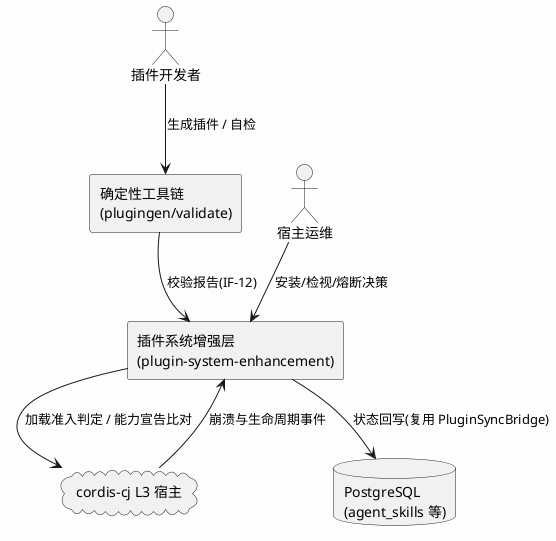
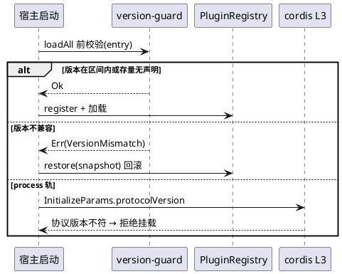
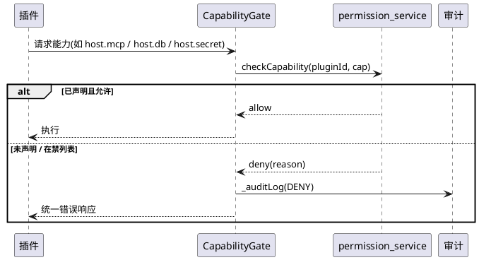

# 需求规格说明书：插件系统增强迭代（plugin-system-enhancement）

> 模板：`skills/sdd/templates/spec_template.md` ｜ 验收句式：`skills/sdd/templates/ears-format.md`（EARS）
> 主工程：`plugin-system-enhancement` ｜ 版本 v1.0 ｜ 日期 2026-10-19
> 配套：`SPECS_INDEX.md`（子系统目录与集成契约，唯一权威账本）、`research.md`（基线与复用论证）
> 需求源：`docs/ref/plugin-mechanism-comparison-wx.html` §9「对 ASR 的启示」
> **范围声明**：本文件只定义**跨子系统**的总体需求与红线；各子系统内部细节需求见各自 `spec.md`（铁律 15：主工程不重复实现子系统内部细节）。

---

# 1. 组件定位

## 1.1 核心职责

本工程负责**为 agentskills-runtime 既有插件系统加装"校验与门禁"能力**，使其从"能加载第三方插件"演进为"敢加载第三方二进制插件"，覆盖版本协商、能力治理、依赖编排、崩溃自愈、创作工具五类缺口。

## 1.2 核心输入

1. **插件清单 `plugin.yaml`**（各 `skills/{name}/plugin.yaml`）—— 新增版本、能力、依赖三类声明字段。
2. **插件二进制 / 可执行文件** —— L3 process 轨子进程、sync 轨编译产物。
3. **L3 握手载荷 `InitializeParams`**（`libs/cordis-cj/cordis_core/src/message.cj:10-53`）—— 新增 `protocolVersion` / `declaredCapabilities`。
4. **进程生命周期事件** —— `isExited`（`plugin_manager.cj:78`，stdout EOF 判定崩溃）、退出码、signal。
5. **开发者 CLI 指令** —— `plugingen`（`src/plugin/tools/plugingen/plugingen.cj:48`）、新增 `plugin validate`。
6. **上游对比报告的增强建议** —— §9 建议表 P0×2 / P1×4 / P2×2。

## 1.3 核心输出

1. **加载准入判定** —— `Ok` / `Err(PluginError)`，含新增版本类错误码。
2. **能力门禁判定** —— allow / deny，DENY 走既有审计（复用 `src/security/permission_service.cj` 审计位）。
3. **依赖拓扑序** —— 加载序与逆序停机序。
4. **崩溃与重启事件** —— 经 `plugin_event_bus` 广播，经 `PluginSyncBridge`（`src/plugin/plugin_sync_bridge.cj:38-90`）回写 `agent_skills`。
5. **插件健康检视输出** —— 扩展既有 `plugin_inspect`（`plugin_agent_tools.cj:113`）与 `inspectProcessPlugin`（`cordis_host_manager.cj:395-414`）。
6. **校验报告** —— `plugin validate` 对人类/CI 可读的结构化报告。

## 1.4 职责边界（明确不做）

| 不做 | 归属 |
|---|---|
| **不复活 `dylib` 轨**（`PluginDylibLoader` 现为零调用孤儿代码） | 单独立项（建议 `specs/plugin-dylib-track`），见 SPECS_INDEX R-01 |
| **不重写**既有插件系统底座（三轨、注册表、事件总线、宿主服务） | 既有 `.codeartsdoer/specs/plugin-system` |
| 不做 RSI 每 N 轮后台自评触发器与 LRT 五环节编排 | 既有 `specs/RSI` |
| 不改动 `plugin + SKILL.md` 三维一体、三轨 `mode` 声明、确定性代码腿工具链本身 | 报告 §9 明确标注的**保持项** |
| 不新建数据库表/列（默认复用 `agent_skills` 既有列与 JSON 承载字段） | — |
| 不新建可观测 UI 面板 | 复用既有 Agent 工具与 HTTP 端点 |

---

# 2. 领域术语

**三轨（mode）**
: 插件与宿主的三种隔离档位 —— `sync`（编译进宿主）/ `dylib`（动态库反射加载）/ `process`（L3 子进程 stdio JSON-RPC）。声明于 `plugin.yaml`，解析见 `plugin_config.cj:80`、枚举定义 `:23-38`。
: 备注：本次实证发现 `dylib` 轨运行时不存在，见 §1.4。

**pluginApi 版本**
: 宿主向插件暴露的编程接口契约版本。插件声明其要求的区间，宿主声明自身当前值，不落在区间内即拒绝加载。
: 备注：借鉴 openclaw `openclaw.compat.pluginApi` 与 deepseek-harness peer deps 校验。

**能力（Capability）**
: 插件被允许触达的宿主资源类别，至少含：DB 表、网络出口（MCP alias/tool）、文件访问、子进程派生、环境变量、secret 取值。**缺省全拒**。

**能力宣告握手**
: L3 进程启动后，插件上报其将注册的 Service / Route，宿主与 `plugin.yaml` 声明比对，不符即拒绝挂载。判定口径：**上报 ⊆ 声明**。

**重启风暴**
: 插件启动即崩溃，被自愈逻辑无限重拉的失控状态。须由熔断机制终止。

**确定性代码腿**
: 以 `loaddbinfo` / `crudgen` / `crudweb` / `plugingen` / `pluginuninstall` 承载的框架自进化路径（区别于技能文本层）。报告 §9 列为 ASR 独一份的差异化优势，本次保持不改造。

---

# 3. 角色与边界

## 3.1 核心角色

- **插件开发者**：用 `plugingen` 生成插件、本地 `plugin validate` 自检、发布插件。
- **宿主运维 / 部署者**：安装第三方插件、观察插件健康与崩溃事件、决定是否熔断。
- **主工程闸口决策人**：确认各子系统闸口、维护 `SPECS_INDEX.md`。

## 3.2 外部系统

- **cordis-cj L3 宿主**（`libs/cordis-cj/cordis_host/`）：提供进程托管、期望态 reconcile、`topoSort`、`healCrashed`。
- **PostgreSQL**：经 `host.db` 服务代理（`cordis_host_services.cj:451-468`）访问，受 `tableWhitelist` 与行级权限约束。
- **`agent_skills` 表**：插件运行时状态回写目标（`plugin_sync_bridge.cj:64-90`）。
- **既有确定性工具链**：`loaddbinfo` / `crudgen` / `crudweb` / `plugingen` / `pluginuninstall`。

## 3.3 交互上下文

---

# 4. DFX 约束

> 每条可量化、可验证；跨子系统统一红线，各子系统 `spec.md` 不得放宽。

## 4.1 性能

1. **REQ-DFX-P1**：加载前版本校验与能力预检，单个插件**必须**在 10 ms 内完成（纯内存比对，禁止阻塞 IO）。
2. **REQ-DFX-P2**：L3 能力宣告握手**不得**使 `awaitActive` 超时窗口（现 `30 * Duration.second`，`cordis_host_manager.cj:216`）之外再增加可感知延迟；握手往返 **应当** ≤ 1 s。
3. **REQ-DFX-P3**：依赖拓扑排序对 100 个插件规模 **必须**在 50 ms 内完成。

## 4.2 可靠性

1. **REQ-DFX-R1**：版本不兼容 / 能力不符的插件被拒绝时，宿主**必须**继续启动，不得因单个插件导致宿主启动失败。
2. **REQ-DFX-R2**：被拒绝的 L3 插件进程**必须**未被拉起，或已被安全终止且**无僵尸进程残留**。
3. **REQ-DFX-R3**：任一插件崩溃**不得**影响其它插件与宿主进程存活。
4. **REQ-DFX-R4**：启动即崩的插件**必须**在 N 次（缺省 5）重启后触发熔断并停止重拉。

## 4.3 安全性

1. **REQ-DFX-S1**：能力门禁**缺省全拒**（未声明的能力一律拒绝），禁止 fail-open。
2. **REQ-DFX-S2**：`src/security/permission_service.cj:295-322` 对未知 capability type 的 **fail-open 必须改为 fail-closed**（P0，复用前置条件）。
3. **REQ-DFX-S3**：插件进程**不得**继承宿主环境变量全集（`plugin_manager.cj:98-100` 现状违反），必须改为白名单注入。
4. **REQ-DFX-S4**：`host.secret` 的 `env:NAME` 取值**必须**经 per-plugin 授权清单校验（`cordis_host_services.cj:116-128` 现状对任意 env 名直接返明文）。
5. **REQ-DFX-S5**：所有 DENY 判定**必须**落审计（复用 `permission_service.cj` 既有 `_auditLog` 位）。

## 4.4 可维护性

1. **REQ-DFX-M1**：崩溃原因**必须**结构化捕获退出码 / signal / stderr 尾帧（`plugin_host.cj:964` 现状只写固定串 `"process exited unexpectedly"`）。
2. **REQ-DFX-M2**：`inspectProcessPlugin`（`cordis_host_manager.cj:391`）的 docstring 承诺（pid / restartCount / lastError）**必须**与实现一致。
3. **REQ-DFX-M3**：跨子系统接口变更**必须**先改契约再改实现；单侧先改按 P0 计（铁律 15）。

## 4.5 兼容性

1. **REQ-DFX-C1（防回退硬锚点）**：既有 4 个 sync 插件（`src/plugins/generated_anchors.cj:10-17` 锚定 EntityPlugin / EntityRoute / FeedbackPlugin / FeedbackRoute）与 51 个 skill 插件**加载行为零回归**。
2. **REQ-DFX-C2**：存量插件清单**未**声明版本 / 能力 / 依赖时，新增校验**必须**向后兼容放行，不得因缺字段拒绝加载。
3. **REQ-DFX-C3**：`order` 字段语义**保持**向后兼容（依赖推导优先，但显式 `order` 仍作为同层稳定序）。

---

# 5. 核心能力

> 本节定义**跨子系统**的能力与规则；实现细节与内部验收见各子系统 `spec.md`。

## 5.1 版本协商准入

### 5.1.1 业务规则

1. **REQ-EN-001（P0）**：宿主**必须**提供唯一的插件 API 版本常量，供加载前比对。
   - a. 验收条件：WHEN 宿主启动 THEN 系统 SHALL 暴露唯一的插件 API 版本常量供全部加载路径读取。
2. **REQ-EN-002（P0）**：插件清单**必须**可声明其要求的 `pluginApi` 版本区间与宿主版本区间。
   - a. 验收条件：WHEN 清单含版本声明 THEN 解析器 SHALL 解析出该区间且未知版本字段不得静默丢弃。
3. **REQ-EN-003（P0）**：版本不在区间内**必须**拒绝加载，并复用 `PluginRegistry.restore`（`plugin_registry.cj:160-180`）回滚注册表（兑现 REQ-PS-010）。
   - a. 验收条件：WHEN 版本不兼容 THEN 系统 SHALL 拒绝加载、返回版本类错误码、并将注册表回滚到加载前快照。
4. **REQ-EN-004**：L3 握手**必须**携带协议版本，宿主侧校验不符即拒绝挂载。
5. **REQ-EN-005（兼容）**：存量清单无版本声明时**必须**放行（REQ-DFX-C2）。
6. **禁止项**：**不得**因版本校验改动 `dylib` 轨接线（见 §1.4）。

### 5.1.2 交互流程

### 5.1.3 异常场景

1. **清单版本字段格式非法**
   - a. 触发条件：版本区间字符串无法解析。
   - b. 系统行为：记为 `IncompatibleApi` 并按 REQ-DFX-C2 判定是否放行（存量兼容优先）。
   - c. 用户感知：结构化错误 + 校验报告条目。
2. **L3 握手超时 / 无响应**
   - a. 触发条件：`awaitActive` 超时（`cordis_host_manager.cj:216`）。
   - b. 系统行为：拒绝挂载，终止进程，无僵尸残留（REQ-DFX-R2）。
   - c. 用户感知：`plugin.error` 事件 + 状态回写 `Error`。

## 5.2 能力治理

### 5.2.1 业务规则

1. **REQ-EN-010（P1）**：能力清单**必须**至少覆盖 DB 表、网络出口（MCP alias/tool）、文件访问、子进程派生、环境变量、secret 取值六类。
2. **REQ-EN-011（P1）**：能力门禁**缺省全拒**（REQ-DFX-S1）。
3. **REQ-EN-012（P1，安全缺陷修复）**：插件进程**不得**继承宿主环境变量全集；`plugin.yaml.env` 白名单**必须**真正生效。
   - a. 验收条件：WHEN 插件进程启动 THEN 其环境 SHALL 仅含白名单项与 cordis 注入项，且不包含 `orm_connectionUrl` 等宿主敏感变量。
4. **REQ-EN-013（P1，安全缺陷修复）**：`host.secret` 的 `env:NAME` 取值**必须**经 per-plugin 授权清单。
5. **REQ-EN-014（P1）**：**必须**维护一张"跨进程不可用的能力"清单，且**握手预检与静态审计复用同一张表**（不得各建一份）。
6. **REQ-EN-015（复用优先）**：能力模型**应当**改造复用 `src/security/permission_service.cj` 与 `sandbox_executor.cj`；若改为新建，**必须**在设计文档写明复用不成立的理由（铁律 9）。

### 5.2.2 交互流程

### 5.2.3 异常场景

1. **未声明能力被请求**
   - a. 触发条件：插件调用未在其清单中声明的能力。
   - b. 系统行为：拒绝 + 落审计（REQ-DFX-S5），插件进程继续存活。
   - c. 用户感知：统一错误响应结构（不自造错误码）。
2. **未知 capability type**
   - a. 触发条件：出现枚举外的能力类型。
   - b. 系统行为：**fail-closed 拒绝**（REQ-DFX-S2，修复 `permission_service.cj:295-322` 的 fail-open）。
   - c. 用户感知：DENY + 审计。

## 5.3 能力宣告握手（L3）

1. **REQ-EN-020（P0）**：L3 进程启动后**必须**上报将注册的 Service / Route。
2. **REQ-EN-021（P0）**：宿主**必须**与 `plugin.yaml` 声明比对，判定口径为**上报 ⊆ 声明**；不符即拒绝挂载。
3. **REQ-EN-022**：被拒插件**必须**满足 REQ-DFX-R2（未拉起或已安全终止、无僵尸）。
4. **REQ-EN-023**：静态预检与运行时握手**必须**复用同一张禁列表（REQ-EN-014）。

## 5.4 依赖编排

1. **REQ-EN-030（P2）**：**必须**支持依赖声明驱动的顺序推导，替代/兜底 `order` 数字排序。
2. **REQ-EN-031**：**必须**具备环检测并给出明确错误（现状 `plugin_loader.cj:122-130` 无环检测）。
3. **REQ-EN-032**：停机 / 卸载**必须**按依赖逆序（现状 `cordis_host_manager.cj:425` 顺序遍历，注释与实现不符）。
4. **REQ-EN-033**：process 轨**应当**补齐 `toCordisEntry`（`cordis_host_manager.cj:263-274`）的 provide/inject，使既有 cordis `topoSort`（`plugin_host.cj:984-1010`）生效，**不得另写一套排序**。

## 5.5 崩溃自愈与可观测

1. **REQ-EN-040（P2→按 P1 排期）**：**必须**实现重启退避、重启计数、重启风暴熔断。
2. **REQ-EN-041**：`autoRestart`（`plugin_config.cj:103-104`）**必须**被真正消费（现状解析后零消费点，`autoRestart:false` 完全无效）。
3. **REQ-EN-042**：崩溃原因**必须**结构化（REQ-DFX-M1）。
4. **REQ-EN-043**：崩溃 / 重启**必须**发出可订阅事件（IF-11）并经 `PluginSyncBridge` 回写。

## 5.6 创作工具链

1. **REQ-EN-050（P1）**：`plugingen` 生成的插件**必须**自带一个"跑得起的最小测试"。
2. **REQ-EN-051（P1）**：**必须**提供独立的 `plugin validate` 命令，可离线校验清单与产物。
3. **REQ-EN-052**：`plugin validate` **必须**复用上游能力枚举（IF-05/06/07）与版本字段口径（IF-02），**不得**自建一套规则。

## 5.7 存量零回归（防回退）

1. **REQ-EN-060**：既有 4 个 sync 插件与 51 个 skill 插件**加载行为零回归**（REQ-DFX-C1）。
2. **REQ-EN-061**：新增校验对无声明的存量清单**一律向后兼容放行**（REQ-DFX-C2）。

---

# 6. 数据约束

> 逻辑约束；**不含**数据库字段类型 / 索引 / 外键（那是 `design.md` 与增量 DDL 的事）。

## 6.1 插件清单（plugin.yaml，扩展后）

1. **name**：必填，非空；重复注册由 `PluginRegistry.register`（`plugin_registry.cj:39-56`）幂等兜底。
2. **mode**：枚举 `sync | dylib | process`；未知值**不得**再静默降级为 Sync（现状 `plugin_config.cj:275`，须给出明确错误）。
3. **版本区间字段（新增）**：可选；缺省视为"不约束"（向后兼容）。
4. **能力声明字段（新增）**：可选；缺省视为"最小集 / 沿用既有 tableWhitelist 语义"，**不得**因缺省拒绝存量加载。
5. **依赖声明字段（新增）**：可选；与 `@PluginAnnotation.dependencies`（`plugin_annotation.cj:40`，逗号分隔 String）共同作为拓扑输入。
6. **tableWhitelist**：保留既有语义，升级为能力清单的 DB 子项。
7. **autoRestart**：保留（缺省 true），且**必须**被消费（REQ-EN-041）。

## 6.2 握手载荷（InitializeParams，扩展后）

1. **protocolVersion（新增）**：由 version-guard 冻结定义（IF-04）。
2. **declaredCapabilities（新增）**：由 capability-handshake 追加（IF-08），值域取自 capability-governance 的能力枚举（IF-05）。
3. **约束**：两个字段的写入**必须串行**（先 IF-04 后 IF-08），禁止并行改同一结构体（R-05）。

## 6.3 运行时状态（复用 `agent_skills`）

1. **runtime_status**：沿用既有取值域，扩展 `error` 语义以表达"版本拒绝 / 能力拒绝 / 熔断"。
2. **last_error**：沿用；**必须**填充结构化崩溃原因（REQ-DFX-M1）。
3. **约束**：观测增量默认收纳进既有列与 JSON 承载字段；**新增列须先论证复用不成立**（铁律 9，R-06）。

---

# 7. 需求到子系统的覆盖追踪

| 需求 | 覆盖子系统 | 契约接口 |
|---|---|---|
| REQ-EN-001~005（版本协商） | version-guard | IF-01~IF-04 |
| REQ-EN-010~015（能力治理） | capability-governance | IF-05~IF-07 |
| REQ-EN-020~023（能力握手） | capability-handshake | IF-08、IF-09 |
| REQ-EN-030~033（依赖编排） | dependency-graph | IF-10 |
| REQ-EN-040~043（崩溃自愈） | lifecycle-observability | IF-11 |
| REQ-EN-050~052（创作工具链） | authoring-toolchain | IF-12 |
| REQ-EN-060~061（防回退） | **全部** | — |
| REQ-DFX-*（跨子系统红线） | **全部** | — |

> 各子系统 `spec.md` 的需求覆盖追踪矩阵须回指本表条目，保证无游离需求、无游离任务。
